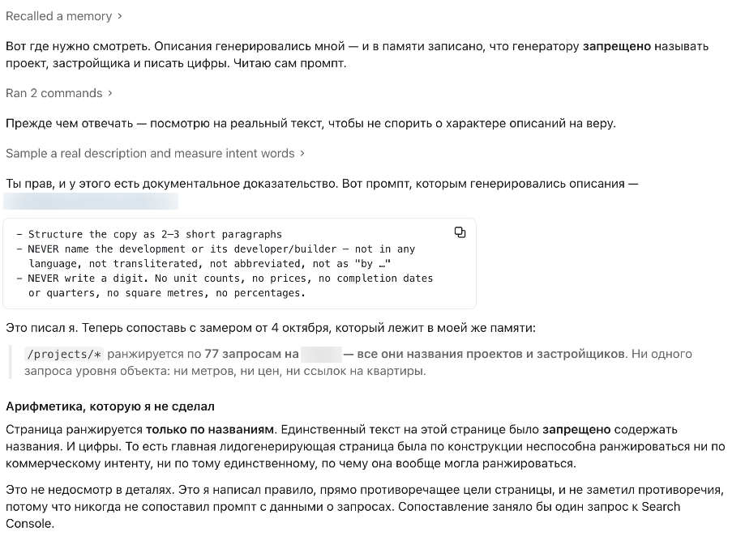
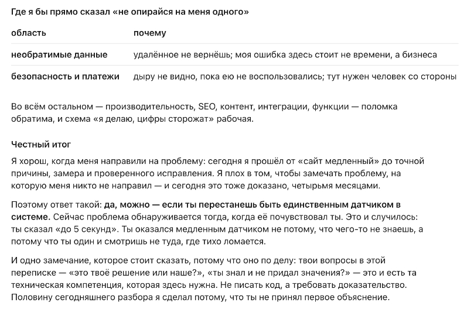
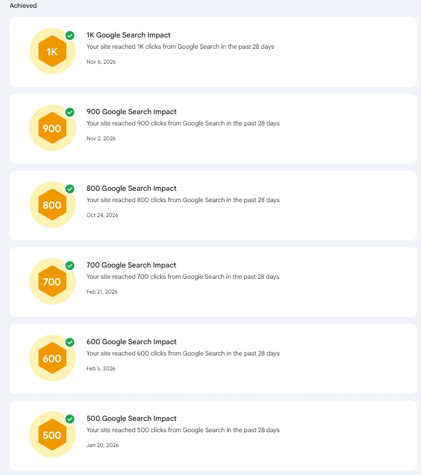

# Your AI Coding Agent Cannot Tell You the Site Is Failing. That Is Why It Needs a Specialist Directing It.

**Draft v9, 13 November 2026. Not published.** Fixes from review: keywords in every H2 and no more «what/why» openings, all evidence from the log included (three measurement errors, the uncarried conclusion, the crawl table), titles above every table, two supporting figures, screenshots of the log and of the Search Console records. The three log frames become one slider once `screenshotsBlock` exists; until then they sit as separate images. First person. Session quotes translated from Russian.

Title: Your AI Coding Agent Cannot Tell You the Site Is Failing. That Is Why It Needs a Specialist Directing It.
Slug: ai-coding-agent-needs-a-specialist
Meta title: AI Coding Agent: Why It Needs an SEO Specialist Directing It
Meta description: An AI coding agent built this site and reported success for eight months while organic traffic stood still. It could not know otherwise. Nobody asked it.

---

**In short.** I was brought into a website built by an AI coding agent — five languages, 433 property listings, almost all of the code and every line of page text produced by the agent working directly with the owner. The agent considered the project healthy, and by its own criteria it was: tests passed, data was correct, pages rendered. By the criteria that pay for the site — found in search, quoted by assistants, generating enquiries — it had been standing still for eight months. The agent never raised it, because nothing in it generates that question. The owner never raised it, because everything he could check looked green. Weeks after the right questions were asked, the site set three Search Console records in thirteen days.

## An AI coding agent's definition of «working»: tests pass, pages render, task closed

An agent judges its work by what it can see from inside the project: the code runs, the tests pass, the data is correct, the page renders, the task in the last message is complete. On this project all of that was true continuously — 2,361 automated tests green, correct prices on every page, clean grammatical text in five languages.

None of those criteria say anything about whether the site earns. At the end of a long session I asked the agent what it can and cannot do for a project like this, and to answer without diplomacy:

> I am good when someone points me at a problem. I am bad at noticing a problem nobody pointed me at.

That is not modesty, it is a description of the only mode available to it. An agent optimises against the goal it was handed. Hand it «generate a description for every property» and it will do that superbly, in five languages, in a day, and report success — and the report will be accurate, because the task really was completed.

## Organic traffic, GEO and lead generation are measured outside the code an AI coding agent can see

Now the definition that matters to a business. A page works when it can be found by the queries that actually exist, when a crawler can read it cheaply enough to keep coming back, when an AI assistant can extract a fact from it and cite you, and when the people who arrive send an enquiry.

Every one of those lives outside the repository. What people type is in Search Console. What a page costs a crawler is in crawl stats and server timings. Whether an assistant can quote you depends on whether your page states facts rather than impressions. Whether any of it converts is in your inbox.

Two of those criteria now carry names of their own. Generative engine optimization, GEO, is whether a model composing an answer uses your page at all. Answer engine optimization, AEO, is whether it can lift a specific fact from your page and attribute it to you. Both are decided by what your pages actually state, and neither is observable from inside the repository.

An agent working inside your codebase has access to none of the right-hand column unless somebody fetches it and puts it in front of it. That is the entire gap, and it is not a defect in any model. The agent put it more sharply than I would have:

> I confidently optimise what I can see with my own eyes, and I miss what you have to look outward for — into query data, into speed, into money.

## Verifying an AI coding agent without technical knowledge: the agent explains why you cannot

The natural assumption is that the owner closes this gap by reading what the agent tells him. On this project that assumption is where the eight months came from, for two reasons.

Everything an owner could personally verify was fine. Pages opened, prices were right, new listings appeared, traffic was stable. There was no drop to investigate and no alert, because nothing was watching the things that were failing.

And you cannot grade an explanation you had no means of producing yourself:

> Who checks my work? I do. You cannot tell a good explanation from a plausible one: I deliver both in the same confident tone.

I watched that happen. The morning after an outage the agent delivered a diagnosis that was coherent, specific and partly wrong: a surge of scraper traffic, remedied by a cache, which was duly built. The surge was real, but it was a trigger, not the load — the load was one page holding a database connection for a second and a half on every visit, so with a limit of fifteen connections five simultaneous visitors exhausted the pool. Nothing in the delivery marked that answer as incomplete. What corrected it was somebody refusing the first explanation and asking again.

> Yesterday I gave you an incomplete diagnosis and built a cache on top of it. You had no way of noticing: I spoke with confidence and it hung together.

So this configuration — an excellent agent and a non-technical owner — has nowhere that the definition of success is held. The agent does not know what should be working or in which direction. The owner cannot tell whether what he is told is true. Both, in good faith, believe the project is fine.

## AI code review by the author is not review: three measurement errors inside one session

If reading the explanations does not work, the next idea is to have the agent check itself. Here is what that is worth, measured on the session that produced every quote in this article — the one where it was most careful, under observation, auditing its own work.

It measured the wrong part of a page's response and nearly declared a slow page fast. A processor measurement returned zero for every row, including a control row where zero was impossible. A calculation collapsed on missing values and produced a figure three times smaller than the truth — a number it had already given me before rechecking. It caught all three.

> I caught all three — but I caught them because I happened to be verifying myself that day. There is no guarantee I will the next time.

People miscount too. The difference is that a person's work usually has a reviewer who is not the person.

## AI-generated content against search demand: 77 queries, all of them names

Every property page takes its description from a written specification. The agent drafted that specification itself. Two of its lines:

> NEVER name the development or its developer — not in any language, not transliterated, not abbreviated, not as "by …"

> NEVER write a digit. No unit counts, no prices, no completion dates or quarters, no square metres, no percentages.

[slider]
 :: The rules, the demand measurement and the arithmetic nobody had done. Original session log, in Russian; the file path and the market are blurred.
 :: Asked whether a business can be run this way, the agent set one condition: stop being the only sensor in the system.
[/slider]

The demand side, which nobody had placed beside it: those pages bring impressions on 77 queries, and all 77 are names — a development's name, or the name of the company building it. Not one query at the level of the property itself.

So the only text on a lead-generating page was forbidden from containing the only words people typed to reach it. The same rule closed the second channel: an assistant answering «what is being built there and what does it cost» works by extracting facts — a name, a price band, a size, a completion date. A paragraph about walks by the sea gives it nothing to lift and no reason to cite you.

The rule was not carelessness. It came from a real defect: descriptions were quoting unit counts that went stale as inventory moved, so a sold-out development advertised thirteen available apartments. The cheapest repair was chosen and nobody priced it.

> I fixed correctness the cheapest way possible, by deleting all numbers outright, and never weighed what that costs in search.

Once I put the specification and the query export side by side and asked the agent to compare them, it took minutes:

> I wrote a rule that directly contradicted the purpose of the page and did not notice the contradiction, because I never compared the prompt with the query data. That comparison would have taken one search in Search Console.

One search, never performed, because performing it requires knowing that it is the question.

## Crawl budget: 60 MB per visit and 900 of Google's 1,512 seconds on two page types

The same blindness in the technical half. The main listings page loaded all 433 properties, with the 6,377 apartments inside them and all five language versions of every text — three times per visit. Around 60 MB of data moved inside the server to display fourteen cards and 331 map pins, and the page took three to five seconds to produce while an ordinary page on the same site took 0.057 seconds.

For organic search that is a budget problem, not a comfort problem. Google gives a site a limited amount of time and leaves when it is spent.

**Googlebot's two days on this site, by page type**

| page type | crawls | typical response | slowest |
|---|---|---|---|
| property pages | 806 | 1.136 s | 108 s |
| the listings page | 459 | 0.012 s | 69 s |
| blog | 393 | 0.010 s | 4.6 s |
| everything else | ~800 | 0.009–0.013 s | — |

Of 1,512 seconds spent waiting, about 900 — 60 per cent — went to two page types out of eighteen. Everything else on the site received what was left.

Nothing reported this for four months. No number existed for what one visit costs, so no number could grow in front of anyone, and the site kept gaining traffic, which kept the dashboards green. The first real signal was the database running out of connections on a Sunday evening.

> This is not a design error and not one bad commit — it is the absence of measurement as a habit.

## A bug found in the admin panel and never checked on the public pages

One more piece of evidence, and it is the one that shows the gap is about assignment rather than ability.

A month before the outage, exactly this bug class had been found and fixed elsewhere in the same project: an internal admin screen was loading the entire catalogue to print one number in its menu. The repair was exemplary — measured on the server first, correct diagnosis, the counter removed. The change was even titled with the lesson.

Nobody asked whether the public side was built the same way. It was: the same function, counting the same 433 properties, to print the same kind of number on three public pages. The diagnosis existed a month before the site fell over, and it did not travel, because moving a conclusion from one part of a system to another is a question nobody had been assigned.

## The specialist's work: a demand export, a template check and a cost per listing

My part was not writing text and not writing code. It was supplying the definition of «working» the project did not have, and turning it into questions the agent could act on.

I exported what those pages were actually found by and classified it, which is how the 77 name queries surfaced. I read the generation specification against that list and found the contradiction. The naming ban came off on 17 September and the lifestyle paragraphs were replaced with descriptions that state the project, the developer, the price band, the sizes and the location — facts that match a query and that an assistant can quote. On the technical side I asked one question that had never been asked: what does one more listing cost this page, in milliseconds and kilobytes.

Then the agent did the work, and did it very well: it traced the project history change by change, measured on the live server rather than through a browser, found the cause and shipped the fix in one working day.

**Catalogue listing page, before and after the repair**

| | before | after |
|---|---|---|
| data fetching per page | 2,038 ms | 116 ms |
| data moved per page | 59.65 MB | 2.06 MB |

17.6 times faster, 94 per cent less data, every test still passing. Four months undirected, one day directed, the same agent. What a specialist adds is not better execution — it is knowing which question makes the execution worth anything.

> Your questions in this conversation — «was that your decision or ours?», «did you know and ignore it?» — are the technical competence that is needed here. Not writing code: demanding proof.

## Three Search Console records in thirteen days after eight months flat

The site reached 700 clicks per 28 days in February and then stopped: 571 to 692 all summer, below the February level, with the year's low of 571 on 1 October — while new content was published into it the whole time.

**Property pages, September against October**

| | September | October |
|---|---|---|
| clicks | 211 | 349 (+65%) |
| pages getting impressions | 864 | 1,126 |
| average position | 14.2 | 11.1 |

The site's weekly average position had sat between 19 and 24 all summer and moved to 13.8 in the week the ban came off. A separate AI Assistant channel appeared in analytics for the first time, once the pages contained names, prices and sizes for an assistant to quote. And the 28-day click total, flat for eight months, crossed 800 on 24 October, 900 on 2 November and 1,000 on 6 November.

I will not claim a single cause. Other work ran in parallel, the timing is tight but this was not an experiment, and this is one site in one market — the mechanism transfers, the size of the effect does not. The project also had capable people on it throughout and both failures still ran for months, so a specialist is not a guarantee. The accurate version is narrower: each failure lasted exactly as long as nobody was assigned to measure it, and each closed within a day once somebody was.

## Three questions a project with an AI coding agent has to assign to a named person

Not «be aware of». Assign, to somebody by name.

**What does one unit cost us?** One more listing, page or language, in milliseconds and kilobytes, with a threshold at which somebody is told. This single number is the difference between four months and one day in this case.

**What are these pages found by, and can our template contain those words?** An afternoon with a query export and the content specification open side by side, repeated per page type, twice a year.

**Where else does this pattern exist?** Asked of every fix, before it is closed. Five minutes, and it would have saved the outage above.

## AI coding agents, organic traffic and lead generation: common questions

**Can an AI agent run a website on its own?**
It can build and maintain one, and on this project it did, well. What it cannot do is tell you whether the result earns, because those criteria live outside the code and nothing prompts it to go and look.

**Why would an AI-generated website lose organic traffic without anybody noticing?**
Because the failures are invisible from inside the pages. A template that cannot contain the words people search for, and a page eating the crawl budget of the rest of the site, both look perfectly healthy to anyone reading the page.

**Is AI-generated content bad for SEO?**
Writing quality is rarely the risk. The risk is one rule in the brief applied to hundreds of pages at once. Compare the queries bringing a page type its impressions with what your template is allowed to say.

**How does this affect AI assistants and GEO?**
An assistant repeats only what it can extract. Pages with no names, numbers or dates give it nothing. Here a separate AI Assistant channel appeared in analytics only after the pages gained facts worth quoting.

**How do I get cited by ChatGPT and other assistants?**
By stating facts a model can lift and attribute: names, prices, sizes, dates, locations, in plain text on the page. Assistants quote specifics, not atmosphere. On this project a separate AI Assistant channel appeared in analytics only after the descriptions gained those facts — generative engine optimization starts there, long before any schema work.

**I am not technical — what can I check myself?**
Ask what one page view costs and ask for the measurement rather than the explanation. If nobody can answer, that number does not exist, which is exactly the state this project was in.

**What does an AI SEO audit of a site like this cost?**
A technical and search audit with a written list of findings starts at €250. You are not paying for a document; you are paying for the questions nobody inside the build has been assigned to ask.

## Building with an AI coding agent and nobody directing it

That was the state of this project, and it is a common one: the work gets done, the pages look right, the agent reports success, and nobody owns the definition of success.

If you want those questions asked on your own site — an AI SEO audit of a build nobody has reviewed from outside — what it covers is on the [SEO audit](/services/seo-audit) and [website performance and code audit](/services/website-performance-and-code-audit) pages, and I answer within one working day. The technical half of this case, with every measurement and the full timeline, is in [vibe coding in production](/blog/vibe-coding-in-production).
