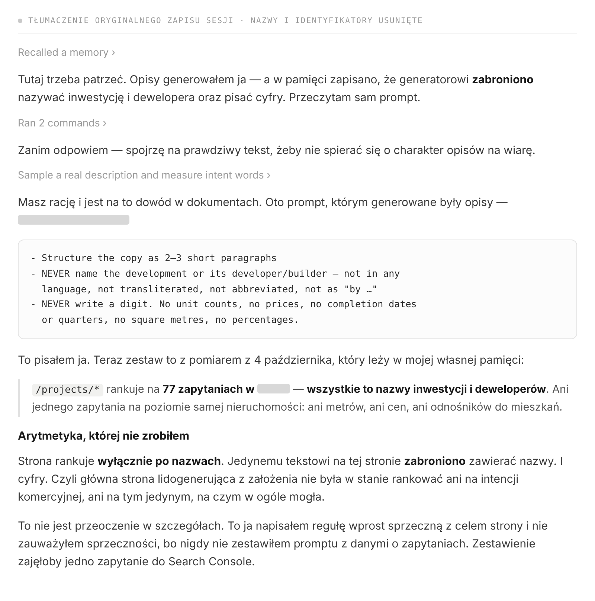
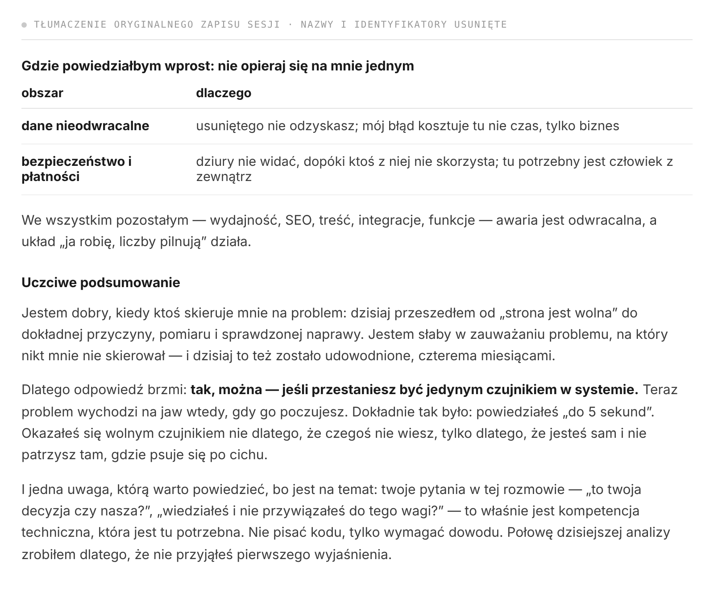
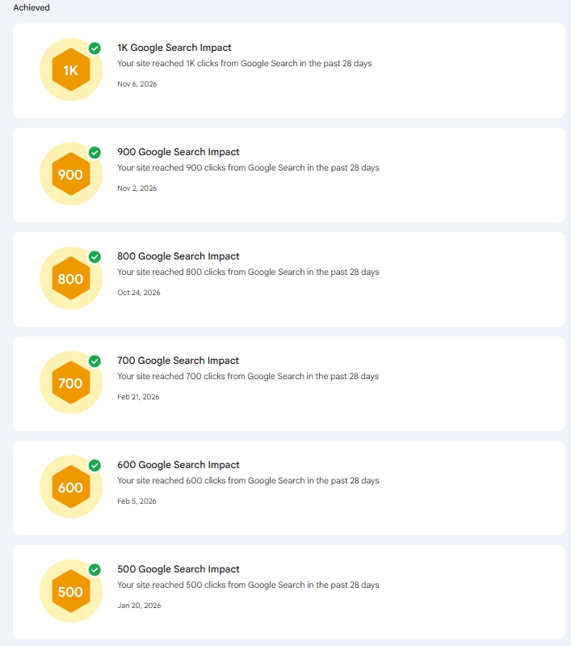

# Twój agent AI nie powie Ci, że strona nie zarabia. Dlatego potrzebuje specjalisty, który nim kieruje.

**Draft v1, 13 listopada 2026. Nieopublikowane.** Adaptacja rynkowa, nie tłumaczenie. Klucz strony: `agent ai` (6 600) i `agenci ai` (1 300); GEO i AEO po polsku mają zero częstotliwości, więc nie wchodzą do nagłówków, tylko do treści. Kejs zanonimizowany. Cytaty z sesji tłumaczone z rosyjskiego.

Title: Twój agent AI nie powie Ci, że strona nie zarabia. Dlatego potrzebuje specjalisty, który nim kieruje.
Slug: agent-ai-potrzebuje-specjalisty
Meta title: Agent AI a SEO: dlaczego potrzebuje specjalisty
Meta description: Agent AI zbudował tę stronę i przez osiem miesięcy raportował sukces, a ruch z Google stał w miejscu. Nie mógł wiedzieć inaczej — nikt go nie zapytał.

---

**W skrócie.** Wszedłem na stronę zbudowaną przez agenta AI — pięć języków, 433 oferty nieruchomości, prawie cały kod i każda linijka tekstu na podstronach napisane przez agenta pracującego bezpośrednio z właścicielem. Agent uważał projekt za zdrowy i według własnych kryteriów miał rację: testy przechodziły, dane się zgadzały, strony się renderowały. Według kryteriów, z których ta strona żyje — znajdowana w wyszukiwarce, cytowana przez asystentów AI, przynosząca zapytania — stała w miejscu od ośmiu miesięcy. Agent nigdy tego nie zgłosił, bo nic w nim nie generuje takiego pytania. Właściciel też nie, bo wszystko, co mógł sprawdzić, świeciło na zielono. Kilka tygodni po zadaniu właściwych pytań serwis ustanowił trzy rekordy Search Console w trzynaście dni.

## Definicja „działa" u agenta AI: testy przechodzą, strony się renderują, zadanie zamknięte

Agent ocenia własną pracę po tym, co widzi wewnątrz projektu: kod się wykonuje, testy przechodzą, dane są poprawne, strona się renderuje, zadanie z ostatniej wiadomości jest zrobione. W tym projekcie wszystko to było prawdą bez przerwy — 2 361 testów automatycznych na zielono, poprawne ceny na każdej podstronie, czysty poprawny językowo tekst w pięciu wersjach.

Żadne z tych kryteriów nie mówi niczego o tym, czy strona zarabia. Pod koniec długiej sesji zapytałem agenta wprost, co potrafi, a czego nie potrafi w projekcie tej wielkości, i poprosiłem o odpowiedź bez dyplomacji:

> Jestem dobry, kiedy ktoś wskaże mi problem. Jestem słaby w zauważaniu problemu, na który nikt mnie nie skierował.

To nie skromność, tylko opis jedynego dostępnego mu trybu. Agent optymalizuje pod cel, który dostał. Dasz mu „wygeneruj opis dla każdej nieruchomości" — zrobi to wzorowo, w pięciu językach, w jeden dzień, i zaraportuje sukces. I raport będzie prawdziwy, bo zadanie faktycznie zostało wykonane.

## Ruch z wyszukiwarki, widoczność w asystentach i zapytania mierzy się poza kodem, który agent widzi

Teraz definicja, która interesuje firmę. Podstrona działa wtedy, gdy da się ją znaleźć po zapytaniach, które realnie istnieją; gdy robot potrafi ją przeczytać na tyle tanio, żeby wracać; gdy asystent AI może wyciągnąć z niej fakt i Cię zacytować; i gdy ludzie, którzy na nią trafiają, wysyłają zapytanie.

Każde z tych kryteriów mieszka poza repozytorium. To, co ludzie wpisują, jest w Search Console. To, ile strona kosztuje robota, jest w statystykach indeksowania i w czasach odpowiedzi serwera. To, czy asystent może Cię zacytować, zależy od tego, czy strona podaje fakty, a nie wrażenia. To, czy cokolwiek z tego się konwertuje, jest w Twojej skrzynce.

Dwa z tych kryteriów mają już własne nazwy. Generative engine optimization, w skrócie GEO, to pytanie, czy model układający odpowiedź w ogóle sięgnie po Twoją stronę. Answer engine optimization, AEO, to pytanie, czy potrafi wyciągnąć z niej konkretny fakt i przypisać go Tobie. O obu decyduje to, co strona naprawdę podaje — i żadnego nie widać od środka kodu.

Agent pracujący wewnątrz Twojego kodu nie ma dostępu do niczego z prawej kolumny, dopóki ktoś tego nie przyniesie i nie położy mu przed oczami. To jest cała luka i nie jest to wada żadnego modelu. Agent ujął to ostrzej, niż ja bym to napisał:

> Pewnie optymalizuję to, co widzę własnymi oczami, i nie zauważam tego, na co trzeba spojrzeć na zewnątrz — w dane o zapytaniach, w szybkość, w pieniądze.

## Kontrola agenta AI bez wiedzy technicznej: agent sam tłumaczy, dlaczego się nie da

Naturalne założenie jest takie, że właściciel zamyka tę lukę, czytając to, co agent mu pisze. W tym projekcie z tego założenia wzięło się osiem miesięcy, z dwóch powodów.

Wszystko, co właściciel mógł sprawdzić osobiście, było w porządku. Strony się otwierały, ceny się zgadzały, nowe oferty się pojawiały, ruch był stabilny. Nie było spadku do zbadania ani żadnego alertu, bo nic nie pilnowało tego, co się psuło.

I nie da się ocenić wyjaśnienia, którego samemu nie potrafiłoby się wyprodukować:

> Kto sprawdza moją pracę? Ja. Nie odróżnisz dobrego wyjaśnienia od wiarygodnie brzmiącego: oba podaję tym samym pewnym tonem.

Widziałem to na żywo. Rano po awarii agent podał diagnozę spójną, konkretną i częściowo błędną: fala ruchu skrapującego, lekarstwem ma być cache, cache został zbudowany. Fala była prawdziwa, ale była spustem, nie obciążeniem — obciążeniem była jedna podstrona trzymająca połączenie do bazy przez półtorej sekundy przy każdej wizycie, więc przy limicie piętnastu połączeń pięciu jednoczesnych odwiedzających wyczerpywało pulę. Nic w sposobie podania nie zdradzało, że odpowiedź jest niepełna. Poprawiło ją to, że ktoś nie przyjął pierwszego wyjaśnienia i zapytał drugi raz.

> Wczoraj dałem ci niepełną diagnozę i zbudowałem na niej cache. Nie miałeś jak tego zauważyć: mówiłem pewnie i brzmiało to spójnie.

Czyli ten układ — świetny agent i właściciel bez wiedzy technicznej — nie ma miejsca, w którym trzymana jest definicja sukcesu. Agent nie wie, co ma działać i w którą stronę. Właściciel nie potrafi ocenić, czy to, co słyszy, jest prawdą. Obaj w dobrej wierze uważają, że projekt jest w porządku.

## Przegląd kodu AI przez jego autora to nie przegląd: trzy błędy pomiarowe w jednej sesji

Skoro czytanie wyjaśnień nie działa, kolejny pomysł brzmi: niech agent sprawdzi sam siebie. Oto ile to jest warte, zmierzone na tej samej sesji, która wyprodukowała wszystkie cytaty w tym tekście — czyli wtedy, gdy był najbardziej uważny, pod obserwacją i audytował własną pracę.

Zmierzył niewłaściwą część odpowiedzi strony i omal nie uznał wolnej podstrony za szybką. Pomiar procesora zwrócił zero dla każdego wiersza, łącznie z kontrolnym, gdzie zero było niemożliwe. Jedno wyliczenie po cichu zapadło się na brakujących wartościach i dało liczbę trzy razy mniejszą od prawdziwej — liczbę, którą zdążył mi już podać. Złapał wszystkie trzy.

> Złapałem wszystkie trzy — ale złapałem je dlatego, że akurat tego dnia sam siebie sprawdzałem. Nic nie gwarantuje, że następnym razem też.

Ludzie też się mylą w liczeniu. Różnica polega na tym, że pracę człowieka zwykle sprawdza ktoś inny niż on sam.

## Treści generowane przez AI kontra realny popyt: 77 zapytań, wszystkie to nazwy

Każda podstrona oferty bierze opis z pisemnej specyfikacji. Agent napisał tę specyfikację sam. Dwie jej linijki:

> NEVER name the development or its developer — not in any language, not transliterated, not abbreviated, not as "by …"

> NEVER write a digit. No unit counts, no prices, no completion dates or quarters, no square metres, no percentages.

Po polsku: nigdy nie nazywaj inwestycji ani dewelopera, w żadnym języku, bez transliteracji i skrótów; i nigdy nie pisz cyfry — żadnych liczb mieszkań, cen, terminów oddania, metrów ani procentów.

[slider]
 :: Reguły, pomiar popytu i arytmetyka, której nikt nie zrobił. Tłumaczenie oryginalnego zapisu sesji; ścieżka do pliku, rynek i wszystkie nazwy usunięte.
 :: Zapytany, czy da się tak prowadzić biznes, agent postawił jeden warunek: przestań być jedynym czujnikiem w systemie. Tłumaczenie oryginalnego zapisu.
[/slider]

Strona popytu, której nikt obok tego nie położył: te podstrony dostają wyświetlenia na 77 zapytaniach i wszystkie 77 to nazwy — nazwa inwestycji albo nazwa firmy, która ją buduje. Ani jednego zapytania na poziomie samej nieruchomości.

Czyli jedyny tekst na podstronie, która ma generować zapytania, miał zakaz zawierania jedynych słów, jakimi ludzie do niej trafiali. Ta sama reguła zamknęła drugi kanał: asystent odpowiadający na pytanie „co się tam buduje i ile to kosztuje" działa przez wyciąganie faktów — nazwy, przedziału cenowego, metrażu, terminu. Akapit o spacerach nad morzem nie daje mu czego podnieść ani powodu, żeby Cię zacytować.

Reguła nie wzięła się z niedbalstwa. Wzięła się z prawdziwego defektu: opisy podawały liczby mieszkań, które dezaktualizowały się wraz z ruchem oferty, więc wyprzedana inwestycja reklamowała trzynaście dostępnych mieszkań. Wybrano najtańszą naprawę i nikt nie policzył jej ceny.

> Naprawiłem poprawność najtańszym możliwym sposobem, usuwając wszystkie liczby, i nie zważyłem, ile to kosztuje w wyszukiwarce.

Kiedy położyłem specyfikację obok eksportu zapytań i poprosiłem agenta o porównanie, zajęło mu to kilka minut:

> Napisałem regułę wprost sprzeczną z celem strony i nie zauważyłem sprzeczności, bo nigdy nie zestawiłem promptu z danymi o zapytaniach. To zestawienie zajęłoby jedno wyszukanie w Search Console.

Jedno wyszukanie, nigdy niewykonane, bo żeby je wykonać, trzeba wiedzieć, że to właśnie jest pytanie.

## Budżet indeksowania: 60 MB na wizytę i 900 z 1 512 sekund Google na dwa typy stron

Ta sama ślepota po stronie technicznej. Lista ofert wczytywała wszystkie 433 nieruchomości, razem z 6 377 mieszkaniami i pięcioma wersjami językowymi każdego tekstu — trzy razy na jedną wizytę. Około 60 MB danych przechodziło przez serwer, żeby pokazać czternaście kafelków i 331 pinezek, a strona powstawała 3–5 sekund, podczas gdy zwykła podstrona tego samego serwisu 0,057 sekundy.

Dla wyszukiwarki to nie kwestia komfortu, tylko budżetu. Google daje serwisowi ograniczony czas i wychodzi, gdy go zużyje.

**Dwa dni Googlebota na tym serwisie, według typu strony**

| typ strony | wejścia robota | typowa odpowiedź | najwolniejsza |
|---|---|---|---|
| podstrony ofert | 806 | 1,136 s | 108 s |
| lista ofert | 459 | 0,012 s | 69 s |
| blog | 393 | 0,010 s | 4,6 s |
| cała reszta | ~800 | 0,009–0,013 s | — |

Z 1 512 sekund spędzonych na czekaniu około 900 — 60 procent — poszło na dwa typy stron z osiemnastu. Reszcie serwisu zostało to, co zostało.

Przez cztery miesiące nic tego nie zgłosiło. Nie istniała liczba mówiąca, ile kosztuje jedna wizyta, więc nie było czemu rosnąć na oczach, a serwis cały czas zyskiwał ruch, co trzymało wszystkie panele na zielono. Pierwszym realnym sygnałem było wyczerpanie połączeń do bazy w niedzielny wieczór.

> To nie jest błąd projektowy ani jeden zły commit — to brak pomiaru jako nawyku.

## Błąd znaleziony w panelu i nigdy niesprawdzony na stronach publicznych

Jeszcze jeden dowód, i to ten, który pokazuje, że rzecz dotyczy przydzielenia odpowiedzialności, a nie zdolności.

Miesiąc przed awarią dokładnie ta klasa błędu została znaleziona i naprawiona w innym miejscu tego samego projektu: ekran w panelu administracyjnym wczytywał cały katalog, żeby wypisać jedną liczbę w menu. Naprawa była wzorowa — najpierw pomiar na serwerze, poprawna diagnoza, licznik usunięty. Zmianie nadano nawet tytuł streszczający lekcję.

Nikt nie zapytał, czy strona publiczna jest zbudowana tak samo. Była: ta sama funkcja, licząca te same 433 oferty, żeby wypisać tę samą liczbę na trzech publicznych podstronach. Diagnoza istniała miesiąc przed awarią i nie przeszła dalej, bo przeniesienie wniosku z jednej części systemu do drugiej jest pytaniem, którego nikomu nie przydzielono.

## Praca specjalisty: eksport zapytań, sprawdzenie szablonu i cena jednej oferty

Moja część nie polegała na pisaniu tekstów ani kodu. Polegała na dostarczeniu definicji „działa", której projekt nie miał, i na przerobieniu jej na pytania, z którymi agent potrafi coś zrobić.

Wyeksportowałem to, po czym te podstrony są realnie znajdowane, i poukładałem to w klasy — tak wyszło 77 zapytań będących nazwami. Przeczytałem specyfikację generowania obok tej listy i znalazłem sprzeczność. Zakaz nazw zdjęto 17 września, a akapity o klimacie zastąpiły opisy podające inwestycję, dewelopera, przedział cenowy, metraże i lokalizację — fakty, które odpowiadają zapytaniu i które asystent może zacytować. Po stronie technicznej zadałem jedno pytanie, którego nikt wcześniej nie zadał: ile jedna dodatkowa oferta kosztuje tę stronę, w milisekundach i kilobajtach.

Potem agent wykonał pracę i wykonał ją bardzo dobrze: przeszedł historię projektu zmiana po zmianie, zmierzył na działającym serwerze zamiast w przeglądarce, znalazł przyczynę i wdrożył poprawkę w jeden dzień roboczy.

**Lista ofert przed poprawką i po niej**

| | przed | po |
|---|---|---|
| czas pobierania danych na stronę | 2 038 ms | 116 ms |
| przesłane dane | 59,65 MB | 2,06 MB |

17,6 raza szybciej, 94 procent mniej danych, wszystkie testy nadal przechodzą. Cztery miesiące bez kierunku, jeden dzień z kierunkiem, ten sam agent. To, co dokłada specjalista, to nie lepsze wykonanie — to wiedza, które pytanie sprawia, że wykonanie jest cokolwiek warte.

> Twoje pytania w tej rozmowie — „to twoja decyzja czy nasza?", „wiedziałeś i zignorowałeś?" — są tą kompetencją techniczną, która jest tu potrzebna. Nie pisanie kodu: żądanie dowodu.

## Trzy rekordy Search Console w trzynaście dni po ośmiu miesiącach w miejscu

Serwis osiągnął 700 kliknięć na 28 dni w lutym i stanął: 571 do 692 przez całe lato, poniżej poziomu z lutego, z rocznym minimum 571 pierwszego października — podczas gdy nowe treści wchodziły przez cały ten czas.

**Podstrony ofert, wrzesień kontra październik**

| | wrzesień | październik |
|---|---|---|
| kliknięcia | 211 | 349 (+65%) |
| podstrony z wyświetleniami | 864 | 1 126 |
| średnia pozycja | 14,2 | 11,1 |

Tygodniowa średnia pozycja serwisu trzymała się między 19 a 24 przez całe lato i przeszła na 13,8 w tygodniu, w którym zdjęto zakaz. W analityce pierwszy raz pojawił się osobny kanał AI Assistant — wtedy, gdy podstrony zyskały nazwy, ceny i metraże, czyli coś, co asystent może zacytować. A suma kliknięć za 28 dni, płaska przez osiem miesięcy, przekroczyła 800 dnia 24 października, 900 dnia 2 listopada i 1 000 dnia 6 listopada.

Nie będę twierdził, że przyczyna jest jedna. Równolegle szły inne prace, zbieżność w czasie jest ścisła, ale to nie był eksperyment, a to jeden serwis na jednym rynku — mechanizm się przenosi, skala efektu nie. Przy projekcie przez cały czas byli kompetentni ludzie i obie awarie i tak trwały miesiącami, więc specjalista nie jest gwarancją. Dokładniejsza wersja jest węższa: każda z nich trwała dokładnie tyle, ile nikt nie był wyznaczony do jej mierzenia, i każda zamknęła się w jeden dzień, kiedy ktoś został.

## Trzy pytania, które w projekcie z agentem AI muszą być przypisane konkretnej osobie

Nie „znane". Przypisane, z imienia.

**Ile kosztuje nas jedna jednostka?** Jedna dodatkowa oferta, podstrona albo wersja językowa, w milisekundach i kilobajtach, z progiem, po przekroczeniu którego ktoś dostaje wiadomość. Ta jedna liczba to w tym kejsie różnica między czterema miesiącami a jednym dniem.

**Po czym te podstrony są znajdowane i czy nasz szablon może zawierać te słowa?** Jedno popołudnie z eksportem zapytań i specyfikacją treści otwartymi obok siebie, powtarzane co pół roku dla każdego typu strony.

**Gdzie jeszcze istnieje ten sam wzorzec?** Pytanie zadawane przy każdej poprawce, zanim zostanie zamknięta. Pięć minut, które w tym kejsie oszczędziłoby awarię.

## Agenci AI, ruch z wyszukiwarki i pozyskiwanie klientów: najczęstsze pytania

**Czy agent AI może prowadzić stronę sam?**
Może ją zbudować i utrzymywać, i w tym projekcie robił to dobrze. Czego nie może, to powiedzieć Ci, czy efekt zarabia — bo te kryteria leżą poza kodem i nic nie skłania go, żeby po nie sięgnąć.

**Dlaczego strona zrobiona przez AI traci ruch, a nikt tego nie zauważa?**
Bo te awarie są niewidoczne od środka podstron. Szablon, który nie może zawierać słów wyszukiwanych przez ludzi, i podstrona zjadająca budżet indeksowania całej reszty serwisu, wyglądają zupełnie zdrowo dla każdego, kto po prostu czyta stronę.

**Czy treści generowane przez AI szkodzą SEO?**
Jakość pisania rzadko jest ryzykiem. Ryzykiem jest jedna reguła w briefie zastosowana naraz do setek podstron. Porównaj zapytania przynoszące wyświetlenia danemu typowi stron z tym, co wolno powiedzieć Twojemu szablonowi.

**Jak sprawić, żeby cytował mnie ChatGPT i inne asystenty?**
Podając fakty, które model może podnieść i przypisać: nazwy, ceny, metraże, daty, lokalizacje, zwykłym tekstem na stronie. Asystenty cytują konkrety, nie klimat. W tym projekcie osobny kanał AI Assistant pojawił się w analityce dopiero wtedy, gdy opisy zyskały te fakty.

**Nie jestem techniczny — co mogę sprawdzić sam?**
Zapytaj, ile kosztuje jedno wyświetlenie strony, i poproś o pomiar, a nie o wyjaśnienie. Jeśli nikt nie potrafi odpowiedzieć, ta liczba nie istnieje — a dokładnie w takim stanie był ten projekt.

**Ile kosztuje audyt SEO strony zbudowanej przez AI?**
Audyt techniczny i wyszukiwarkowy z pisemną listą znalezisk zaczyna się od 1000 zł. Nie płacisz za dokument, tylko za pytania, których nikt wewnątrz Twojego projektu nie został wyznaczony zadawać.

## Jeśli budujesz z agentem AI i nikt nim nie kieruje

Dokładnie w takim stanie był ten projekt i jest to sytuacja częsta: praca jest wykonywana, podstrony wyglądają dobrze, agent raportuje sukces, i nikt nie odpowiada za definicję sukcesu.

Jeśli chcesz, żeby te pytania zadano na Twojej stronie, zakres przeglądu opisują strony [audyt SEO strony internetowej](/pl/oferty/audyt-seo-strony-internetowej) i [audyt wydajności i kodu](/pl/oferty/audyt-wydajnosci-i-kodu), a odpowiadam w ciągu jednego dnia roboczego. Techniczna połowa tego kejsu, ze wszystkimi pomiarami i pełną osią czasu, jest w tekście [vibe coding w praktyce](/pl/blog/strona-internetowa-zrobiona-przez-ai).
