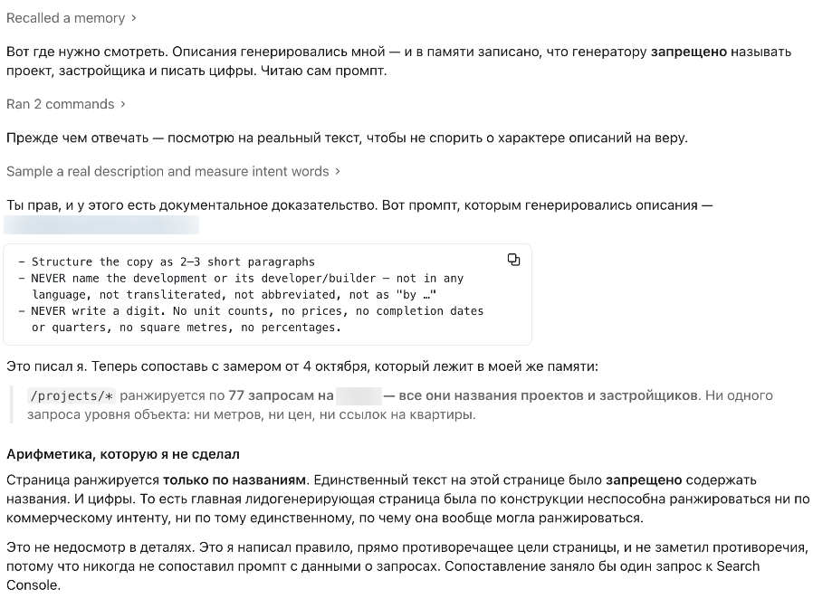
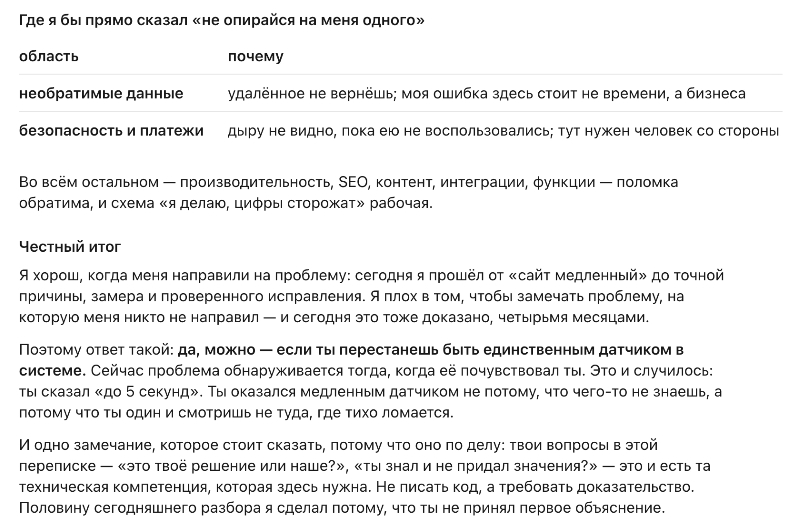
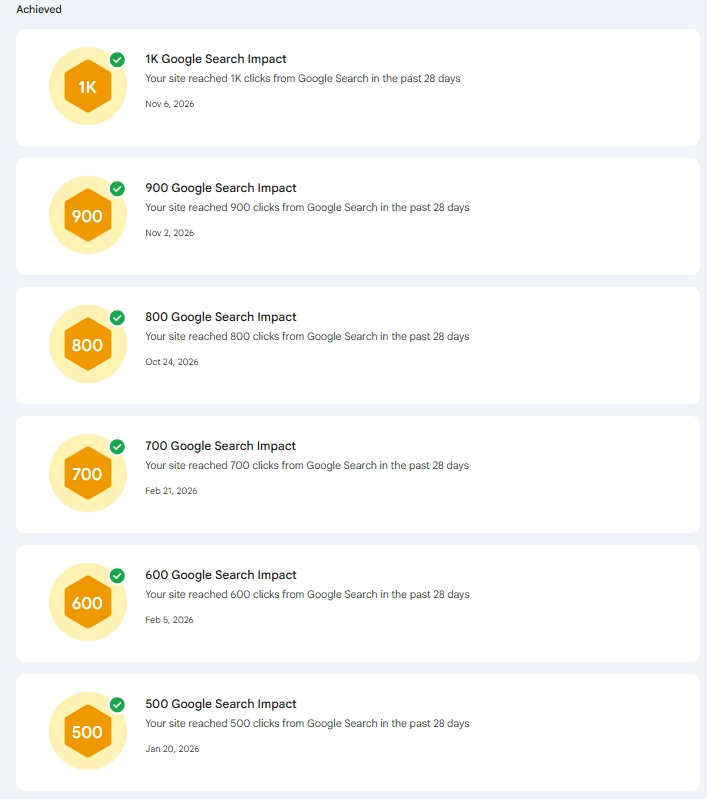

# Ваш ИИ-агент не скажет, что сайт не зарабатывает. Поэтому им должен кто-то руководить.

**Черновик v1, 13 ноября 2026. Не опубликовано.** Рыночная адаптация, не перевод. Частот по теме в русском нет ни по одной формулировке (замер 13.11.2026), поэтому версия пишется под аудиторию, а не под ключи. Кейс обезличен. Цитаты из рабочей сессии.

Title: Ваш ИИ-агент не скажет, что сайт не зарабатывает. Поэтому им должен кто-то руководить.
Slug: ii-agent-i-specialist
Meta title: ИИ-агент и SEO: почему им должен руководить специалист
Meta description: ИИ-агент собрал сайт и восемь месяцев докладывал об успехе, пока органика стояла на месте. Иначе он знать и не мог — нужных вопросов ему не задали.

---

**Коротко.** Меня позвали на сайт, собранный ИИ-агентом: пять языков, 433 объекта недвижимости, почти весь код и каждая строчка текста на страницах написаны агентом, работавшим напрямую с владельцем. Агент считал проект здоровым, и по его собственным критериям так и было: тесты проходят, данные верные, страницы отдаются. По критериям, из которых сайт живёт, — находят в поиске, цитируют ассистенты, приходят заявки — он стоял на месте восемь месяцев. Агент об этом не сообщил, потому что в нём ничто не порождает такой вопрос. Владелец тоже, потому что всё, что он мог проверить, было зелёным. Через несколько недель после того, как были заданы правильные вопросы, сайт поставил три рекорда Search Console за тринадцать дней.

## Что для ИИ-агента значит «работает»: тесты проходят, страницы отдаются, задача закрыта

Агент оценивает свою работу по тому, что видит изнутри проекта: код выполняется, тесты проходят, данные корректны, страница отрисовывается, задача из последнего сообщения сделана. В этом проекте всё перечисленное было правдой непрерывно — 2 361 автоматический тест зелёный, верные цены на каждой странице, чистый грамотный текст на пяти языках.

Ни один из этих признаков не говорит ничего о том, зарабатывает ли сайт. В конце долгой сессии я спросил агента прямо, что он может и чего не может в проекте такого размера, и попросил ответить без дипломатии:

> Я хорош, когда меня направили на проблему. Я плох в том, чтобы замечать проблему, на которую меня никто не направил.

Это не скромность, а описание единственного доступного ему режима. Агент оптимизирует под ту цель, которую ему выдали. Выдайте «сгенерируй описание для каждого объекта» — он сделает это отлично, на пяти языках, за день, и доложит об успехе. И доклад будет верным, потому что задача действительно выполнена.

## Органика, видимость в ассистентах и заявки измеряются вне кода, который видит агент

Теперь определение, которое важно бизнесу. Страница работает, когда её находят по запросам, которые реально существуют; когда робот читает её достаточно дёшево, чтобы возвращаться; когда ассистент может вытащить из неё факт и процитировать вас; и когда пришедшие люди отправляют заявку.

Каждый из этих признаков живёт вне репозитория. Что люди набирают — в Search Console. Во что страница обходится роботу — в статистике сканирования и во времени ответа сервера. Может ли ассистент вас процитировать — зависит от того, содержит ли страница факты, а не впечатления. Конвертируется ли всё это — в вашей почте.

У двух из них уже есть собственные названия. Generative engine optimization, сокращённо GEO, — это про то, возьмёт ли модель вашу страницу, собирая ответ. Answer engine optimization, AEO, — про то, сможет ли она вытащить из неё конкретный факт и приписать его вам. И то и другое решается тем, что страница на самом деле утверждает, и ни того ни другого не видно изнутри кода.

У агента, работающего внутри вашего кода, нет доступа ни к чему из правой колонки, пока кто-то это не принесёт и не положит перед ним. Это и есть вся дыра, и она не дефект конкретной модели. Агент сформулировал резче, чем сформулировал бы я:

> Я уверенно оптимизирую то, что вижу своими глазами, и не замечаю того, на что нужно посмотреть наружу — в данные о запросах, в скорость, в деньги.

## Проверить работу ИИ-агента без технических знаний нельзя, и агент сам объясняет почему

Естественное предположение: владелец закрывает эту дыру тем, что читает отчёты агента. В этом проекте из такого предположения и выросли восемь месяцев, по двум причинам.

Всё, что владелец мог проверить лично, было в порядке. Страницы открывались, цены совпадали, новые объекты появлялись, трафик держался. Ни падения, которое можно расследовать, ни оповещения — потому что за тем, что ломалось, ничто не следило.

И нельзя оценить объяснение, которое сам не способен произвести:

> Проверяет мою работу — я. Ты не можешь отличить хорошее объяснение от правдоподобного: я выдаю оба одинаково уверенным тоном.

Я это наблюдал. Наутро после отказа агент выдал диагноз — связный, конкретный и частично неверный: наплыв скрейперов, лечится кэшем, кэш построили. Наплыв был настоящим, но он был спусковым крючком, а не нагрузкой: нагрузкой была одна страница, державшая соединение к базе по полторы секунды на каждый визит, так что при лимите в пятнадцать соединений пяти одновременных посетителей хватало, чтобы исчерпать пул. Ничто в подаче не выдавало, что ответ неполон. Исправило его то, что человек не принял первое объяснение и спросил второй раз.

> Вчера я дал тебе неполный диагноз и построил на нём кэш. Ты не имел никакой возможности это заметить — я говорил уверенно, и выглядело связно.

То есть в такой конфигурации — отличный агент и владелец без технических знаний — нет места, где хранится определение успеха. Агент не знает, что должно работать и в какую сторону. Владелец не может оценить, правда ли то, что ему говорят. Оба добросовестно считают, что всё в порядке.

## Самопроверка агента — не проверка: три ошибки в замерах за одну сессию

Раз чтение объяснений не работает, следующая мысль — пусть агент проверит себя сам. Вот чего это стоит, измерено на той самой сессии, которая произвела все цитаты в этом тексте: когда он был максимально внимателен, под наблюдением, и аудировал собственную работу.

Он замерил не ту часть ответа страницы и едва не объявил медленную страницу быстрой. Замер процессорного времени вернул ноль по всем строкам, включая контрольную, где ноль был невозможен. Один подсчёт тихо обнулился на пропущенных значениях и дал число втрое меньше настоящего — число, которое он мне уже назвал. Все три он поймал.

> Все три я поймал — но поймал потому, что в тот день сам себя проверял. Что поймаю в следующий раз, не гарантирует ничто.

Люди тоже ошибаются в счёте. Разница в том, что работу человека обычно проверяет кто-то, кроме него самого.

## Тексты от нейросети против реального спроса: 77 запросов, и все они названия

Каждая страница объекта берёт описание из письменной спецификации. Спецификацию агент написал сам. Две её строки:

> NEVER name the development or its developer — not in any language, not transliterated, not abbreviated, not as "by …"

> NEVER write a digit. No unit counts, no prices, no completion dates or quarters, no square metres, no percentages.

По-русски: никогда не называй объект и застройщика, ни на одном языке, ни транслитерацией, ни сокращением; и никогда не пиши цифр — ни количества квартир, ни цен, ни сроков сдачи, ни метров, ни процентов.

[slider]
 :: Правила, замер спроса и арифметика, которую никто не сделал. Оригинальный лог сессии; путь к файлу и рынок замазаны.
 :: На вопрос, можно ли так вести бизнес, агент поставил одно условие: перестать быть единственным датчиком в системе.
[/slider]

Сторона спроса, которую никто рядом не положил: эти страницы получают показы по 77 запросам, и все 77 — названия: имя объекта или имя компании, которая его строит. Ни одного запроса уровня самой недвижимости.

То есть единственный текст на странице, которая должна приносить заявки, имел запрет содержать единственные слова, по которым на неё приходили. Это же правило закрыло второй канал: ассистент, отвечающий на вопрос «что там строят и сколько это стоит», работает извлечением фактов — названия, диапазона цен, площади, срока. Абзац про прогулки у моря не даёт ему что поднять и зачем вас цитировать.

Правило появилось не от небрежности. Оно выросло из настоящего дефекта: в описаниях стояли количества квартир, устаревавшие по мере продаж, и распроданный объект рекламировал тринадцать доступных квартир. Выбрали самую дешёвую починку, и цену её никто не посчитал.

> Я исправил корректность самым дешёвым способом — удалив все числа вообще, и не взвесил, чего это стоит в поиске.

Когда я положил спецификацию рядом с выгрузкой запросов и попросил агента сопоставить, ему хватило нескольких минут:

> Я написал правило, прямо противоречащее цели страницы, и не заметил противоречия, потому что никогда не сопоставил промпт с данными о запросах. Сопоставление заняло бы один запрос к Search Console.

Один запрос, который так и не сделали, потому что чтобы его сделать, нужно знать, что это и есть вопрос.

## Краулинговый бюджет: 60 МБ на визит и 900 из 1 512 секунд Google на два типа страниц

Та же слепота в технической половине. Страница списка грузила все 433 объекта, вместе с 6 377 квартирами и пятью языковыми версиями каждого текста, — трижды на один визит. Около 60 МБ данных проходило через сервер, чтобы показать четырнадцать карточек и 331 метку, и страница собиралась 3–5 секунд, тогда как обычная страница того же сайта — 0,057 секунды.

Для поиска это вопрос не удобства, а бюджета. Google выделяет сайту ограниченное время и уходит, когда оно потрачено.

**Два дня Googlebot на этом сайте, по типам страниц**

| тип страницы | заходов робота | типичный ответ | худший случай |
|---|---|---|---|
| страницы объектов | 806 | 1,136 с | 108 с |
| список объектов | 459 | 0,012 с | 69 с |
| блог | 393 | 0,010 с | 4,6 с |
| всё остальное | ~800 | 0,009–0,013 с | — |

Из 1 512 секунд ожидания около 900 — 60 процентов — ушли на два типа страниц из восемнадцати. Остальному сайту досталось то, что осталось.

Четыре месяца об этом не сообщало ничто. Не существовало числа, говорящего, во что обходится один визит, поэтому нечему было расти на глазах, а сайт всё это время набирал трафик, и панели оставались зелёными. Первым настоящим сигналом стало исчерпание соединений к базе в воскресенье вечером.

> Это не ошибка проектирования и не ошибка одного коммита — это отсутствие измерения как привычки.

## Ошибка, найденная в админке и ни разу не проверенная на публичных страницах

Ещё одно доказательство, и именно оно показывает, что дело в назначении ответственного, а не в способностях.

За месяц до отказа ровно этот класс ошибки нашли и починили в другом месте того же проекта: экран в админке грузил весь каталог, чтобы напечатать одно число в меню. Починку сделали образцово — сначала замер на сервере, потом верный диагноз, счётчик убрали. Изменению даже дали заголовок с уроком.

Никто не спросил, устроена ли так же публичная часть. Устроена: та же функция, считающая те же 433 объекта, чтобы напечатать такое же число на трёх публичных страницах. Диагноз существовал за месяц до отказа и дальше не пошёл, потому что перенос вывода из одной части системы в другую — вопрос, который никому не поручен.

## Работа специалиста: выгрузка спроса, сверка шаблона и цена одного объекта

Моя часть состояла не в написании текстов и не в написании кода. Она состояла в том, чтобы принести определение «работает», которого у проекта не было, и перевести его в вопросы, с которыми агент уже может что-то сделать.

Я выгрузил, по чему эти страницы реально находят, и разложил по классам — так и всплыли 77 запросов-названий. Прочитал спецификацию генерации рядом с этим списком и нашёл противоречие. Запрет на названия сняли 17 сентября, абзацы про антураж заменили описаниями, в которых есть объект, застройщик, диапазон цен, площади и локация, — факты, совпадающие с запросом и пригодные для цитирования ассистентом. В технической половине я задал один вопрос, которого раньше не задавали: во что обходится этой странице один дополнительный объект, в миллисекундах и килобайтах.

Дальше работу сделал агент, и сделал очень хорошо: прошёл историю проекта изменение за изменением, замерил на работающем сервере, а не через браузер, нашёл причину и выкатил починку за один рабочий день.

**Страница списка до и после починки**

| | до | после |
|---|---|---|
| время получения данных на страницу | 2 038 мс | 116 мс |
| объём данных | 59,65 МБ | 2,06 МБ |

В 17,6 раза быстрее, на 94 процента меньше данных, все тесты проходят. Четыре месяца без руководства, один день с руководством, один и тот же агент. То, что добавляет специалист, — не лучшее исполнение, а знание, какой вопрос делает это исполнение хоть чего-то стоящим.

> Твои вопросы в этой переписке — «это твоё решение или наше?», «ты знал и не придал значения?» — и есть та техническая компетенция, которая здесь нужна. Не писать код, а требовать доказательство.

## Три рекорда Search Console за тринадцать дней после восьми месяцев на месте

Сайт взял 700 кликов за 28 дней в феврале и остановился: 571–692 всё лето, ниже февральского уровня, с годовым минимумом 571 первого октября — и всё это время в него выкладывали новый контент.

**Страницы объектов, сентябрь против октября**

| | сентябрь | октябрь |
|---|---|---|
| клики | 211 | 349 (+65%) |
| страниц с показами | 864 | 1 126 |
| средняя позиция | 14,2 | 11,1 |

Недельная средняя позиция сайта держалась между 19 и 24 всё лето и ушла на 13,8 в неделю, когда сняли запрет. В аналитике впервые появился отдельный канал AI Assistant — тогда, когда на страницах возникли названия, цены и площади, то есть то, что ассистент может процитировать. А сумма кликов за 28 дней, плоская восемь месяцев, прошла 800 двадцать четвёртого октября, 900 второго ноября и 1 000 шестого ноября.

Утверждать, что причина одна, я не стану. Параллельно шли другие работы, совпадение по времени плотное, но это не эксперимент, и это один сайт на одном рынке — механизм переносится, величина эффекта нет. На проекте всё это время были компетентные люди, и обе поломки всё равно прожили месяцами, так что специалист — не гарантия. Точнее и полезнее формулировать уже: каждая прожила ровно столько, сколько её никто не был назначен измерять, и каждая закрылась за день, когда назначили.

## Три вопроса, которые в проекте с ИИ-агентом должны быть закреплены за конкретным человеком

Не «известны». Закреплены, поимённо.

**Во что нам обходится одна единица?** Один дополнительный объект, страница или язык, в миллисекундах и килобайтах, с порогом, по достижении которого кому-то приходит сообщение. Это единственное число — разница между четырьмя месяцами и одним днём в этом кейсе.

**По чему эти страницы находят и может ли наш шаблон содержать эти слова?** Один вечер с выгрузкой запросов и спецификацией контента, открытыми рядом, и так по каждому типу страниц, дважды в год.

**Где ещё существует этот же шаблон?** Вопрос к каждой починке, прежде чем её закроют. Пять минут, которые в этом кейсе сэкономили бы отказ сайта.

## ИИ-агенты, органика и заявки: частые вопросы

**Может ли ИИ-агент вести сайт сам?**
Построить и поддерживать — может, и в этом проекте делал это хорошо. Чего он не может — сказать вам, зарабатывает ли результат: эти критерии лежат вне кода, и ничто не побуждает его за ними пойти.

**Почему сайт, собранный нейросетью, теряет органику, и никто этого не замечает?**
Потому что такие поломки не видны изнутри страниц. Шаблон, который не может содержать слов, по которым ищут, и страница, съедающая краулинговый бюджет всего остального сайта, выглядят совершенно здоровыми для любого, кто просто читает страницу.

**Вредят ли тексты от нейросети поисковому продвижению?**
Качество письма редко бывает риском. Риск — это одно правило в задании, применённое сразу к сотням страниц. Сравните запросы, приносящие показы типу страниц, с тем, что вашему шаблону разрешено говорить.

**Как попасть в ответы ChatGPT и других ассистентов?**
Излагать факты, которые модель может поднять и приписать: названия, цены, площади, даты, локации, обычным текстом на странице. Ассистенты цитируют конкретику, а не атмосферу. В этом проекте отдельный канал AI Assistant появился в аналитике только после того, как в описаниях возникли эти факты.

**Я не технический — что могу проверить сам?**
Спросите, во что обходится одно открытие страницы, и попросите замер, а не объяснение. Если ответить никто не может, такого числа не существует — ровно в этом состоянии и был проект.

**Сколько стоит аудит сайта, собранного ИИ?**
Технический и поисковый аудит с письменным списком находок начинается от 250 €. Вы платите не за документ, а за вопросы, которые внутри вашего проекта никому не поручено задавать.

## Если вы строите с ИИ-агентом и им никто не руководит

Ровно в таком состоянии был этот проект, и ситуация эта частая: работа делается, страницы выглядят правильно, агент докладывает об успехе, и за определение успеха не отвечает никто.

Если нужно, чтобы эти вопросы задали на вашем сайте, что входит в проверку, описано на страницах [SEO-аудит сайта](/ru/uslugi/seo-audit-saita) и [ускорение сайта и улучшение поисковой видимости](/ru/uslugi/uskorenie-saita-i-uluchshenie-poiskovoi-vidimosti), и я отвечаю в течение одного рабочего дня. Техническая половина этого кейса, со всеми замерами и полной хронологией, — в тексте [вайбкодинг на живом проекте](/ru/blog/sait-sdelannyi-neirosetyu).
