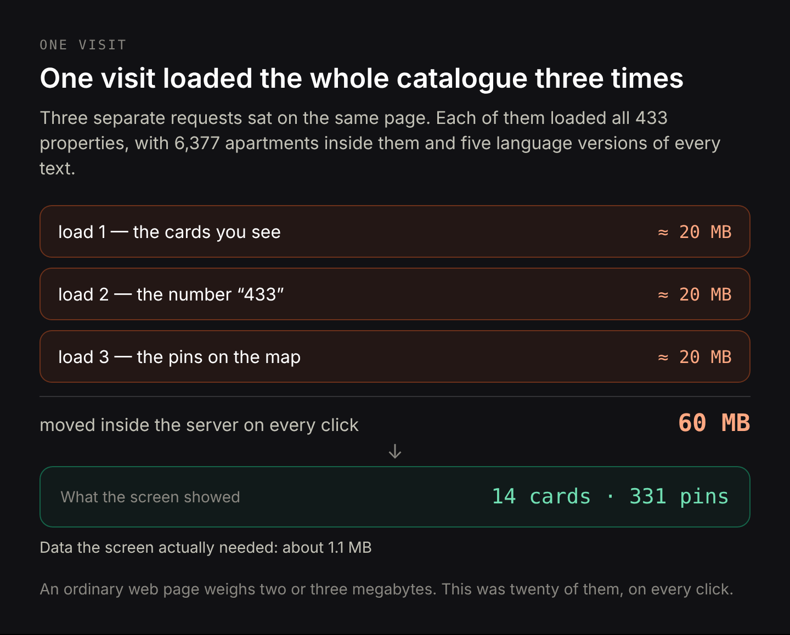
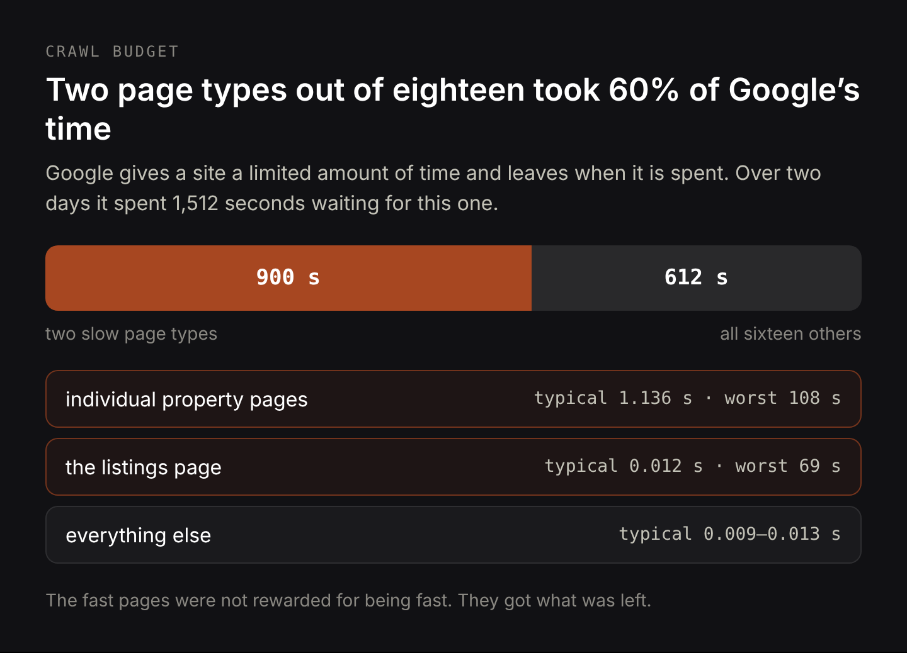
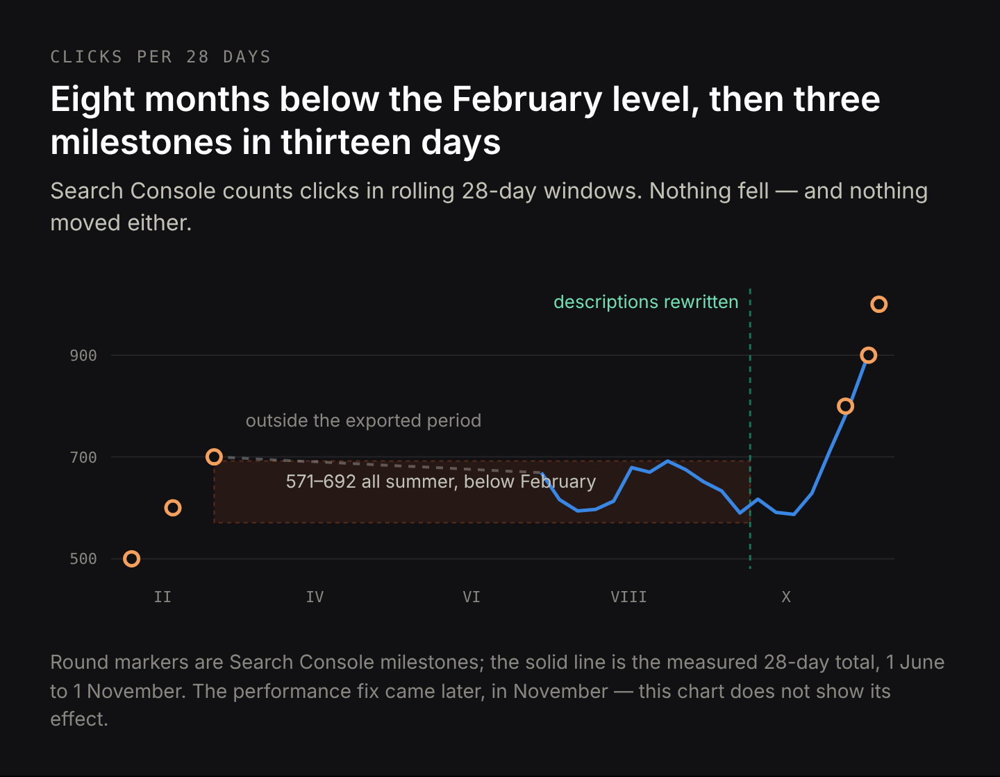
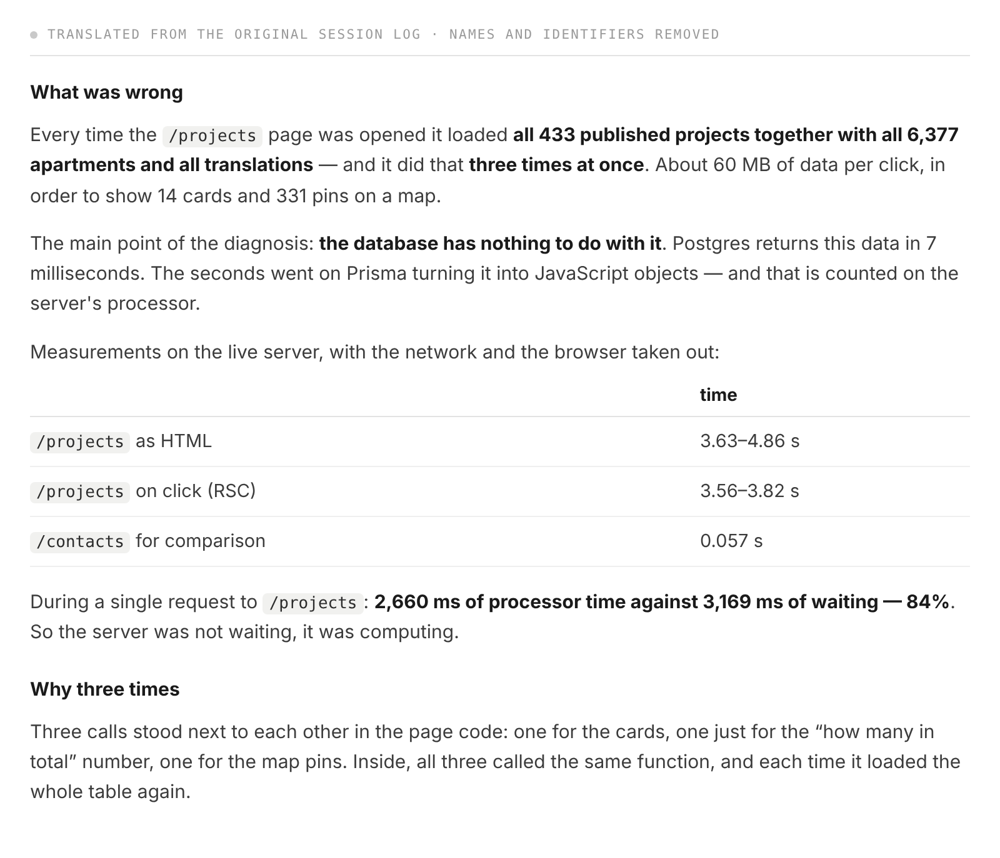
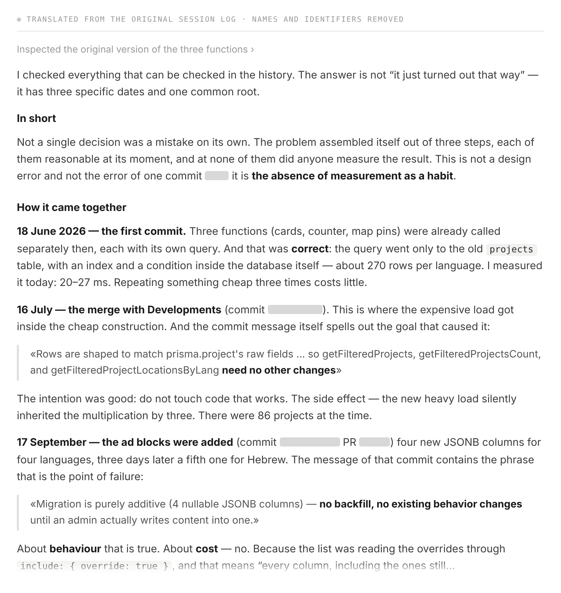
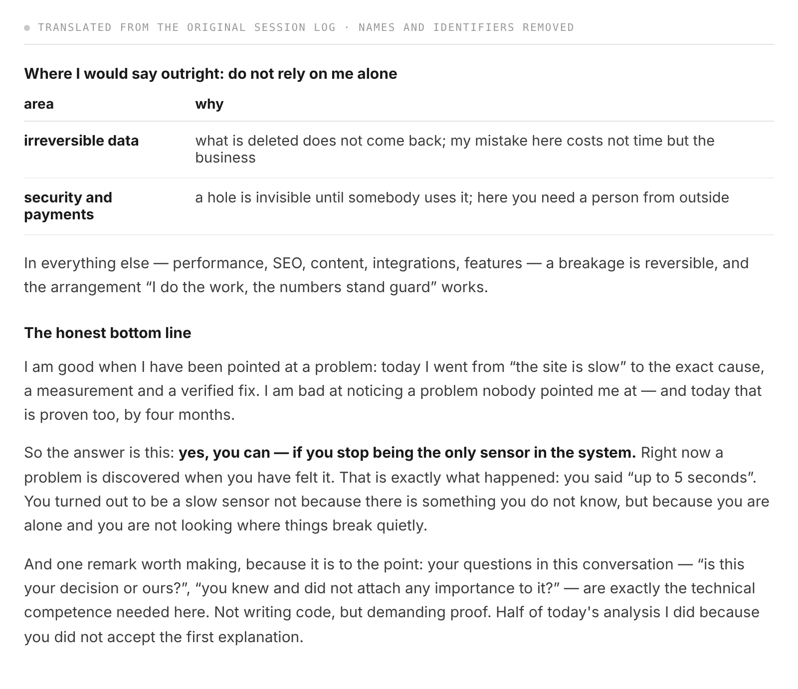

# Vibe Coding in Production: Why an AI-Built Site Still Needs Someone Who Measures It

**Draft v3, 12 November 2026. Not published.** Case anonymised: no company, developer or project names, no commit hashes, no file paths. All measurements are real. Written for a business owner who builds with AI, not for developers. v3: cut from 3,900 to ~2,500 words, three measurement sections merged into one, the outage moved to the opening as a scene, the AI's own line about self-checking moved up, thesis stated three times instead of seven.

Title: Vibe Coding in Production: Why an AI-Built Site Still Needs Someone Who Measures It
Slug: vibe-coding-in-production
Meta title: Vibe Coding in Production: What Four Months Cost
Meta description: An AI-built listings page moved 60 MB per visit for four months. What it cost in Google crawl budget and stalled traffic, and why one day fixed it.

---

**Short answer.** AI can build a website that genuinely works — this one did, for four months, in five languages, with real customers on it. What AI cannot do is notice the price of its own decisions when nobody asks about it. On this project every visit to the main listings page moved about 60 MB of data — the weight of roughly twenty ordinary web pages — to display fourteen listings. Nothing complained, because the site kept growing. The bill arrived as eight months of search traffic standing still, and then one evening when the site stopped answering. Fixing it took one working day. The distance between those two numbers, four months and one day, is the argument for having one person on an AI-built project whose job is to measure it.

On a Sunday evening in November the site stopped responding. Not the listings page — everything: the blog, the contact form, pages that had nothing to do with each other. The owner could see that it was down and had no way of knowing why, because he does not read code, and until that evening he had never needed to.

The site is a property catalogue in five languages: 433 published listings with 6,377 apartments inside them. Most of its code was written by an AI agent working directly with him. He describes what he wants, approves what comes back, ships it. That is vibe coding in the real sense of the phrase — not a weekend toy, but a live business running on software nobody on the business side reads.

And for four months it worked. Pages opened, prices were right, the admin panel saved what it was supposed to save, search traffic was stable. Nothing looked broken, because nothing was broken.

## Correct code, expensive code: why an AI-built site can work and still lose money

The usual version of this story is "AI writes rubbish". That version is wrong here, and the real one is more uncomfortable.

The code was not bad. Queries returned the right data, pages showed the right prices, and 2,361 automated tests — small scripts that check the site still behaves correctly after every change — passed. When the problem was finally investigated, the investigation was done by the same AI agent, and it was good work: it went through the project's history change by change, measured on the live server, and named its own authorship without being pushed.

What was missing was a price. Nobody, neither the owner nor the AI, had ever written down what one page view costs. So there was no number anywhere that could grow in front of anyone's eyes.

The agent described the mechanism better than I can. Asked whether a project this size can be run with it by someone without technical knowledge, and asked not to be diplomatic, it answered (the session was in Russian; this is a translation):

> Who checks my work? I do. You cannot tell a good explanation from a plausible one: I deliver both in the same confident tone.

That is the whole risk in one line. You will not get broken pages from an AI. You will get working pages whose running cost nobody is watching, described to you in a confident voice.

## What one visit actually cost: the whole catalogue, three times over, to show fourteen listings

Every time somebody opened the listings page, the server loaded all 433 properties, with all 6,377 apartments inside them, and all five language versions of every text. It did this three times for a single page: once for the cards you see, once for the number "433 properties", once for the pins on the map. Each of the three loaded the entire catalogue again from scratch. The page then threw nearly all of it away and displayed fourteen cards and 331 map pins.

Around 60 MB of data moved inside the server to produce that one screen. An ordinary web page weighs two or three megabytes; this was twenty of them, per click, and no visitor ever saw a byte of it.

Most of that weight was text that cannot appear in a list of cards at all:

| what was loaded on every click | size | shown in the list? |
|---|---|---|
| promotional articles in 5 languages | 6,620 KB | no |
| property descriptions in 5 languages | 2,230 KB | no |
| search-engine fields | 397 KB | no |
| city, price, first photo and the rest | ~1,100 KB | yes |

Ninety-six per cent of every visit was editorial text belonging to individual property pages, travelling across the server three times in order to be discarded.

One detail matters for anyone who has ever been told their slow site needs a bigger database. The database here was not the problem: it returned all those rows in 7 milliseconds, effectively instantly. The seconds went into the server converting data it did not need — 84 per cent of the request was the processor working, not waiting. The listings page took 3.6 to 4.9 seconds to produce. An ordinary page on the same site, same server, same database, took 0.057 seconds. Sixty times faster. A gap like that is never hosting. It is always what the page asked for.

## How a slow page spends your Google crawl budget on nothing

Visitors are the obvious victim of a slow page. They are not the expensive one.

Google does not read your whole site every day. It allocates a limited amount of time per site — the industry calls this crawl budget — and when that time is spent, it leaves, whether or not it has seen your new pages. A slow page spends that time on behalf of every other page you own.

Google's own crawl log for this site, over two days:

| type of page | times crawled | typical response | slowest response |
|---|---|---|---|
| individual property pages | 806 | 1.136 s | 108 s |
| the listings page | 459 | 0.012 s | 69 s |
| blog | 393 | 0.010 s | 4.6 s |
| other content pages | ~800 | 0.009–0.013 s | — |

Over those two days Google spent 1,512 seconds waiting for this site to answer, and about 900 of them — 60 per cent — went to two page types out of eighteen. In the worst single cases the crawler waited 108 seconds and 69 seconds for one page.

Nobody sends an invoice for that. It arrives as new pages being found late, updated pages being re-read late, and everything else getting a smaller share of Google's attention than it earned.

## Eight months of standing still, disguised as a healthy site

Here is the part that makes this case worth writing down, and it is the opposite of what people expect.

The site did not lose traffic. Clicks held steady through the summer, appearances in search rose month after month, average position improved. No drop to investigate, no alert, no angry email. On every screen the owner looked at, the project was fine. The agent, listing its own failures at the end of the session, put the reason plainly:

> The error lived for four months. Not because it was subtle — the page was shipping 60 MB per click. Because no mechanism measured the speed of the public pages at all. The signal arrived only when the database ran out of connections.

The problem is only visible when you line the months up. Search Console counts clicks in rolling 28-day windows — any given day shows the total for the four weeks before it. In February the site reached 700 clicks per 28 days. Through June, July, August and September that same figure sat between 571 and 692: below February. On 1 October it touched 571, the lowest point of the year. The site was not falling. It was standing still for eight months while new content kept being published into it — which, for a catalogue business, means eight months of listings and articles that cost money to produce and bought no additional reach.

Then it moved. On 24 October the site passed 800 clicks per 28 days, on 2 November 900, on 6 November 1,000 — three milestones in thirteen days after eight months without a single one.

It is worth being exact about what caused that, because the convenient answer is wrong. It was not this fix. The listings page was still slow through all three of those milestones; it was repaired in November, after the outage. What broke the plateau was a different correction, made in September to the text on the property pages: [a content rule the agent wrote for itself banned the only words those pages were found by](/blog/ai-coding-agent-needs-a-specialist), and that is a separate story with its own measurements. The performance work is the subject of this article, and its effect on traffic cannot be read from this chart yet.

Degradation hidden by growth is the hardest kind to catch, because every warning light you might have installed is still green. The page never broke. It slid from unnoticeable to unbearable, and no boundary along the way raised its hand — until the evening the database ran out of connections, because each visit now held one for a second and a half, and fifteen were all there were.

## How moving filtering out of the database in July made every visit cost more by October

The agent reconstructed this from the project's history rather than from memory. Three dates, one root cause, and not one of the three was a bad decision on the day it was made.

**18 June.** The three requests already existed separately, and that was correct: filtering happened inside the database, which is very good at it, and only about 270 rows were touched at a time. Measured today, that original version runs in 20–27 milliseconds. Repeating something that cheap three times is still cheap.

**16 July.** A second type of listing was merged into the same page. To avoid disturbing code that worked, the new request was written to match the old shape — and filtering moved out of the database into the page's own code. From that moment the cost of one visit stopped depending on how much the visitor asked for and started depending on how much existed in total. There were 86 properties then, so it was five times cheaper than it later became, and nobody felt a thing.

**17 September.** Four fields were added to hold promotional articles, one per language. The note attached to that change said: "purely additive — no backfill, no existing behavior changes until an admin actually writes content into one." About behaviour that is true. About cost it is not: the listings page asked for "all fields", which literally means all of them, including fields that did not exist when the request was written. The new articles joined the page on the day they were created, automatically, without a line of that page's code being touched.

And all the while the catalogue grew: 86 properties in July, 217 in August, 286 in September, 415 in October, 433 today. Every new listing multiplied a cost nobody had written down.

As the agent summed it up after tracing the history:

> No single decision was a mistake. The problem assembled itself out of three steps, each of them reasonable at its moment, and at none of them did anyone measure the result. This is not a design error and not one bad commit — it is the absence of measurement as a habit.

[slider]
 :: The diagnosis: the database answered in 7 ms and the server spent the seconds computing. Translated from the original session log; names and identifiers removed.
 :: Three dates, one root cause: filtering left the database in July and new columns joined the query by themselves in September. Translated from the original log.
 :: The closing answer, and the sentence this article ends on. Translated from the original log.
[/slider]

## The same bug had been found a month earlier in the admin panel and never checked on the public side

On 13 October this exact problem was found and fixed elsewhere in the same project: an internal admin screen loading the entire catalogue to print one number in its menu. That fix was done properly — measured first, diagnosed correctly, the offending counter removed. The change was even titled with the lesson: every admin page waited two seconds for one number in the nav.

Nobody asked whether the public side was built the same way. It was: the same function, counting the same 433 properties, to print the same kind of number on three public pages.

The diagnosis existed a month before the site fell over.

> This is the most expensive of the mistakes made here: not writing bad code, but failing to spread a conclusion that had already been found.

## One working day to undo four months of accumulated cost

Two changes, both small. One request instead of three, because the heavy load never depended on the visitor's filters anyway. And ask only for the nineteen fields the cards actually display, leaving the five-language articles on the pages that show them.

| | before | after |
|---|---|---|
| time spent fetching data per page | 2,038 ms | 116 ms |
| data moved per page | 59.65 MB | 2.06 MB |

17.6 times faster, 94 per cent less data, all 2,361 tests still passing. Added with the fix: a test that watches which fields the cards actually use, so the day somebody adds a field and forgets to request it, the test says its name out loud instead of letting the page quietly break.

The work took one working day. The condition that made it necessary had been building for four months.

## What you are hiring a specialist for, and it is not writing code

Before the three practical things, the agent's own summary of what it is and is not good at, because it frames all of them:

> I am good when someone points me at a problem: today I went from "the site is slow" to an exact cause, a measurement and a verified fix. I am bad at noticing a problem nobody pointed me at — and today proves that too, with four months.

A specialist on this project would not have written better code. The code was fine. Three things were missing, and all three are what someone holding the whole system in their head does without being asked.

**Asking what one row costs.** Not "does the page feel fast", which is an opinion, but "how many milliseconds and how many kilobytes does one more property add to this page". That number did not exist, so nothing could visibly grow. Put differently: you do not need to understand why a page is slow, you need the system to message you when the listings page goes over one second.

**Carrying a conclusion across the system.** When the counter problem surfaced in the admin panel, the question "where else does this exact pattern exist?" takes five minutes and would have saved four months.

**Reading how the thing is built, a few days a quarter.** Not permanently, and not by the person who built it. The agent made three measurement mistakes in the single session where it diagnosed all this — it nearly declared a slow page fast, one check returned zero for every row including the control, and one calculation silently produced a figure three times too small. It caught all three because it happened to be verifying itself that day. Nothing guarantees it will the next day.

And the limit of the claim, which I would rather state than have you find: this project had capable people on it the whole time, and the problem still lived four months. A specialist is not a guarantee. The accurate version is narrower and more useful — the error lasted exactly as long as nobody measured it, and it closed in one day once somebody asked what it cost.

Two areas deserve more than this, and the agent named them itself: anything irreversible, where a deletion cannot be undone and the cost is the business rather than an afternoon, and security and payments, where a hole stays invisible until somebody uses it. Everything else — speed, search visibility, content, integrations — breaks in ways you can walk back.

## Common questions about AI-built websites and what they cost to run

**Can AI build a website that actually works?**
Yes. This one did for four months, in five languages, with real customers on it. The question worth asking is not whether it works on launch day, but whether anybody will notice when its running cost changes. Here the code stayed correct the whole time and became 17.6 times more expensive than it needed to be.

**Is AI-generated code reliable?**
In the ordinary sense, yes: it does what it was asked to do. The risk is narrower than people expect. An AI optimises whatever it was pointed at, and the thing nobody points at is almost always the price of a decision — the cost per row, the crawl budget, the money.

**Why is my website slow if my database is fast?**
Because the database is often not the bottleneck. Here it answered in 7 milliseconds and the page still took over three seconds, with 84 per cent of that time spent processing data the page did not need. Find out whether the server is waiting or working before anybody blames hosting.

**What is crawl budget, and how does a slow page waste it?**
Google gives your site a limited amount of time per visit and leaves when it is spent. Here two page types out of eighteen consumed 60 per cent of 1,512 seconds over two days. Fast pages are not rewarded for being fast; they get whatever attention is left.

**Do I still need a developer if I use AI?**
You need somebody who measures, which is a different job from writing code. Nobody here needed to write better queries. Somebody needed to ask what one catalogue row cost, and whether a bug found in the admin panel also existed on the public site.

**How do I tell whether my own AI-built site has this problem?**
Compare how long the server takes to produce your heaviest page and a simple page on the same site — not how they feel. A sixty-fold gap between two pages on the same system is not a hosting problem, and you do not need to read code to see it.

## What to check on your own site this week

Compare server response time on your heaviest page and on a simple one. If the gap is tens of times, the cause is inside the page.

Open the crawl statistics report in Google Search Console and look at average response time by page type. If one type is an order of magnitude above the others, that is where your crawl budget goes.

Take any fix your team made in the past three months and ask where else that same pattern exists. It is the cheapest question in this article.

Write down one number per important page — response time or page weight — and have something tell you when it moves. The four months in this story happened because that number did not exist.

A technical and search audit with a written list of findings starts at €250. If you want somebody outside your build to run these checks, the [website performance and code audit](/services/website-performance-and-code-audit) page lists what it covers, and I answer within one working day. If you are still deciding who should be doing this work at all, [freelancer or agency for your website](/blog/freelancer-or-agency-for-your-website) deals with that question on its own.

I asked the agent at the end of that session whether a business can be run this way by someone who does not read code. Its answer is the sentence I would keep:

> Yes, it can — if you stop being the only sensor in the system. Right now a problem gets discovered when you feel it.
