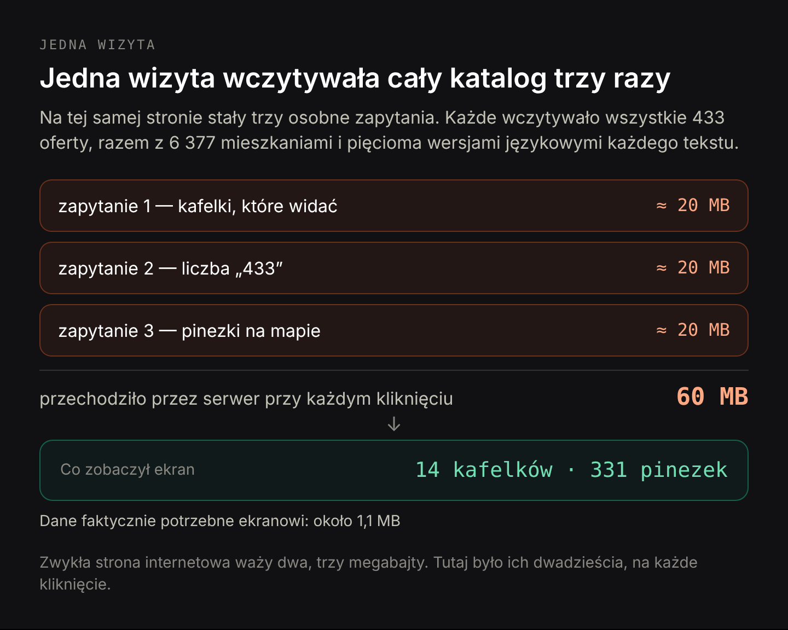
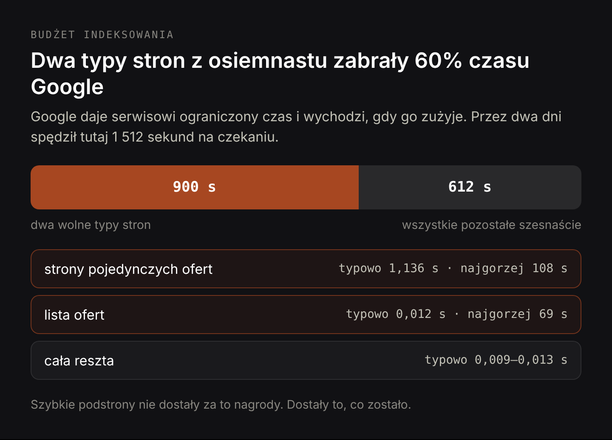
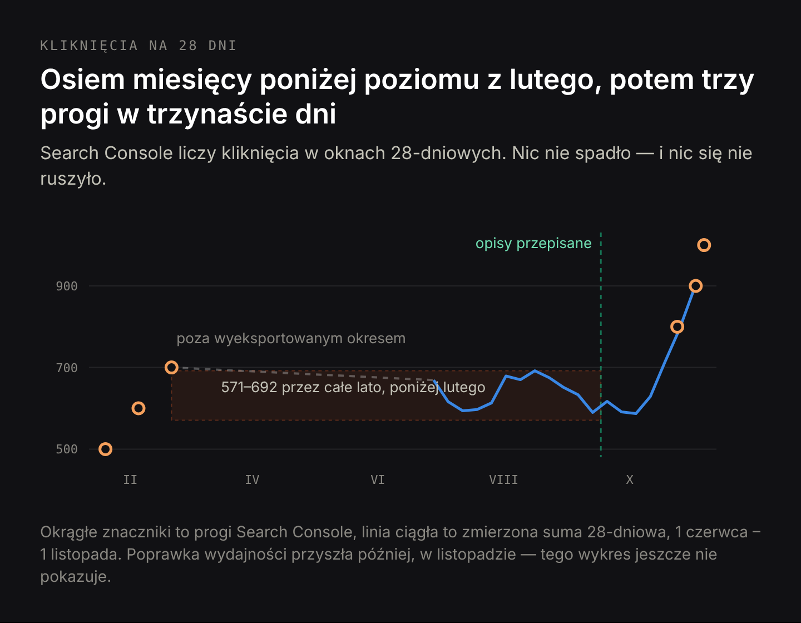
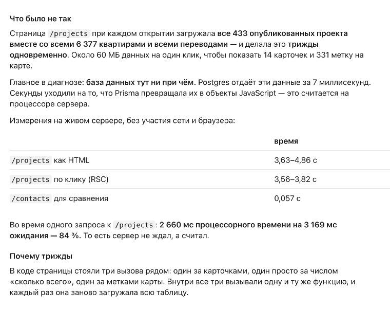
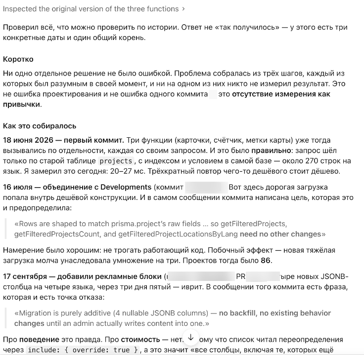

# Vibe coding w praktyce: dlaczego strona zrobiona przez AI nadal potrzebuje kogoś, kto ją mierzy

**Draft v1, 12 listopada 2026. Nieopublikowane.** Adaptacja rynkowa, nie tłumaczenie. Kejs zanonimizowany: bez nazw firmy, dewelopera i projektu, bez hashy commitów i ścieżek do plików. Wszystkie pomiary prawdziwe. Polski kąt: kto odpowiada, kiedy strona przestaje działać, i co musi być zapisane przy przekazaniu projektu.

Title: Vibe coding w praktyce: dlaczego strona zrobiona przez AI nadal potrzebuje kogoś, kto ją mierzy
Slug: strona-internetowa-zrobiona-przez-ai
Meta title: Vibe coding: ile kosztowały cztery miesiące bez pomiaru
Meta description: Strona zrobiona przez AI przesyłała 60 MB przy każdej wizycie przez cztery miesiące. Co to kosztowało w Google i dlaczego naprawa zajęła jeden dzień.

---

**Krótka odpowiedź.** AI potrafi zbudować stronę, która naprawdę działa — ta działała cztery miesiące, w pięciu językach, z prawdziwymi klientami. Czego AI nie potrafi, to zauważyć ceny własnych decyzji, kiedy nikt o nią nie pyta. W tym projekcie każde wejście na stronę z listą ofert przesyłało około 60 MB danych — tyle, co dwadzieścia zwykłych stron internetowych — żeby pokazać czternaście ofert. Nic nie protestowało, bo serwis cały czas rósł. Rachunek przyszedł jako osiem miesięcy ruchu stojącego w miejscu i jeden wieczór, kiedy strona przestała odpowiadać. Naprawa zajęła jeden dzień roboczy. Odległość między tymi dwiema liczbami, cztery miesiące i jeden dzień, to cały argument za tym, żeby przy projekcie budowanym z AI był ktoś, czyim zadaniem jest mierzyć.

W niedzielny wieczór w listopadzie strona przestała odpowiadać. Nie lista ofert — wszystko: blog, formularz kontaktowy, podstrony niemające ze sobą nic wspólnego. Właściciel widział, że serwis leży, i nie miał jak ustalić dlaczego, bo nie czyta kodu i do tego wieczora nigdy nie musiał.

Serwis to katalog nieruchomości w pięciu językach: 433 opublikowane oferty, a w nich 6 377 mieszkań. Większość kodu napisał agent AI pracujący bezpośrednio z właścicielem. Właściciel opisuje, czego chce, akceptuje to, co wraca, i wdraża. To jest vibe coding w prawdziwym znaczeniu tego słowa — nie zabawka na weekend, tylko działający biznes na oprogramowaniu, którego nikt po stronie biznesowej nie czyta.

I przez cztery miesiące to działało. Strony się otwierały, ceny się zgadzały, panel zapisywał to, co miał zapisywać, ruch z wyszukiwarki był stabilny. Nic nie wyglądało na zepsute, bo nic nie było zepsute.

## Poprawny kod bywa drogim kodem: dlaczego strona zrobiona przez AI może działać i jednocześnie kosztować

Zwykła wersja takiej historii brzmi „AI pisze buble". Tutaj ta wersja jest nieprawdziwa, a prawdziwa jest mniej wygodna.

Kod nie był zły. Zapytania zwracały właściwe dane, strony pokazywały właściwe ceny, a 2 361 testów automatycznych — małych skryptów sprawdzających, czy serwis nadal zachowuje się poprawnie po każdej zmianie — przechodziło. Kiedy w końcu zaczęto szukać przyczyny, szukał jej ten sam agent AI i zrobił to dobrze: przeszedł historię projektu zmiana po zmianie, zmierzył wszystko na działającym serwerze i sam wskazał własne autorstwo, bez przyciskania.

Brakowało ceny. Nikt — ani właściciel, ani AI — nigdy nie zapisał, ile kosztuje jedno wyświetlenie strony. Nie istniała więc żadna liczba, która mogłaby komukolwiek rosnąć na oczach.

Sam agent opisał ten mechanizm lepiej, niż potrafię. Zapytany wprost, czy projekt tej wielkości da się prowadzić z nim przez osobę bez wiedzy technicznej, i poproszony, żeby nie był dyplomatyczny, odpowiedział (rozmowa toczyła się po rosyjsku, to tłumaczenie):

> Kto sprawdza moją pracę? Ja. Nie odróżnisz dobrego wyjaśnienia od wiarygodnie brzmiącego: oba podaję tym samym pewnym tonem.

To jest całe ryzyko w jednym zdaniu. Od AI nie dostaniesz zepsutych stron. Dostaniesz działające strony, których kosztu bieżącego nikt nie pilnuje, opisane pewnym głosem.

## Ile naprawdę kosztowała jedna wizyta: cały katalog trzy razy, żeby pokazać czternaście ofert

Przy każdym otwarciu listy ofert serwer wczytywał wszystkie 433 nieruchomości, wraz z 6 377 mieszkaniami w środku i pięcioma wersjami językowymi każdego tekstu. Robił to trzy razy na jedną stronę: raz dla kafelków, które widać, raz dla liczby „433 oferty", raz dla pinezek na mapie. Każde z tych trzech zapytań wczytywało cały katalog od nowa. Potem strona wyrzucała prawie wszystko i pokazywała czternaście kafelków i 331 pinezek.

Łącznie około 60 MB danych przechodziło wewnątrz serwera, żeby powstał jeden ekran. Zwykła strona internetowa waży dwa, trzy megabajty; tutaj było ich dwadzieścia, na każde kliknięcie, i żaden odwiedzający nie zobaczył z tego ani bajtu.

Większość tej wagi to teksty, które na liście kafelków w ogóle nie mogą się pojawić:

| co wczytywało się przy każdym kliknięciu | rozmiar | czy lista to pokazuje? |
|---|---|---|
| bloki reklamowe w 5 językach | 6 620 KB | nie |
| opisy nieruchomości w 5 językach | 2 230 KB | nie |
| pola pod wyszukiwarki | 397 KB | nie |
| miasto, cena, pierwsze zdjęcie i reszta | ~1 100 KB | tak |

Dziewięćdziesiąt sześć procent każdej wizyty to tekst redakcyjny należący do stron pojedynczych ofert, przewożony przez serwer trzy razy po to, żeby zostać wyrzuconym.

Jeden szczegół jest ważny dla każdego, komu powiedziano, że wolna strona potrzebuje mocniejszej bazy danych. Baza nie była tu problemem: zwróciła wszystkie te wiersze w 7 milisekundach, czyli natychmiast. Sekundy poszły na przetwarzanie przez procesor serwera danych, których strona nie potrzebowała — 84 procent czasu zapytania to praca procesora, nie czekanie. Lista ofert powstawała 3,6–4,9 sekundy. Zwykła podstrona tego samego serwisu, na tym samym serwerze i tej samej bazie — 0,057 sekundy. Sześćdziesiąt razy szybciej. Taka różnica nigdy nie bierze się z hostingu. Bierze się z tego, o co strona prosi.

## Jak wolna strona wydaje twój budżet indeksowania Google na nic

Odwiedzający są oczywistą ofiarą wolnej strony. Nie są ofiarą najdroższą.

Google nie czyta całego serwisu codziennie. Przydziela na niego ograniczony czas — w branży nazywa się to budżetem indeksowania — i kiedy ten czas się skończy, wychodzi, niezależnie od tego, czy zobaczył twoje nowe podstrony. Wolna strona wydaje ten czas w imieniu wszystkich pozostałych.

Dziennik indeksowania Google dla tego serwisu, z dwóch dni:

| typ strony | liczba wejść robota | typowa odpowiedź | najwolniejsza |
|---|---|---|---|
| strony pojedynczych ofert | 806 | 1,136 s | 108 s |
| lista ofert | 459 | 0,012 s | 69 s |
| blog | 393 | 0,010 s | 4,6 s |
| pozostałe podstrony | ~800 | 0,009–0,013 s | — |

Przez te dwa dni Google spędził na czekaniu 1 512 sekund, z czego około 900 — 60 procent — poszło na dwa typy stron z osiemnastu. W najgorszych pojedynczych przypadkach robot czekał na jedną stronę 108 i 69 sekund.

Nikt za to nie wystawia faktury. To wraca jako nowe podstrony znajdowane z opóźnieniem, zaktualizowane czytane ponownie z opóźnieniem i cała reszta serwisu dostająca mniejszy kawałek uwagi Google, niż na niego zasłużyła.

## Osiem miesięcy w miejscu, przebrane za zdrowy serwis

To jest ta część, dla której warto było ten kejs opisać, i jest odwrotnością tego, czego ludzie się spodziewają.

Serwis nie tracił ruchu. Kliknięcia trzymały poziom przez całe lato, wyświetleń w wyszukiwarce przybywało z miesiąca na miesiąc, średnia pozycja się poprawiała. Żadnego spadku do zbadania, żadnego alertu, żadnego nerwowego maila. Na każdym ekranie, na który patrzył właściciel, projekt był w porządku. Agent, wymieniając na koniec sesji własne porażki, ujął przyczynę wprost:

> Błąd żył cztery miesiące. Nie dlatego, że był sprytny — strona ładowała 60 MB na kliknięcie. Dlatego, że żaden mechanizm nie mierzył szybkości stron publicznych. Sygnał przyszedł dopiero wtedy, gdy skończyły się połączenia do bazy.

Problem widać dopiero wtedy, gdy ustawi się miesiące obok siebie. Search Console liczy kliknięcia w oknach 28-dniowych — każdy dzień pokazuje sumę z poprzednich czterech tygodni. W lutym serwis osiągnął 700 kliknięć na 28 dni. Przez czerwiec, lipiec, sierpień i wrzesień ta sama liczba mieściła się między 571 a 692: poniżej lutego. Pierwszego października dotknęła 571, najniżej w całym roku. Serwis nie spadał. Stał w miejscu przez osiem miesięcy, podczas gdy wrzucano do niego nowe treści — a dla biznesu katalogowego to osiem miesięcy ofert i artykułów, które kosztowały, a nie kupiły ani metra zasięgu.

Potem ruszyło. 24 października serwis przekroczył 800 kliknięć na 28 dni, 2 listopada 900, 6 listopada 1 000 — trzy progi w trzynaście dni po ośmiu miesiącach bez ani jednego.

Warto być tu precyzyjnym, bo wygodna odpowiedź jest nieprawdziwa. To nie była ta poprawka. Lista ofert przez wszystkie trzy progi nadal była wolna; naprawiono ją w listopadzie, już po awarii. Plato przełamała inna zmiana, wrześniowa, w tekstach na stronach ofert: [reguła treści, którą agent napisał sam sobie, zabraniała jedynych słów, po których te podstrony znajdowano](/pl/blog/agent-ai-potrzebuje-specjalisty) — to osobna historia z własnymi pomiarami. Tematem tego tekstu jest wydajność, a jej wpływu na ruch z tego wykresu jeszcze nie da się odczytać.

Degradacja ukryta pod wzrostem jest najtrudniejsza do złapania, bo każda kontrolka, którą mógłbyś zamontować, dalej świeci na zielono. Strona nigdy się nie zepsuła. Przesunęła się z „niezauważalne" do „nie do zniesienia" i żadna granica po drodze nie podniosła ręki — aż do wieczora, kiedy skończyły się połączenia do bazy, bo każda wizyta trzymała jedno przez półtorej sekundy, a było ich piętnaście.

## Jak przeniesienie filtrowania z bazy danych w lipcu podniosło koszt każdej wizyty do października

Agent odtworzył to z historii projektu, a nie z pamięci. Trzy daty, jedna przyczyna źródłowa, i żadna z tych trzech decyzji nie była błędem w dniu, w którym zapadła.

**18 czerwca.** Trzy zapytania istniały osobno i to było poprawne: filtrowanie odbywało się w bazie danych, która jest w tym bardzo dobra, i dotykało naraz około 270 wierszy. Zmierzona dzisiaj, ta pierwotna konstrukcja działa w 20–27 milisekund. Powtórzenie czegoś taniego trzy razy nadal jest tanie.

**16 lipca.** Do tej samej strony dołączono drugi typ ofert. Żeby nie ruszać działającego kodu, nowe zapytanie napisano na wzór starego — i filtrowanie przeniosło się z bazy danych do kodu samej strony. Od tego momentu koszt jednej wizyty przestał zależeć od tego, o ile ofert prosi odwiedzający, a zaczął zależeć od tego, ile ich jest w ogóle. Było ich wtedy 86, więc było pięć razy taniej niż później, i nikt niczego nie poczuł.

**17 września.** Dodano cztery pola na bloki reklamowe, po jednym na język. W notatce do tej zmiany napisano: „zmiana czysto dodająca — nic nie trzeba przenosić, żadne istniejące zachowanie się nie zmienia, dopóki administrator czegoś tam nie wpisze". Co do zachowania to prawda. Co do kosztu nie: lista ofert prosiła o „wszystkie pola", co znaczy dosłownie wszystkie, łącznie z tymi, które nie istniały w chwili pisania zapytania. Nowe bloki dołączyły do strony w dniu migracji, automatycznie, bez jednej linijki zmiany w jej kodzie.

A katalog przez cały czas rósł: 86 ofert w lipcu, 217 w sierpniu, 286 we wrześniu, 415 w październiku, 433 dzisiaj. Każda nowa oferta mnożyła koszt, którego nikt nie zapisał.

Agent podsumował to tak:

> Żadna pojedyncza decyzja nie była błędem. Problem złożył się z trzech kroków, z których każdy był rozsądny w swoim momencie, i przy żadnym z nich nikt nie zmierzył wyniku. To nie jest błąd projektowy ani jeden zły commit — to brak pomiaru jako nawyku.

[slider]
 :: Diagnoza: baza odpowiadała w 7 ms, a sekundy schodziły serwerowi na przeliczanie. Oryginalny zapis sesji, po rosyjsku.
 :: Trzy daty, jedna przyczyna: filtrowanie wyszło z bazy w lipcu, a we wrześniu nowe kolumny same dołączyły do zapytania.
 :: Końcowa odpowiedź i zdanie, którym kończy się ten tekst.
[/slider]

## Ten sam błąd znaleziono miesiąc wcześniej w panelu administracyjnym i nie sprawdzono strony publicznej

13 października dokładnie ten problem znaleziono i naprawiono w innym miejscu tego samego projektu: ekran w panelu administracyjnym wczytywał cały katalog, żeby wypisać jedną liczbę w menu. Naprawę zrobiono wzorowo — najpierw pomiar na serwerze, potem poprawna diagnoza, potem usunięcie licznika. Zmianie nadano nawet tytuł streszczający lekcję: każda strona panelu czekała dwie sekundy na jedną liczbę w nawigacji.

Nikt nie zapytał, czy część publiczna jest zbudowana tak samo. Była: ta sama funkcja, licząca te same 433 oferty, żeby wypisać tę samą liczbę na trzech publicznych podstronach.

Diagnoza istniała miesiąc przed awarią.

> To najdroższy z popełnionych tu błędów: nie napisanie złego kodu, tylko nierozniesienie wniosku, który już został znaleziony.

## Jeden dzień roboczy, żeby cofnąć cztery miesiące narastającego kosztu

Dwie zmiany, obie drobne. Jedno zapytanie zamiast trzech, bo ciężkie wczytywanie i tak nigdy nie zależało od filtrów odwiedzającego. I pytanie wyłącznie o te dziewiętnaście pól, które kafelki faktycznie pokazują, zostawiając pięciojęzyczne teksty tam, gdzie ich miejsce.

| | przed | po |
|---|---|---|
| czas pobierania danych na stronę | 2 038 ms | 116 ms |
| przesłane dane | 59,65 MB | 2,06 MB |

17,6 raza szybciej, 94 procent mniej danych, wszystkie 2 361 testów nadal przechodzi. Razem z poprawką doszedł test, który obserwuje, z których pól kafelek rzeczywiście korzysta — żeby w dniu, w którym ktoś doda pole i zapomni o nie poprosić, test wypowiedział jego nazwę na głos, zamiast pozwolić stronie po cichu się zepsuć.

Praca zajęła jeden dzień roboczy. Stan, który ją wymusił, narastał cztery miesiące.

## Czego naprawdę szukasz, zatrudniając specjalistę, i to nie jest pisanie kodu

Zanim trzy konkretne rzeczy — własne podsumowanie agenta, bo to ono je spina:

> Jestem dobry, kiedy ktoś wskaże mi problem: dzisiaj przeszedłem od „strona jest wolna" do dokładnej przyczyny, pomiaru i sprawdzonej poprawki. Jestem słaby w zauważaniu problemu, na który nikt mnie nie skierował — i dzisiejszy dzień też to udowadnia, czterema miesiącami.

Specjalista na tym projekcie nie napisałby lepszego kodu. Kod był w porządku. Brakowało trzech rzeczy i wszystkie trzy robi bez proszenia ktoś, kto trzyma cały system w głowie.

**Pytanie, ile kosztuje jeden wiersz.** Nie „czy strona wydaje się szybka", bo to opinia, tylko „ile milisekund i ile kilobajtów dokłada do tej strony jedna kolejna oferta". Takiej liczby nie było, więc nic nie mogło w widoczny sposób rosnąć. Inaczej mówiąc: nie musisz rozumieć, dlaczego strona jest wolna — potrzebujesz systemu, który napisze ci, że lista ofert przekroczyła sekundę.

**Przeniesienie wniosku na cały system.** Kiedy problem z licznikiem wypłynął w panelu, pytanie „gdzie jeszcze istnieje dokładnie ten sam wzorzec?" zajmuje pięć minut i oszczędziłoby cztery miesiące.

**Czytanie tego, jak rzecz jest zbudowana, kilka dni na kwartał.** Nie na stałe i nie przez tego, kto ją zbudował. Agent w tej jednej sesji, w której wszystko zdiagnozował, popełnił trzy błędy pomiarowe: o mało nie uznał wolnej strony za szybką, jeden pomiar zwracał zero dla każdego wiersza łącznie z kontrolnym, a jedno wyliczenie po cichu dało wynik trzy razy mniejszy od prawdziwego. Złapał wszystkie trzy, bo akurat tego dnia sam siebie sprawdzał. Nic nie gwarantuje, że następnego też.

I granica tego twierdzenia, którą wolę postawić sam: przy tym projekcie przez cały czas byli kompetentni ludzie, a problem i tak żył cztery miesiące. Specjalista nie jest gwarancją. Dokładna wersja jest węższa i bardziej użyteczna — błąd trwał dokładnie tyle, ile nikt go nie mierzył, i zamknął się w jeden dzień, kiedy ktoś zapytał o jego cenę.

## Co w Polsce warto zapisać, zanim oddasz projekt w ręce AI albo wykonawcy

Jedna rzecz różni ten kejs od typowej polskiej sytuacji: tutaj właściciel budował z AI sam, więc dostęp do wszystkiego miał od pierwszego dnia. Jeżeli stronę robi dla ciebie ktoś inny — agencja, freelancer albo jedno i drugie na zmianę — to przy przekazaniu projektu zapisz cztery rzeczy, i żadna z nich nie dotyczy jakości kodu.

Czyje są dostępy: hosting, domena, baza, repozytorium kodu i panel. Nie „mamy to u wykonawcy", tylko konto na ciebie, a wykonawca dopisany.

Co dokładnie wchodzi w utrzymanie. Zdanie „opieka nad stroną" nie zobowiązuje nikogo do mierzenia czasu odpowiedzi. Zdanie „raz w miesiącu raport z czasem odpowiedzi kluczowych podstron" już tak.

Kto odpowiada, kiedy serwis przestaje odpowiadać wieczorem w niedzielę, i w jakim czasie reaguje.

Jedna liczba na podstronę, uzgodniona na piśmie: czas odpowiedzi albo waga strony, i próg, po przekroczeniu którego ktoś ma się odezwać. To jest ta rzecz, której w tym kejsie nie było przez cztery miesiące.

Dwa obszary wymagają więcej niż to wszystko, a agent nazwał je sam: wszystko nieodwracalne, gdzie usunięcia nie da się cofnąć i kosztem jest biznes, a nie jedno popołudnie, oraz bezpieczeństwo i płatności, gdzie dziura jest niewidoczna, dopóki ktoś z niej nie skorzysta. Cała reszta — szybkość, widoczność w wyszukiwarce, treści, integracje — psuje się odwracalnie.

## Najczęstsze pytania o strony zrobione przez AI i ich koszt utrzymania

**Czy AI może zrobić stronę internetową, która naprawdę działa?**
Tak. Ta działała cztery miesiące, w pięciu językach, z prawdziwymi klientami. Pytanie nie brzmi, czy działa w dniu uruchomienia, tylko czy ktokolwiek zauważy, kiedy zmieni się koszt jej utrzymania. Tutaj kod przez cały czas pozostawał poprawny i stał się 17,6 raza droższy, niż musiał.

**Czy kod generowany przez AI jest wiarygodny?**
W zwykłym sensie tak: robi to, o co został poproszony. Ryzyko jest węższe, niż się ludziom wydaje. AI optymalizuje to, na co je skierowano, a tym, na co nikt nie kieruje, jest prawie zawsze cena decyzji — koszt na wiersz, budżet indeksowania, pieniądze.

**Dlaczego moja strona jest wolna, skoro baza danych jest szybka?**
Bo baza często nie jest wąskim gardłem. Tutaj odpowiadała w 7 milisekundach, a strona i tak powstawała ponad trzy sekundy, z czego 84 procent to przetwarzanie danych, których nie potrzebowała. Ustal, czy serwer czeka, czy pracuje, zanim ktokolwiek obwini hosting.

**Czym jest budżet indeksowania i jak wolna strona go marnuje?**
Google daje twojemu serwisowi ograniczony czas i wychodzi, gdy go zużyje. Tutaj dwa typy stron z osiemnastu zjadły 60 procent z 1 512 sekund w ciągu dwóch dni. Szybkie podstrony nie dostają za to nagrody — dostają to, co zostanie.

**Czy przy AI nadal potrzebny jest programista?**
Potrzebny jest ktoś, kto mierzy, a to inna praca niż pisanie kodu. Nikt tutaj nie musiał napisać lepszych zapytań. Ktoś musiał zapytać, ile kosztuje jeden wiersz katalogu, i czy błąd znaleziony w panelu istnieje też po stronie publicznej.

**Jak sprawdzić, czy mój serwis ma ten sam problem?**
Porównaj, ile serwer potrzebuje na wygenerowanie twojej najcięższej podstrony i zwykłej podstrony tego samego serwisu — nie to, jak się wydają. Sześćdziesięciokrotna różnica między dwiema stronami tego samego systemu to nie jest problem hostingu i nie trzeba umieć czytać kodu, żeby ją zobaczyć.

## Co sprawdzić u siebie w tym tygodniu

Porównaj czas odpowiedzi serwera na najcięższej i na prostej podstronie. Jeśli różnica jest wielokrotna, przyczyna siedzi w stronie, nie w hostingu.

Otwórz w Google Search Console raport statystyk indeksowania i spójrz na średni czas odpowiedzi według typu strony. Jeśli jeden typ jest o rząd wielkości wyżej od reszty, tam idzie twój budżet.

Weź dowolną poprawkę z ostatnich trzech miesięcy i zapytaj, gdzie jeszcze istnieje ten sam wzorzec. To najtańsze pytanie w tym tekście.

Zapisz jedną liczbę na każdą ważną podstronę — czas odpowiedzi albo wagę — i spraw, żeby coś odezwało się, kiedy ta liczba się ruszy. Cztery miesiące z tej historii wydarzyły się dlatego, że takiej liczby nie było.

Audyt techniczny i SEO z pisemną listą znalezisk zaczyna się od 1000 zł. Jeśli chcesz, żeby te sprawdzenia zrobił ktoś spoza twojego zespołu, strona [audyt wydajności i kodu](/pl/oferty/audyt-wydajnosci-i-kodu) opisuje, co obejmuje, a odpowiadam w ciągu jednego dnia roboczego. Jeśli dopiero decydujesz, kto w ogóle ma tę pracę wykonywać, [freelancer czy agencja przy stronie internetowej](/pl/blog/freelancer-czy-agencja-strona-internetowa) zajmuje się osobno tym pytaniem.

Na koniec tamtej sesji zapytałem agenta, czy biznes da się prowadzić w ten sposób przez kogoś, kto nie czyta kodu. Jego odpowiedź to zdanie, które bym zachował:

> Tak, da się — jeśli przestaniesz być jedynym czujnikiem w systemie. Teraz problem zostaje wykryty wtedy, kiedy poczujesz go ty.
