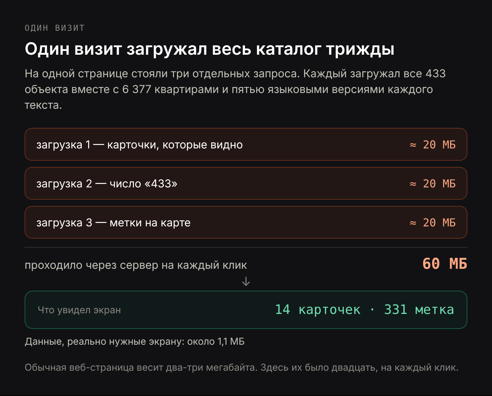
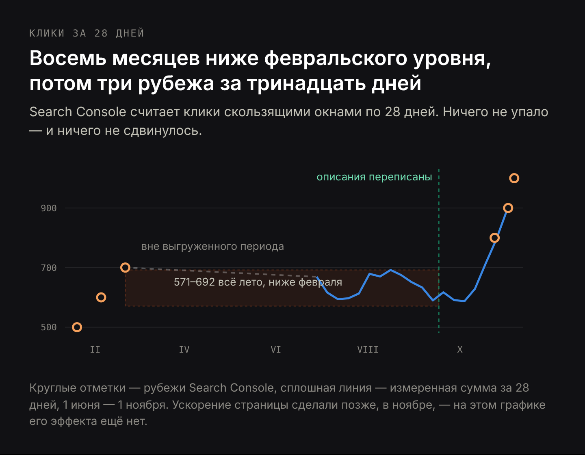
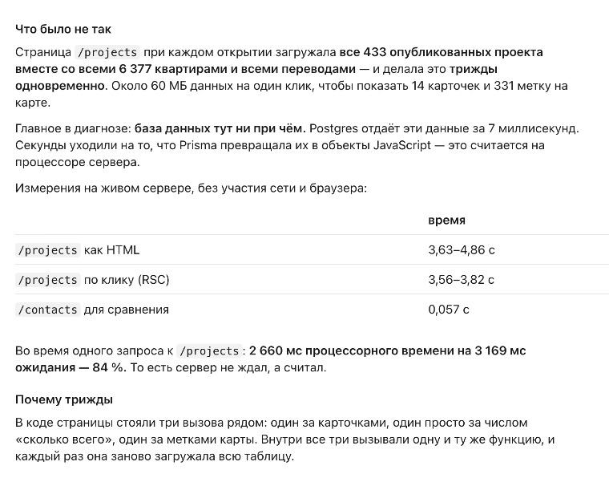
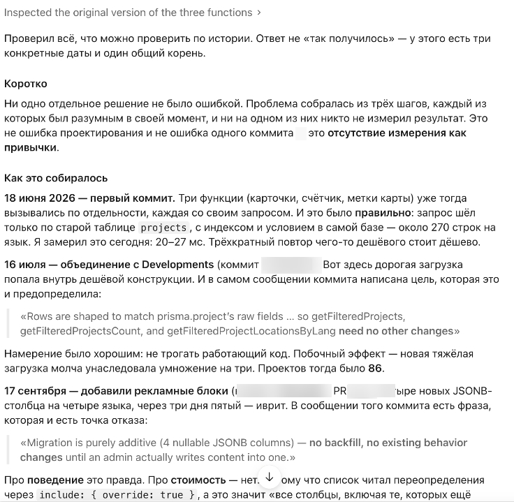
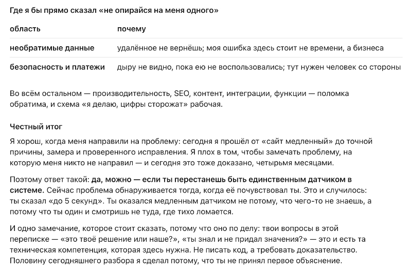

# Вайбкодинг на живом проекте: почему сайту, который собрала нейросеть, всё равно нужен человек с замерами

**Черновик v1, 12 ноября 2026. Не опубликовано.** Рыночная адаптация, не перевод. Кейс обезличен: без названий компании, застройщиков и проекта, без хешей коммитов и путей к файлам. Все замеры настоящие. Русский угол — читатель чаще сам себе подрядчик: между ним и кодом нет никого, поэтому отдельный раздел о том, что завести вместо второго человека.

Title: Вайбкодинг на живом проекте: почему сайту, который собрала нейросеть, всё равно нужен человек с замерами
Slug: sait-sdelannyi-neirosetyu
Meta title: Вайбкодинг: во что обошлись четыре месяца без замеров
Meta description: Сайт, собранный нейросетью, четыре месяца гонял 60 МБ на каждый визит. Во что это обошлось в Google и почему починка заняла один день.

---

**Краткий ответ.** Нейросеть умеет собрать сайт, который действительно работает, — этот работал четыре месяца, на пяти языках, с живыми клиентами. Чего нейросеть не умеет — замечать цену собственных решений, пока о ней никто не спрашивает. В этом проекте каждое открытие страницы с объектами гоняло около 60 МБ данных — вес примерно двадцати обычных веб-страниц — чтобы показать четырнадцать карточек. Никто не возмущался, потому что сайт при этом рос. Счёт пришёл в виде восьми месяцев стоящего на месте трафика и одного вечера, когда сайт перестал отвечать. Починка заняла один рабочий день. Расстояние между этими двумя числами, четыре месяца и один день, — и есть весь аргумент за то, чтобы на проекте, который строится с нейросетью, был человек, чья работа — измерять.

В воскресенье вечером в ноябре сайт перестал отвечать. Не страница с объектами — всё: блог, форма обратной связи, страницы, не имеющие друг к другу отношения. Владелец видел, что сайт лежит, и не мог выяснить почему: он не читает код и до этого вечера ни разу не был должен.

Сайт — каталог недвижимости на пяти языках: 433 опубликованных объекта, внутри них 6 377 квартир. Бо́льшую часть кода написал ИИ-агент, работающий напрямую с владельцем. Владелец описывает, что хочет, принимает то, что получилось, и выкатывает. Это и есть вайбкодинг в настоящем смысле слова — не игрушка на выходные, а живой бизнес на коде, который со стороны бизнеса никто не читает.

И четыре месяца это работало. Страницы открывались, цены были правильные, админка сохраняла то, что должна была сохранять, трафик из поиска держался. Ничто не выглядело сломанным, потому что ничто и не было сломано.

## Корректный код бывает дорогим: почему сайт от нейросети может работать и при этом терять деньги

Обычная версия такой истории звучит как «нейросеть пишет ерунду». Здесь эта версия неверна, а верная — неудобнее.

Код был не плохой. Запросы возвращали правильные данные, страницы показывали правильные цены, и 2 361 автоматический тест — небольшие скрипты, которые после каждого изменения проверяют, что сайт ведёт себя как надо, — проходили. Когда наконец стали искать причину, искал её тот же самый агент, и сделал это хорошо: прошёл историю проекта изменение за изменением, замерил всё на работающем сервере и сам назвал собственное авторство, без нажима.

Не хватало цены. Ни владелец, ни нейросеть ни разу не записали, сколько стоит одно открытие страницы. Поэтому не существовало числа, которое могло бы у кого-то расти на глазах.

Сам агент описал этот механизм лучше, чем могу я. На прямой вопрос, можно ли вести проект такого размера вместе с ним человеку без технических знаний, и с просьбой ответить не дипломатично, он сказал (разговор шёл по-русски):

> Проверяет мою работу — я. Ты не можешь отличить хорошее объяснение от правдоподобного: я выдаю оба одинаково уверенным тоном.

Это всё риск в одной фразе. Сломанных страниц от нейросети вы не получите. Вы получите работающие страницы, за стоимостью которых никто не следит, и уверенный голос, объясняющий, почему всё в порядке.

## Во что обходился один визит: весь каталог трижды, чтобы показать четырнадцать карточек

При каждом открытии списка объектов сервер загружал все 433 объекта, вместе с 6 377 квартирами внутри и всеми пятью языковыми версиями каждого текста. И делал это трижды на одну страницу: раз для карточек, которые видно, раз для числа «433 объекта», раз для меток на карте. Каждый из трёх запросов загружал весь каталог заново. Дальше страница выбрасывала почти всё и показывала четырнадцать карточек и 331 метку.

Суммарно около 60 МБ данных проходило внутри сервера ради одного экрана. Обычная веб-страница весит два-три мегабайта; здесь их было двадцать, на каждый клик, и ни один посетитель не увидел из этого ни байта.

Бо́льшая часть веса — тексты, которые в списке карточек не могут появиться в принципе:

| что грузилось на каждый клик | размер | список это показывает? |
|---|---|---|
| рекламные блоки на 5 языках | 6 620 КБ | нет |
| описания объектов на 5 языках | 2 230 КБ | нет |
| поля под поисковики | 397 КБ | нет |
| город, цена, первое фото и остальное | ~1 100 КБ | да |

Девяносто шесть процентов каждого визита — редакторский текст, принадлежащий страницам отдельных объектов, который трижды проезжал через сервер ради того, чтобы быть выброшенным.

Одна деталь важна для всех, кому когда-либо говорили, что медленному сайту нужна база помощнее. База здесь была ни при чём: она отдала все эти строки за 7 миллисекунд, то есть мгновенно. Секунды ушли на то, что процессор сервера обрабатывал данные, которые странице не нужны, — 84 процента времени запроса сервер работал, а не ждал. Список объектов собирался 3,6–4,9 секунды. Обычная страница того же сайта, на том же сервере и той же базе, — 0,057 секунды. В шестьдесят раз быстрее. Такая разница никогда не берётся из хостинга. Она всегда берётся из того, что страница попросила.

## Как медленная страница тратит ваш краулинговый бюджет впустую

Посетители — очевидная жертва медленной страницы. Но не самая дорогая.

Google не читает ваш сайт целиком каждый день. Он выделяет на сайт ограниченное время — в отрасли это называют краулинговым бюджетом — и, когда время потрачено, уходит, независимо от того, увидел он ваши новые страницы или нет. Медленная страница тратит это время за счёт всех остальных.

Журнал обхода Google по этому сайту за два дня:

| тип страницы | заходов робота | типичный ответ | худший случай |
|---|---|---|---|
| страницы отдельных объектов | 806 | 1,136 с | 108 с |
| список объектов | 459 | 0,012 с | 69 с |
| блог | 393 | 0,010 с | 4,6 с |
| остальные страницы | ~800 | 0,009–0,013 с | — |

За эти два дня Google провёл в ожидании ответа 1 512 секунд, и около 900 из них — 60 процентов — ушли на два типа страниц из восемнадцати. В худших отдельных случаях робот ждал одну страницу 108 и 69 секунд.

Счёта за это никто не выставляет. Оно возвращается тем, что новые страницы находятся позже, обновлённые перечитываются позже, а всему остальному сайту достаётся меньше внимания Google, чем он заработал.

## Восемь месяцев на месте, переодетые в здоровый рост

Вот ради чего этот кейс стоило записать, и это противоположно тому, чего обычно ждут.

Сайт не терял трафик. Клики держались всё лето, показов в поиске становилось больше месяц к месяцу, средняя позиция улучшалась. Ни падения, которое можно расследовать, ни оповещения, ни нервного письма. На любом экране, куда смотрел владелец, проект был в порядке. Агент, перечисляя в конце сессии собственные провалы, назвал причину прямо:

> Ошибка жила четыре месяца. Не потому, что была хитрой — страница грузила 60 МБ на клик. Потому что ни один механизм не измерял скорость публичных страниц. Сигнал пришёл только тогда, когда кончились соединения к базе.

Проблему видно, только если поставить месяцы рядом. Search Console считает клики скользящими окнами по 28 дней: любой день показывает сумму за предыдущие четыре недели. В феврале сайт взял 700 кликов за 28 дней. Весь июнь, июль, август и сентябрь то же число держалось между 571 и 692 — ниже февраля. Первого октября оно коснулось 571, минимума за год. Сайт не падал. Он восемь месяцев стоял на месте, пока в него выкладывали новый контент, — а для каталожного бизнеса это восемь месяцев объектов и статей, которые стоили денег и не купили ни метра охвата.

Потом сдвинулось. 24 октября сайт прошёл 800 кликов за 28 дней, 2 ноября — 900, 6 ноября — 1 000: три рубежа за тринадцать дней после восьми месяцев без единого.

Здесь стоит быть точным, потому что удобный ответ — неверный. Это была не та починка. Список объектов всё время этих трёх рубежей оставался медленным; его починили в ноябре, уже после отказа. Плато сломала другая правка, сентябрьская, в текстах на страницах объектов: [правило для текстов, которое агент написал сам себе, запрещало единственные слова, по которым эти страницы находили](/ru/blog/ii-agent-i-specialist), и это отдельная история со своими замерами. Темой этой статьи остаётся производительность, и её влияния на трафик по этому графику пока прочесть нельзя.

Деградация, спрятанная под ростом, ловится труднее всего, потому что любая лампочка, которую вы могли бы повесить, продолжает гореть зелёным. Страница ни разу не сломалась. Она переползла из «незаметно» в «невыносимо», и ни одна граница по дороге не подняла руку — до того вечера, когда кончились соединения к базе, потому что каждый визит держал одно по полторы секунды, а всего их было пятнадцать.

## Как перенос фильтрации из базы данных в июле поднял цену каждого визита к октябрю

Агент восстановил это по истории проекта, а не по памяти. Три даты, один корень, и ни одно из трёх решений не было ошибкой в день, когда принималось.

**18 июня.** Три запроса уже существовали по отдельности, и это было правильно: фильтрация шла в базе данных, которая в этом очень хороша, и затрагивала за раз около 270 строк. Если замерить сегодня, та исходная конструкция работает за 20–27 миллисекунд. Повторить что-то дешёвое трижды — всё ещё дёшево.

**16 июля.** К той же странице присоединили второй тип объектов. Чтобы не трогать работающий код, новый запрос написали по образцу старого — и фильтрация переехала из базы данных в код самой страницы. С этого момента цена одного визита перестала зависеть от того, сколько объектов запросил посетитель, и стала зависеть от того, сколько их всего. Тогда их было 86, то есть в пять раз дешевле, чем потом, и никто ничего не почувствовал.

**17 сентября.** Добавили четыре поля под рекламные блоки, по одному на язык. В пометке к этому изменению было написано: «изменение чисто добавляющее — ничего переносить не нужно, существующее поведение не меняется, пока администратор что-нибудь туда не впишет». Про поведение это правда. Про стоимость — нет: список объектов просил «все поля», а это буквально все, включая те, которых не существовало в момент написания запроса. Новые блоки присоединились к странице в день миграции, сами, без единой строчки изменений в её коде.

И всё это время каталог рос: 86 объектов в июле, 217 в августе, 286 в сентябре, 415 в октябре, 433 сегодня. Каждый новый объект умножал цену, которую никто не записал.

Агент подвёл итог так:

> Ни одно отдельное решение не было ошибкой. Проблема собралась из трёх шагов, каждый из которых был разумным в свой момент, и ни на одном из них никто не замерил результат. Это не ошибка проектирования и не ошибка одного коммита — это отсутствие измерения как привычки.

[slider]
 :: Диагноз: база отдавала за 7 мс, а секунды уходили у сервера на пересчёт. Оригинальный лог сессии.
 :: Три даты, один корень: в июле фильтрация ушла из базы, в сентябре новые столбцы подключились к запросу сами.
 :: Итоговый ответ и фраза, которой заканчивается статья.
[/slider]

## Тот же класс ошибки нашли месяцем раньше в админке и не проверили публичную часть

13 октября ровно эта проблема была найдена и исправлена в другом месте того же проекта: экран в админке грузил весь каталог, чтобы напечатать одно число в меню. Починку сделали образцово — сначала замер на сервере, потом правильный диагноз, потом счётчик убрали. Изменению даже дали заголовок, в котором записан урок: каждая страница админки ждала две секунды ради одного числа в навигации.

Никто не спросил, устроена ли так же публичная часть. Устроена: та же функция, считающая те же 433 объекта, чтобы напечатать такое же число на трёх публичных страницах.

Диагноз существовал за месяц до отказа.

> Это самая дорогая из допущенных здесь ошибок: не написать плохой код, а не распространить уже найденный вывод.

## Один рабочий день, чтобы отменить четыре месяца накопленной цены

Два изменения, оба небольшие. Один запрос вместо трёх — тяжёлая загрузка и так никогда не зависела от фильтров посетителя. И запрашивать только те девятнадцать полей, которые карточка действительно показывает, оставив пятиязычные тексты там, где им место.

| | до | после |
|---|---|---|
| время получения данных на страницу | 2 038 мс | 116 мс |
| объём данных | 59,65 МБ | 2,06 МБ |

В 17,6 раза быстрее, на 94 процента меньше данных, все 2 361 тест по-прежнему проходят. Вместе с починкой добавился тест, который следит, какими полями карточка пользуется на самом деле: в день, когда кто-нибудь добавит поле и забудет его запросить, тест назовёт это поле вслух, вместо того чтобы дать странице тихо сломаться.

Работа заняла один рабочий день. Состояние, которое её потребовало, набиралось четыре месяца.

## Зачем на самом деле нужен специалист, и это не написание кода

Сначала — как это сформулировал сам агент, потому что его фраза объясняет всё остальное:

> Я хорош, когда меня направили на проблему: сегодня я прошёл от «сайт медленный» до точной причины, замера и проверенного исправления. Я плох в том, чтобы замечать проблему, на которую меня никто не направил, — и сегодняшний день это тоже доказал, четырьмя месяцами.

Специалист на этом проекте не написал бы код лучше. Код был нормальный. Не хватало трёх вещей, и все три делает без напоминания человек, который держит систему в голове целиком.

**Вопрос, сколько стоит одна строка.** Не «кажется ли страница быстрой» — это мнение, — а «сколько миллисекунд и килобайт добавляет к этой странице один новый объект». Такого числа не существовало, поэтому ничто не могло заметно вырасти. Иначе говоря: вам не нужно понимать, почему страница медленная, вам нужно, чтобы система сама написала, что список объектов вышел за секунду.

**Перенос вывода на всю систему.** Когда проблема со счётчиком всплыла в админке, вопрос «где ещё существует ровно этот же шаблон?» занимает пять минут и сэкономил бы четыре месяца.

**Чтение того, как вещь устроена, несколько дней в квартал.** Не постоянно и не тем, кто её построил. Агент в той единственной сессии, где всё это диагностировал, допустил три ошибки в замерах: едва не объявил медленную страницу быстрой, один замер возвращал ноль по всем строкам, включая контрольную, а один подсчёт тихо дал число втрое меньше настоящего. Все три он поймал сам, потому что в тот день себя проверял. Что поймает в следующий раз, не гарантирует ничто.

И граница этого утверждения, которую я предпочитаю поставить сам: на проекте всё это время были компетентные люди, и проблема всё равно прожила четыре месяца. Специалист — не гарантия. Точная формулировка уже и полезнее: ошибка жила ровно столько, сколько её никто не измерял, и закрылась за один день, когда кто-то спросил её цену.

## Что завести, если между вами и кодом нет никого

Этот кейс отличается от типичной ситуации читателя одним: здесь у владельца был ИИ-агент и полный доступ, но не было второго человека. Если вы строите сайт сами с нейросетью, второго человека у вас тоже нет, и четыре вещи заменяют его частично.

**Одно число на каждую важную страницу, которое само жалуется.** Время ответа или вес страницы, порог и уведомление в мессенджер. Это тот самый слой, которого не было четыре месяца. Понимать, почему страница медленная, вам не нужно — нужно узнать об этом в день, когда она такой стала, а не через четыре месяца.

**Тесты как память о решениях.** Не ради правильности, а чтобы ошибка, которую один раз уже нашли, назвала себя по имени, когда вернётся. Такой тест срабатывает без вас и без того, чтобы кто-то помнил о его существовании.

**Резервные копии, которые кто-то действительно восстанавливал.** Не те, которые создаются, а те, которые хоть раз разворачивали. Тогда ошибка стоит вечера, а не данных.

**Независимый взгляд несколько дней в квартал.** Человек со стороны, который читает не функции, а устройство, и которому платят за вопрос «оно точно так работает?». Это единственное, что закрывает дыру из предыдущего раздела, и это не постоянные расходы.

Две области требуют большего, и агент назвал их сам: всё необратимое, где удаление не отменить и ценой будет бизнес, а не один вечер, и безопасность с платежами, где дыру не видно, пока ею не воспользовались. Всё остальное — скорость, видимость в поиске, тексты, интеграции — ломается обратимо.

## Частые вопросы о сайтах, собранных нейросетью, и о цене их содержания

**Может ли нейросеть сделать сайт, который реально работает?**
Да. Этот работал четыре месяца, на пяти языках, с живыми клиентами. Вопрос не в том, работает ли он в день запуска, а в том, заметит ли кто-нибудь, когда изменится цена его содержания. Здесь код всё это время оставался корректным и стал в 17,6 раза дороже, чем требовалось.

**Можно ли доверять коду, который написала нейросеть?**
В обычном смысле да: он делает то, о чём его попросили. Риск уже, чем принято думать. Нейросеть оптимизирует то, на что её направили, а тем, на что не направляют, почти всегда оказывается цена решения — стоимость на строку, краулинговый бюджет, деньги.

**Почему сайт медленный, если база данных быстрая?**
Потому что база часто и не узкое место. Здесь она отвечала за 7 миллисекунд, а страница всё равно собиралась больше трёх секунд, и 84 процента этого времени сервер обрабатывал данные, которые ему не нужны. Выясните, сервер ждёт или работает, прежде чем кто-нибудь обвинит хостинг.

**Что такое краулинговый бюджет и как медленная страница его тратит?**
Google даёт сайту ограниченное время и уходит, когда оно израсходовано. Здесь два типа страниц из восемнадцати съели 60 процентов из 1 512 секунд за два дня. Быстрые страницы за свою быстроту награды не получают — им достаётся то, что осталось.

**Нужен ли программист, если есть нейросеть?**
Нужен тот, кто измеряет, а это другая работа, чем писать код. Здесь никому не требовалось написать запросы лучше. Требовалось спросить, сколько стоит одна строка каталога, и существует ли найденная в админке ошибка на публичной части.

**Как понять, есть ли эта проблема у меня?**
Сравните, сколько сервер тратит на сборку вашей самой тяжёлой страницы и обычной страницы того же сайта, — не то, какими они кажутся. Шестидесятикратная разница между двумя страницами одной системы — это не про хостинг, и чтобы её увидеть, код читать не нужно.

## Что проверить у себя на этой неделе

Сравните время ответа сервера на самой тяжёлой и на простой странице. Если разница в десятки раз, причина внутри страницы, а не в хостинге.

Откройте в Google Search Console отчёт о статистике сканирования и посмотрите среднее время ответа по типам страниц. Если один тип на порядок выше остальных — туда и уходит бюджет.

Возьмите любое исправление за последние три месяца и спросите, где ещё в системе существует тот же шаблон. Это самый дешёвый вопрос в тексте.

Запишите одно число на каждую важную страницу — время ответа или вес — и сделайте так, чтобы что-то сообщило вам, когда оно сдвинется. Четыре месяца из этой истории случились потому, что такого числа не было.

Технический и поисковый аудит с письменным списком находок начинается от 250 €. Если нужно, чтобы эти проверки сделал человек со стороны, страница [ускорение сайта и улучшение поисковой видимости](/ru/uslugi/uskorenie-saita-i-uluchshenie-poiskovoi-vidimosti) описывает, что в него входит, и я отвечаю в течение одного рабочего дня. Если вы ещё решаете, кому вообще поручить эту работу, [фрилансер или студия для сайта](/ru/blog/frilanser-ili-studiya-dlya-saita) разбирает этот вопрос отдельно.

В конце той сессии я спросил агента, можно ли вести такой бизнес человеку, который не читает код. Его ответ — фраза, которую я бы оставил:

> Да, можно — если ты перестанешь быть единственным датчиком в системе. Сейчас проблема обнаруживается тогда, когда её почувствовал ты.
