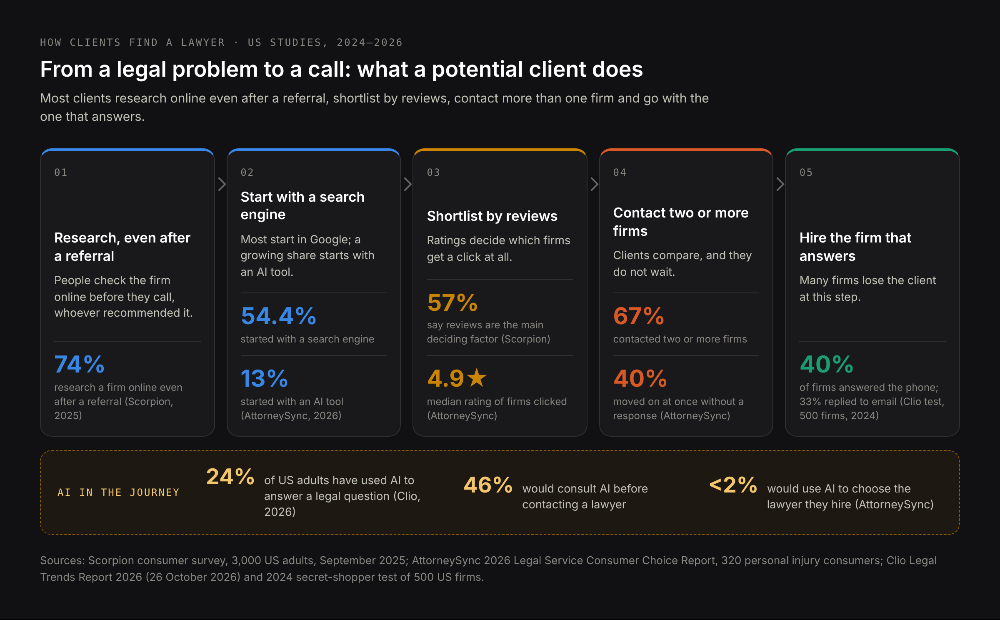
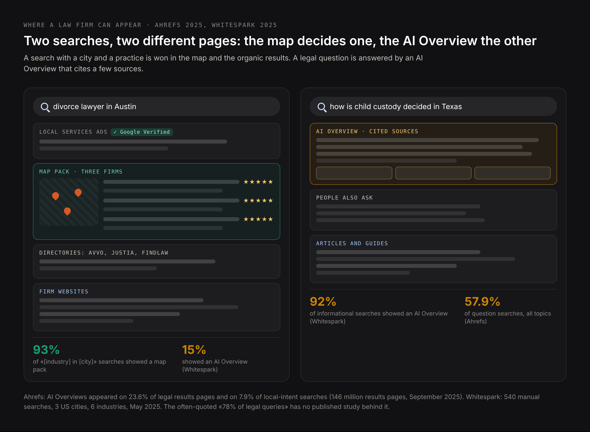
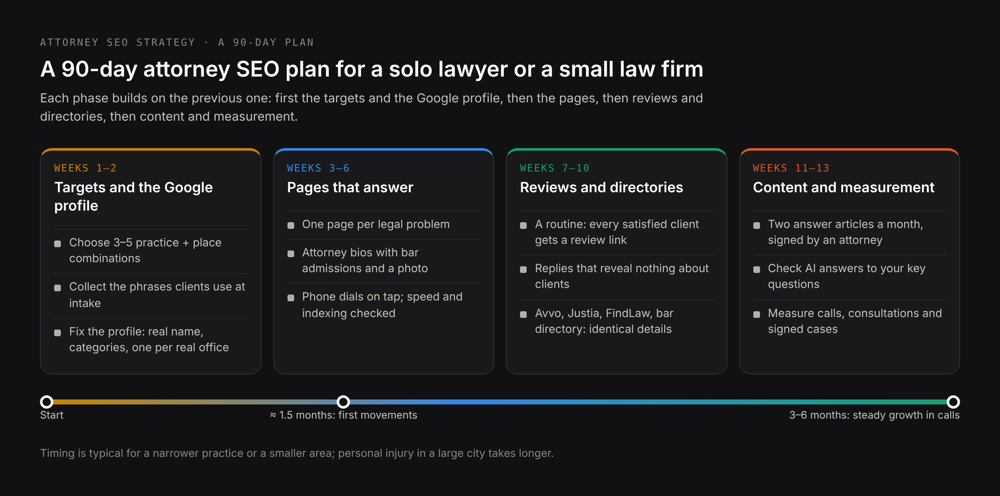
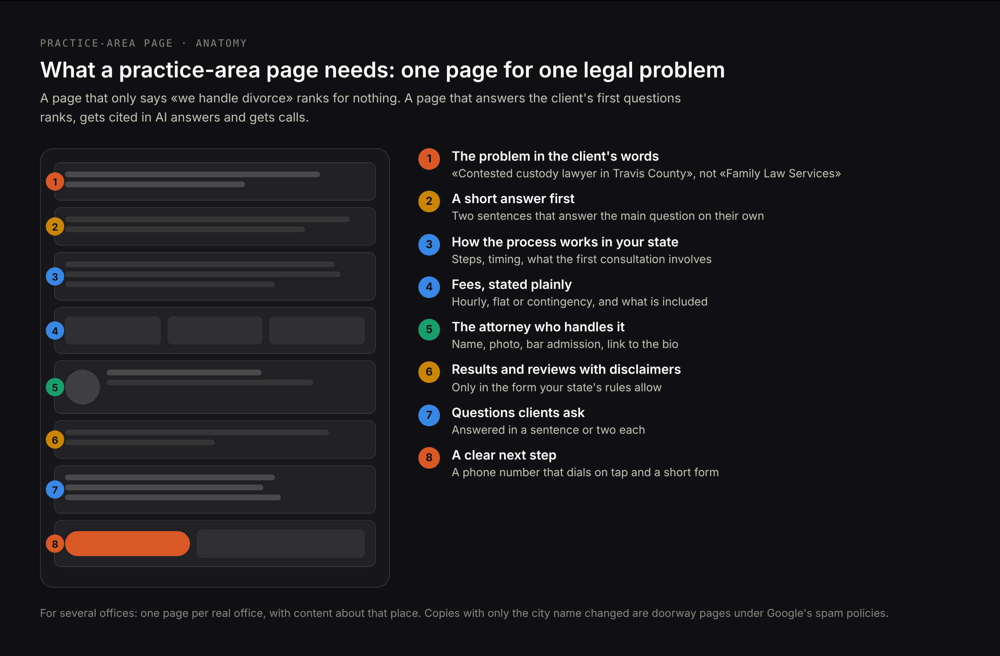

# DRAFT EN — «Attorney SEO» (27 Oct 2026). A step-by-step guide for lawyers and small law firms.
# Core: research/pseo/page-core/lawyers.csv — seo for attorney 3 600, attorney seo marketing 3 600,
# seo attorney 3 600, attorney seo 2 900, lawyer seo 2 900, seo for lawyer 2 900, lawyer seo
# marketing 2 900, legal seo 1 000, seo for lawyers 720, local seo for lawyers 720, best attorney
# seo 390, attorney seo expert 260, small law firm seo, law firm seo audit 110, keywords, tips,
# strategy, technical, content. Intent: research/pseo/intent-check-lawyers.md — «attorney seo»
# and «law firm seo» share 0 URLs; «attorney seo» SERP = guides for lawyers (Clio, LawPay, DC Bar,
# CosmoLex, Attorney at Work), so this is a guide, not a service page. Service phrases stay on
# /seo-for-law-firms, /local-seo-for-lawyers, /personal-injury-seo; prices on
# /blog/how-much-legal-seo-costs.
# Sources (checked 27 Oct 2026): Scorpion consumer report (Sep 2025, 3,000 US adults);
# AttorneySync 2026 consumer choice report (320 PI consumers); Martindale-Avvo «State of the
# Legal Consumer 2026» (Jan 2026); Clio Legal Trends 2026 (26 Oct 2026) and 2024 secret-shopper
# data (500 firms); Ahrefs AI Overview triggers (146M SERPs, Sep 2025); Whitespark local AIO
# study (May 2025); LocaliQ search advertising benchmarks 2026; ABA Model Rules 7.1–7.3 and
# comment [5] to 7.2; ABA Formal Opinion 496 (13 Jan 2021); NYSBA Opinion 1267 (2024); NY
# Appellate Division order on Rule 7.1 (eff. 1 Jun 2026) and NYSBA explainer (8 Sep 2026);
# Texas Rules 7.04–7.05; Florida Rules 4-7.13, 4-7.14, 4-7.20; Google Business Profile
# guidelines; Google Local Services «Google Verified» (20 Oct 2025); Google spam policies
# (updated 28 Aug 2026); review snippet guidelines (updated 8 Sep 2026); schema.org/Attorney
# (deprecated, V30.1); Thomson Reuters sale of FindLaw to Internet Brands (Dec 2024).
# NOT used: «AI Overviews show on 78% of legal queries» — no primary source (debunked in text).
# H1 (Title) and Meta title differ on purpose.

Title: Attorney SEO: A Step-by-Step Guide for Lawyers and Small Law Firms
Slug: attorney-seo
Meta title: SEO for Attorneys: How to Get Clients From Google and AI
Meta description: Attorney SEO in 2026: how clients find lawyers, Google Business Profile, practice-area pages, reviews under bar rules, AI answers and a 90-day plan.

---

> Quick answer: Attorney SEO is the work that makes a lawyer or law firm appear when people search for legal help — in Google's map, in the regular results, in AI answers and in legal directories. For a solo lawyer or a small firm it comes down to five things: a complete Google Business Profile for each office, one page for each legal problem you handle, attorney bio pages that show real experience, a steady flow of genuine reviews, and a website that loads fast and answers the call on a phone. All of it has to stay within your state's bar advertising rules, which shape what you can say about results, specialization and reviews.

Lawyers are told that SEO is expensive, slow and best left to an agency. Part of that is true: legal search is one of the most competitive markets online, and a click on a legal ad is among the most expensive in any industry. But most of what decides whether a small firm gets found is not secret and not technical. It is a set of decisions a lawyer can understand and check: which cases to target, how the Google profile is filled in, what each page says, how reviews are handled.

This guide goes through those decisions in the order I would make them, with the data behind each one and the bar rules that apply. It is written for solo attorneys and small law firms in the US, with notes for other countries where the rules differ. If you would rather hand the work over, the [law firm SEO service page](/seo-for-law-firms) describes how I do it; this article is meant to be useful whether you hire anyone or not.

## What attorney SEO is, and how legal SEO differs from SEO for other businesses

**Attorney SEO** (also called lawyer SEO, legal SEO or SEO for law firms) is search engine optimization for legal services: making sure that a person with a legal problem finds your firm, trusts what they see and contacts you. The goal is not traffic. The goal is consultations and signed cases.

The method is the same as for any business — useful pages, a sound website, a strong local profile, mentions on other sites — but four things make the legal market different:

- **Google is stricter about legal content.** Google's quality guidelines treat pages that can affect a person's money, safety or rights as «Your Money or Your Life» (YMYL) topics and expect visible expertise behind them. Earlier editions named divorce, child custody and wills as examples; the current one defines YMYL by the harm a page can do, and a wrong answer about a deadline or a custody rule clearly qualifies.
- **Bar rules limit what you can say.** You cannot promise outcomes, call yourself a specialist without certification in most states, or pay someone to recommend you. Ordinary marketing copy («the best divorce lawyer in town») often breaks these rules.
- **Most clients search locally and urgently.** Someone arrested tonight or injured in a crash this morning is not reading blog posts. They see the map, a few results, and they call.
- **Paid search is expensive.** In LocaliQ's 2026 benchmarks, attorneys and legal services pay $9.87 per click on average and $131.63 per lead. SEO does not replace ads overnight, but every client who finds you without an ad is a lead you did not pay $130 for.

## How clients find a lawyer online in 2026: search, reviews and AI

Before choosing tactics, it helps to see what a potential client actually does. Several 2025–2026 studies of US legal consumers agree on the pattern.

- **They research even when someone recommended you.** In Scorpion's survey of 3,000 US adults (September 2025), 74% researched a law firm online even after getting a referral. In Martindale-Avvo's January 2026 report, 92.4% said they were likely to research their legal issue online before contacting a lawyer.
- **Most start with a search engine.** In AttorneySync's 2026 study, where 320 personal injury clients were recorded while searching for a lawyer, 54.4% started with a search engine and 13% with an AI tool.
- **Reviews decide the shortlist.** In the Scorpion survey, 57% named online reviews as their main deciding factor, and more than half would not consider a firm rated below 4 stars. In the AttorneySync recordings, the firms people clicked had a median rating of 4.9.
- **They contact more than one firm, and they do not wait.** 67% of the AttorneySync participants contacted two or more firms, and 40% moved on at once if they got no response. In the Scorpion survey, 72% would not wait more than 24 hours for a callback.
- **Many firms do not answer.** When Clio's researchers posed as potential clients and contacted 500 US firms in 2024, only 40% answered the phone and 33% replied to an email; 48% neither answered nor called back.
- **AI is used for questions, not yet for hiring.** Clio's 2026 Legal Trends Report (26 October 2026) found that 24% of US adults had used AI to answer a legal question, and 46% would consult AI before contacting a lawyer. But in the AttorneySync study fewer than 2% said they would use AI to choose the lawyer they hire.

What this means for SEO: being visible is only half the job. A firm that ranks well but has a 3.8 rating, or that sends calls to voicemail, loses the client it paid to attract. The plan below treats reviews and response speed as part of SEO, because for a law firm they are.

## Where a law firm can appear: the map, organic results, AI Overviews and directories

«Ranking on Google» means at least four different places, and each one is won differently.

| Place on the page | What decides it | When it matters most |
|---|---|---|
| Google Maps «local pack» (three firms) | Google Business Profile, distance, reviews, relevance of the category | «lawyer near me», «[practice] lawyer in [city]» |
| Organic results | Practice-area pages, site quality, links and mentions | City and practice searches, specific legal problems |
| AI Overviews and AI Mode | Clear answers on pages Google already trusts | Questions: «how is custody decided», «can I sue my employer for…» |
| Directories (Avvo, Justia, FindLaw, Super Lawyers) | Your profile there and the directory's own strength | Almost every legal search; also a source for AI answers |

### How often legal searches show an AI Overview

Legal-marketing blogs often say that AI Overviews appear on «78% of legal queries». I could not find any study behind that number. The press release that spread it credits Semrush, but Semrush's published study does not contain it. The best data I found is from Ahrefs, which analysed 146 million results pages in September 2025: AI Overviews appeared on 23.6% of legal results pages. Across all topics, they appeared on 57.9% of question-style searches and on only 7.9% of searches with local intent.

A smaller manual study by Whitespark (May 2025) shows the same split: searches like «personal injury lawyers in Phoenix» showed an AI Overview 15% of the time and a map pack 93% of the time, while informational questions in the same industries showed one 92% of the time.

The practical conclusion: the searches that bring clients ready to hire are still decided mostly by the map and the organic results. AI answers matter for the questions people ask before they are ready — and that is where they form their first impression of who knows the subject.

## Attorney SEO strategy: a 90-day plan for a solo lawyer or a small law firm

A small firm cannot do everything at once, and does not need to. This is the order I would follow; each step builds on the previous one.

### Choosing practice areas and cities to win first

The biggest mistake in attorney SEO strategy is aiming at the most expensive search in the biggest city: «personal injury lawyer Los Angeles» is fought over by firms with national budgets. A small firm wins first where competition is thinner and its experience is real:

- **A narrower practice**: «contested custody» rather than «family law», «truck accident» rather than «personal injury».
- **A smaller place**: a suburb or county seat where your office actually is, rather than the metro area.
- **A language**: if you serve clients in Spanish, Polish or Vietnamese, a page in that language faces a fraction of the competition.
- **A problem with no good answer yet**: look at the results for the questions your clients ask you. If the top results are thin directory pages, that is your opening.

Write down three to five combinations of practice and place. Everything else in this plan is built around them.

### Attorney SEO keywords: what clients type before they call a lawyer

Lawyers describe their work in legal terms; clients search in their own words. A client does not search «tortious interference» — they search «my former employer is telling clients lies about me». Good attorney SEO keywords come from three sources:

1. **Your intake notes.** The exact phrases people use when they call. These are your best keywords and no tool has them.
2. **Google's own suggestions.** Type the start of a client's question and look at the autocomplete, the «People also ask» box and the related searches at the bottom of the page.
3. **A keyword tool for volumes.** To compare «child custody lawyer» with «custody attorney» in your state, any keyword tool will do. Volumes for small cities are often shown as zero; that does not mean nobody searches.

Group the phrases by the problem they describe, not by the words. «DUI lawyer», «drunk driving attorney» and «arrested for DWI what to do» are one problem and belong on one page.

### Google Business Profile for a law firm and for each attorney

For local searches, the Google Business Profile matters more than anything on your website. Google's guidelines contain rules written specifically for professions like law, and breaking them is the most common reason a firm's listing gets suspended or never ranks:

- **Name without keywords.** The profile name must be the real name of the firm, as it appears on your signage and letterhead. Google's guidelines say that adding unnecessary information to the name — service descriptions, locations — is not permitted. «Smith Law — Best Divorce Lawyer Austin» invites a suspension; «Smith Law PLLC» is correct.
- **One profile per office, a real office.** Google states that virtual offices are not eligible. A shared coworking desk you never use is not an office.
- **Profiles for individual attorneys.** Google calls lawyers «individual practitioners»: an attorney who serves clients publicly may have a profile of their own, in addition to the firm's. A solo lawyer practising under a firm brand should have one profile, named «Firm name: Attorney name». An attorney should not have several profiles for different practice areas.
- **Categories by practice.** Choose the most precise primary category («Divorce lawyer», «Criminal justice attorney», «Personal injury attorney») and add the others as secondary.
- **Everything else filled in.** Hours, phone, website link to the right office page, languages spoken, photos of the real office and people, and questions and answers that reflect what clients actually ask.

Check that the name, address and phone match exactly across the profile, your website and the directories. Inconsistent details are one of the few technical things that still confuse Google's local results.

### Practice-area pages: one page per legal problem

A single «Practice areas» page listing ten services ranks for none of them. Each problem a client searches for needs its own page, and each page has to do more than say you handle it.

A strong practice-area page:

- **Names the problem the way the client does** in the title and the first sentence: «Contested custody lawyer in Travis County», not «Family Law Services».
- **Answers the first question at once**: how the process works in your state, how long it usually takes, what the first consultation involves.
- **Explains fees honestly**: hourly, flat or contingency, and what is included. Clients compare firms on this, and it is exactly the kind of fact AI answers quote.
- **Shows who does the work**: the attorney's name, photo, bar admission and a link to their bio.
- **Includes results only with the disclaimers your state requires** (more on that below).
- **Ends with a clear next step**: a phone number that dials on tap and a short form.

For firms with several offices, the same logic applies to cities: one page per real office, with content that is actually about that place — the courthouse, local procedures, how to get there. Copies of one page with the city name swapped are what Google's spam policies call doorway pages; Google's own example of doorway abuse is pages «targeted at specific regions or cities that funnel users to one page».

### Attorney bio pages that show experience

The bio page is where Google — and the client — checks whether real expertise stands behind the content. It should include bar admissions and years of practice, education, the courts you appear in, publications and talks, languages, memberships, and a plain description of the cases you take. A professional photo matters more than lawyers expect: in a market where everyone claims experience, a real face is one of the few things that cannot be copied.

Link each practice-area page to the attorney who handles it, and each article to the attorney who wrote or reviewed it. That connection between content and a named, licensed person is the clearest expertise signal a legal website can send.

### Getting reviews, and replying to them under ABA Formal Opinion 496

Reviews influence both the map ranking and the client's decision, so they need a routine, not occasional luck:

- **Ask every satisfied client**, at the moment the matter ends well, with a direct link to your Google profile. A short text message works better than an email.
- **Never pay for reviews, write them yourself or offer anything in exchange.** Besides breaking Google's rules, a fake review is a false statement about your services, which bar rules prohibit.
- **Do not filter.** Asking only the clients you expect to be happy («review gating») is against Google's policies.

Replying to negative reviews is where lawyers get into trouble. The American Bar Association addressed it in **Formal Opinion 496** (January 2021): a lawyer's duty of confidentiality applies to online replies, even if the client already disclosed the information themselves, and a negative review is not a «controversy» that allows a lawyer to reveal client information in self-defense. The opinion suggests that a lawyer may not respond at all, may ask the platform to remove a review that is false, may invite the person to discuss the matter offline, or may reply with a statement such as: «Professional obligations do not allow me to respond as I would wish.»

A safe reply never confirms that the reviewer was a client and never mentions anything about a case.

### Legal directories worth keeping: Avvo, Justia, FindLaw, Super Lawyers

Directories rank for a large share of legal searches and are often cited in AI answers, so a complete, consistent profile on the main ones is worth an afternoon. Two things are worth knowing before you pay for any upgrade:

- **Many of them have one owner.** Internet Brands owns Avvo, Martindale-Hubbell, Lawyers.com and Nolo, and bought FindLaw from Thomson Reuters in December 2024. A listing on four of these sites is, in practice, a relationship with one company.
- **Paying for a «recommendation» is restricted.** ABA Model Rule 7.2(b) prohibits giving anything of value for recommending a lawyer, with exceptions for the reasonable cost of advertising. In 2024 the New York State Bar's ethics committee (Opinion 1267) found that paying a site that presents the lawyers it lists as vetted for «excellent qualifications» counts as paying for a recommendation. A paid placement that is clearly an ad is one thing; a paid «top attorney» badge is another.

Start with the free profiles: Avvo, Justia, FindLaw, your state bar's directory, and Super Lawyers or Best Lawyers if you are selected. Make the name, address, phone and practice areas identical to your Google profile.

### Attorney SEO content: answering legal questions clients ask

Content for a law firm is not a blog about firm news. It is answers to the questions clients ask before they hire anyone: «Can I move out of state with my child after a divorce in Texas?», «What happens at an arraignment?», «How long do I have to file a personal injury claim in Florida?». Each good answer is a chance to rank, to be cited in an AI Overview and to show the reader that you know the subject.

Rules for legal content that ranks:

- **One question per article, answered in the first two sentences**, then explained in detail.
- **Jurisdiction-specific**: the statute, the deadline, the court — general national content is what directories already publish.
- **Reviewed and signed by a licensed attorney**, with the date it was last checked. Laws change, and an outdated article about a deadline can harm a reader.
- **Linked to the practice-area page** where the reader can act on it.
- **A «not legal advice» note**, short and at the end, not a wall of disclaimers before the answer.

Two good articles a month, each answering a real client question in depth, do more than daily posts written to fill a calendar.

### Links and mentions a law firm can earn

Links from other websites are still one of Google's strongest signals, and for law firms the good ones come from real activity: bar association and court-related pages, law school alumni pages, local news that quotes you on a legal question, community organizations you support, podcasts and webinars you appear on, and articles you write for trade publications. Each of these is also a mention that AI systems can find.

Avoid link packages and «guest posts» bought in bulk. They are against Google's spam policies, and many of the sites that sell them are exactly the low-quality sources Google discounts.

## Technical SEO for law firm websites: checks a lawyer can run

You do not need to read code to check the technical basics. Most problems on law firm websites fall into a handful of groups:

- **Speed on a phone.** Run your main pages through Google's PageSpeed Insights on mobile. Heavy sliders, video backgrounds and stock-photo carousels are the usual reasons for a slow site.
- **The phone number dials on tap** on every page, and the form works and sends a copy to an inbox someone reads.
- **Every important page is indexed.** In Google Search Console, check the «Pages» report; type `site:yourfirm.com` into Google to see what is there.
- **One address per page.** The site opens on one version (with or without «www», always https) and the others redirect to it.
- **Structured data uses current types.** On schema.org, the type «Attorney» is now marked as deprecated, with LegalService recommended instead. LocalBusiness or LegalService markup with your name, address, phone and opening hours helps search engines read the basics.
- **No review stars from your own reviews.** Google does not show star ratings in results for reviews that a business collects and displays about itself. Markup for them does not help.

If you want a deeper check, a [law firm SEO audit](/seo-for-law-firms) covers the technical side together with practice-area structure and competitors.

## Attorney SEO and bar advertising rules in 2026

Your website, your Google profile and your directory listings are all lawyer advertising. Every state has its own version of the rules, so check yours, but most follow the ABA Model Rules, and a few recent changes are worth knowing.

| What you want to do in SEO | Rule that applies | What it means in practice |
|---|---|---|
| Describe your services and results | ABA Model Rule 7.1: no false or misleading communication | No promises of outcomes; results only with context, so a reader does not expect the same |
| Call yourself a «specialist» or «expert» | Rule 7.2(c) | Only if certified by an approved body that you name; Florida also allows objectively verifiable claims |
| Pay for leads or a directory listing | Rule 7.2(b) and comment [5] | Paying for advertising and for leads is allowed if the provider does not recommend you or pretend to have analysed the person's problem |
| Put your contact details on pages | Rule 7.2(d) | At least one responsible lawyer or firm name with contact information |
| Contact people who need a lawyer | Rule 7.3 | No live person-to-person solicitation for money; ABA Formal Opinion 501 (2022) covers this |
| Reply to reviews | Rule 1.6 and Formal Opinion 496 | No client information, not even that the person was a client |

State differences that affect a website:

- **New York** rewrote its advertising rule with effect from 1 June 2026, replacing it with a version based on the ABA rule. The New York State Bar Association's own explanation: you no longer have to put the words «Attorney Advertising» on everything. The former rule required that label on a firm's home page and specific wording on past results.
- **Texas** requires advertisements to be filed with the State Bar's Advertising Review Committee, but exempts information and links on a law firm website except the home page, and the home page too if its contents are otherwise exempt.
- **Florida** exempts the information on a lawyer's website from filing for review, requires past results to be objectively verifiable, and has detailed requirements for testimonials, including a disclaimer that the reader may not obtain the same result.
- **California** moved its old mandatory disclaimer for testimonials into an optional comment when it adopted the current Rule 7.1 in 2018: a disclaimer «often avoids creating unjustified expectations».

Outside the US the rules can be stricter or looser — in the UK, advertising is governed by the SRA and the BSB; in Poland, advocates were allowed to use commercial communications only in 2023 — but the principle is the same: facts, not superlatives.

This is a summary for planning SEO work, not legal advice; your state bar's ethics opinions are the final word.

## Lawyer SEO in AI search: ChatGPT, Google AI Overviews and AI Mode (GEO, AEO)

AI search changes where the first contact happens. A person who asks ChatGPT or Google «how is child support calculated in Ohio» gets an answer with a few cited sources before they see any law firm. Being one of those sources is the work now called **GEO** (generative engine optimization) or **AEO** (answer engine optimization); I explain both in detail in [What is generative engine optimization](/blog/what-is-generative-engine-optimization).

For a law firm, it comes down to a few concrete steps:

- **Answer questions directly.** AI systems quote sentences that answer a question on their own. A section that starts with «In Ohio, child support is calculated using…» is quotable; a section that starts with «Every family is different» is not.
- **Put facts in text**: fees, practice areas, languages, counties served, the attorney's name and bar admission. AI answers cite what is written, not what is in a PDF or an image.
- **Be present where AI looks.** For «best [practice] lawyer in [city]», AI answers often cite directories and lists as well as firm websites. A consistent profile on Avvo, Justia, FindLaw and your bar's directory feeds those answers.
- **Let AI crawlers in.** Check that your robots.txt and your hosting firewall do not block OAI-SearchBot (ChatGPT search) or Google. Some security plugins and hosting firewalls block «unknown bots» by default.
- **Keep the main text in the HTML** the server sends, not loaded later by JavaScript; several AI crawlers do not run JavaScript.

How ChatGPT decides which pages to cite is a subject of its own; I cover it in [ChatGPT SEO](/blog/chatgpt-seo).

## Attorney SEO marketing vs Google Ads and Local Services Ads: cost and timing

SEO, Google Ads and Local Services Ads are not alternatives; they work on different timelines.

| Channel | How you pay | When it brings calls | What to know |
|---|---|---|---|
| Google Ads (search ads) | Per click: $9.87 on average for legal services, $131.63 per lead (LocaliQ, 2026) | From the first day | Stops the day the budget ends; criminal and personal injury clicks cost more than average |
| Local Services Ads | Per lead, not per click | From the first weeks, after verification | Since 20 October 2025 the badge is called «Google Verified» (it replaced «Google Screened»); Google checks the state bar license of each lawyer; lead credits are now automated |
| SEO | Your time or a monthly fee | First movements in about 1.5 months, steady growth in 3–6 months | Keeps working when you stop paying; slower in the most competitive practices and cities |

For legal advertisers, Local Services Ads show at the very top of the page, with your photo, rating and the «Google Verified» badge. Google has started moving Local Services Ads into Performance Max campaigns from August 2026, beginning with home services; legal categories have not been named yet.

A sensible mix for a small firm: Local Services Ads or a small search campaign for immediate calls in your main practice, and SEO for the long term, so that the cost per client falls over time instead of rising with every price increase from Google. What SEO for a law firm costs is broken down in [How much SEO for a law firm costs](/blog/how-much-legal-seo-costs).

## How to measure attorney SEO: calls, consultations and signed cases

Rankings and traffic are signals, not results. Measure what pays the bills:

1. **Calls from Google.** The Google Business Profile shows calls and direction requests; a call-tracking number on the website shows calls from organic search.
2. **Form submissions**, tracked as conversions in Google Analytics and marked by source.
3. **Consultations booked** — ask every new client how they found you, and record it in your case-management system.
4. **Signed cases and their value**, by source, once a quarter.
5. **Visibility for your three to five target combinations**: map position for «[practice] lawyer [city]», and whether you are cited in AI answers to your key questions (ask them logged out, or in a fresh account without memory).

If calls rise but consultations do not, the problem is intake, not SEO.

## Law firm SEO audit: a checklist for one afternoon

| Check | How to verify |
|---|---|
| Google Business Profile name is the real firm name, with no keywords | Compare it with your letterhead |
| Each office has its own verified profile at a real address | Google Business Profile manager |
| Primary category matches your main practice | Profile settings |
| Name, address and phone are identical on the site, Google and directories | Compare them side by side |
| Each main practice has its own page, written for one problem | Your site's menu |
| Each practice page names the responsible attorney and links to the bio | Read the pages |
| Bios show bar admissions, years of practice and a real photo | Read the bios |
| The phone number dials on tap on every mobile page | Try it on your phone |
| Mobile speed is acceptable on the main pages | PageSpeed Insights |
| Important pages are indexed | Search Console, or a site: search |
| Results and testimonials carry the disclaimers your state requires | Your state bar's advertising rules |
| You have a routine for asking every satisfied client for a review | Your intake or closing checklist |
| Review replies reveal nothing about clients or cases | Read your last ten replies |
| robots.txt and the firewall do not block Google or AI crawlers | Read robots.txt; ask your host |
| Every lead is recorded with its source | Your case-management system |

## Attorney SEO mistakes that cost cases

- **Keywords in the Google profile name.** It may help for a few weeks, then the profile is suspended or edited by Google, and a suspension can take weeks to resolve.
- **City pages with nothing but a swapped city name.** These are doorway pages under Google's spam policies and drag down the rest of the site.
- **A virtual office to «rank» in another city.** Not eligible under Google's rules, and a misleading statement about where you practise.
- **Bought or self-written reviews.** A breach of Google's rules and of the bar rule against false statements.
- **«Specialist», «expert», «best»** without certification or an objective basis.
- **Paying a directory or lead service that presents itself as recommending you.** See Rule 7.2(b) and NYSBA Opinion 1267.
- **Replies to reviews that confirm the person was a client.** See Formal Opinion 496.
- **A website that nobody answers.** All the SEO in the world does not help if 48% of calls go unanswered, as in Clio's test.
- **One page for all practice areas.** It ranks for none of them.

## What to do yourself and when to hire an attorney SEO expert

A solo lawyer can do most of the first 90 days alone: the Google profile, reviews, directories, bios and a few practice pages are a matter of decisions and an evening a week. Outside help pays off for the technical side, for building a site structure that grows without duplicate pages, for content in competitive practices, and for measuring what actually brings signed cases.

When choosing an attorney SEO company or consultant, ask:

1. **Who exactly will do the work**, and will you speak to that person?
2. **What will be done in the first three months**, page by page?
3. **How do they handle your state's advertising rules** in the copy they write?
4. **What do they measure** — rankings, or calls and consultations?
5. **Who owns the website, the content and the Google profile** if you part ways?
6. **Do they build links**, and from where?

Be cautious with guarantees of first place in Google, contracts that lock you in for a year before any work is shown, and offers that include the website, content and the Google profile «under the agency's account».

If you want to hand the work over, I do SEO for law firms as one consultant: an audit from 250 €, monthly work from 800 €. What each includes is on the [law firm SEO](/seo-for-law-firms) page; for firms that live from the map there is [local SEO for lawyers](/local-seo-for-lawyers), and for the most competitive practice, [personal injury SEO](/personal-injury-seo).

## Common questions about attorney SEO

**How long does attorney SEO take?**
The first movements — fixes to the Google profile, new pages getting indexed — show in about 1.5 months. Steady growth in calls takes three to six months. In the most competitive practices, such as personal injury in a large city, it takes longer, which is why starting with a narrower practice or a smaller area makes sense.

**How much does SEO cost for a law firm?**
It depends on the practice and the market. As one consultant, I charge from 250 € for an audit and from 800 € a month for ongoing work, or from 1,300 € in very competitive markets. The full breakdown is in [How much SEO for a law firm costs](/blog/how-much-legal-seo-costs).

**Can I do SEO for my law firm myself?**
Yes, much of it. The Google Business Profile, reviews, directory profiles, attorney bios and the first practice-area pages are decisions you can make yourself. The technical side and content in competitive practices are where outside help usually pays off.

**Is SEO worth it for a small law firm?**
Usually yes, if it is aimed at a practice and area the firm can realistically win. With legal clicks at around $10 and leads at around $130 in Google Ads, each client who finds you through search instead of an ad lowers your cost per case.

**Does a law firm need a blog for SEO?**
Not a blog of firm news. It needs answers to the questions clients ask before hiring, each tied to a practice-area page. Two thorough articles a month are enough for most small firms.

**Can AI write my law firm's content?**
AI can help with drafts, but every legal page must be checked and signed by a licensed attorney. Google holds legal content to a higher standard, and an AI-written answer with a wrong deadline or rule can mislead a reader and break the bar rule against misleading communications.

**Do I still need an «Attorney Advertising» label on my website?**
It depends on your state. New York, which was known for the requirement, dropped it from 1 June 2026. Some states still require labels on certain materials, so check your state's current rules.

**Can each attorney at the firm have their own Google profile?**
Yes, if they serve clients in a public-facing role: Google treats lawyers as individual practitioners. A solo lawyer practising under a firm name should have one profile, named «Firm name: Attorney name».

## Where to start with attorney SEO

This week, open your Google Business Profile and compare its name with your letterhead; remove anything that is not your firm's real name. Write down the three practice-and-place combinations you most want to win. Search for each one on your phone and note who appears in the map, in the results and in any AI answer. Then ask your last five satisfied clients for a review.

Those four steps cost nothing and show you where you stand. If you want someone to take the next steps with you, [write to me](/contacts) with your website, your main practice and the area you serve, and I will tell you what I would do first.
