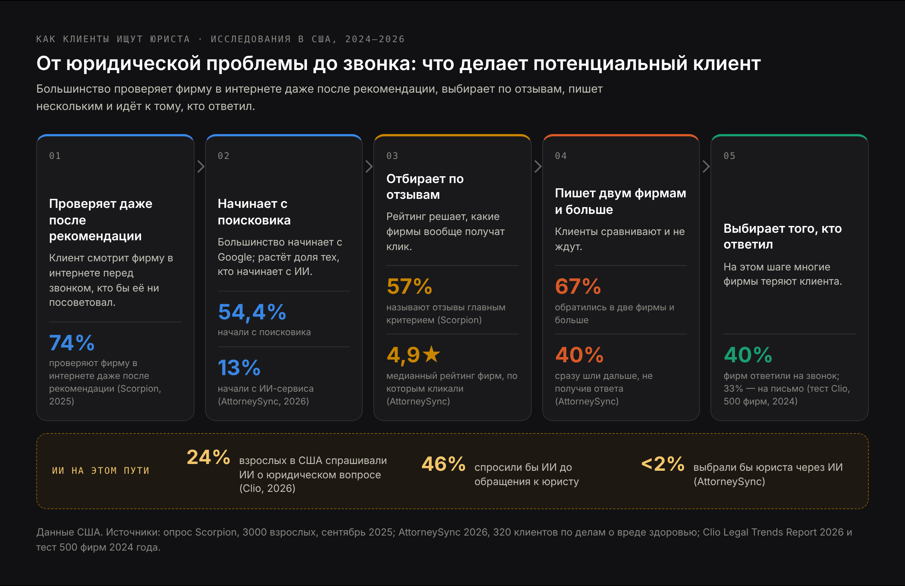
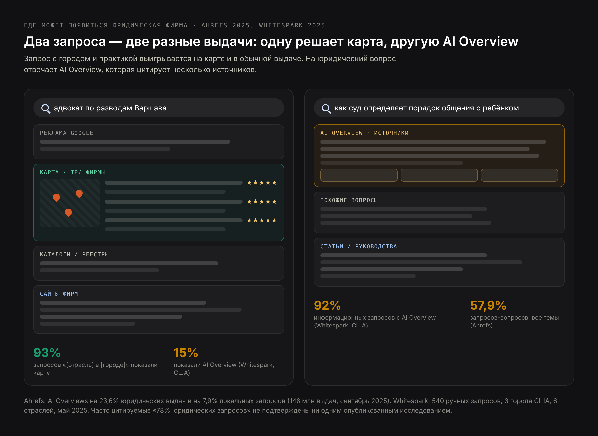
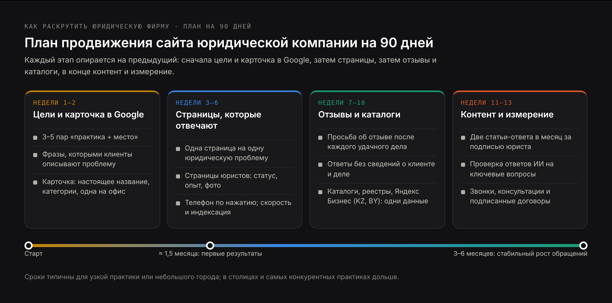
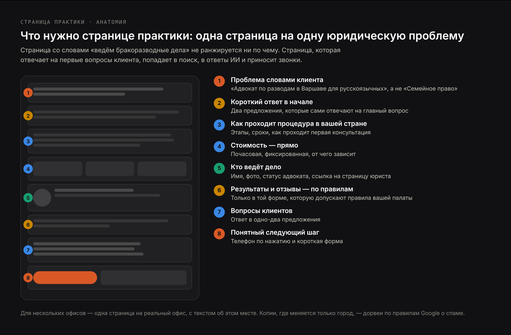

# DRAFT RU — рыночная адаптация blog-attorney-seo-EN.md (27 Oct 2026), не перевод.
# Аудитория: русскоязычные юристы, адвокаты и юридические фирмы в Польше, на Кипре, в Казахстане, ОАЭ,
# Грузии и других странах, а также фирмы, которые обслуживают русскоязычных клиентов за рубежом.
# Ядро: «продвижение сайта юридической компании» 50/мес (в выдаче статья klerk.ru + агентства),
# «продвижение сайта адвоката» 30/мес (агентства). Формат — пошаговое руководство; услуги остаются
# на /ru/seo-dlya-yuridicheskogo-sayta и /ru/prodvizhenie-saita-advokata, цены — /ru/blog/skolko-stoit-seo-yuristov.
# В H2/H3: «как раскрутить юридическую фирму», «продвижение юридических услуг», «SEO для юристов»,
# «карточка юридической компании в Google», «отзывы о юристе», «сайт юридической компании».
# Источники: всё из EN-версии (Scorpion, сент. 2025; AttorneySync 2026; Martindale-Avvo, янв. 2026;
# Clio Legal Trends 2026 и тест 2024 г.; Ahrefs, сент. 2025; Whitespark, май 2025; LocaliQ 2026;
# правила Google Business Profile; спам-политика Google; schema.org/Attorney (deprecated);
# ABA Formal Opinion 496). Этика по странам: uchwała NRA 93/2023 и §23 KEA (Польша), KERP ст. 31–32;
# Кодекс проф. этики адвокатов РК (2014, ред. 19.02.2022), ст. 8; Advocates' Code of Conduct
# Regulations 2023, reg. 18 (Кипр); Федеральный декрет-закон ОАЭ № 34/2022, ст. 45(1)(h) и 101;
# Грузия — с оговоркой. Доли поисковиков: StatCounter, сентябрь 2026.
# Американские данные везде помечены как американские.
# NOT used: «AI Overviews на 78% юридических запросов» — первоисточника нет (опровергнуто в тексте).
# H1 (Title) и Meta title различаются намеренно.

Title: Продвижение сайта юридической компании и адвоката: пошаговое руководство
Slug: prodvizhenie-saita-yuridicheskoi-kompanii
Meta title: Как раскрутить юридическую фирму в Google и ИИ (2026)
Meta description: Продвижение сайта юридической компании и адвоката в 2026 году: карточка в Google, страницы практик, отзывы, адвокатская этика, ИИ-поиск и план на 90 дней.

---

> Короткий ответ: продвижение сайта юридической компании — это работа, благодаря которой юрист или фирма появляются там, где человек ищет юридическую помощь: на карте Google, в обычной выдаче, в ответах ИИ и в юридических каталогах. Для практикующего в одиночку адвоката или небольшой фирмы всё сводится к пяти вещам: заполненная карточка в Google для каждого офиса, отдельная страница на каждую юридическую проблему, страницы юристов с реальным опытом, постоянный поток настоящих отзывов и сайт, который быстро открывается и легко звонит с телефона. И всё это — в рамках правил вашей адвокатской палаты, которые определяют, что можно говорить о результатах, опыте и отзывах.

Юристам часто говорят, что SEO — это дорого, долго и лучше отдать агентству. Отчасти это правда: юридическая ниша — одна из самых конкурентных в интернете, а клик по юридической рекламе стоит дороже, чем почти в любой другой отрасли. Но большая часть того, что решает, найдут ли небольшую фирму, — не секрет и не техника. Это набор решений, которые юрист может понять и проверить сам: какие дела брать в фокус, как заполнена карточка в Google, что написано на каждой странице, как вы работаете с отзывами.

В этом руководстве я прохожу эти решения в том порядке, в каком принимал бы их сам, с данными и правилами за каждым шагом. Оно написано для адвокатов, юристов и небольших фирм в Польше, на Кипре, в Казахстане, ОАЭ, Грузии и других странах, а также для тех, кто обслуживает русскоязычных клиентов за рубежом. Если удобнее передать работу специалисту, на странице [SEO для юридического сайта](/ru/seo-dlya-yuridicheskogo-sayta) описано, как я её веду; но статья полезна и без этого.

## Что такое SEO для юристов и чем продвижение юридических услуг отличается от других ниш

**SEO для юристов** (продвижение сайта юридической компании, продвижение сайта адвоката) — это поисковая оптимизация для юридических услуг: человек с юридической проблемой находит вашу фирму, доверяет тому, что видит, и обращается к вам. Цель — не трафик. Цель — консультации и подписанные договоры.

Метод тот же, что для любого бизнеса: полезные страницы, исправный сайт, сильный локальный профиль, упоминания на других ресурсах. Но юридический рынок отличается четырьмя вещами.

- **Google строже относится к юридическому контенту.** Руководство Google для асессоров качества относит страницы, способные повлиять на деньги, безопасность или права человека, к темам «Your Money or Your Life» (YMYL) и ожидает за ними видимой экспертизы. В прежних редакциях примерами прямо назывались развод, опека над детьми и завещания; нынешняя определяет YMYL через вред, который может нанести страница, — и ошибка в сроке или в правиле об опеке под это определение очевидно подпадает.
- **Правила адвокатской этики ограничивают, что можно говорить.** Во многих странах адвокату нельзя обещать результат, сравнивать себя с коллегами, называть себя «лучшим» или платить за рекомендации. Обычный маркетинговый текст вроде «лучший адвокат по разводам в городе» нередко нарушает эти правила.
- **Клиенты ищут локально и срочно.** Человек, которого задержали вечером или который утром попал в ДТП, не читает статьи в блоге. Он видит карту, несколько результатов — и звонит.
- **Платный поиск дорог.** По данным LocaliQ за 2026 год, в США юристы платят в среднем $9,87 за клик и $131,63 за заявку. В других странах цифры другие, но юридические ниши везде среди самых дорогих. SEO не заменит рекламу за один день, но каждый клиент, который нашёл вас без рекламы, — это заявка, за которую вы не заплатили.

## Как клиенты ищут юриста и адвоката в интернете: поиск, отзывы и ИИ

Прежде чем выбирать тактику, полезно увидеть, что потенциальный клиент делает на самом деле. Самые подробные исследования 2025–2026 годов сделаны в США, на американских потребителях юридических услуг, — поэтому цифры ниже американские. Но сама последовательность действий мало зависит от страны.

- **Клиенты проверяют юриста, даже если его порекомендовали.** В опросе Scorpion среди 3000 взрослых американцев (сентябрь 2025 года) 74% изучали юридическую фирму в интернете уже после того, как получили рекомендацию. В отчёте Martindale-Avvo за январь 2026 года 92,4% ответили, что, скорее всего, изучат свою юридическую проблему в интернете, прежде чем обратиться к юристу.
- **Большинство начинает с поисковика.** В исследовании AttorneySync 2026 года записывали, как 320 клиентов по делам о травмах ищут юриста: 54,4% начали с поисковой системы, 13% — с ИИ-инструмента.
- **Короткий список определяют отзывы.** В опросе Scorpion 57% назвали отзывы в интернете главным фактором выбора, и больше половины не стали бы рассматривать фирму с рейтингом ниже 4 звёзд. В записях AttorneySync медианный рейтинг фирм, на которые нажимали, составил 4,9.
- **Клиенты связываются с несколькими фирмами и не ждут.** 67% участников исследования AttorneySync обратились в две фирмы или больше, а 40% сразу уходили к следующей, если не получали ответа. В опросе Scorpion 72% не готовы ждать обратного звонка дольше 24 часов.
- **Многие фирмы просто не отвечают.** Когда исследователи Clio в 2024 году под видом клиентов обратились в 500 американских фирм, на звонок ответили только 40%, на письмо — 33%; 48% не ответили и не перезвонили.
- **ИИ используют для вопросов, но пока не для выбора юриста.** В отчёте Clio Legal Trends 2026 (26 октября 2026 года) 24% взрослых американцев уже задавали ИИ юридический вопрос, а 46% готовы посоветоваться с ИИ перед обращением к юристу. Но в исследовании AttorneySync меньше 2% сказали, что доверили бы ИИ выбор юриста.

Вывод для SEO: быть видимым — только половина работы. Фирма, которая хорошо ранжируется, но имеет рейтинг 3,8 или отправляет звонки на автоответчик, теряет клиента, за привлечение которого уже заплатила. Поэтому в плане ниже отзывы и скорость ответа — часть SEO: для юридической фирмы так и есть.

## Где может появиться юридическая компания: карта, обычная выдача, AI Overviews и каталоги

«Быть в Google» означает как минимум четыре разных места на странице, и в каждое попадают по-своему.

| Место на странице | Что решает | Когда важнее всего |
|---|---|---|
| Блок карт Google (три фирмы) | Карточка компании в Google, расстояние, отзывы, точность категории | «адвокат рядом», «юрист по [практика] [город]» |
| Обычная выдача | Страницы практик, качество сайта, ссылки и упоминания | Запросы с городом и практикой, конкретные юридические проблемы |
| AI Overviews и AI Mode | Чёткие ответы на страницах, которым Google уже доверяет | Вопросы: «как делится имущество при разводе», «можно ли оспорить увольнение» |
| Юридические каталоги и реестры | Ваш профиль там и сила самого каталога | Почти любой юридический запрос; ещё и источник для ответов ИИ |

### Как часто юридические запросы показывают AI Overview: откуда миф про 78%

В блогах о юридическом маркетинге часто пишут, что AI Overviews появляются на «78% юридических запросов». Исследования, на котором держится эта цифра, я не нашёл. Пресс-релиз, разнёсший её, ссылается на Semrush, но в опубликованном исследовании Semrush её нет. Лучшие данные, которые мне удалось найти, — у Ahrefs: в сентябре 2025 года они проанализировали 146 миллионов страниц выдачи, и AI Overviews появлялись на 23,6% юридических. По всем темам — на 57,9% запросов в форме вопроса и лишь на 7,9% запросов с локальным намерением.

Небольшое ручное исследование Whitespark (май 2025 года) показывает тот же раскол: по запросам вроде «personal injury lawyers in Phoenix» ИИ-обзор появлялся в 15% случаев, а блок карт — в 93%, тогда как на информационные вопросы в тех же нишах ИИ-обзор выходил в 92% случаев.

Практический вывод: запросы, с которыми приходят клиенты, готовые нанять юриста, по-прежнему решаются в основном картой и обычной выдачей. Ответы ИИ важны для вопросов, которые люди задают раньше, — и именно там складывается первое впечатление о том, кто разбирается в теме.

## Как раскрутить юридическую фирму: план продвижения сайта на 90 дней

Небольшая фирма не может делать всё одновременно — и не должна. Ниже порядок, которого я бы придерживался; каждый шаг опирается на предыдущий.

### Как выбрать практики и города для продвижения юридической фирмы в первую очередь

Главная ошибка — целиться в самый дорогой запрос в самом большом городе. За «юрист Дубай» или «adwokat Warszawa» борются фирмы с серьёзными бюджетами. Небольшая фирма выигрывает сначала там, где конкуренция тоньше, а её опыт — настоящий:

- **Более узкая практика**: «раздел имущества при разводе», а не «семейное право»; «обжалование отказа в виде на жительство», а не «миграционные услуги».
- **Более конкретное место**: район или город, где действительно находится ваш офис, а не вся агломерация.
- **Язык**: если вы ведёте клиентов на русском, страница на русском языке в Варшаве, Лимасоле или Дубае конкурирует лишь с малой долей тех, кто бьётся за местный язык. Подробнее — ниже, в разделе о русскоязычной версии сайта.
- **Проблема, на которую пока нет хорошего ответа**: посмотрите выдачу по вопросам, которые клиенты задают вам. Если наверху — тонкие страницы каталогов, это ваша возможность.

Запишите три–пять сочетаний «практика + место». Всё остальное в плане строится вокруг них.

### Ключевые слова для сайта юриста: что клиенты набирают перед звонком

Юристы описывают свою работу юридическими терминами, клиенты ищут своими словами. Клиент не ищет «защиту деловой репутации» — он ищет «бывший работодатель рассказывает обо мне клиентам неправду». Хорошие ключевые слова для продвижения юридических услуг берутся из трёх источников:

1. **Записи первичных консультаций.** Точные фразы, которыми люди описывают проблему по телефону. Это лучшие ключевые слова, и ни в одном инструменте их нет.
2. **Подсказки самого Google.** Начните набирать вопрос клиента и посмотрите автодополнение, блок «Похожие вопросы» и связанные запросы внизу страницы.
3. **Сервис для оценки частотности.** Чтобы сравнить «адвокат по разводам» и «юрист по разводам» в вашей стране, подойдёт любой. Для русскоязычных запросов в Варшаве или Тбилиси частотность часто показывается нулевой — это не значит, что никто не ищет: спрос по-русски за рубежом просто мал и плохо измеряется.

Группируйте фразы по проблеме, а не по словам. «Адвокат по ДТП», «юрист после аварии» и «попал в ДТП что делать» — одна проблема, и место ей на одной странице.

### Карточка юридической компании в Google и профиль каждого адвоката

Для локальных запросов карточка компании в Google (Google Business Profile) важнее всего, что есть на сайте. В правилах Google есть пункты, написанные специально для таких профессий, как юристы, и их нарушение — самая частая причина, по которой карточку блокируют или она вообще не ранжируется.

- **Название без ключевых слов.** Название карточки должно быть реальным названием фирмы — таким, как на вывеске и бланках. Правила Google прямо запрещают добавлять в название лишнее: описание услуг, местоположение. «Kowalski i Wspólnicy — лучший адвокат по разводам Варшава» — прямой путь к блокировке; «Kowalski i Wspólnicy» — правильно.
- **Одна карточка на один настоящий офис.** Google прямо пишет, что виртуальные офисы не допускаются. Место в коворкинге, где вы никогда не бываете, — не офис.
- **Карточки отдельных юристов.** Google относит юристов к «индивидуальным специалистам»: адвокат, который публично принимает клиентов, может иметь собственную карточку в дополнение к карточке фирмы. Адвокат, практикующий в одиночку под названием фирмы, должен иметь одну карточку с названием в формате «Название фирмы: Имя адвоката». Заводить несколько карточек одного юриста под разные практики нельзя.
- **Категории по практике.** Выберите самую точную основную категорию — по семейному праву, уголовной защите, миграционным делам — и добавьте остальные как дополнительные.
- **Всё остальное — заполнено.** Часы работы, телефон, ссылка на страницу нужного офиса, языки обслуживания (здесь стоит указать и русский), фотографии реального офиса и людей, вопросы и ответы, отражающие то, о чём клиенты действительно спрашивают.

Проверьте, что название, адрес и телефон совпадают буква в букву в карточке, на сайте и в каталогах. Расхождения — одна из немногих технических мелочей, которые до сих пор сбивают локальную выдачу Google.

### Карточка юридической компании в Яндекс Бизнесе для Казахстана и Беларуси

В большинстве стран из этой статьи поиск — это Google: в Польше, по данным StatCounter за сентябрь 2026 года, на него приходится 89,56% запросов. Но в Казахстане у Google 68,15%, а у Яндекса — 29,72%; в Беларуси — 58,98% и 38,54% соответственно. Если ваши клиенты там, карточка фирмы в Яндекс Бизнесе нужна наряду с карточкой в Google, и данные в обеих должны совпадать.

### Страницы практик на сайте юридической компании: одна страница на одну проблему

Одна страница «Практики» со списком из десяти услуг не ранжируется ни по одной из них. Каждой проблеме, которую ищет клиент, нужна своя страница, и эта страница должна делать больше, чем сообщать, что вы такими делами занимаетесь.

Сильная страница практики:

- **Называет проблему так, как называет её клиент**, — в заголовке и первом предложении: «Адвокат по разделу имущества при разводе в Варшаве», а не «Услуги в сфере семейного права».
- **Сразу отвечает на первый вопрос**: как устроена процедура в вашей стране, сколько обычно длится, что происходит на первой консультации.
- **Честно объясняет стоимость**: почасовая оплата, фиксированная сумма или иной порядок, и что в неё входит. Клиенты сравнивают фирмы именно по этому, и именно такие факты цитируют ответы ИИ.
- **Показывает, кто делает работу**: имя юриста, фото, статус (адвокат, радца правны, член палаты) и ссылку на его страницу.
- **Говорит о результатах только так, как позволяют правила вашей палаты.** Во многих странах проценты выигранных дел и число дел публиковать нельзя (подробнее в разделе об этике).
- **Заканчивается понятным следующим шагом**: номер, который набирается одним касанием, и короткая форма.

Для фирм с несколькими офисами та же логика работает для городов: одна страница на один реальный офис, с содержанием именно об этом месте — суд, местные процедуры, как добраться. Копии одной страницы с заменённым названием города — это то, что спам-политика Google называет дорвеями (doorway pages). В собственном примере Google такие злоупотребления — это страницы, «нацеленные на отдельные регионы или города и ведущие пользователей на одну страницу».

### Русскоязычная версия сайта юридической компании для клиентов за рубежом

Если среди ваших клиентов много русскоязычных — релоканты в Польше, Грузии или ОАЭ, покупатели недвижимости на Кипре, предприниматели из Казахстана, — отдельная русская версия страниц практик часто даёт самый быстрый результат. Конкуренция на русском языке в Варшаве или Лимасоле несравнимо ниже, чем на польском или греческом.

Несколько правил, без которых это не работает:

- **Отдельный адрес для каждой языковой версии** (например, `/ru/...`), а не переключатель, который подменяет текст на той же странице.
- **Разметка hreflang**: каждая языковая версия страницы указывает на остальные, чтобы Google показывал человеку подходящую.
- **Не машинный перевод, а адаптация.** Русскоязычный клиент за рубежом задаёт свои вопросы: о документах, о сроках для иностранцев, о том, говорит ли юрист по-русски на самом заседании или нужен переводчик.
- **Русская версия дополняет местную, а не заменяет её.** Google часто показывает результаты на местном языке даже тем, кто ищет по-русски, а часть русскоязычных клиентов ищет на польском, английском или греческом. Сильная местная версия по-прежнему нужна.

Как устроить такой сайт с нуля, я разбираю на странице о [создании сайта для адвоката](/ru/sozdanie-saita-dlya-advokata).

### Страницы адвокатов и юристов, которые показывают опыт

Страница юриста — то место, где и Google, и клиент проверяют, стоит ли за контентом реальная экспертиза. На ней должны быть: статус и номер в реестре палаты, годы практики, образование, суды и инстанции, в которых вы выступаете, публикации и выступления, языки, членство в профессиональных организациях и простое описание дел, которые вы ведёте. Профессиональное фото важнее, чем принято думать: на рынке, где опыт заявляют все, настоящее лицо — одна из немногих вещей, которые нельзя скопировать.

Связывайте каждую страницу практики с юристом, который ведёт такие дела, а каждую статью — с юристом, который её написал или проверил. Связь контента с конкретным человеком, у которого есть право практики, — самый ясный сигнал экспертизы, который может дать юридический сайт. Зачем вообще адвокату собственный сайт, если есть карточка и каталоги, я разбирал отдельно: [зачем адвокату сайт](/ru/blog/zachem-advokatu-sait).

### Отзывы о юристе: как собирать и как отвечать, не нарушая адвокатскую тайну

Отзывы влияют и на позицию в картах, и на решение клиента, поэтому им нужен порядок, а не случай.

- **Просите каждого довольного клиента** — в момент, когда дело закончилось хорошо, с прямой ссылкой на вашу карточку в Google. Короткое сообщение в мессенджере работает лучше письма.
- **Проверьте правила своей палаты о согласии клиента.** В Польше, например, этические нормы допускают публикацию мнений клиентов только с их согласия, а для радц правных — никогда по уголовным и семейным делам (подробнее ниже).
- **Никогда не платите за отзывы, не пишите их сами и ничего не предлагайте взамен.** Помимо нарушения правил Google, фальшивый отзыв — недостоверное заявление о ваших услугах, а его запрещают правила этики практически везде.
- **Не фильтруйте.** Просить отзыв только у тех, кто, как вы ожидаете, останется доволен (так называемый review gating), запрещено правилами Google.

Ответы на негативные отзывы — место, где юристы чаще всего попадают в неприятности. Самый ясный опубликованный разбор этой темы — **Formal Opinion 496** Американской ассоциации юристов (ABA), январь 2021 года. Это американский документ, но его логика хорошо иллюстрирует, как работает профессиональная тайна. Обязанность конфиденциальности распространяется на ответы в интернете, даже если клиент сам раскрыл информацию; негативный отзыв — не тот «спор», который позволяет юристу раскрыть сведения о клиенте ради самозащиты. По мнению ABA, юрист может вообще не отвечать, может попросить платформу удалить ложный отзыв, может предложить обсудить вопрос лично, вне сети, или ответить фразой вроде «Профессиональные обязательства не позволяют мне ответить так, как мне бы хотелось». Как этот вопрос толкует ваша палата, стоит проверить отдельно.

Безопасный ответ никогда не подтверждает, что автор отзыва был клиентом, и ничего не говорит о деле.

### Юридические каталоги и реестры: где стоит заполнить профиль

Каталоги занимают значительную часть выдачи по юридическим запросам и часто цитируются в ответах ИИ, поэтому полный и одинаковый профиль в основных из них стоит одного вечера. С чего начать:

- **Официальный реестр вашей палаты**, если в нём можно указать специализацию, языки и контакты.
- **Местные юридические каталоги и бизнес-справочники**, которые реально появляются в выдаче по вашим запросам: наберите «адвокат + город» и посмотрите, какие сайты стоят рядом с фирмами.
- **Русскоязычные справочники и сообщества** в вашей стране, если вы работаете с русскоязычными клиентами.

Название, адрес, телефон и практики должны совпадать с карточкой в Google. И будьте осторожны с платными «рекомендациями»: на Кипре правила запрещают адвокатам работать через агентов и платить за направление клиентов, а в ОАЭ закон штрафует за привлечение клиентов за комиссию. Платное размещение, которое явно является рекламой, — одно; платный значок «лучший адвокат года» — другое.

### Контент для SEO юристов: ответы на вопросы, которые задают клиенты

Контент юридической фирмы — не блог с новостями фирмы. Это ответы на вопросы, которые клиенты задают до того, как кого-то нанять: «Можно ли переехать с ребёнком в другую страну после развода в Польше?», «Что будет, если пропустить срок подачи на продление визы в ОАЭ?», «Как наследуется недвижимость на Кипре, если наследник живёт за границей?». Каждый хороший ответ — шанс попасть в выдачу, в AI Overview и показать читателю, что вы знаете предмет.

Правила юридического контента, который ранжируется:

- **Один вопрос на статью, ответ — в первых двух предложениях**, дальше подробное объяснение.
- **Привязка к юрисдикции**: конкретный закон, срок, суд. Общие тексты «для всех стран» уже публикуют каталоги.
- **Проверено и подписано юристом с правом практики**, с датой последней проверки. Законы меняются, и устаревшая статья о сроке может навредить читателю.
- **Ссылка на страницу практики**, где читатель может перейти к действию.
- **Короткая оговорка «не является юридической консультацией»** — в конце, а не стена дисклеймеров перед ответом.

Две хорошие статьи в месяц, каждая из которых глубоко отвечает на реальный вопрос клиента, дают больше, чем ежедневные посты ради заполнения календаря.

### Ссылки и упоминания, которые может заработать юридическая фирма

Ссылки с других сайтов по-прежнему один из самых сильных сигналов Google, и у юристов хорошие ссылки появляются из реальной деятельности: страницы палат и ассоциаций, университеты, местные и русскоязычные СМИ, которые цитируют вас по юридическому вопросу, подкасты и вебинары с вашим участием, статьи для отраслевых изданий. Каждое такое упоминание ИИ-системы тоже могут найти.

Избегайте пакетов ссылок и «гостевых постов», купленных оптом: это нарушает спам-политику Google, а сайты, которые их продают, Google и так не учитывает.

## Технический SEO сайта юридической компании: что юрист может проверить сам

Чтобы проверить техническую основу, читать код не нужно. Большинство проблем юридических сайтов укладывается в несколько групп:

- **Скорость на телефоне.** Прогоните главные страницы через Google PageSpeed Insights в мобильном режиме. Тяжёлые слайдеры, видео на фоне и карусели стоковых фото — обычные причины медленного сайта.
- **Номер телефона набирается одним касанием** на каждой странице, а форма работает и отправляет копию на почту, которую кто-то читает.
- **Все важные страницы проиндексированы.** В Google Search Console проверьте отчёт «Страницы»; наберите в Google `site:вашсайт.pl`, чтобы увидеть, что там есть.
- **У каждой страницы один адрес.** Сайт открывается в одной версии (с «www» или без, всегда по https), остальные перенаправляют на неё.
- **Языковые версии размечены.** Если у сайта есть русская, местная и английская версии, hreflang указан на каждой странице и ведёт на существующие адреса.
- **Микроразметка использует актуальные типы.** На schema.org тип «Attorney» помечен как устаревший, вместо него рекомендован LegalService. Разметка LocalBusiness или LegalService с названием, адресом, телефоном и часами работы помогает поисковикам прочитать основное.
- **Никаких звёзд рейтинга из собственных отзывов.** Google не показывает звёзды в выдаче для отзывов, которые компания собирает и публикует о самой себе. Разметка для них не помогает.

Если нужна более глубокая проверка, аудит в рамках [SEO для юридического сайта](/ru/seo-dlya-yuridicheskogo-sayta) охватывает техническую часть вместе со структурой практик и конкурентами.

## Реклама адвоката и правила этики: что можно писать на сайте в Польше, на Кипре, в Казахстане, ОАЭ и Грузии

Ваш сайт, карточка в Google и профили в каталогах — это информация об адвокате, а во многих странах и реклама в смысле правил этики. Правила различаются сильно: от почти полного запрета саморекламы до довольно свободного продвижения с ограничениями. Ниже — короткий обзор для пяти стран, где много русскоязычных юристов и клиентов.

| Страна | Документ | Что можно | Чего нельзя |
|---|---|---|---|
| Польша, адвокаты | Uchwała NRA 93/2023 (26.05.2023), Kodeks Etyki Adwokackiej | Коммерческая информация (informacja handlowa) об адвокате и его услугах | Сравнения, оценочные формулировки, обещания результата, эмоциональное давление; мнения клиентов — только с их письменного или электронного согласия (§23) |
| Польша, радцы правные | Kodeks Etyki Radcy Prawnego, ст. 31–32 | Информирование о своей деятельности | Вводящее в заблуждение содержание, обещания, сравнения; мнения и рекомендации клиентов — только с согласия и никогда по уголовным и семейным делам |
| Казахстан | Кодекс профессиональной этики адвокатов (2014, ред. 19.02.2022), ст. 8 | Объективная и достоверная информация об адвокате | «Самореклама адвоката не соответствует этическим правилам»; оценочные характеристики и сравнения |
| Кипр | Advocates' Code of Conduct Regulations 2023, reg. 18 | Продвижение своих услуг | Недостоверные и вводящие в заблуждение сведения, процент успеха и число дел, сравнение с другими юристами, имена клиентов без согласия; агенты и платные направления клиентов |
| ОАЭ | Федеральный декрет-закон № 34/2022 (в силе с 02.01.2023), ст. 45(1)(h) и 101 | В пределах этики профессии; детали — в исполнительных положениях | Продвигать себя любым способом, противоречащим этике профессии, в том числе через посредников; ст. 101 предусматривает штраф для любого, кто привлекает клиентов за комиссию |
| Грузия | Закон «Об адвокатах», рекомендации Ассоциации адвокатов Грузии | Закон рекламу напрямую не регулирует | Комиссия по этике Ассоциации даёт рекомендации о рекламе, в том числе в соцсетях и против слоганов с «гарантией»; актуальную редакцию стоит уточнить в Ассоциации |

Что из этого следует для SEO:

- **В Польше полный запрет рекламы для адвокатов снят только в 2023 году**, и формулировки на сайте по-прежнему должны быть фактическими. «Лучший адвокат по разводам в Варшаве» не годится; «Адвокат, практика в семейном праве с 2015 года, ведёт дела на польском и русском» — годится.
- **В Казахстане осторожнее всего**: для адвоката допустима объективная информация без оценок. Страница практики, которая объясняет процедуру и сроки, этому формату соответствует; рекламные слоганы — нет.
- **На Кипре нельзя публиковать проценты выигранных дел и число дел**, поэтому «98% успешных дел» и «500+ выигранных процессов» убираются со всех страниц и из карточки.
- **Юридические компании, которые не являются адвокатскими образованиями**, во многих странах свободнее в рекламе. Но законы о защите прав потребителей и о рекламе действуют везде, и недостоверное заявление остаётся недостоверным, кто бы его ни сделал.

Общий принцип для всех стран: на сайте — факты, а не превосходные степени. Это общий обзор, а не юридическая консультация — проверьте правила своей палаты, прежде чем публиковать тексты.

## Продвижение юридических услуг в ИИ-поиске: ChatGPT, Google AI Overviews и AI Mode (GEO, AEO)

ИИ-поиск меняет место первого контакта. Человек, который спрашивает ChatGPT или Google «как поделить квартиру при разводе в Польше», получает ответ с несколькими источниками ещё до того, как увидит хоть одну юридическую фирму. Стать одним из этих источников — это работа, которую сейчас называют **GEO** (generative engine optimization) или **AEO** (answer engine optimization). Обе подробно разобраны в статье [что такое GEO](/ru/blog/chto-takoe-geo).

Для юридической фирмы это несколько конкретных шагов:

- **Отвечайте на вопросы прямо.** ИИ-системы цитируют предложения, которые отвечают на вопрос сами по себе. Раздел, который начинается со слов «В Польше имущество, нажитое в браке, по общему правилу делится…», можно процитировать; раздел, который начинается с «Каждая семья уникальна», — нельзя.
- **Пишите факты текстом**: стоимость, практики, языки, города и суды, имя юриста и его статус в палате. ИИ цитирует то, что написано, а не то, что спрятано в PDF или на картинке.
- **Будьте там, куда смотрит ИИ.** На запросы вида «лучший юрист по [практика] в [город]» ответы ИИ часто ссылаются не только на сайты фирм, но и на каталоги и подборки. Одинаковый профиль в каталогах и в реестре палаты питает эти ответы.
- **Пускайте ИИ-краулеров.** Проверьте, что robots.txt и файрвол хостинга не блокируют OAI-SearchBot (поиск ChatGPT) и Google. Некоторые плагины безопасности и файрволы по умолчанию блокируют «неизвестных ботов».
- **Держите основной текст в HTML**, который отдаёт сервер, а не подгружайте его позже через JavaScript: ряд ИИ-краулеров JavaScript не выполняет.
- **Помните о русскоязычных вопросах.** Русскоязычный клиент задаёт ИИ вопрос по-русски, и русская версия страницы с прямым ответом увеличивает шансы попасть в такой ответ.

Как ChatGPT решает, какие страницы цитировать, — отдельная тема; я разбираю её в статье [SEO для ChatGPT](/ru/blog/seo-dlya-chatgpt).

## Продвижение сайта юриста или Google Ads: стоимость и сроки

SEO и контекстная реклама — не альтернативы, они работают на разных отрезках времени.

| Канал | Как вы платите | Когда приносит обращения | Что важно знать |
|---|---|---|---|
| Google Ads (поисковая реклама) | За клик; в США в среднем $9,87 за клик и $131,63 за заявку в юридических услугах (LocaliQ, 2026) | С первого дня | Останавливается в тот день, когда заканчивается бюджет; юридические клики — одни из самых дорогих в любой стране |
| Local Services Ads | За заявку, а не за клик | — | Формат доступен лишь в части стран, прежде всего в США; для рынков из этой статьи это пока американский инструмент |
| SEO | Ваше время или ежемесячная оплата | Первые результаты примерно через 1,5 месяца, рост — через 3–6 месяцев | Продолжает работать, когда вы перестаёте платить; медленнее в самых конкурентных практиках и городах |

Разумное сочетание для небольшой фирмы: небольшая поисковая кампания для немедленных звонков по главной практике и SEO на длинную дистанцию, чтобы стоимость клиента со временем снижалась, а не росла с каждым повышением цен в рекламе. Из чего складывается стоимость продвижения юридического сайта, разобрано в статье [сколько стоит SEO для юристов](/ru/blog/skolko-stoit-seo-yuristov).

## Как измерять продвижение сайта юридической компании: звонки, консультации, договоры

Позиции и трафик — сигналы, а не результат. Измеряйте то, что оплачивает счета:

1. **Звонки из Google.** Карточка компании показывает звонки и запросы маршрута; отдельный номер для отслеживания на сайте показывает звонки из органической выдачи.
2. **Заявки через формы и мессенджеры**, настроенные как конверсии в Google Analytics с указанием источника.
3. **Записи на консультацию** — спрашивайте каждого нового клиента, как он вас нашёл, и фиксируйте это в своей CRM или таблице дел.
4. **Подписанные договоры и их стоимость** по источникам — раз в квартал.
5. **Видимость по вашим трём–пяти целевым сочетаниям**: позиция в картах по запросу «юрист по [практика] [город]» на местном языке и на русском, и цитируют ли вас ответы ИИ на ключевые вопросы (задавайте их без входа в аккаунт или в новом аккаунте без памяти).

Если звонков больше, а консультаций нет, проблема в обработке обращений, а не в SEO.

## Аудит сайта юридической компании: чек-лист на один вечер

| Что проверить | Как проверить |
|---|---|
| Название карточки в Google — реальное название фирмы, без ключевых слов | Сравните с бланком фирмы |
| У каждого офиса своя подтверждённая карточка по реальному адресу | Менеджер карточек Google |
| Основная категория соответствует главной практике | Настройки карточки |
| Название, адрес и телефон одинаковы на сайте, в Google, Яндекс Бизнесе (если нужен) и каталогах | Сравните рядом |
| У каждой основной практики своя страница об одной проблеме | Меню сайта |
| На каждой странице практики указан ответственный юрист и есть ссылка на его страницу | Прочитайте страницы |
| На страницах юристов — статус в палате, годы практики, настоящее фото | Прочитайте страницы юристов |
| Русская и местная версии страниц связаны hreflang | Исходный код страницы или проверка в Search Console |
| Номер телефона набирается одним касанием на каждой мобильной странице | Попробуйте на своём телефоне |
| Скорость главных страниц на телефоне приемлемая | PageSpeed Insights |
| Важные страницы проиндексированы | Search Console или поиск site: |
| На сайте нет сравнений, превосходных степеней, процентов успеха и обещаний результата | Правила этики вашей палаты |
| Отзывы и мнения клиентов опубликованы с их согласия | Правила вашей палаты, ваши записи согласий |
| Есть порядок, по которому каждого довольного клиента просят об отзыве | Чек-лист закрытия дела |
| Ответы на отзывы не раскрывают ничего о клиентах и делах | Прочитайте последние десять ответов |
| robots.txt и файрвол не блокируют Google и ИИ-краулеров | Прочитайте robots.txt; спросите хостинг |
| Каждое обращение записывается с источником | Ваша CRM или таблица дел |

## Ошибки в продвижении сайта адвоката, которые стоят клиентов

- **Ключевые слова в названии карточки в Google.** Несколько недель это может помогать, потом Google блокирует или исправляет карточку, а разблокировка может занять недели.
- **Страницы городов, в которых отличается только название города.** По спам-политике Google это дорвеи, и они тянут вниз весь сайт.
- **Виртуальный офис, чтобы «попасть» в другой город.** Не допускается правилами Google и вводит клиентов в заблуждение относительно того, где вы практикуете.
- **Купленные или написанные самостоятельно отзывы.** Нарушение правил Google и правил этики о недостоверных заявлениях.
- **«Лучший», «№ 1», «гарантируем результат»** — оценочные формулировки и обещания, которые запрещают правила этики в Польше, Казахстане, на Кипре и не только.
- **Проценты выигранных дел и число дел** там, где их публиковать нельзя, — например, на Кипре.
- **Отзывы клиентов без их согласия** — в Польше это прямо требуется этическими нормами.
- **Ответы на отзывы, подтверждающие, что человек был клиентом.** См. логику ABA Formal Opinion 496 и правила тайны в вашей стране.
- **Русская версия сайта, сделанная машинным переводом без hreflang.** Она не ранжируется и не вызывает доверия у читателя.
- **Сайт, на звонки с которого никто не отвечает.** Никакое SEO не поможет, если почти половина обращений остаётся без ответа, как у 48% фирм в тесте Clio.
- **Одна страница на все практики.** Она не ранжируется ни по одной.

## Что юрист может сделать сам, а когда нанимать специалиста по SEO для юристов

Адвокат, практикующий в одиночку, может сделать большую часть первых 90 дней сам: карточка в Google, отзывы, каталоги, страницы юристов и несколько страниц практик — это вопрос решений и одного вечера в неделю. Помощь со стороны окупается в технической части, в структуре сайта без дублей, в контенте для конкурентных практик и многоязычных сайтов и в измерении того, что приносит договоры.

Выбирая SEO-агентство или консультанта для юридической фирмы, спросите:

1. **Кто именно будет делать работу** и сможете ли вы общаться с этим человеком напрямую?
2. **Что будет сделано за первые три месяца** — по страницам?
3. **Как учитываются правила этики вашей палаты** в текстах, которые они пишут?
4. **Что они измеряют** — позиции или звонки и консультации?
5. **Кому принадлежат сайт, тексты и карточка в Google**, если вы расстанетесь?
6. **Строят ли они ссылки** и откуда?

Насторожитесь, если вам гарантируют первое место в Google, предлагают договор на год без каких-либо результатов до его окончания или регистрируют сайт, тексты и карточку «на аккаунт агентства».

Если хотите передать работу, я веду SEO для юридических фирм и адвокатов как один консультант: аудит — от 250 € разово, отдельные задачи — 250–700 €, постоянная работа — от 800 € в месяц, а в очень конкурентных городах и практиках — от 1300 € в месяц. Счета выставляю в евро или в другой валюте по договорённости. Что входит в работу, описано на страницах [SEO для юридического сайта](/ru/seo-dlya-yuridicheskogo-sayta) и [продвижение сайта адвоката](/ru/prodvizhenie-saita-advokata).

## Частые вопросы о продвижении сайта юридической компании

**Сколько времени занимает продвижение сайта юридической компании?**
Первые результаты — исправленная карточка в Google, новые страницы в индексе — видны примерно через 1,5 месяца. Устойчивый рост обращений — через три–шесть месяцев. В самых конкурентных практиках и крупных городах дольше, поэтому начинать с более узкой практики, конкретного района или русскоязычной версии разумно.

**Сколько стоит SEO для юридической фирмы?**
Зависит от практики и рынка. Как отдельный консультант я беру от 250 € за аудит и от 800 € в месяц за постоянную работу, в очень конкурентных городах и практиках — от 1300 € в месяц. Подробный разбор — в статье [сколько стоит SEO для юристов](/ru/blog/skolko-stoit-seo-yuristov).

**Можно ли продвигать сайт адвоката самостоятельно?**
Во многом да. Карточка в Google, отзывы, профили в каталогах, страницы юристов и первые страницы практик — это решения, которые вы можете принять сами. Помощь со стороны обычно окупается в технической части, в многоязычной структуре и в контенте для конкурентных практик.

**Можно ли адвокату вообще продвигать себя в интернете?**
В большинстве стран можно, но в рамках правил палаты. В Польше полный запрет снят в 2023 году, но сравнения, оценки и обещания результата запрещены; на Кипре продвижение разрешено без процентов успеха и сравнений; в Казахстане допустима только объективная информация без оценок. Проверьте правила своей палаты — это общий обзор, а не юридическая консультация.

**Нужен ли юридической компании блог для SEO?**
Не блог с новостями фирмы. Нужны ответы на вопросы, которые клиенты задают до обращения, каждый — со ссылкой на страницу практики. Большинству небольших фирм достаточно двух подробных статей в месяц.

**Может ли ИИ писать тексты для сайта юриста?**
ИИ может помочь с черновиками, но каждую юридическую страницу должен проверить и подписать юрист с правом практики. Google предъявляет к юридическому контенту повышенные требования, а ответ ИИ с ошибкой в сроке или норме может ввести читателя в заблуждение и нарушить правила этики о недостоверной информации.

**Нужна ли русскоязычная версия сайта юридической фирме в Польше, на Кипре или в ОАЭ?**
Если у вас есть русскоязычные клиенты — да. На русском языке конкуренция за юридические запросы в этих странах намного ниже. Но русская версия дополняет местную, а не заменяет её: Google часто показывает результаты на местном языке.

**Может ли у каждого юриста фирмы быть своя карточка в Google?**
Да, если он публично принимает клиентов: Google относит юристов к индивидуальным специалистам. Адвокат, практикующий в одиночку под названием фирмы, должен иметь одну карточку в формате «Название фирмы: Имя адвоката».

**Нужен ли Яндекс для продвижения юридических услуг?**
Если ваши клиенты в Казахстане или Беларуси — да, наряду с Google: по данным StatCounter за сентябрь 2026 года, на Яндекс там приходится 29,72% и 38,54% запросов. В Польше, где у Google 89,56%, главная площадка — Google.

## С чего начать продвижение сайта юридической компании или адвоката

На этой неделе откройте карточку компании в Google и сравните её название с бланком фирмы; уберите всё, что не является реальным названием. Запишите три сочетания «практика + место», которые хотите выиграть в первую очередь, — на местном языке и, если у вас есть русскоязычные клиенты, на русском. Наберите каждое на телефоне и отметьте, кто стоит в картах, в выдаче и в ответе ИИ. Пройдитесь по сайту и уберите «лучший», «гарантия» и проценты успеха. И попросите последних пятерых довольных клиентов оставить отзыв — с их согласия на публикацию.

Эти шаги ничего не стоят и показывают, где вы находитесь. Если хотите, чтобы кто-то прошёл следующие шаги вместе с вами, [напишите мне](/ru/kontakty): пришлите адрес сайта, главную практику и страну или город, где вы работаете, и я скажу, с чего начал бы сам.
