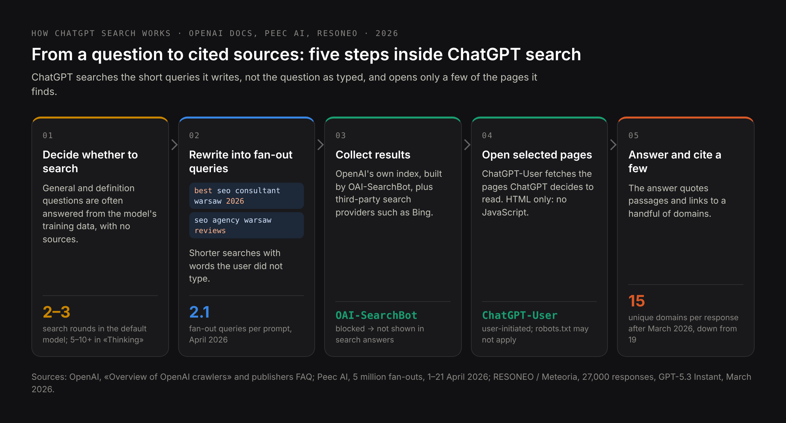
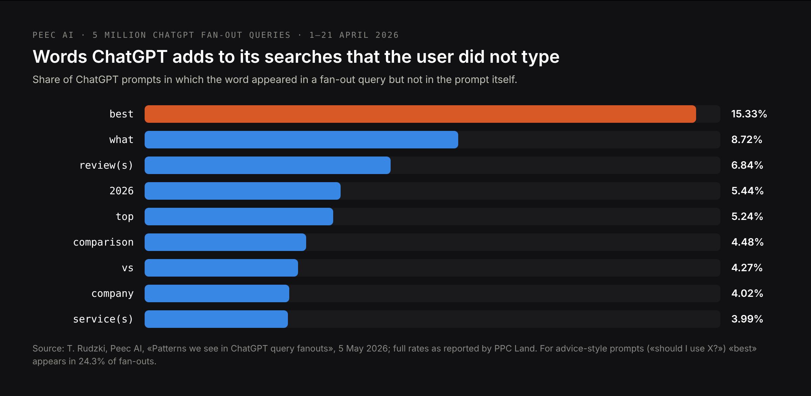
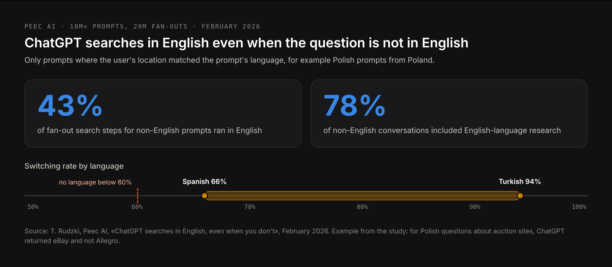

# DRAFT EN — «ChatGPT SEO» (24 Oct 2026). How ChatGPT search works and how pages get cited.
# Core: research/pseo/page-core/chatgpt-seo-article.md — chatgpt seo 320, seo for chatgpt
# 320, how to rank in chatgpt 140, how to rank on chatgpt 140, how to optimize for chatgpt
# search 140, how to rank higher in chatgpt 70, chatgpt seo optimization 70, how to rank in
# chatgpt search 50, chatgpt search optimization 30, chatgpt visibility 30, optimize for
# chatgpt 30, how to get mentioned in chatgpt 20. Intent: research/pseo/intent-check-
# chatgpt-seo-article.md — «chatgpt seo» shares 4 URLs with «chatgpt for seo» (tool intent,
# declined by the owner as not our audience; one section explains the difference);
# «chatgpt seo agency/services» stay on /services/chatgpt-seo-services.
# Differentiation: /blog/how-to-get-recommended-by-chatgpt is the business checklist for
# being recommended; this article is ChatGPT search mechanics and getting pages cited.
# Sources: OpenAI publishers FAQ and bots docs; OpenAI «Testing ads in ChatGPT» (9 Feb 2026,
# updated 7 May 2026); OpenAI product discovery update (24 Mar 2026, via TechInformed);
# Peec AI «ChatGPT searches in English» (Feb 2026; 10M prompts, 20M fan-outs); Peec AI
# fan-out patterns (5M fan-outs, 1–21 Apr 2026, published 5 May 2026; full rates via PPC
# Land); RESONEO / Meteoria via Search Engine Land and SEJ (GPT-5.3 Instant, March 2026);
# LLM Pulse (GPT-6 tracking drop, 9 Oct 2026); CNBC (Instant Checkout ended, 20 Mar 2026);
# owner's 141-answer study; live test 24 Oct 2026.
# Competitor names from the live test are withheld on purpose.
# H1 (Title) and Meta title differ on purpose.

Title: ChatGPT SEO: How to Rank in ChatGPT Search and Get Your Pages Cited
Slug: chatgpt-seo
Meta title: How to Rank in ChatGPT: A ChatGPT SEO Guide (2026)
Meta description: How ChatGPT search picks the pages it cites: fan-out queries, English sub-searches, OpenAI's crawlers, local and shopping results, and how to track it.

---

> Quick answer: ChatGPT SEO is optimizing a website so that ChatGPT finds its pages when it searches the web, cites them with a link and describes the business correctly. ChatGPT does not search your question as you typed it: it rewrites it into one or more shorter queries, often adding words like «best», «reviews» or the current year, and for non-English questions it often searches in English. It reads results from its own crawler, OAI-SearchBot, and from third-party search providers such as Bing, then cites only a handful of sites. To rank in ChatGPT, let OAI-SearchBot in, put the main text in the HTML the server sends, answer the query ChatGPT will actually search on your page, and be present in the lists, reviews and directories it finds for those queries.

ChatGPT has around 900 million weekly users, and when it answers with web search, it decides which few sites get a link. This guide explains how that decision is made, based on OpenAI's documentation for publishers, three studies of millions of ChatGPT search queries, my own analysis of 141 AI answers to buying questions, and a live test on 24 October 2026 in which I asked ChatGPT to recommend SEO consultants in Warsaw. If you want the business side — how to become one of the companies ChatGPT recommends — that is a separate [checklist for getting recommended by ChatGPT](/blog/how-to-get-recommended-by-chatgpt). This article is about the search engine inside ChatGPT and how to get your pages cited by it.

## What is ChatGPT SEO, and what it is not

**ChatGPT SEO** is search engine optimization for ChatGPT: making a site findable, readable and citable for ChatGPT's web search, and making the business it describes known to ChatGPT's models. The same work is also called «SEO for ChatGPT», «ChatGPT search optimization» or «ranking in ChatGPT». It is part of the wider [LLM SEO](/blog/llm-seo), applied to one assistant.

The phrase has a second meaning that has nothing to do with this: **using ChatGPT as an SEO tool** — writing meta descriptions, keyword ideas or articles with ChatGPT. Search results for «ChatGPT SEO» mix the two. This article is only about the first: how to appear in ChatGPT's answers, not how to use ChatGPT to do SEO for Google.

## How ChatGPT search works: from a question to cited sources

ChatGPT does not search every time. For a general question it may answer from what its model learned in training, with no sources at all. When the question needs current, local or specific facts, or when the user switches web search on, it searches. That search runs in five steps.

1. **Decide whether to search.** A definition question often gets no search; «best SEO consultant in Warsaw» almost always does.
2. **Rewrite the question into fan-out queries.** ChatGPT sends on average 2.1 search queries per prompt, according to Peec AI's analysis of 5 million fan-outs in April 2026. They are shorter than the question and contain words the user did not type.
3. **Collect results.** From OpenAI's own index, built by its crawler OAI-SearchBot, and from third-party search providers; Bing is the best known of them.
4. **Open selected pages.** OpenAI's user agent ChatGPT-User fetches the pages ChatGPT decides to read. In a honeypot test by RESONEO, it was ChatGPT-User, not OAI-SearchBot, that fetched page content during a conversation.
5. **Write the answer and cite a few sources.** After the default model switched to GPT-5.3 Instant in March 2026, ChatGPT cited 15 unique domains per response on average instead of 19, according to RESONEO's analysis of 27,000 responses. The default, faster model runs two or three rounds of search; the slower «Thinking» models chain five to more than ten.

OpenAI runs three crawlers, and only one of them decides whether you can appear in ChatGPT search:

| User agent | What it does | What blocking it means |
|---|---|---|
| OAI-SearchBot | Crawls pages for ChatGPT's search index | Your pages are not shown in ChatGPT search answers; changes take about 24 hours |
| ChatGPT-User | Opens a page when a user's question or a GPT needs it; does not crawl automatically | OpenAI says robots.txt rules may not apply, because the visit is initiated by a user |
| GPTBot | Collects content that may be used to train OpenAI's models | Your text is not used for training; ChatGPT search is not affected |

One more rule from OpenAI's publisher FAQ: a page blocked in robots.txt can still appear in ChatGPT as a bare link and title, if OpenAI finds its URL elsewhere. To keep a page out completely, use a noindex meta tag — and let OAI-SearchBot crawl the page, or it cannot see the tag.

## What ChatGPT adds to your query: fan-out queries

The search ChatGPT runs is not the question the user typed. Peec AI analyzed 5 million ChatGPT fan-out queries collected on 1–21 April 2026 and counted the words that appeared in the searches but not in the prompts.

«Best» is the most common addition; for advice-style questions such as «should I use X?» it appears in 24.3% of fan-outs. ChatGPT also adds brand names on its own: a question about «a CRM with the best support for syncing data» became a search for «CRM integration sync capabilities - Salesforce, HubSpot, Microsoft Dynamics comparison».

What this means for a page:

- **ChatGPT searches for lists and comparisons.** «Best SEO consultant Warsaw 2026» returns ranking articles, directories and review sites. To be cited for such a query, a business has to be in those lists or publish a comparison page itself.
- **The current year matters.** A page titled «… in 2026» matches fan-outs that add the year; a page last updated two years ago looks stale next to it.
- **Brands ChatGPT already knows get searched by name.** If the model knows your competitors and not you, the fan-out compares them, and your page is not even a candidate. This is where the training path of [LLM SEO](/blog/llm-seo) meets the search path.

## Why ChatGPT searches in English even when you ask in Polish

For questions in other languages, ChatGPT often runs part of its search in English. Peec AI analyzed more than 10 million prompts and 20 million fan-outs in February 2026, using only cases where the user's location matched the language of the prompt — for example, Polish prompts from Poland.

- **43%** of fan-out steps for non-English prompts ran in English.
- In about **78%** of non-English conversations, ChatGPT added English-language research.
- The rate varied by language, from **66%** for Spanish to **94%** for Turkish; no language was below 60%.

The consequences are concrete. In Peec AI's Polish example, a question about auction sites returned eBay while Allegro, by far the largest marketplace in Poland, was missing. German software questions returned no German companies. For a business that sells in Poland, Germany or France, the English web becomes part of its local visibility: an English version of the key pages, and mentions in English-language sources that ChatGPT trusts in your category, are not only for foreign clients. Google's AI features stay closer to the query language, so this is mostly a ChatGPT problem.

## How to rank in ChatGPT search: what decides whether a page is cited

OpenAI does not publish ranking factors. What follows comes from its documentation, the studies above and my own tests.

### 1. Let OAI-SearchBot in, and decide about GPTBot separately

Check robots.txt, your firewall and your CDN's bot protection. A blanket block on «AI bots» often catches OAI-SearchBot, and then your site cannot appear in ChatGPT search at all. Blocking GPTBot is a separate decision about training and does not affect search.

### 2. Put the main content in the HTML the server sends

OpenAI's crawlers do not run JavaScript. If your services, prices or answers are loaded by scripts after the page opens, ChatGPT receives an empty page. View the page source and search for a sentence from the page: if it is not there, ChatGPT does not see it either.

### 3. Be indexed in Bing as well as Google

Bing is one of ChatGPT's search providers. Add your site to Bing Webmaster Tools, submit the sitemap and use IndexNow for new and changed pages. Many sites that rank in Google were never checked in Bing.

### 4. Answer the query ChatGPT will search, not only the one the user asks

Write down the ten questions your customers ask, then the searches ChatGPT would turn them into: «best … in [city] 2026», «… reviews», «… vs …», «… price». Make sure a page on your site answers each one in the first sentence under a heading that names it, with numbers, prices and dates where they exist. The method is described in detail in [what is AEO](/blog/what-is-answer-engine-optimization).

### 5. Be in the lists, reviews and directories ChatGPT finds

Search your fan-out queries in Bing and Google yourself. The ranking articles, directories and review sites you see are the sources ChatGPT will read. Getting listed there, with the same name, services and prices as on your site, often matters more than another page on your own domain.

### 6. Publish facts ChatGPT can quote

In my live test, ChatGPT explained its shortlist with «publicly available service descriptions, review listings and published pricing» and quoted one provider's price list. A page that states who you serve, where, what it costs and how long it takes gives ChatGPT something to quote. «Contact us for a quote» gives it nothing.

### 7. Keep pages current

Show the date of the last update on pages with facts that change, and update them. Fan-outs that add «2026» favour pages that say they are current.

### 8. Cover the English path if you sell outside English-speaking markets

An English version of your main service pages, and presence in the English-language sources in your category, catches the part of ChatGPT's search that runs in English.

## ChatGPT search optimization checklist

| Check | How to verify |
|---|---|
| OAI-SearchBot is allowed in robots.txt and not blocked by the firewall or CDN | Read robots.txt; check the bot settings of your CDN |
| GPTBot is allowed or blocked on purpose | robots.txt reflects a decision, not a default |
| Main text, prices and contacts are in the server HTML | View page source; search for a sentence from the page |
| Key pages are indexed in Bing | Bing Webmaster Tools; a site: search in Bing |
| New and changed URLs go out through IndexNow | CMS or hosting setting |
| Each key question has a section that answers it in the first sentence | Read the first sentence under each heading |
| Prices, service areas and terms are published as text | Read the service pages as a customer would |
| The business is listed in the rankings and directories that appear for your fan-out queries | Search «best [service] [city] 2026» in Bing and Google |
| Name, services and prices match across the site, Google Business Profile and directories | Compare them side by side |
| Pages with changing facts show an update date | Check the page template |
| Important pages have an English version if you sell in other languages | Check the language switcher |
| Pages you want hidden use noindex, not only robots.txt | Check the page's meta robots tag |

## How to rank in ChatGPT for local businesses

Local questions — «a dentist in Warsaw», «a plumber near me», «an accountant for a small company in Kraków» — are where ChatGPT relies most on map and listing data. In my study of 141 AI answers to buying questions, ChatGPT referred to Google Maps in 23 of 47 answers, while Perplexity did so in 7 and Google AI Mode in 4. ChatGPT also cited the fewest sources: 1.6 per answer, against 16.7 for Perplexity. The full breakdown is in the [study of 141 AI answers](/blog/ai-assistant-recommendations-study).

For a local business, that leads to four tasks:

- **A complete Google Business Profile** with the right categories, service areas, opening hours, photos and services.
- **Reviews** that mention the service and the place in the customer's own words: «they fixed the boiler in our flat in Mokotów» says more than five stars.
- **Consistent listings** on the directories that appear for «best [service] [city]» searches, with the same name, address and phone number as on your site.
- **A service page per city or district** you actually serve, with prices and the area in the text, not a page that swaps the city name in a template.

## ChatGPT Shopping: how products get into ChatGPT now

ChatGPT shows product results with images, prices and comparisons. In September 2025 OpenAI launched Instant Checkout, which let US users buy from Etsy sellers without leaving the chat, with Shopify merchants to follow. In March 2026 it moved away from it: CNBC reported on 20 March that OpenAI was ending Instant Checkout in favour of retailers' apps, and OpenAI's update of 24 March recast shopping in ChatGPT around product discovery. Purchases are now completed on the merchant's site or in its ChatGPT app.

What gets products into ChatGPT now:

- **Product feeds.** Merchants share structured feeds — title, description, images, price, availability — through OpenAI's Agentic Commerce Protocol or through platforms. Shopify merchants are included through Shopify Catalog without extra work.
- **Crawlable product pages.** The same OAI-SearchBot rule applies: a blocked shop does not appear in search answers.
- **Complete product data.** Brand, GTIN, dimensions, materials, availability and the attributes people filter by. ChatGPT may shorten titles and write its own labels such as «budget-friendly», so the facts have to be in the data.

OpenAI says product results «are not ads and are not influenced by partnerships». Reviews and comparison articles still shape which products ChatGPT puts forward, through the same fan-out searches as everything else.

## Why ChatGPT answers differ between users

Two people asking ChatGPT the same question can get different businesses. There are four reasons, and they all affect how you should test.

- **Different models.** More than 90% of ChatGPT's weekly users are on the free plan, according to RESONEO, and the default model searches less and cites fewer sources than the paid «Thinking» models. Since 7–8 October 2026 the default is GPT-6. Test in the free plan, because that is what most of your customers see.
- **Memory and personalization.** ChatGPT uses saved memories, earlier chats and custom instructions. The temporary chat does not reliably remove this: on 24 October 2026 ChatGPT's temporary chat itself stated that it «may use memory, plugins and custom instructions». Test logged out or in a separate account without memory.
- **Location and language.** ChatGPT takes the user's approximate location into account for local questions, and the language of the question changes how much it searches in English.
- **Randomness.** The same question asked twice can return different sources. One check is an impression; ten checks of the same question set are a measurement.

**Ads.** OpenAI started testing ads in ChatGPT in February 2026, for logged-in adult users on the Free and Go plans, and by October 2026 had extended them to 89 countries. Ads are labelled as sponsored and shown separately from the answer, and OpenAI states that «ads do not influence the answers ChatGPT gives you». So ChatGPT SEO and ChatGPT ads are two different channels, as they are in Google.

## How to track ChatGPT traffic and citations

**Referrals in analytics.** ChatGPT adds utm_source=chatgpt.com to the links it shows, so in GA4 these visits appear under that source. Create a channel group for AI assistants that also covers perplexity.ai, gemini.google.com, claude.ai and copilot.microsoft.com.

**The October 2026 drop that was not a drop.** After GPT-6 reached paid plans on 7 October and free plans on 8 October 2026, many links in ChatGPT's answers opened without the UTM tag or a referrer. LLM Pulse measured a fall of about 46% in ChatGPT sessions from 9 October across the sites it monitors, while Direct traffic rose by almost the same amount. Annotate 9 October 2026 in your reports and compare ChatGPT and Direct together on the pages ChatGPT used to send traffic to.

**Server logs.** Filter by the user agents OAI-SearchBot and ChatGPT-User. OAI-SearchBot shows what ChatGPT indexes; ChatGPT-User shows which pages it opened to answer real questions — the closest thing to impressions you can get.

**A fixed question set.** Twenty to fifty questions your customers ask, checked monthly in the free plan, logged out. Record whether you are named, whether your site is cited with a link, whether the description is right, and which sources were cited instead. The method is described in [how to check what AI says about your company](/blog/how-to-check-what-ai-says-about-your-company).

ChatGPT does not offer site owners a report of their impressions or citations. Bing Webmaster Tools has one for Copilot and Bing's AI answers, which is worth checking for the overlap.

## Live test: what ChatGPT answered about SEO consultants in Warsaw

On 24 October 2026 I asked ChatGPT, with web search on, in a temporary chat: «Who are the best SEO consultants in Warsaw for a small business?»

What happened:

- **ChatGPT named five consultants and agencies.** I do not name them here; the point is the mechanism, not the list. My own business was not among them, although I am an SEO consultant in Warsaw and my site publishes prices.
- **Its sources were the providers' own sites and one Polish business magazine's ranking article.**
- **It explained its own criteria:** «publicly available service descriptions, review listings and published pricing». For one provider it quoted the price list from its website.
- **Its advice to the user was to compare experience, technical and content SEO, and transparent pricing** — the same things that got the named providers onto the list.

The lesson is uncomfortable and useful. Publishing prices is necessary but not enough: the named providers were also present in the source ChatGPT found for «best SEO consultants Warsaw» — a ranking article. A business that is missing from the lists ChatGPT's fan-out queries return is missing from the answer, however good its own pages are.

## Common ChatGPT SEO mistakes

**Blocking OAI-SearchBot by accident.** A firewall rule or a CDN's «block AI bots» switch removes a site from ChatGPT search. Check it before anything else.

**Optimizing for the question instead of the search.** Users ask long questions; ChatGPT searches short queries with «best», «reviews» and the year. Pages that only match the long question miss the search.

**Ignoring the English web.** For non-English markets, a large share of ChatGPT's research runs in English. A business with no English presence leaves that part to competitors.

**Testing in your own account.** Memory, chat history and custom instructions shape the answer, and the temporary chat may still use them. Test logged out.

**Reading the October 2026 drop as lost visibility.** Since GPT-6, many ChatGPT visits are counted as Direct. Check both channels before changing anything.

**Confusing ChatGPT SEO with ChatGPT ads.** Ads are a paid placement next to the answer; they do not change what the answer says.

**Waiting for a ranking report.** ChatGPT does not have a Search Console. Measuring with a fixed question set and server logs is the only way to see change.

## Common questions about ChatGPT SEO

**What is ChatGPT SEO?**
ChatGPT SEO is optimizing a website so that ChatGPT finds its pages when it searches the web, cites them with a link and describes the business correctly. It is not the same as using ChatGPT as a tool for SEO work.

**How do I rank in ChatGPT?**
Allow OAI-SearchBot, put the main text in the server HTML, get indexed in Bing, answer the queries ChatGPT actually searches — often with «best», «reviews» and the year — and be listed in the rankings and directories it finds for them. For local businesses, add a complete Google Business Profile and reviews.

**Where does ChatGPT get its search results from?**
From OpenAI's own index, built by the OAI-SearchBot crawler, and from third-party search providers, of which Bing is the best known. Pages it decides to read are opened by the ChatGPT-User agent.

**Can I pay to rank in ChatGPT?**
No. OpenAI shows labelled ads to Free and Go users and states that ads do not influence the answers. Product results in ChatGPT Shopping are also described by OpenAI as not ads and not influenced by partnerships.

**Does blocking GPTBot remove my site from ChatGPT?**
No. GPTBot collects data for training. ChatGPT search uses OAI-SearchBot. Blocking OAI-SearchBot is what removes your pages from search answers.

**Why does ChatGPT recommend my competitors and not me?**
Usually because they appear in the sources ChatGPT finds for its fan-out queries — rankings, directories, review sites — or because the model already knows them by name. Check which sources ChatGPT cites for your key questions, then work on being present there.

**How long does ChatGPT SEO take?**
Technical fixes show quickly: OpenAI says robots.txt changes for OAI-SearchBot take about 24 hours, and new pages appear after the next crawl. Appearing in third-party lists and reviews takes weeks to months. Becoming known to the model itself takes until the next model is trained.

**Does ChatGPT use Google?**
OpenAI names its own crawler and third-party search providers without listing them all; Bing is the one usually named. Whatever the providers, pages that rank well in classic search are the usual candidates. And in my study ChatGPT referred to Google Maps in about half of its answers to local service questions, so a Google Business Profile matters for ChatGPT too.

## Where to start with ChatGPT SEO

Open your robots.txt and your CDN's bot settings and make sure OAI-SearchBot is allowed. View the source of your main service page and look for its main text. Then write down five questions your customers ask, turn each into the search ChatGPT would run — «best … in [city] 2026» — and look at what Bing and Google return for it: those are the sources you need to be in. Ask ChatGPT the same five questions logged out and record who it names and which sites it cites.

If you would rather have this done for you, I offer it as a separate service: a ChatGPT visibility audit from 250 €, one-off; monthly ChatGPT SEO work from 800 €; monitoring alone from 250 € a month. What each includes is on the [ChatGPT SEO services](/services/chatgpt-seo-services) page, or [write to me](/contacts) with your site and the questions your customers ask.
