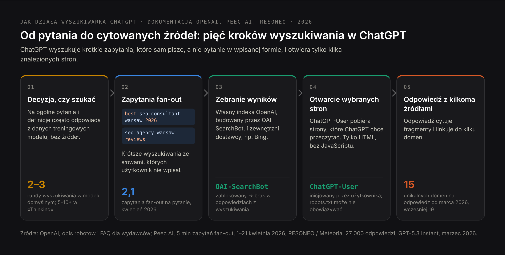
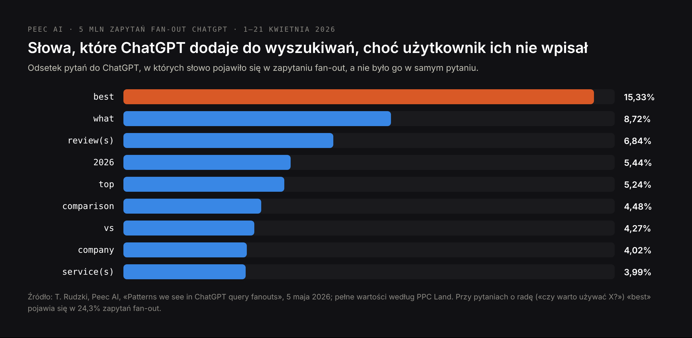
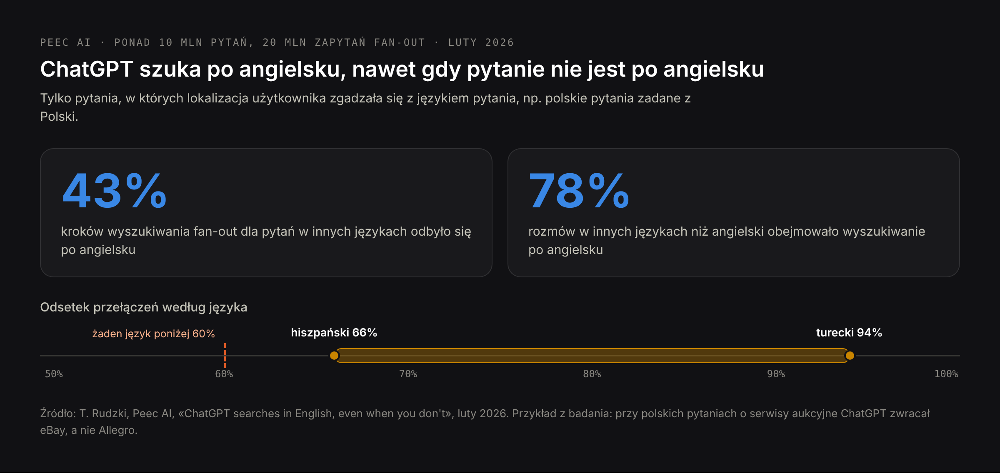

# DRAFT PL — «ChatGPT SEO» (24 Oct 2026). Translation of blog-chatgpt-seo-EN.md.
# PL volume: pozycjonowanie w chatgpt 170 (service intent → /pl/oferty/pozycjonowanie-w-chatgpt,
# linked from here); the rest of PL demand is near zero. PAA used: «Skąd ChatGPT bierze
# odpowiedzi?». Sources as in the EN draft. Competitor names withheld on purpose.
# H1 (Title) and Meta title differ on purpose.

Title: Jak pojawić się w ChatGPT: jak działa wyszukiwarka ChatGPT i jak zdobyć cytowania strony
Slug: jak-pojawic-sie-w-chatgpt
Meta title: ChatGPT SEO: jak pojawić się w odpowiedziach ChatGPT (2026)
Meta description: Jak ChatGPT wybiera strony, które cytuje: zapytania fan-out, wyszukiwanie po angielsku, roboty OpenAI, wyniki lokalne i produktowe oraz pomiar ruchu.

---

> Krótka odpowiedź: ChatGPT SEO, czyli pozycjonowanie strony w ChatGPT, to optymalizacja strony tak, żeby ChatGPT znajdował jej podstrony, gdy przeszukuje internet, cytował je z linkiem i poprawnie opisywał firmę. ChatGPT nie wyszukuje pytania w takiej formie, w jakiej je wpisaliście: przepisuje je na jedno lub kilka krótszych zapytań, często dodając słowa takie jak «best», «reviews» czy bieżący rok, a przy pytaniach po polsku często szuka po angielsku. Wyniki bierze z własnego robota, OAI-SearchBot, i od zewnętrznych dostawców wyszukiwania, takich jak Bing, a potem cytuje tylko kilka stron. Żeby pojawić się w ChatGPT, wpuśćcie OAI-SearchBot, umieśćcie główną treść w HTML-u wysyłanym przez serwer, odpowiedzcie na stronie na zapytanie, które ChatGPT faktycznie wyszuka, i bądźcie obecni w rankingach, opiniach i katalogach, które znajduje dla tych zapytań.

Z ChatGPT korzysta około 900 milionów osób tygodniowo, a kiedy odpowiada z wyszukiwaniem w sieci, to on decyduje, które kilka stron dostanie link. Ten poradnik wyjaśnia, jak zapada ta decyzja. Opiera się na dokumentacji OpenAI dla wydawców, trzech badaniach milionów zapytań wyszukiwania ChatGPT, mojej analizie 141 odpowiedzi AI na pytania zakupowe i teście z 24 października 2026 roku, w którym poprosiłem ChatGPT o polecenie konsultantów SEO w Warszawie. Jeśli interesuje Was strona biznesowa — jak zostać jedną z firm, które ChatGPT poleca — to osobna [lista kontrolna: jak trafić do rekomendacji ChatGPT](/pl/blog/jak-trafic-do-rekomendacji-chatgpt). Ten artykuł dotyczy wyszukiwarki wewnątrz ChatGPT i tego, jak sprawić, żeby cytowała Wasze strony.

## Czym jest ChatGPT SEO, a czym nie jest

**ChatGPT SEO** to optymalizacja pod wyszukiwarkę ChatGPT: sprawienie, żeby strona była dla niej możliwa do znalezienia, przeczytania i zacytowania, a firma, którą opisuje, była znana modelom ChatGPT. Tę samą pracę nazywa się też «SEO dla ChatGPT», «pozycjonowaniem w ChatGPT» albo «optymalizacją pod wyszukiwarkę ChatGPT». To część szerszego [pozycjonowania w LLM](/pl/blog/pozycjonowanie-w-llm), zastosowana do jednego asystenta.

Fraza ma też drugie znaczenie, niezwiązane z tym tekstem: **używanie ChatGPT jako narzędzia SEO** — do pisania meta opisów, szukania słów kluczowych czy tworzenia artykułów. Wyniki wyszukiwania dla «ChatGPT SEO» mieszają oba znaczenia. Ten artykuł dotyczy tylko pierwszego: jak pojawić się w odpowiedziach ChatGPT, a nie jak używać ChatGPT do pozycjonowania w Google.

## Jak działa wyszukiwarka ChatGPT: od pytania do cytowanych źródeł

ChatGPT nie szuka za każdym razem. Na ogólne pytanie może odpowiedzieć z tego, czego model nauczył się podczas trenowania, bez żadnych źródeł. Kiedy pytanie wymaga aktualnych, lokalnych lub konkretnych faktów albo kiedy użytkownik włączy wyszukiwanie w sieci, ChatGPT szuka. To wyszukiwanie przebiega w pięciu krokach.

1. **Decyzja, czy szukać.** Pytanie o definicję często nie uruchamia wyszukiwania; «najlepszy konsultant SEO w Warszawie» prawie zawsze tak.
2. **Przepisanie pytania na zapytania fan-out.** ChatGPT wysyła średnio 2,1 zapytania na jedno pytanie, według analizy 5 milionów zapytań fan-out przeprowadzonej przez Peec AI w kwietniu 2026 roku. Są krótsze niż pytanie i zawierają słowa, których użytkownik nie wpisał.
3. **Zebranie wyników.** Z własnego indeksu OpenAI, budowanego przez robota OAI-SearchBot, i od zewnętrznych dostawców wyszukiwania; najbardziej znanym z nich jest Bing.
4. **Otwarcie wybranych stron.** Agent OpenAI o nazwie ChatGPT-User pobiera strony, które ChatGPT postanawia przeczytać. W teście z pułapką przeprowadzonym przez RESONEO treść strony podczas rozmowy pobrał właśnie ChatGPT-User, a nie OAI-SearchBot.
5. **Napisanie odpowiedzi i zacytowanie kilku źródeł.** Po przełączeniu domyślnego modelu na GPT-5.3 Instant w marcu 2026 roku ChatGPT cytował średnio 15 unikalnych domen na odpowiedź zamiast 19, według analizy 27 000 odpowiedzi wykonanej przez RESONEO. Domyślny, szybszy model wykonuje dwie lub trzy rundy wyszukiwania; wolniejsze modele «Thinking» — od pięciu do ponad dziesięciu.

OpenAI ma trzy roboty i tylko jeden z nich decyduje o tym, czy możecie pojawić się w wyszukiwarce ChatGPT:

| User agent | Co robi | Co oznacza jego zablokowanie |
|---|---|---|
| OAI-SearchBot | Indeksuje strony dla wyszukiwarki ChatGPT | Wasze strony nie pojawiają się w odpowiedziach z wyszukiwania; zmiana działa po około 24 godzinach |
| ChatGPT-User | Otwiera stronę, gdy potrzebuje jej pytanie użytkownika albo GPT; nie indeksuje automatycznie | OpenAI zaznacza, że reguły robots.txt mogą nie obowiązywać, bo wizytę inicjuje użytkownik |
| GPTBot | Zbiera treści, które mogą posłużyć do trenowania modeli OpenAI | Wasz tekst nie trafia do trenowania; wyszukiwarka ChatGPT się nie zmienia |

Jeszcze jedna zasada z FAQ OpenAI dla wydawców: strona zablokowana w robots.txt może mimo to pojawić się w ChatGPT jako sam link z tytułem, jeśli OpenAI znajdzie jej adres gdzie indziej. Żeby całkowicie ją ukryć, użyjcie meta tagu noindex — i pozwólcie OAI-SearchBot na indeksowanie tej strony, bo inaczej nie zobaczy tagu.

## Co ChatGPT dodaje do zapytania: zapytania fan-out

Wyszukiwanie, które uruchamia ChatGPT, to nie jest pytanie wpisane przez użytkownika. Peec AI przeanalizowało 5 milionów zapytań fan-out ChatGPT zebranych 1–21 kwietnia 2026 roku i policzyło słowa, które pojawiały się w wyszukiwaniach, choć nie było ich w pytaniach.

«Best» to najczęstszy dodatek; przy pytaniach z prośbą o radę, takich jak «czy warto używać X?», pojawia się w 24,3% zapytań fan-out. ChatGPT sam dodaje też nazwy marek: pytanie o «CRM z najlepszą obsługą synchronizacji danych» zamieniło się w wyszukiwanie «CRM integration sync capabilities - Salesforce, HubSpot, Microsoft Dynamics comparison».

Co to oznacza dla strony:

- **ChatGPT szuka list i porównań.** «Best SEO consultant Warsaw 2026» zwraca artykuły z rankingami, katalogi i serwisy z opiniami. Żeby zostać zacytowanym przy takim zapytaniu, firma musi być w tych zestawieniach albo sama opublikować stronę z porównaniem.
- **Bieżący rok ma znaczenie.** Strona z tytułem «… w 2026 roku» pasuje do zapytań, do których ChatGPT dodaje rok; strona zaktualizowana dwa lata temu wygląda przy niej na nieaktualną.
- **Marki, które ChatGPT już zna, są wyszukiwane z nazwy.** Jeśli model zna Waszych konkurentów, a Was nie, zapytanie fan-out porównuje ich, a Wasza strona nie jest nawet kandydatem. Tu ścieżka trenowania z [pozycjonowania w LLM](/pl/blog/pozycjonowanie-w-llm) spotyka się ze ścieżką wyszukiwania.

## Dlaczego ChatGPT szuka po angielsku, nawet gdy pytacie po polsku

Przy pytaniach w innych językach ChatGPT często prowadzi część wyszukiwania po angielsku. Peec AI przeanalizowało ponad 10 milionów pytań i 20 milionów zapytań fan-out w lutym 2026 roku, biorąc pod uwagę tylko przypadki, w których lokalizacja użytkownika zgadzała się z językiem pytania — na przykład polskie pytania zadane z Polski.

- **43%** kroków fan-out dla pytań w innych językach niż angielski odbyło się po angielsku.
- W około **78%** takich rozmów ChatGPT dodał wyszukiwanie po angielsku.
- Odsetek różnił się w zależności od języka, od **66%** dla hiszpańskiego do **94%** dla tureckiego; żaden język nie spadł poniżej 60%.

Skutki są konkretne. W polskim przykładzie Peec AI pytanie o serwisy aukcyjne zwróciło eBay, a Allegro, zdecydowanie największego marketplace'u w Polsce, w odpowiedzi nie było. Pytania o niemieckie oprogramowanie nie zwróciły żadnej niemieckiej firmy. Dla firmy, która sprzedaje w Polsce, angielski internet staje się częścią lokalnej widoczności: angielska wersja kluczowych stron i wzmianki w anglojęzycznych źródłach, którym ChatGPT ufa w Waszej branży, nie są tylko dla klientów z zagranicy. Funkcje AI w Google trzymają się bliżej języka zapytania, więc to przede wszystkim problem ChatGPT.

## Jak pojawić się w wyszukiwarce ChatGPT: co decyduje o cytowaniu strony

OpenAI nie publikuje czynników rankingowych. To, co poniżej, wynika z jego dokumentacji, z opisanych badań i z moich testów.

### 1. Wpuśćcie OAI-SearchBot, a o GPTBot zdecydujcie osobno

Sprawdźcie robots.txt, firewall i ochronę przed botami w CDN. Hurtowa blokada «botów AI» często łapie też OAI-SearchBot, a wtedy strona w ogóle nie może pojawić się w wyszukiwarce ChatGPT. Zablokowanie GPTBot to osobna decyzja dotycząca trenowania i nie wpływa na wyszukiwanie.

### 2. Umieśćcie główną treść w HTML-u wysyłanym przez serwer

Roboty OpenAI nie uruchamiają JavaScriptu. Jeśli usługi, ceny czy odpowiedzi ładują się skryptami po otwarciu strony, ChatGPT dostaje pustą stronę. Otwórzcie źródło strony i wyszukajcie w nim zdanie z treści: jeśli go tam nie ma, ChatGPT też go nie widzi.

### 3. Bądźcie w indeksie Binga, nie tylko Google

Bing jest jednym z dostawców wyszukiwania ChatGPT. Dodajcie stronę do Bing Webmaster Tools, prześlijcie mapę strony i używajcie IndexNow dla nowych i zmienionych podstron. Wiele stron, które dobrze stoją w Google, nigdy nie zostało sprawdzonych w Bingu.

### 4. Odpowiedzcie na zapytanie, które wyszuka ChatGPT, a nie tylko na pytanie użytkownika

Zapiszcie dziesięć pytań, które zadają Wasi klienci, a potem wyszukiwania, na które ChatGPT by je zamienił: «najlepszy … w [mieście] 2026», «… opinie», «… vs …», «… cena». Upewnijcie się, że jakaś strona w Waszym serwisie odpowiada na każde z nich w pierwszym zdaniu pod nagłówkiem, który je nazywa, z liczbami, cenami i datami tam, gdzie istnieją. Metodę opisuję szczegółowo w artykule [czym jest AEO](/pl/blog/aeo-answer-engine-optimization).

### 5. Bądźcie w rankingach, opiniach i katalogach, które znajduje ChatGPT

Wyszukajcie swoje zapytania fan-out w Bingu i Google. Artykuły z rankingami, katalogi i serwisy z opiniami, które zobaczycie, to źródła, które przeczyta ChatGPT. Obecność w nich — z tą samą nazwą, usługami i cenami co na stronie — często znaczy więcej niż kolejna podstrona we własnej domenie.

### 6. Publikujcie fakty, które ChatGPT może zacytować

W moim teście ChatGPT uzasadnił swoją listę «publicznie dostępnymi opisami usług, serwisami z opiniami i opublikowanymi cenami» i zacytował cennik jednego z usługodawców. Strona, która mówi, komu służycie, gdzie, ile to kosztuje i ile trwa, daje ChatGPT coś do zacytowania. «Zapytaj o wycenę» nie daje mu nic.

### 7. Aktualizujcie strony

Pokazujcie datę ostatniej aktualizacji na stronach ze zmieniającymi się faktami i faktycznie je aktualizujcie. Zapytania fan-out z dopiskiem «2026» faworyzują strony, które mówią, że są aktualne.

### 8. Zadbajcie o ścieżkę angielską

Angielska wersja głównych stron usług i obecność w anglojęzycznych źródłach Waszej branży wyłapują tę część wyszukiwania ChatGPT, która odbywa się po angielsku.

## Lista kontrolna optymalizacji pod wyszukiwarkę ChatGPT

| Co sprawdzić | Jak to sprawdzić |
|---|---|
| OAI-SearchBot jest dozwolony w robots.txt i nie blokuje go firewall ani CDN | Przeczytajcie robots.txt; sprawdźcie ustawienia botów w CDN |
| GPTBot jest dozwolony albo zablokowany świadomie | robots.txt odzwierciedla decyzję, a nie ustawienie domyślne |
| Główna treść, ceny i kontakty są w HTML-u z serwera | Źródło strony; wyszukajcie w nim zdanie z treści |
| Kluczowe strony są w indeksie Binga | Bing Webmaster Tools; wyszukiwanie site: w Bingu |
| Nowe i zmienione adresy idą przez IndexNow | Ustawienie CMS-a lub hostingu |
| Każde ważne pytanie ma sekcję, która odpowiada na nie w pierwszym zdaniu | Przeczytajcie pierwsze zdanie pod każdym nagłówkiem |
| Ceny, obszar działania i warunki są opublikowane jako tekst | Przeczytajcie strony usług oczami klienta |
| Firma jest w rankingach i katalogach, które pojawiają się dla Waszych zapytań fan-out | Wyszukajcie «najlepszy [usługa] [miasto] 2026» w Bingu i Google |
| Nazwa, usługi i ceny są takie same na stronie, w Profilu Firmy w Google i w katalogach | Porównajcie je obok siebie |
| Strony ze zmieniającymi się faktami pokazują datę aktualizacji | Sprawdźcie szablon strony |
| Ważne strony mają wersję angielską | Sprawdźcie przełącznik języków |
| Strony, które mają być ukryte, mają noindex, a nie tylko blokadę w robots.txt | Sprawdźcie meta tag robots |

## Jak pojawić się w ChatGPT jako firma lokalna

Pytania lokalne — «dentysta w Warszawie», «hydraulik w pobliżu», «księgowa dla małej firmy w Krakowie» — to miejsce, w którym ChatGPT najbardziej polega na danych z map i katalogów. W moim badaniu 141 odpowiedzi AI na pytania zakupowe ChatGPT odwoływał się do Map Google w 23 z 47 odpowiedzi, Perplexity w 7, a Google AI Mode w 4. ChatGPT podawał też najmniej źródeł: 1,6 na odpowiedź wobec 16,7 w Perplexity. Pełne wyniki są w [badaniu 141 odpowiedzi AI](/pl/blog/pozycjonowanie-w-ai-badanie).

Dla firmy lokalnej oznacza to cztery zadania:

- **Kompletny Profil Firmy w Google** z właściwymi kategoriami, obszarem działania, godzinami otwarcia, zdjęciami i usługami.
- **Opinie**, które opisują usługę i miejsce słowami klienta: «naprawili piec w naszym mieszkaniu na Mokotowie» mówi więcej niż pięć gwiazdek.
- **Spójne wpisy** w katalogach, które pojawiają się dla wyszukiwań «najlepszy [usługa] [miasto]», z tą samą nazwą, adresem i telefonem co na stronie.
- **Strona usługi dla każdego miasta lub dzielnicy**, którą faktycznie obsługujecie, z cenami i obszarem w treści, a nie szablon, w którym zmienia się tylko nazwa miasta.

## Zakupy w ChatGPT: jak produkty trafiają do ChatGPT teraz

ChatGPT pokazuje wyniki produktowe ze zdjęciami, cenami i porównaniami. We wrześniu 2025 roku OpenAI uruchomiło Instant Checkout, który pozwalał użytkownikom w USA kupować u sprzedawców z Etsy bez wychodzenia z czatu, a kolejni mieli być sklepy na Shopify. W marcu 2026 roku OpenAI się z tego wycofało: CNBC podało 20 marca, że OpenAI kończy z Instant Checkout na rzecz aplikacji sprzedawców, a aktualizacja OpenAI z 24 marca przestawiła zakupy w ChatGPT na odkrywanie produktów. Zakup kończy się teraz na stronie sprzedawcy albo w jego aplikacji w ChatGPT.

Co dziś decyduje o obecności produktów w ChatGPT:

- **Feedy produktowe.** Sprzedawcy przekazują ustrukturyzowane feedy — tytuł, opis, zdjęcia, cenę, dostępność — przez Agentic Commerce Protocol OpenAI albo przez platformy. Sklepy na Shopify są uwzględniane przez Shopify Catalog bez dodatkowej pracy.
- **Strony produktów dostępne dla robota.** Obowiązuje ta sama zasada co wyżej: zablokowany sklep nie pojawia się w odpowiedziach z wyszukiwania.
- **Kompletne dane produktów.** Marka, GTIN, wymiary, materiały, dostępność i atrybuty, po których ludzie filtrują. ChatGPT może skracać tytuły i pisać własne etykiety, takie jak «budżetowy», więc fakty muszą być w danych.

OpenAI podaje, że wyniki produktowe «nie są reklamami i nie wpływają na nie partnerstwa». Opinie i artykuły porównawcze nadal kształtują to, które produkty ChatGPT wysuwa na pierwszy plan — przez te same zapytania fan-out co wszystko inne.

## Dlaczego ChatGPT odpowiada różnym osobom inaczej

Dwie osoby, które zadadzą ChatGPT to samo pytanie, mogą dostać różne firmy. Są cztery powody i każdy z nich wpływa na to, jak testować.

- **Różne modele.** Ponad 90% tygodniowych użytkowników ChatGPT korzysta z planu darmowego, według RESONEO, a domyślny model szuka rzadziej i cytuje mniej źródeł niż płatne modele «Thinking». Od 7–8 października 2026 roku domyślnym modelem jest GPT-6. Testujcie w planie darmowym, bo to właśnie widzi większość Waszych klientów.
- **Pamięć i personalizacja.** ChatGPT korzysta z zapisanej pamięci, wcześniejszych rozmów i instrukcji niestandardowych. Czat tymczasowy tego nie wyłącza: 24 października 2026 roku czat tymczasowy ChatGPT sam informował, że «może korzystać z pamięci, wtyczek i instrukcji niestandardowych». Testujcie bez logowania albo na osobnym koncie bez pamięci.
- **Lokalizacja i język.** Przy pytaniach lokalnych ChatGPT bierze pod uwagę przybliżoną lokalizację użytkownika, a język pytania zmienia to, jak dużo szuka po angielsku.
- **Losowość.** To samo pytanie zadane dwa razy może zwrócić różne źródła. Jedno sprawdzenie to wrażenie; dziesięć sprawdzeń tego samego zestawu pytań to pomiar.

**Reklamy.** OpenAI zaczęło testować reklamy w ChatGPT w lutym 2026 roku dla zalogowanych dorosłych użytkowników planów Free i Go, a do października 2026 roku rozszerzyło je na 89 krajów. Reklamy są oznaczone jako sponsorowane i oddzielone od odpowiedzi, a OpenAI deklaruje, że «reklamy nie wpływają na odpowiedzi ChatGPT». ChatGPT SEO i reklamy w ChatGPT to więc dwa różne kanały, tak jak w Google.

## Jak mierzyć ruch i cytowania z ChatGPT

**Wejścia w analityce.** ChatGPT dodaje utm_source=chatgpt.com do linków, które pokazuje, więc w GA4 te wizyty widać pod tym źródłem. Utwórzcie grupę kanałów dla asystentów AI, która obejmie też perplexity.ai, gemini.google.com, claude.ai i copilot.microsoft.com.

**Spadek z października 2026 roku, który nie był spadkiem.** Po tym, jak GPT-6 trafił do planów płatnych 7 października, a do darmowych 8 października 2026 roku, wiele linków w odpowiedziach ChatGPT zaczęło otwierać się bez tagu UTM i bez referera. LLM Pulse zmierzyło od 9 października spadek sesji z ChatGPT o około 46% na monitorowanych stronach, podczas gdy ruch bezpośredni wzrósł prawie o tyle samo. Oznaczcie 9 października 2026 roku w raportach i porównujcie ChatGPT razem z ruchem bezpośrednim na stronach, na które ChatGPT wcześniej kierował ruch.

**Logi serwera.** Filtrujcie po user agentach OAI-SearchBot i ChatGPT-User. OAI-SearchBot pokazuje, co ChatGPT indeksuje; ChatGPT-User — które strony otworzył, żeby odpowiedzieć na prawdziwe pytania. To najbliższy odpowiednik wyświetleń, jaki można dostać.

**Stały zestaw pytań.** Od dwudziestu do pięćdziesięciu pytań, które zadają Wasi klienci, sprawdzanych co miesiąc w planie darmowym, bez logowania. Zapisujcie, czy firma została wymieniona, czy strona jest cytowana z linkiem, czy opis jest poprawny i które źródła zacytowano zamiast Was. Metodę opisuję w artykule [co asystenci AI mówią o Twojej firmie](/pl/blog/co-asystenci-ai-mowia-o-twojej-firmie).

ChatGPT nie daje właścicielom stron raportu wyświetleń ani cytowań. Bing Webmaster Tools ma taki raport dla Copilota i odpowiedzi AI w Bingu i warto go sprawdzać, bo źródła w dużej części się pokrywają.

## Test na żywo: co ChatGPT odpowiedział o konsultantach SEO w Warszawie

24 października 2026 roku zadałem ChatGPT, z włączonym wyszukiwaniem w sieci, w czacie tymczasowym, pytanie po angielsku: «Who are the best SEO consultants in Warsaw for a small business?» («Kim są najlepsi konsultanci SEO w Warszawie dla małej firmy?»).

Co się wydarzyło:

- **ChatGPT wymienił pięciu konsultantów i agencje.** Nie podaję tu ich nazw; chodzi o mechanizm, a nie o listę. Mojej firmy wśród nich nie było, choć jestem konsultantem SEO w Warszawie, a moja strona publikuje ceny.
- **Źródłami były strony samych usługodawców i ranking w jednym polskim magazynie biznesowym.**
- **Sam wyjaśnił swoje kryteria:** «publicznie dostępne opisy usług, serwisy z opiniami i opublikowane ceny». Przy jednym z usługodawców zacytował cennik z jego strony.
- **Użytkownikowi doradził porównanie doświadczenia, SEO technicznego i treści oraz przejrzystości cen** — czyli tego samego, co wprowadziło wymienionych usługodawców na listę.

Wniosek jest niewygodny, ale przydatny. Publikowanie cen jest konieczne, ale nie wystarcza: wymienieni usługodawcy byli też obecni w źródle, które ChatGPT znalazł dla «best SEO consultants Warsaw» — w artykule z rankingiem. Firmy, której brakuje w zestawieniach zwracanych przez zapytania fan-out ChatGPT, brakuje też w odpowiedzi, niezależnie od tego, jak dobre są jej własne strony.

## Najczęstsze błędy w pozycjonowaniu w ChatGPT

**Przypadkowa blokada OAI-SearchBot.** Reguła firewalla albo przełącznik «blokuj boty AI» w CDN usuwa stronę z wyszukiwarki ChatGPT. Sprawdźcie to przed wszystkim innym.

**Optymalizacja pod pytanie zamiast pod wyszukiwanie.** Użytkownicy zadają długie pytania; ChatGPT szuka krótkich zapytań z «best», «reviews» i rokiem. Strony dopasowane tylko do długiego pytania mijają się z wyszukiwaniem.

**Pomijanie angielskiego internetu.** Na rynkach nieanglojęzycznych duża część wyszukiwania ChatGPT odbywa się po angielsku. Firma bez obecności po angielsku zostawia tę część konkurencji.

**Testowanie na własnym koncie.** Pamięć, historia rozmów i instrukcje niestandardowe kształtują odpowiedź, a czat tymczasowy może nadal z nich korzystać. Testujcie bez logowania.

**Odczytanie spadku z października 2026 roku jako utraty widoczności.** Od czasu GPT-6 wiele wizyt z ChatGPT jest liczonych jako ruch bezpośredni. Sprawdźcie oba kanały, zanim cokolwiek zmienicie.

**Mylenie ChatGPT SEO z reklamami w ChatGPT.** Reklama to płatne miejsce obok odpowiedzi; nie zmienia tego, co mówi odpowiedź.

**Czekanie na raport pozycji.** ChatGPT nie ma swojego Search Console. Pomiar stałym zestawem pytań i logami serwera to jedyny sposób, żeby zobaczyć zmianę.

## Najczęstsze pytania o pozycjonowanie w ChatGPT

**Czym jest ChatGPT SEO?**
ChatGPT SEO to optymalizacja strony tak, żeby ChatGPT znajdował jej podstrony, gdy przeszukuje internet, cytował je z linkiem i poprawnie opisywał firmę. To nie to samo co używanie ChatGPT jako narzędzia do pracy nad SEO.

**Jak pojawić się w ChatGPT?**
Wpuśćcie OAI-SearchBot, umieśćcie główną treść w HTML-u z serwera, zadbajcie o indeks Binga, odpowiedzcie na zapytania, które ChatGPT faktycznie wyszukuje — często z «best», «reviews» i rokiem — i bądźcie w rankingach i katalogach, które dla nich znajduje. Firmy lokalne powinny dodać kompletny Profil Firmy w Google i opinie.

**Skąd ChatGPT bierze odpowiedzi?**
Z tego, czego model nauczył się podczas trenowania, a kiedy szuka w sieci — z własnego indeksu OpenAI, budowanego przez robota OAI-SearchBot, i od zewnętrznych dostawców wyszukiwania, z których najbardziej znany jest Bing. Strony, które postanawia przeczytać, otwiera agent ChatGPT-User.

**Czy można zapłacić za wysoką pozycję w ChatGPT?**
Nie. OpenAI pokazuje oznaczone reklamy użytkownikom planów Free i Go i deklaruje, że reklamy nie wpływają na odpowiedzi. Wyniki produktowe w ChatGPT OpenAI również opisuje jako niebędące reklamami i niezależne od partnerstw.

**Czy zablokowanie GPTBot usuwa stronę z ChatGPT?**
Nie. GPTBot zbiera dane do trenowania. Wyszukiwarka ChatGPT korzysta z OAI-SearchBot. To zablokowanie OAI-SearchBot usuwa strony z odpowiedzi z wyszukiwania.

**Dlaczego ChatGPT poleca moich konkurentów, a nie mnie?**
Zwykle dlatego, że są w źródłach, które ChatGPT znajduje dla swoich zapytań fan-out — w rankingach, katalogach i serwisach z opiniami — albo dlatego, że model zna ich już z nazwy. Sprawdźcie, jakie źródła ChatGPT cytuje przy Waszych kluczowych pytaniach, i pracujcie nad obecnością w nich.

**Ile trwa pozycjonowanie w ChatGPT?**
Poprawki techniczne działają szybko: według OpenAI zmiany w robots.txt dla OAI-SearchBot zaczynają obowiązywać po około 24 godzinach, a nowe strony pojawiają się po kolejnym zaindeksowaniu. Obecność w zewnętrznych zestawieniach i opiniach to tygodnie lub miesiące. To, żeby poznał Was sam model, wymaga wytrenowania kolejnego modelu.

**Czy ChatGPT korzysta z Google?**
OpenAI mówi o własnym robocie i zewnętrznych dostawcach wyszukiwania, nie wymieniając wszystkich; zwykle wymienia się Binga. Niezależnie od dostawców kandydatami są zwykle strony, które dobrze stoją w klasycznej wyszukiwarce. A w moim badaniu ChatGPT odwoływał się do Map Google w mniej więcej połowie odpowiedzi na pytania o lokalne usługi, więc Profil Firmy w Google ma znaczenie także dla ChatGPT.

## Od czego zacząć pozycjonowanie w ChatGPT

Otwórzcie robots.txt i ustawienia botów w CDN i upewnijcie się, że OAI-SearchBot jest dozwolony. Zajrzyjcie do źródła głównej strony usługi i poszukajcie w nim głównej treści. Potem zapiszcie pięć pytań, które zadają klienci, zamieńcie każde na wyszukiwanie, które uruchomiłby ChatGPT — «najlepszy … w [mieście] 2026» — i zobaczcie, co zwracają dla niego Bing i Google: to są źródła, w których musicie być. Zadajcie ChatGPT te same pięć pytań bez logowania i zapiszcie, kogo wymienia i jakie strony cytuje.

Jeśli wolicie zlecić tę pracę, oferuję ją jako osobną usługę: audyt widoczności w ChatGPT od 1000 zł, jednorazowo; comiesięczne pozycjonowanie w ChatGPT od 3500 zł; sam monitoring od 1000 zł miesięcznie. Co obejmuje każda z nich, opisuję na stronie [pozycjonowanie w ChatGPT](/pl/oferty/pozycjonowanie-w-chatgpt), a możecie też [napisać do mnie](/pl/kontakt), podając adres strony i pytania, które zadają Wasi klienci.
