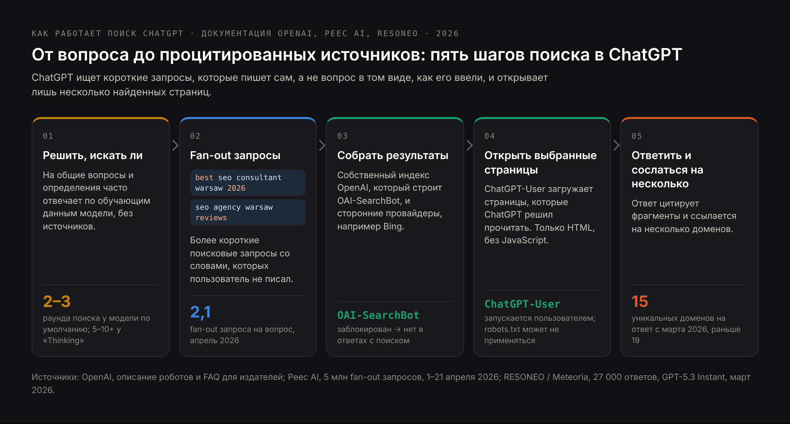
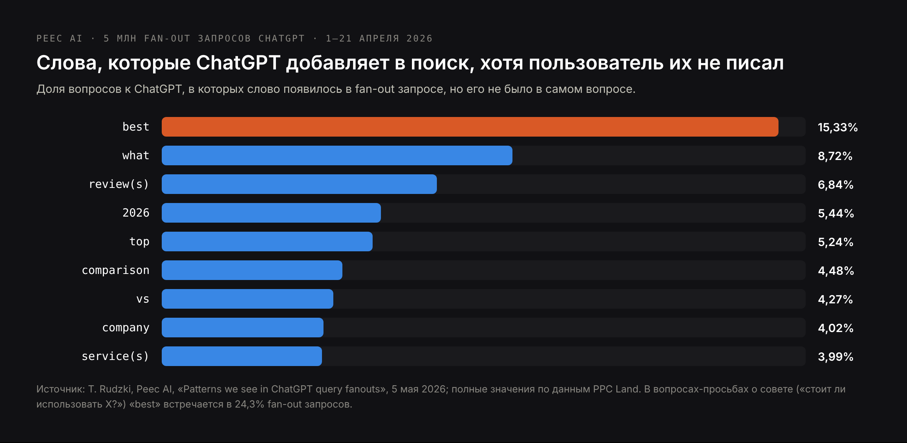
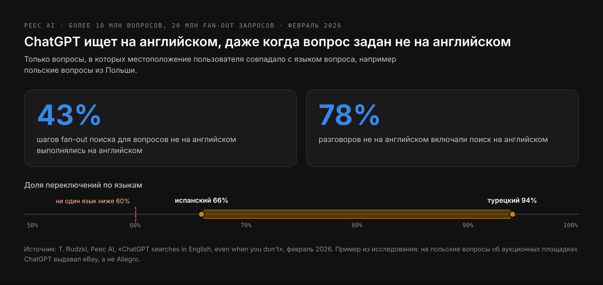
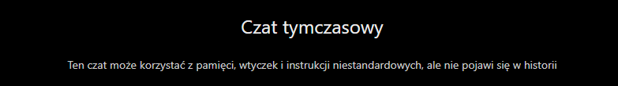

# DRAFT RU — «ChatGPT SEO» (24 Oct 2026). Translation of blog-chatgpt-seo-EN.md.
# RU volume near zero («продвижение в chatgpt» → /ru/uslugi/prodvizhenie-v-chatgpt, linked
# from here). Sources as in the EN draft. Competitor names withheld on purpose.
# Prices in € as on /ru/uslugi/prodvizhenie-v-chatgpt. H1 (Title) ≠ Meta title.

Title: SEO для ChatGPT: как попасть в поиск ChatGPT и в источники его ответов
Slug: seo-dlya-chatgpt
Meta title: Как продвигать сайт в ChatGPT: разбор поиска ChatGPT (2026)
Meta description: Как ChatGPT выбирает страницы, которые цитирует: fan-out запросы, поиск на английском, роботы OpenAI, локальная и товарная выдача и как это измерять.

---

> Коротко: SEO для ChatGPT — это оптимизация сайта, чтобы ChatGPT находил его страницы, когда ищет в интернете, цитировал их со ссылкой и правильно описывал компанию. ChatGPT не ищет ваш вопрос в том виде, в каком вы его написали: он переписывает его в один или несколько более коротких запросов, часто добавляя слова вроде «best», «reviews» или текущий год, а на вопросы не на английском часто ищет по-английски. Результаты он берёт из собственного робота OAI-SearchBot и у сторонних поисковых провайдеров, таких как Bing, а затем цитирует лишь несколько сайтов. Чтобы попасть в ответы ChatGPT, пустите OAI-SearchBot, разместите основной текст в HTML, который отдаёт сервер, ответьте на странице на тот запрос, который ChatGPT действительно будет искать, и будьте в рейтингах, отзывах и каталогах, которые он находит по этим запросам.

ChatGPT пользуются около 900 миллионов человек в неделю, и когда он отвечает с поиском в интернете, именно он решает, какие несколько сайтов получат ссылку. В этом разборе — как принимается это решение. Он основан на документации OpenAI для издателей, трёх исследованиях миллионов поисковых запросов ChatGPT, моём анализе 141 ответа ИИ на вопросы о выборе подрядчика и живом тесте 24 октября 2026 года, в котором я попросил ChatGPT порекомендовать SEO-консультантов в Варшаве. Если вас интересует бизнес-сторона — как стать одной из компаний, которые ChatGPT рекомендует, — это отдельный [чек-лист: как попасть в рекомендации ChatGPT](/ru/blog/kak-popast-v-rekomendacii-chatgpt). Эта статья — о поисковике внутри ChatGPT и о том, как добиться, чтобы он цитировал ваши страницы.

## Что такое SEO для ChatGPT и чем оно не является

**SEO для ChatGPT** (ChatGPT SEO) — это поисковая оптимизация под ChatGPT: сделать сайт находимым, читаемым и пригодным для цитирования в поиске ChatGPT, а компанию, которую он описывает, — известной моделям ChatGPT. Ту же работу называют «продвижением в ChatGPT» или «оптимизацией под поиск ChatGPT». Это часть более широкого [LLM SEO](/ru/blog/llm-seo), применённая к одному ассистенту.

У фразы есть второе значение, не связанное с этой статьёй: **использование ChatGPT как инструмента для SEO** — чтобы писать мета-описания, подбирать ключевые слова или тексты. Поисковая выдача по «ChatGPT SEO» смешивает оба значения. Эта статья только о первом: как появиться в ответах ChatGPT, а не как с помощью ChatGPT продвигаться в Google.

## Как работает поиск ChatGPT: от вопроса до процитированных источников

ChatGPT ищет не каждый раз. На общий вопрос он может ответить по тому, что модель выучила при обучении, без всяких источников. Когда вопрос требует актуальных, локальных или конкретных фактов или когда пользователь включает поиск в сети, ChatGPT ищет. Этот поиск проходит в пять шагов.

1. **Решить, искать ли.** Вопрос об определении часто обходится без поиска; «лучший SEO-консультант в Варшаве» почти всегда запускает поиск.
2. **Переписать вопрос в fan-out запросы.** В среднем ChatGPT отправляет 2,1 поискового запроса на один вопрос, по анализу 5 миллионов fan-out запросов, который Peec AI провела в апреле 2026 года. Они короче вопроса и содержат слова, которых пользователь не писал.
3. **Собрать результаты.** Из собственного индекса OpenAI, который строит робот OAI-SearchBot, и от сторонних поисковых провайдеров; самый известный из них — Bing.
4. **Открыть выбранные страницы.** Агент OpenAI под названием ChatGPT-User загружает страницы, которые ChatGPT решил прочитать. В эксперименте RESONEO с ловушкой содержимое страницы во время разговора загрузил именно ChatGPT-User, а не OAI-SearchBot.
5. **Написать ответ и процитировать несколько источников.** После того как в марте 2026 года моделью по умолчанию стала GPT-5.3 Instant, ChatGPT стал цитировать в среднем 15 уникальных доменов на ответ вместо 19, по анализу 27 000 ответов, проведённому RESONEO. Модель по умолчанию, более быстрая, делает два-три раунда поиска; более медленные модели «Thinking» — от пяти до более чем десяти.

У OpenAI три робота, и только один из них решает, можете ли вы появиться в поиске ChatGPT:

| User agent | Что делает | Что значит его блокировка |
|---|---|---|
| OAI-SearchBot | Индексирует страницы для поиска ChatGPT | Ваши страницы не показываются в ответах с поиском; изменение вступает в силу примерно через 24 часа |
| ChatGPT-User | Открывает страницу, когда она нужна для вопроса пользователя или GPT; сам сайты не обходит | OpenAI предупреждает, что правила robots.txt могут не применяться, потому что визит инициирует пользователь |
| GPTBot | Собирает тексты, которые могут использоваться для обучения моделей OpenAI | Ваш текст не идёт в обучение; на поиск ChatGPT это не влияет |

Ещё одно правило из FAQ OpenAI для издателей: страница, закрытая в robots.txt, всё равно может появиться в ChatGPT в виде голой ссылки с заголовком, если OpenAI найдёт её адрес в другом месте. Чтобы полностью её скрыть, используйте мета-тег noindex — и разрешите OAI-SearchBot сканировать эту страницу, иначе он не увидит тег.

## Что ChatGPT добавляет к запросу: fan-out запросы

Поиск, который запускает ChatGPT, — это не вопрос, который ввёл пользователь. Peec AI проанализировала 5 миллионов fan-out запросов ChatGPT, собранных 1–21 апреля 2026 года, и посчитала слова, которые появлялись в поисковых запросах, хотя их не было в вопросах.

«Best» — самое частое добавление; в вопросах-просьбах о совете вроде «стоит ли использовать X?» оно встречается в 24,3% fan-out запросов. ChatGPT сам добавляет и названия брендов: вопрос о «CRM с лучшей поддержкой синхронизации данных» превратился в поиск «CRM integration sync capabilities - Salesforce, HubSpot, Microsoft Dynamics comparison».

Что это значит для страницы:

- **ChatGPT ищет списки и сравнения.** «Best SEO consultant Warsaw 2026» возвращает статьи-рейтинги, каталоги и сайты отзывов. Чтобы вас процитировали по такому запросу, компания должна быть в этих подборках или сама опубликовать страницу со сравнением.
- **Текущий год имеет значение.** Страница с заголовком «… в 2026 году» совпадает с запросами, к которым ChatGPT добавляет год; страница, обновлённая два года назад, рядом с ней выглядит устаревшей.
- **Бренды, которые ChatGPT уже знает, ищутся по названию.** Если модель знает ваших конкурентов, а вас нет, fan-out запрос сравнивает их, и ваша страница даже не становится кандидатом. Здесь путь обучения из [LLM SEO](/ru/blog/llm-seo) встречается с путём поиска.

## Почему ChatGPT ищет на английском, даже когда вы спрашиваете на другом языке

На вопросы на других языках ChatGPT часто выполняет часть поиска по-английски. Peec AI проанализировала более 10 миллионов вопросов и 20 миллионов fan-out запросов в феврале 2026 года, учитывая только случаи, когда местоположение пользователя совпадало с языком вопроса — например, польские вопросы из Польши.

- **43%** шагов fan-out для вопросов не на английском выполнялись на английском.
- Примерно в **78%** таких разговоров ChatGPT добавлял поиск на английском.
- Доля зависела от языка: от **66%** для испанского до **94%** для турецкого; ни один язык не опустился ниже 60%.

Последствия конкретные. В польском примере Peec AI вопрос об аукционных площадках вернул eBay, а Allegro, крупнейшего маркетплейса Польши, в ответе не оказалось. Вопросы о немецком программном обеспечении не вернули ни одной немецкой компании. Для бизнеса, который продаёт в Польше, Германии или Франции, англоязычный интернет становится частью локальной видимости: английская версия ключевых страниц и упоминания в англоязычных источниках, которым ChatGPT доверяет в вашей нише, нужны не только для иностранных клиентов. ИИ-функции Google держатся ближе к языку запроса, так что это в первую очередь проблема ChatGPT.

## Как попасть в поиск ChatGPT: что решает, процитируют ли страницу

OpenAI не публикует факторы ранжирования. Всё, что ниже, следует из её документации, из описанных исследований и из моих тестов.

### 1. Пустите OAI-SearchBot, а о GPTBot решите отдельно

Проверьте robots.txt, файрвол и защиту от ботов в CDN. Общая блокировка «ИИ-ботов» часто задевает и OAI-SearchBot, и тогда сайт вообще не может появиться в поиске ChatGPT. Блокировка GPTBot — отдельное решение об обучении, на поиск она не влияет.

### 2. Разместите основной текст в HTML, который отдаёт сервер

Роботы OpenAI не выполняют JavaScript. Если услуги, цены или ответы подгружаются скриптами после открытия страницы, ChatGPT получает пустую страницу. Откройте исходный код страницы и найдите в нём фразу из текста: если её там нет, ChatGPT её тоже не видит.

### 3. Будьте в индексе Bing, а не только Google

Bing — один из поисковых провайдеров ChatGPT. Добавьте сайт в Bing Webmaster Tools, отправьте карту сайта и используйте IndexNow для новых и изменённых страниц. Многие сайты, которые хорошо стоят в Google, ни разу не проверяли в Bing.

### 4. Отвечайте на запрос, который будет искать ChatGPT, а не только на вопрос пользователя

Выпишите десять вопросов, которые задают ваши клиенты, а затем — поисковые запросы, в которые ChatGPT их превратит: «лучший … в [город] 2026», «… отзывы», «… vs …», «… цена». Убедитесь, что какая-то страница сайта отвечает на каждый из них в первом предложении под заголовком, который его называет, с цифрами, ценами и датами там, где они есть. Подробно метод описан в статье [что такое AEO](/ru/blog/chto-takoe-aeo).

### 5. Будьте в рейтингах, отзывах и каталогах, которые находит ChatGPT

Поищите свои fan-out запросы в Bing и Google сами. Статьи-рейтинги, каталоги и сайты отзывов, которые вы увидите, — это источники, которые прочитает ChatGPT. Присутствие в них — с тем же названием, услугами и ценами, что на сайте, — часто значит больше, чем ещё одна страница на собственном домене.

### 6. Публикуйте факты, которые ChatGPT может процитировать

В моём тесте ChatGPT объяснил свой список «общедоступными описаниями услуг, сайтами отзывов и опубликованными ценами» и процитировал прайс одного из исполнителей. Страница, на которой сказано, для кого вы работаете, где, сколько это стоит и сколько занимает, даёт ChatGPT что цитировать. «Узнайте цену у менеджера» не даёт ему ничего.

### 7. Обновляйте страницы

Показывайте дату последнего обновления на страницах с меняющимися фактами и действительно их обновляйте. Fan-out запросы с «2026» отдают предпочтение страницам, которые сообщают, что они актуальны.

### 8. Закройте английский путь, если продаёте не на англоязычных рынках

Английская версия основных страниц услуг и присутствие в англоязычных источниках вашей ниши перехватывают ту часть поиска ChatGPT, которая идёт на английском.

## Чек-лист оптимизации под поиск ChatGPT

| Что проверить | Как проверить |
|---|---|
| OAI-SearchBot разрешён в robots.txt и не блокируется файрволом или CDN | Прочитайте robots.txt; проверьте настройки ботов в CDN |
| GPTBot разрешён или заблокирован осознанно | robots.txt отражает решение, а не настройку по умолчанию |
| Основной текст, цены и контакты есть в HTML от сервера | Исходный код страницы; найдите в нём фразу из текста |
| Ключевые страницы есть в индексе Bing | Bing Webmaster Tools; поиск site: в Bing |
| Новые и изменённые адреса отправляются через IndexNow | Настройка CMS или хостинга |
| На каждый важный вопрос есть раздел, отвечающий на него в первом предложении | Прочитайте первое предложение под каждым заголовком |
| Цены, география работы и условия опубликованы текстом | Прочитайте страницы услуг глазами клиента |
| Компания есть в рейтингах и каталогах, которые появляются по вашим fan-out запросам | Поищите «лучший [услуга] [город] 2026» в Bing и Google |
| Название, услуги и цены совпадают на сайте, в профиле компании в Google и в каталогах | Сравните их рядом |
| На страницах с меняющимися фактами есть дата обновления | Проверьте шаблон страницы |
| У важных страниц есть английская версия, если вы продаёте на других языках | Проверьте переключатель языков |
| Страницы, которые нужно скрыть, закрыты noindex, а не только robots.txt | Проверьте мета-тег robots |

## Как попасть в ChatGPT локальному бизнесу

Локальные вопросы — «стоматолог в Варшаве», «сантехник рядом», «бухгалтер для небольшой фирмы в Кракове» — это то, где ChatGPT больше всего опирается на данные карт и каталогов. В моём исследовании 141 ответа ИИ на вопросы о выборе подрядчика ChatGPT ссылался на Google Карты в 23 из 47 ответов, Perplexity — в 7, а Google AI Mode — в 4. ChatGPT также давал меньше всего источников: 1,6 на ответ против 16,7 у Perplexity. Полные результаты — в [исследовании 141 ответа ИИ](/ru/blog/issledovanie-otvetov-ii-assistentov).

Для локального бизнеса из этого следуют четыре задачи:

- **Заполненный профиль компании в Google** с правильными категориями, зоной обслуживания, часами работы, фотографиями и услугами.
- **Отзывы**, в которых клиенты своими словами называют услугу и место: «починили котёл в нашей квартире на Мокотуве» говорит больше, чем пять звёзд.
- **Одинаковые записи** в каталогах, которые появляются по запросам «лучший [услуга] [город]», с тем же названием, адресом и телефоном, что на сайте.
- **Страница услуги для каждого города или района**, который вы действительно обслуживаете, с ценами и зоной работы в тексте, а не шаблон, в котором меняется только название города.

## Покупки в ChatGPT: как товары попадают в ChatGPT сейчас

ChatGPT показывает товарную выдачу с фотографиями, ценами и сравнениями. В сентябре 2025 года OpenAI запустила Instant Checkout, который позволял пользователям в США покупать у продавцов Etsy, не выходя из чата, а следующими должны были стать магазины на Shopify. В марте 2026 года OpenAI от этого отошла: CNBC 20 марта сообщил, что OpenAI сворачивает Instant Checkout в пользу приложений ритейлеров, а обновление OpenAI от 24 марта перестроило покупки в ChatGPT вокруг поиска товаров. Покупка теперь завершается на сайте продавца или в его приложении в ChatGPT.

Что сейчас определяет, попадут ли товары в ChatGPT:

- **Товарные фиды.** Продавцы передают структурированные фиды — название, описание, изображения, цену, наличие — через Agentic Commerce Protocol от OpenAI или через платформы. Магазины на Shopify попадают туда через Shopify Catalog без дополнительной работы.
- **Доступные роботу страницы товаров.** Действует то же правило: заблокированный магазин не появляется в ответах с поиском.
- **Полные данные о товарах.** Бренд, GTIN, размеры, материалы, наличие и атрибуты, по которым люди фильтруют. ChatGPT может сокращать названия и писать собственные метки вроде «бюджетный», поэтому факты должны быть в данных.

OpenAI заявляет, что товарные результаты «не являются рекламой и не зависят от партнёрств». Отзывы и сравнительные статьи по-прежнему влияют на то, какие товары ChatGPT выдвигает вперёд, — через те же fan-out запросы, что и всё остальное.

## Почему ChatGPT отвечает разным людям по-разному

Два человека, задавшие ChatGPT один и тот же вопрос, могут получить разные компании. Причин четыре, и каждая влияет на то, как тестировать.

- **Разные модели.** Более 90% еженедельных пользователей ChatGPT сидят на бесплатном тарифе, по данным RESONEO, а модель по умолчанию ищет реже и цитирует меньше источников, чем платные модели «Thinking». С 7–8 октября 2026 года моделью по умолчанию стала GPT-6. Тестируйте на бесплатном тарифе — именно его видит большинство ваших клиентов.
- **Память и персонализация.** ChatGPT использует сохранённую память, прошлые чаты и пользовательские инструкции. Временный чат этого не отключает: 24 октября 2026 года временный чат ChatGPT сам предупреждал, что «может использовать память, плагины и пользовательские инструкции». Тестируйте без входа в аккаунт или в отдельном аккаунте без памяти.
- **Местоположение и язык.** В локальных вопросах ChatGPT учитывает приблизительное местоположение пользователя, а язык вопроса меняет то, насколько много он ищет на английском.
- **Случайность.** Один и тот же вопрос, заданный дважды, может вернуть разные источники. Одна проверка — впечатление; десять проверок одного набора вопросов — измерение.

**Реклама.** OpenAI начала тестировать рекламу в ChatGPT в феврале 2026 года для авторизованных взрослых пользователей тарифов Free и Go, а к октябрю 2026 года расширила её на 89 стран. Реклама помечена как спонсорская и отделена от ответа, а OpenAI заявляет, что «реклама не влияет на ответы ChatGPT». Значит, SEO для ChatGPT и реклама в ChatGPT — два разных канала, как и в Google.

## Как измерять трафик и цитирования из ChatGPT

**Переходы в аналитике.** ChatGPT добавляет utm_source=chatgpt.com к ссылкам, которые показывает, поэтому в GA4 эти визиты видны под этим источником. Создайте группу каналов для ИИ-ассистентов, которая охватит также perplexity.ai, gemini.google.com, claude.ai и copilot.microsoft.com.

**Падение октября 2026 года, которое не было падением.** После того как GPT-6 стала доступна на платных тарифах 7 октября, а на бесплатных — 8 октября 2026 года, многие ссылки в ответах ChatGPT стали открываться без UTM-метки и без реферера. LLM Pulse зафиксировала с 9 октября падение сессий из ChatGPT примерно на 46% на отслеживаемых сайтах, при этом прямой трафик вырос почти на столько же. Отметьте 9 октября 2026 года в отчётах и сравнивайте ChatGPT вместе с прямым трафиком на страницах, на которые ChatGPT раньше приводил посетителей.

**Логи сервера.** Фильтруйте по user agent OAI-SearchBot и ChatGPT-User. OAI-SearchBot показывает, что ChatGPT индексирует; ChatGPT-User — какие страницы он открыл, чтобы ответить на реальные вопросы. Это ближайший аналог показов, который можно получить.

**Постоянный набор вопросов.** Двадцать-пятьдесят вопросов, которые задают ваши клиенты, раз в месяц на бесплатном тарифе, без входа в аккаунт. Записывайте, названа ли компания, процитирован ли сайт со ссылкой, верно ли описание и какие источники процитированы вместо вас. Метод описан в статье [что ИИ-ассистенты говорят о вашей компании](/ru/blog/chto-ii-assistenty-govoryat-o-vashey-kompanii).

ChatGPT не даёт владельцам сайтов отчёта о показах или цитированиях. В Bing Webmaster Tools такой отчёт есть для Copilot и ИИ-ответов Bing, и его стоит смотреть, потому что источники во многом пересекаются.

## Живой тест: что ChatGPT ответил про SEO-консультантов в Варшаве

24 октября 2026 года я задал ChatGPT с включённым поиском в сети, во временном чате, вопрос на английском: «Who are the best SEO consultants in Warsaw for a small business?» («Кто лучшие SEO-консультанты в Варшаве для небольшого бизнеса?»).

Что произошло:

- **ChatGPT назвал пять консультантов и агентств.** Я не привожу здесь их названия: важен механизм, а не список. Моей компании среди них не было, хотя я SEO-консультант в Варшаве и на моём сайте опубликованы цены.
- **Источниками были сайты самих исполнителей и рейтинг в одном польском бизнес-журнале.**
- **Он сам объяснил свои критерии:** «общедоступные описания услуг, сайты отзывов и опубликованные цены». Для одного из исполнителей он процитировал прайс с его сайта.
- **Пользователю он посоветовал сравнивать опыт, техническое и контентное SEO и прозрачность цен** — то же самое, что привело названных исполнителей в список.

Вывод неудобный, но полезный. Публиковать цены нужно, но этого мало: названные исполнители были ещё и в источнике, который ChatGPT нашёл по запросу «best SEO consultants Warsaw», — в статье-рейтинге. Компании, которой нет в подборках, возвращаемых fan-out запросами ChatGPT, нет и в ответе, какими бы хорошими ни были её собственные страницы.

## Частые ошибки в SEO для ChatGPT

**Случайная блокировка OAI-SearchBot.** Правило файрвола или переключатель «блокировать ИИ-ботов» в CDN убирает сайт из поиска ChatGPT. Проверьте это прежде всего.

**Оптимизация под вопрос, а не под поиск.** Пользователи задают длинные вопросы; ChatGPT ищет короткие запросы с «best», «reviews» и годом. Страницы, подогнанные только под длинный вопрос, мимо этого поиска.

**Игнорирование англоязычного интернета.** На неанглоязычных рынках большая часть поиска ChatGPT идёт на английском. Компания без присутствия на английском отдаёт эту часть конкурентам.

**Тесты в собственном аккаунте.** Память, история чатов и пользовательские инструкции влияют на ответ, а временный чат может всё равно их использовать. Тестируйте без входа в аккаунт.

**Принять падение октября 2026 года за потерю видимости.** После перехода на GPT-6 многие визиты из ChatGPT считаются прямым трафиком. Проверьте оба канала, прежде чем что-то менять.

**Путать SEO для ChatGPT с рекламой в ChatGPT.** Реклама — это платное место рядом с ответом; она не меняет того, что говорит ответ.

**Ждать отчёта о позициях.** У ChatGPT нет своего Search Console. Измерение постоянным набором вопросов и логами сервера — единственный способ увидеть изменения.

## Частые вопросы про SEO для ChatGPT

**Что такое SEO для ChatGPT?**
SEO для ChatGPT — это оптимизация сайта, чтобы ChatGPT находил его страницы, когда ищет в интернете, цитировал их со ссылкой и правильно описывал компанию. Это не то же самое, что использовать ChatGPT как инструмент для SEO-работы.

**Как попасть в ответы ChatGPT?**
Пустите OAI-SearchBot, разместите основной текст в HTML от сервера, будьте в индексе Bing, отвечайте на запросы, которые ChatGPT действительно ищет, — часто с «best», «reviews» и годом, — и будьте в рейтингах и каталогах, которые он по ним находит. Локальному бизнесу добавьте заполненный профиль компании в Google и отзывы.

**Откуда ChatGPT берёт результаты поиска?**
Из собственного индекса OpenAI, который строит робот OAI-SearchBot, и от сторонних поисковых провайдеров, самый известный из которых — Bing. Страницы, которые он решает прочитать, открывает агент ChatGPT-User.

**Можно ли заплатить за место в ChatGPT?**
Нет. OpenAI показывает помеченную рекламу пользователям тарифов Free и Go и заявляет, что реклама не влияет на ответы. Товарные результаты в ChatGPT OpenAI тоже описывает как не рекламу и не зависящие от партнёрств.

**Убирает ли блокировка GPTBot сайт из ChatGPT?**
Нет. GPTBot собирает данные для обучения. Поиск ChatGPT использует OAI-SearchBot. Именно блокировка OAI-SearchBot убирает страницы из ответов с поиском.

**Почему ChatGPT рекомендует моих конкурентов, а не меня?**
Обычно потому, что они есть в источниках, которые ChatGPT находит по своим fan-out запросам, — в рейтингах, каталогах, на сайтах отзывов, — или потому, что модель уже знает их по названию. Проверьте, какие источники ChatGPT цитирует по вашим ключевым вопросам, и работайте над присутствием в них.

**Сколько времени занимает продвижение в ChatGPT?**
Технические исправления срабатывают быстро: по данным OpenAI, изменения в robots.txt для OAI-SearchBot вступают в силу примерно через 24 часа, а новые страницы появляются после следующего сканирования. Появление в сторонних подборках и отзывах занимает недели или месяцы. Чтобы вас узнала сама модель, нужно дождаться обучения следующей модели.

**Использует ли ChatGPT Google?**
OpenAI говорит о собственном роботе и сторонних поисковых провайдерах, не перечисляя их всех; обычно называют Bing. Какими бы ни были провайдеры, кандидатами обычно становятся страницы, которые хорошо стоят в классическом поиске. А в моём исследовании ChatGPT ссылался на Google Карты примерно в половине ответов на вопросы о локальных услугах, так что профиль компании в Google важен и для ChatGPT.

## С чего начать SEO для ChatGPT

Откройте robots.txt и настройки ботов в CDN и убедитесь, что OAI-SearchBot разрешён. Посмотрите исходный код главной страницы услуги и найдите в нём основной текст. Затем выпишите пять вопросов, которые задают клиенты, превратите каждый в поисковый запрос, который запустил бы ChatGPT, — «лучший … в [город] 2026», — и посмотрите, что по нему выдают Bing и Google: это источники, в которых вам нужно быть. Задайте ChatGPT те же пять вопросов без входа в аккаунт и запишите, кого он называет и какие сайты цитирует.

Если удобнее поручить эту работу, я делаю её как отдельную услугу: аудит видимости в ChatGPT — от 250 € разово, ежемесячное продвижение в ChatGPT — от 800 € в месяц, только мониторинг — от 250 € в месяц. Что входит в каждый вариант, описано на странице [продвижение в ChatGPT](/ru/uslugi/prodvizhenie-v-chatgpt), или [напишите мне](/ru/kontakty), указав адрес сайта и вопросы, которые задают ваши клиенты.
