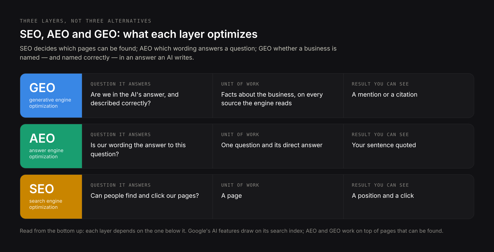
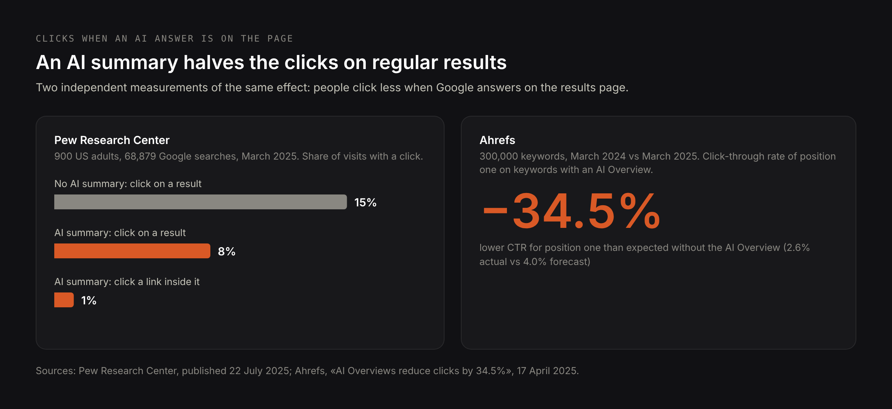
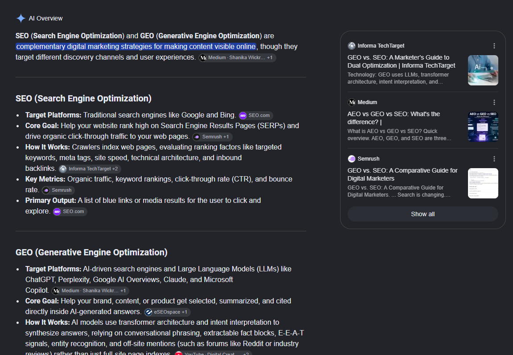
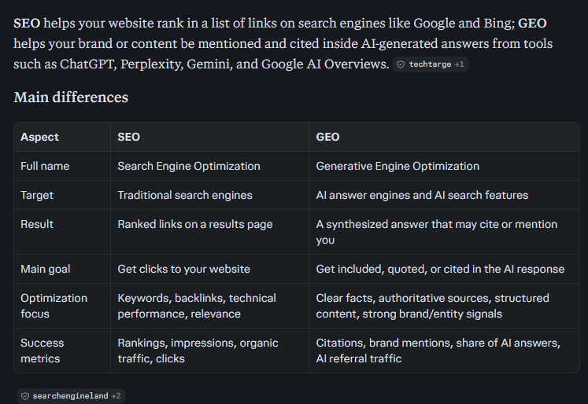
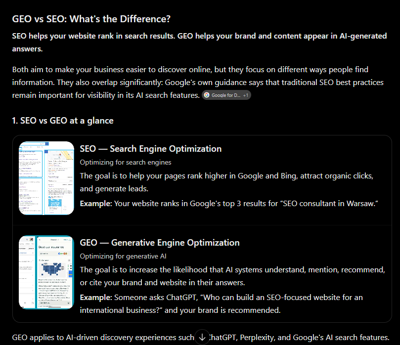
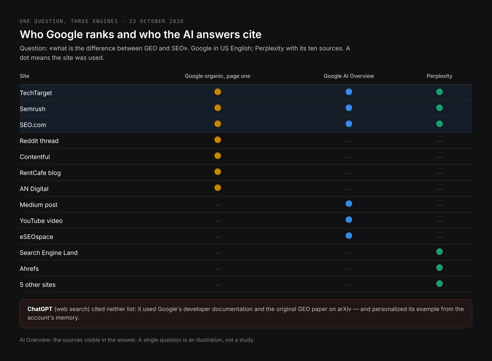
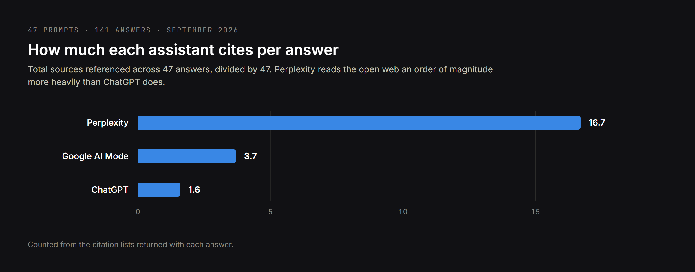
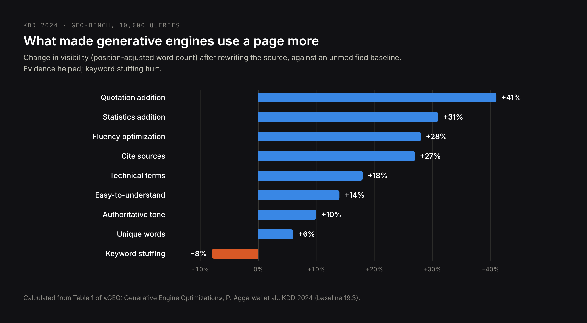
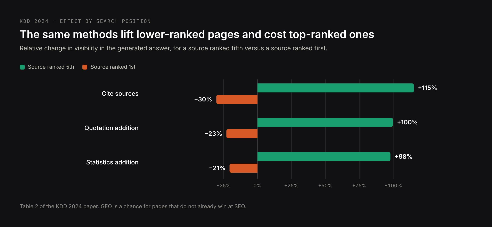

# DRAFT EN — the definitive GEO vs SEO comparison (23 Oct 2026).
# Core: research/pseo/page-core/geo-vs-seo.md — geo vs seo 2,900, seo vs geo 1,900,
# seo vs aeo 1,000, geo vs aeo 880, what is geo vs seo 590, seo and geo 720, the
# three-way combinations ~1,700. One article, not four: research/pseo/intent-check-
# geo-article.md shows 0 shared URLs even between «geo vs seo» and «seo vs geo» —
# the SERP for this young topic has not settled, so word order cannot justify pages.
# Keywords in H2s: geo vs seo, seo vs geo, what is geo vs seo, seo and geo,
# seo vs aeo, geo vs aeo, seo vs geo vs aeo, is seo dead, geo and seo strategy.
# Sources: KDD 2024 GEO paper (arXiv 2311.09735), Google Search Central «AI features
# and your website» (updated 2025-12-10), Pew Research Center (22 Jul 2025), Ahrefs
# (17 Apr 2025), TechCrunch (6 Oct 2025; 23 Jul 2025), the owner's 141-answer study,
# and a live test run on 23 Oct 2026 (screenshots in article-figures/).
# H1 (Title) and Meta title differ on purpose.

Title: SEO vs GEO vs AEO: How Search Engine Optimization and Generative Engine Optimization Really Differ
Slug: geo-vs-seo
Meta title: GEO vs SEO: Differences, Overlap and What to Do in 2026
Meta description: GEO vs SEO explained with data: what each one optimizes for, where they overlap, how ChatGPT, Perplexity and Google AI pick sources, and how to measure both.

---

> Quick answer: SEO gets a page ranked in a list of results so people click it. GEO (generative engine optimization) gets a business or a fact named inside an answer that an AI writes — in ChatGPT, Perplexity, Gemini or Google's AI Overviews. AEO (answer engine optimization) gets your exact wording chosen as the answer to one question. They share most of their foundations: Google says there are no extra requirements to appear in its AI features beyond being indexed and eligible for a snippet. They differ in the result (a mention instead of a click), in where the evidence comes from (each AI engine reads different sources), and in how you measure success. In practice you do not choose between them: you do SEO, and then you check, engine by engine, whether the work shows up in AI answers.

Most articles on GEO vs SEO compare two definitions and stop. This one compares them with data: the original research that named GEO, Google's own documentation, click studies from Pew Research Center and Ahrefs, my analysis of [141 AI answers to buying questions](/blog/ai-assistant-recommendations-study), and a live test I ran on 23 October 2026, asking ChatGPT, Perplexity and Google the same question and comparing what each of them cited.

## What is GEO vs SEO: the short definitions

**SEO (search engine optimization)** is the work that gets a page to appear high in the list of results of a search engine — Google, Bing — for the queries its audience types, and to be clicked. Its unit is the page, its result is a position, its proof is a visit.

**GEO (generative engine optimization)** is the work that gets a business, a product or a fact included in an answer generated by an AI model. The term comes from a 2023 research paper by a team from Princeton University and IIT Delhi, presented at the KDD 2024 conference. Its unit is the claim, its result is a mention or a citation, its proof is the answer itself.

**AEO (answer engine optimization)** is narrower: the work that gets your wording selected as the answer to a specific question — in a featured snippet, an AI Overview, a voice assistant or a chatbot. It is older than GEO and grew out of featured snippets.

**AIO** is used in two senses: "AI optimization" as an umbrella term for all of the above, or Google's AI Overviews as a product. When you see "SEO vs GEO vs AEO vs AIO", the fourth letter usually means the umbrella.

| Term | Optimizes for | Unit of work | Result you can see |
| --- | --- | --- | --- |
| SEO | Ranking in search results | A page | A position and a click |
| GEO | Inclusion in AI-generated answers | A claim about you | A mention or a citation |
| AEO | Being the chosen answer to one question | A question and its answer | Your wording quoted |
| AIO | Any of the above, in AI systems | Varies | Varies |

## GEO vs SEO side by side: twelve differences that matter

The differences are less about technique than about what the system on the other side does with your page. A search engine ranks documents and lets the person choose. A generative engine reads documents, compresses them and decides for the person.

| | SEO | GEO |
| --- | --- | --- |
| The system | Ranks documents | Writes an answer from documents |
| What the user sees | Ten links and snippets | One answer with two or three names |
| What you compete for | A position | Inclusion in the answer |
| Input | A typed query, often 2–4 words | A spoken-style question, often a full sentence with context |
| Unit of optimization | The page | The fact or claim about you |
| Where the evidence lives | Mostly your own site plus links to it | Your site, plus listings, reviews, forums, video and the press |
| Outcome | A click to your site | A mention, often without a click |
| Personalization | Moderate (location, language) | Strong (conversation history, memory) |
| Stability | Positions change over weeks | Answers can change between two runs |
| Main KPI | Rankings, clicks, conversions | Share of answers, citations, accuracy of the description |
| Tools | Search Console, rank trackers | Fixed question sets run across engines |
| Failure mode | You are on page two | You are not named, or named with wrong facts |

The most practical difference is the last row. In SEO, the bad outcome is invisibility. In GEO there is a second bad outcome SEO never had: being named with an old price, a service you stopped offering, or a competitor's feature. I wrote about that separately: [where AI gets outdated information about your company](/blog/where-ai-gets-outdated-information-about-your-company).

## Where SEO and GEO overlap: Google says there is no separate checklist

For Google's own AI features the overlap is close to total, and Google says so directly. Its documentation for site owners states that there are no additional requirements to appear in AI Overviews or AI Mode, and no special optimizations necessary: a page must be indexed and eligible to be shown in Google Search with a snippet. The same page says there is no special schema.org markup to add, that structured data should match the visible text, and that clicks from AI features are reported inside the normal Performance report in Search Console.

The documentation also explains a mechanism that matters for strategy: both features may use "query fan-out" — the system runs several related searches across subtopics and then assembles the answer. One question from a user becomes many searches in the background. A page that ranks for none of those sub-queries has no way in.

So for Google, the foundation of GEO is SEO: crawlable pages, an index, relevance, and a snippet-eligible answer. Everything that follows in this article is about what changes on top of that foundation — and about the engines that are not Google.

## Where GEO and SEO differ: the result is a mention, not a click

The biggest change is in what the user does after the answer. Two independent measurements:

- **Pew Research Center** analysed the March 2025 browsing of 900 US adults — 68,879 Google searches. An AI summary appeared on 18% of them. When it did, people clicked a regular result on 8% of visits, against 15% when there was no summary. They clicked a link inside the summary on 1% of visits, and ended their browsing session on 26% of pages with a summary, against 16% without one.
- **Ahrefs** compared 300,000 keywords in Search Console data before and after AI Overviews launched in the US. For keywords that show an AI Overview, the click-through rate of the first position was 34.5% lower than expected without it.

The scale is no longer a niche. In July 2025 Google reported more than 2 billion monthly users of AI Overviews and over 100 million monthly users of AI Mode in the US and India; in October 2025 OpenAI said ChatGPT had 800 million weekly users.

What follows from this is not "SEO is dead" — the AI answer is still built from pages that rank. What follows is that a ranking alone no longer guarantees a visit, and that the answer itself has become a place where a buyer forms an opinion about you before seeing your site.

## SEO vs GEO in one live test: the same question in Google, Perplexity and ChatGPT

On 23 October 2026 I asked all three engines the same question: "what is the difference between GEO and SEO" — Google in US English, Perplexity and ChatGPT with web search on. Then I wrote down which sites each of them used.

Google answered with an AI Overview above the results. The organic results under it were led by a Reddit thread, then Informa TechTarget, Contentful, Semrush, a property-marketing blog, a digital agency and SEO.com. The AI Overview cited a different mix: a Medium post, SEO.com, Semrush, TechTarget, an agency blog and a YouTube video.

Perplexity built a comparison table from ten sources: TechTarget, Semrush, Search Engine Land, Ahrefs, SEO.com and five smaller sites.

ChatGPT cited primary sources instead of marketing blogs: Google's developer documentation and the original GEO paper on arXiv. It also did something the other two did not: its example for SEO was "your website ranks in Google's top 3 results for 'SEO consultant in Warsaw'". That came from the memory of my own account, which knows what I do. The answer you see is not the answer your buyer sees.

Three things are visible in one question:

- **Ranking helps, but does not decide.** Three of the seven organic results — TechTarget, Semrush and SEO.com — were used by both the AI Overview and Perplexity. The first organic result, a Reddit thread, was used by neither.
- **AI answers reach past the first page.** Medium, YouTube and agency blogs that were not among the organic results ended up in the AI Overview.
- **Each engine has its own habits.** Perplexity read widely, Google mixed its index with video and blogs, ChatGPT went to primary sources and to the user's memory.

One question is an illustration, not a study. The pattern, though, matches what I measured on a much larger set.

## How ChatGPT, Perplexity and Google AI Mode pick sources: data from 141 answers

In September 2026 I put 47 buying questions — "which web developer should I hire for…", "who does SEO for…" — to ChatGPT, Perplexity and Google AI Mode and counted every source in all 141 answers. The full method is in the [study](/blog/ai-assistant-recommendations-study); the numbers that matter for GEO vs SEO are these:

| Engine | Sources per answer | Citations of companies' own websites | Typical behaviour |
| --- | --- | --- | --- |
| Perplexity | 16.7 | 667 | Reads the open web widely and shows its work |
| Google AI Mode | 3.7 | 141 | A tight selection close to what ranks in Google |
| ChatGPT | 1.6 | 47 | Selects before reading; mostly sources other than your site |

Two findings change how GEO differs from SEO:

- **Work on your own site pays off unevenly.** It shows up in Perplexity first, in Google's AI features through ranking, and least in ChatGPT, where the businesses named were mostly found through third-party pages.
- **Entity ambiguity outranked page quality.** When a company's name was shared with others or described inconsistently, assistants skipped it or mixed it up with someone else, however good its pages were. In SEO a confusing name costs you some clicks; in GEO it can cost you the mention entirely.

When the subject was GEO itself, the assistants cited YouTube, LinkedIn and Reddit more often than the trade press — while Google's first page for the same commercial terms was held by agency listicles. Two channels, two different sets of winners.

## What the GEO research actually found

The paper that introduced the term is "GEO: Generative Engine Optimization" by Pranjal Aggarwal, Vishvak Murahari, Tanmay Rajpurohit, Ashwin Kalyan, Karthik Narasimhan and Ameet Deshpande, presented at KDD 2024. The authors built GEO-bench — 10,000 queries from 25 domains — and tested nine ways of rewriting a source page to see which made a generative engine use it more.

| Method | What was changed in the source | Visibility vs baseline |
| --- | --- | --- |
| Quotation addition | Quotes from relevant sources added | +41% |
| Statistics addition | Numbers replace general statements | +31% |
| Fluency optimization | The same content, written more fluently | +28% |
| Cite sources | Claims backed with citations | +27% |
| Technical terms | Domain vocabulary added | +18% |
| Easy-to-understand | Simpler language | +14% |
| Authoritative | A more confident, persuasive tone | +10% |
| Unique words | Rarer vocabulary | +6% |
| Keyword stuffing | More query keywords inserted | −8% |

Visibility is measured as position-adjusted word count: how much of the answer comes from the source, weighted by where in the answer it appears. The percentages are calculated from Table 1 of the paper, against a baseline of 19.3.

Two results deserve more attention than they usually get:

- **Keyword stuffing made things worse.** The classic SEO reflex — repeat the query — reduced visibility in generated answers. What helped was evidence: quotations, numbers, citations.
- **The gains went to lower-ranked pages.** For sources in the fifth position, citing sources raised visibility by 115%; for sources in the first position, the same method lowered it by 30%. GEO is not a reward for those who already win at SEO — it is a chance for those who do not.

The limits matter too. The experiments ran on a test engine built by the authors and on Perplexity, where visibility improved by up to 37%. The engines of 2026 are not the engines of 2023, and the effect of each method varied by domain. Treat the numbers as directions, not as a recipe.

## SEO vs AEO: ranking for a question vs being its answer

SEO and AEO aim at the same results page, but at different parts of it. SEO aims at the list; AEO aims at the box above the list — the featured snippet, the AI Overview, the voice answer — and at the chatbot reply that answers the question directly.

| | SEO | AEO |
| --- | --- | --- |
| Target | A position in the list | The single chosen answer |
| Unit | A page covering a topic | One question with one direct answer |
| Typical change | Better relevance and authority of the page | The answer stated in the first lines, in a format that survives extraction |
| Markup | Helpful | Must match the visible answer exactly |
| Measure | Position | Whether your wording was the one used |

The practical method of AEO is simple to describe and hard to do well: build a map of real questions, give each question one owner page, answer it in the first two sentences, then add the detail. That is the work described on the [answer engine optimization](/services/answer-engine-optimization-services) page.

## GEO vs AEO: being named vs being quoted

GEO and AEO are often used as synonyms. They overlap, but they answer different questions:

- **AEO asks: is my wording the answer?** It works question by question, mostly on your own pages.
- **GEO asks: am I in the answer at all, and described correctly?** It works on how a business is represented across every source an engine reads — including the many that are not yours.

A law firm can win AEO for "how long does a residence permit take in Poland" and still be absent when someone asks an assistant "which immigration lawyer in Warsaw should I contact". The first is a fact the engine quotes; the second is a recommendation the engine assembles from listings, reviews and articles. Both matter; they are fixed in different places.

## SEO vs GEO vs AEO in one map

Put together, the three are layers, not alternatives:

1. **SEO is the foundation.** Without crawlable, indexed, relevant pages, nothing else can happen — Google's AI features draw on its index, and other engines search the web too.
2. **AEO works on the answer.** It makes the facts on your pages extractable: one question, one clear answer, consistent markup.
3. **GEO works on the representation.** It makes sure the engines can tell your business apart from others, find the same facts about you on sites they trust, and repeat them correctly.

That is also why "SEO vs GEO" is a slightly wrong question. The useful question is how much of each layer your situation needs.

## Is SEO dead? Will GEO replace SEO?

No — and the evidence is in the systems themselves. Google's AI Overviews and AI Mode are built on its search index and require nothing beyond being indexed and snippet-eligible. Perplexity cited companies' own websites 667 times in 47 answers. ChatGPT searches the web before naming providers. Every one of these engines depends on documents that someone optimized to be found.

What is dying is a narrow version of SEO: chasing positions for informational queries that an AI now answers on the page, and reporting traffic as if a click were the only outcome. When the Pew data shows clicks halving under an AI summary, the value of being the source of that summary goes up, not down.

Will SEO exist in five years? The discipline of making content findable, readable and trustworthy for machines will. The reports will look different: share of answers next to share of clicks.

## How to measure SEO and GEO: different KPIs, one plan

| What you measure | SEO | GEO |
| --- | --- | --- |
| Visibility | Positions, impressions | Share of answers that name you, per engine |
| Quality | CTR, engagement | Accuracy of how you are described |
| Evidence | Backlinks, rankings of key pages | Which sources each engine cites for your questions |
| Business result | Leads and revenue from organic | Leads that mention AI, branded searches, AI referral traffic |
| Tooling | Search Console, analytics | A fixed set of buyer questions, run on a schedule |

Three rules make GEO measurement honest:

- **Freeze the question set.** Write down 20–50 questions your buyers actually ask, in their words and languages, and run the same set every month. Changing the questions changes the result.
- **Run clean sessions.** As the ChatGPT example above shows, memory and conversation history change the answer. Log out, use a fresh session, and note the date, engine, model and language of each run.
- **Record sources, not only names.** Whether you are named matters less than why. The cited sources tell you where to work next.

How to do this step by step is in [how to check what AI assistants say about your company](/blog/how-to-check-what-ai-says-about-your-company) and [how to monitor brand mentions in AI answers](/blog/how-to-monitor-brand-mentions-in-ai-answers).

## GEO and SEO strategy: what to do first, by type of business

| Business | Where buyers ask | Priority |
| --- | --- | --- |
| Local service (clinic, lawyer, contractor) | Google and maps, increasingly ChatGPT | Local SEO and a complete business profile first; then consistent listings and reviews, which assistants read |
| B2B services and consulting | ChatGPT, Perplexity, LinkedIn | Entity clarity and third-party mentions; clear service pages; articles with original data |
| E-commerce | Google Shopping and AI Overviews | Technical SEO and product data first; then comparison and buying-guide content with real numbers |
| Publisher or SaaS with informational content | Google, where AI Overviews absorb simple answers | Fewer generic explainers, more original research, tools and data that answers have to cite |

And the checklist that works for most of them, in order:

1. Make sure the site is crawlable and indexable, and that your server does not block the AI crawlers you want — for ChatGPT search that is OAI-SearchBot.
2. Fix entity clarity: one name, one description of what you do, for whom and where, the same on the site, in structured data and on every profile.
3. State the facts that set you apart as plain sentences — services, markets, prices, numbers — not slogans.
4. Give each important question its own page and answer it in the first lines.
5. Back claims with numbers and named sources; quote experts where it adds evidence.
6. Keep structured data identical to what the page says.
7. Get listed and described correctly on the directories and review sites that actually appear in answers for your industry.
8. Earn mentions in articles and comparisons on sites the engines already use.
9. Publish something only you can publish: data, cases, measurements.
10. Freeze a question set and run a baseline in each engine.
11. Repeat monthly; fix what the sources tell you.
12. Report SEO and GEO side by side, so neither is judged by the other's metric.

## Common GEO myths

**"GEO needs a separate website or special markup."** For Google's AI features it explicitly does not. For other engines, clear content and consistent facts matter far more than any tag.

**"llms.txt will get us into ChatGPT."** It is a proposed convention that no major assistant has confirmed using. It is cheap to add and harmless, which is all it is. Details: [does your site need an llms.txt file](/blog/does-your-site-need-llms-txt).

**"Repeat the question as many times as possible."** The original GEO research measured keyword stuffing as the one method that reduced visibility.

**"Write it with AI, the AI will like it."** Engines quote what is distinctive and verifiable. Text that says what a thousand other pages say gives them no reason to pick yours.

**"Once we're in the answer, we're in."** Answers change between runs and between users. Inclusion is a share over many runs, not a state.

## Common questions about GEO vs SEO

**Is SEO still relevant in 2026?**
Yes. Google's AI Overviews and AI Mode draw on its index and need nothing beyond normal indexing and snippet eligibility, and other AI engines search the web before they answer. What has changed is that a ranking no longer guarantees a click, so SEO is now measured together with presence in AI answers.

**What is GEO relative to SEO?**
GEO is a layer on top of SEO. SEO makes pages findable and ranked; GEO makes sure that, when an AI writes an answer from those and other pages, your business is included and described correctly.

**Is GEO replacing SEO?**
No. Generative engines depend on documents that are crawlable, indexed and relevant — which is what SEO produces. GEO changes the outcome you aim for and adds sources outside your site to the work.

**Do I need a separate GEO strategy?**
You need separate measurement and a few separate tasks — entity clarity, third-party sources, a question set per engine. The content and technical work is largely shared with SEO.

**How long does GEO take to show results?**
Changes on your own site can appear in answers within weeks, once pages are recrawled. New mentions on other sites and a change in how assistants describe you usually take two to four months.

**What is the difference between GEO and AEO?**
AEO works on being the quoted answer to one question, mostly on your own pages. GEO works on being included and correctly described in generated answers, across all the sources an engine reads.

**Can a small business do GEO itself?**
Partly: keep the business profile and listings complete and consistent, state your facts plainly on the site, and ask the same buyer questions in ChatGPT, Perplexity and Google every month. The harder part is tracing which sources each engine uses and changing them.

## Where to start

If you are starting from zero, do the SEO foundation first and run a GEO baseline at the same time, so you know what the AI engines say about you before you change anything. The four ways I can help are on the [generative engine optimization](/services/ai-ready-seo-and-geo-optimization) page; Google and AI answers as one ongoing job are on [AI SEO services](/services/ai-seo-services); ChatGPT on its own and all models measured one by one are on [ChatGPT SEO services](/services/chatgpt-seo-services) and [LLM SEO services](/services/llm-seo-services).

**Sources:** P. Aggarwal et al., "GEO: Generative Engine Optimization", KDD 2024 (arXiv 2311.09735) · Google Search Central, "AI features and your website", updated 10 December 2025 · Pew Research Center, browsing data of 900 US adults, March 2025, published 22 July 2025 · Ahrefs, "AI Overviews reduce clicks by 34.5%", 17 April 2025 · TechCrunch, 23 July 2025 (AI Overviews, AI Mode) and 6 October 2025 (ChatGPT) · own study of 141 AI answers, September 2026 · own live test, 23 October 2026.
