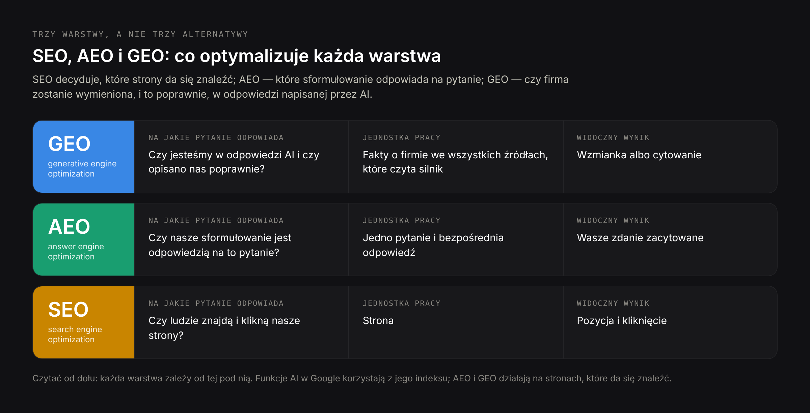
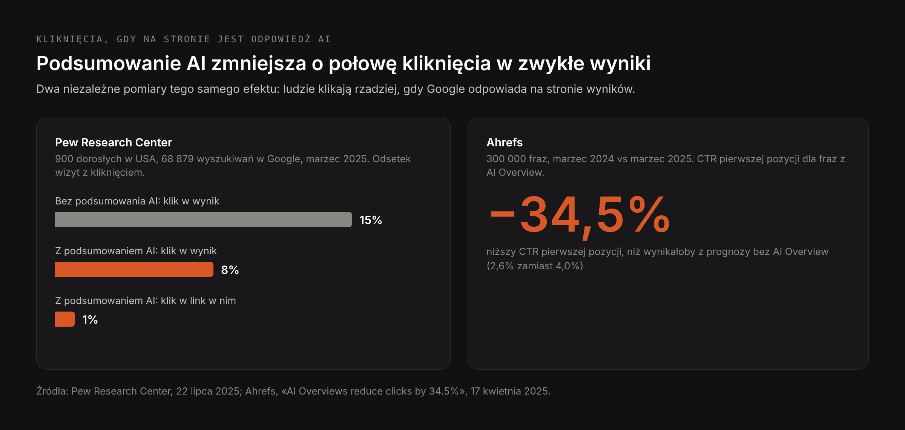
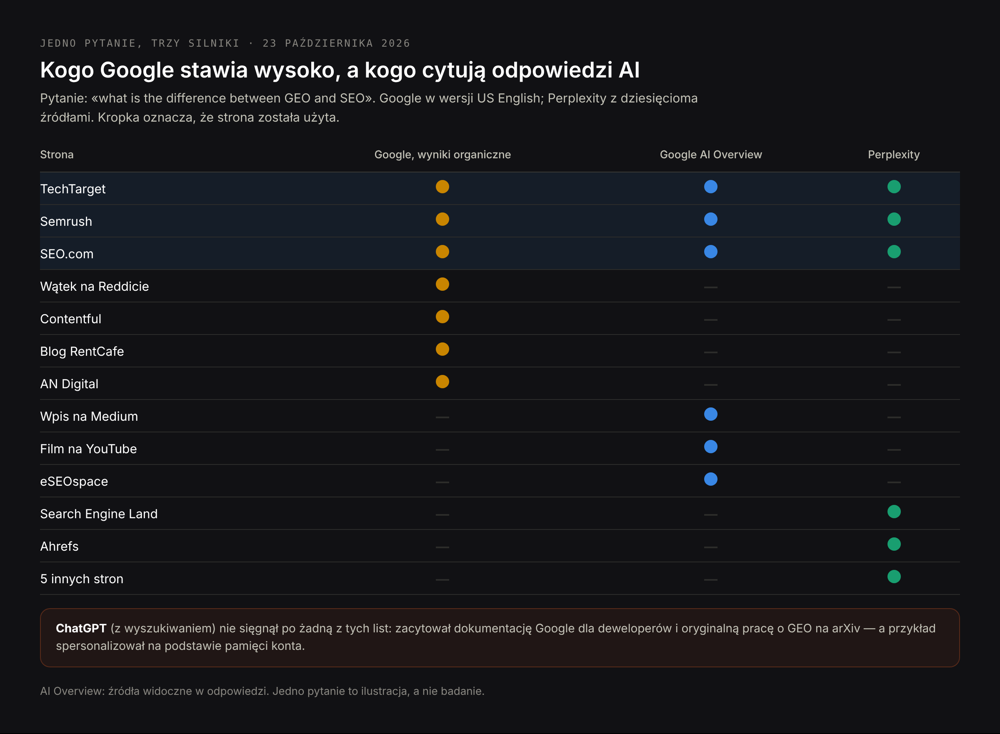
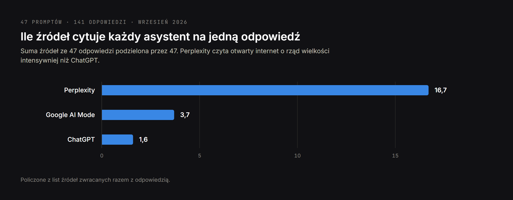
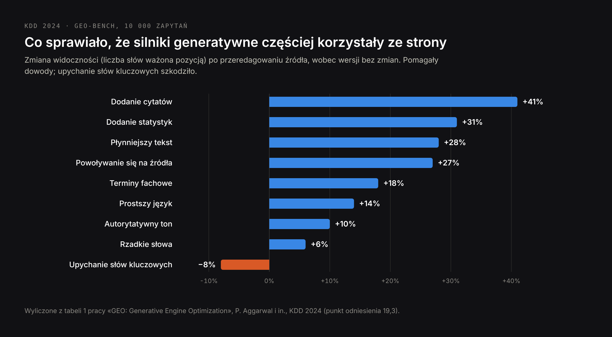
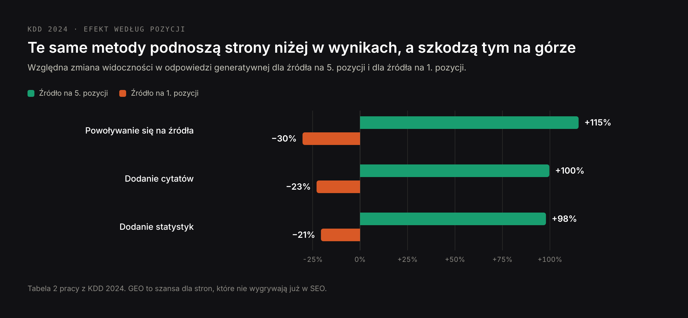

# DRAFT PL — market version of blog-geo-vs-seo-EN.md, not a translation (23 Oct 2026).
# Core (PL): geo seo 390, geo vs seo 110, seo geo aeo 40, geo pozycjonowanie 40;
# PAA: Czym się różni SEO od GEO? Czy SEO ma jeszcze sens? Po jakim czasie widać
# efekty SEO? Ile kosztuje SEO miesięcznie? Keywords in H2s: geo vs seo, geo seo,
# czym się różni SEO od GEO, SEO vs AEO, GEO vs AEO, SEO GEO AEO, czy SEO ma sens.
# Same sources and figures as EN; figures in Polish (fig-*-pl.png), screenshots
# shared. Prices in zł as on the PL service pages. H1 (Title) ≠ Meta title.

Title: SEO, GEO i AEO: czym pozycjonowanie w Google różni się od optymalizacji pod AI
Slug: geo-vs-seo-roznice
Meta title: GEO vs SEO: różnice, wspólne elementy i co robić w 2026
Meta description: GEO vs SEO na danych: co optymalizuje każde z nich, gdzie się pokrywają, jak ChatGPT, Perplexity i AI w Google wybierają źródła i jak mierzyć oba kanały.

---

> Krótka odpowiedź: SEO sprawia, że strona pojawia się wysoko na liście wyników i ludzie w nią klikają. GEO (generative engine optimization) sprawia, że firma albo fakt zostaje wymieniony w odpowiedzi, którą pisze AI — w ChatGPT, Perplexity, Gemini albo w podsumowaniach AI w Google. AEO (answer engine optimization) sprawia, że to Wasze sformułowanie zostaje wybrane jako odpowiedź na jedno konkretne pytanie. Większość fundamentów jest wspólna: Google pisze wprost, że do pojawienia się w jego funkcjach AI nie trzeba niczego ponad indeksowanie i możliwość wyświetlenia fragmentu strony. Różnią się wynikiem (wzmianka zamiast kliknięcia), źródłami, z których korzysta każdy silnik, i sposobem mierzenia. W praktyce nie wybiera się między nimi: robi się SEO, a potem sprawdza, silnik po silniku, czy ta praca widać w odpowiedziach AI.

Większość tekstów o GEO vs SEO porównuje dwie definicje i na tym kończy. Ten porównuje je na danych: na pracy naukowej, w której po raz pierwszy opisano GEO, na dokumentacji Google, na badaniach kliknięć Pew Research Center i Ahrefs, na mojej [analizie 141 odpowiedzi AI na pytania zakupowe](/pl/blog/pozycjonowanie-w-ai-badanie) i na teście z 23 października 2026 roku, w którym zadałem to samo pytanie ChatGPT, Perplexity i Google i porównałem, kogo każdy z nich zacytował.

## Czym się różni SEO od GEO: krótkie definicje

**SEO (search engine optimization)**, po polsku pozycjonowanie strony, to praca nad tym, żeby strona pojawiała się wysoko w wynikach wyszukiwarki — Google, Bing — na frazy, które wpisują Wasi klienci, i żeby ją klikano. Jednostką pracy jest strona, wynikiem — pozycja, dowodem — wizyta.

**GEO (generative engine optimization)** to praca nad tym, żeby firma, produkt albo fakt znalazł się w odpowiedzi generowanej przez model AI. Termin pochodzi z pracy naukowej zespołu z Princeton University i IIT Delhi z 2023 roku, przedstawionej na konferencji KDD 2024. Jednostką pracy jest twierdzenie o firmie, wynikiem — wzmianka albo cytowanie, dowodem — sama odpowiedź.

**AEO (answer engine optimization)** jest węższe: chodzi o to, żeby Wasze sformułowanie zostało wybrane jako odpowiedź na konkretne pytanie — w polecanym fragmencie, w podsumowaniu AI, w asystencie głosowym albo w chatbocie. AEO jest starsze od GEO i wyrosło z polecanych fragmentów Google.

**AIO** bywa używane w dwóch znaczeniach: jako „AI optimization”, czyli parasol nad wszystkim powyżej, albo jako skrót od AI Overviews w Google. W zestawieniu „SEO vs GEO vs AEO vs AIO” czwarta pozycja zwykle oznacza parasol.

| Termin | Na co optymalizuje | Jednostka pracy | Widoczny wynik |
| --- | --- | --- | --- |
| SEO | Pozycja w wynikach wyszukiwania | Strona | Pozycja i kliknięcie |
| GEO | Obecność w odpowiedziach generowanych przez AI | Twierdzenie o firmie | Wzmianka albo cytowanie |
| AEO | Bycie wybraną odpowiedzią na jedno pytanie | Pytanie i odpowiedź | Wasze zdanie zacytowane |
| AIO | Dowolne z powyższych w systemach AI | Różnie | Różnie |

## GEO vs SEO obok siebie: dwanaście różnic, które mają znaczenie

Różnice dotyczą mniej technik, a bardziej tego, co system po drugiej stronie robi z Waszą stroną. Wyszukiwarka układa dokumenty w kolejności i zostawia wybór człowiekowi. Silnik generatywny czyta dokumenty, streszcza je i wybiera za człowieka.

| | SEO | GEO |
| --- | --- | --- |
| System | Układa dokumenty w kolejności | Pisze odpowiedź na podstawie dokumentów |
| Co widzi użytkownik | Dziesięć linków z opisami | Jedną odpowiedź z dwiema–trzema nazwami |
| O co się walczy | O pozycję | O obecność w odpowiedzi |
| Wejście | Wpisana fraza, zwykle 2–4 słowa | Pytanie jak w rozmowie, często całe zdanie z kontekstem |
| Jednostka optymalizacji | Strona | Fakt albo twierdzenie o firmie |
| Gdzie są dowody | Głównie Wasza strona i linki do niej | Wasza strona oraz katalogi, opinie, fora, wideo i media |
| Rezultat | Kliknięcie w Waszą stronę | Wzmianka, często bez kliknięcia |
| Personalizacja | Umiarkowana (lokalizacja, język) | Silna (historia rozmowy, pamięć) |
| Stabilność | Pozycje zmieniają się w ciągu tygodni | Odpowiedź może się zmienić między dwoma zapytaniami |
| Główny wskaźnik | Pozycje, kliknięcia, konwersje | Udział w odpowiedziach, cytowania, trafność opisu |
| Narzędzia | Search Console, monitoring pozycji | Stały zestaw pytań sprawdzany w kilku silnikach |
| Porażka | Jesteście na drugiej stronie | Nie ma Was w odpowiedzi albo opisano Was z błędami |

Najważniejszy praktycznie jest ostatni wiersz. W SEO złym wynikiem jest niewidoczność. W GEO jest drugi zły wynik, którego SEO nie znało: zostać wymienionym ze starą ceną, usługą, której już nie ma, albo funkcją konkurenta. Jak to naprawiać, opisuję na stronie [poprawa błędnych danych o firmie w AI](/pl/oferty/poprawa-blednych-danych-w-ai).

## Gdzie SEO i GEO się pokrywają: Google nie ma osobnej listy wymagań

W przypadku funkcji AI w samym Google pokrycie jest niemal całkowite i Google mówi to wprost. Dokumentacja dla właścicieli stron mówi, że nie ma dodatkowych wymagań, żeby pojawić się w AI Overviews albo w trybie AI, ani żadnych specjalnych optymalizacji: strona ma być zaindeksowana i mieć możliwość wyświetlenia w wyszukiwarce z fragmentem. Ta sama strona dokumentacji mówi, że nie trzeba dodawać specjalnych danych strukturalnych schema.org, że dane strukturalne powinny zgadzać się z widocznym tekstem i że kliknięcia z funkcji AI są liczone w zwykłym raporcie Skuteczność w Search Console.

Dokumentacja opisuje też mechanizm ważny dla strategii: obie funkcje mogą korzystać z techniki „query fan-out” — system wykonuje kilka powiązanych wyszukiwań w podtematach i dopiero z nich składa odpowiedź. Jedno pytanie użytkownika zamienia się w tle w wiele wyszukiwań. Strona, która nie pojawia się w żadnym z tych podzapytań, nie ma jak wejść do odpowiedzi.

Dla Google fundamentem GEO jest więc SEO: strony dostępne dla robotów, indeks, trafność i odpowiedź nadająca się na fragment. Wszystko dalej w tym artykule dotyczy tego, co zmienia się ponad tym fundamentem — i silników, które nie są Google.

## Gdzie GEO i SEO się różnią: wynikiem jest wzmianka, a nie kliknięcie

Największa zmiana dotyczy tego, co użytkownik robi po przeczytaniu odpowiedzi. Dwa niezależne pomiary:

- **Pew Research Center** przeanalizowało przeglądanie internetu przez 900 dorosłych w USA w marcu 2025 roku — 68 879 wyszukiwań w Google. Podsumowanie AI pojawiło się w 18% z nich. Gdy się pojawiło, ludzie klikali w zwykły wynik przy 8% wizyt, a bez podsumowania — przy 15%. W link wewnątrz podsumowania klikali przy 1% wizyt, a sesję kończyli na 26% stron z podsumowaniem wobec 16% bez niego.
- **Ahrefs** porównał 300 000 fraz w danych Search Console przed wprowadzeniem AI Overviews w USA i po nim. Dla fraz, przy których pojawia się AI Overview, CTR pierwszej pozycji był o 34,5% niższy, niż wynikałoby z prognozy bez niego.

Skala nie jest już niszowa. W lipcu 2025 roku Google podał, że z AI Overviews korzysta ponad 2 miliardy osób miesięcznie, a z trybu AI ponad 100 milionów miesięcznie w USA i Indiach; w październiku 2025 roku OpenAI poinformował, że ChatGPT ma 800 milionów użytkowników tygodniowo.

Nie wynika z tego, że „SEO umarło” — odpowiedź AI wciąż powstaje ze stron, które są wysoko w wynikach. Wynika z tego, że sama pozycja nie gwarantuje już wizyty, a odpowiedź stała się miejscem, w którym klient wyrabia sobie zdanie o firmie, zanim zobaczy jej stronę.

## GEO vs SEO w jednym teście: to samo pytanie w Google, Perplexity i ChatGPT

23 października 2026 roku zadałem trzem silnikom to samo pytanie: „what is the difference between GEO and SEO” — Google w wersji US English, Perplexity i ChatGPT z włączonym wyszukiwaniem. Potem zapisałem, z jakich stron korzystał każdy z nich. Pytanie było po angielsku, bo w tym języku jest najwięcej materiału na ten temat.

Google odpowiedział podsumowaniem AI nad wynikami. Wyniki organiczne pod nim otwierał wątek na Reddicie, dalej Informa TechTarget, Contentful, Semrush, blog o marketingu nieruchomości, agencja marketingowa i SEO.com. Podsumowanie AI zacytowało inny zestaw: wpis na Medium, SEO.com, Semrush, TechTarget, blog agencji i film na YouTube.

Perplexity zbudował tabelę porównawczą z dziesięciu źródeł: TechTarget, Semrush, Search Engine Land, Ahrefs, SEO.com i pięciu mniejszych stron.

ChatGPT zamiast blogów marketingowych zacytował źródła pierwotne: dokumentację Google dla deweloperów i oryginalną pracę o GEO na arXiv. Zrobił też coś, czego nie zrobili pozostali: jako przykład SEO podał „Twoja strona jest w top 3 Google na frazę ‘SEO consultant in Warsaw’”. Wziął to z pamięci mojego konta, która wie, czym się zajmuję. Odpowiedź, którą widzicie, nie jest odpowiedzią, którą widzi Wasz klient.

W jednym pytaniu widać trzy rzeczy:

- **Pozycja pomaga, ale nie przesądza.** Trzy z siedmiu wyników organicznych — TechTarget, Semrush i SEO.com — wykorzystały zarówno podsumowanie AI, jak i Perplexity. Pierwszego wyniku organicznego, wątku na Reddicie, nie wykorzystał nikt.
- **Odpowiedzi AI sięgają poza pierwszą stronę.** Medium, YouTube i blogi agencji, których nie było w wynikach organicznych, trafiły do podsumowania AI.
- **Każdy silnik ma swoje nawyki.** Perplexity czytał szeroko, Google mieszał swój indeks z wideo i blogami, ChatGPT poszedł do źródeł pierwotnych i do pamięci użytkownika.

Jedno pytanie to ilustracja, a nie badanie. Wzorzec zgadza się jednak z tym, co zmierzyłem na dużo większym zbiorze.

## Jak ChatGPT, Perplexity i Google AI Mode wybierają źródła: dane ze 141 odpowiedzi

We wrześniu 2026 roku zadałem 47 pytań zakupowych — „jakiego programistę wybrać do…”, „kto robi SEO dla…” — ChatGPT, Perplexity i Google AI Mode i policzyłem każde źródło we wszystkich 141 odpowiedziach. Pełna metoda jest w [badaniu](/pl/blog/pozycjonowanie-w-ai-badanie); dla porównania GEO vs SEO liczą się te liczby:

| Silnik | Źródeł na odpowiedź | Cytowań stron samych firm | Typowe zachowanie |
| --- | --- | --- | --- |
| Perplexity | 16,7 | 667 | Czyta szeroko otwarty internet i pokazuje źródła |
| Google AI Mode | 3,7 | 141 | Wąski wybór, bliski temu, co jest wysoko w Google |
| ChatGPT | 1,6 | 47 | Wybiera przed czytaniem; głównie źródła spoza Waszej strony |

Dwa wnioski zmieniają to, czym GEO różni się od SEO:

- **Praca na własnej stronie zwraca się nierówno.** Widać ją najpierw w Perplexity, w funkcjach AI Google — przez pozycje, a najmniej w ChatGPT, gdzie wymieniane firmy znajdowano głównie przez strony zewnętrzne.
- **Niejednoznaczna nazwa ważyła więcej niż jakość strony.** Gdy nazwę firmy nosiły też inne podmioty albo opis różnił się między stronami, asystenci firmę pomijali albo mylili z kimś innym, niezależnie od jakości jej podstron. W SEO myląca nazwa kosztuje trochę kliknięć; w GEO może kosztować całą wzmiankę.

Gdy tematem było samo GEO, asystenci częściej cytowali YouTube, LinkedIn i Reddit niż prasę branżową — a pierwszą stronę Google dla tych samych fraz komercyjnych zajmowały zestawienia agencji. Dwa kanały, dwa różne zestawy zwycięzców.

## Co naprawdę pokazały badania nad GEO

Pracę, która wprowadziła termin, napisali Pranjal Aggarwal, Vishvak Murahari, Tanmay Rajpurohit, Ashwin Kalyan, Karthik Narasimhan i Ameet Deshpande: „GEO: Generative Engine Optimization”, KDD 2024. Autorzy zbudowali zbiór GEO-bench — 10 000 zapytań z 25 dziedzin — i sprawdzili dziewięć sposobów przeredagowania strony źródłowej, żeby zobaczyć, które sprawiają, że silnik generatywny korzysta z niej częściej.

| Metoda | Co zmieniono w źródle | Widoczność wobec wersji bez zmian |
| --- | --- | --- |
| Dodanie cytatów | Cytaty z wiarygodnych źródeł | +41% |
| Dodanie statystyk | Liczby zamiast ogólników | +31% |
| Płynniejszy tekst | Ta sama treść, lepiej napisana | +28% |
| Powoływanie się na źródła | Twierdzenia poparte odnośnikami | +27% |
| Terminy fachowe | Słownictwo dziedziny | +18% |
| Prostszy język | Łatwiejsze sformułowania | +14% |
| Autorytatywny ton | Pewniejszy, przekonujący styl | +10% |
| Rzadkie słowa | Mniej typowe słownictwo | +6% |
| Upychanie słów kluczowych | Więcej fraz z zapytania | −8% |

Widoczność mierzono jako liczbę słów ważoną pozycją: ile odpowiedzi pochodzi ze źródła, z uwzględnieniem miejsca, w którym się pojawia. Procenty są wyliczone z tabeli 1 pracy, wobec punktu odniesienia 19,3.

Dwa wyniki zasługują na więcej uwagi, niż zwykle dostają:

- **Upychanie słów kluczowych pogarszało wynik.** Klasyczny odruch z SEO — powtórzyć frazę — zmniejszał widoczność w odpowiedziach. Pomagały dowody: cytaty, liczby, źródła.
- **Zyskiwały strony niżej w wynikach.** Dla źródeł na piątej pozycji powoływanie się na źródła zwiększało widoczność o 115%; dla źródeł na pierwszej pozycji ta sama metoda ją zmniejszała o 30%. GEO nie jest nagrodą dla tych, którzy już wygrywają w SEO — jest szansą dla tych, którzy nie wygrywają.

Ograniczenia też są ważne. Eksperymenty prowadzono na silniku testowym zbudowanym przez autorów i na Perplexity, gdzie widoczność rosła maksymalnie o 37%. Silniki z 2026 roku nie są silnikami z 2023 roku, a efekt każdej metody zależał od dziedziny. Te liczby to kierunki, a nie przepis.

## SEO vs AEO: pozycja na pytanie a bycie odpowiedzią

SEO i AEO celują w tę samą stronę wyników, ale w różne jej części. SEO celuje w listę; AEO — w ramkę nad listą: polecany fragment, podsumowanie AI, odpowiedź głosową — i w odpowiedź chatbota, który odpowiada wprost.

| | SEO | AEO |
| --- | --- | --- |
| Cel | Pozycja na liście | Jedna wybrana odpowiedź |
| Jednostka | Strona omawiająca temat | Jedno pytanie z jedną bezpośrednią odpowiedzią |
| Typowa zmiana | Lepsza trafność i autorytet strony | Odpowiedź w pierwszych zdaniach, w formie, która przetrwa wycięcie |
| Dane strukturalne | Pomagają | Muszą dokładnie odpowiadać widocznej odpowiedzi |
| Pomiar | Pozycja | Czy użyto Waszego sformułowania |

Metodę AEO łatwo opisać, a trudno dobrze wykonać: zbudować mapę prawdziwych pytań, każdemu pytaniu dać jedną stronę-właściciela, odpowiedzieć w pierwszych dwóch zdaniach, a dopiero potem rozwinąć. Tę pracę opisuję na stronie [pozycjonowanie w AI (AEO)](/pl/oferty/pozycjonowanie-w-ai-i-chatgpt).

## GEO vs AEO: być wymienionym a być zacytowanym

GEO i AEO bywają używane zamiennie. Pokrywają się, ale odpowiadają na różne pytania:

- **AEO pyta: czy nasze sformułowanie jest odpowiedzią?** Działa pytanie po pytaniu, głównie na Waszych stronach.
- **GEO pyta: czy w ogóle jesteśmy w odpowiedzi i czy opisano nas poprawnie?** Działa na tym, jak firma jest przedstawiona we wszystkich źródłach, które czyta silnik — także w tych, które nie należą do Was.

Kancelaria może wygrać AEO na pytanie „ile trwa uzyskanie karty pobytu w Polsce” i nadal nie pojawić się, gdy ktoś zapyta asystenta „do jakiego prawnika od legalizacji pobytu w Warszawie się zgłosić”. Pierwsze to fakt, który silnik cytuje; drugie to rekomendacja, którą silnik składa z katalogów, opinii i artykułów. Oba się liczą; naprawia się je w różnych miejscach.

## SEO, GEO i AEO na jednej mapie

Razem te trzy pojęcia są warstwami, a nie alternatywami:

1. **SEO jest fundamentem.** Bez stron dostępnych dla robotów, zaindeksowanych i trafnych nic dalej się nie wydarzy — funkcje AI w Google korzystają z jego indeksu, a inne silniki też przeszukują sieć.
2. **AEO pracuje nad odpowiedzią.** Sprawia, że fakty na Waszych stronach da się wyciągnąć: jedno pytanie, jedna jasna odpowiedź, spójne dane strukturalne.
3. **GEO pracuje nad wizerunkiem w odpowiedziach.** Dba o to, żeby silniki odróżniały Waszą firmę od innych, znajdowały te same fakty o Was na stronach, którym ufają, i powtarzały je poprawnie.

Dlatego „GEO vs SEO” to trochę źle postawione pytanie. Użyteczne pytanie brzmi: ile każdej warstwy potrzebuje Wasza sytuacja.

## Czy SEO ma jeszcze sens, skoro jest GEO?

Ma — a dowód jest w samych systemach. AI Overviews i tryb AI w Google działają na indeksie wyszukiwarki i nie wymagają niczego ponad indeksowanie i możliwość wyświetlenia fragmentu. Perplexity zacytował strony samych firm 667 razy w 47 odpowiedziach. ChatGPT przeszukuje sieć, zanim wymieni wykonawców. Każdy z tych silników zależy od dokumentów, które ktoś zoptymalizował, żeby dało się je znaleźć.

Umiera wąska wersja SEO: walka o pozycje na frazy informacyjne, na które AI odpowiada już na stronie wyników, i raportowanie ruchu tak, jakby kliknięcie było jedynym rezultatem. Gdy dane Pew pokazują, że kliknięcia pod podsumowaniem AI spadają o połowę, wartość bycia źródłem tego podsumowania rośnie, a nie maleje.

Czy SEO przetrwa kolejne pięć lat? Dyscyplina polegająca na tym, żeby treść dało się znaleźć, przeczytać i jej zaufać — przetrwa. Raporty będą wyglądały inaczej: udział w odpowiedziach obok udziału w kliknięciach.

## Jak mierzyć SEO i GEO: różne wskaźniki, jeden plan

| Co mierzymy | SEO | GEO |
| --- | --- | --- |
| Widoczność | Pozycje, wyświetlenia | Odsetek odpowiedzi, które Was wymieniają, w każdym silniku |
| Jakość | CTR, zaangażowanie | Trafność opisu firmy |
| Dowody | Linki, pozycje kluczowych stron | Jakie źródła każdy silnik cytuje dla Waszych pytań |
| Wynik biznesowy | Zapytania i sprzedaż z ruchu organicznego | Zapytania, w których klient wspomina AI, wyszukiwania marki, ruch z AI |
| Narzędzia | Search Console, analityka | Stały zestaw pytań klientów sprawdzany według harmonogramu |

Trzy zasady sprawiają, że pomiar GEO jest uczciwy:

- **Zamroźcie zestaw pytań.** Zapiszcie 20–50 pytań, które naprawdę zadają Wasi klienci, ich słowami i w ich językach, i co miesiąc sprawdzajcie ten sam zestaw. Zmiana pytań zmienia wynik.
- **Używajcie czystych sesji.** Jak pokazał przykład ChatGPT powyżej, pamięć i historia rozmów zmieniają odpowiedź. Wylogujcie się, używajcie nowej sesji i zapisujcie datę, silnik, model i język każdego sprawdzenia.
- **Zapisujcie źródła, a nie tylko nazwy.** Ważniejsze od tego, czy Was wymieniono, jest dlaczego. Cytowane źródła mówią, gdzie pracować dalej.

Punktem wyjścia jest [audyt widoczności w wyszukiwaniu AI](/pl/oferty/audyt-widocznosci-w-ai), część stała to [monitoring marki w odpowiedziach AI](/pl/oferty/monitoring-marki-w-ai).

## Strategia GEO i SEO: od czego zacząć, zależnie od rodzaju firmy

| Firma | Gdzie pytają klienci | Priorytet |
| --- | --- | --- |
| Usługi lokalne (gabinet, kancelaria, wykonawca) | Google i mapy, coraz częściej ChatGPT | Najpierw lokalne SEO i pełna wizytówka; potem spójne katalogi i opinie, które czytają asystenci |
| Usługi B2B i doradztwo | ChatGPT, Perplexity, LinkedIn | Jednoznaczna nazwa i wzmianki w źródłach zewnętrznych; jasne podstrony usług; artykuły z własnymi danymi |
| Sklep internetowy | Google Zakupy i podsumowania AI | Najpierw SEO techniczne i dane produktów; potem porównania i poradniki zakupowe z konkretnymi liczbami |
| Wydawca albo SaaS z treściami informacyjnymi | Google, gdzie podsumowania AI przejmują proste odpowiedzi | Mniej ogólnych poradników, więcej własnych badań, narzędzi i danych, które odpowiedzi muszą cytować |

I lista kroków, która działa dla większości z nich, w kolejności:

1. Upewnijcie się, że strona jest dostępna dla robotów i indeksowana, a serwer nie blokuje robotów AI, które chcecie wpuścić — dla wyszukiwania ChatGPT to OAI-SearchBot.
2. Uporządkujcie jednoznaczność firmy: jedna nazwa i jeden opis tego, co robicie, dla kogo i gdzie — tak samo na stronie, w danych strukturalnych i w każdym profilu.
3. Zapiszcie fakty, które Was wyróżniają, prostymi zdaniami — usługi, rynki, ceny, liczby — a nie hasłami.
4. Każdemu ważnemu pytaniu dajcie własną podstronę i odpowiedzcie w pierwszych zdaniach.
5. Popierajcie twierdzenia liczbami i nazwanymi źródłami; cytujcie ekspertów tam, gdzie to dodaje dowodu.
6. Trzymajcie dane strukturalne identyczne z tym, co mówi strona.
7. Bądźcie poprawnie opisani w katalogach i serwisach z opiniami, które naprawdę pojawiają się w odpowiedziach w Waszej branży.
8. Zdobywajcie wzmianki w artykułach i zestawieniach na stronach, z których silniki już korzystają.
9. Publikujcie to, co możecie opublikować tylko Wy: dane, przypadki, pomiary.
10. Zamroźcie zestaw pytań i zróbcie punkt wyjścia w każdym silniku.
11. Powtarzajcie pomiar co miesiąc; poprawiajcie to, co wskazują źródła.
12. Raportujcie SEO i GEO obok siebie, żeby żadnego nie oceniać miarą drugiego.

## Mity o GEO

**„GEO wymaga osobnej strony albo specjalnego kodu.”** W przypadku funkcji AI w Google wprost nie wymaga. W innych silnikach jasna treść i spójne fakty znaczą dużo więcej niż jakikolwiek znacznik.

**„Plik llms.txt wprowadzi nas do ChatGPT.”** To proponowana konwencja, której żaden duży asystent nie potwierdził, że używa. Jest tania i nieszkodliwa — i tyle.

**„Powtórzmy frazę jak najwięcej razy.”** Pierwotne badania nad GEO zmierzyły upychanie słów kluczowych jako jedyną metodę, która zmniejszała widoczność.

**„Napiszmy to AI, AI to polubi.”** Silniki cytują to, co wyróżnia się i da się sprawdzić. Tekst, który mówi to samo co tysiąc innych stron, nie daje im powodu, żeby wybrać właśnie Wasz.

**„Skoro jesteśmy w odpowiedzi, to już jesteśmy.”** Odpowiedzi zmieniają się między zapytaniami i między użytkownikami. Obecność to odsetek w wielu sprawdzeniach, a nie stan.

## Najczęstsze pytania o GEO vs SEO

**Czym się różni SEO od GEO?**
SEO walczy o pozycję strony na liście wyników i o kliknięcie. GEO walczy o to, żeby firma znalazła się w odpowiedzi, którą pisze AI, i była w niej opisana poprawnie. SEO pracuje głównie na Waszej stronie; GEO także na wszystkich źródłach, które czyta silnik.

**Czy SEO ma jeszcze sens?**
Tak. AI Overviews i tryb AI w Google korzystają z jego indeksu i nie wymagają niczego ponad zwykłe indeksowanie, a inne silniki AI przeszukują sieć, zanim odpowiedzą. Zmieniło się to, że pozycja nie gwarantuje już kliknięcia, więc SEO mierzy się dziś razem z obecnością w odpowiedziach AI.

**Czy GEO zastąpi SEO?**
Nie. Silniki generatywne zależą od dokumentów, które są dostępne, zaindeksowane i trafne — a to właśnie wynik SEO. GEO zmienia rezultat, do którego się dąży, i dokłada do pracy źródła spoza Waszej strony.

**Po jakim czasie widać efekty SEO i GEO?**
Zmiany na Waszej stronie mogą pojawić się w odpowiedziach AI po kilku tygodniach, gdy roboty ją ponownie odwiedzą. Nowe wzmianki w innych serwisach i zmiana tego, jak asystenci opisują firmę, zajmują zwykle dwa–cztery miesiące. Nowe podstrony w zwykłym SEO potrzebują najczęściej dwóch–czterech miesięcy, w konkurencyjnych branżach dłużej.

**Ile kosztuje SEO i GEO miesięcznie?**
U mnie stała praca nad Google i odpowiedziami AI razem zaczyna się od 3500 zł miesięcznie, audyt widoczności — od 1000 zł jednorazowo, a sam monitoring odpowiedzi AI — od 1000 zł miesięcznie.

**Czym GEO różni się od AEO?**
AEO pracuje nad tym, żeby być cytowaną odpowiedzią na jedno pytanie, głównie na Waszych stronach. GEO pracuje nad tym, żeby firma była obecna i poprawnie opisana w odpowiedziach generowanych przez AI, we wszystkich źródłach, które czyta silnik.

**Czy mała firma może robić GEO sama?**
Częściowo: dbać o pełną i spójną wizytówkę oraz wpisy w katalogach, zapisać fakty prosto na stronie i co miesiąc zadawać te same pytania klientów w ChatGPT, Perplexity i Google. Trudniejsza część to ustalenie, z jakich źródeł korzysta każdy silnik, i zmiana tych źródeł.

## Od czego zacząć

Jeśli zaczynacie od zera, zróbcie najpierw fundament SEO i równolegle punkt wyjścia GEO, żeby wiedzieć, co mówią o Was silniki AI, zanim cokolwiek zmienicie. Cztery sposoby, w jakie mogę pomóc, są na stronie [GEO SEO: optymalizacja pod odpowiedzi AI](/pl/oferty/ai-seo-and-geo-optymalizacja); Google i odpowiedzi AI jako jedna stała praca — na stronie [usługi AI SEO](/pl/oferty/uslugi-ai-seo); sam ChatGPT i wszystkie modele mierzone osobno — na stronach [pozycjonowanie w ChatGPT](/pl/oferty/pozycjonowanie-w-chatgpt) i [LLM SEO](/pl/oferty/llm-seo).

**Źródła:** P. Aggarwal i in., „GEO: Generative Engine Optimization”, KDD 2024 (arXiv 2311.09735) · Google Search Central, „AI features and your website”, aktualizacja 10 grudnia 2025 · Pew Research Center, dane o przeglądaniu 900 dorosłych w USA, marzec 2025, publikacja 22 lipca 2025 · Ahrefs, „AI Overviews reduce clicks by 34.5%”, 17 kwietnia 2025 · TechCrunch, 23 lipca 2025 (AI Overviews, tryb AI) i 6 października 2025 (ChatGPT) · własne badanie 141 odpowiedzi AI, wrzesień 2026 · własny test, 23 października 2026.
