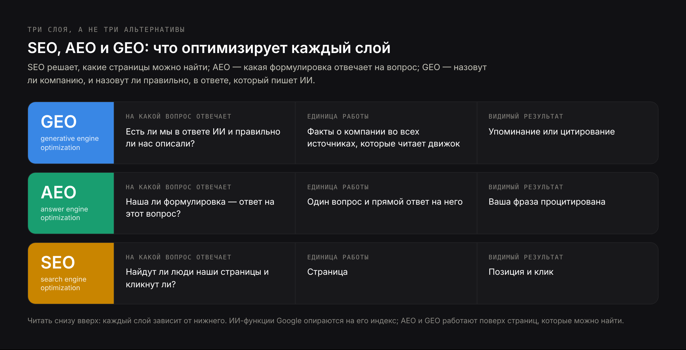
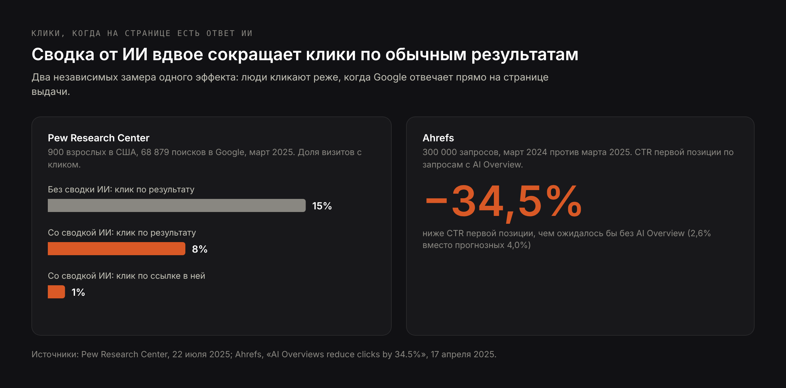
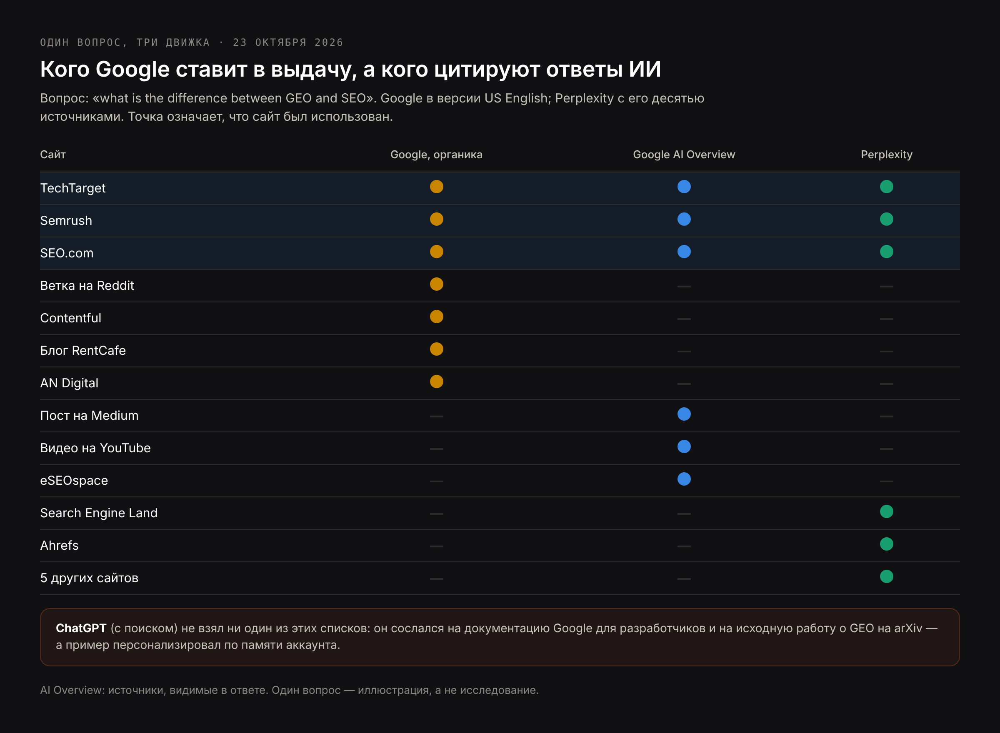
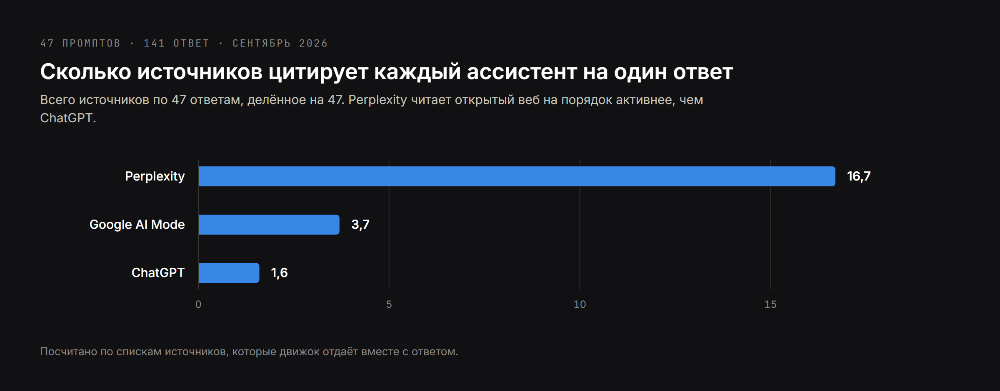
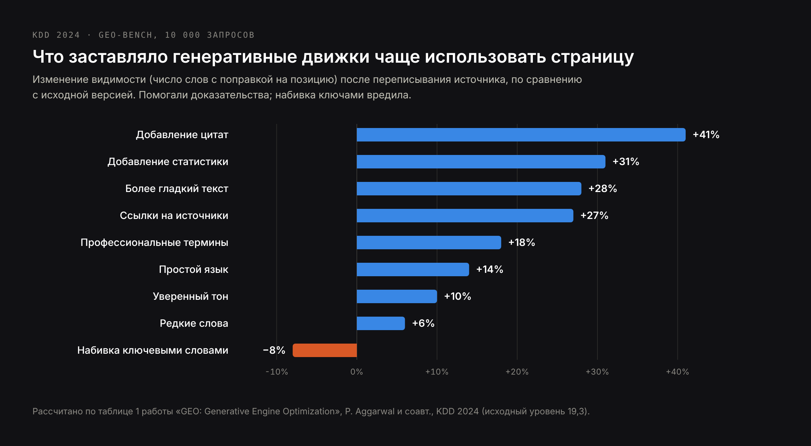
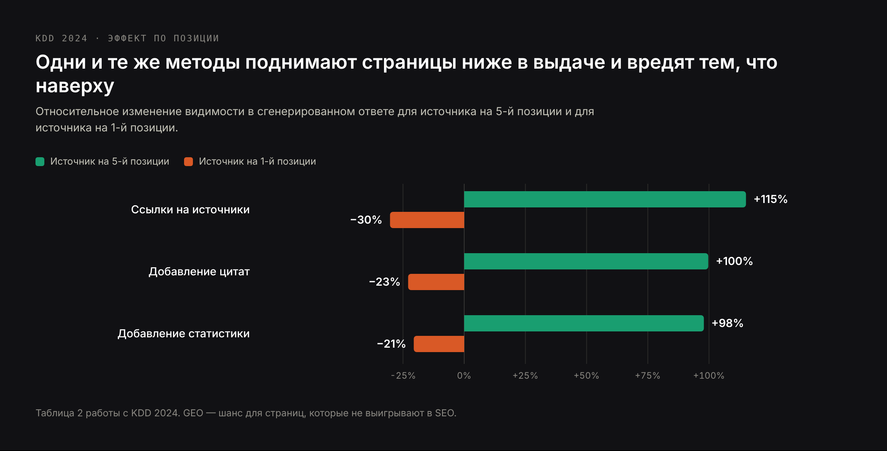

# DRAFT RU — market version of blog-geo-vs-seo-EN.md, not a translation (23 Oct 2026).
# Core (RU): practically zero; PAA: «Что такое GEO-продвижение?», «Сколько стоит
# SEO в месяц?». Made on the owner's rule for AI topics. Keywords in H2s: GEO и SEO,
# чем GEO отличается от SEO, SEO vs AEO, GEO vs AEO, SEO GEO AEO, GEO-продвижение,
# продвижение в нейросетях. No mention of Russia. Prices in € as on RU pages.
# Same sources and figures as EN; figures in Russian (fig-*-ru.png), screenshots
# shared. H1 (Title) ≠ Meta title.

Title: SEO, GEO и AEO: чем продвижение в Google отличается от оптимизации под нейросети
Slug: geo-vs-seo-raznica
Meta title: GEO vs SEO: разница, общее и что делать в 2026 году
Meta description: GEO и SEO на данных: что оптимизирует каждое, где они совпадают, как ChatGPT, Perplexity и ИИ в Google выбирают источники и как измерять оба канала.

---

> Коротко: SEO поднимает страницу в списке результатов поиска, чтобы по ней кликнули. GEO (generative engine optimization) добивается, чтобы компанию или факт назвали в ответе, который пишет ИИ, — в ChatGPT, Perplexity, Gemini или в обзорах от ИИ в Google. AEO (answer engine optimization) добивается, чтобы именно ваша формулировка стала ответом на конкретный вопрос. Основа у них в основном общая: Google прямо пишет, что для попадания в его ИИ-функции не нужно ничего сверх индексации и возможности показать фрагмент страницы. Различаются они результатом (упоминание вместо клика), источниками, которые читает каждый движок, и способом измерения. На практике выбирать между ними не нужно: вы делаете SEO, а потом проверяете, движок за движком, видна ли эта работа в ответах ИИ.

Большинство статей про GEO и SEO сравнивают два определения и на этом заканчиваются. Эта статья сравнивает их на данных: на научной работе, в которой впервые описали GEO, на документации Google, на исследованиях кликов Pew Research Center и Ahrefs, на моём [разборе 141 ответа ИИ на вопросы о выборе подрядчика](/ru/blog/issledovanie-otvetov-ii-assistentov) и на тесте 23 октября 2026 года, в котором я задал один и тот же вопрос ChatGPT, Perplexity и Google и сравнил, кого процитировал каждый из них.

## Чем GEO отличается от SEO: короткие определения

**SEO (search engine optimization)**, или SEO-продвижение сайта, — работа над тем, чтобы страница стояла высоко в результатах поисковика — Google, Bing — по запросам, которые вводят ваши клиенты, и чтобы по ней кликали. Единица работы — страница, результат — позиция, доказательство — визит.

**GEO (generative engine optimization)**, или GEO-продвижение, — работа над тем, чтобы компания, продукт или факт попали в ответ, который генерирует ИИ-модель. Термин появился в научной работе команды из Принстонского университета и IIT Delhi 2023 года, представленной на конференции KDD 2024. Единица работы — утверждение о компании, результат — упоминание или цитирование, доказательство — сам ответ.

**AEO (answer engine optimization)** уже: работа над тем, чтобы ваша формулировка стала ответом на конкретный вопрос — в расширенном сниппете, обзоре от ИИ, голосовом ассистенте или чат-боте. AEO старше GEO и выросло из расширенных сниппетов Google.

**AIO** используют в двух значениях: «AI optimization» как общий зонтик для всего перечисленного или сокращение от AI Overviews в Google. В связке «SEO vs GEO vs AEO vs AIO» четвёртая буква обычно означает зонтик.

| Термин | Под что оптимизирует | Единица работы | Видимый результат |
| --- | --- | --- | --- |
| SEO | Позиция в результатах поиска | Страница | Позиция и клик |
| GEO | Присутствие в ответах, которые пишет ИИ | Утверждение о компании | Упоминание или цитирование |
| AEO | Стать выбранным ответом на один вопрос | Вопрос и ответ на него | Ваша фраза процитирована |
| AIO | Любое из перечисленного в ИИ-системах | По-разному | По-разному |

## GEO и SEO рядом: двенадцать различий, которые имеют значение

Различия касаются не столько приёмов, сколько того, что делает с вашей страницей система на другой стороне. Поисковик ранжирует документы и оставляет выбор человеку. Генеративный движок читает документы, сжимает их и выбирает за человека.

| | SEO | GEO |
| --- | --- | --- |
| Система | Ранжирует документы | Пишет ответ на основе документов |
| Что видит пользователь | Десять ссылок с описаниями | Один ответ с двумя–тремя названиями |
| За что идёт борьба | За позицию | За присутствие в ответе |
| Вход | Набранный запрос, обычно 2–4 слова | Вопрос как в разговоре, часто целое предложение с контекстом |
| Единица оптимизации | Страница | Факт или утверждение о компании |
| Где лежат доказательства | В основном на вашем сайте и в ссылках на него | На сайте, а ещё в каталогах, отзывах, на форумах, в видео и прессе |
| Итог | Переход на ваш сайт | Упоминание, часто без перехода |
| Персонализация | Умеренная (место, язык) | Сильная (история разговора, память) |
| Стабильность | Позиции меняются за недели | Ответ может поменяться между двумя запросами |
| Главный показатель | Позиции, клики, конверсии | Доля ответов, цитирования, точность описания |
| Инструменты | Search Console, съём позиций | Постоянный набор вопросов, который прогоняется в нескольких движках |
| Провал | Вы на второй странице | Вас нет в ответе или вас описали с ошибками |

Практически важнее всего последняя строка. В SEO плохой исход — невидимость. В GEO есть второй плохой исход, которого в SEO не было: вас назвали со старой ценой, с услугой, которой больше нет, или с функцией конкурента. Как это исправлять, описано на странице [исправление неверных данных о компании в ИИ](/ru/uslugi/ispravlenie-nevernyh-dannyh-v-ii).

## Где SEO и GEO совпадают: у Google нет отдельного списка требований

Для ИИ-функций самого Google совпадение почти полное, и Google говорит это прямо. В документации для владельцев сайтов сказано, что для попадания в AI Overviews и режим ИИ нет дополнительных требований и не нужны специальные оптимизации: страница должна быть проиндексирована и иметь право показываться в поиске с фрагментом. Там же написано, что особая разметка schema.org не нужна, что структурированные данные должны совпадать с видимым текстом и что клики из ИИ-функций учитываются в обычном отчёте «Эффективность» в Search Console.

Документация описывает и механизм, важный для стратегии: обе функции могут использовать «query fan-out» — система выполняет несколько связанных поисков по подтемам и уже из них собирает ответ. Один вопрос пользователя превращается в фоне в множество поисков. Страница, которой нет ни в одном из этих подзапросов, в ответ не попадёт.

Значит, для Google основа GEO — это SEO: страницы, доступные роботам, индекс, релевантность и ответ, пригодный для фрагмента. Всё дальше в этой статье — о том, что меняется поверх этой основы, и о движках, которые не Google.

## Где GEO и SEO расходятся: результат — упоминание, а не клик

Главное изменение — в том, что пользователь делает после ответа. Два независимых замера:

- **Pew Research Center** разобрал, как 900 взрослых в США пользовались интернетом в марте 2025 года, — 68 879 поисков в Google. Сводка от ИИ появилась в 18% из них. Когда она была, люди кликали по обычному результату в 8% визитов, а без неё — в 15%. По ссылке внутри сводки кликали в 1% визитов, а сессию заканчивали на 26% страниц со сводкой против 16% без неё.
- **Ahrefs** сравнил 300 000 запросов в данных Search Console до и после запуска AI Overviews в США. По запросам с AI Overview CTR первой позиции оказался на 34,5% ниже, чем дал бы прогноз без обзора.

Масштаб уже не нишевый. В июле 2025 года Google сообщил, что AI Overviews пользуются больше 2 миллиардов человек в месяц, а режимом ИИ — больше 100 миллионов в месяц в США и Индии; в октябре 2025 года OpenAI заявила, что у ChatGPT 800 миллионов пользователей в неделю.

Отсюда не следует, что «SEO умерло»: ответ ИИ по-прежнему собирается из страниц, которые высоко в поиске. Следует то, что одна позиция больше не гарантирует визит, а сам ответ стал местом, где клиент составляет мнение о компании ещё до того, как увидит её сайт.

## GEO и SEO в одном тесте: один вопрос в Google, Perplexity и ChatGPT

23 октября 2026 года я задал трём движкам один вопрос: «what is the difference between GEO and SEO» — Google в версии US English, Perplexity и ChatGPT с включённым поиском. Потом записал, какими сайтами пользовался каждый. Вопрос был на английском, потому что на этом языке по теме больше всего материалов.

Google ответил обзором от ИИ над результатами. Органическую выдачу под ним открывала ветка на Reddit, дальше шли Informa TechTarget, Contentful, Semrush, блог о маркетинге недвижимости, маркетинговое агентство и SEO.com. Обзор от ИИ процитировал другой набор: пост на Medium, SEO.com, Semrush, TechTarget, блог агентства и видео на YouTube.

Perplexity собрал сравнительную таблицу из десяти источников: TechTarget, Semrush, Search Engine Land, Ahrefs, SEO.com и пяти небольших сайтов.

ChatGPT вместо маркетинговых блогов сослался на первоисточники: документацию Google для разработчиков и исходную работу о GEO на arXiv. И сделал то, чего не сделали остальные: в примере для SEO написал «ваш сайт в топ-3 Google по запросу ‘SEO consultant in Warsaw’». Это он взял из памяти моего аккаунта, которая знает, чем я занимаюсь. Ответ, который видите вы, — не тот ответ, который видит ваш клиент.

В одном вопросе видно три вещи:

- **Позиция помогает, но не решает.** Три из семи органических результатов — TechTarget, Semrush и SEO.com — взяли и обзор от ИИ, и Perplexity. Первый органический результат, ветку на Reddit, не взял никто.
- **Ответы ИИ заходят дальше первой страницы.** Medium, YouTube и блоги агентств, которых не было в органике, попали в обзор от ИИ.
- **У каждого движка свои привычки.** Perplexity читал широко, Google смешивал свой индекс с видео и блогами, ChatGPT пошёл к первоисточникам и к памяти пользователя.

Один вопрос — иллюстрация, а не исследование. Но картина совпадает с тем, что я замерил на гораздо большем наборе.

## Как ChatGPT, Perplexity и Google AI Mode выбирают источники: данные по 141 ответу

В сентябре 2026 года я задал 47 вопросов о выборе подрядчика — «какого разработчика нанять для…», «кто делает SEO для…» — ChatGPT, Perplexity и Google AI Mode и посчитал каждый источник во всех 141 ответе. Полная методика — в [исследовании](/ru/blog/issledovanie-otvetov-ii-assistentov); для сравнения GEO и SEO важны вот эти цифры:

| Движок | Источников на ответ | Ссылок на сайты самих компаний | Типичное поведение |
| --- | --- | --- | --- |
| Perplexity | 16,7 | 667 | Широко читает открытый интернет и показывает источники |
| Google AI Mode | 3,7 | 141 | Узкий выбор, близкий к тому, что высоко в Google |
| ChatGPT | 1,6 | 47 | Выбирает до чтения; в основном источники вне вашего сайта |

Два вывода меняют то, чем GEO отличается от SEO:

- **Работа на своём сайте окупается неравномерно.** Её видно сначала в Perplexity, в ИИ-функциях Google — через позиции, и меньше всего в ChatGPT, где названные компании находились в основном через сторонние страницы.
- **Неоднозначное название весило больше качества страницы.** Когда название компании носили и другие или описание расходилось от сайта к сайту, ассистенты пропускали компанию или путали её с кем-то ещё, как бы хороши ни были её страницы. В SEO путаница с названием стоит части кликов; в GEO она может стоить упоминания целиком.

Когда темой был сам GEO, ассистенты чаще ссылались на YouTube, LinkedIn и Reddit, чем на отраслевую прессу, — а первую страницу Google по тем же коммерческим запросам занимали подборки агентств. Два канала, два разных набора победителей.

## Что на самом деле показали исследования GEO

Работу, которая ввела термин, написали Pranjal Aggarwal, Vishvak Murahari, Tanmay Rajpurohit, Ashwin Kalyan, Karthik Narasimhan и Ameet Deshpande: «GEO: Generative Engine Optimization», KDD 2024. Авторы собрали набор GEO-bench — 10 000 запросов из 25 областей — и проверили девять способов переписать страницу-источник, чтобы понять, какие из них заставляют генеративный движок чаще её использовать.

| Метод | Что меняли в источнике | Видимость против исходной версии |
| --- | --- | --- |
| Добавление цитат | Цитаты из надёжных источников | +41% |
| Добавление статистики | Цифры вместо общих слов | +31% |
| Более гладкий текст | То же содержание, лучше написанное | +28% |
| Ссылки на источники | Утверждения подкреплены ссылками | +27% |
| Профессиональные термины | Лексика области | +18% |
| Простой язык | Более лёгкие формулировки | +14% |
| Уверенный тон | Более убедительный стиль | +10% |
| Редкие слова | Менее типичная лексика | +6% |
| Набивка ключевыми словами | Больше фраз из запроса | −8% |

Видимость измеряли как число слов с поправкой на позицию: какая часть ответа взята из источника с учётом того, где в ответе она стоит. Проценты рассчитаны по таблице 1 работы относительно исходного уровня 19,3.

Два результата заслуживают больше внимания, чем им обычно уделяют:

- **Набивка ключевыми словами делала хуже.** Классический рефлекс из SEO — повторить запрос — снижал видимость в ответах. Помогали доказательства: цитаты, цифры, источники.
- **Выигрывали страницы ниже в выдаче.** Для источников на пятой позиции ссылки на источники поднимали видимость на 115%; для источников на первой позиции тот же метод её снижал на 30%. GEO — не награда тем, кто уже выигрывает в SEO, а шанс для тех, кто не выигрывает.

Ограничения тоже важны. Эксперименты шли на тестовом движке, который собрали авторы, и на Perplexity, где видимость росла максимум на 37%. Движки 2026 года — не движки 2023-го, а эффект каждого метода зависел от области. Эти цифры — направления, а не рецепт.

## SEO vs AEO: позиция по вопросу против того, чтобы быть ответом

SEO и AEO целятся в одну и ту же страницу результатов, но в разные её части. SEO целится в список; AEO — в блок над списком: расширенный сниппет, обзор от ИИ, голосовой ответ — и в ответ чат-бота, который отвечает напрямую.

| | SEO | AEO |
| --- | --- | --- |
| Цель | Позиция в списке | Один выбранный ответ |
| Единица | Страница, раскрывающая тему | Один вопрос с одним прямым ответом |
| Типичная правка | Выше релевантность и авторитет страницы | Ответ в первых строках, в форме, которая переживёт вырезание |
| Разметка | Помогает | Должна точно совпадать с видимым ответом |
| Замер | Позиция | Использовали ли вашу формулировку |

Метод AEO просто описать и трудно хорошо выполнить: собрать карту реальных вопросов, дать каждому вопросу одну страницу-владельца, ответить в первых двух предложениях, а потом раскрыть подробности.

## GEO vs AEO: быть названным против того, чтобы быть процитированным

GEO и AEO часто употребляют как синонимы. Они пересекаются, но отвечают на разные вопросы:

- **AEO спрашивает: наша ли формулировка — ответ?** Работает вопрос за вопросом, в основном на ваших страницах.
- **GEO спрашивает: есть ли мы в ответе вообще и правильно ли нас описали?** Работает с тем, как компания представлена во всех источниках, которые читает движок, — и в тех, что вам не принадлежат.

Юридическая фирма может выиграть AEO по вопросу «сколько оформляется вид на жительство в Польше» и всё равно не появиться, когда кто-то спросит ассистента «к какому юристу по легализации в Варшаве обратиться». Первое — факт, который движок цитирует; второе — рекомендация, которую движок собирает из каталогов, отзывов и статей. Важно и то и другое; исправляется оно в разных местах.

## SEO, GEO и AEO на одной схеме

Вместе эти три понятия — слои, а не альтернативы:

1. **SEO — основание.** Без страниц, доступных роботам, проиндексированных и релевантных, дальше ничего не произойдёт: ИИ-функции Google опираются на его индекс, а другие движки тоже ищут в интернете.
2. **AEO работает с ответом.** Делает факты на ваших страницах извлекаемыми: один вопрос, один ясный ответ, согласованная разметка.
3. **GEO работает с представлением компании.** Следит, чтобы движки отличали вашу компанию от других, находили одни и те же факты о вас на сайтах, которым доверяют, и повторяли их правильно.

Поэтому «GEO vs SEO» — немного неверно поставленный вопрос. Полезный вопрос — сколько каждого слоя нужно в вашей ситуации.

## SEO умерло? Заменит ли GEO-продвижение SEO?

Нет — и доказательство в самих системах. AI Overviews и режим ИИ в Google работают на индексе поисковика и не требуют ничего сверх индексации и возможности показать фрагмент. Perplexity сослался на сайты самих компаний 667 раз в 47 ответах. ChatGPT ищет в интернете, прежде чем назвать подрядчиков. Каждый из этих движков зависит от документов, которые кто-то оптимизировал, чтобы их можно было найти.

Умирает узкая версия SEO: борьба за позиции по информационным запросам, на которые ИИ уже отвечает прямо на странице выдачи, и отчёты о трафике так, будто клик — единственный результат. Когда данные Pew показывают, что под сводкой от ИИ кликов вдвое меньше, ценность того, чтобы быть источником этой сводки, растёт, а не падает.

Останется ли SEO через пять лет? Дисциплина, которая делает контент находимым, читаемым и заслуживающим доверия для машин, — останется. Отчёты будут выглядеть иначе: доля в ответах рядом с долей в кликах.

## Как измерять SEO и GEO: разные показатели, один план

| Что измеряем | SEO | GEO |
| --- | --- | --- |
| Видимость | Позиции, показы | Доля ответов, где вас называют, по каждому движку |
| Качество | CTR, вовлечённость | Точность описания компании |
| Доказательства | Ссылки, позиции ключевых страниц | Какие источники каждый движок цитирует по вашим вопросам |
| Результат для бизнеса | Заявки и продажи из органики | Заявки, где клиент упоминает ИИ, брендовые запросы, трафик из ИИ |
| Инструменты | Search Console, аналитика | Постоянный набор вопросов клиентов по расписанию |

Три правила делают замер GEO честным:

- **Заморозьте набор вопросов.** Запишите 20–50 вопросов, которые действительно задают ваши клиенты, их словами и на их языках, и каждый месяц прогоняйте один и тот же набор. Поменяли вопросы — поменялся результат.
- **Используйте чистые сессии.** Как показал пример с ChatGPT выше, память и история разговоров меняют ответ. Выйдите из аккаунта, начните новую сессию и записывайте дату, движок, модель и язык каждого прогона.
- **Записывайте источники, а не только названия.** Важнее того, назвали ли вас, — почему. Цитируемые источники подсказывают, где работать дальше.

Отправная точка — [аудит видимости в ИИ-поиске](/ru/uslugi/audit-vidimosti-v-ii-poiske), постоянная часть — [мониторинг упоминаний бренда в ИИ-ответах](/ru/uslugi/monitoring-brenda-v-ii).

## Стратегия GEO и SEO: с чего начать в зависимости от бизнеса

| Бизнес | Где спрашивают клиенты | Приоритет |
| --- | --- | --- |
| Местные услуги (клиника, юрист, подрядчик) | Google и карты, всё чаще ChatGPT | Сначала локальное SEO и полная карточка компании; потом согласованные каталоги и отзывы, которые читают ассистенты |
| B2B-услуги и консалтинг | ChatGPT, Perplexity, LinkedIn | Однозначное название и упоминания во внешних источниках; ясные страницы услуг; статьи со своими данными |
| Интернет-магазин | Google Покупки и обзоры от ИИ | Сначала техническое SEO и данные товаров; потом сравнения и гиды по выбору с реальными цифрами |
| Издание или SaaS с информационным контентом | Google, где обзоры от ИИ забирают простые ответы | Меньше общих объяснений, больше своих исследований, инструментов и данных, которые ответам придётся цитировать |

И порядок действий, который подходит большинству:

1. Убедитесь, что сайт доступен роботам и индексируется, а сервер не блокирует ИИ-роботов, которых вы хотите пустить, — для поиска ChatGPT это OAI-SearchBot.
2. Наведите порядок с однозначностью компании: одно название и одно описание того, что вы делаете, для кого и где, — одинаково на сайте, в структурированных данных и во всех профилях.
3. Запишите факты, которые вас отличают, простыми предложениями — услуги, рынки, цены, цифры, — а не слоганами.
4. Дайте каждому важному вопросу свою страницу и ответьте на него в первых строках.
5. Подкрепляйте утверждения цифрами и названными источниками; цитируйте экспертов там, где это добавляет доказательств.
6. Держите структурированные данные идентичными тому, что написано на странице.
7. Будьте правильно описаны в каталогах и на площадках отзывов, которые действительно появляются в ответах в вашей отрасли.
8. Зарабатывайте упоминания в статьях и подборках на сайтах, которыми движки уже пользуются.
9. Публикуйте то, что можете опубликовать только вы: данные, кейсы, замеры.
10. Заморозьте набор вопросов и сделайте исходный замер в каждом движке.
11. Повторяйте замер каждый месяц; исправляйте то, на что указывают источники.
12. Показывайте SEO и GEO в отчётах рядом, чтобы не оценивать одно по меркам другого.

## Мифы о GEO

**«Для GEO нужен отдельный сайт или специальный код».** Для ИИ-функций Google — прямо не нужен. В других движках ясный текст и согласованные факты значат гораздо больше любого тега.

**«Файл llms.txt приведёт нас в ChatGPT».** Это предложенное соглашение, использование которого не подтвердил ни один крупный ассистент. Он дешёвый и безвредный — и только.

**«Повторим запрос как можно больше раз».** Исходное исследование GEO показало, что набивка ключевыми словами — единственный метод, который снижал видимость.

**«Напишем текст ИИ, ИИ его полюбит».** Движки цитируют то, что выделяется и поддаётся проверке. Текст, который говорит то же, что тысяча других страниц, не даёт им повода выбрать ваш.

**«Попали в ответ — значит, мы там есть».** Ответы меняются между запросами и между пользователями. Присутствие — это доля во многих прогонах, а не состояние.

## Частые вопросы про GEO и SEO

**Что такое GEO-продвижение?**
Это работа над тем, чтобы компания попадала в ответы, которые пишут ИИ-ассистенты и поисковые ИИ-функции — ChatGPT, Perplexity, Gemini, обзоры от ИИ в Google, — и была в них описана правильно. В неё входят ясные факты на сайте, однозначное название компании, присутствие в источниках, которые читают движки, и регулярные замеры ответов.

**Чем GEO отличается от SEO?**
SEO борется за позицию страницы в списке результатов и за клик. GEO борется за то, чтобы компания была в ответе ИИ и была описана правильно. SEO работает в основном на вашем сайте; GEO — ещё и во всех источниках, которые читает движок.

**Актуально ли SEO в 2026 году?**
Да. AI Overviews и режим ИИ в Google опираются на его индекс и не требуют ничего сверх обычной индексации, а другие ИИ-движки ищут в интернете, прежде чем ответить. Изменилось то, что позиция больше не гарантирует клик, поэтому SEO теперь измеряют вместе с присутствием в ответах ИИ.

**Заменит ли GEO SEO?**
Нет. Генеративные движки зависят от документов, которые доступны, проиндексированы и релевантны, — а это и есть результат SEO. GEO меняет результат, к которому вы стремитесь, и добавляет в работу источники за пределами вашего сайта.

**Когда будут видны результаты GEO?**
Изменения на вашем сайте могут появиться в ответах ИИ через несколько недель, когда роботы перечитают страницы. Новые упоминания на других сайтах и изменение того, как ассистенты описывают компанию, обычно занимают два–четыре месяца.

**Сколько стоит SEO и GEO в месяц?**
У меня постоянная работа над Google и ответами ИИ вместе начинается от 800 € в месяц, аудит видимости — от 250 € разово, а только мониторинг ответов ИИ — от 250 € в месяц.

**Чем GEO отличается от AEO?**
AEO работает над тем, чтобы быть процитированным ответом на один вопрос, в основном на ваших страницах. GEO работает над тем, чтобы компания была в ответах, которые пишет ИИ, и была описана правильно, во всех источниках, которые читает движок.

## С чего начать

Если вы начинаете с нуля, сначала сделайте основу SEO и параллельно исходный замер GEO, чтобы знать, что говорят о вас ИИ-движки, прежде чем что-то менять. Четыре варианта, как я могу помочь, — на странице [GEO-оптимизация](/ru/uslugi/ai-seo-i-geo-optimizaciya); Google и ответы ИИ как одна постоянная работа — на странице [AI SEO-продвижение](/ru/uslugi/ai-seo-prodvizhenie); отдельно ChatGPT и все модели с замерами по каждой — на страницах [продвижение в ChatGPT](/ru/uslugi/prodvizhenie-v-chatgpt) и [LLM SEO](/ru/uslugi/llm-seo).

**Источники:** P. Aggarwal и соавт., «GEO: Generative Engine Optimization», KDD 2024 (arXiv 2311.09735) · Google Search Central, «AI features and your website», обновлено 10 декабря 2025 · Pew Research Center, данные о поведении 900 взрослых в США, март 2025, публикация 22 июля 2025 · Ahrefs, «AI Overviews reduce clicks by 34.5%», 17 апреля 2025 · TechCrunch, 23 июля 2025 (AI Overviews, режим ИИ) и 6 октября 2025 (ChatGPT) · собственное исследование 141 ответа ИИ, сентябрь 2026 · собственный тест, 23 октября 2026.
