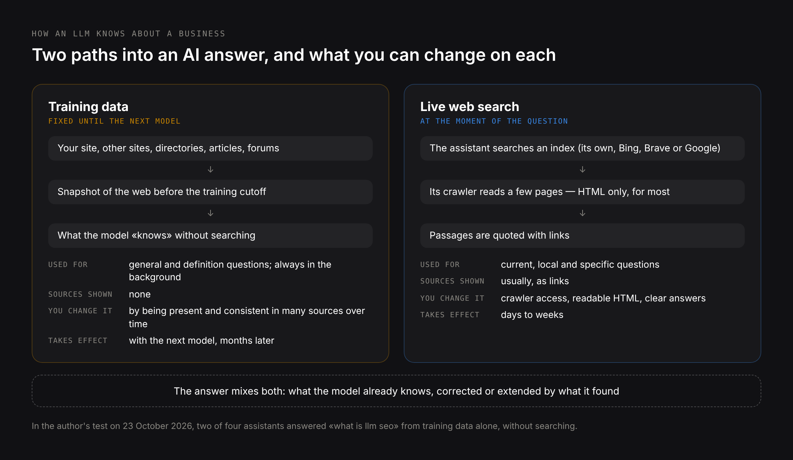
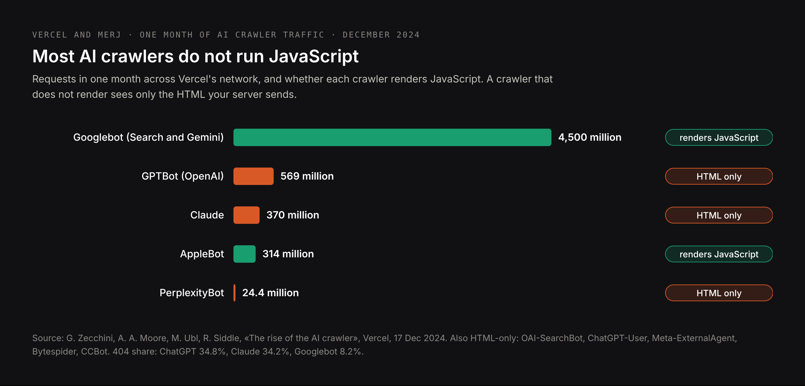
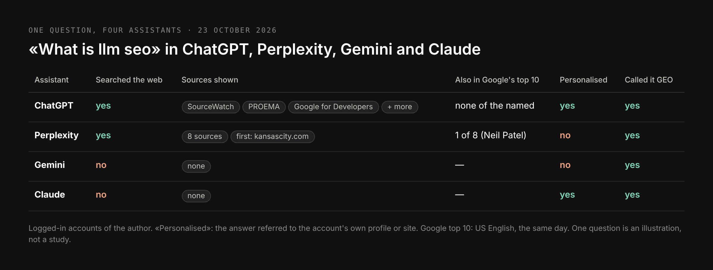

# DRAFT EN — «LLM SEO» (24 Oct 2026). Practical guide, model by model.
# Core: research/pseo/page-core/llm-seo-article.md — llm seo 720, llmo 480, how to
# optimize content for llms 320, seo for llm(s) 210+210, llm txt / llms txt for seo
# 140+140, llm search optimization 140, what is llm in seo 110, what is llm seo 90,
# what is llm optimization 90, llmo meaning 70. Intent: research/pseo/intent-check-
# llm-seo-article.md — «llm seo» and «what is llm seo» share 4 of 10 URLs; «llm seo
# services» 0 (stays on /services/llm-seo-services); «generative engine optimization»
# 1; «chatgpt seo» 1; «llm optimization» 0 (half of its SERP is ML engineering).
# Not here: services/agency (service page), comparisons (geo-vs-seo), tools (one
# section; a separate tools article is queued).
# Sources: Vercel + MERJ «The rise of the AI crawler» (17 Dec 2024); Vercel «How
# we're adapting SEO for LLMs» (10 Jun 2025); OpenAI, Anthropic, Perplexity crawler
# docs; Google-Extended docs; Anthropic subprocessor list via Xponent21 / TechCrunch;
# Peec AI report via ALM Corp (25 Sep 2026); Bing Webmaster blog; owner's study; live
# test 23 Oct 2026 («what is llm seo» in ChatGPT, Perplexity, Gemini, Claude).
# H1 (Title) and Meta title differ on purpose.

Title: LLM SEO: How to Optimize Your Website for ChatGPT, Claude, Gemini and Perplexity
Slug: llm-seo
Meta title: What Is LLM SEO? A Practical Guide for 2026
Meta description: LLM SEO model by model: how ChatGPT, Claude, Gemini and Perplexity learn about a business, where each searches the web and what to change on your site.

---

> Quick answer: LLM SEO is optimizing a website and a brand so that large language models — ChatGPT, Claude, Gemini, Perplexity, Copilot — know the business, find its pages and describe it correctly. A model learns about you in two ways: from its training data, which is fixed until the next model, and from live web search at the moment of the question. Each model searches a different index: ChatGPT its own index and Bing, Claude Brave Search, Gemini Google, Copilot Bing, Perplexity its own crawler. Most AI crawlers do not run JavaScript, so a site whose text is loaded by scripts can look empty to them. LLM SEO works on both paths: being present in the sources models learn from, and being readable and findable when they search.

LLM SEO overlaps with GEO and AEO, and many people use the three names for one thing. This guide takes the angle the others skip: the models themselves. What a model knows about you without searching, where each model goes when it does search, what its crawler can and cannot read, and what to change on your site so that each of them gets it right. It is based on crawler documentation from OpenAI, Anthropic, Perplexity and Google, a study of more than a billion AI-crawler requests by Vercel and MERJ, and a live test on 23 October 2026 in which I asked ChatGPT, Perplexity, Gemini and Claude the same question.

## What is LLM SEO?

**LLM SEO** (large language model search engine optimization) is the work of making a business visible and accurately described in answers produced by large language models. An LLM is the model behind an AI assistant: GPT behind ChatGPT, Claude, Gemini, the models Perplexity and Copilot use. LLM SEO asks three questions about each of them:

1. **Does the model know the business** without searching — from what it learned in training?
2. **Can the model find and read the business's pages** when it searches the web at the moment of a question?
3. **Is what the model says correct** — services, prices, locations, the people behind it?

Classic SEO asks whether a page ranks. LLM SEO asks whether a model can use what the page says, and whether what it says elsewhere about you agrees.

## LLM SEO, LLMO and «LLM optimization»: three names, two meanings

- **LLM SEO** and **LLMO** (large language model optimization) mean the same marketing work. LLMO is common in German-speaking markets — «LLMO Agentur» alone is searched hundreds of times a month.
- **GEO** (generative engine optimization) and **AEO** (answer engine optimization) overlap with both. All four AI assistants I tested treated LLM SEO and GEO as overlapping or as the same thing. The differences are explained in [what is GEO](/blog/what-is-generative-engine-optimization) and [what is AEO](/blog/what-is-answer-engine-optimization).
- **«LLM optimization»** has a second, unrelated meaning in engineering: making a model faster or cheaper to run — quantization, caching, inference tuning. Half of the search results for that phrase are about this. If that is what you were looking for, this article is not it.

## How LLMs learn about your business: training data vs live search

A language model can know about a business in two ways, and they need different work.



**Training data.** Before release, a model is trained on a large snapshot of the web and other text. What it learns stays fixed until the next version. If your business was described in many sources before the training cutoff, the model may know it without searching; if it changed its name, prices or services after the cutoff, the model may repeat the old version. You cannot edit training data, only influence what future models learn by being present in the sources they are trained on: your site, but above all other sites, directories, articles and discussions.

**Live search.** When a question needs current or specific information, the assistant searches the web, reads a few pages and writes the answer from them, usually with links. This path is what you influence directly: whether the engine's crawler is allowed in, whether it can read the page, and whether the page answers the question clearly.

Which path an assistant takes depends on the question and the product. In my test on 23 October 2026, two of the four assistants answered a definition question without searching at all — the answer came from what the model already knew.

| | Training data | Live search |
|---|---|---|
| When it is used | Always; alone for general and definition questions | When the question needs current, local or specific facts |
| How current | Fixed at the model's training cutoff | Minutes to days old |
| Shows sources | No | Usually, as links |
| What you can do | Be present and consistent in many sources over time | Allow the crawler, make pages readable, answer clearly |
| How fast changes appear | With the next model | Days to weeks |

## Where each LLM searches the web

Each assistant searches a different index with a different crawler. This is the most practical fact in LLM SEO, because a page can be visible to one model and invisible to another.

| Assistant | Search index behind its answers | Crawler for search | Training crawler | What it means for you |
|---|---|---|---|---|
| ChatGPT | OpenAI's own index, plus Bing and other suppliers | OAI-SearchBot | GPTBot | Allow OAI-SearchBot; Bing visibility helps but no longer guarantees ChatGPT visibility |
| Claude | Brave Search | Claude-SearchBot | ClaudeBot | Check that your pages appear in Brave Search, not only Google |
| Gemini | Google Search | Googlebot | Google-Extended token (training only) | Classic Google SEO; blocking Google-Extended does not remove you from Search |
| Google AI Overviews and AI Mode | Google Search | Googlebot | — | Same index as Google results |
| Copilot | Bing | Bingbot | — | Bing Webmaster Tools, IndexNow |
| Perplexity | Its own index | PerplexityBot | Not used for training, according to Perplexity | Allow PerplexityBot |

What the sources say, briefly:

- **OpenAI** documents three agents: OAI-SearchBot for ChatGPT search, GPTBot for training, and ChatGPT-User for pages a user asks ChatGPT to open. Sites that block OAI-SearchBot are not shown in ChatGPT search answers. According to a Peec AI report summarised in September 2026, ChatGPT increasingly answers from its own index — internally called Labrador — while still using Bing and other data suppliers.
- **Anthropic** lists Brave Search as the web search provider for Claude since March 2025, and documents three agents: ClaudeBot for training, Claude-SearchBot for search indexing, Claude-User for user requests. Blocking Claude-SearchBot «may reduce your site's visibility and accuracy in user search results», in Anthropic's own words.
- **Google** uses Googlebot for both Search and its AI features. The separate Google-Extended token controls whether content is used for Gemini models; Google states it does not affect inclusion or ranking in Google Search, which includes AI Overviews and AI Mode.
- **Perplexity** runs PerplexityBot to «surface and link websites» in its results and states that it is not used to train AI models. A second agent, Perplexity-User, fetches pages on a user's request and generally ignores robots.txt.

A robots.txt that keeps a site out of model training but visible in every assistant's search looks like this:

```text
# search and answer engines: allowed
User-agent: OAI-SearchBot
Allow: /

User-agent: Claude-SearchBot
Allow: /

User-agent: PerplexityBot
Allow: /

# training only: blocked
User-agent: GPTBot
Disallow: /

User-agent: ClaudeBot
Disallow: /

User-agent: Google-Extended
Disallow: /

User-agent: *
Allow: /
```

Whether to block training is a business decision. Blocking it keeps your text out of future models, but it also means the next model learns about you only from what others write.

## AI crawlers and JavaScript: why your site can look empty to ChatGPT

In December 2024 Vercel and MERJ published an analysis of AI-crawler traffic across Vercel's network: more than a billion requests in a month. Two findings matter for almost every modern website.



**Most AI crawlers do not run JavaScript.** OpenAI's crawlers, ClaudeBot, PerplexityBot, Meta's and ByteDance's crawlers and Common Crawl's CCBot all read only the HTML the server sends. ChatGPT's and Claude's crawlers do download JavaScript files — 11.5% and 23.8% of their requests — but do not execute them. Only Gemini, which uses Googlebot's infrastructure, and AppleBot render pages like a browser.

**AI crawlers waste a third of their requests.** 34.8% of ChatGPT's and 34.2% of Claude's fetches hit pages that returned 404, against 8.2% for Googlebot. They follow old and broken URLs far more often.

What this means in practice:

- A single-page app built with React, Vue or Angular that renders its text in the browser sends the AI crawler an almost empty HTML shell. For ChatGPT, Claude and Perplexity, that page has no content.
- Prices, product details, reviews and FAQs loaded later by scripts are invisible to them even on a site that is otherwise server-rendered.
- Redirects from old URLs matter more than they used to, because AI crawlers keep requesting them.

The check takes a minute: open the page's source (not the inspector) or fetch it without JavaScript, and look for the main text. If it is not in the HTML, the fix is server-side rendering, static generation or prerendering — in Next.js, the default when pages are built as server components. This site, for example, is built that way, so every article reaches every crawler as complete HTML.

## How to optimize content for LLMs

### 1. Make every important page readable without JavaScript

Main text, prices, contact details and FAQs in the HTML the server sends. Check the source of your five most important pages.

### 2. Allow the search crawlers you want to appear in

OAI-SearchBot, Claude-SearchBot, PerplexityBot, Googlebot and Bingbot. Decide separately about the training crawlers.

### 3. Be indexed in every index the models use

Google Search Console, Bing Webmaster Tools — which also feeds Copilot and part of ChatGPT — and a check that your key pages appear in Brave Search for Claude. Submit new and changed URLs through IndexNow, which Bing supports.

### 4. Write passages that survive being summarised

Models pull chunks, not pages. A section that names its question in the heading and answers it in the first sentence, with numbers and named sources, can be quoted on its own. A page whose answer is spread across five paragraphs cannot. The full method is in [what is AEO](/blog/what-is-answer-engine-optimization).

### 5. Describe the business the same way everywhere

Name, services, locations, prices or price ranges, founding year, people. A model merges whatever it finds, and contradictions between your site, LinkedIn and old directories become contradictions in the answer.

### 6. Be present in the sources models learn from and search

Independent reviews, comparison articles, industry media, communities such as Reddit and GitHub for technical products, and directories that rank for your service. These sources feed both paths: future training data and today's live search.

### 7. Keep pages current and fix broken URLs

AI crawlers request old URLs constantly. Redirect what moved, return 410 for what is gone for good, keep the sitemap clean and show the date of the last update on pages with facts that change.

## LLM SEO for each model: ChatGPT, Claude, Gemini, Perplexity and Copilot

**ChatGPT.** Allow OAI-SearchBot. Be indexed in Bing, but do not stop there: ChatGPT increasingly answers from its own index. Its answers are personalised by the user's saved memory and earlier chats, so test it logged out or in a separate account without memory: as of October 2026, ChatGPT's temporary chat states that it may still use memory and custom instructions. In my study of 141 answers, ChatGPT cited only 1.6 sources per answer and referred to Google Maps in 23 of 47 answers to service questions, so a complete Google Business Profile matters here too. ChatGPT-only work is covered on the [ChatGPT SEO services](/services/chatgpt-seo-services) page.

**Claude.** Its web search runs on Brave Search, so search for your key queries in Brave and see whether your pages are there. Allow Claude-SearchBot. Claude does not always search: for general questions it answers from training data, which is where long-standing, consistent mentions of your business pay off.

**Gemini and Google's AI features.** They rely on Google's index, so classic Google SEO is the base. Blocking Google-Extended affects training, not visibility in Search.

**Perplexity.** It searches on almost every question and cites many sources — 16.7 per answer in my study — mostly from the open web, often including the businesses' own sites. Allow PerplexityBot and make pages answer questions directly.

**Copilot.** Grounded in Bing. Bing Webmaster Tools shows how often your pages are cited in Copilot and Bing's AI answers in its AI Performance report, the only first-party citation report any AI assistant provides so far.

## llms.txt for SEO: what it does and what it does not

llms.txt is a proposed Markdown file at the root of a site that lists its most important pages for language models. It is often sold as «the robots.txt for AI», and it is not: it cannot allow or block anything. Google states that its Search systems do not use it, and no published study has found that it increases citations in AI answers. It can be useful for documentation sites whose users paste docs into coding assistants. For visibility in ChatGPT, Claude or Perplexity, robots.txt and readable HTML matter; llms.txt does not. The details, with an example file, are in [does your site need llms.txt](/blog/does-your-site-need-llms-txt).

## LLM SEO checklist

| Check | How to verify |
|---|---|
| Main text, prices and contacts are in the server HTML | View page source; search for a sentence from the page |
| OAI-SearchBot, Claude-SearchBot, PerplexityBot, Googlebot, Bingbot are allowed | Read robots.txt |
| A decision is made about GPTBot, ClaudeBot and Google-Extended | robots.txt reflects it on purpose, not by accident |
| Key pages are indexed in Google and Bing | Search Console, Bing Webmaster Tools |
| Key pages appear in Brave Search for your main queries | Search them in Brave |
| New URLs are submitted through IndexNow | CMS or hosting setting |
| Old URLs redirect; 404s are fixed | Server logs filtered by AI user agents |
| Each important question has a section that answers it in the first sentence | Read the first sentence under each heading |
| Business facts match on the site, Google Business Profile, LinkedIn and directories | Compare them side by side |
| The business is mentioned on the reviews, lists and media models cite | Ask the assistants and record their sources |
| A fixed question set is checked monthly in each assistant, in clean sessions | Spreadsheet or tracker |

## LLM SEO tools: what they measure

| Type | What it does | Examples |
|---|---|---|
| LLM visibility trackers | Ask a fixed set of questions in several assistants on a schedule; record mentions, citations, competitors | Profound, Peec AI, Otterly.AI, LLMrefs |
| SEO suites with AI modules | Track brand mentions in AI answers next to keyword data | Semrush, Ahrefs Brand Radar |
| First-party reports | Citations measured by the engine itself | Bing Webmaster Tools AI Performance |
| Log analysis | Shows which AI crawlers visit, what they request and what fails | Server or CDN logs, Vercel and Cloudflare analytics |

Trackers sample answers; they do not see what every user sees, especially in ChatGPT, where answers depend on memory. Log analysis is the most underused of the four: it is the only way to see what GPTBot or ClaudeBot actually fetched from your site.

## How to measure LLM visibility

1. **Write 20–50 questions** your customers ask, in their words and languages, including the city.
2. **Ask each in ChatGPT, Claude, Gemini and Perplexity once a month**, logged out or in a separate account without memory, so it does not bias the answer; ChatGPT's temporary chat may still use memory.
3. **Record per answer:** whether the business is named, whether the site is cited with a link, whether the description is correct, which sources are cited.
4. **Report per model**, not as one number. The four assistants read different indexes and change at different speeds.
5. **Add first-party data:** Bing's AI Performance report, AI referrals in GA4 grouped by source (chatgpt.com, perplexity.ai, claude.ai, gemini.google.com, copilot.microsoft.com), and AI crawler activity in your server logs.

One caution: after the GPT-6 rollout on 7–8 October 2026, part of ChatGPT's links arrived without a tag or referrer and were counted as Direct in GA4. A drop in «ChatGPT traffic» may be a tracking change rather than a visibility change.

## LLM SEO examples

### Example 1: four assistants, one question

On 23 October 2026 I asked ChatGPT, Perplexity, Gemini and Claude the same question: «what is llm seo». ChatGPT and Perplexity searched the web; Gemini and Claude answered from what their models already knew, without showing any source.




Perplexity cited eight sources. Only one of them, Neil Patel's blog, was also in Google's top ten for the same query; its first source was an article on a Kansas City news site.


ChatGPT cited SourceWatch, PROEMA and Google's developer documentation — and tailored the answer to the account it was asked from: its example was a web developer specialising in SEO and GEO, and further down it gave recommendations for this very site. Any test run in a personal account measures that account, not the market.


What the test shows:

- **For general questions, the training path decides.** Half of the assistants did not search. To be part of such answers, a business or an author has to be present in many sources long enough to enter training data.
- **The search path reads a different web from Google's.** Perplexity's sources barely overlapped with Google's top ten.
- **All four assistants treated LLM SEO and GEO as overlapping or identical.** The terminology is settled by usage, not by definitions.
- **Personalisation is real.** Measure in clean sessions.

### Example 2: when LLM SEO pays off

Vercel reported in June 2025 that ChatGPT referred about 10% of its new sign-ups, up from 4.8% a month earlier and 1% six months before. In the same article, the form builder Tally said AI search had become its largest acquisition channel. Both are products that developers ask assistants about, with extensive documentation that is readable as plain HTML — the conditions under which LLM SEO pays off fastest.

## Common LLM SEO mistakes

**Blocking every AI bot «for safety».** A blanket block on GPTBot, ClaudeBot and PerplexityBot often catches the search crawlers too. Decide training and search separately.

**Client-side rendering of key content.** The most common technical reason a good site is invisible to ChatGPT and Claude.

**Checking only Google.** Claude searches Brave; ChatGPT increasingly searches its own index. A page that ranks in Google can be absent from both.

**Measuring in your own account.** ChatGPT's memory and history shape its answers. A test in your own account mostly measures you.

**Expecting llms.txt to do the work.** It does not affect visibility in any major assistant.

**Optimising only your own site.** Models cite and learn from what others write about you. Without mentions elsewhere, there is little for them to find.

## Does your business need LLM SEO?

If customers ask AI assistants before they choose — professional services, software, clinics, education, relocation, anything with a considered purchase — LLM SEO is part of being found. The technical layer (rendering, crawlers, indexes) is a one-off check that every modern site should have; the content and mentions layers are ongoing.

My prices: an LLM visibility audit — what ChatGPT, Perplexity, Gemini and Claude say about you and from which sources — from 250 €, one-off; monthly LLM SEO work from 800 €; monitoring alone from 250 € a month. What each includes is on the [LLM SEO services](/services/llm-seo-services) page.

## Common questions about LLM SEO

**What is LLM SEO in simple terms?**
LLM SEO is optimizing a website and a brand so that AI assistants such as ChatGPT, Claude, Gemini and Perplexity know the business, find its pages and describe it correctly when people ask them.

**Is LLM SEO the same as GEO?**
In practice the terms overlap and are used interchangeably; all four assistants I tested treated them as overlapping or the same. LLM SEO puts more weight on the models themselves — training data, crawlers and each model's search index. See [what is GEO](/blog/what-is-generative-engine-optimization).

**What is LLMO?**
LLMO stands for large language model optimization, another name for LLM SEO, common in German-speaking markets. In engineering, «LLM optimization» also means making models run faster or cheaper, which is unrelated.

**How do I optimize content for LLMs?**
Put the main text in server-rendered HTML, allow the AI search crawlers, get indexed in Google and Bing and check Brave, answer each question in the first sentence under a heading that names it, keep business facts consistent everywhere, and earn mentions on the sites models cite.

**Do AI crawlers render JavaScript?**
Most do not. According to Vercel and MERJ, OpenAI's crawlers, ClaudeBot and PerplexityBot read only the HTML the server sends. Gemini, through Googlebot, and AppleBot render JavaScript.

**Should I block GPTBot?**
Blocking GPTBot keeps your content out of future OpenAI model training but does not remove you from ChatGPT search, which uses OAI-SearchBot. Decide based on whether you want future models to learn from your own text or only from what others write about you.

**How long does LLM SEO take?**
Search-path fixes show within days to weeks: ChatGPT applies robots.txt changes in about a day, and pages appear after the next crawl. Training-path changes appear only when a new model is released, usually months later.

## Where to start with LLM SEO

Open the source of your home page and your main service page and look for the main text; if it is not there, that is the first fix. Then check robots.txt for the search crawlers, search your main query in Brave and Bing as well as Google, and ask ChatGPT, Claude, Gemini and Perplexity — in clean sessions — the question your customers ask before they call you. If you would rather have this done properly, with every source recorded and a plan per model, see [LLM SEO services](/services/llm-seo-services) or [write to me](/contacts).
