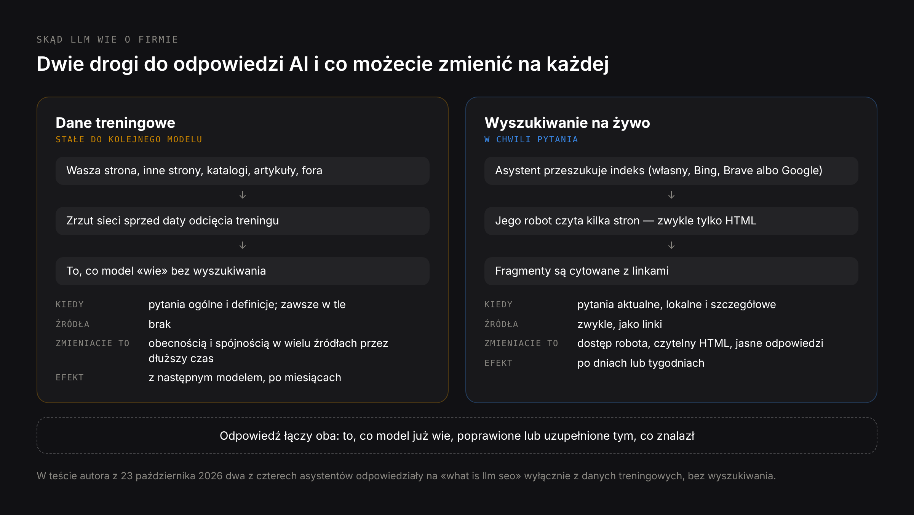
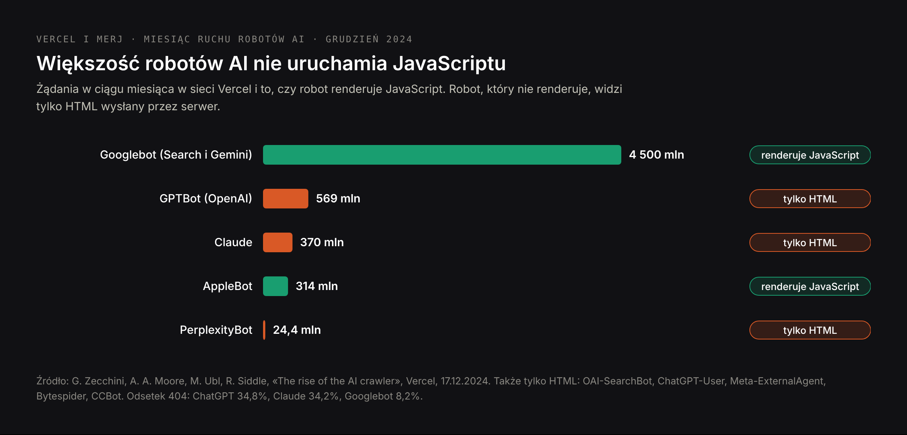
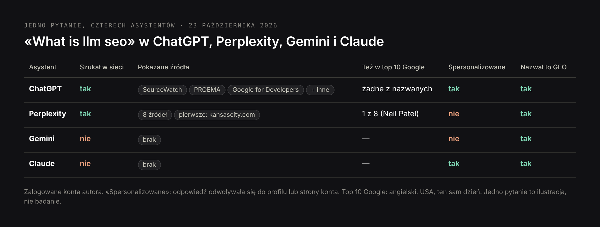

# DRAFT PL — «Pozycjonowanie w LLM» (24 Oct 2026). Same research as EN, written for
# Polish readers. Core (PL): pozycjonowanie w llm 70, llm seo meaning, llmo seo,
# llm seo tools (10 each). SERP «llm seo» PL: Polish agency blogs. Prices in zł as on
# /pl/oferty/llm-seo. H1 (Title) ≠ Meta title.

Title: LLM SEO, czyli pozycjonowanie w LLM: jak przygotować stronę pod ChatGPT, Claude, Gemini i Perplexity
Slug: pozycjonowanie-w-llm
Meta title: Pozycjonowanie w LLM: czym jest LLM SEO (2026)
Meta description: LLM SEO model po modelu: skąd ChatGPT, Claude, Gemini i Perplexity wiedzą o firmie, gdzie każdy szuka w sieci i co zmienić na stronie, żeby ją dobrze opisały.

---

> Krótko: LLM SEO, czyli pozycjonowanie w LLM, to optymalizacja strony i marki tak, żeby duże modele językowe — ChatGPT, Claude, Gemini, Perplexity, Copilot — znały firmę, znajdowały jej strony i opisywały ją poprawnie. Model dowiaduje się o Was na dwa sposoby: z danych treningowych, które nie zmieniają się do kolejnej wersji modelu, i z wyszukiwania w sieci w chwili pytania. Każdy model przeszukuje inny indeks: ChatGPT własny i Bing, Claude Brave Search, Gemini Google, Copilot Bing, Perplexity własnego robota. Większość robotów AI nie uruchamia JavaScriptu, więc strona, której tekst ładują skrypty, może być dla nich pusta. LLM SEO pracuje na obu drogach: obecność w źródłach, z których modele się uczą, i czytelność oraz dostępność stron, gdy modele szukają.

LLM SEO pokrywa się z GEO i AEO, a wiele osób używa tych trzech nazw dla jednej rzeczy. Ten poradnik bierze perspektywę, którą inni pomijają: same modele. Co model wie o Was bez szukania, dokąd idzie każdy model, gdy szuka, co jego robot potrafi przeczytać, a czego nie, i co zmienić na stronie, żeby każdy z nich podał poprawne informacje. Opiera się na dokumentacji robotów OpenAI, Anthropic, Perplexity i Google, analizie ponad miliarda żądań robotów AI przygotowanej przez Vercel i MERJ oraz na teście z 23 października 2026 roku, w którym zadałem ChatGPT, Perplexity, Gemini i Claude to samo pytanie.

## Czym jest LLM SEO, czyli pozycjonowanie w LLM

**LLM SEO** (large language model search engine optimization), po polsku coraz częściej pozycjonowanie w LLM, to praca nad tym, żeby firma była widoczna i poprawnie opisana w odpowiedziach dużych modeli językowych. LLM to model, który stoi za asystentem AI: GPT za ChatGPT, Claude, Gemini, modele używane przez Perplexity i Copilota. LLM SEO zadaje każdemu z nich trzy pytania:

1. **Czy model zna firmę** bez wyszukiwania — z tego, czego nauczył się w treningu?
2. **Czy model znajdzie i przeczyta strony firmy**, gdy szuka w sieci w chwili pytania?
3. **Czy to, co mówi, jest prawdą** — usługi, ceny, lokalizacje, ludzie stojący za firmą?

Klasyczne SEO pyta, czy strona jest wysoko. LLM SEO pyta, czy model może wykorzystać to, co strona mówi, i czy to, co mówią o Was inne miejsca, jest z tym spójne.

## LLM SEO, LLMO i «optymalizacja LLM»: trzy nazwy, dwa znaczenia

- **LLM SEO** i **LLMO** (large language model optimization) oznaczają tę samą pracę marketingową. Nazwa LLMO jest popularna szczególnie w krajach niemieckojęzycznych.
- **GEO** (generative engine optimization) i **AEO** (answer engine optimization) pokrywają się z obiema. Wszyscy czterej asystenci, których sprawdziłem, traktowali LLM SEO i GEO jako pojęcia nakładające się albo tożsame. Różnice opisuję w artykułach [GEO co to jest](/pl/blog/geo-co-to-jest) i [AEO: answer engine optimization](/pl/blog/aeo-answer-engine-optimization).
- **«Optymalizacja LLM»** ma też drugie, zupełnie inne znaczenie w inżynierii: przyspieszanie lub obniżanie kosztu działania samego modelu — kwantyzacja, cache, strojenie wnioskowania. Połowa wyników na angielskie «llm optimization» dotyczy właśnie tego.

## Skąd modele LLM wiedzą o firmie: dane treningowe a wyszukiwanie na żywo

Model językowy może wiedzieć o firmie na dwa sposoby i każdy wymaga innej pracy.



**Dane treningowe.** Przed premierą model jest trenowany na dużym zrzucie sieci i innych tekstów. To, czego się nauczy, nie zmienia się do następnej wersji. Jeśli firma była opisana w wielu źródłach przed datą odcięcia treningu, model może ją znać bez szukania; jeśli po tej dacie zmieniła nazwę, ceny lub usługi, model może powtarzać starą wersję. Danych treningowych nie da się edytować — można tylko wpłynąć na to, czego nauczą się przyszłe modele, będąc obecnym w źródłach, z których się uczą: na własnej stronie, ale przede wszystkim na innych stronach, w katalogach, artykułach i dyskusjach.

**Wyszukiwanie na żywo.** Gdy pytanie wymaga aktualnych lub konkretnych informacji, asystent szuka w sieci, czyta kilka stron i z nich pisze odpowiedź, zwykle z linkami. Na tę drogę wpływacie bezpośrednio: czy robot silnika ma dostęp, czy potrafi przeczytać stronę i czy strona jasno odpowiada na pytanie.

To, którą drogą pójdzie asystent, zależy od pytania i produktu. W moim teście z 23 października 2026 roku dwóch z czterech asystentów odpowiedziało na pytanie o definicję w ogóle bez wyszukiwania — odpowiedź pochodziła z tego, co model już wiedział.

| | Dane treningowe | Wyszukiwanie na żywo |
|---|---|---|
| Kiedy są używane | Zawsze; same przy pytaniach ogólnych i definicjach | Gdy pytanie wymaga aktualnych, lokalnych lub konkretnych faktów |
| Aktualność | Stała, z daty odcięcia treningu | Sprzed minut lub dni |
| Pokazuje źródła | Nie | Zwykle, jako linki |
| Co możecie zrobić | Być obecnym i spójnym w wielu źródłach przez dłuższy czas | Wpuścić robota, zrobić czytelne strony, odpowiadać jasno |
| Kiedy widać zmiany | Z następnym modelem | Po dniach lub tygodniach |

## Gdzie każdy model LLM szuka w sieci

Każdy asystent przeszukuje inny indeks innym robotem. To najbardziej praktyczny fakt w LLM SEO, bo strona może być widoczna dla jednego modelu i niewidoczna dla drugiego.

| Asystent | Indeks wyszukiwania | Robot do wyszukiwania | Robot treningowy | Co to dla Was znaczy |
|---|---|---|---|---|
| ChatGPT | Własny indeks OpenAI oraz Bing i inni dostawcy | OAI-SearchBot | GPTBot | Wpuśćcie OAI-SearchBot; widoczność w Bing pomaga, ale już nie gwarantuje widoczności w ChatGPT |
| Claude | Brave Search | Claude-SearchBot | ClaudeBot | Sprawdźcie, czy Wasze strony są w Brave Search, a nie tylko w Google |
| Gemini | Google Search | Googlebot | Token Google-Extended (tylko trening) | Klasyczne SEO w Google; zablokowanie Google-Extended nie usuwa Was z wyszukiwarki |
| AI Overviews i tryb AI w Google | Google Search | Googlebot | — | Ten sam indeks co wyniki Google |
| Copilot | Bing | Bingbot | — | Bing Webmaster Tools, IndexNow |
| Perplexity | Własny indeks | PerplexityBot | Według Perplexity nieużywany do treningu | Wpuśćcie PerplexityBot |

Co mówią źródła, w skrócie:

- **OpenAI** opisuje trzech agentów: OAI-SearchBot do wyszukiwania w ChatGPT, GPTBot do treningu i ChatGPT-User do stron, które użytkownik każe ChatGPT otworzyć. Strony blokujące OAI-SearchBot nie są pokazywane w odpowiedziach wyszukiwania ChatGPT. Według raportu Peec AI, omówionego we wrześniu 2026 roku, ChatGPT coraz częściej odpowiada z własnego indeksu — wewnętrznie nazwanego Labrador — wciąż korzystając też z Binga i innych dostawców danych.
- **Anthropic** od marca 2025 roku wymienia Brave Search jako dostawcę wyszukiwania dla Claude i opisuje trzech agentów: ClaudeBot do treningu, Claude-SearchBot do indeksowania pod wyszukiwanie i Claude-User do zapytań użytkowników. Zablokowanie Claude-SearchBot, jak pisze sam Anthropic, może zmniejszyć widoczność i dokładność strony w wynikach wyszukiwania użytkowników.
- **Google** używa Googlebota i do wyszukiwarki, i do funkcji AI. Osobny token Google-Extended decyduje, czy treść jest używana do modeli Gemini; Google pisze, że nie wpływa on na obecność ani pozycje w wyszukiwarce Google, której częścią są AI Overviews i tryb AI.
- **Perplexity** używa PerplexityBota do pokazywania i linkowania stron w wynikach i deklaruje, że nie służy on do trenowania modeli. Drugi agent, Perplexity-User, pobiera strony na prośbę użytkownika i zwykle ignoruje robots.txt.

Plik robots.txt, który wyłącza stronę z trenowania modeli, ale zostawia ją widoczną w wyszukiwaniu każdego asystenta, wygląda tak:

```text
# wyszukiwarki i silniki odpowiedzi: dozwolone
User-agent: OAI-SearchBot
Allow: /

User-agent: Claude-SearchBot
Allow: /

User-agent: PerplexityBot
Allow: /

# tylko trening: zablokowane
User-agent: GPTBot
Disallow: /

User-agent: ClaudeBot
Disallow: /

User-agent: Google-Extended
Disallow: /

User-agent: *
Allow: /
```

Czy blokować trening, to decyzja biznesowa. Blokada trzyma Wasze teksty z dala od przyszłych modeli, ale oznacza też, że następny model nauczy się o Was tylko z tego, co napiszą inni.

## Roboty AI a JavaScript: dlaczego strona może być pusta dla ChatGPT

W grudniu 2024 roku Vercel i MERJ opublikowali analizę ruchu robotów AI w sieci Vercel: ponad miliard żądań w ciągu miesiąca. Dwa wnioski dotyczą niemal każdej nowoczesnej strony.



**Większość robotów AI nie uruchamia JavaScriptu.** Roboty OpenAI, ClaudeBot, PerplexityBot, roboty Mety i ByteDance oraz CCBot z Common Crawl czytają tylko HTML wysłany przez serwer. Roboty ChatGPT i Claude pobierają pliki JavaScript — 11,5% i 23,8% ich żądań — ale ich nie wykonują. Stronę jak przeglądarka renderują tylko Gemini, który korzysta z infrastruktury Googlebota, i AppleBot.

**Roboty AI marnują jedną trzecią żądań.** 34,8% pobrań ChatGPT i 34,2% pobrań Claude trafia w strony zwracające 404, przy 8,2% u Googlebota. Znacznie częściej chodzą po starych i zepsutych adresach.

Co to znaczy w praktyce:

- Aplikacja jednostronicowa w React, Vue lub Angularze, która renderuje tekst w przeglądarce, wysyła robotowi AI niemal pustą skorupę HTML. Dla ChatGPT, Claude i Perplexity taka strona nie ma treści.
- Ceny, szczegóły produktów, opinie i FAQ ładowane później skryptami są dla nich niewidoczne, nawet jeśli reszta strony jest renderowana na serwerze.
- Przekierowania ze starych adresów znaczą więcej niż kiedyś, bo roboty AI ciągle o nie pytają.

Sprawdzenie zajmuje minutę: otwórzcie źródło strony (nie inspektor) albo pobierzcie ją bez JavaScriptu i poszukajcie głównego tekstu. Jeśli go tam nie ma, rozwiązaniem jest renderowanie po stronie serwera, generowanie statyczne albo prerendering — w Next.js to domyślne zachowanie przy stronach budowanych jako komponenty serwerowe. Ta strona jest zbudowana właśnie tak, więc każdy artykuł dociera do każdego robota jako pełny HTML.

## Jak optymalizować treści pod LLM

### 1. Każda ważna strona czytelna bez JavaScriptu

Główny tekst, ceny, dane kontaktowe i FAQ w HTML wysyłanym przez serwer. Sprawdźcie źródło pięciu najważniejszych stron.

### 2. Wpuśćcie roboty wyszukiwania, w których chcecie być

OAI-SearchBot, Claude-SearchBot, PerplexityBot, Googlebot i Bingbot. O robotach treningowych zdecydujcie osobno.

### 3. Bądźcie w każdym indeksie, którego używają modele

Google Search Console, Bing Webmaster Tools — który zasila też Copilota i część ChatGPT — oraz sprawdzenie, czy kluczowe strony są w Brave Search dla Claude. Nowe i zmienione adresy zgłaszajcie przez IndexNow, obsługiwany przez Binga.

### 4. Piszcie fragmenty, które przetrwają streszczenie

Modele pobierają fragmenty, nie całe strony. Sekcja, która nazywa pytanie w nagłówku i odpowiada w pierwszym zdaniu, z liczbami i nazwanymi źródłami, może być zacytowana samodzielnie. Strona, której odpowiedź rozłożona jest na pięć akapitów — nie. Pełną metodę opisuję w artykule [AEO: answer engine optimization](/pl/blog/aeo-answer-engine-optimization).

### 5. Opisujcie firmę wszędzie tak samo

Nazwa, usługi, lokalizacje, ceny lub przedziały cen, rok założenia, ludzie. Model łączy to, co znajdzie, a sprzeczności między stroną, LinkedInem i starymi katalogami stają się sprzecznościami w odpowiedzi.

### 6. Bądźcie w źródłach, z których modele się uczą i które przeszukują

Niezależne opinie, artykuły porównawcze, media branżowe, społeczności takie jak Reddit czy GitHub przy produktach technicznych i katalogi, które są wysoko na Waszą usługę. Te źródła zasilają obie drogi: przyszłe dane treningowe i dzisiejsze wyszukiwanie.

### 7. Aktualizujcie strony i naprawiajcie zepsute adresy

Roboty AI stale pytają o stare adresy. Przekierujcie to, co się przeniosło, zwracajcie 410 dla tego, co zniknęło na dobre, utrzymujcie czystą mapę strony i pokazujcie datę ostatniej aktualizacji na stronach ze zmiennymi faktami.

## Pozycjonowanie w każdym modelu: ChatGPT, Claude, Gemini, Perplexity i Copilot

**ChatGPT.** Wpuśćcie OAI-SearchBot. Bądźcie w indeksie Binga, ale na tym nie poprzestawajcie: ChatGPT coraz częściej odpowiada z własnego indeksu. Jego odpowiedzi personalizuje zapisana pamięć użytkownika i wcześniejsze rozmowy, więc testujcie go bez logowania albo na osobnym koncie bez pamięci: w październiku 2026 roku czat tymczasowy ChatGPT informuje, że może korzystać z pamięci i instrukcji niestandardowych. W moim badaniu 141 odpowiedzi ChatGPT podawał tylko 1,6 źródła na odpowiedź i w 23 z 47 odpowiedzi na pytania o usługi odwoływał się do Map Google, więc kompletny Profil Firmy w Google też ma tu znaczenie. Pracę tylko pod ChatGPT opisuję na stronie [pozycjonowanie w ChatGPT](/pl/oferty/pozycjonowanie-w-chatgpt).

**Claude.** Jego wyszukiwanie działa na Brave Search, więc wpiszcie swoje kluczowe zapytania w Brave i sprawdźcie, czy Wasze strony tam są. Wpuśćcie Claude-SearchBot. Claude nie zawsze szuka: na pytania ogólne odpowiada z danych treningowych, i tu procentują długotrwałe, spójne wzmianki o firmie.

**Gemini i funkcje AI w Google.** Opierają się na indeksie Google, więc podstawą jest klasyczne SEO w Google. Zablokowanie Google-Extended wpływa na trening, nie na widoczność w wyszukiwarce.

**Perplexity.** Szuka niemal przy każdym pytaniu i cytuje wiele źródeł — 16,7 na odpowiedź w moim badaniu — głównie z otwartej sieci, często także strony samych firm. Wpuśćcie PerplexityBot i piszcie strony, które odpowiadają wprost.

**Copilot.** Opiera się na Bingu. Bing Webmaster Tools w raporcie AI Performance pokazuje, jak często Wasze strony są cytowane w Copilocie i odpowiedziach AI w Bing — to jedyny jak dotąd raport cytowań udostępniany przez samego asystenta AI.

## llms.txt a SEO: co daje, a czego nie

llms.txt to proponowany plik Markdown w katalogu głównym strony, który wymienia jej najważniejsze podstrony dla modeli językowych. Często sprzedaje się go jako «robots.txt dla AI», a nim nie jest: niczego nie może dopuścić ani zablokować. Google pisze, że jego systemy wyszukiwania go nie używają, a żadne opublikowane badanie nie wykazało, że zwiększa liczbę cytowań w odpowiedziach AI. Może się przydać stronom z dokumentacją, której użytkownicy wklejają ją do asystentów programistycznych. Dla widoczności w ChatGPT, Claude czy Perplexity liczą się robots.txt i czytelny HTML, a llms.txt — nie. Szczegóły z przykładowym plikiem są w artykule [czy strona potrzebuje pliku llms.txt](/pl/blog/czy-strona-potrzebuje-pliku-llms-txt).

## Checklista LLM SEO

| Co sprawdzić | Jak to zweryfikować |
|---|---|
| Główny tekst, ceny i kontakt są w HTML z serwera | Źródło strony; wyszukajcie w nim zdanie ze strony |
| OAI-SearchBot, Claude-SearchBot, PerplexityBot, Googlebot, Bingbot mają dostęp | Przeczytajcie robots.txt |
| Jest świadoma decyzja o GPTBot, ClaudeBot i Google-Extended | robots.txt odzwierciedla ją celowo, a nie przypadkiem |
| Kluczowe strony są zaindeksowane w Google i Bing | Search Console, Bing Webmaster Tools |
| Kluczowe strony pojawiają się w Brave Search na główne zapytania | Wyszukajcie je w Brave |
| Nowe adresy są zgłaszane przez IndexNow | Ustawienie w CMS lub hostingu |
| Stare adresy przekierowują; błędy 404 są naprawione | Logi serwera przefiltrowane po robotach AI |
| Każde ważne pytanie ma sekcję z odpowiedzią w pierwszym zdaniu | Przeczytajcie pierwsze zdanie pod każdym nagłówkiem |
| Fakty o firmie zgadzają się na stronie, w Profilu Firmy w Google, na LinkedInie i w katalogach | Porównajcie je obok siebie |
| Firma jest wymieniana w opiniach, zestawieniach i mediach, które cytują modele | Zapytajcie asystentów i zapiszcie źródła |
| Stały zestaw pytań jest sprawdzany co miesiąc w każdym asystencie, w czystych sesjach | Arkusz albo tracker |

## Narzędzia do LLM SEO: co mierzą

| Typ | Co robi | Przykłady |
|---|---|---|
| Trackery widoczności w LLM | Regularnie zadają stały zestaw pytań w kilku asystentach i zapisują wzmianki, cytowania i konkurentów | Profound, Peec AI, Otterly.AI, LLMrefs |
| Pakiety SEO z modułami AI | Śledzą wzmianki o marce w odpowiedziach AI obok danych o frazach | Semrush, Ahrefs Brand Radar, Senuto |
| Raporty samych silników | Cytowania mierzone przez sam silnik | Bing Webmaster Tools AI Performance |
| Analiza logów | Pokazuje, które roboty AI przychodzą, o co pytają i co się nie udaje | Logi serwera lub CDN, analityka Vercel i Cloudflare |

Trackery robią próbki odpowiedzi; nie widzą tego, co widzi każdy użytkownik, zwłaszcza w ChatGPT, gdzie odpowiedzi zależą od pamięci. Analiza logów jest z tych czterech najrzadziej używana, a to jedyny sposób, żeby zobaczyć, co GPTBot czy ClaudeBot naprawdę pobrał z Waszej strony.

## Jak mierzyć widoczność w LLM

1. **Spiszcie 20–50 pytań**, które zadają klienci, ich słowami i w ich językach, z miastem.
2. **Raz w miesiącu zadajcie każde w ChatGPT, Claude, Gemini i Perplexity**, bez logowania albo na osobnym koncie bez pamięci, żeby nie zniekształcała odpowiedzi; czat tymczasowy ChatGPT może nadal korzystać z pamięci.
3. **Dla każdej odpowiedzi zapiszcie:** czy firma jest wymieniona, czy strona jest cytowana z linkiem, czy opis jest poprawny i jakie źródła są cytowane.
4. **Raportujcie osobno dla każdego modelu**, a nie jedną liczbą. Czterej asystenci czytają różne indeksy i zmieniają się w różnym tempie.
5. **Dodajcie dane z pierwszej ręki:** raport AI Performance w Bing, ruch z AI w GA4 według źródła (chatgpt.com, perplexity.ai, claude.ai, gemini.google.com, copilot.microsoft.com) i aktywność robotów AI w logach serwera.

Jedno ostrzeżenie: po wdrożeniu GPT-6 7–8 października 2026 roku część linków z ChatGPT przychodziła bez parametru i referera i była liczona w GA4 jako ruch bezpośredni. Spadek «ruchu z ChatGPT» może być zmianą w śledzeniu, a nie w widoczności.

## Przykłady LLM SEO

### Przykład 1: czterech asystentów, jedno pytanie

23 października 2026 roku zadałem ChatGPT, Perplexity, Gemini i Claude to samo pytanie: «what is llm seo». ChatGPT i Perplexity szukały w sieci; Gemini i Claude odpowiedziały z tego, co ich modele już wiedziały, bez pokazania żadnego źródła.




Perplexity zacytowało osiem źródeł. Tylko jedno z nich, blog Neila Patela, było też w pierwszej dziesiątce Google na to samo zapytanie; pierwszym źródłem był artykuł w serwisie informacyjnym z Kansas City.


ChatGPT zacytował SourceWatch, PROEMA i dokumentację Google dla deweloperów — i dopasował odpowiedź do konta, z którego zadano pytanie: przykładem był programista specjalizujący się w SEO i GEO, a niżej podał rekomendacje dla tej właśnie strony. Każdy test w prywatnym koncie mierzy to konto, a nie rynek.


Co pokazuje test:

- **Przy pytaniach ogólnych decyduje droga treningowa.** Połowa asystentów nie szukała. Żeby być w takich odpowiedziach, firma albo autor musi być obecny w wielu źródłach na tyle długo, żeby trafić do danych treningowych.
- **Droga wyszukiwania czyta inną sieć niż Google.** Źródła Perplexity prawie nie pokrywały się z pierwszą dziesiątką Google.
- **Wszyscy czterej asystenci traktowali LLM SEO i GEO jako pojęcia nakładające się albo tożsame.** O terminologii decyduje użycie, nie definicje.
- **Personalizacja jest realna.** Mierzcie w czystych sesjach.

### Przykład 2: kiedy LLM SEO się opłaca

Vercel podał w czerwcu 2025 roku, że ChatGPT przyprowadzał około 10% jego nowych rejestracji, wobec 4,8% miesiąc wcześniej i 1% pół roku wcześniej. W tym samym artykule kreator formularzy Tally podał, że wyszukiwanie AI stało się jego największym kanałem pozyskania. Oba to produkty, o które programiści pytają asystentów, z obszerną dokumentacją czytelną jako zwykły HTML — w takich warunkach LLM SEO zwraca się najszybciej.

## Najczęstsze błędy w LLM SEO

**Blokowanie wszystkich botów AI «na wszelki wypadek».** Ogólna blokada GPTBot, ClaudeBot i PerplexityBot często obejmuje też roboty wyszukiwania. O treningu i wyszukiwaniu decydujcie osobno.

**Renderowanie kluczowych treści po stronie klienta.** Najczęstszy techniczny powód, dla którego dobra strona jest niewidoczna dla ChatGPT i Claude.

**Sprawdzanie tylko Google.** Claude szuka w Brave; ChatGPT coraz częściej we własnym indeksie. Strona wysoko w Google może nie istnieć w żadnym z nich.

**Mierzenie we własnym koncie.** Pamięć i historia ChatGPT kształtują odpowiedzi. Test we własnym koncie mierzy głównie Was.

**Liczenie na llms.txt.** Nie wpływa na widoczność w żadnym z głównych asystentów.

**Optymalizacja tylko własnej strony.** Modele cytują i uczą się z tego, co piszą o Was inni. Bez wzmianek gdzie indziej mają niewiele do znalezienia.

## Czy Waszej firmie potrzebne jest pozycjonowanie w LLM

Jeśli klienci pytają asystentów AI, zanim wybiorą — usługi profesjonalne, oprogramowanie, kliniki, edukacja, relokacja, każdy przemyślany zakup — LLM SEO jest częścią bycia znalezionym. Warstwa techniczna (renderowanie, roboty, indeksy) to jednorazowe sprawdzenie, które powinna przejść każda nowoczesna strona; warstwy treści i wzmianek to praca ciągła.

U mnie audyt widoczności w LLM — co mówią o Was ChatGPT, Perplexity, Gemini i Claude i na podstawie jakich źródeł — kosztuje od 1000 zł jednorazowo, miesięczna praca nad LLM SEO od 3500 zł, a sam monitoring od 1000 zł miesięcznie. Co obejmuje każda opcja, opisuję na stronie [LLM SEO](/pl/oferty/llm-seo).

## Najczęstsze pytania o LLM SEO

**Czym jest LLM SEO w prostych słowach?**
LLM SEO, czyli pozycjonowanie w LLM, to optymalizacja strony i marki tak, żeby asystenci AI, tacy jak ChatGPT, Claude, Gemini i Perplexity, znali firmę, znajdowali jej strony i opisywali ją poprawnie, gdy ktoś ich pyta.

**Czy LLM SEO to to samo co GEO?**
W praktyce pojęcia się pokrywają i są używane zamiennie; wszyscy czterej asystenci w moim teście traktowali je jako nakładające się albo tożsame. LLM SEO kładzie większy nacisk na same modele — dane treningowe, roboty i indeks wyszukiwania każdego modelu. Zobaczcie [GEO co to jest](/pl/blog/geo-co-to-jest).

**Co to jest LLMO?**
LLMO to large language model optimization, inna nazwa LLM SEO, popularna zwłaszcza w krajach niemieckojęzycznych. W inżynierii «optymalizacja LLM» oznacza też przyspieszanie lub obniżanie kosztu działania modeli, co nie ma z tym związku.

**Jak optymalizować treści pod LLM?**
Umieśćcie główny tekst w HTML renderowanym na serwerze, wpuśćcie roboty wyszukiwania AI, zadbajcie o indeksację w Google i Bing i sprawdźcie Brave, odpowiadajcie na każde pytanie w pierwszym zdaniu pod nagłówkiem, który je nazywa, utrzymujcie spójne fakty o firmie wszędzie i zdobywajcie wzmianki w serwisach cytowanych przez modele.

**Czy roboty AI renderują JavaScript?**
Większość nie. Według Vercel i MERJ roboty OpenAI, ClaudeBot i PerplexityBot czytają tylko HTML wysłany przez serwer. JavaScript renderują Gemini, przez Googlebota, i AppleBot.

**Czy blokować GPTBot?**
Zablokowanie GPTBot trzyma Wasze treści z dala od trenowania przyszłych modeli OpenAI, ale nie usuwa Was z wyszukiwania w ChatGPT, które korzysta z OAI-SearchBot. Zdecydujcie, czy chcecie, żeby przyszłe modele uczyły się z Waszego tekstu, czy tylko z tego, co piszą o Was inni.

**Po jakim czasie widać efekty LLM SEO?**
Poprawki na drodze wyszukiwania widać po dniach lub tygodniach: ChatGPT uwzględnia zmiany w robots.txt po około dobie, a strony pojawiają się po kolejnym crawlu. Zmiany na drodze treningowej widać dopiero po premierze nowego modelu, zwykle po miesiącach.

## Od czego zacząć pozycjonowanie w LLM

Otwórzcie źródło strony głównej i głównej strony usługi i poszukajcie w nim tekstu; jeśli go nie ma, to pierwsza poprawka. Potem sprawdźcie robots.txt pod kątem robotów wyszukiwania, wyszukajcie główne zapytanie w Brave i Bing, nie tylko w Google, i zadajcie ChatGPT, Claude, Gemini i Perplexity — w czystych sesjach — pytanie, które klienci zadają, zanim zadzwonią. Jeśli wolicie, żeby zrobić to porządnie, z zapisanym każdym źródłem i planem dla każdego modelu, zobaczcie stronę [LLM SEO](/pl/oferty/llm-seo) albo [napiszcie do mnie](/pl/kontakt).
