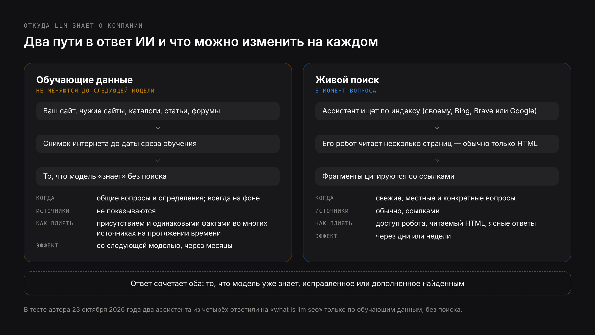
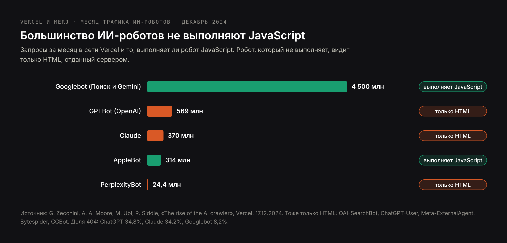
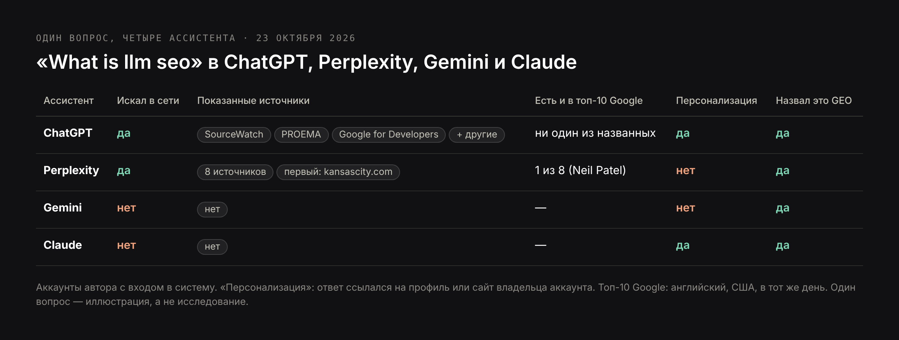
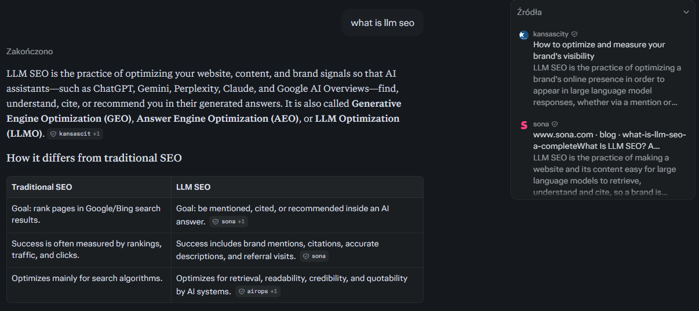
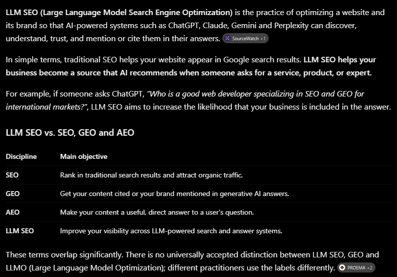
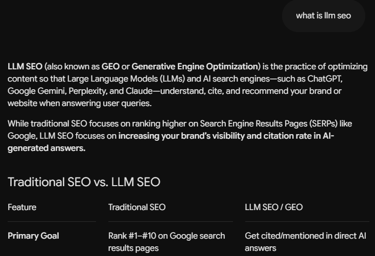
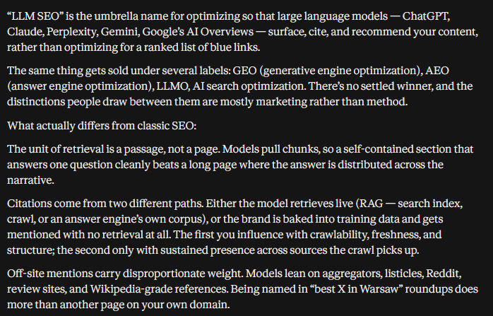

# DRAFT RU — «LLM SEO» (24 Oct 2026). Same research as EN/PL, written for
# Russian-speaking readers. No frequencies in the core; made under the owner's AI-topic
# rule. SERP «продвижение в нейросетях»: habr, vc.ru, sostav. No mention of Russia.
# Prices in € as on /ru/uslugi/llm-seo. H1 (Title) ≠ Meta title.

Title: LLM SEO: как оптимизировать сайт под ChatGPT, Claude, Gemini и Perplexity
Slug: llm-seo
Meta title: Что такое LLM SEO и продвижение в нейросетях (2026)
Meta description: LLM SEO по моделям: откуда ChatGPT, Claude, Gemini и Perplexity знают о компании, где каждая ищет в сети и что изменить на сайте, чтобы его описывали верно.

---

> Коротко: LLM SEO — это оптимизация сайта и бренда так, чтобы большие языковые модели — ChatGPT, Claude, Gemini, Perplexity, Copilot — знали компанию, находили её страницы и описывали её верно. Модель узнаёт о вас двумя путями: из обучающих данных, которые не меняются до следующей версии модели, и из поиска в интернете в момент вопроса. Каждая модель ищет по своему индексу: ChatGPT — по собственному и Bing, Claude — по Brave Search, Gemini — по Google, Copilot — по Bing, Perplexity — своим роботом. Большинство ИИ-роботов не выполняют JavaScript, поэтому сайт, текст которого подгружается скриптами, может быть для них пустым. LLM SEO работает на обоих путях: присутствие в источниках, на которых учатся модели, и читаемость и доступность страниц, когда модели ищут.

LLM SEO пересекается с GEO и AEO, и многие используют три названия для одного и того же. Этот разбор смотрит с той стороны, которую другие пропускают, — со стороны самих моделей. Что модель знает о вас без поиска, куда идёт каждая модель, когда ищет, что её робот может прочитать, а что нет, и что изменить на сайте, чтобы каждая из них говорила о вас правильно. В основе — документация роботов OpenAI, Anthropic, Perplexity и Google, анализ больше миллиарда запросов ИИ-роботов от Vercel и MERJ и тест 23 октября 2026 года, в котором я задал ChatGPT, Perplexity, Gemini и Claude один и тот же вопрос.

## Что такое LLM SEO

**LLM SEO** (large language model search engine optimization) — это работа над тем, чтобы компания была видна и верно описана в ответах больших языковых моделей. По-русски это ещё называют продвижением в нейросетях или оптимизацией под LLM. LLM — модель, которая стоит за ИИ-ассистентом: GPT за ChatGPT, Claude, Gemini, модели, которые используют Perplexity и Copilot. LLM SEO задаёт каждой из них три вопроса:

1. **Знает ли модель компанию** без поиска — из того, чему научилась при обучении?
2. **Найдёт и прочитает ли модель страницы компании**, когда ищет в интернете в момент вопроса?
3. **Верно ли то, что она говорит**, — услуги, цены, адреса, люди за компанией?

Классическое SEO спрашивает, стоит ли страница высоко. LLM SEO спрашивает, может ли модель использовать то, что написано на странице, и согласуется ли с этим то, что о вас пишут в других местах.

## LLM SEO, LLMO и «оптимизация LLM»: три названия, два смысла

- **LLM SEO** и **LLMO** (large language model optimization) означают одну и ту же маркетинговую работу. Название LLMO особенно распространено в немецкоязычных странах.
- **GEO** (generative engine optimization) и **AEO** (answer engine optimization) пересекаются с обоими. Все четыре ассистента, которых я проверил, считали LLM SEO и GEO пересекающимися или одним и тем же. Разница разобрана в статьях [что такое GEO](/ru/blog/chto-takoe-geo) и [что такое AEO](/ru/blog/chto-takoe-aeo).
- **«Оптимизация LLM»** в инженерии имеет второе, не связанное с этим значение: ускорение или удешевление работы самой модели — квантизация, кэширование, настройка вывода. Половина выдачи по английскому «llm optimization» — именно об этом.

## Откуда LLM знают о вашей компании: обучающие данные и живой поиск

Языковая модель может знать о компании двумя способами, и для каждого нужна своя работа.



**Обучающие данные.** Перед выпуском модель обучают на большом снимке интернета и других текстов. Выученное не меняется до следующей версии. Если компанию описывали во многих источниках до даты среза обучения, модель может знать её без поиска; если после этой даты компания сменила название, цены или услуги, модель может повторять старую версию. Обучающие данные нельзя отредактировать — можно только повлиять на то, чему научатся будущие модели, присутствуя в источниках, на которых они учатся: на своём сайте, но прежде всего на чужих сайтах, в каталогах, статьях и обсуждениях.

**Живой поиск.** Когда вопросу нужны свежие или конкретные сведения, ассистент ищет в интернете, читает несколько страниц и пишет ответ по ним, обычно со ссылками. На этот путь вы влияете напрямую: пускают ли робота движка, может ли он прочитать страницу и ясно ли она отвечает на вопрос.

Каким путём пойдёт ассистент, зависит от вопроса и продукта. В моём тесте 23 октября 2026 года два ассистента из четырёх ответили на вопрос-определение вообще без поиска — ответ пришёл из того, что модель уже знала.

| | Обучающие данные | Живой поиск |
|---|---|---|
| Когда используются | Всегда; одни — для общих вопросов и определений | Когда вопросу нужны свежие, местные или конкретные факты |
| Насколько свежие | Зафиксированы на дату среза обучения | Минуты или дни |
| Показывают источники | Нет | Обычно, ссылками |
| Что можно сделать | Быть в многих источниках и с одинаковыми фактами на протяжении времени | Пустить робота, сделать страницы читаемыми, отвечать ясно |
| Когда видны изменения | Со следующей моделью | Через дни или недели |

## Где каждая LLM ищет в интернете

Каждый ассистент ищет по своему индексу своим роботом. Это самый практичный факт в LLM SEO: страница может быть видна одной модели и невидима другой.

| Ассистент | Поисковый индекс | Робот для поиска | Робот для обучения | Что это значит для вас |
|---|---|---|---|---|
| ChatGPT | Собственный индекс OpenAI, плюс Bing и другие поставщики | OAI-SearchBot | GPTBot | Пустите OAI-SearchBot; видимость в Bing помогает, но больше не гарантирует видимость в ChatGPT |
| Claude | Brave Search | Claude-SearchBot | ClaudeBot | Проверьте, есть ли ваши страницы в Brave Search, а не только в Google |
| Gemini | Google Поиск | Googlebot | Токен Google-Extended (только обучение) | Классическое SEO в Google; запрет Google-Extended не убирает вас из Поиска |
| Обзоры от ИИ и режим ИИ в Google | Google Поиск | Googlebot | — | Тот же индекс, что у выдачи Google |
| Copilot | Bing | Bingbot | — | Bing Webmaster Tools, IndexNow |
| Perplexity | Собственный индекс | PerplexityBot | По словам Perplexity, для обучения не используется | Пустите PerplexityBot |

Что говорят источники, коротко:

- **OpenAI** описывает трёх агентов: OAI-SearchBot для поиска в ChatGPT, GPTBot для обучения и ChatGPT-User для страниц, которые пользователь просит ChatGPT открыть. Сайты, закрытые от OAI-SearchBot, не показываются в ответах поиска ChatGPT. По отчёту Peec AI, пересказанному в сентябре 2026 года, ChatGPT всё чаще отвечает по собственному индексу — внутри OpenAI его называют Labrador, — продолжая использовать Bing и других поставщиков данных.
- **Anthropic** с марта 2025 года указывает Brave Search как поставщика веб-поиска для Claude и описывает трёх агентов: ClaudeBot для обучения, Claude-SearchBot для индексации под поиск и Claude-User для запросов пользователей. Закрыть Claude-SearchBot, по словам самой Anthropic, значит, возможно, снизить видимость и точность сайта в результатах поиска пользователей.
- **Google** использует Googlebot и для Поиска, и для функций ИИ. Отдельный токен Google-Extended решает, используется ли контент для моделей Gemini; Google пишет, что на присутствие и позиции в Google Поиске он не влияет, а обзоры от ИИ и режим ИИ — часть Поиска.
- **Perplexity** использует PerplexityBot, чтобы показывать сайты и ссылаться на них в своих результатах, и заявляет, что для обучения моделей он не используется. Второй агент, Perplexity-User, загружает страницы по запросу пользователя и, как правило, игнорирует robots.txt.

robots.txt, который не отдаёт сайт на обучение моделей, но оставляет его видимым в поиске каждого ассистента, выглядит так:

```text
# поиск и движки ответов: разрешено
User-agent: OAI-SearchBot
Allow: /

User-agent: Claude-SearchBot
Allow: /

User-agent: PerplexityBot
Allow: /

# только обучение: закрыто
User-agent: GPTBot
Disallow: /

User-agent: ClaudeBot
Disallow: /

User-agent: Google-Extended
Disallow: /

User-agent: *
Allow: /
```

Закрывать ли обучение — решение бизнеса. Запрет не пускает ваши тексты в будущие модели, но тогда следующая модель узнает о вас только из того, что напишут другие.

## ИИ-роботы и JavaScript: почему сайт может быть пустым для ChatGPT

В декабре 2024 года Vercel и MERJ опубликовали анализ трафика ИИ-роботов в сети Vercel: больше миллиарда запросов за месяц. Два вывода касаются почти любого современного сайта.



**Большинство ИИ-роботов не выполняют JavaScript.** Роботы OpenAI, ClaudeBot, PerplexityBot, роботы Meta и ByteDance и CCBot от Common Crawl читают только HTML, который отдаёт сервер. Роботы ChatGPT и Claude скачивают файлы JavaScript — 11,5% и 23,8% их запросов, — но не выполняют их. Страницу как браузер отрисовывают только Gemini, который использует инфраструктуру Googlebot, и AppleBot.

**ИИ-роботы тратят впустую треть запросов.** 34,8% запросов ChatGPT и 34,2% запросов Claude приходятся на страницы с ответом 404, у Googlebot — 8,2%. Они гораздо чаще ходят по старым и битым адресам.

Что это значит на практике:

- Одностраничное приложение на React, Vue или Angular, которое рисует текст в браузере, отдаёт ИИ-роботу почти пустую HTML-оболочку. Для ChatGPT, Claude и Perplexity у такой страницы нет содержимого.
- Цены, характеристики товаров, отзывы и FAQ, которые подгружаются скриптами позже, для них невидимы, даже если остальная страница рендерится на сервере.
- Редиректы со старых адресов значат больше, чем раньше: ИИ-роботы постоянно их запрашивают.

Проверка занимает минуту: откройте исходный код страницы (не инспектор) или загрузите её без JavaScript и найдите основной текст. Если его там нет, решение — рендеринг на сервере, статическая генерация или пререндеринг; в Next.js это поведение по умолчанию для страниц на серверных компонентах. Этот сайт сделан именно так, поэтому каждая статья приходит любому роботу полным HTML.

## Как оптимизировать контент под LLM

### 1. Каждая важная страница читается без JavaScript

Основной текст, цены, контакты и FAQ — в HTML, который отдаёт сервер. Проверьте исходный код пяти самых важных страниц.

### 2. Пустите поисковых роботов тех ассистентов, где хотите быть

OAI-SearchBot, Claude-SearchBot, PerplexityBot, Googlebot и Bingbot. Об обучающих роботах решайте отдельно.

### 3. Будьте в каждом индексе, которым пользуются модели

Google Search Console, Bing Webmaster Tools — он питает ещё Copilot и часть ChatGPT — и проверка, что ключевые страницы есть в Brave Search для Claude. Новые и изменённые адреса отправляйте через IndexNow, который поддерживает Bing.

### 4. Пишите фрагменты, которые переживут пересказ

Модели берут фрагменты, а не страницы. Раздел, который называет вопрос в заголовке и отвечает в первом предложении, с числами и названными источниками, можно процитировать отдельно. Страницу, где ответ размазан по пяти абзацам, — нет. Полный метод — в статье [что такое AEO](/ru/blog/chto-takoe-aeo).

### 5. Описывайте компанию везде одинаково

Название, услуги, адреса, цены или диапазоны цен, год основания, люди. Модель сводит всё, что находит, и противоречия между сайтом, LinkedIn и старыми каталогами становятся противоречиями в ответе.

### 6. Будьте в источниках, на которых модели учатся и которые ищут

Независимые отзывы, сравнительные статьи, отраслевые издания, сообщества вроде Reddit и GitHub для технических продуктов, каталоги, которые стоят высоко по вашей услуге. Эти источники питают оба пути: будущие обучающие данные и сегодняшний поиск.

### 7. Обновляйте страницы и чините битые адреса

ИИ-роботы постоянно запрашивают старые адреса. Перенаправляйте то, что переехало, отдавайте 410 для того, что удалено навсегда, держите карту сайта чистой и показывайте дату обновления на страницах с меняющимися фактами.

## Продвижение в каждой модели: ChatGPT, Claude, Gemini, Perplexity и Copilot

**ChatGPT.** Пустите OAI-SearchBot. Будьте в индексе Bing, но не останавливайтесь на этом: ChatGPT всё чаще отвечает по собственному индексу. Его ответы персонализирует сохранённая память пользователя и прошлые чаты, поэтому проверяйте его без входа в аккаунт или в отдельном аккаунте без памяти: в октябре 2026 года временный чат ChatGPT предупреждает, что может использовать память и пользовательские инструкции. В моём исследовании 141 ответа ChatGPT давал всего 1,6 источника на ответ и в 23 из 47 ответов на вопросы об услугах ссылался на Google Карты, так что заполненный профиль компании в Google важен и здесь. Работа только под ChatGPT описана на странице [продвижение в ChatGPT](/ru/uslugi/prodvizhenie-v-chatgpt).

**Claude.** Его веб-поиск работает на Brave Search, поэтому введите свои главные запросы в Brave и посмотрите, есть ли там ваши страницы. Пустите Claude-SearchBot. Claude ищет не всегда: на общие вопросы он отвечает по обучающим данным, и здесь окупаются давние и одинаковые упоминания компании.

**Gemini и функции ИИ в Google.** Опираются на индекс Google, поэтому основа — классическое SEO в Google. Запрет Google-Extended влияет на обучение, а не на видимость в Поиске.

**Perplexity.** Ищет почти на каждый вопрос и цитирует много источников — 16,7 на ответ в моём исследовании, — в основном из открытого интернета, часто включая сайты самих компаний. Пустите PerplexityBot и пишите страницы, которые отвечают прямо.

**Copilot.** Работает на Bing. Bing Webmaster Tools в отчёте AI Performance показывает, как часто ваши страницы цитируются в Copilot и ответах ИИ в Bing, — пока это единственный отчёт о цитированиях от самого ИИ-ассистента.

## llms.txt и SEO: что он даёт и чего не даёт

llms.txt — предлагаемый файл в формате Markdown в корне сайта, который перечисляет его главные страницы для языковых моделей. Его часто продают как «robots.txt для ИИ», но это не так: он ничего не может разрешить или запретить. Google пишет, что его поисковые системы файл не используют, и ни одно опубликованное исследование не показало, что он увеличивает число цитирований в ответах ИИ. Он может пригодиться сайтам с документацией, которую пользователи вставляют в ассистенты для программирования. Для видимости в ChatGPT, Claude или Perplexity важны robots.txt и читаемый HTML, а llms.txt — нет. Подробности с примером файла — в статье [нужен ли сайту файл llms.txt](/ru/blog/nuzhen-li-saitu-fail-llms-txt).

## Чек-лист LLM SEO

| Что проверить | Как проверить |
|---|---|
| Основной текст, цены и контакты есть в HTML с сервера | Исходный код страницы; найдите в нём фразу со страницы |
| OAI-SearchBot, Claude-SearchBot, PerplexityBot, Googlebot, Bingbot допущены | Прочитайте robots.txt |
| Принято решение по GPTBot, ClaudeBot и Google-Extended | robots.txt отражает его сознательно, а не случайно |
| Ключевые страницы проиндексированы в Google и Bing | Search Console, Bing Webmaster Tools |
| Ключевые страницы находятся в Brave Search по главным запросам | Поищите их в Brave |
| Новые адреса отправляются через IndexNow | Настройка CMS или хостинга |
| Старые адреса перенаправлены; ошибки 404 исправлены | Логи сервера с фильтром по ИИ-роботам |
| На каждый важный вопрос есть раздел с ответом в первом предложении | Прочитайте первое предложение под каждым заголовком |
| Факты о компании совпадают на сайте, в профиле компании в Google, в LinkedIn и каталогах | Сравните их рядом |
| Компанию упоминают в отзывах, подборках и изданиях, которые цитируют модели | Спросите ассистентов и запишите источники |
| Постоянный набор вопросов проверяется раз в месяц в каждом ассистенте, в чистых сессиях | Таблица или трекер |

## Инструменты LLM SEO: что они измеряют

| Тип | Что делает | Примеры |
|---|---|---|
| Трекеры видимости в LLM | Регулярно задают постоянный набор вопросов нескольким ассистентам и записывают упоминания, ссылки, конкурентов | Profound, Peec AI, Otterly.AI, LLMrefs |
| SEO-платформы с модулями ИИ | Отслеживают упоминания бренда в ответах ИИ рядом с данными о запросах | Semrush, Ahrefs Brand Radar |
| Отчёты самих движков | Цитирования, которые считает сам движок | Bing Webmaster Tools AI Performance |
| Анализ логов | Показывает, какие ИИ-роботы приходят, что запрашивают и что не получается | Логи сервера или CDN, аналитика Vercel и Cloudflare |

Трекеры делают выборку ответов и не видят того, что видит каждый пользователь, особенно в ChatGPT, где ответы зависят от памяти. Анализ логов используют реже всего, а это единственный способ увидеть, что GPTBot или ClaudeBot на самом деле забрали с вашего сайта.

## Как измерять видимость в LLM

1. **Выпишите 20–50 вопросов**, которые задают клиенты, их словами и на их языках, с городом.
2. **Раз в месяц задавайте каждый в ChatGPT, Claude, Gemini и Perplexity** без входа в аккаунт или в отдельном аккаунте без памяти, чтобы она не искажала ответ; временный чат ChatGPT может всё равно использовать память.
3. **Для каждого ответа записывайте:** названа ли компания, есть ли ссылка на сайт, верно ли описание, какие источники процитированы.
4. **Считайте отдельно по каждой модели**, а не одной цифрой. Четыре ассистента читают разные индексы и меняются с разной скоростью.
5. **Добавьте данные из первых рук:** отчёт AI Performance в Bing, переходы из ИИ в GA4 по источнику (chatgpt.com, perplexity.ai, claude.ai, gemini.google.com, copilot.microsoft.com) и активность ИИ-роботов в логах сервера.

Одна оговорка: после выхода GPT-6 7–8 октября 2026 года часть ссылок из ChatGPT приходила без метки и реферера и засчитывалась в GA4 как прямые заходы. Падение «трафика из ChatGPT» может быть сбоем отслеживания, а не потерей видимости.

## Примеры LLM SEO

### Пример 1: четыре ассистента, один вопрос

23 октября 2026 года я задал ChatGPT, Perplexity, Gemini и Claude один и тот же вопрос: «what is llm seo». ChatGPT и Perplexity искали в интернете; Gemini и Claude ответили из того, что их модели уже знали, не показав ни одного источника.





Perplexity процитировал восемь источников. Только один из них, блог Нила Пателя, был и в первой десятке Google по тому же запросу; первым источником стала статья на новостном сайте из Канзас-Сити.



ChatGPT процитировал SourceWatch, PROEMA и документацию Google для разработчиков — и подогнал ответ под аккаунт, из которого задали вопрос: примером стал веб-разработчик, специализирующийся на SEO и GEO, а ниже он дал рекомендации для этого самого сайта. Любой тест в личном аккаунте измеряет этот аккаунт, а не рынок.





Что показывает тест:

- **На общие вопросы решает путь обучения.** Половина ассистентов не искала. Чтобы попасть в такие ответы, компания или автор должны присутствовать во многих источниках достаточно долго, чтобы оказаться в обучающих данных.
- **Путь поиска читает не тот интернет, что Google.** Источники Perplexity почти не совпадали с первой десяткой Google.
- **Все четыре ассистента считали LLM SEO и GEO пересекающимися или одним и тем же.** Терминологию определяет употребление, а не определения.
- **Персонализация реальна.** Измеряйте в чистых сессиях.

### Пример 2: когда LLM SEO окупается

Vercel сообщил в июне 2025 года, что ChatGPT приводил около 10% его новых регистраций — против 4,8% месяцем раньше и 1% полгода назад. В той же статье конструктор форм Tally рассказал, что ИИ-поиск стал его крупнейшим каналом привлечения. Оба — продукты, о которых разработчики спрашивают ассистентов, с подробной документацией, читаемой как обычный HTML, — в таких условиях LLM SEO окупается быстрее всего.

## Частые ошибки в LLM SEO

**Закрыть всех ИИ-ботов «на всякий случай».** Общий запрет на GPTBot, ClaudeBot и PerplexityBot часто задевает и поисковых роботов. Об обучении и поиске решайте отдельно.

**Ключевой контент рендерится на стороне клиента.** Самая частая техническая причина, по которой хороший сайт невидим для ChatGPT и Claude.

**Проверять только Google.** Claude ищет в Brave; ChatGPT всё чаще — в собственном индексе. Страница, которая стоит высоко в Google, может отсутствовать в обоих.

**Измерять в своём аккаунте.** Память и история ChatGPT формируют его ответы. Тест в своём аккаунте измеряет в основном вас.

**Надеяться на llms.txt.** Он не влияет на видимость ни в одном из главных ассистентов.

**Оптимизировать только свой сайт.** Модели цитируют и учатся на том, что пишут о вас другие. Без упоминаний в других местах им почти нечего найти.

## Нужно ли вашему бизнесу LLM SEO

Если клиенты спрашивают ИИ-ассистентов, прежде чем выбрать, — профессиональные услуги, программы, клиники, обучение, переезд, любая обдуманная покупка, — LLM SEO становится частью того, чтобы вас нашли. Технический слой (рендеринг, роботы, индексы) — разовая проверка, которую должен пройти любой современный сайт; слои контента и упоминаний — постоянная работа.

У меня аудит видимости в LLM — что говорят о вас ChatGPT, Perplexity, Gemini и Claude и на основе каких источников — стоит от 250 € разово, ежемесячная работа по LLM SEO — от 800 € в месяц, только мониторинг — от 250 € в месяц. Что входит в каждый вариант, описано на странице [LLM SEO](/ru/uslugi/llm-seo).

## Частые вопросы про LLM SEO

**Что такое LLM SEO простыми словами?**
LLM SEO — это оптимизация сайта и бренда так, чтобы ИИ-ассистенты вроде ChatGPT, Claude, Gemini и Perplexity знали компанию, находили её страницы и верно описывали её, когда их спрашивают.

**LLM SEO и GEO — это одно и то же?**
На практике понятия пересекаются и используются как синонимы; все четыре ассистента в моём тесте считали их пересекающимися или одним и тем же. LLM SEO больше внимания уделяет самим моделям — обучающим данным, роботам и поисковому индексу каждой модели. Подробнее — в статье [что такое GEO](/ru/blog/chto-takoe-geo).

**Что такое LLMO?**
LLMO — large language model optimization, другое название LLM SEO, особенно распространённое в немецкоязычных странах. В инженерии «оптимизация LLM» означает ещё и ускорение или удешевление работы моделей, что к этому не относится.

**Как оптимизировать контент под LLM?**
Отдавайте основной текст в HTML, отрисованном на сервере, пустите поисковых ИИ-роботов, позаботьтесь об индексации в Google и Bing и проверьте Brave, отвечайте на каждый вопрос в первом предложении под заголовком, который его называет, держите факты о компании одинаковыми везде и добивайтесь упоминаний на сайтах, которые цитируют модели.

**Выполняют ли ИИ-роботы JavaScript?**
Большинство — нет. По данным Vercel и MERJ, роботы OpenAI, ClaudeBot и PerplexityBot читают только HTML, который отдаёт сервер. JavaScript выполняют Gemini через Googlebot и AppleBot.

**Закрывать ли GPTBot?**
Запрет GPTBot не пускает ваш контент в обучение будущих моделей OpenAI, но не убирает вас из поиска ChatGPT, который использует OAI-SearchBot. Решите, хотите ли вы, чтобы будущие модели учились на ваших текстах или только на том, что о вас пишут другие.

**Через сколько видны результаты LLM SEO?**
Исправления на пути поиска видны через дни или недели: ChatGPT учитывает изменения robots.txt примерно через сутки, а страницы появляются после следующего обхода. Изменения на пути обучения видны только после выхода новой модели, обычно через месяцы.

## С чего начать LLM SEO

Откройте исходный код главной страницы и главной страницы услуги и найдите там основной текст; если его нет, это первое, что нужно исправить. Потом проверьте robots.txt на поисковых роботов, поищите главный запрос в Brave и Bing, а не только в Google, и задайте ChatGPT, Claude, Gemini и Perplexity — в чистых сессиях — вопрос, который клиенты задают, прежде чем позвонить. Если хотите, чтобы это сделали как следует, с каждым источником и планом по каждой модели, посмотрите страницу [LLM SEO](/ru/uslugi/llm-seo) или [напишите мне](/ru/kontakty).
