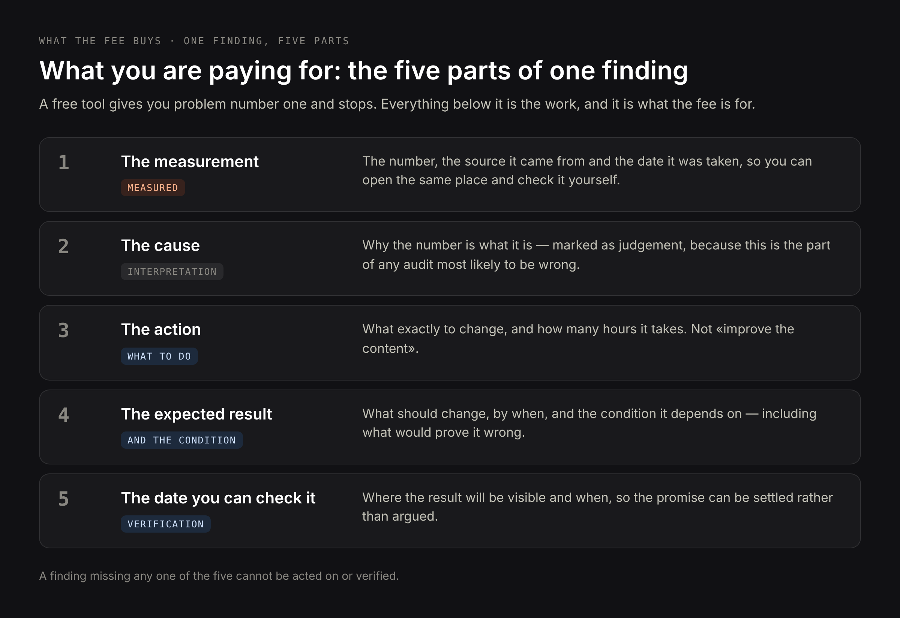
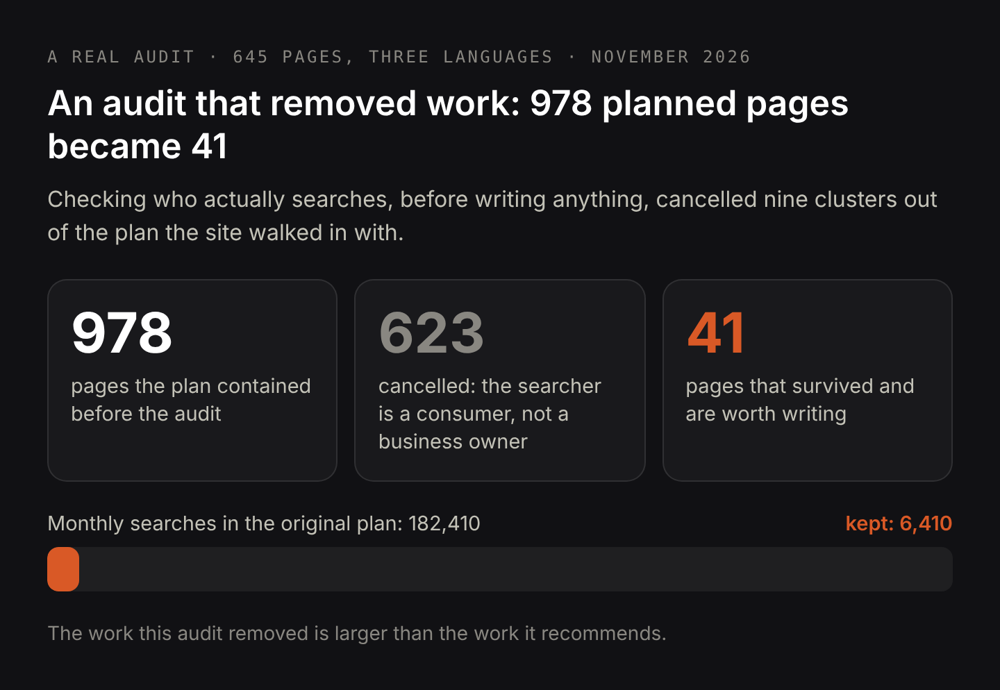

# DRAFT EN — «SEO audit: what it includes and what the client receives» (3 Nov 2026).
# Demand: research/dataforseo/audit-article-demand.md (measured 3 Nov 2026, Google Ads, US).
#   what is an seo audit 320, what is seo audit 320, what is a website audit 320,
#   how to perform an seo audit 170, how to conduct an seo audit 170, how to do an seo audit 90,
#   seo audit example 320, seo audit report 210, seo audit template 140, sample seo audit report 90,
#   seo audit report example 90, seo audit checklist 260, website audit checklist 170,
#   technical seo audit checklist 170, seo audit cost 110, how much does an seo audit cost 70,
#   what is included in an seo audit 20, what does an seo audit include 20.
#   «seo audit tools» 1900 deliberately NOT targeted — that intent wants software, not a consultant.
# Intent check (3 Nov 2026, live top-20, US): fully informational — Reddit r/SEO, American
#   Marketing Association, Greenlane, Quora, Siteimprove, 1Digital, Swydo, Pepperland,
#   Valve+Meter. No service landing pages in the top. PAA: «Can ChatGPT do an SEO audit?»,
#   «How to perform a complete SEO audit?», «What is the 80/20 rule in SEO?».
# Separation from the service page: commercial «seo audit» and «website audit» stay on
#   /seo-audit. This article takes the informational tail only and links to the service page.
# Figures come from the anonymised sample audit shipped as a PDF with this article.
# H1 (Title) and Meta title differ on purpose.

Title: What You Pay For in an SEO Audit, and What the Report Must Contain
Slug: what-you-pay-for-in-an-seo-audit
Meta title: SEO Audit: What It Includes and What You Get
Meta description: What an SEO audit measures, how it is performed step by step, what the report must contain, and a real sample audit to download. Plus when you do not need one.

---

> Quick answer: an SEO audit is a measurement of a website against its own search data and its own market, ending in a written plan. A useful audit contains four things for every problem it reports: the measurement with the source and the date it was taken, the cause, the action, and the result to expect with the condition that result depends on. It is not a list of everything wrong with the site, and a good one often removes planned work instead of adding it. A full audit takes two to five days and costs around 250 euro for a small site.

Most people meet the SEO audit as a PDF full of red warnings from a crawler, with no indication of which warning matters or what to do first. That document costs the same as a real audit, which is why it is worth being precise about what the money buys. You are not paying for the list of problems — a free tool produces that in four minutes. You are paying for someone to measure your site against your own data, decide which of the problems is worth your time, say what each fix should change and by when, and tell you which of the work you were planning not to do. This article goes through each of those, shows what the finished report has to contain, and ends with the cases where you should not buy one at all. Everything is illustrated with a real audit of a live site with 645 pages in three languages, [which you can download in full](/seo-audit-sample-en.pdf).

## What an SEO audit is, and what it is not

An SEO audit is a measurement of one website against three things: the search data the site already generates, the pages it actually has, and the live search results it competes in. The output is not a diagnosis. The output is an ordered plan in which every line says what was measured, why it is that way, what to do about it, and what should happen afterwards.

A website audit is the broader name for the same thing, and the words are used interchangeably. Where they differ in practice is scope: a technical audit stops at crawling and code, while an SEO audit has to include demand and intent, because a technically perfect page aimed at the wrong searcher still earns nothing.

Three things an audit is not. It is not a crawler report: a crawler finds broken links and missing tags, which is maybe a tenth of the work and the only tenth a machine can do alone. It is not a keyword list: volume says how many people search, not who they are or whether they would ever buy from you. And it is not a ranking promise: anyone who commits to a position in a month is selling you the first visible movement twice.

## What is included in an SEO audit: the six things that get measured

Every number in a real audit has a source and a date, so the client can open the same place and check it. In the sample audit shipped with this article, six sources were used.

- **Search Console, a full quarter.** Impressions, clicks, average position and the exact query text, per page and per language. In the sample site: 19,440 impressions, 3 clicks, and 559 of 645 pages with any impressions at all.
- **Every page, read from the content system.** Title, meta title, meta description, H1 and every H2 and H3 of all 645 pages, plus the block structure of each. This is what makes statements like «62 headings are labels» countable rather than impressionistic.
- **The site's own keyword plan, reconciled against reality.** Each query the site intends to answer, checked against the page that is supposed to answer it. In the sample: 1,328 assignments, of which the head query of the entire niche pointed at an unrelated page.
- **Live search results, read for intent.** The top ten for each query family the site targets, read to establish one thing: is the searcher a business owner looking for a contractor, or their own customer? This is the step that decides what gets written and what does not.
- **Presence in AI answers.** Whether an AI answer appears for the queries the site targets, and whether the site is anywhere in the pool those answers are assembled from — the question an [AI visibility audit](/services/ai-visibility-audit) exists to answer. In the sample: an AI answer showed on 304 of 321 query families, and the site was in the top ten of none of them.
- **Internal links and reachability.** Whether the pages can be reached and are actually being shown, and whether the links between them resolve.

Notice what is missing from that list: a tool score. No audit worth paying for reports a number out of 100, because that number is a weighted average of things that do not share a unit.

## How an SEO audit is performed, step by step

The order matters more than the thoroughness, because early steps decide what later steps are even worth looking at.

1. **Take the baseline.** Export the quarter of search data and write down the handful of numbers the whole audit will be measured against later. In the sample those were 19,440 impressions, 3 clicks and an average position of 53.6 on the single most-shown page.
2. **Read the site as a machine reads it.** Pull every title, heading and meta field into one table. Patterns show up immediately at this stage that no page-by-page review would surface: the same six label headings repeated across dozens of pages, seventeen pages whose meta title repeats their H1 word for word.
3. **Reconcile demand against pages.** For every query the site means to win, find the page that is supposed to win it. The gaps found here are the real work; the mismatches found here are usually the cheapest fix in the whole report.
4. **Check intent in the live results, not in the tool.** For each query family, look at who ranks. Four or more shared domains across a family means one page can serve all of it; zero or one means these are different searches wearing similar words.
5. **Separate what you measured from what you concluded.** The impression count is a fact. «The page ranks badly because its headings do not use the query wording» is a hypothesis. A report that prints both in the same typeface is hiding the difference.
6. **Rank by expected effect and attach a date.** Not by severity, and not by how easy the fix is: by what the fix should change, and when you will be able to see whether it did.

## What an SEO audit report looks like: a real example you can download

An SEO audit report is the deliverable, so it is fair to judge the whole service by it. A sample audit report is attached to this article as a PDF, sixteen pages, covering a real trilingual site whose address is withheld. Rather than describe it, here is what each page of it has to contain.

Every finding gets a page of its own, and that page has five parts: the measurement with its source and date, the cause as the author reads it, the action with the hours it costs, the expected result with the condition it depends on, and the date on which the client may check it. If any one of those five is missing, the finding cannot be acted on or verified.

The report also contains three things that most templates leave out. A section on what the site already does right, because knowing which defects are absent is worth as much as knowing which are present. A section on what was deliberately not recommended and why, which in the sample covers four items including a migration that an audit script flagged as a defect and the live pages proved harmless. And a section on where the audit was wrong before it was right: three claims that the data corrected before they reached the client, and three measuring instruments that produced false results until they were calibrated.

That last section is the one worth insisting on when you commission an audit. An auditor who cannot name a place where their first reading was wrong either did not check their own work or is not telling you about it.

## Can ChatGPT do an SEO audit?

It can do the reading, and it cannot do the measuring. That distinction is the whole answer.

An assistant can read your pages and tell you that a heading is vague, that a meta description is too long, that a paragraph buries its point. That is genuinely useful and it is roughly the top tenth of an audit. What it cannot do is open your Search Console and see that one page collected 2,613 impressions at position 53.6 and earned nothing from them, because it has no access to your data. It cannot tell you that a query family with 2,900 monthly searches is worthless to you, because that requires looking at who currently ranks and deciding who the searcher is. And it cannot attach a date and a condition to a prediction, because it is not going to be there in six weeks to be wrong.

There is a sharper version of this problem. Ask an assistant to audit a site and it will produce a plausible, well-organised document, because producing plausible, well-organised documents is exactly what it is good at. The failure mode is not nonsense, it is confident generality: advice that is true of every website and therefore decides nothing about yours. The test is simple. Open any claim in the document and ask where the number came from and on what date. If there is no answer, you are holding a very good essay about SEO.

Used properly, an assistant is an instrument inside the audit rather than a substitute for it, and like every instrument it needs calibrating before you trust it. In the sample audit, a link checker reported all 29 internal links broken because the phrase it searched for appears on every page of that site, and a results reader reported the same domain for every result because the results were wrapped in redirects. Both were caught by testing them against a case with a known answer first.

## Is an SEO audit just a list of what is wrong with the site?

That is what a scan produces, and it is why audits have the reputation they have. The difference is that a finding is not a defect, it is a defect plus a consequence plus a price.

Take the strongest finding in the sample audit. A service page was shown 2,613 times in a quarter at an average position of 53.6 and received zero clicks. The scan version of that finding is «page ranks poorly». The audit version is: 64 queries are already matched to this page, position 53 is page six where the click-through rate is effectively zero, the headings name the service but not the city, the price or the question people actually typed, rewriting them is three to four hours of work with no development, and the page should move into the 25 to 30 range within six to eight weeks, which is where the first clicks begin. If it has not moved by week eight, the text was not the ceiling and the next step is a different one.

Everything in that second version can be argued with, which is the point. A list of what is wrong cannot be argued with, and that is its weakness, not its strength.

## Is an SEO audit a way to create work for the consultant?

It is a fair suspicion, and there is a test for it: look at whether the audit ever recommends less.

In the sample audit, the plan it inherited contained 978 pages to create, covering 3,190 monthly searches. Checking the live results for the query families behind them showed that nine of those clusters were aimed at the wrong person entirely. «Website for a restaurant» sounds like a restaurant owner looking for a developer; the top ten is restaurant sites and ordering platforms, so the searcher wants dinner. Real estate agents, plumbers, manufacturers and therapists all failed the same way. Nine clusters and 176,000 monthly searches were struck out, 623 of the 978 planned pages were cancelled, and what remained was 41 pages worth about 6,400 searches a month.

The work that audit removed is larger than the work it recommends. An audit that cannot do that for you — that returns a longer task list than the one you walked in with, every single time — is not measuring anything.

There is a smaller version of the same test. Ask what the auditor chose not to recommend. In the sample, the largest single block of impressions on the entire site, 2,487 of them at an average position of 77.7, was deliberately left alone: at that position and that breadth, the competition at the top is national and established, the text is not what holds the page back, and rewriting it would change nothing the auditor could promise in advance.

## What an SEO audit costs and how long it takes

[A full audit of a small site](/services/seo-audit) costs around 250 euro and takes two to five working days. The range is driven by page count and by how many languages the site runs, because every language multiplies the reading, not the thinking.

What the price should include: the measurement with sources, the ordered plan, the expected result per action, and a follow-up conversation once you have read it. What it should not include is implementation — those are different jobs with different prices, and bundling them is how an audit turns into a sales document for the work it recommends.

A free automated audit has its place: it will find broken links and missing tags in a few minutes, and if that is all your site needs, you have saved yourself the fee. It will not tell you which of its findings matters, and it will never tell you not to write 623 pages.

## When you do not need an SEO audit

Four situations where the honest answer is to spend the money elsewhere.

- **The site is brand new and has almost no pages.** There is nothing to measure yet. Write the pages for the queries you already know you serve, give it a quarter, then audit against real data.
- **You already know what is broken and have not fixed it.** If three people have told you the site is slow and the product pages have no text, an audit will tell you the same thing with better formatting. Fix the known things first; audit what remains.
- **Nobody is going to do the work.** An audit whose plan nobody has time to implement is an expensive document. If there is no implementation budget and no in-house hands, buy a smaller piece of actual work instead.
- **Your problem is not search.** If the enquiries arrive and do not convert, or the pricing is wrong, or the product is not wanted, more search visibility makes the loss larger, not smaller.

There is a fifth, less obvious case: you have had an audit in the last six months and acted on none of it. A second audit of the same site measures the same things and recommends the same actions, which is why a serious auditor will ask what happened to the first one before quoting for a second.

## What to ask for before you pay for an SEO audit

Five questions that separate a measurement from a template.

- **Where does each number come from, and on what date was it taken?** If the answer is not a named source and a date, it is not a measurement.
- **Which findings are measurements and which are your interpretation?** Both are legitimate. Mixing them silently is not.
- **What result do you expect from each action, and by when?** Including what would prove the prediction wrong.
- **What are you deliberately not recommending?** A report with no such section has not made any choices.
- **Will you tell me where your first reading was wrong?** This is the one that cannot be answered with a template.

If the answers are good, you will be able to act on the document alone, including with someone else doing the implementation. That is the actual test of an audit: it should be useful even if you never hire the person who wrote it.
