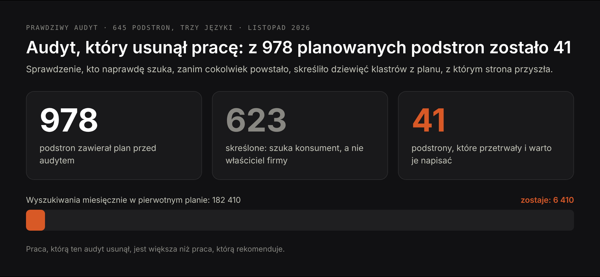

# DRAFT PL — «Za co właściwie płacisz, zamawiając audyt SEO» (3.11.2026).
# Popyt: research/dataforseo/audit-article-demand.md (zmierzone 3.11.2026, Google Ads, PL).
#   audyt seo co to 140, co to jest audyt seo 90, czym jest audyt seo 70, co zawiera audyt seo 30,
#   audyt seo krok po kroku 90, jak zrobić audyt seo 70, audyt seo jak zrobić 50,
#   jak przeprowadzić audyt seo 30, przykładowy audyt seo 30, audyt seo przykład 30,
#   audyt seo narzędzia 20. Razem bez ceny: ok. 570/mies.
# CENA CELOWO POZA NAGŁÓWKAMI: «audyt seo cena» 210 i «ile kosztuje audyt seo» 90 należą do
#   strony usługi /pl/oferty/audyt-seo-strony-internetowej. W artykule cena pojawia się raz,
#   w zdaniu z linkiem do tej strony — dwie strony nie mogą walczyć o to samo zapytanie.
# Intencja (3.11.2026, żywe wyniki, PL): informacyjna — cyber_Folks, BiznesRadar, netfortis,
#   silence.pl, Semgence, Verseo, Poradnik Przedsiębiorcy, zgred.pl. Brak stron usługowych
#   w topie. Wideo w wynikach: «Jak samodzielnie zrobić audyt SEO? (Lepiej niż agencja)» —
#   stąd osobny rozdział o robieniu audytu samodzielnie.
# Liczby pochodzą ze zanonimizowanego przykładowego audytu dołączonego do artykułu w PDF.
# H1 (Title) i Meta title różnią się celowo.

Title: Za co płacisz w audycie SEO i co musi zawierać raport
Slug: za-co-placisz-w-audycie-seo
Meta title: Audyt SEO — co zawiera i co dostajesz na koniec
Meta description: Co mierzy audyt SEO, jak przebiega krok po kroku, co musi zawierać raport i przykładowy audyt do pobrania. Oraz kiedy audyt nie jest potrzebny.

---

> W skrócie: audyt SEO to pomiar strony względem jej własnych danych z wyszukiwarki i jej własnego rynku, zakończony pisemnym planem. Użyteczny audyt podaje przy każdym problemie cztery rzeczy: pomiar ze źródłem i datą odczytu, przyczynę, działanie oraz spodziewany rezultat wraz z warunkiem, od którego ten rezultat zależy. To nie jest lista wszystkiego, co na stronie jest źle, a dobry audyt częściej usuwa zaplanowaną pracę, niż ją dokłada. Pełny audyt zajmuje od dwóch do pięciu dni roboczych.

Większość ludzi poznaje audyt SEO jako PDF pełen czerwonych ostrzeżeń z crawlera, bez wskazania, które ostrzeżenie ma znaczenie i od czego zacząć. Taki dokument kosztuje tyle samo co prawdziwy audyt, więc warto precyzyjnie powiedzieć, co kupują te pieniądze. Nie płacisz za listę problemów — darmowe narzędzie wyprodukuje ją w cztery minuty. Płacisz za to, żeby ktoś zmierzył twoją stronę jej własnymi danymi, rozstrzygnął, który z tych problemów jest wart twojego czasu, powiedział, co każda poprawka ma zmienić i do kiedy, oraz wskazał tę część zaplanowanej pracy, której nie należy wykonywać. Ten artykuł przechodzi przez każdy z tych punktów, pokazuje, co musi zawierać gotowy raport, i kończy się przypadkami, w których audytu kupować nie warto. Wszystko ilustruje prawdziwy audyt działającej strony z 645 podstronami w trzech językach, [który można pobrać w całości](/seo-audit-sample-pl.pdf).

## Audyt SEO — co to jest i czym nie jest

Audyt SEO to pomiar jednej strony względem trzech rzeczy: danych wyszukiwarki, które ta strona już generuje, podstron, które faktycznie istnieją, oraz żywych wyników wyszukiwania, w których ta strona konkuruje. Wynikiem nie jest diagnoza. Wynikiem jest uporządkowany plan, w którym każda pozycja mówi, co zmierzono, dlaczego tak jest, co z tym zrobić i co powinno się potem wydarzyć.

Audyt strony internetowej to szersza nazwa tej samej rzeczy i w praktyce słowa używane są wymiennie. Różnica dotyczy zakresu: audyt techniczny zatrzymuje się na crawlowaniu i kodzie, a audyt SEO musi objąć popyt i intencję, bo technicznie bezbłędna podstrona skierowana do niewłaściwego szukającego i tak nic nie zarobi.

Trzy rzeczy, którymi audyt nie jest. Nie jest raportem z crawlera: crawler znajduje zepsute linki i brakujące znaczniki, czyli może jedną dziesiątą pracy i jedyną dziesiątą, którą maszyna wykona sama. Nie jest listą słów kluczowych: wolumen mówi, ilu ludzi szuka, a nie kim są i czy kiedykolwiek od ciebie kupią. I nie jest obietnicą pozycji: kto zobowiązuje się do konkretnego miejsca w miesiąc, sprzedaje ci pierwszy widoczny ruch dwa razy.

## Co zawiera audyt SEO: sześć rzeczy, które się mierzy

Każda liczba w prawdziwym audycie ma źródło i datę, żeby klient mógł otworzyć to samo miejsce i sprawdzić. W przykładowym audycie dołączonym do tego artykułu użyto sześciu źródeł.

- **Search Console, pełny kwartał.** Wyświetlenia, kliknięcia, średnia pozycja i dokładna treść zapytań, w podziale na podstrony i języki. Na badanej stronie: 19 440 wyświetleń, 3 kliknięcia i 559 z 645 podstron z jakimikolwiek wyświetleniami.
- **Każda podstrona, odczytana z systemu treści.** Tytuł, tytuł meta, opis meta, H1 oraz wszystkie nagłówki H2 i H3 wszystkich 645 podstron, a do tego układ bloków każdej z nich. To właśnie sprawia, że zdanie «62 nagłówki są etykietami» da się policzyć, a nie tylko odczuć.
- **Własny plan słów kluczowych strony, zestawiony z rzeczywistością.** Każde zapytanie, na które strona zamierza odpowiadać, sprawdzone względem podstrony, która ma na nie odpowiadać. W przykładzie: 1 328 przypisań, z czego główne zapytanie całej niszy wskazywało niepowiązaną podstronę.
- **Żywe wyniki wyszukiwania, czytane pod kątem intencji.** Pierwsza dziesiątka dla każdej rodziny zapytań, do której strona celuje, odczytana po to, by ustalić jedno: czy szuka właściciel firmy, który potrzebuje wykonawcy, czy jego własny klient. To ten krok rozstrzyga, co powstanie, a co nie.
- **[Obecność w odpowiedziach AI](/pl/oferty/audyt-widocznosci-w-ai).** Czy dla zapytań, do których strona celuje, pokazuje się odpowiedź AI, i czy strona jest gdziekolwiek w puli, z której te odpowiedzi są składane. W przykładzie: odpowiedź AI pokazała się przy 304 z 321 rodzin zapytań, a strona nie była w pierwszej dziesiątce żadnej z nich.
- **Linki wewnętrzne i osiągalność.** Czy podstrony da się osiągnąć i czy faktycznie się wyświetlają oraz czy linki między nimi prowadzą do żywych stron.

Zwróć uwagę, czego na tej liście nie ma: oceny z narzędzia. Żaden audyt wart swojej ceny nie podaje wyniku w skali do stu, bo taka liczba jest średnią ważoną rzeczy, które nie mają wspólnej jednostki.

## Audyt SEO krok po kroku: jak go przeprowadzam

Kolejność znaczy tu więcej niż dokładność, bo wczesne kroki rozstrzygają, na co w ogóle warto patrzeć w krokach późniejszych.

1. **Zdejmij punkt odniesienia.** Wyeksportuj kwartał danych z wyszukiwarki i zapisz te kilka liczb, względem których cały audyt będzie później mierzony. W przykładzie były to 19 440 wyświetleń, 3 kliknięcia i średnia pozycja 53,6 na najczęściej pokazywanej podstronie.
2. **Przeczytaj stronę tak, jak czyta ją maszyna.** Zbierz wszystkie tytuły, nagłówki i pola meta do jednej tabeli. Na tym etapie natychmiast wychodzą wzorce, których nie wyłapie przeglądanie podstrona po podstronie: te same sześć nagłówków-etykiet powtórzone na dziesiątkach podstron, siedemnaście podstron, których tytuł meta powtarza H1 znak w znak.
3. **Zestaw popyt z podstronami.** Dla każdego zapytania, które strona ma wygrać, znajdź podstronę, która ma je wygrywać. Luki znalezione tutaj są prawdziwą pracą, a niedopasowania znalezione tutaj bywają najtańszą poprawką w całym raporcie.
4. **Sprawdź intencję w żywych wynikach, a nie w narzędziu.** Dla każdej rodziny zapytań zobacz, kto tam rankuje. Cztery lub więcej wspólnych domen w rodzinie oznacza, że jedna podstrona obsłuży całość; zero lub jedna oznacza, że to różne wyszukiwania w podobnych słowach.
5. **Oddziel to, co zmierzyłeś, od tego, co wywnioskowałeś.** Liczba wyświetleń jest faktem. «Podstrona rankuje słabo, bo jej nagłówki nie używają sformułowań z zapytania» jest hipotezą. Raport, który drukuje jedno i drugie tą samą czcionką, ukrywa tę różnicę.
6. **Uszereguj według spodziewanego efektu i dopisz datę.** Nie według wagi problemu i nie według łatwości poprawki: według tego, co poprawka ma zmienić i kiedy będzie widać, czy zmieniła.

## Jak wygląda raport z audytu SEO: przykładowy audyt do pobrania

Raport jest tym, co klient dostaje, więc wolno po nim oceniać całą usługę. Do tego artykułu dołączony jest przykładowy audyt SEO w PDF, szesnaście stron, dotyczący prawdziwej trójjęzycznej strony, której adres został ukryty. Zamiast go opisywać — oto, co każda jego strona musi zawierać.

Każde ustalenie dostaje własną stronę, a ta strona ma pięć części: pomiar ze źródłem i datą, przyczynę w interpretacji autora, działanie wraz z liczbą godzin, spodziewany rezultat z warunkiem, od którego zależy, oraz datę, w której klient może to sprawdzić. Jeśli brakuje którejkolwiek z tych pięciu, ustalenia nie da się ani wykonać, ani zweryfikować.

Raport zawiera też trzy rzeczy, które większość szablonów pomija. Rozdział o tym, co strona już robi dobrze, bo wiedza o tym, których usterek nie ma, jest warta tyle samo co wiedza o tych, które są. Rozdział o tym, czego świadomie nie rekomendowano i dlaczego — w przykładzie obejmuje cztery pozycje, w tym migrację, którą skrypt audytowy zgłosił jako usterkę, a żywe strony okazały się nieszkodliwe. Oraz rozdział o tym, gdzie audyt mylił się, zanim trafił: trzy twierdzenia, które dane poprawiły, zanim dotarły do klienta, i trzy narzędzia pomiarowe, które dawały fałszywe wyniki do czasu kalibracji.

Ten ostatni rozdział to ten, którego warto zażądać, zamawiając audyt. Audytor, który nie potrafi wskazać miejsca, gdzie jego pierwsze odczytanie było błędne, albo nie sprawdził własnej pracy, albo ci o tym nie mówi.

## Czy ChatGPT zrobi audyt SEO za darmo?

Czytanie potrafi, mierzenia nie potrafi. W tym rozróżnieniu mieści się cała odpowiedź.

Asystent przeczyta twoje podstrony i powie, że nagłówek jest nieprecyzyjny, że opis meta jest za długi, że akapit chowa swoją myśl. To naprawdę przydatne i jest to mniej więcej górna jedna dziesiąta audytu. Czego nie zrobi: nie otworzy twojej Search Console i nie zobaczy, że jedna podstrona zebrała 2 613 wyświetleń na pozycji 53,6 i nic na tym nie zarobiła, bo nie ma dostępu do twoich danych. Nie powie ci, że rodzina zapytań z 2 900 wyszukiwaniami miesięcznie jest dla ciebie bezwartościowa, bo to wymaga spojrzenia, kto tam dziś rankuje, i rozstrzygnięcia, kim jest szukający. I nie dopisze do prognozy daty ani warunku, bo za sześć tygodni nie będzie go tam, żeby się pomylić.

Jest ostrzejsza wersja tego problemu. Poproś asystenta o audyt, a dostaniesz wiarygodny, dobrze uporządkowany dokument, bo produkowanie wiarygodnych, dobrze uporządkowanych dokumentów jest dokładnie tym, w czym jest dobry. Błąd nie polega na bzdurach, tylko na pewnej siebie ogólności: na radach prawdziwych wobec każdej strony internetowej i przez to nierozstrzygających niczego wobec twojej. Test jest prosty. Otwórz dowolne twierdzenie w takim dokumencie i zapytaj, skąd pochodzi liczba i z jakiej daty. Jeśli odpowiedzi nie ma, trzymasz w ręku bardzo dobry esej o SEO.

Użyty rozsądnie, asystent jest narzędziem wewnątrz audytu, a nie zamiennikiem audytu, i jak każde narzędzie wymaga kalibracji, zanim mu zaufasz. W przykładowym audycie sprawdzarka linków zgłosiła wszystkie 29 linków wewnętrznych jako zepsute, bo fraza, której szukała, występuje na każdej podstronie tamtego serwisu, a czytnik wyników zgłaszał tę samą domenę dla każdego wyniku, bo wyniki były opakowane w przekierowania. Oba błędy wyszły, bo każde narzędzie przetestowano najpierw na przypadku o znanej odpowiedzi.

## Czy audyt SEO to tylko lista tego, co na stronie jest źle?

Tak wygląda wynik skanu i stąd właśnie bierze się reputacja audytów. Różnica polega na tym, że ustalenie to nie jest usterka, tylko usterka plus konsekwencja plus cena.

Weźmy najmocniejsze ustalenie z przykładowego audytu. Podstrona usługowa wyświetliła się 2 613 razy w kwartale na średniej pozycji 53,6 i dostała zero kliknięć. Wersja skanowa tego ustalenia brzmi: «podstrona słabo rankuje». Wersja audytowa brzmi: 64 zapytania są już do tej podstrony dopasowane, pozycja 53 to szósta strona wyników, gdzie klikalność jest praktycznie zerowa, nagłówki nazywają usługę, ale nie miasto, nie cenę i nie pytanie, które ludzie naprawdę wpisali, przepisanie ich to trzy do czterech godzin bez prac programistycznych, a podstrona powinna wejść w przedział od 25 do 30 w ciągu sześciu do ośmiu tygodni, czyli tam, gdzie zaczynają się pierwsze kliknięcia. Jeśli do ósmego tygodnia nie ruszy, sufitem nie była treść i kolejny krok będzie inny.

Z każdym zdaniem tej drugiej wersji można się spierać i o to właśnie chodzi. Z listą tego, co jest źle, spierać się nie można, i to jest jej słabość, a nie siła.

## Czy audyt SEO można zrobić samodzielnie, lepiej niż agencja?

Część można i warto, a poradniki, które mówią «zrób to sam zamiast płacić», mają rację w połowie. Darmowe i tanie narzędzia znajdą zepsute linki, brakujące znaczniki, powolne podstrony i duplikaty tytułów. Jeśli twoja strona ma dwadzieścia podstron i nigdy nikt na nią nie patrzył, zrobisz to w jedno popołudnie i zaoszczędzisz całą opłatę.

Granica przebiega w trzech miejscach i nie jest kwestią narzędzi, tylko czasu i dystansu. Pierwsze: narzędzie wypisze ci czterdzieści problemów i nie powie, który z nich jest wart twojego tygodnia — a to jest cała trudność. Drugie: sprawdzenie, kim jest szukający, wymaga otwarcia żywych wyników dla każdej rodziny zapytań i uczciwego przyznania, że połowa twojego planu celuje w cudzego klienta; na własnym pomyśle robi się to źle, bo każdy broni tego, co sam wymyślił. Trzecie: prognoza z datą i warunkiem wymaga, żeby ktoś zobowiązał się wobec ciebie na sześć tygodni do przodu, a wobec siebie samego nikt się tak nie zobowiązuje.

Rozsądny podział: zrób samodzielnie część techniczną narzędziami, a zapłać za rozstrzygnięcia i za kolejność. To zwykle tańsze niż pełny audyt i uczciwsze wobec tego, co naprawdę kupujesz.

## Czy audyt SEO to sposób na wymyślenie pracy dla pozycjonera?

To uzasadnione podejrzenie i jest na nie test: sprawdź, czy audyt kiedykolwiek rekomenduje mniej.

W przykładowym audycie plan, który strona przyniosła ze sobą, zawierał 978 podstron do napisania, obejmujących 3 190 wyszukiwań miesięcznie. Sprawdzenie żywych wyników dla stojących za nimi rodzin zapytań pokazało, że dziewięć z tych klastrów celowało w zupełnie niewłaściwą osobę. «Strona dla restauracji» brzmi jak właściciel restauracji szukający wykonawcy; w pierwszej dziesiątce stoją strony restauracji i platformy z zamówieniami, więc szukający chce zjeść kolację. Biura nieruchomości, hydraulicy, producenci i terapeuci oblali tak samo. Dziewięć klastrów i 176 000 wyszukiwań miesięcznie zostało skreślonych, 623 z 978 planowanych podstron odwołano, a zostało 41 podstron wartych około 6 400 wyszukiwań miesięcznie.

Praca, którą ten audyt usunął, jest większa niż praca, którą rekomenduje. Audyt, który tego dla ciebie nie potrafi — który za każdym razem oddaje dłuższą listę zadań niż ta, z którą przyszedłeś — niczego nie mierzy.

Jest mniejsza wersja tego samego testu. Zapytaj, czego audytor postanowił nie rekomendować. W przykładzie największy pojedynczy blok wyświetleń w całym serwisie, 2 487 z nich na średniej pozycji 77,7, celowo zostawiono w spokoju: przy tej pozycji i takiej szerokości zapytań czoło wyników trzymają serwisy ogólnokrajowe i od dawna ugruntowane, treść nie jest tym, co hamuje podstronę, a przepisanie jej nie zmieniłoby niczego, co audytor mógłby obiecać z góry.

Pełny audyt zajmuje od dwóch do pięciu dni roboczych, a jego [cena i zakres opisane są na stronie usługi](/pl/oferty/audyt-seo-strony-internetowej). W tej opłacie powinien mieścić się pomiar ze źródłami, uporządkowany plan, spodziewany rezultat przy każdym działaniu i rozmowa po lekturze. Nie powinno się w niej mieścić wdrożenie — to inna praca z inną wyceną, a łączenie ich w jedno zamienia audyt w dokument sprzedażowy dla roboty, którą sam rekomenduje.

## Kiedy audyt SEO nie jest potrzebny

Cztery sytuacje, w których uczciwa odpowiedź brzmi: wydaj te pieniądze gdzie indziej.

- **Strona jest zupełnie nowa i ma bardzo mało podstron.** Nie ma jeszcze czego mierzyć. Napisz podstrony pod zapytania, co do których już wiesz, że je obsługujesz, daj temu kwartał, a potem audytuj na prawdziwych danych.
- **Wiesz już, co jest zepsute, i tego nie naprawiłeś.** Jeśli trzy osoby powiedziały ci, że strona jest wolna, a karty produktów nie mają tekstu, audyt powie ci to samo, tylko ładniej sformatowane. Napraw znane rzeczy najpierw, a audytuj resztę.
- **Nikt tej pracy nie wykona.** Audyt, którego planu nie ma kto wdrożyć, jest drogim dokumentem. Jeśli nie ma budżetu na wdrożenie ani rąk w firmie, kup mniejszy kawałek prawdziwej pracy.
- **Twój problem nie leży w wyszukiwarce.** Jeśli zapytania przychodzą i nie zamieniają się w klientów, albo cennik jest zły, albo produktu nikt nie chce — większa widoczność w wyszukiwarce powiększy stratę, a nie ją zmniejszy.

Jest jeszcze piąty, mniej oczywisty przypadek: miałeś audyt w ciągu ostatniego półrocza i nie wdrożyłeś z niego nic. Drugi audyt tej samej strony zmierzy to samo i zarekomenduje te same działania, dlatego poważny audytor zapyta, co się stało z pierwszym, zanim wyceni drugi.

## O co zapytać, zanim zapłacisz za audyt SEO

Pięć pytań, które oddzielają pomiar od szablonu.

- **Skąd pochodzi każda liczba i z jakiej jest daty?** Jeśli odpowiedzią nie jest nazwane źródło i data, to nie jest pomiar.
- **Które ustalenia są pomiarami, a które twoją interpretacją?** Jedno i drugie jest w porządku. Milczące mieszanie ich nie jest.
- **Jakiego rezultatu spodziewasz się po każdym działaniu i do kiedy?** Razem z tym, co obaliłoby tę prognozę.
- **Czego świadomie nie rekomendujesz?** Raport bez takiego rozdziału nie dokonał żadnych wyborów.
- **Czy powiesz mi, gdzie twoje pierwsze odczytanie było błędne?** Tego jednego nie da się odpowiedzieć z szablonu.

Jeśli odpowiedzi są dobre, będziesz w stanie działać na podstawie samego dokumentu, również z kimś innym przy wdrożeniu. I to jest właściwy test audytu: powinien być użyteczny nawet wtedy, gdy nigdy nie zatrudnisz osoby, która go napisał.
