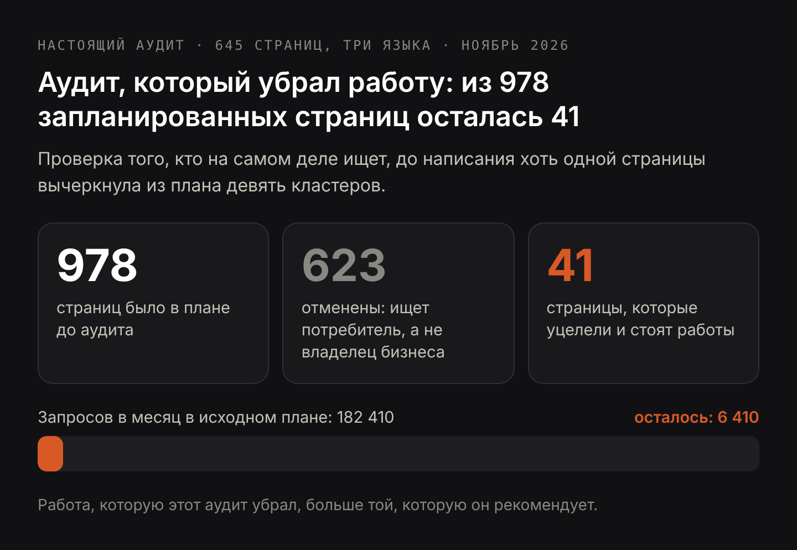

# DRAFT RU — «За что вы на самом деле платите, заказывая SEO-аудит» (3.11.2026).
# Аудитория: русскоязычные в мире (решение владельца 3.11.2026). Поэтому опорой служат
#   мировые частоты из ядра (аудит сайта 1000, seo аудит 720), а не замер по Польше и
#   Казахстану, где вся информационная группа даёт 20–40 в месяц.
#   См. research/dataforseo/audit-article-demand.md и claude/blog-seo-audit-article.md.
# Коммерческие «аудит сайта» и «seo аудит» остаются за /ru/uslugi/seo-audit-saita.
#   Статья берёт информационный интент и ведёт на посадочную ссылкой.
# Интент (3.11.2026, живая выдача): информационная — Рег.ру, Kokoc, Skillbox, Workspace,
#   Точка Реклама, Darvin Digital, Unisender, Хорошоп. Страниц услуг в топе нет.
#   Выдача занята крупными контент-машинами, поэтому отличие статьи — не полнота гида,
#   а проверяемость: все числа из настоящего аудита, с источником и датой.
# Числа взяты из анонимизированного примера аудита, который приложен к статье в PDF.
# H1 (Title) и Meta title различаются намеренно.

Title: За что вы платите в SEO-аудите и что обязан содержать отчёт
Slug: za-chto-platit-klient-v-seo-audite
Meta title: SEO-аудит: что входит и что получает клиент
Meta description: Что измеряет SEO-аудит, как он проводится по шагам, что обязан содержать отчёт и реальный пример для скачивания. И когда аудит не нужен.

---

> Коротко: SEO-аудит — это измерение сайта по его собственным поисковым данным и по его собственному рынку, которое заканчивается письменным планом. Полезный аудит даёт по каждой проблеме четыре вещи: измерение с источником и датой съёма, причину, действие и ожидаемый результат с условием, от которого этот результат зависит. Это не список всего, что на сайте плохо, и хороший аудит чаще убирает запланированную работу, чем добавляет новую. Полный аудит занимает от двух до пяти рабочих дней.

Большинство людей знакомится с SEO-аудитом в виде PDF, набитого красными предупреждениями краулера, без единого указания, какое из них важно и с чего начинать. Такой документ стоит столько же, сколько настоящий аудит, поэтому стоит точно сказать, что покупают эти деньги. Вы платите не за список проблем — бесплатный инструмент выдаст его за четыре минуты. Вы платите за то, чтобы кто-то измерил ваш сайт его же собственными данными, решил, какая из этих проблем стоит вашего времени, сказал, что каждая починка должна изменить и к какому сроку, и назвал ту часть запланированной работы, которую делать не нужно. Статья проходит по каждому из этих пунктов, показывает, что обязан содержать готовый отчёт, и заканчивается случаями, когда аудит покупать не стоит. Всё показано на настоящем аудите работающего сайта с 645 страницами на трёх языках, [который можно скачать целиком](/seo-audit-sample-ru.pdf).

## Что такое SEO-аудит и чем он не является

SEO-аудит — это измерение одного сайта по трём вещам: поисковым данным, которые сайт уже производит, страницам, которые у него фактически есть, и живой выдаче, в которой он конкурирует. На выходе не диагноз. На выходе упорядоченный план, в котором каждая строка говорит, что измерено, почему это так, что с этим делать и что должно произойти потом.

Аудит сайта — более широкое имя той же работы, и на практике слова используются как синонимы. Разница в охвате: технический аудит останавливается на обходе и коде, а SEO-аудит обязан включать спрос и интент, потому что технически безупречная страница, нацеленная не на того ищущего, всё равно ничего не заработает.

Три вещи, которыми аудит не является. Это не отчёт краулера: краулер находит битые ссылки и отсутствующие теги, то есть примерно одну десятую работы и единственную десятую, которую машина делает сама. Это не список ключевых слов: объём говорит, сколько людей ищет, а не кто они и купят ли они у вас хоть когда-нибудь. И это не обещание позиции: тот, кто обязуется вывести вас на конкретное место за месяц, продаёт вам первое заметное движение дважды.

## Что входит в SEO-аудит: шесть вещей, которые измеряют

У каждой цифры в настоящем аудите есть источник и дата, чтобы клиент открыл то же место и проверил. В примере аудита, приложенном к статье, использованы шесть источников.

- **Search Console, полный квартал.** Показы, клики, средняя позиция и точный текст запросов по страницам и языкам. На проверяемом сайте: 19 440 показов, 3 клика и 559 страниц из 645 с хоть какими-то показами.
- **Каждая страница, прочитанная из системы управления контентом.** Title, метатайтл, мета-описание, H1 и все заголовки H2 и H3 всех 645 страниц, плюс блочная структура каждой. Именно это превращает фразу «62 заголовка — ярлыки» в подсчитанный факт, а не во впечатление.
- **Собственное семантическое ядро сайта, сверенное с реальностью.** Каждый запрос, на который сайт собирается отвечать, проверен против страницы, которая обязана на него отвечать. В примере: 1328 привязок, и головной запрос всей ниши указывал на несвязанную страницу.
- **Живая выдача, прочитанная ради интента.** Первая десятка по каждому семейству запросов, на которое целится сайт, прочитанная ради одного: ищет владелец бизнеса, которому нужен подрядчик, или его собственный клиент. Именно этот шаг решает, что будет написано, а что нет.
- **Присутствие в ответах ИИ.** Показывается ли ответ ИИ по запросам, на которые целится сайт, и есть ли сайт хоть где-то в том пуле, из которого эти ответы собираются — на это и отвечает [аудит видимости в ИИ-поиске](/ru/uslugi/audit-vidimosti-v-ii-poiske). В примере: ответ ИИ показался по 304 семействам запросов из 321, а сайт не попал в первую десятку ни по одному из них.
- **Внутренние ссылки и достижимость.** Доступны ли страницы и показываются ли они на самом деле, и ведут ли ссылки между ними на живые страницы.

Обратите внимание, чего в этом списке нет: оценки от инструмента. Ни один аудит, стоящий своих денег, не выдаёт балл по стобалльной шкале, потому что такая цифра — взвешенное среднее вещей, у которых нет общей единицы измерения.

## Как проводится SEO-аудит: шаг за шагом

Порядок здесь важнее тщательности, потому что ранние шаги решают, на что в поздних шагах вообще стоит смотреть.

1. **Снимите точку отсчёта.** Выгрузите квартал поисковых данных и запишите те несколько цифр, по которым весь аудит потом будет мериться. В примере это 19 440 показов, 3 клика и средняя позиция 53,6 на самой показываемой странице.
2. **Прочитайте сайт так, как его читает машина.** Соберите все заголовки, подзаголовки и мета-поля в одну таблицу. На этом шаге сразу выходят закономерности, которых не увидеть при просмотре страница за страницей: одни и те же шесть заголовков-ярлыков на десятках страниц, семнадцать страниц, у которых метатайтл знак в знак повторяет H1.
3. **Сверьте спрос со страницами.** Для каждого запроса, который сайт намерен выиграть, найдите страницу, которая обязана его выигрывать. Найденные здесь дыры — это настоящая работа, а найденные здесь несовпадения обычно оказываются самой дешёвой починкой во всём отчёте.
4. **Проверьте интент по живой выдаче, а не по инструменту.** По каждому семейству запросов посмотрите, кто там ранжируется. Четыре и более общих домена в семействе означают, что одна страница закроет всё; ноль или один — что это разные поиски в похожих словах.
5. **Разведите то, что вы измерили, и то, что вы заключили.** Число показов — факт. «Страница плохо ранжируется, потому что её заголовки не используют формулировки запроса» — гипотеза. Отчёт, печатающий то и другое одним шрифтом, прячет эту разницу.
6. **Отранжируйте по ожидаемому эффекту и поставьте дату.** Не по тяжести проблемы и не по лёгкости починки, а по тому, что починка должна изменить и когда станет видно, изменила ли.

## Как выглядит отчёт по SEO-аудиту: реальный пример для скачивания

Отчёт — это то, что клиент получает на руки, поэтому по нему и судят всю услугу. К статье приложен пример SEO-аудита в PDF, шестнадцать страниц, по настоящему трёхъязычному сайту, адрес которого скрыт. Вместо описания — вот что обязана содержать каждая его страница.

Каждая находка получает отдельную страницу, и на этой странице пять частей: измерение с источником и датой, причина в толковании автора, действие с числом часов, ожидаемый результат с условием, от которого он зависит, и дата, когда клиент вправе это проверить. Если нет хотя бы одной из пяти, находку нельзя ни выполнить, ни проверить.

В отчёте есть ещё три вещи, которые большинство шаблонов опускает. Раздел о том, что сайт уже делает правильно, потому что знание о том, каких дефектов нет, стоит столько же, сколько знание о тех, которые есть. Раздел о том, чего сознательно не рекомендовали и почему — в примере там четыре пункта, включая миграцию, которую скрипт аудита пометил дефектом, а живые страницы оправдали. И раздел о том, где аудит ошибался до того, как стал прав: три утверждения, которые данные поправили до того, как они дошли до клиента, и три измерительных прибора, выдававших ложный результат, пока их не откалибровали.

Вот последнего раздела и стоит требовать, когда заказываете аудит. Аудитор, который не может назвать место, где его первое прочтение было неверным, либо не проверял собственную работу, либо не говорит вам об этом.

## Может ли ChatGPT сделать SEO-аудит

Читать он умеет, измерять не умеет. В этом различии и состоит весь ответ.

Ассистент прочитает ваши страницы и скажет, что заголовок размыт, что мета-описание слишком длинное, что абзац прячет свою мысль. Это действительно полезно и составляет примерно верхнюю десятую часть аудита. Чего он не сделает: не откроет вашу Search Console и не увидит, что одна страница собрала 2613 показов на позиции 53,6 и не заработала на этом ничего, потому что у него нет доступа к вашим данным. Не скажет, что семейство запросов на 2900 поисков в месяц для вас бесполезно, потому что для этого надо посмотреть, кто там сегодня стоит, и решить, кто этот ищущий. И не припишет к прогнозу дату и условие, потому что через шесть недель его там не будет, чтобы оказаться неправым.

Есть версия этой проблемы поострее. Попросите ассистента сделать аудит — и получите правдоподобный, хорошо организованный документ, потому что производство правдоподобных, хорошо организованных документов есть ровно то, что он умеет лучше всего. Сбой не в чепухе, а в уверенной общности: в советах, верных для любого сайта и потому не решающих ничего про ваш. Проверка простая. Откройте любое утверждение в таком документе и спросите, откуда взялась цифра и на какую дату. Если ответа нет, у вас в руках очень хорошее эссе про SEO.

При разумном применении ассистент — это прибор внутри аудита, а не замена аудиту, и, как всякий прибор, он требует калибровки, прежде чем ему доверять. В примере аудита проверка ссылок объявила битыми все 29 внутренних ссылок, потому что фраза, которую она искала, есть на каждой странице того сайта, а читалка выдачи возвращала один и тот же домен по каждому результату, потому что результаты были обёрнуты в редиректы. Обе ошибки вскрылись только потому, что каждый прибор сначала проверили на случае с заранее известным ответом.

## SEO-аудит — это просто список того, что на сайте плохо?

Так выглядит результат скана, и именно отсюда у аудитов такая репутация. Разница в том, что находка — это не дефект, а дефект плюс следствие плюс цена.

Возьмём самую сильную находку из примера аудита. Услуговая страница показалась 2613 раз за квартал на средней позиции 53,6 и получила ноль кликов. Скановая версия этой находки звучит так: «страница плохо ранжируется». Аудитная версия звучит так: 64 запроса уже привязаны к этой странице, позиция 53 — это шестая страница выдачи, где кликабельность практически нулевая, заголовки называют услугу, но не город, не цену и не тот вопрос, который люди реально набрали, переписывание занимает три-четыре часа без разработки, а страница должна войти в диапазон с 25-й по 30-ю позицию за шесть-восемь недель, то есть туда, где начинаются первые клики. Если к восьмой неделе она не сдвинулась, потолок был не в тексте, и следующий шаг будет другим.

С каждым предложением второй версии можно спорить, и в этом весь смысл. Со списком того, что плохо, спорить нельзя, и это его слабость, а не сила.

## Можно ли сделать SEO-аудит самому, бесплатными инструментами

Часть можно и стоит, и руководства в духе «сделай сам вместо того, чтобы платить» правы ровно наполовину. Бесплатные и дешёвые инструменты найдут битые ссылки, отсутствующие теги, медленные страницы и дубли заголовков. Если у вас двадцать страниц и на сайт никто никогда не смотрел, вы справитесь за один вечер и сэкономите всю сумму.

Граница проходит в трёх местах, и дело не в инструментах, а во времени и дистанции. Первое: инструмент выпишет вам сорок проблем и не скажет, какая из них стоит вашей недели, — а в этом и состоит вся сложность. Второе: проверка того, кто ищет, требует открыть живую выдачу по каждому семейству запросов и честно признать, что половина вашего плана целится в чужого клиента; на собственной затее это делается плохо, потому что каждый защищает то, что сам придумал. Третье: прогноз с датой и условием требует, чтобы кто-то взял перед вами обязательство на шесть недель вперёд, а перед самим собой так не обязываются.

Разумное разделение: техническую часть сделайте сами инструментами, а заплатите за решения и за очерёдность. Это обычно дешевле полного аудита и честнее по отношению к тому, что вы на самом деле покупаете.

## SEO-аудит придуман, чтобы найти сеошнику работу?

Подозрение справедливое, и на него есть проверка: посмотрите, рекомендует ли аудит когда-нибудь меньше.

В примере аудита план, с которым сайт пришёл, содержал 978 страниц к написанию, закрывающих 3190 запросов в месяц. Проверка живой выдачи по стоящим за ними семействам показала, что девять из этих кластеров целились совсем не в того человека. «Сайт для ресторана» звучит как владелец ресторана, которому нужен разработчик; в первой десятке стоят сайты ресторанов и платформы доставки, то есть ищущий хочет поужинать. Агентства недвижимости, сантехники, производители и терапевты провалились точно так же. Девять кластеров и 176 000 запросов в месяц были вычеркнуты, 623 страницы из 978 запланированных отменены, а осталась 41 страница примерно на 6400 запросов в месяц.

Работа, которую этот аудит убрал, больше той, которую он рекомендует. Аудит, который так для вас не умеет — который каждый раз возвращает список задач длиннее того, с которым вы пришли, — ничего не измеряет.

Есть и меньшая версия той же проверки. Спросите, чего аудитор решил не рекомендовать. В примере самый крупный единичный блок показов по всему сайту, 2487 показов на средней позиции 77,7, намеренно оставлен в покое: при такой позиции и такой ширине запросов верх выдачи держат общенациональные и давно укоренившиеся сайты, текст не является тем, что держит страницу, и переписывание не изменило бы ничего, что аудитор мог бы обещать заранее.

Полный аудит занимает от двух до пяти рабочих дней, а его [цена и состав описаны на странице услуги](/ru/uslugi/seo-audit-saita). В эту сумму должны входить измерение с источниками, упорядоченный план, ожидаемый результат по каждому действию и разговор после прочтения. В неё не должно входить внедрение — это другая работа с другой ценой, а их склейка превращает аудит в продающий документ для той работы, которую он же и рекомендует.

## Когда SEO-аудит не нужен

Четыре ситуации, в которых честный ответ — потратить эти деньги на другое.

- **Сайт совсем новый, и страниц на нём мало.** Измерять пока нечего. Напишите страницы под запросы, по которым вы точно работаете, дайте этому квартал, а потом проводите аудит по настоящим данным.
- **Вы уже знаете, что сломано, и не починили.** Если три человека сказали вам, что сайт медленный, а у карточек товаров нет текста, аудит скажет вам то же самое, только с лучшей вёрсткой. Сначала почините известное, аудитом закройте остальное.
- **Эту работу некому делать.** Аудит, план которого некому внедрять, — это дорогой документ. Если нет ни бюджета на внедрение, ни рук внутри компании, купите меньший кусок настоящей работы.
- **Ваша проблема не в поиске.** Если заявки приходят и не превращаются в клиентов, или цена не та, или продукт не нужен, то рост видимости в поиске увеличит убыток, а не уменьшит.

Есть и пятый, менее очевидный случай: аудит был у вас в последние полгода, и по нему не сделано ничего. Второй аудит того же сайта измерит то же самое и порекомендует те же действия, поэтому серьёзный аудитор спросит, что стало с первым, прежде чем считать цену второго.

## О чём спросить до того, как платить за SEO-аудит

Пять вопросов, которые отделяют измерение от шаблона.

- **Откуда взята каждая цифра и на какую она дату?** Если ответ — не названный источник и дата, это не измерение.
- **Какие находки являются измерениями, а какие вашим толкованием?** И то и другое законно. Молча смешивать их — нет.
- **Какого результата вы ждёте от каждого действия и к какому сроку?** Вместе с тем, что опровергло бы этот прогноз.
- **Чего вы сознательно не рекомендуете?** Отчёт без такого раздела не сделал ни одного выбора.
- **Назовёте ли вы место, где ваше первое прочтение было неверным?** Вот на это из шаблона не ответишь.

Если ответы хорошие, вы сможете действовать по одному этому документу, в том числе силами другого исполнителя. Это и есть настоящая проверка аудита: он должен быть полезен даже в том случае, если вы никогда не наймёте того, кто его написал.
