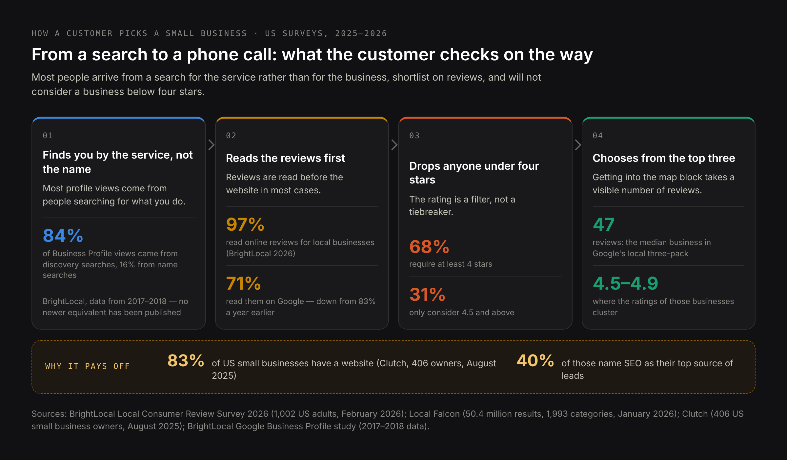
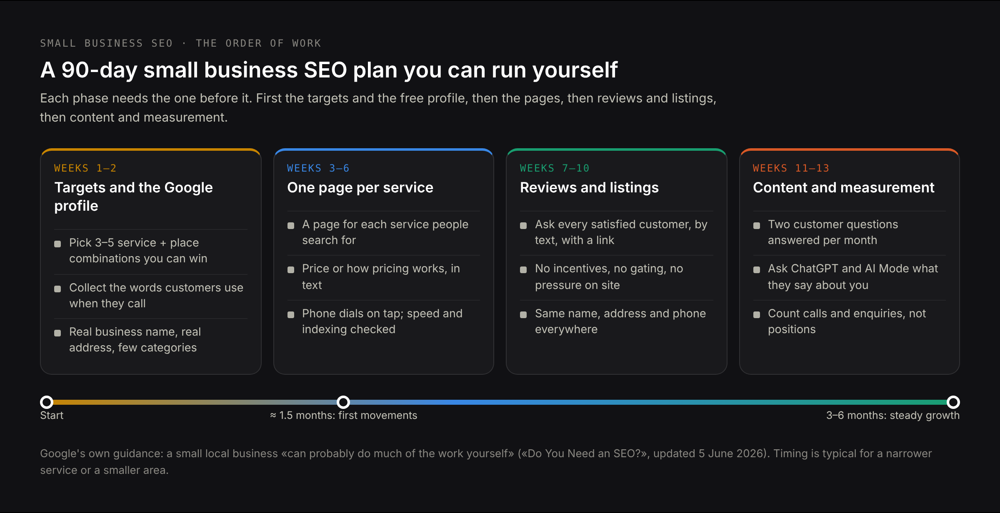

# DRAFT EN — «Small business SEO» (29 Oct 2026). A step-by-step guide an owner can run alone.
# Core: research/pseo/page-core/small-business.md — small business seo 2 900 (one phrase in many
# spellings: seo for small business, seo marketing for small business, seo optimization for small
# business, small business seo marketing). Commercial «seo services for small business» 3 600 stays
# on /seo-services-for-small-business. Intent: research/pseo/intent-check-small-business.md —
# «small business seo» shares 0 URLs with «seo services for small business» and 0 with
# «seo for startups»; 1 with «local seo for small business» (its own EN page).
# PAA used as headings: «Is SEO dead now with AI?», «What are the benefits of SEO for small
# businesses?», «What is the 80/20 rule in SEO?», «What are the 3 C's of SEO?», «How do I learn SEO
# as a beginner?», «What does SCO mean in business?».
# Sources (checked 29 Oct 2026): Google «AI Features and Your Website» (upd. 10.12.2025), «Do You
# Need an SEO?» (upd. 05.06.2026), SEO Starter Guide (upd. 10.12.2025), spam policies (upd.
# 28.08.2026), Business Profile guidelines and prohibited content; Pew Research Center (22.07.2025,
# 900 adults, 68 879 searches); Ahrefs AI Overview CTR (04.02.2026, 300 000 keywords); Ahrefs AI
# Overview prevalence (19.05.2025, 56M AI Overviews); Semrush via PPC Land (21.10.2026, 400
# commercial keywords); Whitespark (12.05.2025, 540 queries); Liz Reid / Google blog (06.08.2025);
# BrightLocal Local Consumer Review Survey 2026 (11.02.2026, 1 002 adults); Local Falcon reviews
# study (14.01.2026, 50.4M results) and restaurant AI study (03.03.2026, 189 905 ChatGPT results);
# Clutch small business websites (21.08.2025, 406 owners); LocaliQ/WordStream benchmarks 2026
# (13 474 campaigns); Ahrefs ranking time (15.05.2025); Ahrefs SEO pricing poll (439 providers,
# 2023–24 data — flagged in text); OpenAI bots docs; Kent Lewis / SEMA News (29.09.2011);
# Search Engine Roundtable (17.10.2018) and Nick Wilsdon's tweet (10.10.2018) for the 46% trail.
# NOT used: «46% of searches have local intent» as a fact (debunked in the text instead); «near me»
# growth (no source after 2019); SMB marketing budget as % of revenue (only large-company data);
# «directories improve AI visibility» (speculation in the sources).
# BrightLocal GMB Insights is used once and flagged: its data is from 2017–2018.
# H1 (Title) and Meta title differ on purpose.

Title: Small Business SEO: A Step-by-Step Guide You Can Do Yourself
Slug: small-business-seo
Meta title: SEO for Small Business: What Still Works in 2026
Meta description: Small business SEO in 2026: what AI changed and what it didn't, Google Business Profile rules, reviews, pages that rank, costs, timing and a plan to follow.

---

> Quick answer: Small business SEO is the work that makes a business findable when someone searches for what it sells — in Google's map, in the regular results and in AI answers. For a small business it comes down to five things: a complete and correctly named Google Business Profile, one page for each service you actually sell, a steady flow of genuine reviews, pages that answer the questions customers ask before buying, and a site that loads fast and is easy to contact from a phone. Most of it is decisions rather than technical work, and Google's own documentation says a small local business «can probably do much of the work yourself».

Every few months someone announces that SEO is dead. This time the reason is AI: Google answers the question at the top of the page, ChatGPT answers it without a page at all, and the clicks that used to reach small websites go somewhere else. Some of that is true and measurable. Most of what a small business needs to do about it is not what the headlines suggest.

This guide goes through the work in the order I would do it, with the data behind each decision and the rules that actually get profiles suspended. It is written for an owner who will do this themselves, or who wants to know what they are paying for. If you would rather hand it over, the [SEO services for small business](/seo-services-for-small-business) page describes how I work; the guide is meant to be useful either way.

## What small business SEO is, and how it differs from SEO for a large site

**Small business SEO** (also called SEO for small business, small business SEO marketing or SEO optimization for small business) is search engine optimization scaled to a business that has a handful of services, one or a few locations, and nobody whose full-time job is marketing.

The method is the same as for any site, but four things are different in practice:

- **The map matters more than the website.** For «[service] in [city]» searches, the three businesses in Google's map block get the attention, and that block is won through the Google Business Profile, not through the site.
- **Reviews are part of the ranking, not just the sales pitch.** They influence both what Google shows and what a customer clicks.
- **You are competing with directories, not only with competitors.** Yelp, Yell, Panorama Firm and their equivalents outrank individual businesses for many searches, which changes where it is worth fighting.
- **There is no team.** A plan with forty tasks is a plan that will not happen. The order of work matters more than its length.

One thing is not different: Google's documentation for small businesses is short, free and specific, and almost nobody reads it. Several of the rules below come straight from it.

## Is SEO dead now that AI answers the question?

This is the most-asked question in the topic, so it deserves data rather than reassurance. The honest answer has three parts, and they point in different directions.

### What the data says about AI answers and clicks

The clicks are really going. Two independent measurements agree:

- **Pew Research Center** followed the actual browsing of 900 US adults across 68,879 Google searches in March 2025. When an AI summary appeared, 8% of visits led to a click on a result, against 15% when there was none. Only **1%** of users clicked a link inside the AI summary itself, and 26% ended their browsing session on that page instead of 16%.
- **Ahrefs** compared 300,000 keywords — half with an AI Overview, half without — using Search Console data from December 2023 to December 2025. Click-through at position one fell **58%** on keywords where an AI Overview appeared. Ahrefs is careful to call this correlation rather than proof of cause.

Google's own position, stated by Liz Reid in August 2025, is that «total organic click volume from Google Search to websites has been relatively stable year-over-year» and that the clicks are of higher quality. Google publishes no numbers to go with that, so you are weighing an unquantified claim from an interested party against two measurements with published samples. Note that the two are not strictly in conflict: Google is talking about total volume across the whole web, the studies about the chance of a click on a given query.

### Why local searches are the exception that matters here

Now the part that decides whether any of this applies to your business.

**Whitespark** ran 540 searches by hand across three US cities and six industries in May 2025 and sorted them by intent. For searches of the «[service] in [city]» kind — the ones that bring customers ready to buy — an AI Overview appeared **15%** of the time, and the local map block appeared **93%** of the time. For informational questions the numbers almost exactly reverse: AI Overview 92%, map block 6%.

**Ahrefs**, looking at 56 million AI Overviews in May 2025, found the same pattern from the other end: AI Overviews are less likely on local and branded queries, and local queries made up only 6.85% of the keywords that triggered them.

So the AI answer is eating the informational search — «how often should I service a boiler» — and mostly leaving the buying search alone. For a plumber, the first is traffic and the second is customers.

The caveat is that this is moving. **Semrush**, tracking 400 US commercial keywords monthly, found AI Overviews on 45.75% of them in September 2025 and **88%** by August 2026 (reported by PPC Land; I could not find Semrush's own post). Commercial searches are being pulled in fast, even if local ones are not yet.

### What Google says about optimizing for AI features

There is a direct answer, and it is in Google's documentation, last updated 10 December 2025:

> «There are no additional requirements to appear in AI Overviews or AI Mode, nor other special optimizations necessary.»

The same page adds that «the best practices for SEO remain relevant for AI features in Google Search» and that «all existing SEO fundamentals continue to be worthwhile». There is no AI text file to add, no special markup, no separate technical setup.

That is worth knowing before you buy anything described as AI optimization. There is real work in AI visibility — checking what assistants say about your business, fixing wrong information at its source, measuring it over time — and I cover it below and in [What is generative engine optimization](/blog/what-is-generative-engine-optimization). But it is not a new set of technical requirements, and anyone selling it as one is selling a page Google says does not need to exist.

## How customers actually find a small business in 2026

Before the tactics, the behaviour. The numbers below come from surveys and SERP studies published in 2025 and 2026.

- **Almost everyone reads reviews.** In BrightLocal's Local Consumer Review Survey 2026, published in February 2026 from a sample of 1,002 US adults, **97%** said they read online reviews for local businesses. **68%** require at least four stars, 31% will only consider 4.5 and above, and 10% only five.
- **There is a visible review threshold.** Local Falcon analysed 50.4 million US search results across 1,993 business categories in January 2026: the median business appearing in Google's local three-pack has **47 reviews**, with ratings clustered between 4.5 and 4.9. Competition in cities runs three to five times higher than in rural areas.
- **Google is still the main review source, but less so.** In the same BrightLocal survey, **71%** named Google as the place they read reviews — down from 83% a year earlier.
- **Most small businesses have a website, and SEO is their main lead source.** Clutch surveyed 406 US small business owners in August 2025: **83%** have a website, and of those, **40%** name SEO as their top source of leads. Among the 17% without a site, a third say a website is not relevant to their industry and 16% cite the cost.

One older number is worth citing with its age attached, because nothing newer exists: BrightLocal's study of Google Business Profile data found that **84%** of profile views came from discovery searches — people looking for a service, not for the business by name — against 16% who searched for the business directly. That data is from 2017–2018 and no equivalent study has been published since, so treat it as a direction rather than a current figure.

### About that «46% of searches have local intent» statistic

You will meet this number in almost every article on local SEO, usually attributed to Google. Its trail is worth following, because it shows what a lot of marketing statistics are made of.

The figure comes from a Google representative speaking at the Secrets of Local Search conference at Google's headquarters in Mountain View in October 2018. It reached the industry through a tweet by the SEO Nick Wilsdon on 10 October 2018, which Barry Schwartz reported at Search Engine Roundtable a week later with an unusually honest caveat: «I do trust the source but all I have is a tweet from this SEO on this stat.» He also wondered aloud whether Google was defining «local intent» in its own way.

Google has never published the research or the method behind it. The wording drifted in the retelling — some sources say «local searches», others «local intent», which are not the same thing — and the number has been repeated unchanged for eight years, through a period in which mobile use, Maps and the shape of the results page all changed considerably.

The practical point is not that local search is unimportant; Whitespark's 93% map-block finding above is measured, recent and says it is. The point is that a single remark at a conference, relayed by a third party, is not evidence — and a statistic that nobody has updated in eight years tells you nothing about today.

## Small business SEO strategy: the order to do the work in

A small business cannot do everything, and does not need to. This is the sequence I would follow, each step building on the last.

### Choosing the searches a small business can realistically win

The most common waste in small business SEO is aiming at the most obvious phrase. «Plumber» in a capital city is contested by franchises and directories with budgets you cannot match. You win first where the competition is thinner and your experience is real:

- **A narrower service**: «boiler replacement» rather than «plumbing», «commercial lease review» rather than «legal services».
- **A smaller place**: the district or town where you actually work, not the whole metro area.
- **A language**: if you serve customers in a second language, a page in that language faces a fraction of the competition.
- **A question nobody answers well**: look at the results for what customers ask you on the phone. If the top results are thin directory pages, that is your opening.

Write down three to five combinations of service and place. Everything below is built around them.

### Small business SEO keywords: what customers type before they buy

Owners describe their work in trade terms; customers describe their problem. Nobody searches «HVAC preventative maintenance contract» — they search «my air conditioner smells bad». Good keywords come from three places:

1. **Your own enquiries.** The exact words people use when they call or write. These are your best keywords and no tool has them.
2. **Google's own suggestions.** Start typing a customer's question and read the autocomplete, the «People also ask» box, and the related searches at the foot of the page. This costs nothing.
3. **A keyword tool, for comparison only.** To decide between two phrasings, any tool will do. Volumes for small towns are often reported as zero, which does not mean nobody searches — it means the tool cannot measure that low.

Group phrases by the problem they describe, not by the words. «Emergency plumber», «burst pipe» and «water coming through ceiling» are one problem and belong on one page.

### Google Business Profile: the rules that get profiles suspended

For local searches this matters more than anything on your site, and Google's guidelines contain specific rules that are broken constantly:

- **The name is your real name, nothing else.** Google: «Your name should reflect your business's real-world name, as used consistently on your storefront, website, stationery», and «Including unnecessary information in your business name isn't permitted». «Smith Plumbing — Emergency 24/7 London» invites a suspension; «Smith Plumbing» does not.
- **The address must be real.** A virtual office «isn't eligible for a Business Profile», PO boxes are not acceptable, and a desk in a co-working space does not qualify «unless that office maintains clear signage».
- **If you travel to customers, say so properly.** A service-area business keeps one profile, hides its address, and sets a service area that «shouldn't extend farther than about 2 hours of driving time».
- **Use few categories.** Google asks you to «use as few categories as possible to describe your overall core business» and warns against using them «solely as keywords».
- **Fill in the rest.** Hours, phone, a link to the right page of your site, languages, real photographs, and answers to the questions customers actually ask.

Then make the name, address and phone identical on the site, the profile and every directory you appear in. Inconsistency here is one of the few purely mechanical things that still holds local results back. The profile is only half of the local picture — the [local SEO for small business](/local-seo-for-small-business) page covers how the map results and the website work together.

### One page for each service you actually sell

A single «Services» page listing eight things ranks for none of them. Each service a customer searches for needs its own page, and that page has to do more than confirm you offer it:

- **Name the problem the way the customer does**, in the title and the first sentence.
- **Answer the first question immediately**: how the job works, how long it takes, what happens on the first visit.
- **Say what it costs**, or at least how pricing works. Customers compare on this, and it is exactly the kind of fact AI answers quote.
- **Show who does the work** — a real name and a real photograph beat any stock image.
- **End with one clear step**: a phone number that dials on tap and a short form.

If you work in several towns, the same logic applies to places: one page per town you genuinely serve, with content actually about that town. Copies of one page with the name swapped are what Google's spam policies now call **doorway abuse**, and they drag down the rest of the site.

### Reviews: how to ask without breaking Google's rules

Reviews move both the ranking and the decision, so they need a routine rather than luck. Google's rules on what you may and may not do are explicit, and two common tactics are prohibited:

- **No incentives.** You may not «offer incentives – such as payment, discounts, free goods and/or services» for reviews, or for changing or removing a bad one.
- **No review gating.** You may not «discourage or prohibit negative reviews, or selectively solicit positive reviews from customers». Asking only the customers you expect to be happy is against the rules, however many tools offer to automate it.
- **No pressure on the premises.** You must not «require or pressure users to leave ratings or write reviews while on the premises», or set staff review quotas.

What is allowed is the straightforward version: Google permits you to «solicit or encourage the posting of content that does represent a genuine experience». Ask every customer at the moment the job ends well, send a direct link, and ask by text message rather than email. Given the median three-pack business has 47 reviews, a steady trickle beats a campaign.

Reply to the bad ones without arguing. A calm, specific reply is read by everyone who comes after, and it is the only part of a negative review you control.

### Content that answers what customers ask before they buy

Content for a small business is not news about the business. It is answers to the questions people ask before they choose anyone: «how much does it cost to replace a boiler», «do I need planning permission for this», «what happens if I cancel». Each good answer is a chance to rank, to be quoted in an AI answer, and to save you the phone call.

Rules that make it work:

- **One question per page**, answered in the first two sentences and then explained properly.
- **Specific to where you work** — the local rule, the local price range, the local process. General national content is what the directories already publish.
- **Written or checked by the person who does the job**, with the date it was last reviewed.
- **Linked to the service page** where the reader can act.

Two thorough answers a month will do more than daily posts written to fill a calendar. And note what Google's spam policies say about volume: scaled content abuse covers «using generative AI tools or other similar tools to generate many pages without adding value for users». The test is the value, not the tool.

### Links and mentions a small business can actually earn

Links from other sites remain a strong signal, and for a small business the realistic ones are not bought:

- suppliers and manufacturers whose products you install, who often list approved installers;
- trade associations and certification bodies you belong to;
- local press, when you are the person who can explain something;
- organisations, teams and events you sponsor;
- partners you already work with, where a genuine credit makes sense.

Avoid link packages and bulk guest posts. They are against Google's spam policies, and the sites selling them are precisely the ones Google discounts.

## Technical SEO for a small business website: checks you can run yourself

You do not need to read code to find the common problems:

- **Speed on a phone.** Run your main pages through PageSpeed Insights on mobile. Sliders, video backgrounds and stock-photo carousels are the usual culprits.
- **The phone number dials on tap** on every page, and the form actually sends to an inbox somebody reads. Test it yourself from a phone.
- **Every important page is indexed.** In Search Console, open the Pages report; or type `site:yourdomain.com` into Google and see what comes back.
- **One address per page.** The site answers on one version — with or without «www», always https — and the others redirect to it.
- **Basic structured data** with your name, address, phone and opening hours, kept consistent with what is visible on the page.
- **No star ratings from your own reviews.** Google does not show rating stars in results for reviews a business collects and displays about itself, so markup for them does not help.

If the list above turns up more than you want to fix one item at a time, it is usually the site itself rather than the settings — what a site built for this looks like is on the [small business website design](/small-business-website-design) page.

## Small business SEO in AI search: ChatGPT and AI Overviews (GEO, AEO)

Being visible to assistants is mostly the same work, plus a few specifics that are easy to get wrong.

**Let the right crawlers in.** OpenAI runs several, and they do different jobs — this is from OpenAI's own documentation:

| Crawler | What it does | What blocking it means |
|---|---|---|
| OAI-SearchBot | Builds the index behind ChatGPT's search | You are not shown in ChatGPT search answers |
| ChatGPT-User | Fetches a page when a user's question needs it | Visits are user-initiated, so robots.txt «may not apply» |
| GPTBot | Collects content that may train OpenAI's models | Your content is not used for training — ChatGPT search is unaffected |

The practical consequence: blocking GPTBot does **not** remove you from ChatGPT. Blocking OAI-SearchBot does. Many security plugins and hosting firewalls block unknown bots by default, so this is worth checking rather than assuming.

**Write facts as text.** Prices, service areas, opening hours, languages and qualifications belong in the page's text, not in an image or a PDF. Assistants quote what is written.

**Expect to be invisible at first, and measure it.** Local Falcon analysed 189,905 ChatGPT results for restaurant searches in February 2026 and found that **83%** of the restaurants it tracks never appeared in ChatGPT's local recommendations, against 14% invisible on Google. That is a vendor study of one industry and a non-random sample, so treat the exact figure carefully — but the direction is consistent with what anyone testing this finds. The way to know is to ask: take five questions your customers would ask, put them to ChatGPT and Google's AI Mode while logged out, and write down who gets named and which sites get cited.

How ChatGPT chooses what to cite is a subject of its own, and I go through it in [ChatGPT SEO](/blog/chatgpt-seo).

## SEO or Google Ads for a small business: cost and timing

They are not alternatives; they work on different clocks.

| | How you pay | When it brings enquiries | What to know |
|---|---|---|---|
| Google Ads | Per click | From the first day | Across 13,474 US campaigns in LocaliQ's 2026 benchmarks, the average click cost **$5.42** and the average lead **$66.69**. Stops the day the budget does |
| SEO | Your time, or a monthly fee | First movement in about six weeks | Keeps working when you stop paying; slower in contested services and cities |
| Google Business Profile | Free | Within days of being complete and correct | The highest return of the three for a local business, and the most often neglected |

For most small businesses the sensible mix is a complete profile first, because it is free and fast; then SEO for the services you want more of; and ads only for the gaps that are urgent.

## How long small business SEO takes

Honest expectations, from the only large study of this I trust:

Ahrefs looked at 1.3 million US keywords and found that **72.9%** of pages in the top ten are more than three years old, that the average page at position one is about five years old, and that only **13.7%** of top-ten pages are under a year old. Of a million URLs first seen in September 2023, **1.74%** reached the top ten within a year — but of the pages that did get there, **40.8%** managed it within the first month.

That last number is the useful one. Ranking is not a slow grind for every page: it either happens fairly quickly for a page aimed at something winnable, or it does not happen at all for a page aimed at something that was never within reach. Which is the argument for choosing narrow targets at the start.

Google's own guidance agrees on the shape: «Some changes might take effect in a few hours, others could take several months», and «you likely want to wait a few weeks to assess whether your work had beneficial effects».

In my own work the pattern is consistent: first movements at about six weeks, meaningful growth between three and six months, longer in contested markets.

## How much small business SEO costs

There is no standard price, but there is a distribution. Ahrefs polled 439 SEO providers and verified their sites: the most common monthly retainer was **$501–$1,000**, and **68.8%** charged $2,000 a month or less. The most common hourly rate was $75–$100, and the most common project price $2,501–$5,000. That poll was run in 2023 and updated in 2024, so read it as the shape of the market rather than today's exact numbers.

For comparison, my own: an audit from €250 one-off, ongoing work from €800 a month. The [pricing page](/pricing) lists what each includes, and [how much SEO costs](/blog/how-much-seo-costs) goes through what drives the number up or down.

Three things are worth paying for even on a small budget: an audit that tells you whether search is a realistic channel for your business at all, the one-off technical fixes it finds, and someone to write the service pages properly if writing is not your strength. Everything else in this guide you can do yourself.

## Myths: the 80/20 rule, the three C's, and «SCO»

Three things people search for in this topic that deserve a straight answer:

**«What is the 80/20 rule in SEO?»** This is the Pareto principle — the general observation that a small share of causes produces most of the effect — applied to SEO by marketers. It appears nowhere in Google's documentation and rests on no SEO-specific study. As a reminder to do the few things that matter it is fine. As a law about search it is not one.

**«What are the three C's of SEO?»** Usually given as content, code and credibility. The framing is traceable to Kent Lewis of Anvil Media, writing in SEMA News in September 2011. It is a useful way to organise a conversation and it is not a Google concept.

**«What does SCO mean in business?»** In searches about websites, it is almost always a typo for SEO. On its own, SCO usually refers to the Shanghai Cooperation Organisation, or to the Unix software company of the 1990s.

None of this matters much, except as a way to judge whoever you are reading. An article built on named frameworks and round-number rules is usually repeating other articles.

## Small business SEO mistakes that cost customers

- **Keywords stuffed into the Google profile name.** Works briefly, then the profile is edited or suspended, and a suspension takes weeks to resolve.
- **A virtual office used to appear in another town.** Not eligible under Google's rules.
- **Town pages that differ only by the town name.** Doorway abuse under the spam policies.
- **Review gating** — asking only customers you expect to be happy. Explicitly prohibited.
- **Bought reviews.** Against Google's rules and, in most of Europe, against consumer law.
- **One page for everything you do.** It ranks for nothing.
- **A contact form nobody has tested since the site launched.** More leads are lost here than to any ranking problem.
- **Paying for AI optimization as a separate technical product.** Google's documentation says there are no additional technical requirements.

## What to do yourself and when to hire someone

Google's own guidance on this is more direct than most consultants would like. From its page on whether you need an SEO, updated in June 2026: if you run a small local business, «you can probably do much of the work yourself».

That matches what I see. The profile, the reviews, the directory listings, the service pages and the answers to customer questions are decisions about your own business, and nobody knows them better than you. An evening a week for a couple of months covers most of it.

Outside help earns its money in four places: an audit that says plainly whether search can work for your business, technical fixes that need someone who can edit the site properly, writing in competitive services, and measurement that connects search to actual enquiries rather than to rankings. For a business this size that is usually one person rather than an agency — what that looks like in practice is on the [SEO consultant](/services/seo-consultant) page.

If you do hire someone, ask these:

1. Who exactly will do the work, and will you speak to that person?
2. What will be done in the first three months, page by page?
3. What do they measure — positions, or calls and enquiries?
4. Who owns the site, the content and the Google profile if you part ways?
5. Do they build links, and from where?

Be wary of guaranteed first places, year-long contracts signed before anything is shown, and anything that keeps your Google profile under an agency account.

## Common questions about small business SEO

**What are the benefits of SEO for small businesses?**
Customers who find you through search are looking for what you sell at the moment they need it, and they keep arriving after you stop paying — unlike ads, which stop the day the budget ends. In Clutch's 2025 survey of 406 small business owners, 40% of those with a website named SEO as their top source of leads.

**Is SEO dead now with AI?**
No, but it has split. On informational questions AI answers take most of the clicks: Pew measured click-through falling from 15% to 8% when an AI summary appears. On local buying searches the map still dominates — Whitespark found an AI Overview on 15% of «[service] in [city]» searches against a map block on 93%. Google's documentation states that no special optimization is needed for AI features and that normal SEO still applies.

**How do I learn SEO as a beginner?**
Start with Google's own SEO Starter Guide, which is free, short and the only source with no incentive to sell you anything. Then do the first three steps in this guide on your own business. Reading more before doing anything is the usual way people spend a year learning SEO and changing nothing.

**How much does SEO cost for a small business?**
In Ahrefs' poll of 439 providers, 68.8% charged $2,000 a month or less, with $501–$1,000 the most common band; that data is from 2023–24. My own work starts at €250 for an audit and €800 a month ongoing.

**How long before SEO works?**
Expect first movements at about six weeks and meaningful growth between three and six months. Ahrefs found that of new pages that do reach the top ten within a year, 40.8% get there in the first month — so a page aimed at something winnable moves early, and a page aimed too high usually never moves.

**Do I need a blog?**
Not a blog of company news. You need answers to the questions customers ask before they buy, each linked to the service page it supports. Two a month is enough for most small businesses.

**Can I use AI to write my website?**
For drafts and structure, yes. For publishing without reading it, no — Google's spam policies name «using generative AI tools or other similar tools to generate many pages without adding value for users» as scaled content abuse. The test is whether the page is worth reading, not which tool produced it.

**Is SEO worth it if I only serve one town?**
Usually more, not less. Competition in a single town is a fraction of a metro area's, the map block appears on almost every local search, and a complete Google Business Profile costs nothing. This is the case where a small business most often outranks much larger companies.

## Where to start with small business SEO this week

Open your Google Business Profile and compare the name with your signage; remove anything that is not your business's real name. Check the categories, the hours and the address. Then write down the three services you most want more of, search for each one with your town on your phone, and note who appears in the map and in the results.

Then ask your last five satisfied customers for a review, with a direct link, by text message.

Those three steps cost nothing and take an evening. They also tell you where you stand, which is more than most audits do. If you want someone to look at the rest, [write to me](/contacts) with your site, your main service and the area you cover, and I will tell you what I would do first — including, if that is the honest answer, that search is not your channel.
