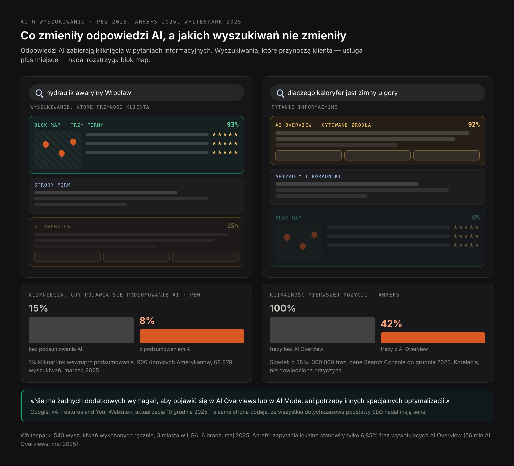
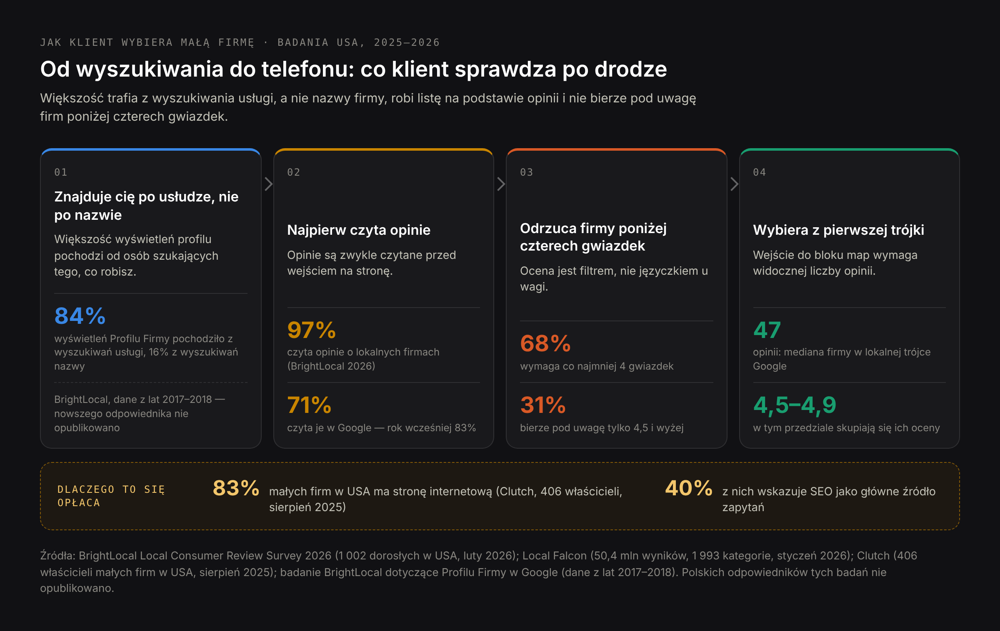
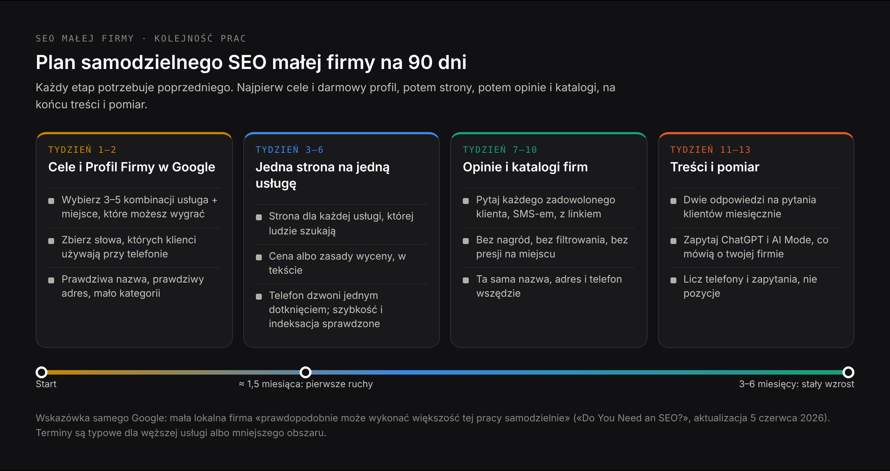
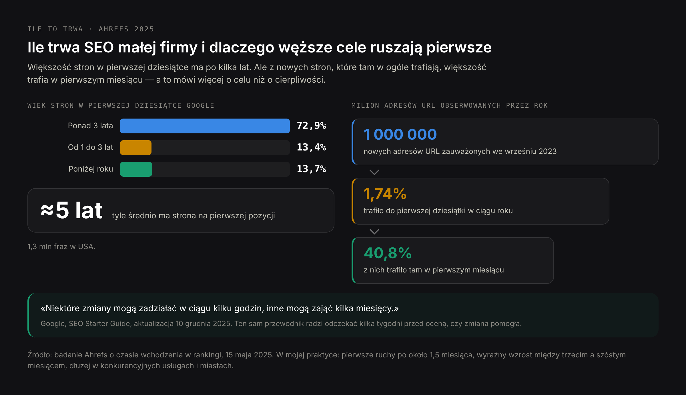

# DRAFT PL — «Jak samemu zrobić SEO» (29.10.2026). Polska adaptacja artykułu EN
# blog-small-business-seo-EN.md. Nie tłumaczenie: ta sama kolejność sekcji i te same fakty,
# inne ramy.
#
# ANGLE: trzy pytania, które Polacy realnie wpisują — «czy SEO ma jeszcze sens» (wątpliwość
# napędzana odpowiedziami AI, najmocniejszy hook, prowadzi sekcję o AI), «jak samemu zrobić SEO»
# (kręgosłup tekstu i H1), «ile kosztuje SEO miesięcznie» (jedna krótka sekcja + link, patrz niżej).
#
# KANIBALIZACJA — świadomie pilnowana:
# - /pl/pozycjonowanie-strony-malej-firmy (H1 «Pozycjonowanie strony małej firmy», meta title
#   «SEO dla małej firmy: audyt od 1000 zł») — strona komercyjna. Żaden nagłówek tego artykułu nie
#   powtarza jej H1 ani meta title; artykuł jest informacyjnym, zrób-to-sam odpowiednikiem i odsyła
#   tam po ujęcie usługowe.
# - /pl/blog/ile-kosztuje-pozycjonowanie-strony — osobny artykuł o cenie. Dlatego sekcja o kosztach
#   ma ~180 słów, tylko liczby nagłówkowe, i linkuje dalej. Nie ma tu pełnego rozbicia cen.
#
# ŹRÓDŁA — te same co w wersji EN, sprawdzone 29.10.2026, nic nie dodane: Google «AI Features and
# Your Website» (akt. 10.12.2025), «Do You Need an SEO?» (akt. 05.06.2026), SEO Starter Guide
# (akt. 10.12.2025), zasady dotyczące spamu (akt. 28.08.2026), wytyczne Profilu Firmy w Google i
# zasady dotyczące opinii; Pew Research Center (22.07.2025, 900 osób, 68 879 wyszukiwań); Ahrefs
# AI Overview CTR (04.02.2026, 300 000 fraz); Ahrefs AI Overview prevalence (19.05.2025, 56 mln);
# Semrush via PPC Land (21.10.2026, 400 fraz); Whitespark (12.05.2025, 540 zapytań); Liz Reid /
# blog Google (06.08.2025); BrightLocal Local Consumer Review Survey 2026 (11.02.2026, 1002 osoby);
# BrightLocal GMB Insights (dane 2017–2018, oflagowane w tekście); Local Falcon opinie
# (14.01.2026, 50,4 mln wyników) i badanie restauracji w ChatGPT (03.03.2026, 189 905 wyników);
# Clutch (21.08.2025, 406 właścicieli); LocaliQ/WordStream benchmarks 2026 (13 474 kampanie);
# Ahrefs ranking time (15.05.2025); Ahrefs SEO pricing poll (439 wykonawców, dane 2023–24,
# oflagowane); dokumentacja botów OpenAI; Kent Lewis / SEMA News (29.09.2011); Search Engine
# Roundtable (17.10.2018) i tweet Nicka Wilsdona (10.10.2018) dla tropu 46%.
# DODANE dla rynku polskiego (jedyna nowa liczba): udział Google w wyszukiwaniu w Polsce 89,56%
# (StatCounter, wrzesień 2026) — użyte raz.
#
# NIE UŻYTE, zgodnie z wersją EN: «46% wyszukiwań ma intencję lokalną» jako fakt (zamiast tego
# rozbiór tropu); wzrost zapytań «near me» (brak źródła po 2019); budżet marketingowy MŚP jako %
# obrotu (dane tylko dla dużych firm); teza «katalogi poprawiają widoczność w AI» (w źródłach to
# spekulacja — w sekcji o katalogach jest to wprost powiedziane).
#
# CZEGO NIE WYMYŚLAŁEM: nie ma tu ani jednej polskiej statystyki, polskiego badania ani polskiego
# procentu poza StatCounterem. Wszystkie badania są amerykańskie i w tekście są tak podpisane; tam,
# gdzie polskiego odpowiednika nie opublikowano, napisane jest to wprost, a sytuacja polska jest
# opisana jakościowo.
#
# ZMIANY WOBEC WERSJI EN:
# 1. Sekcja o kosztach skrócona do ~180 słów + link do /pl/blog/ile-kosztuje-pozycjonowanie-strony
#    (w EN to pełna sekcja). Akapit «za co warto zapłacić nawet przy małym budżecie» przeniesiony do
#    sekcji o tym, co robić samemu — żeby nie budować drugiego tekstu o cenie.
# 2. Dodana jedna sekcja H2 o katalogach firm w Polsce i spójności NAP (Panorama Firm, PKT.pl, Aleo,
#    Oferteo, Targeo) — w EN katalogi są tylko wzmianką w sekcji o Profilu Firmy. 15 H2 łącznie.
# 3. Kupione opinie: zamiast ogólnego «w większości Europy wbrew prawu konsumenckiemu» —
#    «nieuczciwa praktyka rynkowa, UOKiK podejmował wobec nich działania». Bez numeru sprawy, kwoty,
#    daty i artykułu ustawy, bo te nie były weryfikowane.
# 4. Przykłady przeniesione na polski kontekst (instalacje, wymiana pieca, serwis klimatyzacji,
#    przegląd umowy najmu, dzielnica vs aglomeracja). Yelp/Yell zastąpione polskimi katalogami.
# 5. Ceny własne w euro (audyt od 250 €, stała współpraca od 800 € miesięcznie); sondaż Ahrefs
#    zostaje w dolarach i jest podpisany jako amerykański sondaż rynkowy z danymi 2023–24.
# 6. Terminy w słowach właściciela: pierwsze ruchy ~1,5 miesiąca, wyraźny wzrost 3–6 miesięcy
#    (w EN «about six weeks» — to ta sama liczba).
# 7. Figura fig-smb-timeline-pl dodana w sekcji o czasie (w EN jeszcze jej nie było).
# 8. H1 i meta title celowo różne. H1 zbudowany na «jak samemu zrobić SEO»; ani H1, ani meta title,
#    ani żaden nagłówek nie powtarza nagłówków strony komercyjnej.

Title: Jak samemu zrobić SEO: przewodnik krok po kroku dla właściciela małej firmy
Slug: jak-samemu-zrobic-seo
Meta title: Samodzielne SEO w małej firmie: co działa w 2026 roku
Meta description: Jak samemu zrobić SEO: co zmieniło AI, zasady Profilu Firmy w Google, opinie, strony usług, koszty, terminy i plan na pierwszy tydzień pracy.

---

> Krótka odpowiedź: samodzielne SEO małej firmy sprowadza się do pięciu rzeczy — kompletnego i poprawnie nazwanego Profilu Firmy w Google, osobnej strony dla każdej usługi, którą naprawdę sprzedajesz, stałego dopływu prawdziwych opinii, treści odpowiadających na pytania, które klient zadaje przed zakupem, oraz witryny, która szybko się wczytuje i z której da się zadzwonić z telefonu jednym kliknięciem. Większość tej pracy to decyzje o własnej firmie, nie zadania techniczne, dlatego da się ją wykonać bez agencji i bez znajomości kodu. Odpowiedzi AI zmieniły obraz w wyszukiwaniach informacyjnych, ale w wyszukiwaniach zakupowych typu «hydraulik Warszawa» wciąż decyduje blok map. Dokumentacja Google wprost pisze, że mała lokalna firma «prawdopodobnie może wykonać większość tej pracy samodzielnie». Wieczór w tygodniu przez dwa miesiące wystarczy, żeby zrobić to, co daje największą część efektu.

Co kilka miesięcy ktoś ogłasza, że SEO umarło. Tym razem powodem jest AI: Google odpowiada na pytanie na górze strony, ChatGPT odpowiada bez wchodzenia na stronę w ogóle, a kliknięcia, które kiedyś trafiały na małe witryny, idą gdzieś indziej. Część tego jest prawdą i daje się zmierzyć. Większość tego, co mała firma powinna z tym zrobić, nie wygląda tak, jak sugerują nagłówki.

Ten przewodnik przechodzi przez pracę w kolejności, w jakiej sam bym ją wykonał, z danymi pod każdą decyzją i z zasadami, za które Google naprawdę zawiesza profile. Jest napisany dla właściciela, który zrobi to sam albo chce wiedzieć, za co płaci. Jeśli wolisz oddać to komuś, na stronie o [pozycjonowaniu strony małej firmy](/pl/pozycjonowanie-strony-malej-firmy) opisałem, jak pracuję i co wchodzi w audyt; przewodnik ma być użyteczny w obu przypadkach.

Jestem jednym niezależnym konsultantem, nie agencją, więc piszę o metodzie: o tym, co sprawdzam, w jakiej kolejności i na jakich danych opieram każdą decyzję.

Warto od razu ustalić, co znaczy «samemu». Nie znaczy nauczyć się SEO. Znaczy przeznaczyć jeden wieczór w tygodniu na kilka tygodni, zrobić w tym czasie pięć rzeczy z krótkiej odpowiedzi powyżej i nie brać się za nic poza nimi, dopóki nie są zrobione. Właściciel, który uzupełni profil i napisze strony usług, będzie widoczny lepiej niż właściciel, który przeczytał dziesięć poradników i nie zmienił nic.

## Czym jest SEO małej firmy i czym różni się od pozycjonowania dużego serwisu

SEO małej firmy to optymalizacja pod wyszukiwarki w skali biznesu, który ma kilka usług, jedną lub kilka lokalizacji i nikogo, kto zajmuje się marketingiem na pełny etat. Po polsku równie naturalnie mówi się «pozycjonowanie strony małej firmy» — to ta sama praca, a nie dwie różne usługi.

W Polsce cała ta praca praktycznie w całości dotyczy jednej wyszukiwarki: udział Google w wyszukiwaniu wynosi tu 89,56% (StatCounter, wrzesień 2026). To upraszcza decyzje — nie ma sensu rozdzielać wysiłku na kilka silników — i jednocześnie podnosi stawkę, bo jeden dostawca ustala zasady.

Metoda jest taka sama jak dla każdej witryny, ale cztery rzeczy w praktyce wyglądają inaczej.

- **Mapy liczą się bardziej niż strona.** Dla zapytań typu «[usługa] [miasto]» uwagę zbierają trzy firmy z bloku map, a ten blok wygrywa się Profilem Firmy w Google, nie witryną.
- **Opinie są częścią rankingu, nie tylko argumentem sprzedażowym.** Wpływają i na to, co Google pokazuje, i na to, co klient kliknie.
- **Konkurujesz z katalogami, nie tylko z konkurencją.** Panorama Firm, PKT.pl, Oferteo i im podobne wyprzedzają pojedyncze firmy w wielu zapytaniach, co zmienia miejsca, w których warto walczyć.
- **Nie ma zespołu.** Plan z czterdziestoma zadaniami to plan, który się nie wykona. Kolejność pracy ma tu większe znaczenie niż jej długość.

Z tych czterech różnic wynika jedna praktyczna zasada: zanim zaczniesz cokolwiek zmieniać w witrynie, sprawdź, co w twoim zapytaniu w ogóle da się wygrać. Jeśli nad wynikami organicznymi stoją trzy firmy z map, a pod nimi dwa katalogi, miejsce, o które realnie walczysz, nie jest pierwszą pozycją w wynikach, tylko jednym z trzech miejsc na mapie — a to zupełnie inna praca i inna kolejność działań.

Jedna rzecz się nie różni: dokumentacja Google dla małych firm jest krótka, bezpłatna i konkretna, i prawie nikt jej nie czyta. Kilka zasad z tego przewodnika pochodzi wprost z niej.

## Czy SEO ma jeszcze sens, skoro AI odpowiada za wyszukiwarkę

To najczęściej zadawane pytanie w temacie, więc zasługuje na dane, a nie na pocieszenie. Uczciwa odpowiedź ma trzy części i każda prowadzi w inną stronę.

### Co dane mówią o odpowiedziach AI i spadku kliknięć

Kliknięcia faktycznie ubywają. Dwa niezależne pomiary zgadzają się co do kierunku; oba są amerykańskie i polskiego odpowiednika żadnego z nich nie opublikowano.

- **Pew Research Center** śledził realne zachowanie 900 dorosłych Amerykanów w 68 879 wyszukiwaniach Google w marcu 2025 roku. Kiedy pojawiało się podsumowanie AI, 8% wizyt kończyło się kliknięciem w wynik — wobec 15%, gdy podsumowania nie było. Tylko **1%** użytkowników kliknął link wewnątrz samego podsumowania AI, a 26% zakończyło na tej stronie całą sesję przeglądania, zamiast 16%.
- **Ahrefs** porównał 300 000 fraz — połowę z AI Overview, połowę bez — na danych Search Console od grudnia 2023 do grudnia 2025 roku. Klikalność na pierwszej pozycji spadła o **58%** we frazach, w których pojawiało się AI Overview. Ahrefs sam ostrożnie nazywa to korelacją, a nie dowodem przyczyny.

Stanowisko Google, przedstawione przez Liz Reid w sierpniu 2025 roku, jest takie, że «całkowita liczba organicznych kliknięć z wyszukiwarki Google na strony pozostaje względnie stabilna rok do roku», a same kliknięcia są wyższej jakości. Google nie publikuje liczb, które by to pokazywały, więc po jednej stronie masz nieskwantyfikowane twierdzenie strony zainteresowanej, a po drugiej dwa pomiary z opublikowanymi próbami. Warto przy tym zauważyć, że te dwie rzeczy nie są ze sobą ściśle sprzeczne: Google mówi o łącznym wolumenie w całym internecie, a badania — o szansie na kliknięcie w konkretnym zapytaniu.

### Dlaczego wyszukiwania lokalne są wyjątkiem od spadku kliknięć

Teraz część, która rozstrzyga, czy to wszystko w ogóle dotyczy twojej firmy.

**Whitespark** wykonał ręcznie 540 wyszukiwań w trzech amerykańskich miastach i sześciu branżach w maju 2025 roku, a potem podzielił je według intencji. W wyszukiwaniach typu «[usługa] [miasto]» — tych, które przyprowadzają klienta gotowego kupić — AI Overview pojawiało się w **15%** przypadków, a lokalny blok map w **93%**. Dla pytań informacyjnych proporcje odwracają się niemal dokładnie: AI Overview 92%, blok map 6%.

**Ahrefs**, analizując 56 milionów wystąpień AI Overviews w maju 2025 roku, znalazł ten sam wzór z drugiej strony: AI Overviews rzadziej pojawia się w zapytaniach lokalnych i brandowych, a zapytania lokalne stanowiły zaledwie 6,85% fraz, które je uruchamiały.

Odpowiedź AI zjada więc wyszukiwanie informacyjne — «jak często serwisować piec gazowy» — i w dużej mierze zostawia w spokoju wyszukiwanie zakupowe. Dla firmy instalacyjnej pierwsze to ruch na stronie, a drugie to klienci.

Zastrzeżenie brzmi: to się rusza. **Semrush**, monitorując miesięcznie 400 amerykańskich fraz komercyjnych, znalazł AI Overviews w 45,75% z nich we wrześniu 2025 roku i w **88%** w sierpniu 2026 (podane przez PPC Land; własnego wpisu Semrusha nie udało mi się znaleźć). Wyszukiwania komercyjne są wciągane szybko, nawet jeśli lokalne jeszcze nie.

Jak to wygląda w Polsce, nie wiem w liczbach i nie będę ich udawał — nikt nie opublikował polskiego badania obecności AI Overviews w podziale na intencje. Jakościowo widzę to samo, co da się sprawdzić w pół godziny samemu: pytania «jak», «ile», «czy warto» coraz częściej dostają odpowiedź na górze strony, a zapytania z nazwą miasta i usługą nadal otwierają się blokiem map. To sprawdzenie jest darmowe i zajmuje tyle, ile wpisanie dziesięciu fraz w wylogowanej przeglądarce.

### Co Google pisze o optymalizacji pod funkcje AI

Na to jest odpowiedź wprost i leży w dokumentacji Google. Strona «AI Features and Your Website», aktualizowana 10 grudnia 2025 roku, mówi:

> «Nie ma żadnych dodatkowych wymagań, które trzeba spełnić, by pojawiać się w AI Overviews lub w AI Mode, ani żadnych specjalnych optymalizacji, które byłyby do tego konieczne».

Ta sama strona dodaje, że «najlepsze praktyki SEO pozostają istotne dla funkcji AI w wyszukiwarce Google» i że «wszystkie dotychczasowe podstawy SEO nadal mają sens». Nie ma pliku tekstowego dla AI, który trzeba dodać, nie ma specjalnych znaczników, nie ma osobnej konfiguracji technicznej.

Warto to wiedzieć, zanim kupisz cokolwiek opisane jako optymalizacja pod AI. Realna praca w widoczności w modelach językowych istnieje — sprawdzanie, co asystenci mówią o twojej firmie, poprawianie błędnych informacji u źródła, mierzenie tego w czasie — i piszę o niej niżej oraz w artykule o tym, [czym jest GEO](/pl/blog/geo-co-to-jest). Ale to nie jest nowy zestaw wymagań technicznych, a kto sprzedaje to jako wymagania, sprzedaje stronę, której zdaniem Google nie trzeba budować.

## Jak klienci naprawdę znajdują małą firmę w 2026 roku

Przed taktykami — zachowanie. Liczby poniżej pochodzą z badań i analiz wyników wyszukiwania opublikowanych w 2025 i 2026 roku. Wszystkie są amerykańskie. Nie znalazłem polskiego badania, które mierzyłoby to samo na polskiej próbie, więc traktuję je jako kierunek, nie jako polski stan rzeczy.

- **Opinie czyta praktycznie każdy.** W badaniu BrightLocal Local Consumer Review Survey 2026, opublikowanym w lutym 2026 roku na próbie 1002 dorosłych Amerykanów, **97%** odpowiedziało, że czyta opinie o lokalnych firmach. **68%** wymaga co najmniej czterech gwiazdek, 31% rozważy tylko firmę z oceną 4,5 i wyżej, a 10% — tylko piątkę.
- **Istnieje widoczny próg liczby opinii.** Local Falcon przeanalizował 50,4 miliona amerykańskich wyników wyszukiwania w 1993 kategoriach firm w styczniu 2026 roku: mediana firmy pojawiającej się w lokalnej trójce Google ma **47 opinii**, a oceny skupiają się między 4,5 i 4,9. Konkurencja w miastach jest trzy do pięciu razy wyższa niż na terenach wiejskich.
- **Google nadal jest głównym źródłem opinii, ale mniej niż był.** W tym samym badaniu BrightLocal **71%** wskazało Google jako miejsce, w którym czyta opinie — wobec 83% rok wcześniej.
- **Większość małych firm ma stronę, a SEO jest ich głównym źródłem zapytań.** Clutch zapytał 406 amerykańskich właścicieli małych firm w sierpniu 2025 roku: **83%** ma stronę, a wśród nich **40%** wskazuje SEO jako najlepsze źródło leadów. Spośród 17% bez strony jedna trzecia uważa, że strona nie jest istotna w ich branży, a 16% podaje koszt.

Jedną starszą liczbę warto przytoczyć razem z jej wiekiem, bo nic nowszego nie istnieje: analiza danych Profili Firm w Google wykonana przez BrightLocal pokazała, że **84%** wyświetleń profilu pochodziło z wyszukiwań odkrywczych — od ludzi szukających usługi, a nie firmy z nazwy — wobec 16% tych, którzy szukali firmy bezpośrednio. Te dane są z lat 2017–2018 i od tego czasu nikt nie opublikował odpowiednika, więc traktuj je jako kierunek, nie jako aktualną wartość.

### Skąd się wzięła statystyka «46% wyszukiwań ma intencję lokalną»

Tę liczbę spotkasz w niemal każdym artykule o SEO lokalnym, zwykle przypisaną Google. Warto przejść jej trop, bo dobrze pokazuje, z czego zrobiona jest spora część statystyk marketingowych.

Liczba pochodzi od przedstawiciela Google, który wypowiedział ją na konferencji Secrets of Local Search w siedzibie Google w Mountain View w październiku 2018 roku. Do branży dotarła przez tweeta specjalisty SEO Nicka Wilsdona z 10 października 2018 roku, który Barry Schwartz opisał tydzień później w Search Engine Roundtable z niezwykle uczciwym zastrzeżeniem: «Ufam źródłu, ale wszystko, co mam na tę statystykę, to tweet tego specjalisty SEO». Zastanawiał się też na głos, czy Google nie definiuje «intencji lokalnej» po swojemu.

Google nigdy nie opublikował badania ani metody, która za tym stała. Sformułowanie dryfowało w kolejnych powtórzeniach — część źródeł mówi o «wyszukiwaniach lokalnych», inne o «intencji lokalnej», a to nie to samo — i liczba jest powtarzana bez zmiany od ośmiu lat, przez okres, w którym korzystanie z telefonów, Mapy i sam układ strony z wynikami zmieniły się znacząco.

Praktyczny wniosek nie jest taki, że wyszukiwanie lokalne jest nieważne; wynik Whitesparka z 93% obecnością bloku map jest zmierzony, świeży i mówi, że jest ważne. Wniosek jest taki, że jedna uwaga na konferencji, przekazana przez osobę trzecią, nie jest dowodem — a statystyka, której nikt nie odświeżył od ośmiu lat, nie mówi nic o dzisiejszym dniu.

## Jak samemu zrobić SEO małej firmy: kolejność pracy

Mała firma nie może zrobić wszystkiego i nie musi. To sekwencja, którą sam bym prowadził; każdy krok opiera się na poprzednim.

### Jak wybrać wyszukiwania, które mała firma może realnie wygrać

Najczęstsze marnotrawstwo w samodzielnym SEO to celowanie w najbardziej oczywistą frazę. «Hydraulik» w stolicy jest obstawiony przez sieci i katalogi z budżetami, których nie przebijesz. Wygrywa się najpierw tam, gdzie konkurencja jest cieńsza, a twoje doświadczenie prawdziwe.

- **Węższa usługa**: «wymiana pieca gazowego» zamiast «instalacje», «przegląd umowy najmu lokalu» zamiast «usługi prawne».
- **Mniejsze miejsce**: dzielnica albo miasto, w którym naprawdę pracujesz, nie cała aglomeracja.
- **Język**: jeśli obsługujesz klientów w drugim języku, strona w tym języku spotyka się z ułamkiem konkurencji.
- **Pytanie, na które nikt dobrze nie odpowiada**: zobacz wyniki dla tego, o co klienci pytają cię przez telefon. Jeśli na górze są chude strony katalogów, to jest twoje wejście.

Zapisz trzy do pięciu kombinacji usługi i miejsca. Wszystko poniżej buduje się wokół nich. Nie pięćdziesiąt i nie dziesięć — trzy do pięciu, bo tyle zdąży zrobić jedna osoba, zanim straci cierpliwość, a każda z tych kombinacji potrzebuje własnej strony, własnego tekstu i własnych zdjęć.

### Słowa kluczowe małej firmy: co klient wpisuje przed zakupem

Właściciele opisują swoją pracę językiem branży, a klienci opisują swój problem. Nikt nie szuka «umowy serwisowej na konserwację prewencyjną HVAC» — szuka «klimatyzacja brzydko pachnie». Dobre słowa kluczowe pochodzą z trzech miejsc.

1. **Z twoich własnych zapytań.** Dokładne słowa, których ludzie używają, gdy dzwonią albo piszą. To twoje najlepsze frazy i żadne narzędzie ich nie ma. Przez dwa tygodnie zapisuj je dosłownie, w zeszycie albo w arkuszu, bez przekładania na język branżowy.
2. **Z podpowiedzi Google.** Zacznij wpisywać pytanie klienta i przeczytaj autouzupełnianie, ramkę «Inne pytania na ten temat» oraz powiązane wyszukiwania na dole strony. To nic nie kosztuje.
3. **Z narzędzia do słów kluczowych, wyłącznie do porównania.** Żeby zdecydować między dwoma sformułowaniami, wystarczy dowolne. Wolumeny dla małych miejscowości często pokazują się jako zero, co nie znaczy, że nikt nie szuka — znaczy, że narzędzie nie mierzy tak nisko.

Grupuj frazy według problemu, który opisują, a nie według słów. «Hydraulik na już», «pękła rura» i «woda cieknie z sufitu» to jeden problem i należą do jednej strony. Błąd odwrotny — osobna podstrona pod każdą odmianę tej samej frazy — kończy się zestawem stron, które konkurują między sobą o to samo zapytanie, i jest to kłopot, który potem trzeba sprzątać ręcznie.

### Profil Firmy w Google: zasady, za których łamanie Google zawiesza profile

W wyszukiwaniach lokalnych ma to większe znaczenie niż cokolwiek na twojej stronie, a wytyczne Profilu Firmy w Google zawierają konkretne zasady, które są łamane bez przerwy.

- **Nazwa to twoja prawdziwa nazwa i nic więcej.** Google: «Twoja nazwa powinna odzwierciedlać rzeczywistą nazwę Twojej firmy, używaną konsekwentnie na szyldzie, w witrynie i na materiałach firmowych», oraz «Umieszczanie w nazwie firmy niepotrzebnych informacji jest niedozwolone». «Kowalski Instalacje — Awarie 24/7 Warszawa» zaprasza do zawieszenia profilu; «Kowalski Instalacje» nie.
- **Adres musi być prawdziwy.** Biuro wirtualne «nie kwalifikuje się do Profilu Firmy», skrytki pocztowe nie są akceptowane, a biurko w przestrzeni coworkingowej nie wystarczy, «chyba że biuro to ma wyraźne oznakowanie».
- **Jeśli jeździsz do klientów, zgłoś to poprawnie.** Firma działająca w obszarze obsługi ma jeden profil, ukrywa adres i ustawia obszar, który «nie powinien sięgać dalej niż około 2 godziny jazdy».
- **Używaj niewielu kategorii.** Google prosi, by «stosować jak najmniej kategorii opisujących główny profil działalności», i ostrzega przed używaniem ich «wyłącznie jako słów kluczowych».
- **Uzupełnij resztę.** Godziny, telefon, link do właściwej podstrony witryny, języki obsługi, prawdziwe zdjęcia i odpowiedzi na pytania, które klienci faktycznie zadają.

Potem zadbaj, żeby nazwa, adres i telefon były identyczne na stronie, w profilu i w każdym katalogu, w którym się pojawiasz. Sam profil to tylko połowa obrazu lokalnego — na stronie o [pozycjonowaniu lokalnym](/pl/oferty/pozycjonowanie-lokalne) opisałem, jak wyniki map i witryna pracują razem.

### Osobna strona dla każdej usługi, którą naprawdę sprzedajesz

Jedna strona «Usługi» z listą ośmiu pozycji nie rankuje na żadną z nich. Każda usługa, której klient szuka, potrzebuje własnej strony, a ta strona musi zrobić więcej niż potwierdzić, że usługę świadczysz.

- **Nazwij problem tak, jak nazywa go klient**, w tytule i w pierwszym zdaniu. W pierwszym akapicie powiedz wprost, jaką usługę świadczysz i na jakim terenie — tak czytają stronę i wyszukiwarki, i asystenci AI.
- **Odpowiedz od razu na pierwsze pytanie**: jak przebiega praca, ile trwa, co się dzieje przy pierwszej wizycie.
- **Napisz, ile to kosztuje**, albo przynajmniej jak liczy się cenę. Klienci porównują właśnie to i dokładnie takie fakty cytują odpowiedzi AI.
- **Pokaż, kto wykonuje pracę** — prawdziwe imię i prawdziwe zdjęcie biją każde zdjęcie stockowe.
- **Zakończ jednym wyraźnym krokiem**: numerem telefonu, który wybiera się jednym kliknięciem, i krótkim formularzem.

Jeśli pracujesz w kilku miejscowościach, ta sama logika dotyczy miejsc: jedna strona na miejscowość, którą rzeczywiście obsługujesz, z treścią naprawdę o tej miejscowości. Kopie jednej strony z podmienioną nazwą miasta to to, co zasady Google dotyczące spamu (aktualizacja 28 sierpnia 2026) nazywają **nadużyciami dotyczącymi stron przejściowych**, i ciągną w dół resztę witryny.

### Opinie w Google: jak prosić o nie, nie łamiąc zasad

Opinie ruszają i ranking, i decyzję, więc potrzebują rutyny, a nie szczęścia. Zasady Google co do tego, co wolno i czego nie wolno, są wyraźne, a dwie popularne taktyki są zakazane.

- **Bez zachęt materialnych.** Nie wolno «oferować zachęt — takich jak płatność, zniżki, darmowe towary lub usługi» w zamian za opinie ani za zmianę lub usunięcie negatywnej.
- **Bez filtrowania opinii.** Nie wolno «zniechęcać do wystawiania negatywnych opinii, zabraniać ich ani wybiórczo zabiegać o pozytywne opinie klientów». Pytanie tylko tych klientów, po których spodziewasz się zadowolenia, jest wbrew zasadom, niezależnie od tego, ile narzędzi oferuje automatyzację tego procesu.
- **Bez presji na miejscu.** Nie wolno «wymagać od użytkowników ani naciskać na nich, by wystawiali oceny lub pisali opinie, gdy są na miejscu», ani wyznaczać pracownikom limitów opinii.

Dozwolona jest wersja wprost: Google pozwala «zachęcać do publikowania treści, które odzwierciedlają prawdziwe doświadczenie». Pytaj każdego klienta w momencie, w którym praca kończy się dobrze, wysyłaj bezpośredni link i proś SMS-em, a nie mailem. Skoro mediana firmy z lokalnej trójki ma 47 opinii, stały strumyczek bije jednorazową akcję. Pięć opinii miesięcznie przez rok zrobi dla ciebie więcej niż czterdzieści zebranych w jednym tygodniu, bo czytający widzą nie tylko liczbę, ale i to, czy opinie wciąż przychodzą.

Odpowiadaj na złe opinie bez kłótni. Spokojna, konkretna odpowiedź jest czytana przez wszystkich, którzy przyjdą później, i jest jedyną częścią negatywnej opinii, którą kontrolujesz.

### Treści, które odpowiadają na pytania klientów przed zakupem

Treść dla małej firmy to nie aktualności o firmie. To odpowiedzi na pytania, które ludzie zadają, zanim wybiorą kogokolwiek: «ile kosztuje wymiana pieca», «czy potrzebuję na to zgody», «co się stanie, jeśli odwołam zlecenie». Każda dobra odpowiedź to szansa na ranking, na zacytowanie w odpowiedzi AI i na zaoszczędzenie jednej rozmowy telefonicznej.

Zasady, które sprawiają, że to działa:

- **Jedno pytanie na stronę**, z odpowiedzią w pierwszych dwóch zdaniach i porządnym wyjaśnieniem poniżej.
- **Konkretnie o miejscu, w którym pracujesz** — lokalny przepis, lokalny widełkowy zakres cen, lokalny przebieg sprawy. Ogólne treści na poziomie kraju publikują już katalogi.
- **Napisane albo sprawdzone przez osobę, która tę pracę wykonuje**, z datą ostatniej weryfikacji.
- **Podlinkowane do strony usługi**, na której czytelnik może działać.

Dwie porządne odpowiedzi w miesiącu zrobią więcej niż codzienne wpisy pisane pod kalendarz. Zwróć uwagę, co zasady Google dotyczące spamu mówią o ilości: nadużycia dotyczące treści tworzonych na dużą skalę obejmują «używanie generatywnych narzędzi AI lub podobnych narzędzi do tworzenia wielu stron bez wartości dodanej dla użytkowników». Testem jest wartość, nie narzędzie.

### Linki i wzmianki, które mała firma może zdobyć uczciwie

Linki z innych stron pozostają silnym sygnałem, a dla małej firmy realne są te, których się nie kupuje:

- dostawcy i producenci, których produkty montujesz — często prowadzą listy autoryzowanych wykonawców;
- izby, stowarzyszenia branżowe i jednostki certyfikujące, do których należysz;
- lokalna prasa, kiedy jesteś osobą, która potrafi coś wyjaśnić;
- organizacje, zespoły i wydarzenia, które sponsorujesz;
- partnerzy, z którymi już pracujesz, tam gdzie szczere wskazanie wykonawcy ma sens.

Unikaj paczek linków i masowych wpisów gościnnych. Są wbrew zasadom Google dotyczącym spamu, a strony, które je sprzedają, to dokładnie te, których Google nie liczy.

## Katalogi firm w Polsce i spójność danych NAP

Katalogi w polskim wyszukiwaniu mają dwie role i warto ich nie mieszać. Pierwsza: są konkurentem — Panorama Firm, PKT.pl, Aleo, Oferteo czy Targeo potrafią zająć pierwsze miejsca na zapytanie, na które twoja strona dopiero próbuje wejść. Druga: są miejscem, w którym twoje dane firmowe krążą po internecie i mogą krążyć w wersji nieaktualnej.

Pracą, która się tu opłaca, jest spójność, nie liczba wpisów. Nazwa, adres i telefon — w branży nazywa się to NAP, od name, address, phone — powinny być identyczne w Profilu Firmy w Google, na stronie i w każdym katalogu, w którym firma jest wpisana. Stary numer telefonu w jednym katalogu i inny skrót nazwy ulicy w drugim to jedna z niewielu czysto mechanicznych rzeczy, które do dziś potrafią przytrzymać wyniki lokalne.

Praktycznie: wpisz nazwę swojej firmy w Google razem z numerem telefonu i przejrzyj pierwsze dwie strony wyników. Zobaczysz, gdzie jesteś wpisany, często o kilku wpisach nie wiedząc. Popraw albo usuń nieaktualne, uzupełnij te, które zostawiasz, i zapisz w jednym pliku listę miejsc, w których firma jest wpisana — przy zmianie telefonu albo lokalu zaoszczędzi ci to tygodnia.

Nie obiecam przy tym, że wpisy w katalogach poprawią twoją widoczność w odpowiedziach AI. Krąży taka teza, ale źródła, które ją powtarzają, nie mają na to danych — to spekulacja, a nie pomiar. Spójne dane mają sens same z siebie: klient, który dzwoni pod aktualny numer, jest całą potrzebną korzyścią.

## SEO techniczne strony małej firmy: co sprawdzisz samodzielnie

Nie trzeba czytać kodu, żeby znaleźć najczęstsze problemy.

- **Szybkość na telefonie.** Przepuść główne podstrony przez PageSpeed Insights w wersji mobilnej. Zwykłymi winowajcami są slidery, tła wideo i karuzele ze zdjęciami stockowymi.
- **Telefon wybiera się jednym kliknięciem** na każdej podstronie, a formularz naprawdę trafia do skrzynki, którą ktoś czyta. Sprawdź to sam, z telefonu.
- **Każda ważna podstrona jest zaindeksowana.** W Search Console otwórz raport Strony; albo wpisz w Google `site:twojadomena.pl` i zobacz, co wraca. Podstrona, której nie ma w indeksie, nie rankuje na nic, niezależnie od tego, jak dobrze jest napisana.
- **Jeden adres na stronę.** Witryna odpowiada w jednej wersji — z «www» albo bez, zawsze po https — a pozostałe przekierowują do niej.
- **Podstawowe dane strukturalne** z nazwą, adresem, telefonem i godzinami otwarcia, zgodne z tym, co widać na stronie.
- **Bez gwiazdek z własnych opinii.** Google nie pokazuje w wynikach gwiazdek oceny dla opinii, które firma zbiera i wystawia sama o sobie, więc znaczniki do tego nie pomagają.

Jeśli ta lista wyrzuci więcej rzeczy, niż da się poprawić punkt po punkcie, problemem jest zwykle sama witryna, a nie ustawienia — jak wygląda [strona internetowa dla małej firmy](/pl/strona-internetowa-dla-malej-firmy) zbudowana od początku pod wyszukiwanie, opisałem osobno.

## Widoczność małej firmy w wyszukiwaniu AI: ChatGPT, AI Overviews, GEO i AEO

Widoczność u asystentów to w większości ta sama praca, plus kilka szczegółów, które łatwo zrobić źle. GEO i AEO — generative engine optimization i answer engine optimization — to nazwy na tę nadbudowę, nie na osobną dyscyplinę techniczną.

**Wpuść właściwe roboty.** OpenAI prowadzi kilka i robią różne rzeczy; poniżej według własnej dokumentacji OpenAI.

| Robot | Co robi | Co znaczy jego zablokowanie |
|---|---|---|
| OAI-SearchBot | Buduje indeks, na którym opiera się wyszukiwanie w ChatGPT | Nie pokazujesz się w odpowiedziach wyszukiwania ChatGPT |
| ChatGPT-User | Pobiera stronę, gdy pytanie użytkownika tego wymaga | Wizyty inicjuje użytkownik, więc robots.txt «może nie mieć zastosowania» |
| GPTBot | Zbiera treści, które mogą trenować modele OpenAI | Twoje treści nie są używane do trenowania — wyszukiwanie w ChatGPT działa bez zmian |

Praktyczna konsekwencja: zablokowanie GPTBota **nie** usuwa cię z ChatGPT. Zablokowanie OAI-SearchBota — usuwa. Wiele wtyczek bezpieczeństwa i firewalli hostingowych domyślnie blokuje nieznane roboty, więc warto to sprawdzić, a nie założyć.

**Zapisuj fakty tekstem.** Ceny, obszar obsługi, godziny otwarcia, języki i uprawnienia należą do tekstu strony, nie do obrazka ani PDF-a. Asystenci cytują to, co jest napisane.

**Licz się z tym, że na początku będziesz niewidoczny, i zmierz to.** Local Falcon przeanalizował 189 905 wyników ChatGPT dla zapytań restauracyjnych w lutym 2026 roku i stwierdził, że **83%** monitorowanych restauracji nigdy nie pojawiło się w lokalnych rekomendacjach ChatGPT, wobec 14% niewidocznych w Google. To badanie dostawcy narzędzia, na jednej branży i na próbie nielosowej, więc samą liczbę traktuj ostrożnie — ale kierunek zgadza się z tym, co znajduje każdy, kto to testuje. Sposób, żeby wiedzieć, jest jeden: weź pięć pytań, które zadaliby twoi klienci, zadaj je ChatGPT i trybowi AI w Google na wylogowanej sesji i zapisz, kto zostaje wymieniony i które strony są cytowane. Powtórz to po dwóch miesiącach na tych samych pięciu pytaniach — to cała metoda pomiaru i nie potrzebuje żadnego narzędzia.

Jak ChatGPT wybiera, co zacytować, to temat na osobny tekst i przechodzę go w artykule o tym, [jak pojawić się w ChatGPT](/pl/blog/jak-pojawic-sie-w-chatgpt).

## SEO, Google Ads czy Profil Firmy w Google: co kiedy przynosi zapytania

To nie alternatywy; działają na różnych zegarach.

| | Jak płacisz | Kiedy przynosi zapytania | Co warto wiedzieć |
|---|---|---|---|
| Google Ads | Za kliknięcie | Od pierwszego dnia | W 13 474 amerykańskich kampaniach w benchmarkach LocaliQ 2026 średnie kliknięcie kosztowało **5,42 USD**, a średni lead **66,69 USD**. Przestaje działać w dniu, w którym kończy się budżet |
| SEO | Twoim czasem albo stałą opłatą | Pierwsze ruchy po około 1,5 miesiąca | Pracuje dalej, gdy przestajesz płacić; wolniej w zatłoczonych usługach i miastach |
| Profil Firmy w Google | Bezpłatnie | W ciągu kilku dni od uzupełnienia i poprawienia | Najwyższy zwrot z tych trzech dla firmy lokalnej i najczęściej zaniedbywany |

Stawki LocaliQ są amerykańskie i w Polsce będą inne; publicznego polskiego benchmarku kosztu kliknięcia i kosztu leada na porównywalnej próbie nie znalazłem, więc czytaj je jako proporcje między kanałami, nie jako swój budżet. Dla większości małych firm sensowna kolejność jest taka: najpierw kompletny profil, bo jest darmowy i szybki; potem SEO dla usług, których chcesz więcej; a reklamy tylko na te luki, które są pilne. Odwrotna kolejność — reklamy najpierw — oznacza płacenie za kliknięcia prowadzące na stronę, która nie zamienia ich w zapytania, i jest to najdroższy sposób, żeby się o tym przekonać.

## Ile czasu zajmuje SEO małej firmy

Uczciwe oczekiwania, na podstawie jedynego dużego badania tego zagadnienia, któremu ufam.

Ahrefs przeanalizował 1,3 miliona amerykańskich fraz i ustalił, że **72,9%** stron w pierwszej dziesiątce ma więcej niż trzy lata, że przeciętna strona na pierwszej pozycji ma około pięciu lat i że tylko **13,7%** stron z pierwszej dziesiątki ma mniej niż rok. Z miliona adresów URL zauważonych po raz pierwszy we wrześniu 2023 roku **1,74%** weszło do pierwszej dziesiątki w ciągu roku — ale ze stron, które tam dotarły, **40,8%** zrobiło to w pierwszym miesiącu.

Ta ostatnia liczba jest najbardziej użyteczna. Wchodzenie do wyników nie jest powolnym mieleniem dla każdej strony: albo dzieje się dość szybko dla strony wycelowanej w coś, co da się wygrać, albo nie dzieje się wcale dla strony wycelowanej w coś, co nigdy nie było w zasięgu. To jest argument za wybieraniem na początku wąskich celów.

Dokumentacja Google zgadza się co do kształtu: «Niektóre zmiany mogą zadziałać w ciągu kilku godzin, inne mogą potrzebować kilku miesięcy» oraz «prawdopodobnie warto odczekać kilka tygodni, by ocenić, czy twoja praca przyniosła korzystne efekty».

W mojej własnej pracy wzór jest stały: pierwsze ruchy po około 1,5 miesiąca, wyraźny wzrost między trzecim i szóstym miesiącem, dłużej w zatłoczonych rynkach. Nie dotyczy to momentu, w którym telefon zaczyna dzwonić z Profilu Firmy w Google — uzupełniony i poprawny profil potrafi odezwać się w ciągu kilku dni, bo nie konkuruje z wiekiem domeny, tylko z kompletnością danych. Jeśli ktoś obiecuje pierwsze miejsce w miesiąc, obiecuje coś, czego te dane nie potwierdzają.

## Ile kosztuje SEO miesięcznie w małej firmie

Nie ma ceny standardowej, ale jest rozkład. Ahrefs zapytał 439 wykonawców SEO i zweryfikował ich strony: najczęstszym abonamentem miesięcznym było **501–1000 USD**, a **68,8%** liczyło sobie 2000 USD miesięcznie lub mniej. Najczęstsza stawka godzinowa to 75–100 USD, a najczęstsza cena projektu 2501–5000 USD. To amerykański sondaż rynkowy przeprowadzony w 2023 roku i zaktualizowany w 2024, więc czytaj go jako kształt rynku, nie jako dzisiejsze polskie stawki — polskiego badania na porównywalnej próbie wykonawców nie opublikowano.

Dla porównania moje własne stawki: audyt od 250 € jednorazowo, stała współpraca od 800 € miesięcznie, faktura za każdy etap. Co wchodzi w każdy z tych zakresów, widać w [cenniku](/pl/cennik), a co podnosi i obniża kwotę — od liczby usług i miast po stan techniczny witryny — rozkładam w osobnym tekście o tym, [ile kosztuje pozycjonowanie strony](/pl/blog/ile-kosztuje-pozycjonowanie-strony). Tam są widełki, warianty zakresu i to, co w abonamentach bywa dopisane drobnym drukiem. Niezależnie od kwoty proś o zapis, co konkretnie wchodzi w zakres miesięczny i co się dzieje, kiedy współpraca się kończy.

## Mity o SEO: zasada 80/20, trzy C i skrót «SCO»

Trzy rzeczy, których ludzie szukają w tym temacie i które zasługują na prostą odpowiedź.

**«Co to zasada 80/20 w SEO?»** To zasada Pareto — ogólna obserwacja, że mała część przyczyn daje większość efektu — przeniesiona na SEO przez marketerów. Nie występuje nigdzie w dokumentacji Google i nie opiera się na żadnym badaniu dotyczącym SEO. Jako przypomnienie, żeby robić te kilka rzeczy, które mają znaczenie, jest w porządku. Jako prawo rządzące wyszukiwaniem — nie jest nim.

**«Co to trzy C w SEO?»** Podawane zwykle jako content, code i credibility — treść, kod i wiarygodność. Ramę da się wyśledzić do Kenta Lewisa z Anvil Media, który pisał o niej w SEMA News we wrześniu 2011 roku. Jest użytecznym sposobem porządkowania rozmowy i nie jest pojęciem Google.

**«Co znaczy SCO?»** W wyszukiwaniach dotyczących stron internetowych to niemal zawsze literówka w słowie SEO. Samodzielnie skrót SCO odnosi się zwykle do Szanghajskiej Organizacji Współpracy albo do firmy softwarowej z lat dziewięćdziesiątych działającej wokół Uniksa.

Żadna z tych rzeczy nie ma dużego znaczenia poza jednym: jest sposobem, żeby ocenić to, co czytasz. Artykuł zbudowany na nazwanych frameworkach i zasadach o okrągłych liczbach zwykle powtarza inne artykuły.

## Błędy w samodzielnym SEO, które kosztują klientów

- **Słowa kluczowe wciśnięte w nazwę profilu w Google.** Działa krótko, potem profil jest edytowany albo zawieszony, a odwieszenie zajmuje tygodnie.
- **Biuro wirtualne użyte, żeby pojawić się w innym mieście.** Nie kwalifikuje się według zasad Google.
- **Strony pod miasta różniące się tylko nazwą miasta.** Nadużycia dotyczące stron przejściowych według zasad dotyczących spamu.
- **Filtrowanie opinii** — pytanie tylko tych klientów, po których spodziewasz się zadowolenia. Zakazane wprost.
- **Kupione opinie.** Łamią zasady Google, a w Polsce fałszywe opinie są nieuczciwą praktyką rynkową i UOKiK podejmował wobec nich działania.
- **Jedna strona na wszystko, co robisz.** Nie rankuje na nic.
- **Formularz kontaktowy, którego nikt nie sprawdził od uruchomienia witryny.** Tu ginie więcej zapytań niż na jakimkolwiek problemie z rankingiem.
- **Płacenie za optymalizację pod AI jako osobny produkt techniczny.** Dokumentacja Google mówi, że dodatkowych wymagań technicznych nie ma.
- **Zmiana wszystkiego naraz.** Jeśli w jednym tygodniu przebudujesz adresy URL, teksty i nawigację, nie będziesz wiedział, co zadziałało, a co zaszkodziło.

## Co zrobić samemu, a kiedy zatrudnić kogoś do SEO

Wskazówka samego Google jest w tej sprawie bardziej bezpośrednia, niż chciałaby większość konsultantów. Ze strony «Do You Need an SEO?», aktualizowanej 5 czerwca 2026 roku: jeśli prowadzisz małą lokalną firmę, «prawdopodobnie możesz wykonać większość tej pracy samodzielnie».

To zgadza się z tym, co widzę. Profil, opinie, wpisy w katalogach, strony usług i odpowiedzi na pytania klientów to decyzje dotyczące twojej własnej firmy i nikt nie zna jej lepiej niż ty. Wieczór w tygodniu przez dwa miesiące pokrywa większość.

Pomoc z zewnątrz zarabia na siebie w czterech miejscach: audyt, który mówi wprost, czy wyszukiwanie może w twoim biznesie działać; poprawki techniczne, które wymagają kogoś, kto umie porządnie edytować witrynę; pisanie w usługach konkurencyjnych; oraz pomiar, który łączy wyszukiwanie z realnymi zapytaniami, a nie z pozycjami. Nawet przy małym budżecie warto zapłacić za te pierwsze dwie rzeczy — za odpowiedź, czy kanał jest realny, i za jednorazowe naprawy, które audyt znajdzie. Resztę z tego przewodnika zrobisz sam.

Dla firmy tej wielkości jest to zwykle jedna osoba, a nie agencja: krótsza droga decyzji, rozmowa z tym, kto faktycznie wykonuje pracę, i brak warstwy opiekuna klienta. Jak to wygląda w praktyce, opisałem na stronie o pracy z [freelancerem SEO](/pl/oferty/freelancer-seo).

Jeśli kogoś zatrudniasz, zadaj te pytania:

1. Kto dokładnie wykona pracę i czy będziesz rozmawiać z tą osobą?
2. Co zostanie zrobione w pierwszych trzech miesiącach, strona po stronie?
3. Co jest mierzone — pozycje, czy telefony i zapytania?
4. Kto jest właścicielem witryny, treści i profilu w Google, jeśli się rozstaniecie?
5. Czy budowane są linki i skąd?

Uważaj na gwarantowane pierwsze miejsca, roczne umowy podpisywane przed pokazaniem czegokolwiek i na wszystko, co trzyma twój Profil Firmy w Google na koncie agencji.

## Najczęstsze pytania o SEO małej firmy

**Czy SEO ma jeszcze sens przy odpowiedziach AI?**
Ma, ale rozdzieliło się na dwa. W pytaniach informacyjnych odpowiedzi AI zabierają większość kliknięć: Pew zmierzył spadek klikalności z 15% do 8%, gdy pojawia się podsumowanie AI. W lokalnych wyszukiwaniach zakupowych nadal dominują mapy — Whitespark znalazł AI Overview w 15% zapytań typu «[usługa] [miasto]» wobec bloku map w 93%. Dokumentacja Google stwierdza, że pod funkcje AI nie trzeba żadnej specjalnej optymalizacji i że zwykłe SEO nadal obowiązuje.

**Jakie korzyści daje SEO małej firmie?**
Klient, który znajduje cię przez wyszukiwanie, szuka tego, co sprzedajesz, w momencie, w którym tego potrzebuje, i przychodzi dalej po tym, jak przestajesz płacić — w odróżnieniu od reklam, które kończą się w dniu wyczerpania budżetu. W badaniu Clutch z 2025 roku na 406 amerykańskich właścicielach małych firm 40% tych, którzy mają stronę, wskazało SEO jako najlepsze źródło zapytań.

**Jak samemu zrobić SEO, nie znając się na technice?**
Zacznij od trzech rzeczy, w których technika nie jest potrzebna: uporządkuj Profil Firmy w Google, zbuduj osobną stronę dla każdej usługi i wprowadź rutynę proszenia o opinie. To decyzje o własnej firmie, nie praca w kodzie. Technikę zostaw na potem i potraktuj listą kontrolną z sekcji o SEO technicznym; jeśli wyjdzie z niej więcej niż kilka punktów, wtedy warto kogoś zapytać.

**Jak nauczyć się SEO od zera?**
Zacznij od SEO Starter Guide samego Google — jest bezpłatny, krótki i jest jedynym źródłem, które nie ma interesu w sprzedaniu ci czegokolwiek. Potem wykonaj pierwsze trzy kroki z tego przewodnika na własnej firmie. Czytanie dalej, zanim cokolwiek zrobisz, to typowy sposób, w jaki ludzie spędzają rok na nauce SEO i nie zmieniają nic.

**Ile kosztuje SEO miesięcznie?**
W sondażu Ahrefs na 439 wykonawcach 68,8% liczyło sobie 2000 USD miesięcznie lub mniej, a najczęstszym przedziałem było 501–1000 USD; dane są z lat 2023–24 i z rynku amerykańskiego. Moja własna stała współpraca zaczyna się od 800 € miesięcznie, a audyt od 250 € jednorazowo.

**Po jakim czasie SEO daje efekty?**
Pierwszych ruchów spodziewaj się po około 1,5 miesiąca, a wyraźnego wzrostu między trzecim i szóstym miesiącem. Ahrefs ustalił, że spośród nowych stron, które w ciągu roku wchodzą do pierwszej dziesiątki, 40,8% robi to w pierwszym miesiącu — strona wycelowana w coś osiągalnego rusza więc wcześnie, a strona wycelowana za wysoko zwykle nie rusza wcale.

**Czy potrzebuję bloga?**
Nie bloga z aktualnościami firmy. Potrzebujesz odpowiedzi na pytania, które klienci zadają przed zakupem, każdej podlinkowanej do strony usługi, którą wspiera. Dwie w miesiącu wystarczą większości małych firm. Dobrą miarą jest to, czy tekst oszczędza ci rozmowy telefonicznej, którą prowadzisz co tydzień — jeśli tak, warto go napisać.

**Czy mogę napisać stronę przy pomocy AI?**
Do szkiców i do struktury — tak. Do publikowania bez przeczytania — nie. Zasady Google dotyczące spamu nazywają «używanie generatywnych narzędzi AI lub podobnych narzędzi do tworzenia wielu stron bez wartości dodanej dla użytkowników» nadużyciami dotyczącymi treści tworzonych na dużą skalę. Testem jest to, czy stronę warto przeczytać, a nie to, jakie narzędzie ją wyprodukowało.

**Czy SEO opłaca się, jeśli obsługuję tylko jedno miasto?**
Zwykle bardziej, nie mniej. Konkurencja w jednym mieście jest ułamkiem konkurencji w całej aglomeracji, blok map pojawia się w niemal każdym wyszukiwaniu lokalnym, a kompletny Profil Firmy w Google nic nie kosztuje. To przypadek, w którym mała firma najczęściej wyprzedza znacznie większe.

## Od czego zacząć samodzielne SEO w tym tygodniu

Trzy rzeczy, każda do zrobienia w jeden wieczór.

Po pierwsze, otwórz swój Profil Firmy w Google i porównaj nazwę z szyldem; usuń wszystko, co nie jest prawdziwą nazwą firmy. Sprawdź kategorie, godziny i adres.

Po drugie, zapisz trzy usługi, których chcesz więcej, wyszukaj każdą z nazwą swojego miasta na telefonie i zanotuj, kto pojawia się w mapach, a kto w wynikach. To twoja lista konkurentów do pobicia i jednocześnie lista stron, które musisz mieć.

Po trzecie, poproś pięciu ostatnich zadowolonych klientów o opinię, wysyłając bezpośredni link SMS-em.

Te trzy kroki nic nie kosztują, zajmują jeden wieczór i mówią ci, gdzie stoisz, co jest więcej, niż daje większość pierwszych rozmów o pozycjonowaniu. Jeśli chcesz, żeby ktoś spojrzał na resztę, [napisz do mnie](/pl/kontakt) z adresem strony, główną usługą i obszarem, który obsługujesz, a powiem, co zrobiłbym najpierw — w tym, jeśli taka będzie uczciwa odpowiedź, że wyszukiwanie nie jest twoim kanałem.
