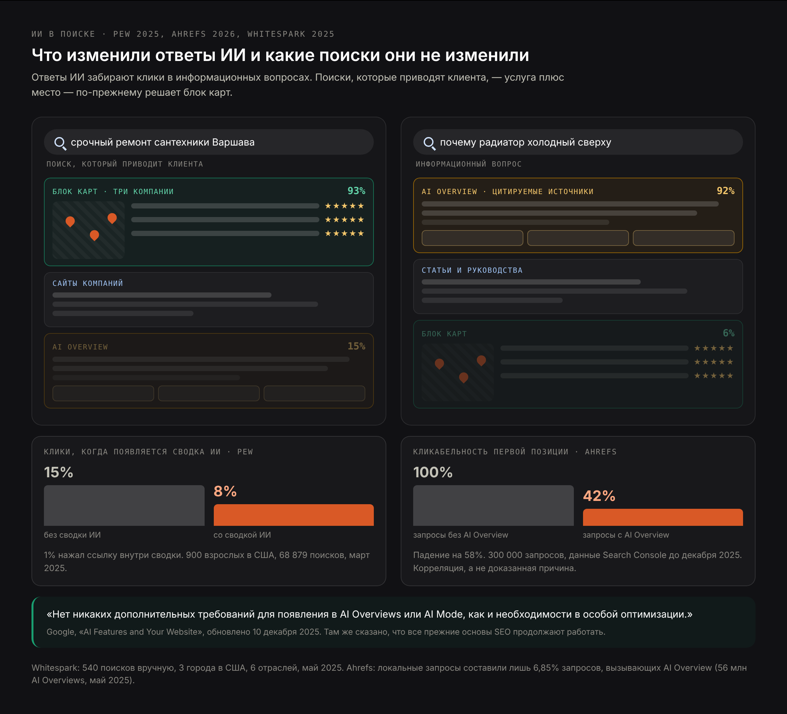
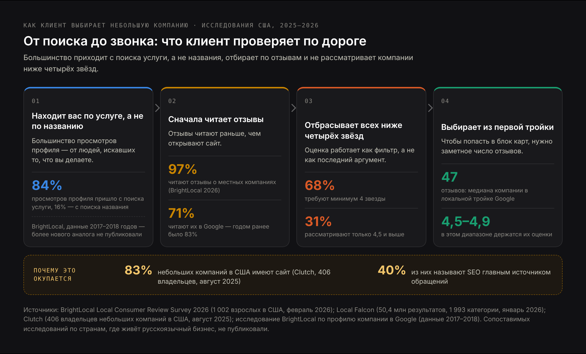
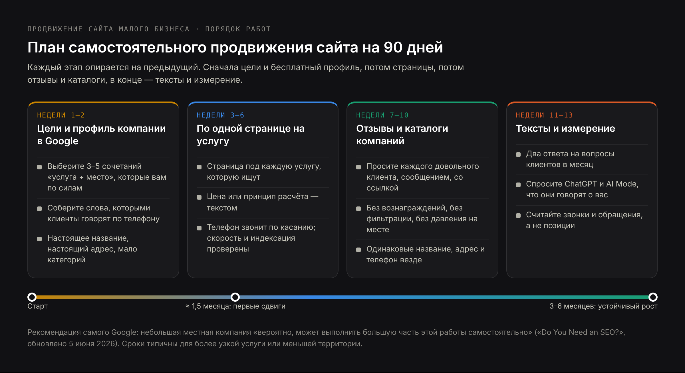
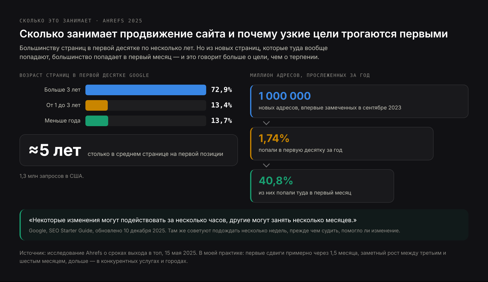

# ЧЕРНОВИК RU — «Как самому продвигать сайт» (29.10.2026). Адаптация английской статьи
# /mnt/user-data/outputs/blog-small-business-seo-EN.md под русскоязычного владельца небольшого
# бизнеса, который живёт и работает за пределами русскоязычного рынка: Польша, Германия, Чехия,
# Испания, Казахстан, Грузия, ОАЭ, США, Канада.
# Угол: «как продвигать сайт самому» — информационная, «сделай сам» половина коммерческой
# страницы /ru/prodvizhenie-saita-malogo-biznesa. Денежный вопрос раскрыт одним разделом
# (~180 слов) со ссылкой на отдельную статью /ru/blog/skolko-stoit-prodvizhenie-saita.
# Источники сохранены из EN без изменений, все американские исследования помечены как
# американские данные: Google «AI Features and Your Website» (обн. 10.12.2025), «Do You Need an
# SEO?» (обн. 05.06.2026), SEO Starter Guide (обн. 10.12.2025), спам-политики (обн. 28.08.2026),
# правила профиля компании и правила об отзывах; Pew Research Center (22.07.2025, 900 человек,
# 68 879 запросов); Ahrefs о CTR при AI Overview (04.02.2026, 300 000 запросов); Ahrefs о
# распространённости AI Overview (19.05.2025, 56 млн ответов); Semrush через PPC Land
# (21.10.2026, 400 коммерческих запросов); Whitespark (12.05.2025, 540 запросов вручную);
# Лиз Рид / блог Google (06.08.2025); BrightLocal Local Consumer Review Survey 2026 (11.02.2026,
# 1 002 человека); Local Falcon по отзывам (14.01.2026, 50,4 млн результатов) и по ресторанам в
# ChatGPT (03.03.2026, 189 905 результатов); Clutch по сайтам малого бизнеса (21.08.2025,
# 406 владельцев); LocaliQ/WordStream 2026 (13 474 кампании); Ahrefs о сроках ранжирования
# (15.05.2025); опрос Ahrefs о ценах (439 исполнителей, данные 2023–24, помечено в тексте);
# документация OpenAI о ботах; Kent Lewis / SEMA News (29.09.2011); Search Engine Roundtable
# (17.10.2018) и твит Ника Уилсдона (10.10.2018) для разбора цифры «46%».
# НЕ использовано (список из EN соблюдён): «46% поисков имеют локальный интент» как факт —
# вместо этого разбор происхождения цифры; рост запросов «рядом со мной» (нет источника после
# 2019 года); маркетинговый бюджет малого бизнеса в процентах от выручки (публичные данные есть
# только по крупным компаниям); утверждение «каталоги улучшают видимость в ИИ» (в источниках это
# предположение, а не измерение). BrightLocal GMB Insights использован один раз с прямой
# пометкой, что данные относятся к 2017–2018 годам.
# ИЗМЕНЕНО относительно EN и почему:
# — добавлен большой раздел о языке сайта и отдельный H3 о русскоязычной версии: у читателя
#   бизнес в стране, где язык поиска не русский, и это его главная проблема в выдаче; в EN эта
#   тема была одним пунктом списка про второй язык;
# — в профиле компании в Google добавлен H3 о названии, адресе и телефоне на языке страны;
# — каталоги-конкуренты названы европейскими и международными, без привязки к одному рынку;
# — к каждому американскому исследованию добавлена пометка о стране выборки и, где это так,
#   прямо сказано, что сопоставимого исследования по странам, где живёт русскоязычный бизнес,
#   не публиковали; никаких цифр по этим странам не придумано;
# — раздел о стоимости сокращён относительно EN до одного блока из-за каннибализации со
#   статьёй о цене; цены автора приведены в евро;
# — добавлена четвёртая иллюстрация (сроки), её в EN-файле нет;
# — добавлен девятый вопрос FAQ — о языке продвижения.
# НЕ УДАЛОСЬ адаптировать: локальные исследования поведения покупателей и цен на SEO по
# Польше, Германии, Чехии, Испании, Казахстану, Грузии, ОАЭ — публичных исследований с
# сопоставимой методикой нет, поэтому эти места описаны качественно, без цифр.
# H1 (Title) и Meta title различаются намеренно. H1 не повторяет и не начинается с H1
# коммерческой страницы /ru/prodvizhenie-saita-malogo-biznesa.

Title: Как самому продвигать сайт: пошаговое руководство для небольшого бизнеса
Slug: kak-samomu-prodvigat-sait
Meta title: Как продвигать сайт самостоятельно: план для владельца бизнеса
Meta description: Как продвигать сайт самому: порядок работ, язык сайта за границей, профиль в Google, отзывы, страницы услуг, видимость в ИИ-поиске, сроки и цены.

---

> Краткий ответ: продвигать сайт самому — значит сделать так, чтобы бизнес находили, когда человек ищет то, что вы продаёте: на Google Картах, в обычной выдаче и в ответах ИИ. Для небольшой компании всё сводится к пяти вещам: полностью и правильно заполненный профиль компании в Google, отдельная страница под каждую услугу, которую вы действительно продаёте, постоянный поток настоящих отзывов, страницы с ответами на вопросы, которые клиент задаёт до покупки, и быстрый сайт, с которого легко позвонить с телефона. Большая часть этой работы — решения о собственном бизнесе, а не техника. Отдельная тема для тех, кто ведёт дело не в своей языковой среде: язык сайта. Документация Google прямо говорит, что небольшой локальный бизнес «вероятно, может сделать большую часть работы самостоятельно».

Раз в несколько месяцев кто-нибудь объявляет, что SEO умерло. На этот раз причина — ИИ: Google отвечает на вопрос в верху страницы, ChatGPT отвечает вообще без страницы, и клики, которые раньше доходили до небольших сайтов, уходят куда-то ещё. Часть этого правда и измерена. Но то, что из этого следует делать небольшому бизнесу, с заголовками почти не совпадает.

Это руководство идёт по работам в том порядке, в котором я делал бы их сам: с данными под каждым решением и с правилами, из-за которых профили компаний действительно блокируют. Оно написано для владельца, который будет делать это своими руками или хочет понимать, за что платит. Если удобнее отдать работу, на странице [продвижение сайта малого бизнеса](/ru/prodvizhenie-saita-malogo-biznesa) описано, как я работаю.

Отдельно о читателе. Я работаю как консультант в одиночку, и чаще всего это русскоязычные предприниматели в странах, где живёт русскоязычный бизнес. У такого владельца есть сложность, которой нет у местного: основной язык поиска в его стране — не русский. Поэтому здесь есть раздел про язык сайта.

## Что входит в самостоятельное продвижение сайта малого бизнеса и чем оно отличается от SEO крупного сайта

**Продвижение сайта небольшой компании** — это обычная поисковая оптимизация, уменьшенная до масштаба бизнеса, у которого несколько услуг, одна или пара точек и ни одного человека, у которого маркетинг — полная занятость.

Метод тот же, что для любого сайта, но на практике отличаются четыре вещи.

- **Карты важнее сайта.** В запросах вида «услуга + город» внимание забирают три компании из блока Google Карт, а этот блок выигрывается через профиль компании в Google, а не через сайт.
- **Отзывы — часть ранжирования, а не только аргумент в продаже.** Они влияют и на то, что показывает Google, и на то, куда человек нажмёт.
- **Вы конкурируете с каталогами, а не только с конкурентами.** Yelp, Panorama Firm, Gelbe Seiten и их местные аналоги обходят отдельные компании по многим запросам, и это меняет понимание того, где стоит бороться.
- **Команды нет.** План из сорока задач — это план, который не случится. Порядок работ тут важнее их количества.

И одна вещь не отличается: документация Google для небольшого бизнеса короткая, бесплатная и конкретная, и её почти никто не читает. Несколько правил ниже взяты прямо оттуда.

И одно разграничение, которое экономит месяцы: продвижение сайта — это не создание сайта. Если на сайте нечего продвигать, порядок другой: сначала структура и страницы, потом видимость. Как выглядит сайт, собранный сразу под поиск, я описываю на странице [сайт для малого бизнеса](/ru/sait-dlya-malogo-biznesa); дальше я исхожу из того, что сайт у вас уже есть.

## Умерло ли SEO сайта из-за того, что ИИ отвечает на вопрос вместо выдачи

Это самый частый вопрос в теме, и он заслуживает данных, а не утешений. Честный ответ состоит из трёх частей, и они указывают в разные стороны.

### Что данные показывают о кликах на сайты при ИИ-ответах в поиске

Клики действительно уходят. Два независимых измерения совпадают, оба — американские.

- **Pew Research Center** отследил реальное поведение 900 взрослых американцев на 68 879 поисках в Google в марте 2025 года. Когда появлялась сводка от ИИ, к клику по результату приводили 8% визитов против 15% там, где сводки не было. По ссылке внутри самой сводки нажимали только **1%** пользователей, а 26% заканчивали сессию на этой странице против 16% без сводки.
- **Ahrefs** сравнил 300 000 запросов — половина с AI Overview, половина без — по данным Search Console с декабря 2023 по декабрь 2025 года. Кликабельность первой позиции по запросам с AI Overview оказалась ниже на **58%**. Сам Ahrefs аккуратно называет это корреляцией, а не доказанной причиной.

Позиция Google, которую в августе 2025 года высказала Лиз Рид, другая: «общий объём органических кликов из поиска Google на сайты год к году остаётся относительно стабильным», а качество этих кликов выросло. Цифр Google к этому утверждению не публикует, так что вы взвешиваете неизмеримое заявление заинтересованной стороны против двух измерений с опубликованными выборками. При этом строго говоря они не противоречат друг другу: Google говорит об общем объёме по всему интернету, а исследования — о вероятности клика по конкретному запросу.

Сопоставимого исследования по странам, где живёт русскоязычный бизнес, никто не публиковал — ни по Европе, ни по другим рынкам. Поэтому дальше я исхожу из того, что направление то же, а величины могут отличаться, и проверять их стоит на своём Search Console, а не на чужих процентах.

### Почему локальный поиск услуг остаётся исключением для сайта малого бизнеса

Теперь та часть, которая решает, относится ли всё перечисленное к вашему бизнесу.

**Whitespark** в мае 2025 года вручную отработал 540 запросов по трём американским городам и шести отраслям и разложил их по типу интереса. Для запросов вида «услуга + город» — тех, что приводят готового покупать человека, — AI Overview появлялся в **15%** случаев, а локальный блок Google Карт — в **93%**. Для информационных вопросов картина почти зеркальная: AI Overview — 92%, блок карт — 6%.

**Ahrefs** на 56 млн ответов AI Overview в мае 2025 года увидел тот же рисунок с другой стороны: AI Overview реже появляется на локальных и брендовых запросах, а локальные запросы составили лишь 6,85% от тех, что его вызывали.

То есть ИИ-ответ съедает информационный поиск — «как часто обслуживать котёл» — и пока в основном не трогает покупательский. Для сантехника первое — это трафик, а второе — клиенты.

Оговорка в том, что картина движется. **Semrush**, отслеживая 400 американских коммерческих запросов ежемесячно, нашёл AI Overview на 45,75% из них в сентябре 2025 года и на **88%** к августу 2026 года (данные приводит PPC Land; собственной публикации Semrush я не нашёл). Коммерческий поиск затягивает в ИИ-ответы быстро, даже если локальный ещё держится.

Практический вывод: если ваши деньги приходят с запросов «услуга + город», паниковать рано. Если они приходят с информационных статей, трафик будет падать, и менять надо содержание страниц, а не технику.

### Что документация Google говорит об оптимизации сайта под ИИ-функции

На этот вопрос есть прямой ответ, и он в документации Google, последнее обновление — 10 декабря 2025 года:

> «Нет никаких дополнительных требований для появления в AI Overviews или AI Mode, равно как и никаких особых оптимизаций».

На той же странице добавлено, что «лучшие практики SEO остаются актуальными для ИИ-функций в поиске Google» и что «все существующие основы SEO продолжают иметь смысл». Нет ни специального файла для ИИ, который надо добавить, ни особой разметки, ни отдельной технической настройки.

Это стоит знать до того, как покупать что-либо под названием «оптимизация под ИИ». Настоящая работа над видимостью в ИИ есть: проверять, что ассистенты говорят о вашей компании, править неверные данные в источнике и измерять это во времени. Я разбираю её ниже и подробно — в статье о том, [что такое GEO](/ru/blog/chto-takoe-geo). Но это не новый набор технических требований, и кто продаёт его как технический продукт, продаёт страницу настроек, которой, по словам Google, не существует.

## Как клиенты находят сайт малого бизнеса в 2026 году

До тактики — поведение. Цифры ниже из опросов и исследований выдачи 2025 и 2026 годов; все четыре — американские выборки.

- **Отзывы читают почти все.** В опросе BrightLocal Local Consumer Review Survey 2026, опубликованном в феврале 2026 года на выборке 1 002 взрослых американцев, **97%** сказали, что читают отзывы о локальных компаниях в интернете. **68%** требуют минимум четыре звезды, 31% рассматривают только 4,5 и выше, а 10% — только пять.
- **Есть видимый порог по числу отзывов.** Local Falcon в январе 2026 года разобрал 50,4 млн американских результатов поиска по 1 993 категориям бизнеса: у средней компании, попадающей в локальный блок из трёх позиций, **47 отзывов**, а рейтинги сосредоточены между 4,5 и 4,9. Конкуренция в городах выше, чем в сельской местности, в три-пять раз.
- **Google остаётся главным источником отзывов, но уже меньше.** В том же опросе BrightLocal **71%** назвали Google местом, где читают отзывы, — против 83% годом раньше.
- **Сайт есть у большинства небольших компаний, и поиск — их основной источник заявок.** Clutch в августе 2025 года опросил 406 американских владельцев небольшого бизнеса: у **83%** есть сайт, и из них **40%** называют SEO главным источником заявок. Из тех 17%, у кого сайта нет, треть считает, что сайт не нужен в их отрасли, а 16% ссылаются на стоимость.

Одну цифру постарше стоит привести вместе с её возрастом, потому что ничего новее не существует: исследование BrightLocal по данным профилей компаний в Google показало, что **84%** просмотров профиля приходили с поисков «на обнаружение» — человек искал услугу, а не конкретную компанию по названию, — против 16% тех, кто искал компанию прямо. Эти данные относятся к 2017–2018 годам, и сопоставимого исследования с тех пор не выходило, так что относитесь к ним как к направлению, а не как к сегодняшней цифре.

Чего в этих данных нет: сопоставимых опросов покупателей по Польше, Германии, Чехии, Испании, Казахстану, Грузии или ОАЭ с такой же методикой никто не публиковал, и подставлять сюда проценты, которых нет, я не стану. Качественно картина та же: сначала смотрят карты и рейтинг, потом открывают один-два сайта, а дальше решает, насколько быстро страница отвечает на «вы такое делаете, сколько стоит и как связаться».

### Откуда взялась цифра «46% поисков имеют локальный интент» и почему её не стоит повторять

Эту цифру вы встретите почти в каждой статье о локальном SEO, обычно со ссылкой на Google. Её путь стоит пройти целиком: он показывает, из чего сделана значительная часть маркетинговой статистики.

Цифра появилась в выступлении представителя Google на конференции Secrets of Local Search в штаб-квартире Google в Маунтин-Вью в октябре 2018 года. В отрасль она попала через твит SEO-специалиста Ника Уилсдона от 10 октября 2018 года, который неделей позже пересказал Барри Шварц в Search Engine Roundtable с необычно честной оговоркой: «Я доверяю источнику, но всё, что у меня есть, — это твит одного SEO-специалиста с этой цифрой». Там же он вслух задался вопросом, не определяет ли Google «локальный интент» каким-то своим способом.

Google никогда не публиковал ни само исследование, ни его методику. Формулировка плыла при пересказах — в одних источниках «локальные поиски», в других «локальный интент», а это не одно и то же, — и цифру восемь лет повторяют без изменений, хотя за это время сильно изменились и доля мобильных устройств, и Google Карты, и сама страница результатов.

Смысл не в том, что локальный поиск неважен: измерение Whitespark с его 93% блока карт свежее и говорит как раз об обратном. Смысл в том, что реплика на конференции, пересказанная третьим лицом, — не доказательство, а статистика, которую никто не обновлял восемь лет, ничего не говорит о сегодняшнем дне. Правило удобно применять к любой статье о продвижении, включая эту: если под цифрой нет выборки, года и метода, цифры нет.

## На каком языке делать сайт и страницы услуг, если бизнес работает за границей

Этого раздела нет в руководствах для местных владельцев, а для предпринимателя за границей он часто решает больше всего остального.

Исходное правило простое: **основной язык сайта — язык страны, где вы продаёте**, потому что спрос физически находится там. Человек, который ищет мастерскую в Варшаве, Праге, Берлине, Валенсии или Алматы, набирает запрос на том языке, на котором живёт и думает. Если ваших страниц на этом языке нет, вы отсутствуете в той выдаче, где сосредоточены деньги, как бы хорошо ни был сделан сайт на русском.

Из этого следуют вполне конкретные вещи.

- **Страницы услуг — на языке страны, по одной на услугу.** Это ваш основной коммерческий слой. Именно здесь работают запросы вида «услуга + город», именно здесь появляется блок карт, именно эти страницы вы указываете в профиле компании в Google.
- **Текст должен читаться как написанный носителем.** Страница на языке страны, собранная машинным переводом, ранжироваться может, а продавать — плохо: клиент читает две фразы и решает, что здесь не разберутся с его задачей. Рабочее решение — написать смысл самому, а вычитку отдать носителю языка: это однократные деньги, а не подписка.
- **Запросы собираются отдельно на каждом языке.** Прямой перевод ключевого слова почти всегда даёт не ту формулировку, которую набирают: названия услуг в каждом языке свои, и проверять их надо подсказками поиска, а не словарём.
- **Один язык — один адрес страницы.** Отдельный URL на каждую языковую версию и разметка hreflang. Страница, где половина абзацев на одном языке, а половина на другом, проигрывает обеим одноязычным.

### Русскоязычная версия сайта: когда она нужна и почему конкуренция на ней ниже

Русская версия нужна в одном случае — **если ваши клиенты русскоязычные**. У множества небольших компаний это именно так: мастер, стоматолог, юрист, бухгалтер, строитель, который работает в основном с русскоязычной диаспорой своего города. Тогда русская версия не «приятное дополнение», а канал, в котором клиент готов платить и доверять быстрее, потому что ему важно объясниться без усилий.

Если же клиенты у вас местные, а русская версия сделана «для себя», она денег не принесёт и внимания не стоит.

Там, где русскоязычный спрос есть, у него есть особенность, которую я вижу постоянно: **конкуренция на русском в такой стране обычно в разы ниже, чем на языке страны**. Местных компаний с нормальной русской страницей услуги мало, диаспорных сайтов мало, каталоги на русский почти не переведены. Открытых исследований об этом нет, и цифру я не придумаю, но проверяется это за десять минут: наберите свою услугу с названием города по-русски и посмотрите выдачу. Часто там нет ни одной нормальной страницы под запрос.

Порядок такой: сначала язык страны, потому что там объём; затем русская версия по тем же услугам, потому что там дешёвый выход в топ. Частотность русских запросов в одном городе маленькая — десятки в месяц, иногда единицы. Отказываться из-за этого не стоит: порог я ставлю на уровне нескольких запросов в месяц, потому что при такой конкуренции даже маленький объём окупает страницу, а человек в этих запросах уже выбирает, а не изучает.

### Название, адрес и телефон в профиле компании в Google — на языке страны

Правило здесь жёсткое и от языка ваших клиентов не зависит. **Название, адрес и телефон в профиле компании в Google заполняются на языке страны** — ровно так, как они записаны в документах, на вывеске и в счетах. Требование Google прямое: название должно отражать «реальное название компании, как оно последовательно используется на вашей витрине, сайте, фирменных бланках».

То есть если фирма зарегистрирована как «Kowalski Serwis», в профиле стоит «Kowalski Serwis», а не «Автосервис Ковальский». Адрес — в местном написании улицы: по нему вас сопоставляют с картой и с другими упоминаниями. Телефон — местный, в местном формате.

Русский язык в профиле место находит, просто не в названии: в описании компании, в ответах на вопросы и в разделе языков обслуживания можно и нужно указать, что вы говорите по-русски. И следствие, о котором забывают: написание названия, адреса и телефона должно совпадать на сайте, в профиле и во всех каталогах. Если на сайте название переведено, а в профиле нет, вы своими руками создаёте то расхождение, которое мешает локальной выдаче.

## Раскрутка сайта своими силами: в каком порядке делать работы

Небольшая компания не может делать всё и не должна. Это последовательность, которой я бы придерживался; каждый шаг опирается на предыдущий.

### Как выбрать запросы, которые сайт малого бизнеса реально может занять

Самая частая потеря сил в продвижении небольшого сайта — целиться в самую очевидную фразу. «Сантехник» в столице занят франшизами и каталогами с бюджетами, которых у вас нет. Выигрывать начинают там, где конкуренция тоньше, а ваш опыт настоящий.

- **Более узкая услуга**: «замена котла», а не «сантехнические работы»; «проверка договора аренды помещения», а не «юридические услуги».
- **Меньшая территория**: район или город, где вы на самом деле работаете, а не вся агломерация.
- **Язык**: если часть ваших клиентов говорит на другом языке, страница на этом языке встречает долю той конкуренции, что есть на основном.
- **Вопрос, на который никто нормально не отвечает**: посмотрите выдачу по тому, что клиенты спрашивают у вас по телефону. Если сверху пустые страницы каталогов — это ваш вход.

Выпишите три-пять сочетаний услуги и места: всё дальнейшее строится вокруг них.

### Ключевые слова для сайта малого бизнеса: что клиенты набирают перед покупкой

Владельцы описывают свою работу профессиональными словами, а клиенты описывают свою проблему. Никто не ищет «договор на профилактическое обслуживание систем кондиционирования» — ищут «из кондиционера плохо пахнет». Нормальные ключевые слова берутся из трёх мест.

1. **Ваши собственные обращения.** Точные слова, которыми люди пишут и звонят. Это лучшие ключевые слова, и ни в одном инструменте их нет.
2. **Подсказки самого Google.** Начните набирать вопрос клиента и прочитайте автодополнение, блок «Похожие вопросы» и связанные запросы в низу страницы. Это бесплатно. Делать это надо в том языке и в той стране, где вы продаёте, — выдача подсказок у разных локалей разная.
3. **Инструмент подбора — только для сравнения.** Чтобы выбрать между двумя формулировками, подойдёт любой. Частотность по небольшим городам инструменты часто показывают нулевой, и это не значит, что никто не ищет; это значит, что инструмент не умеет мерить так мелко.

Группируйте фразы по проблеме, а не по словам: «аварийный сантехник», «прорвало трубу» и «течёт с потолка» — одна проблема и одна страница.

### Профиль компании в Google: правила, из-за которых профили блокируют

Для локального поиска это важнее всего, что есть на вашем сайте, а в правилах Google есть конкретные пункты, которые нарушают постоянно.

- **Название — только настоящее название.** Google: «Ваше название должно отражать реальное название компании, как оно последовательно используется на вашей витрине, сайте, фирменных бланках», и «Добавление лишней информации в название компании не допускается». «Kowalski Serwis — круглосуточно, Варшава, дёшево» — заявка на блокировку; «Kowalski Serwis» — нет.
- **Адрес должен быть настоящим.** Виртуальный офис «не подходит для профиля компании», абонентские ящики не принимаются, а стол в коворкинге не годится, «если в этом офисе нет чёткой вывески».
- **Если вы выезжаете к клиенту, оформите это правильно.** Компания с зоной обслуживания держит один профиль, скрывает адрес и задаёт зону, которая «не должна выходить за пределы примерно двух часов езды».
- **Категорий — минимум.** Google просит «использовать как можно меньше категорий для описания основного направления бизнеса» и предупреждает против использования их «исключительно как ключевых слов».
- **Заполните остальное.** Часы работы, телефон, ссылка на нужную страницу сайта, языки обслуживания, настоящие фотографии и ответы на вопросы, которые клиенты действительно задают.

Дальше сделайте название, адрес и телефон одинаковыми на сайте, в профиле и в каждом каталоге. Расхождения здесь — одна из немногих чисто механических вещей, которые до сих пор тормозят локальную выдачу. Профиль — только половина локальной картины: как блок карт и сайт работают вместе, я разбираю на странице про [локальное SEO-продвижение](/ru/uslugi/lokalnoe-seo-prodvizhenie).

### Отдельная страница сайта под каждую услугу, которую вы продаёте

Одна страница «Услуги» со списком из восьми пунктов не ранжируется ни по одному из них. Каждой услуге, которую клиент ищет отдельным запросом, нужна своя страница, и этой странице недостаточно подтвердить, что вы такое делаете.

- **Назовите проблему словами клиента** — в заголовке и в первом предложении.
- **Сразу ответьте на первый вопрос**: как идёт работа, сколько занимает, что происходит при первом обращении.
- **Напишите, сколько это стоит**, или хотя бы как считается цена. Клиенты сравнивают именно по этому, и это ровно тот тип факта, который цитируют ИИ-ответы.
- **Покажите, кто делает работу** — настоящее имя и настоящая фотография сильнее любого стока.
- **Закончите одним понятным действием**: телефон, который набирается по нажатию, и короткая форма.

Если вы работаете в нескольких городах, та же логика относится и к местам: по странице на город, где вы действительно работаете, и с содержанием, которое действительно про этот город. Копии одной страницы с подменённым названием города — это то, что спам-политики Google теперь называют **doorway abuse**, и они тянут вниз остальной сайт.

### Отзывы о компании: как просить их, не нарушая правила Google

Отзывы двигают и ранжирование, и решение клиента, поэтому им нужна рутина, а не удача. Правила Google о том, что можно и чего нельзя, сформулированы прямо, и две распространённые тактики запрещены.

- **Никаких поощрений.** Нельзя «предлагать стимулы — например, оплату, скидки, бесплатные товары и(или) услуги» за отзыв, а также за изменение или удаление плохого.
- **Никакого фильтра перед отзывом.** Нельзя «препятствовать негативным отзывам или запрещать их, а также выборочно запрашивать положительные отзывы у клиентов». Просить только тех, от кого вы ждёте похвалы, — нарушение, сколько бы инструментов ни предлагали это автоматизировать.
- **Никакого давления на месте.** Нельзя «требовать от пользователей или принуждать их оставлять оценки или писать отзывы, находясь на территории компании», и нельзя ставить сотрудникам план по отзывам.

Разрешён простой вариант: Google позволяет «запрашивать или поощрять публикацию контента, который действительно отражает реальный опыт». Просите каждого клиента в момент, когда работа закончилась хорошо, давайте прямую ссылку и спрашивайте сообщением, а не письмом. Учитывая, что у средней компании из локального блока 47 отзывов, ровный ручеёк полезнее разовой кампании.

На плохие отзывы отвечайте, не споря: спокойный конкретный ответ читают все, кто придёт после, и это единственная часть негативного отзыва, которой вы управляете. Отвечайте на том языке, на котором написан отзыв, — ответ на другом читается как чужой голос.

### Статьи на сайте, которые отвечают на вопросы клиентов до покупки

Статьи для небольшой компании — это не новости о компании. Это ответы на вопросы, которые человек задаёт до того, как выберет кого-либо: «сколько стоит заменить котёл», «нужно ли на это разрешение», «что будет, если я откажусь». Каждый хороший ответ — это возможность ранжироваться, попасть в цитату ИИ-ответа и сэкономить себе телефонный разговор.

Правила, при которых это работает:

- **Один вопрос — одна страница**, ответ в первых двух предложениях, дальше объяснение по-человечески.
- **Привязка к месту, где вы работаете** — местное правило, местный диапазон цен, местный порядок действий. Общие тексты «для всех стран» уже опубликовали каталоги.
- **Написано или проверено тем, кто делает эту работу**, с датой последней проверки.
- **Со ссылкой на страницу услуги**, где читатель может действовать.

Два подробных ответа в месяц дадут больше, чем ежедневные посты для заполнения календаря. И стоит помнить, что спам-политики Google говорят об объёме: scaled content abuse — это «использование инструментов генеративного ИИ или других похожих инструментов для создания множества страниц без добавления ценности для пользователей». Проверяется ценность, а не инструмент.

### Ссылки на сайт и упоминания, которые малый бизнес может получить честно

Ссылки с других сайтов остаются сильным сигналом, и для небольшой компании реальные ссылки — не купленные:

- поставщики и производители, чьё оборудование вы ставите: у них часто есть списки авторизованных мастеров;
- отраслевые объединения и сертифицирующие организации, в которых вы состоите;
- местная пресса — когда вы тот человек, который может что-то объяснить по делу;
- организации, команды и события, которые вы поддерживаете;
- партнёры, с которыми вы уже работаете, где уместно честное упоминание.

Сюда же относятся местные деловые объединения, профильные сообщества города и диаспорные ресурсы, если они живые и их читают.

Пакетов ссылок и массовых гостевых статей избегайте. Они против спам-политик Google, а сайты, которые их продают, — ровно те, чьи ссылки Google обесценивает.

## Техническая проверка сайта малого бизнеса, которую владелец может сделать сам

Чтобы найти типовые проблемы, код читать не нужно.

- **Скорость на телефоне.** Прогоните основные страницы через PageSpeed Insights в мобильном режиме. Обычные виновники — слайдеры, видео на фоне и карусели стоковых фотографий.
- **Телефон набирается по нажатию** на каждой странице, а форма действительно уходит в ящик, который кто-то читает. Проверьте сами, со своего телефона.
- **Все важные страницы в индексе.** В Search Console откройте отчёт «Страницы»; или наберите в Google `site:вашдомен.com` и посмотрите, что вернётся.
- **Один адрес на страницу.** Сайт отвечает на одной версии — с «www» или без, всегда по https, — а остальные версии перенаправляют на неё.
- **Базовая разметка данных** с названием, адресом, телефоном и часами работы, согласованная с тем, что видно на странице.
- **Никаких звёзд из собственных отзывов.** Google не показывает в выдаче звёзды рейтинга для отзывов, которые компания собирает и публикует сама о себе, поэтому разметка под них не помогает.
- **Языковые версии размечены.** Проверьте, что hreflang стоит, адреса разные и ни одна версия не перенаправляет пользователя по языку браузера: автоподстановка языка регулярно ломает индексацию обеих версий.

Если по списку всплыло больше, чем хочется править поштучно, дело обычно в самом сайте, а не в настройках.

## Видимость сайта малого бизнеса в ИИ-поиске: ChatGPT и AI Overviews (GEO, AEO)

Быть видимым для ассистентов — та же работа плюс несколько частностей, где легко ошибиться.

**Пустите нужных краулеров.** У OpenAI их несколько, и у них разные задачи; это из документации самой OpenAI.

| Краулер | Что делает | Что значит его блокировка |
|---|---|---|
| OAI-SearchBot | Строит индекс, на котором работает поиск в ChatGPT | Вас не показывают в поисковых ответах ChatGPT |
| ChatGPT-User | Загружает страницу, когда она нужна для ответа на вопрос пользователя | Заходы инициированы пользователем, поэтому robots.txt «может не применяться» |
| GPTBot | Собирает контент, который может использоваться для обучения моделей OpenAI | Ваш контент не используется для обучения — на поиск в ChatGPT это не влияет |

Практическое следствие: блокировка GPTBot **не** убирает вас из ChatGPT. Блокировка OAI-SearchBot — убирает. Многие плагины безопасности и фаерволы хостингов по умолчанию закрывают неизвестных ботов, так что это стоит проверить, а не предполагать.

**Пишите факты текстом.** Цены, зона обслуживания, часы работы, языки обслуживания и квалификации должны быть в тексте страницы, а не на картинке и не в PDF. Ассистенты цитируют то, что написано.

**Для многоязычного сайта — факты на каждом языке.** Ассистент отвечает на языке вопроса и опирается на то, что нашёл на этом языке. Если цены и зона обслуживания есть только на одной версии, на другом языке вас не процитируют.

**Ожидайте, что сначала вас не будет видно, и измеряйте это.** Local Falcon разобрал 189 905 результатов ChatGPT по ресторанным запросам в феврале 2026 года и обнаружил, что **83%** отслеживаемых им ресторанов не появлялись в локальных рекомендациях ChatGPT никогда против 14% невидимых в Google. Это исследование вендора по одной отрасли на неслучайной выборке, так что к точной цифре стоит относиться осторожно, но направление совпадает с тем, что находит каждый, кто это проверяет. Узнать можно только спросив: возьмите пять вопросов, которые задали бы ваши клиенты, задайте их ChatGPT и AI Mode в Google из разлогиненного окна и выпишите, кого называют и какие сайты цитируют. Делайте это на обоих языках — результаты будут разные.

Как ChatGPT выбирает, что цитировать, — отдельная большая тема, и я прохожу по ней в статье про [SEO для ChatGPT](/ru/blog/seo-dlya-chatgpt).

## SEO сайта, Google Ads или профиль компании в Google: что выбрать малому бизнесу

Это не альтернативы, они работают на разных часах.

| | Как вы платите | Когда приходят заявки | Что важно знать |
|---|---|---|---|
| Google Ads | За клик | С первого дня | По 13 474 американским кампаниям в бенчмарках LocaliQ за 2026 год средний клик стоил **5,42 $**, средняя заявка — **66,69 $**. Останавливается в тот день, когда кончается бюджет |
| SEO сайта | Своим временем или месячной оплатой | Первые сдвиги примерно через 1,5 месяца | Продолжает работать, когда вы перестали платить; медленнее в конкурентных услугах и крупных городах |
| Профиль компании в Google | Бесплатно | В течение нескольких дней после того, как он заполнен и верен | Самая высокая отдача из трёх для локального бизнеса и самое частое упущение |

Для большинства небольших компаний разумная последовательность такая: сначала полный профиль, потому что это бесплатно и быстро; потом SEO по услугам, которых хочется больше; реклама — только на срочные дыры.

Приведённые американские цифры к вашей стране напрямую не относятся: смотреть надо статистику своего аккаунта. В многоязычной ситуации клик в русской кампании обычно дешевле — за него меньше соревнуются.

## Сколько времени занимает продвижение сайта малого бизнеса

Честные ожидания — из единственного крупного исследования, которому я доверяю.

Ahrefs разобрал 1,3 млн американских запросов и обнаружил, что **72,9%** страниц в топ-10 старше трёх лет, что средняя страница на первой позиции существует около пяти лет, а младше года — только **13,7%** страниц из топ-10. Из миллиона адресов, впервые увиденных в сентябре 2023 года, в топ-10 за год вышли **1,74%** — но из тех страниц, которые туда попали, **40,8%** сделали это в первый же месяц.

Последняя цифра и есть полезная. Ранжирование — не медленная шлифовка для каждой страницы: оно либо происходит довольно быстро для страницы, нацеленной на достижимое, либо не происходит совсем для страницы, нацеленной на то, что никогда не было в пределах досягаемости. Это и есть аргумент за узкие цели.

Документация Google согласна по форме: «Некоторые изменения могут вступить в силу за несколько часов, другие — занять несколько месяцев», и «вероятно, вам стоит подождать несколько недель, чтобы оценить, дала ли ваша работа положительный эффект».

В моей практике картина устойчивая: первые сдвиги примерно через полтора месяца, заметный рост — между третьим и шестым месяцем, дольше на конкурентных рынках. На русской версии первые позиции часто приходят раньше: соперничать почти не с кем.

## Сколько стоит продвижение сайта малого бизнеса и за что стоит платить при маленьком бюджете

Стандартной цены нет, но есть распределение. Ahrefs опросил 439 исполнителей и проверил их сайты: самая частая месячная оплата — **501–1 000 $**, и **68,8%** брали 2 000 $ в месяц или меньше. Самая частая часовая ставка — 75–100 $, самая частая стоимость проекта — 2 501–5 000 $. Это американский опрос рынка, проведённый в 2023 году и обновлённый в 2024-м, так что читайте его как форму рынка, а не как сегодняшние цифры.

Для сравнения мои: аудит от 250 €, постоянная работа от 800 € в месяц. Счёт я выставляю в евро, по договорённости — в другой валюте. На странице [цен](/ru/ceny) указано, что входит в каждый вариант, а в статье про то, [сколько стоит продвижение сайта](/ru/blog/skolko-stoit-prodvizhenie-saita), разобрано, что именно поднимает и опускает эту сумму.

Три вещи стоят денег даже при маленьком бюджете: аудит, который говорит, реален ли поиск как канал для вашего бизнеса вообще; разовые технические правки, которые он найдёт; и человек, который нормально напишет страницы услуг, если писать — не ваша сильная сторона. Всё остальное в этом руководстве можно сделать самому.

## Мифы о продвижении сайта: правило 80/20, три «C» и «SCO»

Три вещи, которые ищут в этой теме и которые заслуживают прямого ответа.

**«Что такое правило 80/20 в SEO?»** Это принцип Парето — общее наблюдение, что малая доля причин даёт большую часть результата, — приложенный к SEO маркетологами. В документации Google он не встречается и не опирается ни на одно исследование по SEO. Как напоминание делать те несколько вещей, которые важны, он годится. Как закон о работе поиска — нет.

**«Что такое три „C“ в SEO?»** Обычно это content, code и credibility — содержание, код и доверие. Формулировка отслеживается до Кента Льюиса из Anvil Media, писавшего в SEMA News в сентябре 2011 года. Это удобный способ организовать разговор, и это не концепция Google.

**«Что означает SCO в бизнесе?»** В запросах про сайты это почти всегда опечатка в слове SEO. Само по себе SCO обычно означает Шанхайскую организацию сотрудничества или компанию-разработчика Unix из девяностых.

Значения всё это почти не имеет, кроме одного: по таким словам удобно оценивать того, кого вы читаете. Статья, построенная на именованных фреймворках и правилах из круглых чисел, обычно пересказывает другие статьи.

## Ошибки в продвижении сайта малого бизнеса, которые стоят клиентов

- **Ключевые слова, вписанные в название профиля компании в Google.** Работает недолго, потом профиль правят или блокируют, а снятие блокировки занимает недели.
- **Виртуальный офис, чтобы появиться в другом городе.** По правилам Google не подходит.
- **Страницы под города, которые отличаются только названием города.** Doorway abuse по спам-политикам.
- **Фильтр перед отзывом** — просить только тех клиентов, от которых ждёшь похвалы. Запрещено прямым текстом.
- **Купленные отзывы.** Против правил Google и, в большинстве европейских стран, против потребительского законодательства.
- **Одна страница на всё, что вы делаете.** Она не ранжируется ни по чему.
- **Форма обратной связи, которую никто не проверял с момента запуска сайта.** Здесь теряется больше заявок, чем на любой проблеме с позициями.
- **Сайт только на русском в стране, где ищут на другом языке.** Самая дорогая ошибка из этого списка: вы невидимы в той выдаче, где находится основной спрос.
- **Машинный перевод страниц услуг на язык страны без вычитки.** Ранжироваться может, продавать — почти нет.
- **Оплата «оптимизации под ИИ» как отдельного технического продукта.** Документация Google говорит, что дополнительных технических требований нет.

## Что в продвижении сайта делать самому, а что отдать специалисту

Google высказывается об этом прямее, чем хотелось бы большинству консультантов. Со страницы о том, нужен ли вам SEO-специалист, обновлённой в июне 2026 года: если у вас небольшой локальный бизнес, «вы, вероятно, можете сделать большую часть работы самостоятельно».

Это совпадает с тем, что я вижу. Профиль, отзывы, регистрации в каталогах, страницы услуг и ответы на вопросы клиентов — это решения о вашем собственном бизнесе, и никто не знает их лучше вас. Один вечер в неделю на пару месяцев закрывает большую часть.

Внешняя помощь отрабатывает деньги в четырёх местах: аудит, который прямо говорит, может ли поиск работать для вашего бизнеса; технические правки, для которых нужен человек, умеющий нормально править сайт; тексты в конкурентных услугах и на неродном для вас языке; и измерение, которое связывает поиск с реальными обращениями, а не с позициями. Для бизнеса такого размера это обычно один человек, а не агентство: как это выглядит на практике, описано на странице [частный SEO-специалист](/ru/uslugi/chastnyi-seo-specialist).

Если вы всё же нанимаете исполнителя, спросите вот что.

1. Кто именно будет делать работу и будете ли вы говорить с этим человеком?
2. Что будет сделано в первые три месяца, по страницам?
3. Что измеряется — позиции или звонки и заявки?
4. Кому принадлежат сайт, тексты и профиль компании в Google, если вы расходитесь?
5. Строит ли исполнитель ссылки и откуда?

И шестой вопрос для ситуации «бизнес за границей»: кто напишет тексты на языке страны и кто их вычитает. Ответ «переведём» означает слабые страницы услуг ровно там, где они должны продавать.

Насторожить должны гарантии первых мест, годовые договоры, подписанные до того, как хоть что-то показано, и любая схема, при которой ваш профиль компании в Google остаётся под аккаунтом исполнителя.

## Частые вопросы о продвижении сайта малого бизнеса

**В чём польза SEO для небольшой компании?**
Клиенты, которые находят вас через поиск, ищут именно то, что вы продаёте, и именно в тот момент, когда им это нужно; и они продолжают приходить после того, как вы перестали платить, в отличие от рекламы, которая останавливается в день окончания бюджета. В опросе Clutch 2025 года среди 406 американских владельцев небольшого бизнеса 40% тех, у кого есть сайт, назвали SEO главным источником заявок.

**Умерло ли SEO из-за ИИ?**
Нет, но оно разделилось. На информационных вопросах ИИ-ответы забирают большую часть кликов: Pew измерил падение кликабельности с 15% до 8% при появлении сводки от ИИ. На локальных покупательских запросах по-прежнему доминируют карты — Whitespark нашёл AI Overview в 15% запросов «услуга + город» против блока карт в 93%. Документация Google утверждает, что особой оптимизации под ИИ-функции не требуется и что обычное SEO продолжает работать.

**На каком языке продвигать сайт, если я живу не в русскоязычной стране?**
Основной язык — язык страны, где вы продаёте: там находится спрос, и там работают запросы «услуга + город». Русская версия нужна, если ваши клиенты русскоязычные; в этом случае она обычно встречает в разы меньшую конкуренцию и быстрее выходит в топ. Название, адрес и телефон в профиле компании в Google при этом всегда на языке страны.

**Как новичку изучить SEO?**
Начните с собственного руководства Google — SEO Starter Guide: оно бесплатное, короткое и у него нет интереса вам что-либо продать. Потом сделайте первые три шага этого руководства на своём бизнесе. Читать дальше, ничего не делая, — обычный способ потратить год на изучение SEO и ничего не изменить.

**Сколько стоит продвижение сайта небольшой компании?**
В американском опросе Ahrefs среди 439 исполнителей 68,8% брали 2 000 $ в месяц или меньше, самый частый диапазон — 501–1 000 $; данные 2023–24 годов. Моя работа начинается от 250 € за аудит и от 800 € в месяц за постоянное ведение.

**Через сколько SEO начинает работать?**
Первые сдвиги ждите примерно через полтора месяца, заметный рост — между третьим и шестым месяцем. Ahrefs обнаружил, что из новых страниц, которые всё же выходят в топ-10 в течение года, 40,8% попадают туда в первый месяц: страница, нацеленная на достижимое, двигается рано, а страница, нацеленная слишком высоко, обычно не двигается вообще.

**Нужен ли мне блог?**
Блог с новостями компании — нет. Нужны ответы на вопросы, которые клиенты задают перед покупкой, каждый со ссылкой на ту страницу услуги, которую он поддерживает. Двух в месяц большинству небольших компаний достаточно.

**Можно ли писать сайт с помощью ИИ?**
Для черновиков и структуры — да. Для публикации без вычитки — нет: спам-политики Google называют «использование инструментов генеративного ИИ или других похожих инструментов для создания множества страниц без добавления ценности для пользователей» нарушением. Проверяется не инструмент, а то, стоит ли страницу читать. На неродном языке ИИ-черновик нормален, публикация без носителя — нет.

**Стоит ли SEO усилий, если я работаю в одном городе?**
Обычно да, и даже больше, а не меньше. Конкуренция в одном городе — доля от конкуренции в агломерации, блок карт появляется почти на каждом локальном запросе, а профиль компании в Google ничего не стоит. Это как раз тот случай, когда небольшая компания регулярно обходит в выдаче гораздо более крупные.

## С чего начать продвижение сайта на этой неделе

Откройте профиль компании в Google и сравните название с вывеской и документами: уберите всё, что не является реальным названием компании, и проверьте категории, часы работы и адрес.

Потом выпишите три услуги, которых вам больше всего хочется, и найдите каждую со своего телефона — дважды, на языке страны и на русском. Запишите, кто появляется в блоке карт и в выдаче в каждом случае: именно эти две выдачи и есть ваше поле работы.

И попросите последних пять довольных клиентов оставить отзыв, прямой ссылкой, сообщением.

Эти три дела ничего не стоят и занимают вечер. Зато они показывают, где вы находитесь, — а это больше, чем даёт большинство аудитов. Если хочется, чтобы на остальное посмотрел кто-то со стороны, [напишите мне](/ru/kontakty): пришлите сайт, основную услугу и территорию, которую вы охватываете, и я скажу, что сделал бы первым — включая, если это окажется честным ответом, что поиск вам не подходит как канал.
