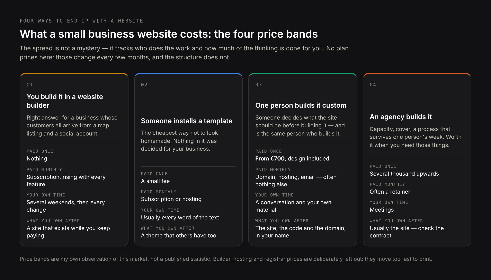
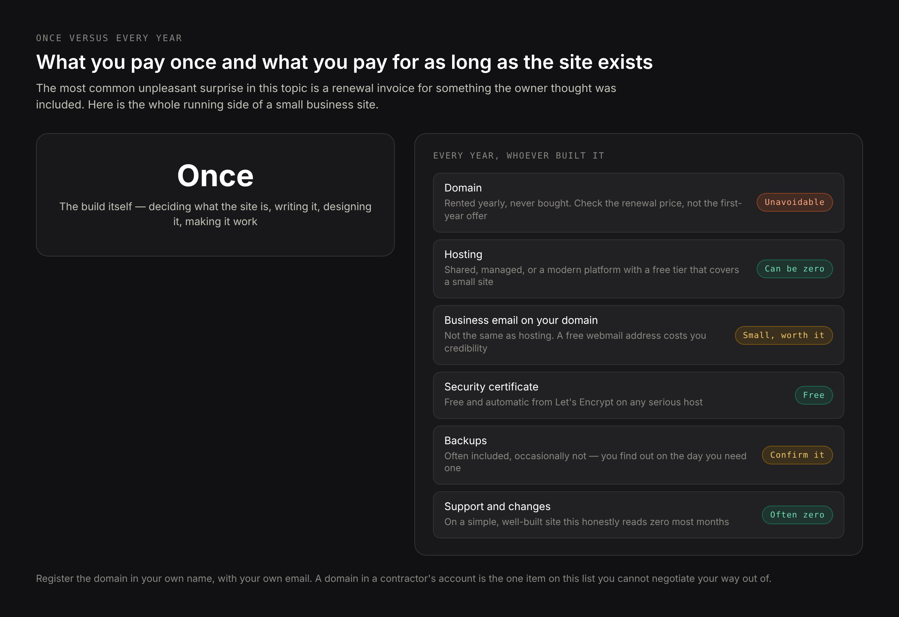
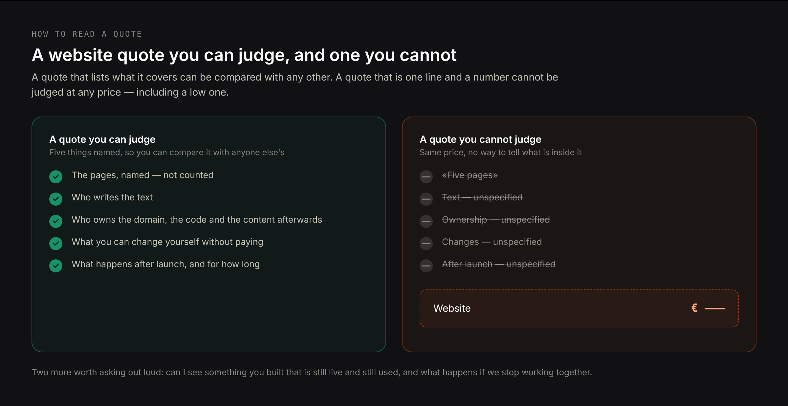

# DRAFT EN — «How much a small business website costs» (29.10.2026). Proposal 16 in
# claude/blog-articles.md. Core: research/pseo/page-core/small-business-website-cost.md
# — on-topic cluster ≈3 020, eleven phrasings at 210 each («small business website
# cost», «how much does a small business website cost», «cost of website for small
# business»…), «average» family 510, «how much does a website cost per month» 480,
# domain questions 590 + 480, «how much does it cost to maintain a website» 210.
# Intent: research/pseo/intent-check-small-business-website-cost.md — 0 shared URLs
# with «small business website design» (the landing page), 0 with «beauty salon
# website cost» (the industry articles), 0 with SEO pricing, 1 with website builders.
#
# DELIBERATE: the article targets «website cost» wording, NOT «website DESIGN cost».
# The whole «average cost of website design for small business» family (320+320+210+
# 90+90 and country tails) was classified as belonging to the design landing page;
# using that wording here would put two of our own pages against each other.
#
# H1 must NOT repeat the landing page H2 «How much does a small business website cost»
# (/small-business-website-design). Same clash exists in PL and RU — see those drafts.
#
# PAA used as sections: «Is $1500 a good price for a website?», «What is a fair price
# for a website?», «What is the average cost of a 5 page website?», «How much does it
# cost to have someone make a website for my business?», «Can ChatGPT actually create
# a website?», «How often should a website be redesigned?»
#
# ON NUMBERS: vendor plan prices (Wix, Squarespace, hosting, registrars) are NOT quoted
# as figures. They change every few months and were not verified for this draft, so the
# article teaches the structure of the cost and sends the reader to the vendor's own
# pricing page. The only figures used are ones that are sourced and dated:
#   — Clutch, 21.08.2025, 406 US small business owners: 83% have a website; of those
#     without, 34% say it is not relevant to their industry, 16% cite cost; 40% of
#     those with a site name SEO as top lead source. (Verified 29.10.2026.)
#   — Google spam policies, updated 28.08.2026, «scaled content abuse». (Verified.)
#   — Google «Do You Need an SEO?», updated 05.06.2026. (Verified.)
#   — Owner's own prices: audit from €250, website from €700 with design included,
#     ongoing SEO from €800/month, business-card site 2–3 weeks, invoices in EUR.
# Price bands are given as the author's own observation of this market and framed as
# such — not as a statistic, not attributed to a study.
#
# NOT used: any «average website cost» figure from agency marketing pages; builder plan
# prices; freelancer rate surveys — none were verified for this draft.

Title: How Much a Small Business Website Costs: Real Prices, Hidden Costs and What Drives Them
Slug: small-business-website-cost
Meta title: Small Business Website Cost in 2026: What You Actually Pay
Meta description: What a small business website costs in 2026, what the quote leaves out, what you pay every month after launch, and how to tell a fair price from a bad one.

---

> Quick answer: A small business website in 2026 costs anywhere from almost nothing to tens of thousands, and the spread is not a mystery — it tracks who does the work and how much of it there is. Doing it yourself on a website builder costs a subscription and your weekends. One freelancer or a small studio building a custom site for a small business usually starts in the high hundreds of euros and runs into the low thousands. An agency starts where that ends. On top of whatever you pay once, every website has a running cost that nobody puts in the quote: a domain, hosting, email, and whatever you pay someone to keep it working. My own starting price is €700 with design included, and the rest of this article is about why the same site can cost ten times that somewhere else.

The honest problem with this question is that most answers to it are written by someone selling the answer. Website builders publish articles concluding that websites are cheap. Agencies publish articles concluding that cheap websites are expensive. Both are right about the other and wrong about themselves.

I build small business websites for a living, so I am not neutral either. What I can do instead is show you the whole structure of the cost — including the parts that appear a year later — and tell you my prices plainly, so you can measure everything else against something concrete.

## What a small business website costs in 2026: the four price bands

There are four ways a small business ends up with a website, and they cost very different amounts for reasons that are not arbitrary.

### Building it yourself on a website builder: a subscription plus your weekends

You pay a monthly subscription and nothing else, apart from your own time. The real cost here is the time: a first website takes most owners several weekends, and the second half of that time goes on things that have nothing to do with design — writing the text, deciding what the pages should be, finding photographs that are yours to use.

This band is genuinely the right answer for some businesses, and I would rather say so than sell you something you do not need. If your customers all find you through a map listing and a social account, and the website only has to exist so that there is somewhere to send them, a builder does that job for the price of a coffee a month.

### Having a template installed for you: the cheapest way to look professional

A freelancer, often found on a marketplace, installs a theme, puts your logo and text in and hands it over. This is the cheapest way to get something that does not look homemade.

It is also where most of the disappointments live, and the reason is specific rather than snobbish: what you bought was an installation, not a design. Nothing in it was decided for your business. The pages are the ones the theme came with, which is why so many of these sites have a «Team» page with one person on it and a «Portfolio» page with stock photographs — the structure was built for somebody else and nobody adjusted it to you.

### One person building a custom site: where the price starts to mean something

A freelancer or a very small studio works out what pages you need, writes or edits the text with you, designs it around your actual services, and builds it. This is my band, and it starts at €700 with design included.

The number varies with how many pages there are and whether anything has to be connected to anything else, not with how impressive the invoice looks. The thing you are really buying is that someone decided what the site should be before building it, and that the person who decided is the person who built.

### An agency building it: a team, and the cost of coordinating one

You get an account manager, a designer, a developer, sometimes a copywriter and a project manager. For a company with a marketing department and a brand to protect, that structure earns its money: it has capacity, it covers for illness, and it does not depend on one person's week.

For a business with eight services and one owner, you are paying for coordination between people who could have been one person. That is the trade, stated plainly, and it is worth making deliberately rather than by default.

The bands overlap at the edges, and a good freelancer can cost more than a bad agency. But the shape holds: what you are mostly buying as you move up the scale is not quality of code. It is how many people are involved and how much of the thinking is done for you.

## What you are actually paying for when you buy a website

A website quote looks like a price for a thing. It is really a price for a stack of decisions, and the decisions are where the hours go.

- **Working out what the site has to do.** How a visitor is supposed to become an enquiry, which services deserve a page, what someone needs to know before they call. An hour of this changes the whole build; skipping it is why some sites look good and bring nothing.
- **The pages themselves.** A service page that answers a customer's first three questions takes real work. A page that says «we offer this service» takes none, which is why cheap sites have so many of them.
- **The text.** The most underestimated line in any quote. If the price seems low, check whether you are expected to supply every word.
- **The design.** Not decoration — the decisions about what the visitor sees first, what the buttons say, how it behaves in one hand on a phone.
- **The build.** Making it fast, making the phone number dial on tap, making the form actually arrive somewhere a human reads.
- **Setting it up to be found.** Titles, descriptions, a sitemap, the technical basics so Google can read it. Not a marketing campaign — the groundwork without which the rest is invisible.
- **Handover.** Whether you can change a price or add a page without paying someone.

When two quotes differ by a factor of five, the difference is almost always in the first and third items: who decides what the site should be, and who writes it.

## Is $1,500 a fair price for a website?

This question comes up so often that Google lists it among the things people also ask, and it deserves a straight answer rather than «it depends».

At that level you are buying one person's time, roughly a working week of it. That is enough for a well-made small site: a handful of pages, your own text edited rather than written from scratch, a design built around your services rather than picked from a gallery, and a proper technical setup. It is not enough for a shop, a booking system, three languages, or a site where someone researches your market for you.

So $1,500 is a fair price for the thing it buys. It becomes a bad price in two situations: when it buys a template installation that was dressed up as a design, and when it buys a custom build that genuinely needed twice the hours, in which case the corners come out of the parts you cannot see — the text, the speed, the setup.

The useful question is not whether the number is fair. It is what is inside it. A quote that lists the pages it covers, says who writes the text and names what happens after launch can be judged. A quote that says «website — $1,500» cannot be judged at any price.

## What a five-page website costs, page by page

«What is the average cost of a 5 page website?» is another of those questions, and the framing is where it goes wrong: websites are not priced by the page, because pages are not the same size.

A home page is the most expensive thing on a small site — it has to say who you are, what you do, where you work and why someone should call, in the space of one screen on a phone. A contact page is the cheapest. A service page sits in between and varies enormously: «window cleaning» and «commercial lease review» are both one page, and one of them needs a lawyer's worth of explanation.

In practice a five-page site means a home page, two or three service pages, an about page and a contact page. That is the standard shape of a small business site and it is what a starting price like mine covers. Where it stops being five pages is the moment someone says «and could each city have its own page» or «and could clients log in» — both reasonable, neither five pages.

If a quote prices per page, ask what happens when one page turns out to need three times the text. The answer tells you whether the price is a price or an opening position.

## The costs that are not in the quote: domain, hosting, email and certificates

Every website has running costs that exist whoever built it, and the most common unpleasant surprise in this whole topic is a renewal invoice for something the owner thought was included.

**The domain.** Rented yearly, never bought. The thing to watch is that first-year prices and renewal prices are usually different, sometimes very different, and the gap is wider on local extensions than on .com. Before you register anything, look up the renewal price, not the offer price — it is on the same page, usually in smaller type. Register it in your own name, with your own email. A domain in a contractor's account is the single most expensive mistake in this list, because you cannot negotiate with someone who holds it.

**Hosting.** Shared hosting is cheap and slow. Managed hosting for a specific platform costs more and takes the maintenance off you. Modern platform hosting of the kind I build on has free tiers that genuinely cover a small business site, which is why hosting is sometimes a line that honestly reads zero.

**Email on your own domain.** Not the same thing as hosting, and worth paying for: a contact address at your own domain, not a free webmail address, is read differently by customers and by spam filters alike.

**The certificate that makes the padlock appear.** Free, from Let's Encrypt, and automatic on any serious host. If a quote has a line item for an SSL certificate, ask about it — not because paid certificates are a scam, but because a small business site almost never needs one.

**Backups.** Often included, occasionally not, and you will only find out which on the day you need one.

Laid out as a budget, the running side of a small business site looks like this:

| Item | How often | Who it is paid to | Can it be zero? |
|---|---|---|---|
| Domain | Every year | A registrar, in your name | No — and watch the renewal price, not the first-year offer |
| Hosting | Monthly or yearly | A host, or your platform | Sometimes, on a modern platform's free tier |
| Business email on your domain | Monthly per mailbox | An email provider | Possible, but a free webmail address costs you credibility |
| Security certificate | — | Nobody, on a decent host | Yes — free and automatic |
| Backups | Monthly, if separate | Host or a service | Often included; confirm rather than assume |
| Support and changes | Only when there is work | Whoever built it | Yes, and on a simple site it often is |

The first line is the one to get right on day one. The rest can be changed later; a domain in someone else's account cannot be, except on their terms.

## How much a website costs per month after launch

«How much does a website cost per month» is one of the biggest questions in this topic by search volume, and the answer splits into two very different halves.

The first half is the running costs above — domain, hosting, email. These are real, small, and unavoidable.

### When a monthly support fee is worth paying, and when it is not

The second half is whatever you pay a person, and here I will say something against my own interest: **for a well-built small business site, this is often zero.** A site that does not run plugins, does not run an outdated content system and does not do anything complicated can go for months with nothing needing to be done to it. Support is worth paying for when something actually needs doing, not as a standing charge against the possibility.

A monthly fee is worth it when the work is real: regular changes, a shop with stock, staff and prices that move, a site that genuinely breaks. It is also worth it when the alternative is that nothing ever gets changed — plenty of small business sites are three years out of date because every edit meant an email, and a small retainer would have kept them current.

A monthly fee that buys «updates and monitoring» on a five-page brochure site is a different thing. It is buying the absence of a problem you did not have, and the honest version of it is an arrangement where you are billed when there is work and not billed when there is none.

### Why the maintenance cost depends on what the site was built on

The reason two identical-looking sites can cost very different amounts to keep alive is underneath them.

A site built on a content system with a dozen plugins has a dozen things that update, occasionally break each other, and need somebody watching. That is genuine ongoing work and it is fair to charge for it. A site built as plain, modern pages with nothing bolted on has almost nothing to go wrong, which is why its maintenance line can honestly read zero.

This is worth asking about before you commit, not after: what is this built on, what has to be kept updated, and what happens if nobody updates it for a year. An answer of «nothing much» is a real feature with a real monetary value, and it rarely appears in the quote as one.

What is a different thing entirely, and what does need a monthly commitment, is getting found — that is ongoing work with a clock on it rather than maintenance, and [how much SEO costs](/blog/how-much-seo-costs) goes through it separately.

## Website builder, freelancer or agency: what each costs over three years

One-off prices make builders look free and custom sites look expensive. Three years is a fairer frame, because that is roughly how long a small business site lives before it needs reworking.

| | What you pay once | What you pay every month | What you spend yourself | What you own at the end |
|---|---|---|---|---|
| Builder, you build it | Nothing | Subscription, and it rises as you need more | Several weekends, then an evening whenever something changes | A site that exists while you keep paying; moving it elsewhere means rebuilding |
| Template installed for you | A small fee | Subscription or hosting | Writing all the text yourself, usually | A theme that someone else also has |
| One person, custom build | From €700 with design included | Domain, hosting, email — often nothing else | A conversation at the start and your own material | The site, the code and the domain, in your name |
| Agency | Several thousand upwards | Often a retainer | Meetings | The site, usually; check the contract on the code and the domain |

The row that surprises people is the first one. A builder subscription is small, but it never stops, it goes up with every feature you turn out to need, and at the end of it you cannot take the site with you. That is not an argument against builders — for a business whose customers all come from Instagram and a map listing, a builder is the right answer and I will say so. It is an argument against comparing a subscription to a one-off price as though they were the same kind of number.

## Why the same website costs €700 from one person and €7,000 from an agency

Not because one of them is lying. Because the money is doing different things.

In a one-person build, nearly all the money is the work. In an agency build, a large share is coordination: the account manager who talks to you, the project manager who talks to the designer, the designer who talks to the developer, and the time lost in the gaps between them. That structure buys real things — capacity, cover when someone is ill, a process that does not depend on one person's mood — and for a company that needs those things it is worth paying for.

For a small business with a handful of services, it mostly buys the translation layer between you and the person doing the work. That is why I work the way I do: the person who quotes is the person who builds, which removes the step that costs the most and loses the most meaning. What it looks like in practice is on the [small business website design](/small-business-website-design) page, and the trade-off I will not pretend away is capacity — one person has a queue, and an agency does not. The same comparison applied to search work rather than building is on the [SEO consultant](/services/seo-consultant) page.

### What you cannot buy back later: the domain, the text and the code

There is a category of cost that never appears in any quote and only arrives when you try to leave, and it is worth more attention than the price itself.

If the domain is registered in the builder's name, you do not own your address. If the site was built on a platform you cannot export, the three years of text you paid for come out as a copy-paste job. If nobody wrote down where the hosting account is, the day you need to move it becomes an archaeology project.

None of this is sinister — most of it happens by accident, because nobody asked at the start. Ask at the start. The three questions are: whose name is on the domain, can the site and its content be exported, and who holds the hosting account. A straight answer to all three costs nothing and is worth more than a discount.

## What pushes the price up: languages, bookings, payments and integrations

Most of the spread above the starting price comes from a short list of things, and each one is a genuine multiplier rather than a markup.

- **A second or third language.** Not translation — a second set of pages that has to be written for that market, kept in step with the first, and told apart by search engines. This is the single most common reason a small site stops being a small site, and it is usually worth it when the second audience is real.
- **Booking or appointments.** Taking a time slot is simple. Taking a time slot that respects staff schedules, holidays, buffers and cancellations is not.
- **Payments.** A link to pay is easy. A checkout with stock, delivery options and invoices is a different product.
- **Connecting to something you already use.** A calendar, a CRM, an accounting system, a supplier's catalogue. The cost depends entirely on the other system's willingness, which nobody can tell you until they look.
- **A lot of similar pages.** Services across many towns, a catalogue, a team of fifteen. Each page is cheap; a hundred of them is not.
- **Content you do not have.** Photographs, texts, case descriptions. If you cannot supply these, someone has to make them, and that is a separate job with a separate price.

When a quote is higher than you expected, the fastest way to understand it is to ask which of these is in there. If none of them is, the number is about hours, not features — and then the question is what those hours are being spent on.

## Can ChatGPT or an AI builder make your website for free?

People genuinely ask this now — it sits in Google's own list of related questions — and the answer has changed enough in two years to be worth stating carefully.

An AI tool will produce you a website. It will be structurally fine, generic in its text, and indistinguishable from the thousands of others produced the same way that week. For a side project or a page that exists so a link has somewhere to point, that may be all you need, and I would not argue with it.

Two things make it a poor foundation for a business that wants customers from search. The first is that the text is the part that makes a page worth finding, and generic text is exactly what a search engine has no reason to rank. The second is explicit in Google's spam policies, last updated on 28 August 2026, which name as **scaled content abuse** the practice of «using generative AI tools or other similar tools to generate many pages without adding value for users». The test there is not which tool was used — it is whether the page is worth reading.

Where AI genuinely saves money on a website project is in the middle of it, not instead of it: first drafts, structure, rewriting your own rough text into something publishable. That is the part owners find hardest and it is the part these tools are actually good at.

## How much a website costs in your industry

Price depends on trade more than people expect, because different businesses need different things from a site before it works at all. A restaurant needs a menu that can be changed from a phone; a clinic needs doctors, licences and a booking flow; a construction company needs projects with photographs and a way to be found in the towns it builds in.

I have written up the costs for several of them separately, with what is specific to each:

- [a beauty salon website](/blog/beauty-salon-website-cost) — bookings, a price list that changes often, staff pages
- [a construction company website](/blog/construction-company-website-cost) — projects, service areas, trust at a high transaction value
- [an auto repair shop website](/blog/auto-repair-shop-website-cost) — services by car type, prices, urgency
- [a psychologist or therapist website](/blog/psychologist-website-cost) — credentials, confidentiality, a careful first contact
- [a real estate agency website](/blog/real-estate-agency-website-cost) — listings, search, keeping data current
- [a property developer website](/blog/property-developer-website-cost) — projects under construction, stage-by-stage material
- [a multilingual website](/blog/multilingual-website-cost) — what the second and third language really add
- [website development in Cyprus](/blog/website-development-cost-in-cyprus) — one market, with local rates and expectations

If your trade is not there, the structure in this article still holds; what changes is which of the multipliers above applies to you.

## How to read a website quote and what to ask before you sign

A quote you can judge has five things in it. Ask for whichever are missing, and treat reluctance as information.

1. **The list of pages.** Named, not counted. «Five pages» and «home, two services, about, contact» are different promises.
2. **Who writes the text.** The most common gap between a cheap quote and a cheap-looking result.
3. **Who owns what afterwards.** The domain, the hosting account, the code, the content. All of it should end up in your name, and the time to establish that is before, not after.
4. **What you can change yourself.** Prices, opening hours, a new service — can you, or is each one an email and an invoice?
5. **What happens after launch.** What is covered, for how long, and what costs extra.

Two more worth asking out loud: can I see something you built that is still live and still being used, and what happens if we stop working together. Both answers tell you more than the price does.

## What I charge for a small business website and what is included

My own numbers, so you have something fixed to measure the rest against.

A small business website starts at **€700, with design included** — I do not sell design as a separate line, because a site designed by one person and built by another costs more and fits worse. That covers the standard shape: a home page, service pages, about and contact, written with you rather than handed to you as a form to fill in, built to load fast and to be contacted from a phone in one tap. A business-card site is normally ready in two to three weeks.

The price moves with the multipliers above, and I will tell you which one is moving it before you commit to anything.

An **SEO audit is €250**, one-off — worth doing before a rebuild rather than after, because it tells you which pages already have value worth keeping. **Ongoing search work starts at €800 a month**, and that is a different service with a different clock: first movements at about a month and a half, meaningful growth between three and six months. Invoices are in euros, or another currency by agreement. The [pricing page](/pricing) lists what each includes.

What I do not charge for is a monthly fee on a site that does not need one. If nothing needs doing in a given month, nothing is billed.

## Common questions about small business website costs

**How much does it cost to have someone make a website for my business?**
For a small business with a handful of services, a custom site from one person starts in the high hundreds of euros — mine from €700 with design included — and rises with languages, bookings, payments and the number of pages. An agency for the same brief starts several times higher, because a share of that price is coordination rather than work.

**Is $1,500 a good price for a website?**
It is about a week of one person's time, which is enough for a well-made small site with your own text edited and a design built around your services. It is not enough for a shop, a booking system or three languages. Judge the quote by what it lists, not by the number.

**What is the average cost of a 5 page website?**
Websites are not priced by the page, because pages are not the same size — a home page costs several times a contact page. Five pages is the standard shape of a small business site and is what a starting price usually covers.

**How much does a website cost per month?**
The unavoidable part is a domain, hosting and email, and it is small. Beyond that, a well-built small site often needs nothing monthly at all. Pay for support when there is work to do, not as a standing charge.

**Do I have to pay for the domain separately?**
Yes, every year, and it should be registered in your name. Check the renewal price rather than the first-year offer — they are often very different, and the gap is wider on local extensions.

**Is a website builder cheaper than a custom site?**
Over three years, usually not as much cheaper as it looks, because the subscription never stops and rises as you need more. The real difference is ownership: you can move a custom site; a builder site has to be rebuilt to move.

**How often should a website be redesigned?**
Most small business sites run three to five years before the design starts working against them. A rebuild driven by a date rather than a problem is usually money spent to feel current.

**Can I get a website for free?**
You can get a page that exists. What costs money is the part that makes it bring customers: deciding what it should say, writing it, and setting it up to be found. That part does not have a free version, only a do-it-yourself one.

**Will a cheap website hurt my search rankings?**
Not by being cheap. It hurts when the corners were cut in the invisible parts — thin or generic text, slow loading, no technical setup. What to do about that is in the [small business SEO guide](/blog/small-business-seo), and most of it you can do yourself.

## What to do before you ask anyone for a price

Write down the services you want more of, in the words your customers use. Write down what someone needs to know before they call you. Find out who currently holds your domain, if you have one — the answer is sometimes a surprise.

With those three things, any quote you get becomes comparable, because you are asking everyone the same question. Without them, you are collecting numbers for different things and lining them up as though they were the same.

If you want a number from me, [write to me](/contacts) with your services, the towns you work in and a link to whatever you have now — a site, a social profile, a map listing. I will tell you what I would build, what it would cost and what I would leave out, including the cases where the honest answer is that you need a map listing and a phone number rather than a website.
