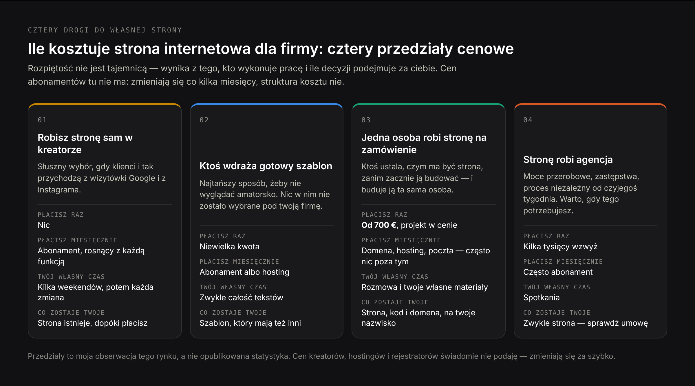
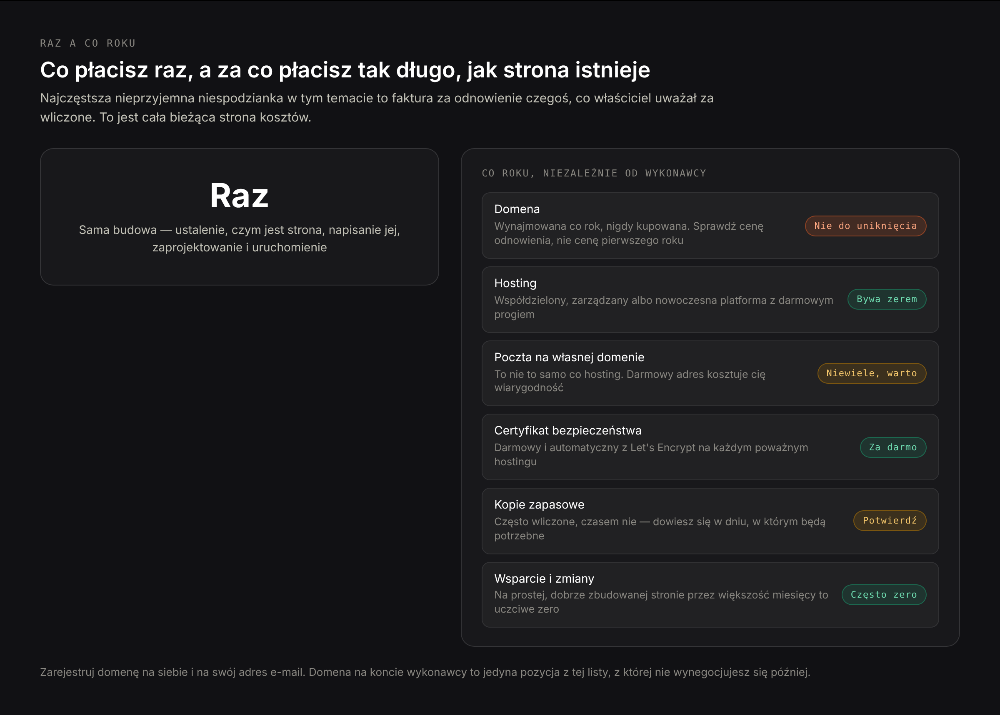
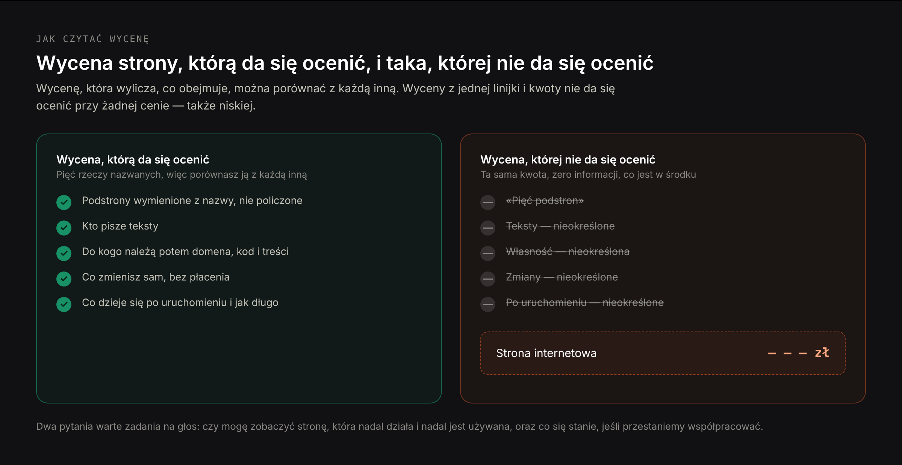

# DRAFT PL — «Ile kosztuje strona internetowa dla firmy» (29.10.2026). Wersja polska
# artykułu EN blog-small-business-website-cost-EN.md. ADAPTACJA, nie tłumaczenie:
# ta sama kolejność sekcji i te same argumenty, przepisane dla polskiego
# przedsiębiorcy.
#
# FRAZY CELOWANE (dane Google Ads, Polska, pomiar 29.10.2026):
#   — «ile kosztuje strona internetowa dla firmy» 140 — fraza H1. CELOWO nie
#     «ile kosztuje strona internetowa» (1 000): head ma własną stronę wyników,
#     dzieli z wariantem «dla firmy» tylko 1 URL. Head występuje w tekście
#     naturalnie i może zostać podchwycony, ale nie jest podstawą H1.
#   — klaster miesięczny, 440 razem — własny duży H2 z trzema H3:
#     «miesięczny koszt strony internetowej» 170, «koszt utrzymania strony
#     internetowej» 140, «ile kosztuje założenie strony internetowej i jej
#     utrzymanie» 90, «miesięczny koszt utrzymania strony internetowej» 30.
#   — «ile kosztuje strona internetowa ze sklepem» 110 — H3 w sekcji o tym, co
#     podnosi cenę. «ile kosztuje prosta strona internetowa» 70 i «ile kosztuje
#     profesjonalna strona internetowa» 70 — wspólny H2 (to ta sama oś pytania).
#     «prowadzenie strony internetowej koszt» 70 + «ile kosztuje strona
#     internetowa na rok» 20 — wspólny H3 o budżecie rocznym. «ile kosztuje
#     strona internetowa wordpress» 30 — własny H2. «ile kosztuje strona
#     internetowa wizytówka» 20 — H2 o pięciu podstronach.
#   — PAA w nagłówkach i FAQ: «Ile kosztuje strona internetowa w 2026?» (H2 nr 1),
#     «Jak wycenić stronę internetową?» (H2 o czytaniu wyceny), «Czy da się samemu
#     stworzyć stronę internetową?» (H2 o AI i kreatorach), «Ile kosztuje zrobienie
#     strony internetowej dla firmy?», «Ile się płaci miesięcznie za stronę
#     internetową?», «Ile kosztuje, żeby ktoś zrobił mi stronę internetową?» (FAQ).
#
# KANIBALIZACJA: lending /pl/strona-internetowa-dla-malej-firmy ma H2 dokładnie
# «Ile kosztuje strona internetowa dla małej firmy». Żaden nagłówek tego artykułu
# go nie powtarza ani się od niego nie zaczyna — celujemy w «dla firmy», nie «dla
# małej firmy», a czytelnika z zapytaniem handlowym odsyłamy na lending. Sprawdzone
# nagłówek po nagłówku: fraza «dla małej firmy» nie występuje w żadnym H1/H2/H3.
#
# CZEGO NIE MA W WERSJI EN, a jest tutaj:
#   1. H3 o pułapce odnowienia domeny .pl — różnica między ceną pierwszego roku
#      a ceną odnowienia jest na .pl znacznie większa niż na .com. Opisany
#      mechanizm, BEZ kwot w złotych dla jakiegokolwiek rejestratora (nie
#      weryfikowane).
#   2. H3 o cenach w złotych i w euro — autor fakturuje w euro, polskie studia
#      wyceniają w złotych, czytelnik porównuje wyceny w dwóch walutach.
#   3. Własny H2 o WordPressie — to domyślne założenie polskiego rynku i fraza
#      jest wyszukiwana. Ujęty uczciwie: rozsądny wybór, którego koszt ujawnia
#      się w utrzymaniu, nie w wycenie.
#
# CZEGO NIE UDAŁO SIĘ ADAPTOWAĆ: sekcja EN «Is $1,500 a fair price for a website?»
# nie ma polskiego odpowiednika w PAA i opiera się na kwocie w dolarach. Zastąpiona
# sekcją «prosta kontra profesjonalna» — ten sam argument (cena jest uczciwa wobec
# tego, co kupuje; oceniaj zawartość, nie liczbę), oparty na dwóch realnie
# wyszukiwanych frazach. Wypadł też link EN do artykułu o Cyprze — w polskiej
# wersji nie ma odpowiednika na liście linków.
#
# O LICZBACH: żadnych cen planów kreatorów, hostingów, rejestratorów ani stawek
# z ankiet freelancerskich — nie były weryfikowane i zestarzeją się w kilka
# miesięcy. Artykuł uczy struktury kosztu i odsyła do cennika dostawcy. Polskie
# cenniki agencji to marketing konkurencji, nie dane rynkowe — nie cytowane,
# nie przerabiane na «średnią rynkową». Tam, gdzie nie ma polskiej liczby,
# sytuacja opisana jakościowo. Użyte liczby:
#   — Clutch, 21.08.2025, 406 amerykańskich właścicieli małych firm: 83% ma
#     stronę; z tych bez strony 34% mówi, że to nieistotne w ich branży, 16%
#     wskazuje koszt. Oznaczone w tekście jako dane amerykańskie.
#   — Zasady spamu Google, aktualizacja 28.08.2026, «scaled content abuse».
#   — Certyfikaty Let's Encrypt są bezpłatne.
#   — Ceny własne autora: strona od 700 € z projektem graficznym w cenie, audyt
#     SEO 250 € jednorazowo, stała współpraca SEO od 800 € miesięcznie, wizytówka
#     gotowa w 2–3 tygodnie, faktury w euro lub innej walucie po uzgodnieniu.
# Przedziały cenowe podane jako własna obserwacja rynku i tak zaznaczone — nie
# jako statystyka i nie z powołaniem na badanie.

Title: Ile kosztuje strona internetowa dla firmy: realne ceny, ukryte koszty i co je podnosi
Slug: ile-kosztuje-strona-internetowa-dla-firmy
Meta title: Koszt strony internetowej w 2026: za co naprawdę płacisz
Meta description: Ile kosztuje strona internetowa dla firmy w 2026 roku, czego nie ma w wycenie, ile płaci się miesięcznie po uruchomieniu i jak odróżnić uczciwą cenę od złej.

---

> Krótka odpowiedź: strona internetowa dla firmy kosztuje dziś od niemal zera do kilkudziesięciu tysięcy, a ta rozpiętość nie jest zagadką — wynika z tego, kto wykonuje pracę i ile tej pracy jest. Zrobiona samodzielnie w kreatorze kosztuje abonament i twoje weekendy. Jedna osoba albo małe studio, budujące stronę na zamówienie dla firmy z kilkoma usługami, zaczyna od kilkuset euro i dochodzi do kilku tysięcy — u mnie strona internetowa zaczyna się od 700 € z projektem graficznym w cenie. Agencja startuje tam, gdzie ten przedział się kończy. Do tego każda strona ma koszty bieżące, których nie ma w wycenie: domena, hosting, poczta na własnej domenie i to, co płacisz komuś za utrzymanie. Dalsza część artykułu wyjaśnia, skąd bierze się dziesięciokrotna różnica między dwiema wycenami tej samej strony.

Uczciwy problem z tym pytaniem polega na tym, że większość odpowiedzi pisze ktoś, kto tę odpowiedź sprzedaje. Kreatory stron publikują artykuły z wnioskiem, że strony są tanie. Agencje publikują artykuły z wnioskiem, że tanie strony są drogie. Jedni i drudzy mają rację co do przeciwnej strony i mylą się co do siebie.

Buduję strony dla małych firm zawodowo, więc ja też nie jestem neutralny. Mogę natomiast zrobić coś innego: pokazać całą strukturę kosztu, razem z tymi częściami, które pojawiają się dopiero po roku, i podać swoje ceny wprost, żebyś miał do czego przyłożyć wszystko pozostałe.

Jedna rzecz warta powiedzenia na początku. W amerykańskim badaniu Clutch z 21 sierpnia 2025 roku, na próbie 406 właścicieli małych firm, 83% miało stronę internetową. Spośród tych bez strony tylko 16% wskazało koszt jako powód — najczęstszą odpowiedzią, od 34%, było przekonanie, że w ich branży strona jest nieistotna. To dane amerykańskie i nie znam polskiego badania o tej samej konstrukcji, więc nie przeliczam ich na polski rynek. Ale kierunek jest wart uwagi: pytanie o cenę rzadziej blokuje decyzję niż wątpliwość, czy strona cokolwiek tej firmie da.

## Ile kosztuje strona internetowa dla firmy w 2026 roku: cztery przedziały cenowe

Są cztery drogi, którymi firma dochodzi do własnej strony, i kosztują bardzo różnie — z powodów, które nie są przypadkowe.

### Strona zrobiona samodzielnie w kreatorze: abonament plus twoje weekendy

Płacisz miesięczny abonament i nic więcej poza własnym czasem. Prawdziwym kosztem jest tu czas: pierwsza strona zajmuje większości właścicieli kilka weekendów, a druga połowa tego czasu idzie na rzeczy, które nie mają nic wspólnego z wyglądem — napisanie tekstów, decyzję, jakie w ogóle mają być podstrony, znalezienie zdjęć, do których masz prawa.

Nie podam tu cen planów, bo zmieniają się co kilka miesięcy i nie sprawdzałem ich na dzień pisania. Sprawdź je na stronie cennika tego kreatora, którego rozważasz, i zwróć uwagę na dwie rzeczy: czy cena promocyjna dotyczy pierwszego okresu rozliczeniowego, i w którym planie zaczyna się podłączenie własnej domeny.

Ten przedział jest szczerze najlepszą odpowiedzią dla części firm i wolę to powiedzieć, niż sprzedać ci coś, czego nie potrzebujesz. Jeśli wszyscy twoi klienci znajdują cię przez wizytówkę w mapach i profil w mediach społecznościowych, a strona ma istnieć po to, żeby było gdzie ich odesłać, kreator wykonuje tę pracę za cenę kawy miesięcznie.

### Szablon wdrożony przez kogoś innego: najtańszy sposób, żeby wyglądać profesjonalnie

Freelancer, często znaleziony na giełdzie zleceń, instaluje gotowy motyw, wstawia twoje logo i teksty i przekazuje całość. To najtańsza droga do czegoś, co nie wygląda na zrobione w domu.

Tu też mieszka większość rozczarowań, a powód jest konkretny, nie snobistyczny: kupiłeś wdrożenie, nie projekt. Nic w tej stronie nie zostało zdecydowane dla twojej firmy. Podstrony są te, które przyszły z szablonem — dlatego tyle takich stron ma zakładkę «Zespół» z jedną osobą i zakładkę «Portfolio» ze zdjęciami ze stocka. Struktura została zbudowana dla kogoś innego i nikt jej do ciebie nie dopasował.

Da się to zrobić dobrze. Warunkiem jest, że ktoś przed wdrożeniem zdecyduje, jakie podstrony są potrzebne, i wyrzuci z szablonu to, czego u ciebie nie ma. To jednak już praca, a nie instalacja, i cena odpowiednio rośnie.

### Jedna osoba budująca stronę na zamówienie: tu cena zaczyna coś znaczyć

Freelancer albo bardzo małe studio ustala, jakich podstron potrzebujesz, pisze albo redaguje z tobą teksty, projektuje stronę wokół twoich rzeczywistych usług i buduje ją. To mój przedział i zaczyna się od 700 € z projektem graficznym w cenie.

Liczba zmienia się wraz z liczbą podstron i z tym, czy coś musi być z czymś połączone, a nie wraz z tym, jak imponująco wygląda faktura. To, co naprawdę kupujesz, to fakt, że ktoś zdecydował, czym ta strona ma być, przed jej zbudowaniem — i że osoba, która zdecydowała, jest tą samą, która budowała.

### Agencja budująca stronę: zespół i koszt jego koordynacji

Dostajesz opiekuna klienta, projektanta, programistę, czasem copywritera i kierownika projektu. Dla firmy z działem marketingu i marką, którą trzeba chronić, ta struktura zarabia na siebie: ma przepustowość, zabezpiecza na wypadek choroby i nie zależy od tygodnia jednej osoby.

Dla firmy z ośmioma usługami i jednym właścicielem płacisz za koordynację między ludźmi, którzy mogli być jedną osobą. Taki jest ten kompromis, powiedziany wprost, i wart jest podjęcia świadomie, a nie domyślnie.

Przedziały nachodzą na siebie na brzegach i dobry freelancer może kosztować więcej niż słaba agencja. Kształt jednak się trzyma: idąc w górę skali, kupujesz przede wszystkim nie jakość kodu. Kupujesz liczbę zaangażowanych osób i to, ile myślenia zrobiono za ciebie.

## Za co właściwie płacisz, kupując stronę internetową

Wycena strony wygląda jak cena rzeczy. W rzeczywistości jest ceną stosu decyzji, a decyzje są tym, w co idą godziny.

- **Ustalenie, co ta strona ma robić.** Jak odwiedzający ma zamienić się w zapytanie, które usługi zasługują na własną podstronę, co ktoś musi wiedzieć, zanim zadzwoni. Godzina tej pracy zmienia całą budowę; pominięcie jej jest powodem, dla którego część stron dobrze wygląda i nic nie przynosi.
- **Same podstrony.** Strona usługi, która odpowiada na pierwsze trzy pytania klienta, wymaga realnej pracy. Strona, która mówi «świadczymy tę usługę», nie wymaga żadnej — dlatego tanie witryny mają ich tak wiele.
- **Teksty.** Najbardziej niedoszacowana pozycja w każdej wycenie. Jeśli cena wydaje się niska, sprawdź, czy nie oczekuje się, że dostarczysz każde słowo.
- **Projekt graficzny.** Nie ozdoba — decyzje o tym, co odwiedzający widzi pierwsze, co piszą przyciski, jak to się zachowuje w jednej dłoni na telefonie.
- **Wykonanie.** Sprawienie, żeby strona była szybka, żeby numer telefonu wybierał się po dotknięciu, żeby formularz naprawdę trafiał tam, gdzie czyta go człowiek.
- **Przygotowanie do bycia znalezionym.** Tytuły, opisy, mapa strony, techniczne podstawy, żeby Google mógł to przeczytać. Nie kampania marketingowa — fundament, bez którego reszta jest niewidoczna.
- **Przekazanie.** Czy możesz zmienić cenę albo dodać podstronę bez płacenia komuś.

Kiedy dwie wyceny różnią się pięciokrotnie, różnica prawie zawsze siedzi w punkcie pierwszym i trzecim: kto decyduje, czym ma być strona, i kto ją pisze.

## Ile kosztuje prosta strona internetowa, a ile profesjonalna

To w praktyce jedno pytanie zadane z dwóch stron, więc odpowiem na nie razem — i zacznę od tego, że słowo «profesjonalna» w ofertach nie oznacza niczego sprawdzalnego.

Prosta strona to taka, w której nic nie jest ze sobą połączone: kilka podstron, formularz kontaktowy, numer telefonu, mapa. Żadnych rezerwacji, żadnych płatności, jeden język. Jeśli dostarczysz własne teksty i zdjęcia, a projekt zostanie zbudowany wokół twoich usług, a nie wybrany z galerii, taka strona mieści się w dolnej części przedziału jednoosobowego. U mnie to jest ta strona, która zaczyna się od 700 €.

Co takiej strony nie obejmuje: sklep, system rezerwacji z grafikami pracowników, trzy języki, logowanie klientów, katalog produktów. Każda z tych rzeczy to osobny produkt, nie dodatek, i przesuwa cenę w górę nie o procent, a o krotność.

«Profesjonalna» w uczciwym użyciu oznacza trzy rzeczy, które da się sprawdzić w gotowej stronie: że ktoś zdecydował o jej strukturze przed budową, że teksty odpowiadają na pytania klienta, a nie opisują firmę, i że techniczne podstawy są zrobione. Żadna z nich nie jest widoczna na zrzucie ekranu, dlatego tak łatwo jest to słowo w ofercie postawić.

Cena bywa więc uczciwa wobec tego, co kupuje, i zła w dwóch sytuacjach: kiedy kupuje wdrożenie szablonu ubrane w słowo «projekt», i kiedy kupuje budowę na zamówienie, która realnie potrzebowała dwa razy więcej godzin — wtedy oszczędności wychodzą z tych części, których nie widzisz: z tekstów, z szybkości, z przygotowania do wyszukiwarki.

Użyteczne pytanie nie brzmi więc, czy liczba jest uczciwa. Brzmi: co jest w środku. Wycenę, która wymienia podstrony, mówi, kto pisze teksty, i nazywa, co dzieje się po uruchomieniu, można ocenić. Wyceny, która mówi «strona internetowa — kwota», nie da się ocenić przy żadnej kwocie.

## Ile kosztuje strona internetowa wizytówka i co zawiera pięć podstron

Strona wizytówka to najczęściej kupowany rodzaj strony firmowej w Polsce i najczęściej opisywana jako «pięć podstron». Samo to określenie jest tam, gdzie sprawa się psuje: stron nie wycenia się od podstrony, bo podstrony nie są tej samej wielkości.

Strona główna jest najdroższą rzeczą na małej witrynie — musi powiedzieć, kim jesteś, co robisz, gdzie pracujesz i dlaczego ktoś ma zadzwonić, w przestrzeni jednego ekranu telefonu. Strona kontaktowa jest najtańsza. Strona usługi leży pośrodku i waha się ogromnie: «mycie okien» i «analiza umowy najmu lokalu» to po jednej podstronie, a jedna z nich potrzebuje wyjaśnienia wielkości opinii prawnej.

W praktyce pięć podstron oznacza stronę główną, dwie lub trzy strony usług, stronę o firmie i kontakt. To standardowy kształt strony firmowej i to właśnie obejmuje cena startowa taka jak moja. Wizytówka jest u mnie zwykle gotowa w dwa do trzech tygodni — i uczciwie: największym opóźnieniem w tym terminie nie jest zwykle praca, a czekanie na teksty i zdjęcia od klienta.

Pięć podstron przestaje być pięcioma podstronami w momencie, gdy ktoś mówi «a czy każde miasto mogłoby mieć własną stronę» albo «a czy klienci mogliby się logować». Oba życzenia są rozsądne, żadne nie jest pięcioma podstronami.

Jeśli wycena liczy od podstrony, zapytaj, co się dzieje, gdy jedna z nich wymaga trzy razy więcej tekstu. Odpowiedź powie ci, czy cena jest ceną, czy stanowiskiem wyjściowym w negocjacji.

## Koszty, których nie ma w wycenie: domena, hosting, poczta i certyfikat

Każda strona ma koszty bieżące, które istnieją niezależnie od tego, kto ją zbudował, a najczęstszą nieprzyjemną niespodzianką w całym tym temacie jest faktura za odnowienie czegoś, co właściciel uważał za wliczone.

**Hosting.** Hosting współdzielony jest tani i wolny. Hosting zarządzany pod konkretną platformę kosztuje więcej i zdejmuje z ciebie utrzymanie. Nowoczesny hosting platformowy, na jakim buduję, ma darmowe poziomy, które naprawdę wystarczają stronie małej firmy — dlatego hosting bywa pozycją, która uczciwie wynosi zero. Ceny sprawdź u dostawcy, bo zmieniają się częściej niż artykuły o nich.

**Poczta na własnej domenie.** To nie to samo co hosting i warto za to płacić. Adres kontaktowy na własnej domenie, a nie na darmowej poczcie, jest inaczej czytany i przez klientów, i przez filtry antyspamowe.

**Certyfikat, od którego pojawia się kłódka.** Bezpłatny, od Let's Encrypt, i automatyczny na każdym poważnym hostingu. Jeśli w wycenie jest osobna pozycja za certyfikat SSL, zapytaj o nią — nie dlatego, że płatne certyfikaty są oszustwem, ale dlatego, że strona małej firmy prawie nigdy nie potrzebuje płatnego.

**Kopie zapasowe.** Często wliczone, czasem nie, a którą z tych rzeczy — dowiesz się dopiero w dniu, w którym będą potrzebne.

### Domena .pl i cena odnowienia: dlaczego pierwszy rok jest tańszy niż każdy następny

To pozycja, w której polski rynek różni się od reszty, i warta jest osobnego akapitu.

Domena jest wynajmowana na rok, nigdy kupiona. Na całym świecie cena pierwszego roku i cena odnowienia bywają różne, ale na domenach .pl ta różnica jest zwykle znacznie większa niż na .com. Mechanizm jest prosty: pierwszy rok jest sprzedawany jako promocja pozyskująca klienta, a odnowienie jest normalną ceną katalogową. Przeniesienie domeny do innego rejestratora jest możliwe, ale wymaga zachodu, więc większość właścicieli po prostu odnawia tam, gdzie zarejestrowała.

Nie podam tu kwot dla żadnego rejestratora, bo ich nie weryfikowałem i zmieniają się w trakcie roku. Podam zasadę: przed rejestracją sprawdź cenę odnowienia, nie cenę promocyjną. Jest na tej samej stronie, zwykle mniejszą czcionką, czasem w osobnej tabeli pod przyciskiem. Jeśli nie możesz jej znaleźć w dwie minuty, to też jest informacja.

I rzecz ważniejsza od ceny: zarejestruj domenę na siebie, z własnym adresem e-mail jako kontaktem. Domena na koncie wykonawcy jest najdroższym błędem z całej tej listy, bo z osobą, która ją trzyma, nie da się negocjować.

Rozpisane jako budżet, bieżąca strona kosztów strony firmowej wygląda tak:

| Pozycja | Jak często | Komu płacisz | Czy może wynieść zero? |
|---|---|---|---|
| Domena | Raz w roku | Rejestratorowi, na twoje nazwisko lub firmę | Nie — i patrz na cenę odnowienia, nie na promocję pierwszego roku |
| Hosting | Miesięcznie lub rocznie | Hostingodawcy albo platformie | Czasem tak, na darmowym poziomie nowoczesnej platformy |
| Poczta firmowa na twojej domenie | Miesięcznie za skrzynkę | Dostawcy poczty | Możliwe, ale darmowy adres kosztuje cię wiarygodność |
| Certyfikat bezpieczeństwa | — | Nikomu, na porządnym hostingu | Tak — bezpłatny i automatyczny |
| Kopie zapasowe | Miesięcznie, jeśli osobno | Hostingowi albo usłudze | Często wliczone; potwierdź, nie zakładaj |
| Wsparcie i zmiany | Tylko gdy jest praca | Temu, kto budował | Tak, i na prostej stronie często tak jest |

Pierwszy wiersz jest tym, który trzeba ustawić dobrze pierwszego dnia. Resztę można zmienić później; domeny na czyimś koncie nie można, inaczej niż na jego warunkach.

## Miesięczny koszt strony internetowej: ile się płaci po uruchomieniu

Pytanie o miesięczny koszt jest po samym pytaniu o cenę największą grupą zapytań w tym temacie, a odpowiedź rozpada się na dwie zupełnie różne połowy.

Pierwsza połowa to koszty bieżące z poprzedniej sekcji — domena, hosting, poczta. Są realne, niewielkie i nieuniknione. Na prostej stronie firmowej mieszczą się w kwocie, która w budżecie firmy nie jest pozycją wymagającą decyzji.

Druga połowa to to, co płacisz człowiekowi, i tu powiem coś przeciw własnemu interesowi: **dla dobrze zbudowanej strony małej firmy ta kwota często wynosi zero.** Strona, która nie ma wtyczek, nie stoi na przestarzałym systemie treści i nie robi nic skomplikowanego, może iść miesiącami bez potrzeby zrobienia czegokolwiek. Za wsparcie warto płacić, kiedy faktycznie jest co zrobić, a nie jako stałą opłatę na wypadek, że coś się pojawi.

### Kiedy warto płacić miesięczny abonament za utrzymanie strony, a kiedy nie

Abonament jest wart swojej ceny, kiedy praca jest prawdziwa: regularne zmiany, sklep ze stanami magazynowymi, zmieniający się zespół i cennik, strona, która realnie się psuje.

Jest też wart swojej ceny w sytuacji odwrotnej, mniej oczywistej: kiedy alternatywą jest, że nic nigdy nie zostanie zmienione. Spora część stron małych firm jest trzy lata nieaktualna, bo każda edycja oznaczała napisanie maila i czekanie, a niewielki stały abonament utrzymałby je w zgodzie z rzeczywistością.

Czym innym jest abonament, który kupuje «aktualizacje i monitoring» na pięciopodstronowej wizytówce. Kupuje brak problemu, którego nie miałeś, a jego uczciwą wersją jest umowa, w której płacisz, gdy jest praca, i nie płacisz, gdy jej nie ma.

Pytanie kontrolne jest jedno i można je zadać przy podpisywaniu: co konkretnie zostanie zrobione w miesiącu, w którym nic się nie zepsuje i o nic nie poproszę. Odpowiedź «przegląd i monitoring» oznacza, że nic.

### Dlaczego koszt utrzymania strony internetowej zależy od tego, na czym ją zbudowano

Powód, dla którego dwie wyglądające identycznie strony mogą kosztować bardzo różnie w utrzymaniu, leży pod nimi.

Strona na systemie treści z kilkunastoma wtyczkami ma kilkanaście rzeczy, które się aktualizują, czasem psują się wzajemnie i wymagają, żeby ktoś na nie patrzył. To realna, ciągła praca i uczciwie jest za nią brać pieniądze. Strona zbudowana jako zwykłe, nowoczesne podstrony, bez niczego dokręconego z boku, ma prawie nic, co mogłoby się zepsuć — dlatego jej pozycja «utrzymanie» może uczciwie wynosić zero.

Warto o to zapytać przed podjęciem decyzji, nie po: na czym to jest zbudowane, co trzeba aktualizować i co się stanie, jeśli nikt nie zaktualizuje tego przez rok. Odpowiedź «w zasadzie nic» jest realną cechą o realnej wartości pieniężnej i rzadko pojawia się w wycenie jako taka.

### Ile kosztuje prowadzenie strony internetowej przez cały rok: jak policzyć budżet

Najprostszy sposób, żeby nie dać się zaskoczyć, to policzyć rok, nie miesiąc, bo część tych pozycji jest rozliczana rocznie i wpada do budżetu jednym przelewem.

Weź cztery liczby: cenę odnowienia domeny za rok, hosting za rok, pocztę razy liczba skrzynek razy dwanaście, i uczciwą ocenę, ile zmian będziesz chciał wprowadzić. Ta czwarta jest jedyną, w której się pomylisz, więc oszacuj ją od strony kalendarza, a nie kwoty: ile razy w roku zmienia się twój cennik, ile razy dochodzi albo odchodzi usługa, ile razy robisz nowe zdjęcia.

Firma, która zmienia na stronie coś dwa razy w roku, nie potrzebuje abonamentu i zapłaci za te dwie zmiany osobno. Firma, która zmienia coś co dwa tygodnie, zapłaci za każdą zmianę osobno znacznie więcej niż za stałą współpracę — i to jest moment, w którym abonament przestaje być sprzedażą, a staje się rachunkiem.

Zupełnie czymś innym, i czymś, co faktycznie wymaga miesięcznego zobowiązania, jest bycie znajdowanym. To praca ciągła z własnym zegarem, a nie utrzymanie, i [ile kosztuje pozycjonowanie strony](/pl/blog/ile-kosztuje-pozycjonowanie-strony) omawiam osobno, żeby nie mieszać tych dwóch budżetów.

## Ile kosztuje strona internetowa WordPress i skąd bierze się koszt jej utrzymania

W Polsce WordPress jest domyślnym założeniem. Kiedy pytasz o stronę, w większości ofert dostaniesz WordPressa, nawet jeśli nikt tego słowa nie wymówi, i warto wiedzieć, co z tego wynika dla ceny.

Sama cena budowy na WordPressie jest zwykle niższa niż budowy od zera, bo spora część pracy jest już wykonana: jest system treści, jest panel administracyjny, są gotowe motywy i wtyczki na rzeczy, których nikt nie chce pisać od nowa. To realna oszczędność i nie zamierzam udawać, że jest inaczej.

Koszt WordPressa ujawnia się po uruchomieniu, w utrzymaniu. Każda wtyczka to osobny program od osobnego autora, z własnym tempem aktualizacji i własnym cyklem życia. Niektóre są płatne rocznie. Niektóre przestają być rozwijane. Aktualizacja jednej potrafi zepsuć drugą, a strona, której nikt nie aktualizuje przez rok, staje się realnym problemem bezpieczeństwa, nie teoretycznym.

To nie jest argument przeciw WordPressowi. To argument za tym, żeby liczyć go razem z utrzymaniem. WordPress jest rozsądnym wyborem, gdy chcesz sam dodawać wpisy i podstrony, gdy potrzebujesz funkcji, która istnieje jako gotowa wtyczka, i gdy zakładasz, że ktoś będzie tę stronę doglądał. Jest wyborem gorszym, gdy kupujesz wizytówkę, która ma stać bez zmian trzy lata, bo wtedy płacisz utrzymanie systemu, z którego nie korzystasz.

Pytania, które rozstrzygają sprawę przed podpisaniem umowy, są trzy: ile wtyczek będzie na tej stronie, które z nich są płatne i w jakim cyklu, i kto je aktualizuje. Wykonawca, który odpowiada na wszystkie trzy bez zaglądania nigdzie, pracował z WordPressem wystarczająco długo.

## Kreator, freelancer czy agencja: ile każda droga kosztuje przez trzy lata

Ceny jednorazowe sprawiają, że kreatory wyglądają na darmowe, a strony na zamówienie na drogie. Trzy lata są uczciwszą ramą, bo tyle mniej więcej żyje strona małej firmy, zanim wymaga przebudowy.

| | Co płacisz raz | Co płacisz miesięcznie | Co wkładasz sam | Co masz na koniec |
|---|---|---|---|---|
| Kreator, budujesz sam | Nic | Abonament, i rośnie, gdy potrzebujesz więcej | Kilka weekendów, potem wieczór przy każdej zmianie | Stronę, która istnieje, póki płacisz; przeniesienie gdzie indziej oznacza zbudowanie od nowa |
| Wdrożony szablon | Niewielką kwotę | Abonament albo hosting | Zwykle napisanie wszystkich tekstów samemu | Motyw, który ma też ktoś inny |
| Jedna osoba, budowa na zamówienie | Od 700 € z projektem graficznym w cenie | Domena, hosting, poczta — często nic więcej | Rozmowę na początku i własne materiały | Stronę, kod i domenę, na siebie |
| Agencja | Od kilku tysięcy w górę | Często abonament | Spotkania | Stronę, zwykle; sprawdź w umowie zapisy o kodzie i domenie |

Wiersz, który zaskakuje ludzi, to pierwszy. Abonament kreatora jest niewielki, ale nigdy się nie kończy, rośnie z każdą funkcją, której okazujesz się potrzebować, i na koniec nie możesz zabrać strony ze sobą. To nie argument przeciw kreatorom — dla firmy, której wszyscy klienci przychodzą z mediów społecznościowych i wizytówki w mapach, kreator jest właściwą odpowiedzią i tak powiem. To argument przeciw porównywaniu abonamentu z ceną jednorazową, jakby to były liczby tego samego rodzaju.

## Dlaczego ta sama strona kosztuje 700 € u jednej osoby i kilka razy tyle w agencji

Nie dlatego, że któraś ze stron kłamie. Dlatego, że pieniądze robią tam różne rzeczy.

W budowie jednoosobowej prawie całe pieniądze to praca. W budowie agencyjnej duża część to koordynacja: opiekun klienta, który rozmawia z tobą, kierownik projektu, który rozmawia z projektantem, projektant, który rozmawia z programistą, i czas tracony w szczelinach między nimi. Ta struktura kupuje rzeczy prawdziwe — przepustowość, zastępstwo, gdy ktoś choruje, proces, który nie zależy od nastroju jednej osoby — i dla firmy, która tych rzeczy potrzebuje, warto za nie płacić.

Dla firmy z kilkoma usługami kupuje głównie warstwę tłumaczenia między tobą a osobą wykonującą pracę. Dlatego pracuję tak, jak pracuję: osoba, która wycenia, jest osobą, która buduje, co usuwa ten krok, który kosztuje najwięcej i traci najwięcej sensu po drodze. Jak to wygląda w praktyce, opisuję na stronie usługi [strona internetowa dla małej firmy](/pl/strona-internetowa-dla-malej-firmy). Wady, której nie będę udawać, że nie ma, jest jedna i jest poważna: jedna osoba ma kolejkę, agencja nie ma. Jeśli potrzebujesz startu w tym tygodniu, bywa, że nie jestem właściwym wyborem — i powiem to w pierwszej odpowiedzi, nie w trzeciej. To samo porównanie zastosowane do pracy nad widocznością, a nie do budowy strony, jest na stronie [freelancer SEO](/pl/oferty/freelancer-seo).

### Czego nie odkupisz później: domena, teksty i kod

Jest kategoria kosztu, która nie pojawia się w żadnej wycenie i przychodzi dopiero, gdy próbujesz odejść. Zasługuje na więcej uwagi niż sama cena.

Jeśli domena jest zarejestrowana na wykonawcę, nie masz własnego adresu. Jeśli strona stoi na platformie, z której nie da się wyeksportować treści, trzy lata tekstów, za które zapłaciłeś, wychodzą jako przeklejanie ręką. Jeśli nikt nie zapisał, gdzie jest konto hostingowe, dzień, w którym trzeba je przenieść, zamienia się w wykopaliska.

Nic z tego nie jest złowrogie — większość dzieje się przez przypadek, bo nikt nie zapytał na początku. Pytaj na początku. Pytania są trzy: na kogo jest zarejestrowana domena, czy stronę i jej treść da się wyeksportować, i kto trzyma konto hostingowe. Prosta odpowiedź na wszystkie trzy nic nie kosztuje, a jest warta więcej niż rabat.

## Co podnosi cenę strony internetowej: języki, rezerwacje, płatności i integracje

Większość rozpiętości powyżej ceny startowej bierze się z krótkiej listy rzeczy, a każda z nich jest realną krotnością, nie narzutem.

- **Drugi albo trzeci język.** Nie tłumaczenie — drugi zestaw podstron, który trzeba napisać dla tamtego rynku, utrzymywać w zgodzie z pierwszym i odróżnić dla wyszukiwarek. To najczęstszy powód, dla którego mała strona przestaje być małą stroną, i zwykle jest tego wart, gdy druga grupa odbiorców jest prawdziwa.
- **Rezerwacje i terminy.** Zajęcie terminu jest proste. Zajęcie terminu, który respektuje grafiki pracowników, urlopy, przerwy między wizytami i odwołania, nie jest.
- **Podłączenie do czegoś, czego już używasz.** Kalendarz, CRM, system księgowy, katalog dostawcy. Koszt zależy całkowicie od uprzejmości tego drugiego systemu, czego nikt nie powie ci, dopóki nie zajrzy.
- **Dużo podobnych podstron.** Usługi w wielu miastach, katalog, zespół piętnastu osób. Jedna podstrona jest tania; sto już nie.
- **Treści, których nie masz.** Zdjęcia, teksty, opisy realizacji. Jeśli nie możesz ich dostarczyć, ktoś musi je stworzyć, a to osobna praca z osobną ceną.

### Ile kosztuje strona internetowa ze sklepem i co podnosi cenę sklepu

Sklep jest na tej liście pozycją, która najmocniej zmienia rząd wielkości, więc dostaje własny akapit.

Przycisk «zapłać» jest tani. Sklep nie jest przyciskiem «zapłać» — jest katalogiem produktów, stanami magazynowymi, wariantami, wysyłką z cenami zależnymi od wagi i kraju, zwrotami, fakturami, obowiązkami informacyjnymi wobec konsumenta i regulaminem. Każda z tych rzeczy jest osobną decyzją i osobną pracą, a trzy z nich są prawne, nie techniczne.

Dlatego na pytanie o cenę strony ze sklepem odpowiadam pytaniem o liczbę produktów, liczbę wariantów i sposób wysyłki. Dwadzieścia produktów bez wariantów, wysyłane jednym kurierem, to inna praca niż dwieście produktów w rozmiarach i kolorach z trzema sposobami dostawy — i różnica jest krotna, a nie procentowa.

Jest też trzecia droga, o której warto wiedzieć, zanim zapłacisz za sklep: jeśli sprzedajesz kilka rzeczy, a nie prowadzisz handlu, czasem wystarczy strona z cennikiem i wygodną formą zamówienia. Sklep ma wtedy koszt, którego nie odrobi.

Kiedy wycena jest wyższa, niż się spodziewałeś, najszybszą drogą do zrozumienia jej jest zapytanie, która z tych pozycji w niej siedzi. Jeśli żadna, liczba dotyczy godzin, a nie funkcji — i wtedy pytanie brzmi, na co te godziny idą.

## Czy da się samemu stworzyć stronę internetową i czy ChatGPT zrobi ją za darmo

Da się, i to dwa razy łatwiej niż dwa lata temu. Warto tylko wiedzieć, co dokładnie dostaje się za darmo.

Narzędzie oparte na sztucznej inteligencji wygeneruje ci stronę. Będzie poprawna strukturalnie, ogólna w tekstach i nieodróżnialna od tysiąca innych zrobionych w tym samym tygodniu w ten sam sposób. Dla projektu na boku albo dla podstrony, która istnieje po to, żeby link miał gdzie prowadzić, może to być wszystko, czego potrzebujesz, i nie będę z tym polemizować.

Dwie rzeczy czynią z tego słaby fundament dla firmy, która chce klientów z wyszukiwarki. Pierwsza: tekst jest tą częścią, która sprawia, że stronę warto znaleźć, a tekst ogólny jest dokładnie tym, czego wyszukiwarka nie ma powodu wysoko pokazywać. Druga jest wpisana wprost w zasady spamu Google, ostatnio aktualizowane 28 sierpnia 2026 roku, które nazywają **scaled content abuse** praktykę «using generative AI tools or other similar tools to generate many pages without adding value for users» — czyli użycie narzędzi generatywnych do tworzenia wielu podstron bez dodawania wartości dla użytkownika. Sprawdzane jest nie to, jakim narzędziem powstała strona, a to, czy warto ją czytać.

Samodzielna budowa ma natomiast jedną realną zaletę, o której rzadko się mówi: po niej wiesz, czego chcesz. Właściciele, którzy przychodzą po trzech weekendach z kreatorem, wiedzą, jakie mają usługi, co chcą powiedzieć pierwsze i czego nie potrzebują. To skraca pracę i obniża cenę, bo pierwsza i najdroższa część — decyzja, czym ta strona ma być — jest już w połowie zrobiona.

Tam, gdzie sztuczna inteligencja faktycznie oszczędza pieniądze na projekcie strony, to w środku, a nie zamiast: pierwsze wersje tekstów, struktura, przepisanie twojego własnego szorstkiego tekstu na coś publikowalnego. To jest ta część, którą właściciele uważają za najtrudniejszą, i ta, w której te narzędzia są naprawdę dobre.

## Ile kosztuje strona internetowa w twojej branży

Cena zależy od branży bardziej, niż się ludziom wydaje, bo różne firmy potrzebują od strony różnych rzeczy, zanim ta strona w ogóle zacznie działać. Restauracja potrzebuje menu, które można zmienić z telefonu; gabinet potrzebuje kwalifikacji, uprawnień i ścieżki rezerwacji; firma budowlana potrzebuje realizacji ze zdjęciami i sposobu na bycie znalezioną w miastach, w których buduje.

Koszty dla kilku z nich rozpisałem osobno, razem z tym, co jest w każdej specyficzne:

- [ile kosztuje strona dla salonu kosmetycznego](/pl/blog/ile-kosztuje-strona-dla-salonu-kosmetycznego) — rezerwacje, cennik, który zmienia się często, podstrony pracowników
- [ile kosztuje strona dla firmy budowlanej](/pl/blog/ile-kosztuje-strona-dla-firmy-budowlanej) — realizacje, obszary działania, zaufanie przy wysokiej wartości zlecenia
- [ile kosztuje strona dla warsztatu samochodowego](/pl/blog/ile-kosztuje-strona-dla-warsztatu-samochodowego) — usługi według marki i modelu, ceny, pilność zgłoszenia
- [ile kosztuje strona dla psychologa](/pl/blog/ile-kosztuje-strona-dla-psychologa) — kwalifikacje, poufność, ostrożny pierwszy kontakt
- [ile kosztuje strona dla agencji nieruchomości](/pl/blog/ile-kosztuje-strona-dla-agencji-nieruchomosci) — oferty, wyszukiwanie, utrzymywanie danych w aktualności
- [ile kosztuje strona dla dewelopera](/pl/blog/ile-kosztuje-strona-dla-dewelopera) — inwestycje w budowie, materiały etap po etapie
- [ile kosztuje strona wielojęzyczna](/pl/blog/ile-kosztuje-strona-wielojezyczna) — co naprawdę dodaje drugi i trzeci język

Jeśli twojej branży tu nie ma, struktura z tego artykułu nadal się trzyma; zmienia się to, która z powyższych krotności dotyczy ciebie.

## Jak wycenić stronę internetową i o co zapytać przed podpisaniem umowy

Wycena, którą da się ocenić, zawiera pięć rzeczy. Poproś o te, których brakuje, a opór traktuj jako informację.

1. **Lista podstron.** Wymienionych, nie policzonych. «Pięć podstron» i «strona główna, dwie usługi, o firmie, kontakt» to różne obietnice.
2. **Kto pisze teksty.** Najczęstsza luka między tanią wyceną a tanio wyglądającym rezultatem.
3. **Kto jest czego właścicielem po zakończeniu.** Domena, konto hostingowe, kod, treść. Wszystko to powinno skończyć na ciebie, a czas, żeby to ustalić, jest przed, nie po.
4. **Co możesz zmienić sam.** Ceny, godziny otwarcia, nowa usługa — możesz, czy każda z tych rzeczy to mail i faktura?
5. **Co dzieje się po uruchomieniu.** Co jest objęte, na jak długo i co kosztuje dodatkowo.

Dwa pytania warte zadania na głos: czy mogę zobaczyć coś, co zbudowałeś i co nadal działa i jest używane, oraz co się stanie, jeśli przestaniemy współpracować. Obie odpowiedzi powiedzą ci więcej niż cena.

A jeśli wyceniasz stronę z drugiej strony, jako wykonawca albo jako właściciel próbujący oszacować własny budżet, metoda jest ta sama od tyłu: wypisz podstrony z nazwami, przypisz każdej liczbę godzin, osobno policz teksty i osobno rzeczy połączone z czymkolwiek. Suma będzie nieprzyjemnie wyższa od pierwszego przeczucia i o wiele bliższa prawdzie.

## Ile kosztuje strona internetowa u mnie i co zawiera cena

Moje własne liczby, żebyś miał coś stałego, do czego można przyłożyć resztę.

Strona internetowa dla firmy zaczyna się u mnie od **700 €, z projektem graficznym w cenie** — nie sprzedaję projektu jako osobnej pozycji, bo strona zaprojektowana przez jedną osobę i zbudowana przez inną kosztuje więcej i pasuje gorzej. To obejmuje standardowy kształt: stronę główną, podstrony usług, o firmie i kontakt, napisane razem z tobą, a nie wręczone ci jako formularz do wypełnienia, zbudowane tak, żeby szybko się wczytywały i żeby można było się skontaktować z telefonu jednym dotknięciem. Wizytówka jest zwykle gotowa w dwa do trzech tygodni.

Cena rusza się wraz z krotnościami opisanymi wyżej, a która z nich ją rusza, powiem przed tym, jak do czegokolwiek się zobowiążesz.

**Audyt SEO to 250 €**, jednorazowo — wart zrobienia raczej przed przebudową niż po, bo mówi, które podstrony mają już wartość, którą warto zachować. **Stała współpraca nad widocznością zaczyna się od 800 € miesięcznie** i jest osobną usługą z innym zegarem: pierwsze ruchy po około półtora miesiąca, zauważalny wzrost między trzecim a szóstym miesiącem. Co obejmuje każda z pozycji, jest wypisane w [cenniku](/pl/cennik).

Za co nie biorę pieniędzy: za miesięczny abonament na stronie, która go nie potrzebuje. Jeśli w danym miesiącu nie ma nic do zrobienia, nic nie jest fakturowane.

### Ceny w złotych i w euro: jak porównać wyceny w dwóch walutach

Jedna rzecz techniczna, która przy porównywaniu ofert w Polsce ma znaczenie. Wystawiam faktury w euro albo w innej walucie po uzgodnieniu, a polskie studia i agencje wyceniają zwykle w złotych. Porównując moją cenę z ich ceną, porównujesz dwie waluty, nie dwie liczby.

Zrób to jawnie, zanim zaczniesz ustawiać oferty w kolejności: przelicz wszystko na jedną walutę po kursie z dnia, w którym porównujesz, i zapisz ten kurs obok. Pamiętaj też, że kurs rusza się w trakcie projektu, więc przy dłuższej współpracy warto wiedzieć, która strona ponosi to ryzyko — u mnie wystarczy o to zapytać przy ustalaniu waluty.

Sprawdź przy tym, co dana cena zawiera po stronie podatków, bo oferty w Polsce podaje się i netto, i brutto, i porównanie jednej z drugą zawyża albo zaniża różnicę o kilkanaście procent. Pytanie «czy to jest kwota, którą przelewam» rozstrzyga sprawę w jednym zdaniu.

## Najczęstsze pytania o koszt strony internetowej

**Ile kosztuje zrobienie strony internetowej dla firmy?**
Dla firmy z kilkoma usługami strona na zamówienie u jednej osoby zaczyna się od kilkuset euro — u mnie od 700 € z projektem graficznym w cenie — i rośnie wraz z językami, rezerwacjami, płatnościami i liczbą podstron. Agencja przy tym samym zakresie startuje kilka razy wyżej, bo część tej ceny to koordynacja, a nie praca.

**Ile kosztuje, żeby ktoś zrobił mi stronę internetową?**
Zależy od tego, ile tej osobie zostawiasz do zdecydowania. Jeśli przychodzisz z gotowymi tekstami, zdjęciami i listą podstron, kupujesz wykonanie i jest ono tańsze. Jeśli ktoś ma ustalić strukturę i napisać teksty, kupujesz pracę, której jest dwa razy więcej, i taka jest też cena.

**Ile się płaci miesięcznie za stronę internetową?**
Część nieunikniona to domena, hosting i poczta, i jest niewielka. Poza tym dobrze zbudowana mała strona często nie potrzebuje miesięcznie niczego. Za wsparcie płać, gdy jest praca do zrobienia, a nie jako stałą opłatę za jej możliwość.

**Ile kosztuje strona internetowa w 2026 roku i czy ceny wzrosły?**
Rozpiętość jest ta sama co kilka lat temu, bo zależy od tego, kto wykonuje pracę. Zmieniły się dwie rzeczy: dolny koniec jest tańszy, bo narzędzia zrobiły więcej za ciebie, a górny koniec jest mniej uzasadniony, bo te same narzędzia skróciły część pracy, za którą się płaciło.

**Czy domenę płaci się osobno?**
Tak, co roku, i powinna być zarejestrowana na ciebie. Na domenach .pl sprawdź cenę odnowienia, a nie cenę pierwszego roku — bywają bardzo różne, znacznie bardziej niż na .com.

**Czy kreator stron jest tańszy od strony na zamówienie?**
Przez trzy lata zwykle nie tak dużo tańszy, jak wygląda, bo abonament nigdy się nie kończy i rośnie, gdy potrzebujesz więcej. Prawdziwa różnica jest we własności: stronę na zamówienie można przenieść, stronę z kreatora trzeba zbudować od nowa, żeby ją przenieść.

**Czy da się samemu stworzyć stronę internetową?**
Da się, i dla części firm jest to właściwa decyzja. Koszt przenosi się wtedy z pieniędzy na czas, a najtrudniejszą częścią nie jest narzędzie, a napisanie tekstów i decyzja, jakie podstrony mają istnieć.

**Jak często trzeba przebudowywać stronę?**
Większość stron małych firm działa trzy do pięciu lat, zanim projekt zaczyna pracować przeciw nim. Przebudowa wywołana datą, a nie problemem, jest zwykle pieniędzmi wydanymi na poczucie świeżości.

**Czy tania strona zaszkodzi mojej widoczności w Google?**
Nie przez to, że jest tania. Szkodzi wtedy, gdy oszczędności wyszły z części niewidocznych — z ubogich albo ogólnych tekstów, z wolnego wczytywania, z braku technicznych podstaw. Co z tym zrobić, opisuję w przewodniku [jak samemu zrobić SEO](/pl/blog/jak-samemu-zrobic-seo), i większość z tego możesz zrobić bez niczyjej pomocy.

## Co przygotować, zanim poprosisz kogokolwiek o wycenę

Wypisz usługi, których chcesz więcej, słowami, których używają twoi klienci. Wypisz, co ktoś musi wiedzieć, zanim do ciebie zadzwoni. Sprawdź, kto obecnie trzyma twoją domenę, jeśli ją masz — odpowiedź bywa zaskoczeniem.

Z tymi trzema rzeczami każda wycena, którą dostaniesz, staje się porównywalna, bo zadajesz wszystkim to samo pytanie. Bez nich zbierasz liczby dotyczące różnych rzeczy i ustawiasz je obok siebie, jakby były tym samym.

Jeśli chcesz liczbę ode mnie, [napisz do mnie](/pl/kontakt) z listą usług, miastami, w których pracujesz, i linkiem do tego, co masz teraz — strony, profilu społecznościowego, wizytówki w mapach. Powiem, co bym zbudował, ile by to kosztowało i co bym pominął, włącznie z tymi sytuacjami, w których uczciwą odpowiedzią jest, że potrzebujesz wizytówki w mapach i numeru telefonu, a nie strony internetowej.
