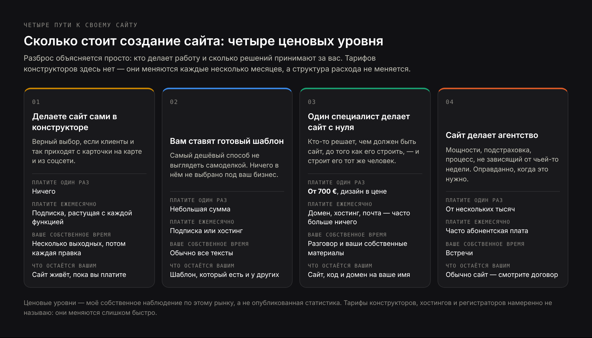
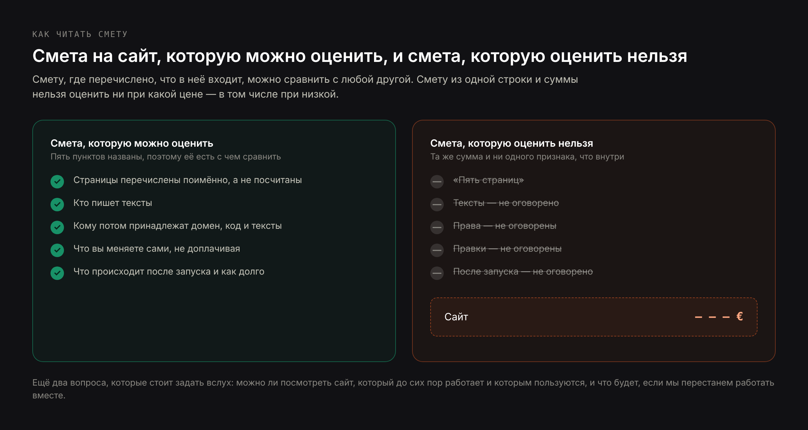

# DRAFT RU — «Сколько стоит создание сайта» (29.10.2026). Русская версия статьи
# blog-small-business-website-cost-EN.md. АДАПТАЦИЯ, не перевод: тот же порядок
# разделов и те же аргументы, переписанные под русскоязычного владельца небольшого
# бизнеса, который живёт и работает в Польше, Казахстане, Грузии, на Кипре, в
# Израиле, Германии или ОАЭ.
#
# ЦЕЛЕВЫЕ ФРАЗЫ (замер 29.10.2026). Частоты низкие — все по 10 в месяц, суммарно
# около 100: «сколько стоит создание сайта», «сколько стоит создание сайта с нуля»,
# «сколько стоит создание сайта под ключ», «сколько стоит создание сайта в
# казахстане», «стоимость поддержки сайта», «стоимость поддержки сайта в месяц»,
# «стоимость технической поддержки сайта». Статья пишется не ради этих 100
# показов, а как русская версия кластера, который на EN и PL стоит дорого.
#
# ГЛАВНЫЙ ВЫВОД ЗАМЕРА И ПРИЧИНА ТАКОЙ СТРУКТУРЫ: русскоязычный поиск по этой теме
# всё время сваливается в хостинг. Три вопроса из шести в блоке «Похожие вопросы»
# — про хостинг («Какие есть хостинг-провайдеры?», «Сколько стоит хостинг?»,
# «Сколько нужно платить за сайт в месяц?»), похожие запросы целиком хостинговые
# («захостить сайт бесплатно», «сколько стоит хостинг сайта в месяц», «купить
# хостинг для сайта», «хостинг для сайта дешевый»), в выдаче по главному запросу
# стоят хостинг-провайдеры. Читатель путает стоимость сайта со стоимостью
# хостинга. Отсюда отдельный крупный H2 с тремя H3, который разводит три расхода:
# создание сайта (разово), хостинг и домен (ежегодно), поддержка (по факту
# работы). Это ровно тот вопрос, на который выдача сейчас не отвечает, и это
# главное отличие русской версии от EN.
#
# PAA В ЗАГОЛОВКАХ И FAQ: «Сколько берут за создание сайта?» (H2 № 3), «Как
# недорого сделать сайт?» (H2 № 11 и FAQ), «Можно ли создать сайт самому с нуля?»
# (H2 № 12 и FAQ), «Сколько стоит хостинг?» и «Какие есть хостинг-провайдеры?»
# (H3 внутри H2 № 4 и FAQ), «Сколько нужно платить за сайт в месяц?» (H2 № 7 и FAQ).
#
# КАННИБАЛИЗАЦИЯ: на лендинге /ru/sait-dlya-malogo-biznesa стоит H2 ровно «Сколько
# стоит сайт для малого бизнеса». Проверено по каждому заголовку: сочетание «для
# малого бизнеса» не встречается ни в H1, ни в одном H2, ни в одном H3 этой статьи.
# Статья целится в формулировку «создание сайта», лендинг держит «сайт для малого
# бизнеса». Читателя с коммерческим запросом отправляем на лендинг — один раз, в
# разделе о разнице между одним человеком и агентством.
#
# ЧЕГО НЕТ В ВЕРСИИ EN, а есть здесь:
#   1. Крупный H2 про три разных расхода с тремя H3 (см. выше) — ядро русской
#      версии. В EN такого раздела нет, там хостинг упомянут одной строкой.
#   2. H2 про «под ключ» — в русском это главное слово сметы и оно ничего не
#      значит, пока не перечислено построчно. В EN аналога нет.
#   3. H2 «Как недорого сделать сайт» — прямой PAA, которого нет в английской
#      выдаче.
#   4. H3 про валюты: автор выставляет счёт в евро, местные подрядчики считают в
#      тенге, злотых, лари и шекелях, читатель сравнивает сметы в двух валютах.
#   5. Казахстан назван прямо — он есть в запросах («сколько стоит создание сайта
#      в казахстане») и это рынок автора.
#
# ЧЕГО НЕ УДАЛОСЬ АДАПТИРОВАТЬ: раздел EN «Is $1,500 a fair price for a website?»
# держится на долларовой сумме и на американском PAA. Заменён разделом «Сколько
# берут за создание сайта» — тот же аргумент (цена честна по отношению к тому, что
# покупает; судить надо по составу, а не по числу), но без выдуманной рыночной
# суммы: опорная цифра только своя, 700 €. Раздел EN про периодичность редизайна
# не стал отдельным H2 — ушёл абзацем в раздел про три года. Раздел EN про пять
# страниц понижен до H3 внутри раздела «под ключ»: в русском это одна тема, и
# иначе получалось два почти одинаковых H2. Ссылка на статью про многоязычный
# сайт стоит в отраслевом списке (как в EN), а не в разделе про множители цены.
#
# О ЧИСЛАХ: цены тарифов конструкторов, хостингов и регистраторов и ставки
# фрилансеров НЕ называются. Они меняются каждые несколько месяцев и для этого
# черновика не проверялись, поэтому статья объясняет структуру расхода и отправляет
# читателя на страницу тарифов самого сервиса. Это сознательное решение: статья с
# тарифами 2026 года протухнет за полгода. Использованные числа:
#   — Clutch, 21.08.2025, 406 владельцев малого бизнеса в США: 83% имеют сайт; из
#     тех, у кого сайта нет, 34% считают, что их отрасли он не нужен, 16% называют
#     цену. В тексте помечено как американские данные.
#   — Правила Google о спаме, обновлены 28.08.2026, «scaled content abuse».
#   — Сертификаты Let's Encrypt бесплатны.
#   — Цены автора: сайт от 700 € с дизайном в цене, SEO-аудит 250 € разово,
#     постоянная работа по поиску от 800 € в месяц, сайт-визитка готов за 2–3
#     недели, счёт в евро или другой валюте по договорённости.
# Ценовые уровни даны как собственное наблюдение автора по этому рынку и так и
# помечены — не как статистика и не со ссылкой на исследование.
#
# РОССИЙСКИЕ СЕРВИСЫ: не упомянуты ни одним словом, равно как и сама страна.
# Из конструкторов названы только Wix, Squarespace, WordPress, Webflow, Shopify.
# Где по смыслу нужна география клиентов — «страны, где живёт русскоязычный бизнес».

Title: Сколько стоит создание сайта: реальные цены, скрытые расходы и что их поднимает
Slug: skolko-stoit-sozdanie-saita
Meta title: Стоимость создания сайта в 2026: за что вы платите
Meta description: Сколько стоит создание сайта в 2026 году, чего нет в смете, сколько платить за домен и хостинг каждый год и как отличить честную цену от плохой.

---

> Короткий ответ: создание сайта в 2026 году стоит от почти нуля до десятков тысяч евро, и разброс объясняется не магией, а тем, кто делает работу и сколько её. Сделать самому в конструкторе — это подписка и несколько ваших выходных. Один специалист, который делает сайт с нуля под конкретный бизнес, обычно начинается в районе нескольких сотен евро и доходит до нескольких тысяч: у меня сайт стоит от 700 € с дизайном в цене. Агентство начинается там, где этот уровень заканчивается. Сверх разовой цены у любого сайта есть ежегодные расходы, которых почти никогда нет в смете: домен, хостинг, почта на своём домене и оплата работы того, кто будет сайт править. Дальше в статье — из чего складывается каждая из этих сумм, почему один и тот же сайт в другом месте стоит в десять раз дороже и как не перепутать стоимость сайта со стоимостью хостинга.

Честная проблема с этим вопросом в том, что почти все ответы на него написаны теми, кто продаёт ответ. Конструкторы сайтов публикуют статьи с выводом, что сайт — это дёшево. Агентства публикуют статьи с выводом, что дешёвый сайт дорого обходится. И те и другие правы насчёт соседа и неправы насчёт себя.

Я делаю сайты небольшим компаниям, то есть тоже не нейтрален. Вместо нейтральности я могу показать всю структуру расхода, включая те его части, которые приходят через год, и назвать свои цены прямо — чтобы вам было с чем сравнивать всё остальное.

Ещё одна деталь, которая объясняет, почему эту тему так трудно прояснить. По данным Clutch от 21.08.2025 — это опрос 406 владельцев малого бизнеса в США, то есть данные американские, — сайт есть у 83% опрошенных. Из тех, у кого сайта нет, 34% считают, что их отрасли он не нужен, и только 16% называют причиной цену. То есть цена пугает заметно реже, чем кажется по разговорам: чаще мешает ощущение, что в моём деле сайт ничего не решает. С ценой разобраться проще, чем с этим ощущением, и ниже я разбираюсь именно с ценой.

## Сколько стоит создание сайта в 2026 году: четыре ценовых уровня

Небольшая компания приходит к сайту одним из четырёх способов, и стоят они очень по-разному — по причинам, которые не произвольны. Ниже — моё собственное наблюдение по этому рынку, а не статистика из исследования.

### Сделать сайт самому в конструкторе: подписка и ваши выходные

Вы платите подписку и больше ничего, кроме своего времени. Настоящий расход здесь — время: первый сайт отнимает у большинства владельцев несколько выходных, и вторая половина этого времени уходит на то, что к дизайну не относится вовсе — написать текст, решить, какие вообще нужны страницы, найти фотографии, которые вы имеете право использовать.

Этот уровень для части бизнесов — правильный ответ, и я лучше скажу так, чем продам вам то, что вам не нужно. Если все ваши клиенты находят вас через карты и аккаунт в соцсети, а сайт нужен только затем, чтобы было куда их отправить, конструктор делает эту работу за стоимость чашки кофе в месяц. Из этой категории понятны и доступны почти везде Wix и Squarespace; что в них входит на каждом тарифе, смотрите на странице тарифов самого сервиса — цены там меняются каждые несколько месяцев, и любая цифра в статье устареет раньше, чем вы её прочитаете.

### Установка готового шаблона: самый дешёвый способ выглядеть прилично

Исполнитель, чаще всего найденный на фриланс-площадке, ставит готовую тему, вставляет ваш логотип и текст и отдаёт результат. Это самый дешёвый способ получить сайт, который не выглядит самодельным.

Здесь же живёт и большая часть разочарований, и причина конкретная, а не снобская: вы купили установку, а не дизайн. Ни одно решение внутри не принималось под ваш бизнес. Страницы — те, что были в шаблоне, и именно поэтому на таких сайтах так часто встречается раздел «Наша команда» с одним человеком и раздел «Портфолио» со стоковыми фотографиями. Структуру делали для кого-то другого, и под вас её никто не менял.

### Один специалист делает сайт с нуля: здесь цена начинает что-то значить

Частный специалист или очень небольшая студия разбирается, какие страницы вам нужны, пишет или редактирует с вами текст, рисует дизайн под ваши реальные услуги и собирает сайт. Это мой уровень, и он начинается от 700 € с дизайном в цене.

Сумма меняется от количества страниц и от того, нужно ли что-то с чем-то связывать, а не от того, насколько солидно выглядит счёт. То, что вы на самом деле покупаете, — это что кто-то решил, каким сайт должен быть, прежде чем его собирать, и что решал тот же человек, который собирал.

### Агентство делает сайт: команда и стоимость её координации

Вы получаете менеджера проекта, дизайнера, разработчика, иногда копирайтера и аккаунт-менеджера. Компании с отделом маркетинга и брендом, который надо оберегать, такая структура отбивает свои деньги: у неё есть запас мощности, она закрывает чужой больничный и не зависит от того, какая у одного человека неделя.

Бизнесу с восемью услугами и одним владельцем вы в этой структуре оплачиваете координацию между людьми, которые могли бы быть одним человеком. Это и есть обмен, если назвать его прямо, и совершать его стоит осознанно, а не по умолчанию.

Уровни перекрываются на краях, и хороший частный специалист может стоить дороже плохого агентства. Но форма держится: поднимаясь по этой шкале, вы покупаете в основном не качество кода. Вы покупаете количество вовлечённых людей и то, какую часть размышлений за вас сделают.

## За что вы платите, когда покупаете сайт

Смета на сайт выглядит как цена за предмет. На самом деле это цена за набор решений, и именно в решениях уходят часы.

- **Понять, что сайт должен делать.** Каким путём посетитель превращается в обращение, какие услуги заслуживают отдельной страницы, что человеку нужно знать до того, как он позвонит. Один час этой работы меняет всю сборку; пропуск этого часа — причина, по которой некоторые сайты красивы и не приносят ничего.
- **Сами страницы.** Страница услуги, которая отвечает на первые три вопроса клиента, требует настоящей работы. Страница, на которой написано «мы оказываем такую услугу», не требует никакой — поэтому на дешёвых сайтах их так много.
- **Текст.** Самая недооценённая строка любой сметы. Если цена кажется низкой, проверьте, не предполагается ли, что все слова принесёте вы.
- **Дизайн.** Не украшение, а решения о том, что посетитель видит первым, что написано на кнопках, как это ведёт себя в одной руке на телефоне.
- **Сборка.** Сделать быстро, сделать так, чтобы номер набирался по касанию, а форма приходила туда, где её читает живой человек.
- **Настройка, чтобы сайт находили.** Заголовки, описания, карта сайта, техническая база — чтобы поисковик мог сайт прочитать, а ИИ-системы вроде ChatGPT и Perplexity могли на него сослаться в ответе. Это не рекламная кампания, а фундамент, без которого всё остальное невидимо.
- **Передача.** Сможете ли вы поменять цену или добавить страницу, никому не заплатив.

Когда две сметы различаются в пять раз, разница почти всегда в первом и третьем пунктах: кто решает, каким будет сайт, и кто пишет текст.

## Сколько берут за создание сайта и как понять, честная ли цена

Этот вопрос Google держит в списке того, что спрашивают чаще всего, и он заслуживает прямого ответа, а не «зависит от задачи».

Цена размером примерно в неделю работы одного человека — а это то, что стоит аккуратный небольшой сайт, — покупает конкретный набор: несколько страниц, ваш собственный текст, отредактированный, а не написанный с чистого листа, дизайн под ваши услуги, а не выбранный из галереи, и нормальную техническую настройку. Этого не хватит на магазин, систему записи, три языка или на сайт, для которого кто-то исследует ваш рынок.

То есть такая цена честна по отношению к тому, что она покупает. Плохой она становится в двух случаях: когда за эти деньги вам поставили шаблон, выданный за дизайн, и когда за эти деньги взялись за работу, которой честно нужно вдвое больше часов — тогда углы срезаются в той части, которую вы не видите: в тексте, в скорости, в настройке.

Полезный вопрос — не «честное ли это число», а «что внутри». Смету, в которой перечислены страницы, сказано, кто пишет текст, и названо, что происходит после запуска, можно оценить. Смету «сайт — такая-то сумма» нельзя оценить ни при какой сумме.

Отсюда простой способ сравнить два предложения, которые различаются вдвое. Выпишите на листе три строки: сколько страниц названо по именам, кто пишет текст и что входит в месяц после запуска. Заполните эти три строки по каждой смете. В девяти случаях из десяти окажется, что разница в цене объясняется строками, а не жадностью: в дешёвой смете страницы посчитаны, а не названы, текст приносите вы, а после запуска не входит ничего. Это не делает дешёвую смету нечестной — просто она про другой объём работы, и теперь вы видите, про какой.

## Стоимость создания сайта, стоимость хостинга и стоимость поддержки сайта: три разных расхода

Это главная путаница в теме, и она видна прямо в поиске. Если набрать «сколько стоит создание сайта», половина того, что поисковик предлагает дальше, — про хостинг: сколько стоит хостинг, какие есть хостинг-провайдеры, где захостить сайт бесплатно, сколько платить за сайт в месяц. В выдаче по этому запросу стоят хостинг-провайдеры, потому что они единственные, у кого есть готовая цифра.

Из этого складывается ложная картина, в которой сайт — это что-то, что покупают на хостинге за несколько евро в месяц. Расхода на самом деле три, они платятся разным людям с разной периодичностью, и путать их дорого.

### Стоимость создания сайта: разовый расход, который платят один раз

Это оплата работы: решить, каким будет сайт, написать и отредактировать текст, нарисовать дизайн, собрать, настроить, передать вам. Платится один раз, тому, кто делает, и это самая большая из трёх сумм.

Важное про неё: она не привязана ни к хостингу, ни к домену. Сайт, который вам сделали, останется вашим, если вы завтра смените хостинг, и не перестанет быть вашим, если хостинг подорожает. Эта сумма покупает не место в интернете, а сам сайт — страницы, текст, дизайн, код.

### Стоимость хостинга и домена: ежегодный расход, который не зависит от того, кто делал сайт

Хостинг — это место, где файлы сайта лежат и откуда их отдают посетителю. Домен — это адрес, по которому к ним приходят. Оба платятся по кругу: домен раз в год, хостинг раз в месяц или раз в год. Оба существуют независимо от того, сделали вам сайт за 700 € или за десять тысяч.

Что касается вопроса «какие есть хостинг-провайдеры», полезнее категорий, чем названий. Виртуальный хостинг — самый дешёвый и самый медленный, несколько сотен сайтов на одной машине. Управляемый хостинг под конкретную платформу стоит дороже и снимает обслуживание с вас. Платформенный хостинг для современных сайтов — тот, на котором я собираю, — часто имеет бесплатный тариф, который небольшой компании действительно хватает, и поэтому строка «хостинг» иногда честно равна нулю. И есть местные провайдеры в стране, где зарегистрирован бизнес, — их выбирают, когда нужен счёт в местной валюте или данные внутри страны.

Конкретных сумм я здесь не называю сознательно. Тарифы хостингов меняются каждые несколько месяцев, и цифра из статьи 2026 года введёт вас в заблуждение быстрее, чем поможет. Смотрите страницу тарифов самого провайдера — это ровно тот случай, когда первоисточник в двух кликах.

Выбирая хостинг, смотреть стоит не на цену, а на четыре вещи: как быстро отдаются страницы, делаются ли резервные копии и как их восстановить, на каком языке и в какие часы отвечает поддержка и можно ли с этого хостинга уехать, забрав файлы и базу. Разница между самым дешёвым и разумным тарифом на небольшом сайте — это обычно стоимость одного обеда в месяц, а разница в том, что происходит в день сбоя, несопоставима.

### Стоимость поддержки сайта: расход по факту работы, а не по расписанию

Третий расход — оплата того, кто сайт правит. И вот здесь я скажу против собственного интереса: у аккуратно сделанного небольшого сайта этот расход часто равен нулю. Если сайт не крутит десяток расширений и не стоит на устаревшей системе управления, с ним месяцами нечего делать.

Поддержка стоит денег, когда есть работа: меняются цены, появляются услуги, нужны новые страницы, что-то действительно сломалось. Она не должна быть абонементом за отсутствие проблемы, которой у вас нет. Подробнее об этом — в разделе про месячные платежи ниже.

Если свести три расхода в одну фразу: создание сайта платится один раз и тому, кто делает; хостинг и домен — каждый год и сервисам; поддержка — по факту работы и тому, кто правит. Когда в разговоре с подрядчиком вы отделите эти три суммы друг от друга, половина непонятных мест в смете исчезнет сама.

## Сколько стоит создание сайта под ключ и что на самом деле входит в эти слова

«Под ключ» — самое популярное слово в русских сметах на сайт и самое пустое. Оно обещает, что вам не придётся ничего доделывать, но ничего не говорит о том, где именно заканчивается чужая работа.

На практике под одними и теми же словами продают очень разное. Бывает «под ключ», где текст пишете вы, фотографии ищете вы, а домен регистрируют на аккаунт исполнителя. И бывает «под ключ», где вам задают двадцать вопросов, пишут текст с ваших ответов, ставят сайт на ваш домен и показывают, как поменять цену без чужой помощи. Разница между этими двумя вариантами больше, чем разница в цене между ними.

Проверять надо не слово, а состав. Под ключ в честном смысле — это когда названы страницы, названо, кто пишет текст, названо, на кого регистрируется домен, и названо, что происходит после запуска. Если все четыре пункта в смете есть, слово «под ключ» можно вычеркнуть: оно уже ничего не добавляет.

Отдельно стоит спросить, входит ли в «под ключ» перенос того, что у вас уже есть. Старый сайт обычно не пустой: там есть страницы, которые уже находят в поиске, и адреса, на которые ведут ссылки с чужих сайтов и из карточки на картах. Если их не перенести и не настроить переадресацию, новый сайт стартует с нуля и первые месяцы приносит меньше, чем старый. Это та часть работы, которую в сметах не называют чаще всего, а обходится её отсутствие дороже всего остального в этом списке.

### Какие пять страниц входят в базовый сайт и почему цена не считается по страницам

Сайт на пять страниц — стандартная форма для небольшой компании: главная, две-три страницы услуг, страница «О нас» и контакты. Это то, что покрывает стартовая цена вроде моей.

Считать по страницам всё равно нельзя, потому что страницы разного размера. Главная — самое дорогое, что есть на небольшом сайте: она должна сказать, кто вы, что делаете, где работаете и почему вам стоит позвонить, в пределах одного экрана телефона. Контакты — самое дешёвое. Страница услуги где-то между и различается сильно: «мойка окон» и «сопровождение сделки с коммерческой недвижимостью» — обе одна страница, и одной из них нужен объём объяснений как у юриста.

Пять страниц заканчиваются в тот момент, когда звучит «а можно каждому городу свою страницу» или «а можно, чтобы клиенты заходили в личный кабинет». Оба желания разумны, но ни одно из них не пять страниц. Если в смете цена стоит за страницу, спросите, что будет, когда одной странице понадобится втрое больше текста. Ответ покажет, цена это или стартовая позиция в торге.

## Расходы, которых нет в смете: домен, почта, сертификат и резервные копии

У любого сайта есть регулярные расходы, которые существуют независимо от того, кто его сделал, и самая частая неприятность в этой теме — счёт на продление чего-то, что владелец считал включённым в цену.

**Домен.** Арендуется на год, никогда не покупается навсегда. Регистрируйте на своё имя и на свою почту. Домен в аккаунте подрядчика — самая дорогая ошибка в этом списке, потому что с человеком, у которого ваш адрес, нельзя договариваться на равных.

**Почта на своём домене.** Это не то же самое, что хостинг, и за это стоит платить: адрес на своём домене, а не на бесплатной почте, иначе читается и клиентами, и спам-фильтрами.

**Сертификат, из-за которого появляется замочек.** Бесплатный, от Let's Encrypt, и подключается автоматически на любом нормальном хостинге. Если в смете есть отдельная строка за SSL-сертификат, спросите, за что она — не потому, что платные сертификаты обман, а потому, что сайту небольшой компании такой почти никогда не нужен.

**Резервные копии.** Часто входят в хостинг, иногда нет, и выяснится это в тот день, когда копия понадобится.

**Поддержка и правки.** Платятся, когда есть работа. На простом сайте это часто ноль месяцами.

### Цена домена в первый год и цена продления: почему они разные

Механика такая. Регистраторы конкурируют за первую регистрацию, потому что потом домен чаще всего продлевают у них же — переносить лень. Поэтому цена первого года — это акция, а цена продления — настоящая цена. Разница бывает кратной, и она обычно шире на национальных доменах, чем на .com: на зонах вроде .pl, .kz, .ge, .ae или .co.il акция на первый год может быть заметной, а продление — обычным.

Что с этим делать: до регистрации найдите на той же странице цену продления, а не цену первого года. Она там есть, обычно мелким шрифтом ниже. И решайте по ней — домен вы будете продлевать все годы, пока работает бизнес, а первый год бывает один раз. Конкретных сумм по регистраторам я не привожу: они не проверялись для этой статьи и меняются вместе с акциями.

Если свести регулярную сторону в бюджет, получается так:

| Расход | Как часто | Кому платите | Может ли быть ноль? |
|---|---|---|---|
| Домен | Раз в год | Регистратору, на ваше имя | Нет — и смотрите цену продления, а не акцию первого года |
| Хостинг | Раз в месяц или раз в год | Хостингу или платформе | Иногда да, на бесплатном тарифе современной платформы |
| Почта на своём домене | Раз в месяц за ящик | Почтовому сервису | Можно обойтись, но бесплатный адрес стоит вам доверия |
| Сертификат безопасности | — | Никому, на нормальном хостинге | Да — бесплатно и автоматически |
| Резервные копии | Раз в месяц, если отдельно | Хостингу или сервису | Часто входят; лучше уточнить, чем предполагать |
| Поддержка и правки | Только когда есть работа | Тому, кто делал | Да, и на простом сайте часто именно так |

Первую строку надо сделать правильно в первый день. Остальное можно поменять потом; домен в чужом аккаунте поменять нельзя — только на условиях того, у кого он лежит.

## Сколько нужно платить за сайт в месяц после запуска

Это один из самых частых вопросов в теме, и ответ делится на две совершенно разные половины.

Первая половина — регулярные расходы выше: домен, хостинг, почта. Они настоящие, небольшие и неизбежные. Это и есть та сумма, которую имеют в виду, когда спрашивают, сколько платить за сайт в месяц, — и она сопоставима со стоимостью мобильной связи, а не с ценой самого сайта.

### Когда месячная плата за поддержку сайта оправдана, а когда нет

Вторая половина — то, что вы платите человеку, и здесь я повторю то, что уже сказал: у аккуратно сделанного небольшого сайта эта сумма часто равна нулю. Сайт, который не крутит расширения, не стоит на устаревшей системе управления и не делает ничего сложного, может месяцами не требовать ни одного действия.

Месячная плата оправдана, когда работа настоящая: регулярные правки, магазин с остатками, меняющиеся цены и сотрудники, сайт, который действительно ломается. Она оправдана и в другом случае: когда без неё не меняется вообще ничего. Множество сайтов небольших компаний отстали на три года просто потому, что каждая правка означала письмо, а небольшой абонемент держал бы их в актуальном состоянии.

Месячная плата за «обновления и мониторинг» на пятистраничном сайте-визитке — другое дело. Это покупка отсутствия проблемы, которой у вас не было, и честная её версия — договорённость, по которой вам выставляют счёт, когда есть работа, и не выставляют, когда работы нет.

### Почему стоимость технической поддержки сайта зависит от того, на чём он сделан

Причина, по которой два внешне одинаковых сайта стоят в обслуживании очень по-разному, лежит под ними.

Сайт на системе управления с десятком расширений имеет десяток вещей, которые обновляются, иногда ломают друг друга и требуют, чтобы кто-то за ними смотрел. Это настоящая регулярная работа, и брать за неё деньги справедливо. Сайт, собранный как обычные современные страницы без навесного оборудования, почти не имеет, чему ломаться, и поэтому строка обслуживания у него честно равна нулю.

Спрашивать об этом стоит до, а не после: на чём это сделано, что здесь нужно обновлять и что будет, если год не обновлять ничего. Ответ «да особо нечего» — это реальное свойство с реальной денежной стоимостью, и в смете оно почти никогда не появляется как преимущество.

Совсем другое дело — работа над тем, чтобы сайт находили. Это не обслуживание, а работа с секундомером, и она устроена иначе: первые сдвиги примерно через полтора месяца, устойчивый рост через три-шесть месяцев. Сколько это стоит и из чего состоит, я разобрал отдельно в статье про [стоимость продвижения сайта](/ru/blog/skolko-stoit-prodvizhenie-saita), чтобы не повторять это здесь.

## Конструктор, частный специалист или агентство: сколько каждый путь стоит за три года

Разовые цены делают конструктор бесплатным, а сайт на заказ дорогим. Три года — более честная рамка, потому что примерно столько живёт сайт небольшой компании до переделки.

| | Разовый платёж | Каждый месяц | Ваше собственное время | Что остаётся у вас в конце |
|---|---|---|---|---|
| Конструктор, делаете сами | Нет | Подписка, и она растёт по мере того, как вам нужно больше | Несколько выходных, потом вечер на каждое изменение | Сайт, который существует, пока вы платите; перенести его куда-то — значит сделать заново |
| Шаблон, установленный исполнителем | Небольшая сумма | Подписка или хостинг | Весь текст обычно пишете вы | Тема, которая есть ещё у кого-то |
| Один специалист, сайт с нуля | От 700 € с дизайном в цене | Домен, хостинг, почта — часто больше ничего | Разговор на старте и свои материалы | Сайт, код и домен на ваше имя |
| Агентство | Несколько тысяч и выше | Часто абонемент | Встречи | Сайт, как правило; код и домен проверяйте по договору |

Строка, которая удивляет людей, — первая. Подписка на конструктор небольшая, но она не прекращается, растёт с каждой функцией, которая вам в итоге понадобилась, и в конце вы не можете забрать сайт с собой. Это не аргумент против конструкторов: бизнесу, у которого все клиенты приходят из соцсети и с карт, конструктор подходит, и я это говорю прямо. Это аргумент против того, чтобы сравнивать подписку с разовой ценой, как будто это числа одной природы.

Попутно о сроке жизни: большинство сайтов небольших компаний работают три-пять лет, прежде чем дизайн начинает играть против них. Переделка по календарю, а не по проблеме, — обычно деньги, потраченные на ощущение современности.

## Почему один и тот же сайт стоит 700 € у одного человека и в несколько раз дороже в агентстве

Не потому, что кто-то из двоих обманывает. Потому что деньги делают разную работу.

В работе одного человека почти все деньги — это работа. В работе агентства большая доля — координация: аккаунт-менеджер, который говорит с вами, менеджер проекта, который говорит с дизайнером, дизайнер, который говорит с разработчиком, и время, теряющееся в стыках между ними. Эта структура покупает настоящие вещи — запас мощности, подстраховку, процесс, который не зависит от настроения одного человека, — и компании, которой эти вещи нужны, за них стоит платить.

Небольшому бизнесу с несколькими услугами она покупает в основном слой перевода между вами и тем, кто делает работу. Поэтому я работаю так, как работаю: тот, кто называет цену, и есть тот, кто собирает сайт, — это убирает шаг, который дороже всех остальных и теряет больше всего смысла. Как это выглядит на практике, видно на странице про [сайт для малого бизнеса](/ru/sait-dlya-malogo-biznesa). Обратную сторону я не буду делать вид, что её нет: у одного человека есть очередь, а у агентства её нет. То же сравнение, но применительно к работе с поиском, а не к сборке, разобрано на странице [частный SEO-специалист](/ru/uslugi/chastnyi-seo-specialist).

### Что нельзя выкупить потом: домен, тексты и код

Есть категория расхода, которая не появляется ни в одной смете и приходит только тогда, когда вы пытаетесь уйти. Она заслуживает больше внимания, чем сама цена.

Если домен зарегистрирован на имя подрядчика или конструктора, у вас нет своего адреса. Если сайт собран на платформе, с которой нельзя выгрузить содержимое, три года текста, за которые вы заплатили, придётся переносить копированием вручную. Если никто не записал, где лежит аккаунт хостинга, день переезда превратится в раскопки.

Ничего зловещего в этом обычно нет — почти всегда так получается случайно, потому что на старте никто не спросил. Спрашивайте на старте. Три вопроса: на чьё имя оформлен домен, можно ли выгрузить сайт и его содержимое, у кого аккаунт хостинга. Прямой ответ на все три не стоит ничего и стоит дороже скидки.

## Что поднимает цену сайта: языки, бронирование, оплата и интеграции

Почти весь разброс выше стартовой цены объясняется коротким списком, и каждый пункт в нём — настоящий множитель, а не наценка.

- **Второй или третий язык.** Это не перевод, а второй набор страниц, который надо написать под тот рынок, держать в соответствии с первым и правильно развести для поисковиков. Самая частая причина, по которой небольшой сайт перестаёт быть небольшим, и обычно она оправдана, когда вторая аудитория настоящая. Для бизнеса в странах, где живёт русскоязычный бизнес, это чаще правило, чем исключение: клиент говорит на одном языке, местные подрядчики и документы — на другом, а поиск разводит эти две аудитории по разным выдачам.
- **Запись и бронирование.** Занять время в календаре просто. Занять время с учётом графика сотрудников, отпусков, перерывов между приёмами и отмен — непросто.
- **Оплата.** Ссылка на оплату — это легко. Корзина с остатками, доставкой и счетами — это другой продукт с другой ценой.
- **Связь с тем, что у вас уже есть.** Календарь, CRM, бухгалтерская система, каталог поставщика. Цена зависит целиком от сговорчивости той системы, и никто не скажет вам заранее, не посмотрев.
- **Много однотипных страниц.** Услуги по многим городам, каталог, команда из пятнадцати человек. Одна страница дешёвая; сто страниц — нет.
- **Содержимое, которого у вас нет.** Фотографии, тексты, описания работ. Если вы не можете это принести, кто-то должен это создать, и это отдельная работа с отдельной ценой.

Когда смета выше, чем вы ожидали, быстрее всего понять её, спросив, какой из этих пунктов в ней есть. Если ни одного, то число — про часы, а не про функции, и тогда вопрос в том, на что эти часы уходят.

## Как недорого сделать сайт и на чём экономить нельзя

Этот вопрос Google тоже держит в списке частых, и у него есть нормальный ответ, не сводящийся к «идите в конструктор».

Экономить можно на трёх вещах, и это честная экономия. Первая — количество страниц на старте: три страницы, которые написаны хорошо, работают лучше десяти написанных кое-как, а добавить страницу потом дешевле, чем переписывать десять. Вторая — ваше участие в тексте: если вы сами надиктуете, что вы делаете и чем отличаетесь, редактура этого стоит дешевле, чем написание с нуля, и получается точнее. Третья — очередь: работа без срочности почти всегда дешевле работы, которую надо сдать к дате.

Экономить нельзя тоже на трёх вещах. На домене, оформленном на вас, — потому что это не экономия, а потеря адреса. На тексте в том смысле, чтобы оставить его пустым: пустая страница не дешёвая, она бесполезная. И на технической настройке — на том, чтобы сайт был быстрым, читался поисковиком и работал на телефоне. Это ровно та часть, которую не видно в день сдачи и которую видно через полгода, когда сайт не находят.

Если бюджет совсем небольшой, самый разумный порядок такой: сначала домен на своё имя и три страницы, написанные нормально, потом остальное по мере того, как появляется, что сказать. Продвижение при маленьком бюджете вы можете значительную часть сделать своими руками — как именно, я расписал в статье про то, [как самому продвигать сайт](/ru/blog/kak-samomu-prodvigat-sait).

## Можно ли создать сайт самому с нуля и сделает ли его ChatGPT бесплатно

Оба вопроса сейчас задают всерьёз, и оба стоят в списке того, что спрашивают чаще всего. Отвечу по порядку.

Сделать сайт самому с нуля можно, и способов два разного веса. В конструкторе — Wix, Squarespace или Shopify, если речь про магазин — это посильно любому владельцу бизнеса без строчки кода: сложность там не техническая, а в том, чтобы решить, что писать. На WordPress или Webflow тоже можно самому, но это уже не вечер, а проект: там придётся разбираться с темой, расширениями и обновлениями, и часть людей на этом останавливается, потратив больше времени, чем стоила бы работа.

ИИ-инструмент сайт вам сделает. Он будет структурно нормальным, с общим текстом и неотличимым от тысяч других, сделанных тем же способом на той же неделе. Для побочного проекта или для страницы, которая существует, чтобы ссылке было куда вести, этого может хватить, и я не стану спорить.

Плохим фундаментом для бизнеса, которому нужны клиенты из поиска, это делают две вещи. Первая: текст — это как раз та часть, из-за которой страницу стоит находить, а общий текст — ровно то, что поисковику незачем ставить выше других. Вторая написана прямо в правилах Google о спаме, обновлённых 28.08.2026: как **scaled content abuse** там названо «использование генеративных ИИ-инструментов или других подобных инструментов для создания множества страниц без пользы для пользователей». Проверяется не то, каким инструментом сделано, а то, стоит ли страницу читать.

Где ИИ действительно экономит деньги на проекте сайта — внутри работы, а не вместо неё: черновики, структура, превращение ваших сырых формулировок в публикуемый текст. Это как раз та часть, которая даётся владельцам труднее всего, и та, в которой эти инструменты правда хороши.

## Сколько стоит сайт в вашей отрасли

Цена зависит от отрасли сильнее, чем принято думать, потому что разным бизнесам нужны от сайта разные вещи, прежде чем он вообще начнёт работать. Ресторану нужно меню, которое можно поменять с телефона; клинике — врачи, лицензии и запись; строительной компании — объекты с фотографиями и способ находиться в городах, где она строит.

По нескольким отраслям я разобрал цену отдельно, с тем, что специфично для каждой:

- [сайт салона красоты](/ru/blog/skolko-stoit-sait-salona-krasoty) — запись, часто меняющийся прайс, страницы мастеров
- [сайт строительной компании](/ru/blog/skolko-stoit-sait-dlya-stroitelnoy-kompanii) — объекты, география работ, доверие при большой сумме сделки
- [сайт автосервиса](/ru/blog/skolko-stoit-sait-dlya-avtoservisa) — услуги по типам машин, цены, срочность
- [сайт психолога](/ru/blog/skolko-stoit-sait-psihologa) — образование и документы, конфиденциальность, осторожный первый контакт
- [сайт агентства недвижимости](/ru/blog/skolko-stoit-sait-agentstva-nedvizhimosti) — объекты, поиск, поддержание данных в актуальном состоянии
- [сайт застройщика](/ru/blog/skolko-stoit-sait-zastroishchika) — проекты в стройке, материал по этапам
- [многоязычный сайт](/ru/blog/skolko-stoit-multiyazychnyi-sait) — что на самом деле добавляют второй и третий язык
- [создание сайта на Кипре](/ru/blog/skolko-stoit-sozdanie-saita-na-kipre) — один рынок с местными ставками и ожиданиями

Если вашей отрасли в списке нет, структура из этой статьи всё равно работает: меняется только то, какие из множителей выше относятся к вам.

## Как читать смету на сайт и о чём спросить до подписания

В смете, которую можно оценить, есть пять вещей. Чего не хватает — спросите, а нежелание отвечать считайте информацией.

1. **Список страниц.** Названных, а не посчитанных. «Пять страниц» и «главная, две услуги, о компании, контакты» — разные обещания.
2. **Кто пишет текст.** Самый частый разрыв между дешёвой сметой и дешёвым на вид результатом.
3. **Кому что принадлежит после.** Домен, аккаунт хостинга, код, содержимое. Всё это должно оказаться оформленным на вас, и устанавливать это надо до, а не после.
4. **Что вы можете менять сами.** Цены, часы работы, новая услуга — сами или каждый раз письмо и счёт?
5. **Что происходит после запуска.** Что входит, на какой срок и что стоит дополнительно.

И ещё два вопроса, которые стоит задать вслух: можно посмотреть то, что вы сделали и что до сих пор работает и используется, и что будет, если мы перестанем работать вместе. Оба ответа говорят больше, чем цена.

## Сколько стоит создание сайта у меня и что входит в цену

Мои числа — чтобы у вас была фиксированная точка, с которой можно сравнивать всё остальное.

Сайт небольшой компании стоит **от 700 €, дизайн входит в цену** — я не продаю дизайн отдельной строкой, потому что сайт, нарисованный одним человеком и собранный другим, стоит дороже и сидит хуже. В эту сумму входит стандартная форма: главная, страницы услуг, о компании и контакты, написанные вместе с вами, а не выданные вам в виде анкеты на заполнение, собранные так, чтобы быстро загружались и чтобы с телефона можно было связаться одним касанием. Сайт-визитка обычно готов за две-три недели.

Цена двигается множителями из раздела выше, и я скажу, какой именно её двигает, до того, как вы на что-то согласитесь.

**SEO-аудит — 250 €**, разово. Его разумнее делать до переделки, а не после: он показывает, какие страницы уже имеют ценность, которую стоит сохранить. **Постоянная работа по поиску — от 800 € в месяц**, и это другая услуга с другими сроками: первые сдвиги примерно через полтора месяца, устойчивый рост через три-шесть месяцев. Что входит в каждую услугу, перечислено на странице [цены](/ru/ceny).

Чего я не беру — месячной платы за сайт, которому она не нужна. Если в этом месяце делать было нечего, в этом месяце ничего и не выставляется.

### Цены в евро, тенге, злотых и шекелях: как сравнивать сметы в разных валютах

Я выставляю счёт в евро или в другой валюте по договорённости. Это нормально для работы на расстоянии, и так же работает часть подрядчиков в странах, где живёт русскоязычный бизнес.

Местные подрядчики считают в местных деньгах: в Казахстане в тенге, в Польше в злотых, в Грузии в лари, в Израиле в шекелях, в ОАЭ в дирхамах. Из-за этого две сметы на один и тот же сайт приходят в разных валютах, и сравнивать их на глаз бессмысленно.

Делайте одно простое действие: приведите обе суммы к одной валюте по курсу на дату сравнения и зафиксируйте эту дату рядом с числом. И отдельно уточните, в какой валюте будет счёт и кто несёт разницу курса, если платёж уйдёт через месяц. Это мелочь на несколько процентов суммы, но именно на ней потом возникает неприятный разговор.

## Частые вопросы о стоимости сайта

**Сколько берут за создание сайта под ключ?**
Для небольшой компании с несколькими услугами сайт с нуля у одного специалиста начинается в районе нескольких сотен евро — у меня от 700 € с дизайном в цене — и растёт от языков, записи, оплаты и количества страниц. Агентство по тому же заданию начинается в несколько раз выше, потому что часть этой цены — координация, а не работа.

**Сколько нужно платить за сайт в месяц?**
Неизбежная часть — домен, хостинг и почта, и она небольшая. Сверх этого аккуратно сделанному небольшому сайту часто вообще не нужно ничего месячного. Платите за поддержку, когда есть работа, а не как за абонемент.

**Сколько стоит хостинг и входит ли он в цену сайта?**
Это отдельный расход, который платится сервису, а не тому, кто делал сайт, и существует независимо от цены сборки. Цены смотрите на странице тарифов самого провайдера — они меняются каждые несколько месяцев. На современных платформах бесплатного тарифа небольшой компании часто хватает.

**Нужно ли платить за домен отдельно?**
Да, каждый год, и он должен быть оформлен на вас. Проверяйте цену продления, а не акцию первого года: они часто различаются сильно, и разрыв шире на национальных доменах, чем на .com.

**Сколько стоит техническая поддержка сайта?**
Зависит от того, на чём сайт сделан. Сайт на системе управления с десятком расширений требует регулярного присмотра, и это честно стоит денег. Сайт, собранный как обычные современные страницы, может месяцами не требовать ничего, и тогда поддержка стоит ноль.

**Можно ли создать сайт самому с нуля?**
В конструкторе — да, без строчки кода, и трудность будет не технической, а в том, чтобы решить, что писать. На WordPress или Webflow тоже можно, но это уже проект с темой, расширениями и обновлениями, и он отнимает больше времени, чем кажется на старте.

**Как недорого сделать сайт?**
Начните с трёх хорошо написанных страниц вместо десяти пустых, надиктуйте текст сами и дайте его отредактировать, не торопите сроки. Не экономьте на домене, оформленном на вас, и на технической настройке — это та часть, которой не видно в день сдачи и которая видна через полгода.

**Конструктор дешевле сайта, сделанного с нуля?**
За три года обычно не настолько дешевле, как выглядит: подписка не прекращается и растёт по мере того, как вам нужно больше. Настоящая разница в собственности — сайт, сделанный на заказ, можно перенести, сайт в конструкторе для переноса надо сделать заново.

**Повредит ли дешёвый сайт позициям в поиске?**
Сам по себе — нет. Вредит то, что углы срезали в невидимой части: тонкий или общий текст, медленная загрузка, отсутствие технической настройки. Проверить это можно до того, как платить за продвижение: если страницы открываются медленно и на них по два абзаца общих слов, проблема не в бюджете на рекламу.

## Что подготовить до того, как спрашивать цену

Выпишите услуги, которых вы хотите больше, теми словами, которыми их называют ваши клиенты. Выпишите, что человеку нужно знать до того, как он вам позвонит. Выясните, у кого сейчас лежит ваш домен, если он у вас есть — ответ иногда оказывается неожиданным.

С этими тремя вещами любая смета становится сопоставимой, потому что вы задаёте всем один и тот же вопрос. Без них вы собираете числа за разные вещи и выстраиваете их в ряд, как будто они про одно.

Если хотите число от меня, [напишите мне](/ru/kontakty): услуги, города, в которых вы работаете, и ссылка на то, что у вас есть сейчас — сайт, профиль в соцсети, карточка на картах. Я скажу, что бы я сделал, сколько это будет стоить и что я бы не делал, включая те случаи, когда честный ответ — что вам нужна карточка на картах и телефон, а не сайт.
