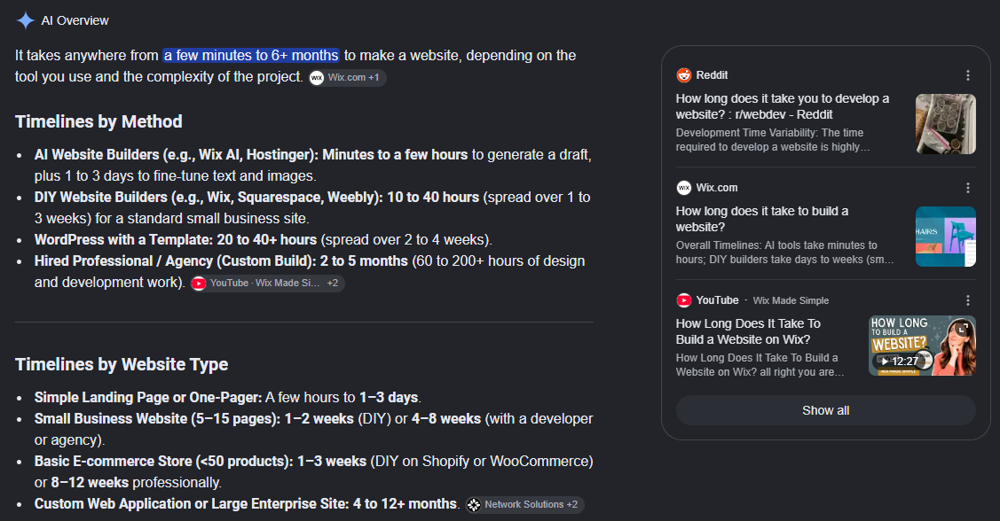
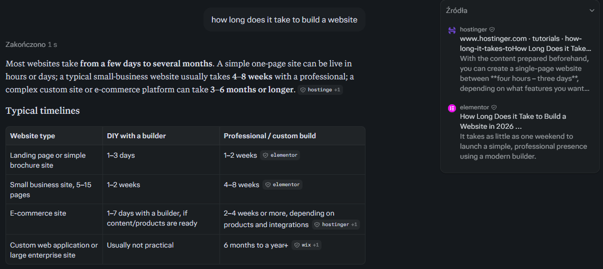
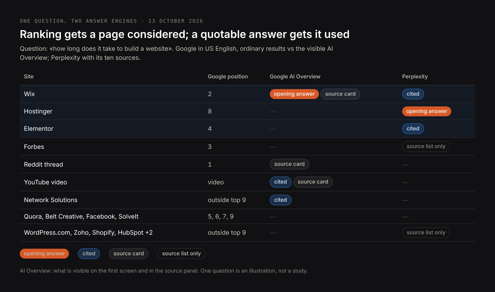
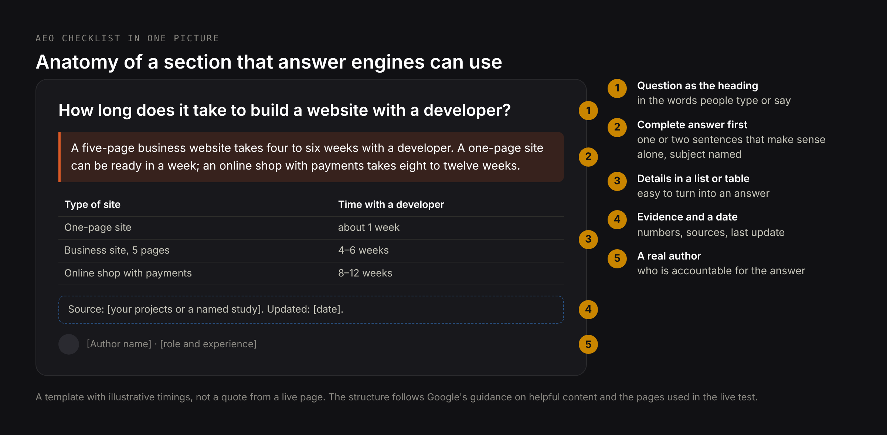
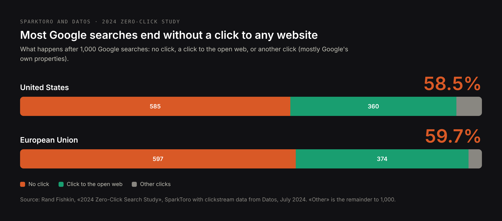

# DRAFT EN — «What is AEO» (24 Oct 2026). Definition + how-to article.
# Core: research/pseo/page-core/what-is-aeo.md — what is aeo 5,400, answer engine
# optimization 2,400, what is aeo in marketing 1,300, aeo in seo 1,000, what is answer
# engine optimization 1,000, aeo marketing 880, answer engine optimization aeo 880,
# aeo seo 720, answer engine optimization tools 590+590, best practices 110, how to
# do aeo 70. Intent: research/pseo/intent-check-what-is-aeo.md — «what is AEO» and the
# bare term share 6 of 10 URLs (one page), «how to» 5, «strategy» 6; «services» 0
# (stays on /services/answer-engine-optimization-services); «what is GEO» 0.
# Not here: «aeo vs seo / aeo vs geo» (geo-vs-seo article).
# Sources: Google Search Central (FAQ rich results gone 7 May 2026; HowTo/FAQ changes
# Aug 2023; AI features and your website); SparkToro/Datos 2024 zero-click study;
# Bing Webmaster blog (Feb, 16 Jun 2026); Alphabet Q2 2026; the owner's 141-answer
# study; live test 23 Oct 2026 («how long does it take to build a website»).
# H1 (Title) and Meta title differ on purpose.

Title: What Is Answer Engine Optimization (AEO)? Meaning, How Answers Are Chosen and How to Do It
Slug: what-is-answer-engine-optimization
Meta title: What Is AEO? Answer Engine Optimization Explained (2026)
Meta description: AEO, or answer engine optimization, explained: what it means in SEO and marketing, how Google and AI tools pick one answer, and how to do it step by step.

---

> Quick answer: AEO, short for answer engine optimization, is the work of making your page the source of the direct answer to a specific question — the answer box in Google, the first sentence of an AI Overview, the line ChatGPT or Perplexity quotes, or the reply a voice assistant reads out. It is a part of SEO: the page still has to be indexed and trusted. What AEO adds is the form of the content: the question named in a heading, a complete answer in the first sentence or two below it, and the details, numbers and sources after that. Since 7 May 2026 Google no longer shows FAQ rich results, so AEO today is about the text itself, not about markup.

Search used to answer a question with ten links. More and more often it answers with one sentence: in the US, 58.5% of Google searches end without a click to any website. Answer engine optimization is about whose sentence that is. This article covers what AEO means, where answers appear, how Google and AI tools choose them — shown on a live test from 23 October 2026 — and how to do AEO step by step, with examples, a checklist and the tools that measure it.

## What is AEO? Answer engine optimization defined

**Answer engine optimization (AEO)** is optimizing content so that a search engine or an AI system uses it as the answer to a question, instead of just listing it among results. An «answer engine» is any system that replies with an answer rather than a list: Google's answer box and AI Overviews, Google AI Mode, ChatGPT, Perplexity, Copilot, Gemini, and voice assistants such as Siri, Alexa and Google Assistant.

The unit of AEO is one question and one answer. The success you can see is concrete: your sentence appears in the answer box, opens the AI Overview, or is quoted with a link to your page.

### Where the term comes from

The term is older than ChatGPT. It spread in 2017–2018, when Google's featured snippets and voice assistants began answering with a single result read out loud; the SEO consultant Jason Barnard is usually credited with coining it. Generative AI did not create AEO — it multiplied the places where one answer replaces a list.

### AEO and GEO in one paragraph

AEO and GEO (generative engine optimization) overlap, and many writers use them as synonyms. The useful difference: AEO is about **your wording becoming the answer to a question**; GEO is about **your business being named, and named correctly, anywhere in an AI-generated answer**, including when nobody asked about you directly. A page can win at AEO for «how long does it take to build a website» without the company behind it ever being recommended. The full comparison is in [GEO vs SEO vs AEO](/blog/geo-vs-seo), and GEO itself is explained in [what is generative engine optimization](/blog/what-is-generative-engine-optimization).

## What AEO stands for in marketing and SEO, and the other «AEO»

In SEO and digital marketing, AEO stands for answer engine optimization. «AEO in SEO» means the part of search optimization aimed at answers rather than rankings; «AEO marketing» usually means content marketing planned around the questions buyers ask.

Two other meanings share the acronym and fill a large part of the search results for «what is AEO»:

- **Authorised Economic Operator** — a customs status in the EU and many other countries that speeds up border clearance for trusted companies. «What is an AEO certificate» is searched as often as «what is AEO» itself. It has nothing to do with search.
- **American Eagle Outfitters** — a US clothing retailer whose stock ticker is AEO.

If you landed here looking for the customs certificate, the place to ask is your national customs authority.

## Where answers appear: answer boxes, AI Overviews, chat assistants and voice

Each answer surface takes its answer in a different way, and what your site gets in return differs too.

| Where the answer appears | What it shows | Sources per answer | What the source gets |
|---|---|---|---|
| Google featured snippet (answer box) | One passage from one page, above the results | 1 | A link and the top of the page |
| Google AI Overview | A generated summary above the results | Several, shown as links and cards | A link, often below the fold of the summary |
| Google AI Mode | A conversational answer, on its own tab | 3.7 on average in my study | A link |
| ChatGPT with search | A conversational answer | 1.6 on average in my study | A link, sometimes none |
| Perplexity | An answer with numbered sources | 16.7 on average in my study | A numbered link |
| Voice assistants | One answer read aloud | Usually 1, often not named | Sometimes the name of the site, rarely a visit |

The averages come from my analysis of [141 AI answers to buying questions](/blog/ai-assistant-recommendations-study). The practical consequence: in a featured snippet there is one winner; in Perplexity there are fifteen places; in ChatGPT, often one or two.

## How answer engines choose an answer: a live test

To show how this works in practice, on 23 October 2026 I asked Google (US English) and Perplexity the same question: «how long does it take to build a website». Then I compared whose text each one used with who ranks in Google's ordinary results.

The AI Overview opens with one answer: «a few minutes to 6+ months», attributed to Wix, which is second in the ordinary results. Wix's page summarises the whole answer in its first lines — AI tools take minutes to hours, DIY builders days to weeks — before any detail. Forbes, third in the ordinary results, is not among the visible sources at all.

Perplexity built its opening sentence from Hostinger, eighth in Google's results, and its table of timelines from Elementor, Hostinger and Wix. Forbes appears only in its list of ten sources, without being attached to any statement.

What the winners have in common is not their ranking. Every page used for a visible answer:

- names the question in its title or first heading, in the same words people search with;
- gives the answer as a range of time in the first lines, then explains it;
- breaks the answer down by type — builder, template, custom — so a table can be built from it.

Forbes ranks well and is trusted, but its article does not give a ready answer at the top. That is answer engine optimization in one example: **ranking gets a page considered; a quotable answer gets it used.**

My own article on this question, [how long does it take to build a website](/blog/how-long-does-it-take-to-build-a-website), is not among the sources either. It opens with a quick answer, but it does not rank in Google's US top ten for this query, so neither engine retrieved it. That is the other half of AEO: a quotable answer that search cannot find is never considered.

## AEO in SEO: where answer engine optimization fits

AEO is not a separate channel next to SEO; it is a layer of it. An answer engine can only use a page that it can find, read and trust, so everything SEO does — crawlability, indexing, links, reputation, speed — is the precondition. What AEO adds is the form of the content.

| | Classic SEO | AEO |
|---|---|---|
| Unit of work | A page | A question and its answer |
| Goal | A high position and a click | Being the answer, with or without a click |
| Main lever | Relevance and authority of the page | A complete, quotable answer within the page |
| Where to look for questions | Keyword tools | People Also Ask, Search Console queries, questions asked to assistants |
| What success looks like | Rankings, clicks | Answer boxes won, citations in AI answers |

A useful rule: if a page answers a question but nobody can quote it without reading three paragraphs, it is SEO-ready and not AEO-ready.

## How to do answer engine optimization: step by step

### Step 1. Find the questions people actually ask

Collect real questions, not keywords:

- **People Also Ask** boxes in Google for your main topics; each answer opens more questions.
- **Search Console:** filter queries containing «how», «what», «why», «how much», «can», «which» in the Performance report.
- **Assistants:** ask ChatGPT and Perplexity your topic and note the follow-up questions they suggest.
- **Your inbox:** the questions customers send before buying are the best AEO list you have.

Group them by intent. One page should answer one main question and its close variants, not ten unrelated ones.

### Step 2. Put the answer first

Under the heading that names the question, write the answer in the first one or two sentences, so that it makes sense if it is the only thing someone reads:

- name the subject instead of «it» or «we»;
- give the number, range, yes or no, or the definition straight away;
- add the condition that changes the answer («for a five-page site», «in Poland», «as of 2026»).

The rest of the section explains, qualifies and proves. This is the inverted pyramid of news writing, applied to every section of a page.

### Step 3. Structure the page so parts can be lifted

- one question per H2 or H3, phrased the way people ask it;
- lists for steps and options, tables for comparisons and prices;
- short paragraphs, one idea each;
- the main content in the HTML, not loaded later by scripts.

A table of «type → time → price» was turned almost directly into Perplexity's answer in the test above.

### Step 4. Prove the answer

Answer engines prefer answers they can trust. Numbers with dates, named sources with links, an author with real experience and a visible «updated» date all help. The research behind GEO measured this: adding statistics, quotations and sources raised a page's use in generated answers by 27–41%, while repeating the keyword lowered it by 8%.

### Step 5. Use markup where it still counts

Structured data does not win answers by itself, and two formats that were once AEO staples are gone from Google's results: HowTo rich results were removed in 2023, and **since 7 May 2026 FAQ rich results no longer appear in Google Search for any site.** FAQ markup does no harm, but it no longer produces anything visible. What remains useful is markup that describes what the page and the business are — Organization, LocalBusiness, Article, Product, BreadcrumbList — and only when it matches what is visible on the page.

### Step 6. Keep answers current

An answer that was right in 2023 and is wrong now is worse than no answer: engines may keep quoting it. Put a visible date on pages with prices, timelines or statistics, and review them at least once a year.

## AEO best practices checklist

| Check | Why it matters | How to verify |
|---|---|---|
| The question is in a heading, in the searcher's words | Engines match questions to headings | Read your H2s alone: do they ask what customers ask? |
| The answer is complete in the first one or two sentences | Only a self-contained passage can be lifted | Read just the first sentence under each heading |
| The subject is named, not «we» or «it» | A quote loses its context | Search the first sentences for «we», «it», «this» |
| Numbers, ranges and dates instead of adjectives | Concrete answers are preferred and checkable | Search for «fast», «affordable», «best» |
| Lists for steps, tables for comparisons | Easy to turn into an answer | Look at the page without reading it |
| Sources named and linked | Trust signal for engines and readers | Count claims without a source |
| Visible author and «updated» date | Freshness and accountability | Top or bottom of the article |
| Main content in the HTML | Some crawlers do not run scripts | View the page source |
| Markup matches the visible content; no reliance on FAQ rich results | FAQ results are gone since May 2026 | Rich Results Test |
| One main question per page | Avoids competing with yourself | List the pages that answer the same question |

## Answer engine optimization examples

### Example 1: the same answer, before and after

A typical answer on a web studio's FAQ page, before:

> Great question! Every project is unique, and timelines depend on many factors. We always work closely with our clients to deliver the best possible result within a reasonable timeframe.

Nothing here answers the question. After:

> A five-page business website takes four to six weeks with a developer: one week for structure and content, two to three for design and development, one for testing and launch. A one-page site can be ready in a week; an online shop with payments takes eight to twelve weeks.

The second version gives the range first, then the breakdown and two alternatives — exactly the shape of the answers Google and Perplexity used in the test.

### Example 2: a heading that can be matched to a question

Before: «Our process». After: «How long does it take to build a website with a developer?» The first heading describes the company; the second names the question that someone types or says. Only the second one can be matched to a query.

### Example 3: a definition that can be quoted

Before: «In today's fast-changing digital landscape, businesses face new challenges…». After: «Answer engine optimization (AEO) is optimizing content so that a search engine or an AI system uses it as the answer to a question.» Definitions that start with the term and finish in one sentence are the ones answer engines quote — the AI Overview for «what is generative engine optimization» took its definition from exactly such a sentence, as I show in [what is GEO](/blog/what-is-generative-engine-optimization).

## Answer engine optimization tools: what they measure

| Type | What it does | Examples | Limit |
|---|---|---|---|
| Question research | Finds the questions people ask around a topic | People Also Ask, AlsoAsked, AnswerThePublic, Search Console | Shows questions, not who answers them in AI tools |
| Rank trackers with SERP features | Show which keywords trigger answer boxes and AI Overviews, and whether you appear | Semrush, Ahrefs, SE Ranking | Mostly Google; AI Overviews are tracked by sampling |
| AI visibility trackers | Run question sets in ChatGPT, Perplexity, Gemini and AI Mode and record citations | Profound, Peec AI, Otterly.AI | Answers change between runs and users |
| First-party AI reports | Citations measured by the engine itself | Bing Webmaster Tools AI Performance | Microsoft surfaces only |

The two searches «answer engine optimization tools» and «answer engine optimization tool» together get about 1,200 searches a month, but no tool does AEO for you. Tools find questions and measure results; the answers have to be written.

## How to measure AEO

- **Share of questions answered.** Take your list of 20–50 key questions. Once a month, check who provides the answer box, the opening of the AI Overview, and the sources in ChatGPT and Perplexity. The share of questions where it is you is the main AEO figure.
- **Search Console.** AI Overviews and AI Mode are not reported separately; they are included in the Web performance report. Watch question-type queries: falling clicks with stable impressions often mean that an answer is now shown above you.
- **Bing Webmaster Tools.** The AI Performance report, in preview since February 2026, shows how often your pages are cited in Copilot and Bing's AI answers, which pages, and the «grounding queries» used to find them; since June 2026 it groups them by intent and topic.
- **AI referrals in GA4.** Visits from chatgpt.com, perplexity.ai, gemini.google.com and copilot.microsoft.com can be grouped into their own channel. After the GPT-6 rollout on 7–8 October 2026, part of ChatGPT's links arrived without a tag or referrer and were counted as Direct, so treat short-term drops with care.

## AEO statistics for 2026

| Figure | Value | Source |
|---|---|---|
| Google searches ending without a click | 58.5% in the US, 59.7% in the EU | SparkToro and Datos, July 2024 |
| Clicks to the open web per 1,000 Google searches | 360 in the US, 374 in the EU | SparkToro and Datos, July 2024 |
| FAQ rich results in Google Search | Shown on no sites since 7 May 2026 | Google Search Central |
| HowTo rich results | Removed in 2023 | Google Search Central |
| Google AI Mode monthly users | More than 1 billion | Alphabet, 22 July 2026 |
| ChatGPT weekly users | More than 900 million | OpenAI via TechCrunch, 27 February 2026 |
| Sources per AI answer | Perplexity 16.7, Google AI Mode 3.7, ChatGPT 1.6 | Bandziuk, 141 answers, September 2026 |
| Effect of adding statistics / quotations / sources on use in AI answers | +31% / +41% / +27% | GEO paper, KDD 2024 |
| Effect of keyword stuffing | −8% | GEO paper, KDD 2024 |

## Common AEO mistakes

**Building an FAQ section for the markup.** Since May 2026 FAQ markup produces no rich result in Google. An FAQ is still useful when the questions are real and the answers are complete; a list of questions written to fill markup is not.

**Answering at the end.** A long introduction before the answer is the most common reason a well-ranked page is passed over, as Forbes was in the test above.

**Cute headings.** «Our approach», «The secret», «Why it matters» describe nothing that anyone asks.

**One page for every question.** Thirty thin pages, each with one short answer, compete with each other and look like low-value content. Group close questions on one page.

**Measuring only rankings.** A page can hold position three and lose most of its clicks to an answer shown above it. Track who gives the answer, not only where you rank.

## Does your business need AEO?

Answer engine optimization pays off when your customers ask questions before they buy: how much, how long, which option, is it legal, what is needed. Professional services, clinics, software, education and any purchase with research behind it fall here. It matters less for impulse purchases and for businesses that customers find by walking past.

For most sites AEO is not a new project but a rewrite of existing pages: the key service pages and the five to twenty articles that answer real questions. In my practice, measuring where a site stands in answers starts at 250 €, preparing a site for AI search at 800 €, and ongoing monitoring at 250 € a month. What is included is on the [answer engine optimization services](/services/answer-engine-optimization-services) page.

## Common questions about answer engine optimization

**What does AEO stand for?**
In SEO and marketing, AEO stands for answer engine optimization: making content the source of direct answers in Google, AI tools and voice assistants. In trade and customs, AEO means Authorised Economic Operator, a customs status unrelated to search.

**Is AEO better than SEO?**
They are not alternatives. AEO is a part of SEO: an answer engine can only use pages it can find and trust. A site that does AEO without SEO has nothing to be quoted from; a site that does SEO without AEO is found but not quoted.

**Is AEO the same as GEO?**
They overlap. AEO aims to make your wording the answer to a question; GEO aims to get your business named and described correctly in AI-generated answers in general. See [GEO vs SEO vs AEO](/blog/geo-vs-seo).

**How do I start with answer engine optimization?**
List the 20 questions customers ask before buying, check who answers them today in Google and in ChatGPT, and rewrite the pages that should answer them: question in the heading, answer in the first sentence, details and sources after.

**Does FAQ schema still help AEO?**
Not in Google's results: since 7 May 2026 FAQ rich results are no longer shown for any site. The markup does no harm, and a real FAQ section with complete answers still helps readers and answer engines through its text, not its markup.

**How long does AEO take to show results?**
A rewritten page can win an answer box or an AI citation within weeks of being recrawled. In AI assistants, results vary by session and model, so judge them over two to three months of monthly checks.

**How much does answer engine optimization cost?**
It depends on how many pages need rewriting. My prices: a measurement of where you stand from 250 €, preparing a site for AI search from 800 €, ongoing monitoring from 250 € a month.

## Where to start with AEO

Take the one question your customers ask most often before they contact you. Search it in Google and ask it in ChatGPT and Perplexity. If the answer they give comes from someone else, look at that page: it almost certainly names the question in a heading and answers it in the first sentence. Then do the same on your page — and if you want this done for your whole site, with the questions, the rewrites and the measurement, [write to me](/contacts) or see the [answer engine optimization services](/services/answer-engine-optimization-services).
