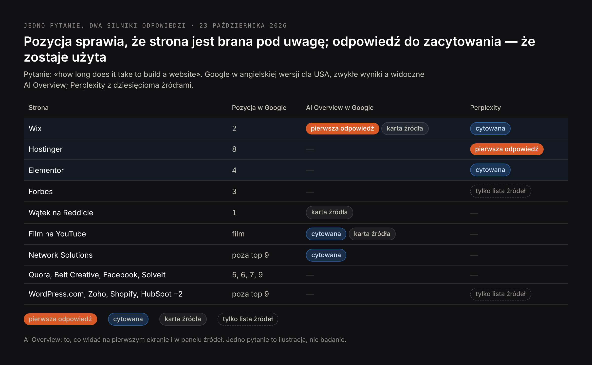
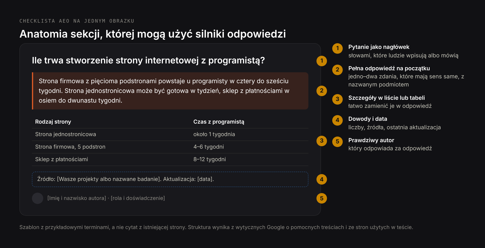
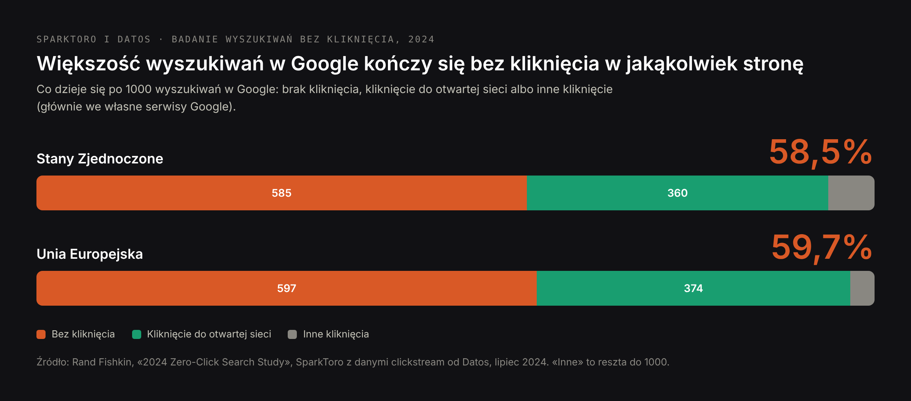

# DRAFT PL — «AEO: answer engine optimization» (24 Oct 2026). Same research as EN,
# written for Polish readers. Core (PL): aeo seo 90, answer engine optimization 50,
# seo geo aeo 40. «aeo co to» (260) is the customs status in the SERP (gov.pl, celne
# portals), so the slug avoids «co to» and the text separates the two meanings.
# Prices in zł as on the PL AEO page. H1 (Title) ≠ Meta title.

Title: AEO (answer engine optimization): czym jest, jak Google i AI wybierają odpowiedź i jak to robić krok po kroku
Slug: aeo-answer-engine-optimization
Meta title: AEO w SEO: czym jest answer engine optimization (2026)
Meta description: AEO, czyli answer engine optimization: co znaczy w SEO, jak Google i narzędzia AI wybierają jedną odpowiedź i jak krok po kroku stać się jej źródłem.

---

> Krótko: AEO, czyli answer engine optimization, to praca nad tym, żeby Wasza strona była źródłem bezpośredniej odpowiedzi na konkretne pytanie — w ramce z odpowiedzią w Google, w pierwszym zdaniu AI Overview, w zdaniu, które cytuje ChatGPT albo Perplexity, czy w odpowiedzi czytanej przez asystenta głosowego. To część SEO: strona nadal musi być zaindeksowana i wiarygodna. AEO dodaje formę treści: pytanie nazwane w nagłówku, pełna odpowiedź w pierwszym lub drugim zdaniu pod nim, a dopiero potem szczegóły, liczby i źródła. Od 7 maja 2026 roku Google nie pokazuje już wyników rozszerzonych FAQ, więc AEO to dziś praca nad samym tekstem, a nie nad oznaczeniami.

Wyszukiwarka odpowiadała kiedyś na pytanie dziesięcioma linkami. Coraz częściej odpowiada jednym zdaniem: w Unii Europejskiej 59,7% wyszukiwań w Google kończy się bez kliknięcia w jakąkolwiek stronę. Answer engine optimization dotyczy tego, czyje to zdanie. W tym artykule: co znaczy AEO, gdzie pojawiają się odpowiedzi, jak Google i narzędzia AI je wybierają — na teście z 23 października 2026 roku — i jak robić AEO krok po kroku, z przykładami, checklistą i narzędziami do pomiaru.

## Czym jest AEO: definicja answer engine optimization

**Answer engine optimization (AEO)** to optymalizacja treści tak, żeby wyszukiwarka albo system AI użył jej jako odpowiedzi na pytanie, a nie tylko pokazał ją na liście wyników. «Silnik odpowiedzi» to każdy system, który zamiast listy daje odpowiedź: ramka z odpowiedzią i AI Overviews w Google, tryb AI w Google, ChatGPT, Perplexity, Copilot, Gemini i asystenci głosowi, tacy jak Siri, Alexa czy Asystent Google.

Jednostką AEO jest jedno pytanie i jedna odpowiedź. Sukces jest konkretny: Wasze zdanie pojawia się w ramce z odpowiedzią, otwiera AI Overview albo jest cytowane z linkiem do Waszej strony.

### Skąd pochodzi termin

Termin jest starszy niż ChatGPT. Rozpowszechnił się w latach 2017–2018, gdy wyróżnione fragmenty Google i asystenci głosowi zaczęli odpowiadać jednym wynikiem czytanym na głos; jego autorstwo zwykle przypisuje się konsultantowi SEO Jasonowi Barnardowi. Generatywna AI nie stworzyła AEO — pomnożyła miejsca, w których jedna odpowiedź zastępuje listę.

### AEO i GEO w jednym akapicie

AEO i GEO (generative engine optimization) się pokrywają i wielu autorów używa ich zamiennie. Przydatna różnica: AEO dotyczy tego, żeby **Wasze sformułowanie stało się odpowiedzią na pytanie**; GEO — żeby **Wasza firma była wymieniana, i to poprawnie, w dowolnym miejscu odpowiedzi AI**, także wtedy, gdy nikt nie pytał o nią wprost. Strona może wygrać AEO na pytanie «ile trwa stworzenie strony internetowej», a stojąca za nią firma nigdy nie zostać polecona. Pełne porównanie jest w tekście [GEO vs SEO vs AEO](/pl/blog/geo-vs-seo-roznice), a samo GEO wyjaśniam w artykule [GEO co to jest](/pl/blog/geo-co-to-jest).

## AEO w SEO i marketingu, a AEO w cle: dwa różne znaczenia

W SEO i marketingu internetowym AEO oznacza answer engine optimization. «AEO w SEO» to ta część optymalizacji, która celuje w odpowiedzi, a nie w pozycje; «AEO w marketingu» to zwykle content marketing planowany wokół pytań, które zadają kupujący.

W Polsce skrót AEO ma jeszcze jedno, popularniejsze znaczenie i to ono wypełnia wyniki na zapytanie «aeo co to»:

- **Upoważniony Przedsiębiorca (AEO, Authorised Economic Operator)** — status celny w Unii Europejskiej, który przyspiesza odprawy dla zaufanych firm. Do niego odnoszą się «certyfikat AEO» i «numer AEO». Nie ma nic wspólnego z wyszukiwarkami; informacje o nim podaje Krajowa Administracja Skarbowa.
- **American Eagle Outfitters** — amerykańska sieć odzieżowa notowana na giełdzie pod symbolem AEO.

Dalej piszę wyłącznie o answer engine optimization.

## Gdzie pojawiają się odpowiedzi: ramka z odpowiedzią, AI Overviews, czaty i głos

Każde z tych miejsc bierze odpowiedź inaczej i co innego daje w zamian stronie, z której ją wzięło.

| Gdzie jest odpowiedź | Co pokazuje | Źródeł na odpowiedź | Co dostaje źródło |
|---|---|---|---|
| Wyróżniony fragment Google (ramka z odpowiedzią) | Jeden fragment z jednej strony nad wynikami | 1 | Link i miejsce na samej górze |
| AI Overview w Google | Wygenerowane podsumowanie nad wynikami | Kilka, jako linki i karty | Link, często niżej w podsumowaniu |
| Tryb AI w Google | Odpowiedź w formie rozmowy, w osobnej karcie | Średnio 3,7 w moim badaniu | Link |
| ChatGPT z wyszukiwaniem | Odpowiedź w formie rozmowy | Średnio 1,6 w moim badaniu | Link, czasem żaden |
| Perplexity | Odpowiedź z numerowanymi źródłami | Średnio 16,7 w moim badaniu | Numerowany link |
| Asystenci głosowi | Jedna odpowiedź czytana na głos | Zwykle 1, często bez nazwy | Czasem nazwa strony, rzadko wizyta |

Średnie pochodzą z mojej analizy [141 odpowiedzi AI na pytania zakupowe](/pl/blog/pozycjonowanie-w-ai-badanie). Praktyczny wniosek: w wyróżnionym fragmencie wygrywa jeden; w Perplexity jest piętnaście miejsc; w ChatGPT często jedno albo dwa.

## Jak wyszukiwarki i AI wybierają odpowiedź: test na żywo

Żeby pokazać, jak to działa w praktyce, 23 października 2026 roku zadałem Google (w angielskiej wersji dla USA) i Perplexity to samo pytanie: «how long does it take to build a website», czyli ile trwa stworzenie strony internetowej. Potem porównałem, czyj tekst każde z nich wykorzystało, z tym, kto jest w zwykłych wynikach Google.

AI Overview zaczyna się od jednej odpowiedzi: «od kilku minut do ponad 6 miesięcy», przypisanej do Wix, który jest drugi w zwykłych wynikach. Strona Wix streszcza całą odpowiedź w pierwszych linijkach — narzędzia AI to minuty lub godziny, kreatory to dni lub tygodnie — zanim przejdzie do szczegółów. Forbes, trzeci w zwykłych wynikach, w ogóle nie ma wśród widocznych źródeł.

Perplexity zbudowało pierwsze zdanie z Hostingera, ósmego w wynikach Google, a tabelę terminów z Elementora, Hostingera i Wix. Forbes pojawia się tylko na liście dziesięciu źródeł, nieprzypisany do żadnego stwierdzenia.

Zwycięzców nie łączy pozycja. Każda strona użyta w widocznej odpowiedzi:

- nazywa pytanie w tytule albo pierwszym nagłówku tymi samymi słowami, którymi ludzie szukają;
- podaje odpowiedź jako przedział czasu w pierwszych linijkach, a dopiero potem ją wyjaśnia;
- rozbija odpowiedź według rodzaju — kreator, szablon, projekt na zamówienie — tak że da się z niej zrobić tabelę.

Forbes jest wysoko i ma zaufanie, ale jego artykuł nie daje gotowej odpowiedzi na górze. To AEO w jednym przykładzie: **pozycja sprawia, że strona jest brana pod uwagę; odpowiedź, którą da się zacytować, sprawia, że zostaje użyta.**

Mój własny artykuł na to pytanie, [ile trwa stworzenie strony internetowej](/pl/blog/ile-trwa-stworzenie-strony-internetowej), w wersji angielskiej też nie trafił do źródeł. Zaczyna się od krótkiej odpowiedzi, ale nie jest w amerykańskiej pierwszej dziesiątce Google na to zapytanie, więc żaden silnik go nie pobrał. To druga połowa AEO: odpowiedzi, której wyszukiwarka nie znajduje, nikt nie rozważy.

## AEO w SEO: gdzie mieści się answer engine optimization

AEO to nie osobny kanał obok SEO, tylko jego warstwa. Silnik odpowiedzi może użyć tylko strony, którą potrafi znaleźć, przeczytać i której ufa, więc wszystko, co robi SEO — dostępność dla robotów, indeksacja, linki, reputacja, szybkość — jest warunkiem wstępnym. AEO dodaje formę treści.

| | Klasyczne SEO | AEO |
|---|---|---|
| Jednostka pracy | Strona | Pytanie i odpowiedź na nie |
| Cel | Wysoka pozycja i kliknięcie | Bycie odpowiedzią, z kliknięciem albo bez |
| Główna dźwignia | Trafność i autorytet strony | Pełna odpowiedź, którą da się zacytować |
| Gdzie szukać pytań | Narzędzia do fraz | «Podobne pytania» w Google, zapytania w Search Console, pytania do asystentów |
| Jak wygląda sukces | Pozycje, kliknięcia | Wygrane ramki z odpowiedzią, cytowania w odpowiedziach AI |

Przydatna zasada: jeśli strona odpowiada na pytanie, ale nikt nie zacytuje jej bez przeczytania trzech akapitów, to jest gotowa pod SEO, a nie pod AEO.

## Jak robić answer engine optimization krok po kroku

### Krok 1. Znajdźcie pytania, które ludzie naprawdę zadają

Zbierajcie prawdziwe pytania, nie frazy:

- **«Podobne pytania»** w Google dla głównych tematów; każda odpowiedź otwiera kolejne pytania.
- **Search Console:** w raporcie skuteczności filtrujcie zapytania z «jak», «co», «dlaczego», «ile», «czy», «który».
- **Asystenci:** zapytajcie ChatGPT i Perplexity o swój temat i zapiszcie pytania uzupełniające, które proponują.
- **Skrzynka mailowa:** pytania, które klienci zadają przed zakupem, to najlepsza lista do AEO.

Pogrupujcie je według intencji. Jedna strona powinna odpowiadać na jedno główne pytanie i jego bliskie warianty, a nie na dziesięć niepowiązanych.

### Krok 2. Odpowiedź na początku

Pod nagłówkiem, który nazywa pytanie, dajcie odpowiedź w pierwszym albo drugim zdaniu — tak, żeby miała sens, nawet jeśli ktoś przeczyta tylko ją:

- nazwijcie podmiot zamiast «to» albo «my»;
- od razu podajcie liczbę, przedział, «tak» lub «nie» albo definicję;
- dodajcie warunek, który zmienia odpowiedź («dla strony z pięcioma podstronami», «w Polsce», «w 2026 roku»).

Reszta sekcji wyjaśnia, doprecyzowuje i udowadnia. To odwrócona piramida z dziennikarstwa, zastosowana do każdej sekcji strony.

### Krok 3. Struktura, z której da się wyjąć fragmenty

- jedno pytanie na nagłówek H2 lub H3, sformułowane tak, jak pytają ludzie;
- listy dla kroków i opcji, tabele dla porównań i cen;
- krótkie akapity, jedna myśl w każdym;
- główna treść w HTML, a nie doładowywana później skryptami.

W teście powyżej tabela «rodzaj → czas → cena» przeszła niemal wprost do odpowiedzi Perplexity.

### Krok 4. Udowodnijcie odpowiedź

Silniki odpowiedzi wolą odpowiedzi, którym mogą zaufać. Pomagają liczby z datami, nazwane źródła z linkami, autor z prawdziwym doświadczeniem i widoczna data aktualizacji. Badania, od których zaczęło się GEO, to zmierzyły: dodanie statystyk, cytatów i źródeł zwiększało wykorzystanie strony w odpowiedziach generowanych o 27–41%, a powtarzanie frazy kluczowej zmniejszało je o 8%.

### Krok 5. Oznaczenia tam, gdzie wciąż coś dają

Dane strukturalne same nie wygrywają odpowiedzi, a dwa formaty, które kiedyś były podstawą AEO, zniknęły z wyników Google: wyniki rozszerzone HowTo usunięto w 2023 roku, a **od 7 maja 2026 roku wyniki rozszerzone FAQ nie pojawiają się w Google dla żadnej strony.** Oznaczenie FAQ nie szkodzi, ale nie daje już nic widocznego. Przydatne pozostają oznaczenia opisujące, czym jest strona i firma — Organization, LocalBusiness, Article, Product, BreadcrumbList — i tylko wtedy, gdy zgadzają się z tym, co widać na stronie.

### Krok 6. Aktualizujcie odpowiedzi

Odpowiedź, która była prawdziwa w 2023 roku, a dziś jest błędna, jest gorsza niż jej brak: silniki mogą ją dalej cytować. Na stronach z cenami, terminami i statystykami pokazujcie datę i przeglądajcie je co najmniej raz w roku.

## Checklista AEO: dobre praktyki

| Co sprawdzić | Dlaczego to ważne | Jak to zweryfikować |
|---|---|---|
| Pytanie jest w nagłówku, słowami szukającego | Silniki dopasowują pytania do nagłówków | Przeczytajcie same H2: czy pytają o to, o co pytają klienci? |
| Odpowiedź jest pełna w pierwszym lub drugim zdaniu | Wyjąć da się tylko samodzielny fragment | Przeczytajcie tylko pierwsze zdanie pod każdym nagłówkiem |
| Podmiot jest nazwany, a nie «my» czy «to» | Cytat traci kontekst | Szukajcie «my», «to», «ten» w pierwszych zdaniach |
| Liczby, przedziały i daty zamiast przymiotników | Konkretne odpowiedzi są preferowane i sprawdzalne | Szukajcie «szybko», «tanio», «najlepszy» |
| Listy dla kroków, tabele dla porównań | Łatwo zamienić je w odpowiedź | Spójrzcie na stronę bez czytania |
| Źródła nazwane i podlinkowane | Sygnał zaufania dla silników i ludzi | Policzcie twierdzenia bez źródła |
| Widoczny autor i data aktualizacji | Świeżość i odpowiedzialność | Góra albo dół artykułu |
| Główna treść w HTML | Niektóre roboty nie uruchamiają skryptów | Źródło strony |
| Oznaczenia zgodne z treścią; bez liczenia na wyniki FAQ | Wyników FAQ nie ma od maja 2026 | Test wyników z elementami rozszerzonymi |
| Jedno główne pytanie na stronę | Unikacie konkurowania z samymi sobą | Wypiszcie strony odpowiadające na to samo pytanie |

## Przykłady answer engine optimization

### Przykład 1: ta sama odpowiedź przed zmianą i po

Typowa odpowiedź z FAQ studia internetowego, przed zmianą:

> Świetne pytanie! Każdy projekt jest wyjątkowy, a czas realizacji zależy od wielu czynników. Zawsze ściśle współpracujemy z klientami, żeby osiągnąć najlepszy efekt w rozsądnym terminie.

Nic tu nie odpowiada na pytanie. Po zmianie:

> Strona firmowa z pięcioma podstronami powstaje u programisty w cztery do sześciu tygodni: tydzień na strukturę i treści, dwa–trzy na projekt i wdrożenie, tydzień na testy i start. Strona jednostronicowa może być gotowa w tydzień, a sklep internetowy z płatnościami w osiem do dwunastu tygodni.

Druga wersja zaczyna od przedziału, potem podaje rozbicie i dwie alternatywy — dokładnie w kształcie odpowiedzi, których Google i Perplexity użyły w teście.

### Przykład 2: nagłówek, który da się dopasować do pytania

Przed: «Nasz proces». Po: «Ile trwa stworzenie strony internetowej z programistą?» Pierwszy nagłówek opisuje firmę, drugi nazywa pytanie, które ktoś wpisuje albo wypowiada. Tylko drugi da się dopasować do zapytania.

### Przykład 3: definicja, którą da się zacytować

Przed: «W dzisiejszym dynamicznym świecie cyfrowym firmy stają przed nowymi wyzwaniami…». Po: «Answer engine optimization (AEO) to optymalizacja treści tak, żeby wyszukiwarka albo system AI użył jej jako odpowiedzi na pytanie». Silniki odpowiedzi cytują definicje, które zaczynają się od terminu i kończą w jednym zdaniu — AI Overview na «what is generative engine optimization» wziął definicję właśnie z takiego zdania, co pokazuję w artykule [GEO co to jest](/pl/blog/geo-co-to-jest).

## Narzędzia do AEO: co mierzą

| Typ | Co robi | Przykłady | Ograniczenie |
|---|---|---|---|
| Badanie pytań | Znajduje pytania, które ludzie zadają wokół tematu | «Podobne pytania», AlsoAsked, AnswerThePublic, Search Console | Pokazuje pytania, a nie kto na nie odpowiada w narzędziach AI |
| Trackery pozycji z elementami SERP | Pokazują, które frazy wywołują ramki z odpowiedzią i AI Overviews i czy tam jesteście | Semrush, Ahrefs, SE Ranking, Senuto | Głównie Google; AI Overviews śledzone na próbkach |
| Trackery widoczności w AI | Zadają zestawy pytań w ChatGPT, Perplexity, Gemini i trybie AI i zapisują cytowania | Profound, Peec AI, Otterly.AI | Odpowiedzi zmieniają się między sesjami i użytkownikami |
| Raporty samych silników | Cytowania mierzone przez silnik | Bing Webmaster Tools AI Performance | Tylko usługi Microsoftu |

Żadne narzędzie nie zrobi AEO za Was. Narzędzia znajdują pytania i mierzą wyniki; odpowiedzi trzeba napisać.

## Jak mierzyć AEO

- **Udział w odpowiedziach.** Weźcie listę 20–50 kluczowych pytań. Raz w miesiącu sprawdzajcie, kto daje ramkę z odpowiedzią, początek AI Overview i źródła w ChatGPT i Perplexity. Odsetek pytań, w których to Wy, to główna liczba w AEO.
- **Search Console.** AI Overviews i tryb AI nie są raportowane osobno; są wliczone w raport skuteczności (Web). Obserwujcie zapytania w formie pytań: spadek kliknięć przy stałych wyświetleniach często oznacza, że nad Wami pojawiła się odpowiedź.
- **Bing Webmaster Tools.** Raport AI Performance, w wersji preview od lutego 2026 roku, pokazuje, jak często Wasze strony są cytowane w Copilocie i odpowiedziach AI w Bing, które strony i jakich «grounding queries» użyto, żeby je znaleźć; od czerwca 2026 roku grupuje je według intencji i tematów.
- **Ruch z AI w GA4.** Wizyty z chatgpt.com, perplexity.ai, gemini.google.com i copilot.microsoft.com można zebrać w osobny kanał. Po wdrożeniu GPT-6 7–8 października 2026 roku część linków z ChatGPT przychodziła bez parametru i referera i była liczona jako ruch bezpośredni, więc krótkie spadki traktujcie ostrożnie.

## Statystyki AEO na 2026 rok

| Wskaźnik | Wartość | Źródło |
|---|---|---|
| Wyszukiwania w Google bez kliknięcia | 58,5% w USA, 59,7% w UE | SparkToro i Datos, lipiec 2024 |
| Kliknięcia do otwartej sieci na 1000 wyszukiwań | 360 w USA, 374 w UE | SparkToro i Datos, lipiec 2024 |
| Wyniki rozszerzone FAQ w Google | Nie pokazują się dla żadnej strony od 7 maja 2026 | Google Search Central |
| Wyniki rozszerzone HowTo | Usunięte w 2023 roku | Google Search Central |
| Użytkownicy trybu AI w Google miesięcznie | Ponad 1 mld | Alphabet, 22 lipca 2026 |
| Użytkownicy ChatGPT tygodniowo | Ponad 900 mln | OpenAI za TechCrunch, 27 lutego 2026 |
| Źródeł na odpowiedź AI | Perplexity 16,7, tryb AI 3,7, ChatGPT 1,6 | Bandziuk, 141 odpowiedzi, wrzesień 2026 |
| Efekt dodania statystyk / cytatów / źródeł na użycie w odpowiedziach AI | +31% / +41% / +27% | Praca o GEO, KDD 2024 |
| Efekt upychania fraz | −8% | Praca o GEO, KDD 2024 |

## Najczęstsze błędy w AEO

**Sekcja FAQ dla oznaczeń.** Od maja 2026 roku oznaczenie FAQ nie daje w Google żadnego wyniku rozszerzonego. FAQ ma sens, gdy pytania są prawdziwe, a odpowiedzi pełne; lista pytań napisana pod oznaczenia — nie.

**Odpowiedź na końcu.** Długi wstęp przed odpowiedzią to najczęstszy powód, dla którego dobrze pozycjonowana strona zostaje pominięta — tak jak Forbes w teście powyżej.

**Ozdobne nagłówki.** «Nasze podejście», «Sekret», «Dlaczego to ważne» nie opisują niczego, o co ktoś pyta.

**Osobna strona na każde pytanie.** Trzydzieści cienkich stron z jedną krótką odpowiedzią konkuruje ze sobą i wygląda na treść niskiej wartości. Bliskie pytania łączcie na jednej stronie.

**Mierzenie tylko pozycji.** Strona może trzymać trzecie miejsce i stracić większość kliknięć na rzecz odpowiedzi pokazanej nad nią. Sprawdzajcie, kto daje odpowiedź, a nie tylko, na którym miejscu jesteście.

## Czy Waszej firmie potrzebne jest AEO

Answer engine optimization się opłaca, gdy klienci przed zakupem zadają pytania: ile kosztuje, ile trwa, którą opcję wybrać, czy to legalne, czego potrzeba. Należą tu usługi profesjonalne, kliniki, oprogramowanie, edukacja i każdy zakup poprzedzony szukaniem informacji. Mniej ważne jest przy zakupach impulsowych i w firmach, do których klienci trafiają, przechodząc obok.

Dla większości stron AEO to nie nowy projekt, tylko przepisanie istniejących stron: kluczowych stron usług i pięciu–dwudziestu artykułów odpowiadających na prawdziwe pytania. U mnie pomiar stanu wyjściowego zaczyna się od 1000 zł, przygotowanie strony do wyszukiwania AI od 3500 zł, a stały monitoring od 1000 zł miesięcznie. Co obejmuje każda opcja, opisuję na stronie [pozycjonowanie w AI (AEO)](/pl/oferty/pozycjonowanie-w-ai-i-chatgpt).

## Najczęstsze pytania o AEO

**Co oznacza skrót AEO?**
W SEO i marketingu AEO to answer engine optimization: praca nad tym, żeby treść była źródłem bezpośrednich odpowiedzi w Google, narzędziach AI i asystentach głosowych. W handlu i cle AEO to Upoważniony Przedsiębiorca (Authorised Economic Operator), status celny niezwiązany z wyszukiwarkami.

**Czy AEO jest lepsze niż SEO?**
To nie są alternatywy. AEO jest częścią SEO: silnik odpowiedzi może użyć tylko stron, które znajduje i którym ufa. Strona robiąca AEO bez SEO nie ma skąd być cytowana; strona robiąca SEO bez AEO jest znajdowana, ale nie cytowana.

**Czy AEO to to samo co GEO?**
Pokrywają się. AEO dąży do tego, żeby Wasze sformułowanie było odpowiedzią na pytanie; GEO — żeby firma była wymieniana i poprawnie opisywana w odpowiedziach AI w ogóle. Zobaczcie [GEO vs SEO vs AEO](/pl/blog/geo-vs-seo-roznice).

**Od czego zacząć answer engine optimization?**
Spiszcie 20 pytań, które klienci zadają przed zakupem, sprawdźcie, kto dziś na nie odpowiada w Google i w ChatGPT, i przepiszcie strony, które powinny odpowiadać: pytanie w nagłówku, odpowiedź w pierwszym zdaniu, szczegóły i źródła potem.

**Czy oznaczenie FAQ wciąż pomaga w AEO?**
Nie w wynikach Google: od 7 maja 2026 roku wyniki rozszerzone FAQ nie są pokazywane dla żadnej strony. Oznaczenie nie szkodzi, a prawdziwa sekcja FAQ z pełnymi odpowiedziami nadal pomaga czytelnikom i silnikom odpowiedzi — tekstem, nie oznaczeniem.

**Po jakim czasie widać efekty AEO?**
Przepisana strona może wygrać ramkę z odpowiedzią albo cytowanie w AI w ciągu kilku tygodni od ponownego zaindeksowania. W asystentach AI wyniki różnią się między sesjami i modelami, więc oceniajcie je po dwóch–trzech miesiącach comiesięcznych pomiarów.

**Ile kosztuje answer engine optimization?**
To zależy od liczby stron do przepisania. U mnie: pomiar stanu wyjściowego od 1000 zł, przygotowanie strony do wyszukiwania AI od 3500 zł, stały monitoring od 1000 zł miesięcznie.

## Od czego zacząć z AEO

Weźcie jedno pytanie, które klienci zadają najczęściej, zanim się z Wami skontaktują. Wpiszcie je w Google i zadajcie w ChatGPT i Perplexity. Jeśli odpowiedź pochodzi od kogoś innego, obejrzyjcie tę stronę: niemal na pewno nazywa pytanie w nagłówku i odpowiada w pierwszym zdaniu. Zróbcie to samo na swojej stronie — a jeśli chcecie, żeby zrobić to dla całego serwisu, z pytaniami, przepisaniem i pomiarem, [napiszcie do mnie](/pl/kontakt) albo zobaczcie stronę [pozycjonowanie w AI (AEO)](/pl/oferty/pozycjonowanie-w-ai-i-chatgpt).
