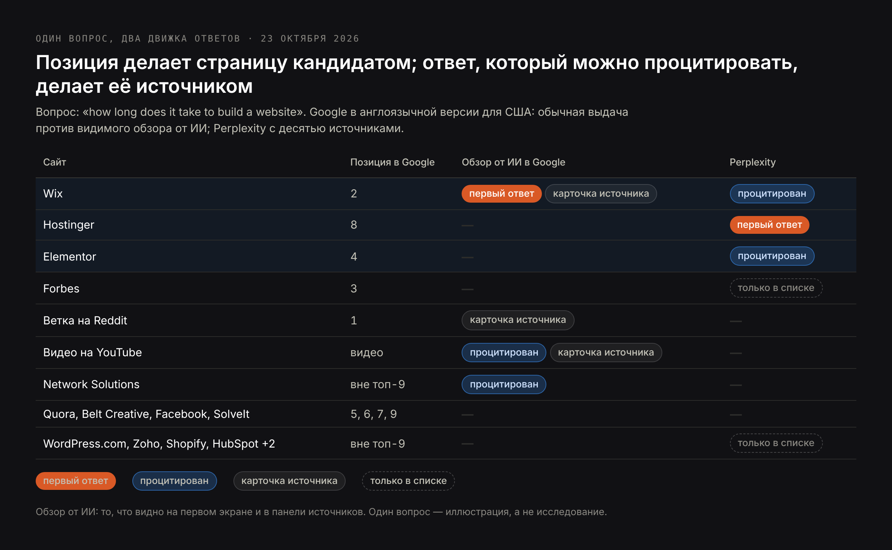
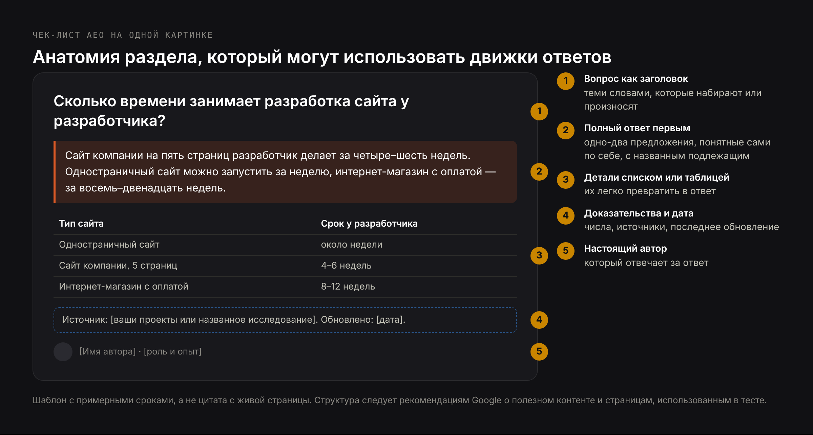
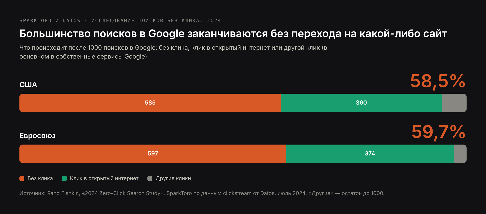

# DRAFT RU — «Что такое AEO» (24 Oct 2026). Same research as EN/PL, written for
# Russian-speaking readers. Core: «aeo оптимизация» 10; SERP «что такое aeo» = vc.ru
# and agency articles about AEO; PAA: «Что такое aeo продвижение?», «Чем отличается
# geo от aeo?». Made under the owner's AI-topic rule. No mention of Russia. Prices in
# € as on RU pages. There is no RU AEO service page: CTA goes to the RU AI SEO and GEO
# pages. H1 (Title) ≠ Meta title.

Title: Что такое AEO: оптимизация под ответы поисковиков и нейросетей — значение, как выбирают ответ и как это делать
Slug: chto-takoe-aeo
Meta title: AEO-оптимизация: что это и как попасть в ответы ИИ (2026)
Meta description: Что такое AEO (answer engine optimization) в SEO и маркетинге, как Google и ИИ-сервисы выбирают один ответ и как пошагово стать его источником.

---

> Коротко: AEO, или answer engine optimization, — это работа над тем, чтобы ваша страница стала источником прямого ответа на конкретный вопрос: в блоке с ответом Google, в первой фразе обзора от ИИ, в предложении, которое цитирует ChatGPT или Perplexity, или в ответе, который зачитывает голосовой ассистент. Это часть SEO: страница по-прежнему должна быть проиндексирована и вызывать доверие. AEO добавляет форму текста: вопрос назван в заголовке, полный ответ стоит в первом-втором предложении под ним, а подробности, числа и источники — потом. С 7 мая 2026 года Google больше не показывает расширенные результаты FAQ, поэтому AEO сегодня — это работа с самим текстом, а не с разметкой.

Раньше поисковик отвечал на вопрос десятью ссылками. Всё чаще он отвечает одной фразой: в Евросоюзе 59,7% поисков в Google заканчиваются без перехода на какой-либо сайт. Answer engine optimization — о том, чья это фраза. В статье: что значит AEO, где появляются ответы, как Google и ИИ-сервисы их выбирают — на живом тесте 23 октября 2026 года — и как делать AEO по шагам, с примерами, чек-листом и инструментами для замеров.

## Что такое AEO: определение answer engine optimization

**Answer engine optimization (AEO)** — это оптимизация контента так, чтобы поисковик или система ИИ использовали его как ответ на вопрос, а не просто показали в списке результатов. «Движок ответов» — любая система, которая вместо списка даёт ответ: блок с ответом и обзоры от ИИ в Google, режим ИИ в Google, ChatGPT, Perplexity, Copilot, Gemini и голосовые ассистенты вроде Siri, Alexa и Google Ассистента.

Единица работы в AEO — один вопрос и один ответ. Успех конкретный: ваша фраза стоит в блоке с ответом, открывает обзор от ИИ или цитируется со ссылкой на вашу страницу.

### Откуда взялся термин

Термин старше ChatGPT. Он распространился в 2017–2018 годах, когда расширенные ответы Google и голосовые ассистенты начали отвечать одним результатом, который читают вслух; авторство обычно приписывают SEO-консультанту Джейсону Барнарду. Генеративный ИИ не создал AEO — он умножил места, где один ответ заменяет список.

### AEO и GEO в одном абзаце

AEO и GEO (generative engine optimization) пересекаются, и многие авторы используют их как синонимы. Полезная разница: AEO — о том, чтобы **ваша формулировка стала ответом на вопрос**; GEO — о том, чтобы **вашу компанию называли, причём верно, в любом месте ответа ИИ**, в том числе когда о ней прямо не спрашивали. Страница может выиграть AEO по вопросу «сколько времени занимает разработка сайта», а компанию, которой она принадлежит, так никогда и не порекомендуют. Полное сравнение — в статье [GEO, SEO и AEO: в чём разница](/ru/blog/geo-vs-seo-raznica), а само GEO я разбираю в статье [что такое GEO](/ru/blog/chto-takoe-geo).

## Что значит AEO в SEO и маркетинге и другие значения сокращения

В SEO и интернет-маркетинге AEO означает answer engine optimization. «AEO в SEO» — часть поисковой оптимизации, нацеленная на ответы, а не на позиции; «AEO в маркетинге» — обычно контент-маркетинг, построенный вокруг вопросов, которые задают покупатели. По-русски его ещё называют AEO-оптимизацией, AEO-продвижением или оптимизацией под ответы ИИ.

У сокращения есть и другие значения, которые часто попадаются в выдаче:

- **Authorised Economic Operator, уполномоченный экономический оператор (УЭО)** — таможенный статус в Евросоюзе и многих других странах, который ускоряет оформление для надёжных компаний. К поиску отношения не имеет.
- **American Eagle Outfitters** — американская сеть одежды с биржевым тикером AEO.

Дальше речь только об answer engine optimization.

## Где появляются ответы: блок с ответом, обзоры от ИИ, чат-ассистенты и голос

Каждое из этих мест берёт ответ по-своему и по-разному «платит» странице, с которой его взяло.

| Где ответ | Что показывает | Источников на ответ | Что получает источник |
|---|---|---|---|
| Расширенный ответ Google (блок с ответом) | Один фрагмент с одной страницы над результатами | 1 | Ссылку и место на самом верху |
| Обзор от ИИ в Google (AI Overview) | Сгенерированную сводку над результатами | Несколько, ссылками и карточками | Ссылку, часто ниже в сводке |
| Режим ИИ в Google | Ответ в форме разговора, на отдельной вкладке | В среднем 3,7 в моём исследовании | Ссылку |
| ChatGPT с поиском | Ответ в форме разговора | В среднем 1,6 в моём исследовании | Ссылку, иногда никакой |
| Perplexity | Ответ с пронумерованными источниками | В среднем 16,7 в моём исследовании | Пронумерованную ссылку |
| Голосовые ассистенты | Один ответ вслух | Обычно 1, часто без названия | Иногда название сайта, редко визит |

Средние — из моего анализа [141 ответа ИИ на вопросы о выборе подрядчика](/ru/blog/issledovanie-otvetov-ii-assistentov). Практический вывод: в расширенном ответе побеждает один; в Perplexity мест пятнадцать; в ChatGPT часто одно-два.

## Как поисковики и ИИ выбирают ответ: живой тест

Чтобы показать, как это работает, 23 октября 2026 года я задал Google (в англоязычной версии для США) и Perplexity один и тот же вопрос: «how long does it take to build a website» — сколько времени занимает разработка сайта. Потом сравнил, чей текст использовал каждый, с тем, кто стоит в обычной выдаче Google.

Обзор от ИИ начинается с одного ответа: «от нескольких минут до 6+ месяцев» — со ссылкой на Wix, который второй в обычной выдаче. Страница Wix сводит весь ответ в первые строки — ИИ-конструкторы за минуты или часы, обычные конструкторы за дни или недели, — и только потом переходит к деталям. Forbes, третий в обычной выдаче, среди видимых источников вообще нет.

Perplexity построил первое предложение по Hostinger, восьмому в выдаче Google, а таблицу сроков — по Elementor, Hostinger и Wix. Forbes есть только в его списке из десяти источников и не привязан ни к одному утверждению.

Победителей объединяет не позиция. Каждая страница, которую использовали в видимом ответе:

- называет вопрос в заголовке или первом подзаголовке теми же словами, какими его ищут;
- даёт ответ диапазоном времени в первых строках, а потом объясняет;
- раскладывает ответ по типам — конструктор, шаблон, разработка на заказ, — так что из него получается таблица.

Forbes стоит высоко и пользуется доверием, но его статья не даёт готового ответа сверху. Это AEO на одном примере: **позиция делает страницу кандидатом; ответ, который можно процитировать, делает её источником.**

Моя собственная статья на этот вопрос — [сколько времени занимает разработка сайта](/ru/blog/skolko-vremeni-zanimaet-razrabotka-saita) — в английской версии тоже не попала в источники. Она начинается с короткого ответа, но не стоит в американской первой десятке Google по этому запросу, поэтому ни один движок её не взял. Это вторая половина AEO: ответ, который поиск не находит, никто не рассматривает.

## AEO в SEO: где место оптимизации под ответы

AEO — не отдельный канал рядом с SEO, а его слой. Движок ответов может использовать только страницу, которую способен найти, прочитать и которой доверяет, поэтому всё, что делает SEO, — доступность для роботов, индексация, ссылки, репутация, скорость — обязательное условие. AEO добавляет форму текста.

| | Классическое SEO | AEO |
|---|---|---|
| Единица работы | Страница | Вопрос и ответ на него |
| Цель | Высокая позиция и клик | Стать ответом, с кликом или без |
| Главный рычаг | Релевантность и авторитет страницы | Полный ответ, который можно процитировать |
| Где искать вопросы | Сервисы подбора запросов | «Похожие вопросы» в Google, запросы в Search Console, вопросы к ассистентам |
| Как выглядит успех | Позиции, клики | Выигранные блоки с ответом, цитаты в ответах ИИ |

Полезное правило: если страница отвечает на вопрос, но процитировать её нельзя, не прочитав три абзаца, — она готова к SEO, но не к AEO.

## Как делать AEO-оптимизацию: по шагам

### Шаг 1. Найдите вопросы, которые люди задают на самом деле

Собирайте настоящие вопросы, а не ключевые слова:

- **«Похожие вопросы»** в Google по главным темам; каждый ответ раскрывает новые вопросы.
- **Search Console:** в отчёте об эффективности фильтруйте запросы со словами «как», «что», «почему», «сколько», «можно ли», «какой».
- **Ассистенты:** спросите ChatGPT и Perplexity о своей теме и запишите уточняющие вопросы, которые они предлагают.
- **Почта:** вопросы, которые клиенты задают до покупки, — лучший список для AEO.

Сгруппируйте их по намерению. Одна страница должна отвечать на один главный вопрос и его близкие варианты, а не на десять несвязанных.

### Шаг 2. Ответ — первым

Под заголовком, который называет вопрос, дайте ответ в первом-втором предложении — так, чтобы он имел смысл, даже если прочитают только его:

- называйте подлежащее, а не «это» или «мы»;
- сразу давайте число, диапазон, «да» или «нет» либо определение;
- добавьте условие, которое меняет ответ («для сайта на пять страниц», «в Польше», «на 2026 год»).

Остальная часть раздела объясняет, уточняет и доказывает. Это перевёрнутая пирамида из журналистики, применённая к каждому разделу страницы.

### Шаг 3. Структура, из которой можно взять части

- один вопрос на подзаголовок H2 или H3, в той формулировке, как спрашивают люди;
- списки для шагов и вариантов, таблицы для сравнений и цен;
- короткие абзацы, одна мысль в каждом;
- основной текст в HTML, а не подгружается скриптами потом.

В тесте выше таблица «тип → срок → цена» почти напрямую стала ответом Perplexity.

### Шаг 4. Докажите ответ

Движки ответов предпочитают ответы, которым можно доверять. Помогают числа с датами, названные источники со ссылками, автор с реальным опытом и видимая дата обновления. Исследование, с которого началось GEO, это измерило: добавление статистики, цитат и источников повышало использование страницы в сгенерированных ответах на 27–41%, а повторение ключевой фразы снижало на 8%.

### Шаг 5. Разметка — там, где она ещё работает

Микроразметка сама по себе ответы не выигрывает, а два формата, которые раньше были основой AEO, исчезли из результатов Google: расширенные результаты HowTo убрали в 2023 году, а **с 7 мая 2026 года расширенные результаты FAQ не показываются в Google ни для одного сайта.** Разметка FAQ не вредит, но ничего видимого больше не даёт. Полезной остаётся разметка, которая описывает, что такое страница и компания, — Organization, LocalBusiness, Article, Product, BreadcrumbList, — и только если она совпадает с тем, что видно на странице.

### Шаг 6. Обновляйте ответы

Ответ, который был верным в 2023 году, а сейчас неверен, хуже, чем отсутствие ответа: движки могут продолжать его цитировать. На страницах с ценами, сроками и статистикой показывайте дату и пересматривайте их хотя бы раз в год.

## Чек-лист AEO: лучшие практики

| Что проверить | Почему это важно | Как проверить |
|---|---|---|
| Вопрос стоит в заголовке, словами того, кто ищет | Движки сопоставляют вопросы с заголовками | Прочитайте только H2: спрашивают ли они то, что спрашивают клиенты? |
| Ответ полный в первом-втором предложении | Взять можно только самостоятельный фрагмент | Прочитайте только первое предложение под каждым заголовком |
| Подлежащее названо, а не «мы» или «это» | Цитата теряет контекст | Ищите «мы», «это», «он» в первых предложениях |
| Числа, диапазоны и даты вместо прилагательных | Конкретные ответы предпочитают и могут проверить | Ищите «быстро», «недорого», «лучший» |
| Списки для шагов, таблицы для сравнений | Их легко превратить в ответ | Посмотрите на страницу, не читая её |
| Источники названы и даны ссылкой | Сигнал доверия для движков и людей | Посчитайте утверждения без источника |
| Видны автор и дата обновления | Свежесть и ответственность | Верх или низ статьи |
| Основной текст в HTML | Не все роботы выполняют скрипты | Исходный код страницы |
| Разметка совпадает с текстом; без расчёта на результаты FAQ | Результатов FAQ нет с мая 2026 | Проверка расширенных результатов |
| Один главный вопрос на страницу | Чтобы не конкурировать с собой | Выпишите страницы, отвечающие на один и тот же вопрос |

## Примеры оптимизации под ответы

### Пример 1: один и тот же ответ до и после

Типичный ответ из раздела FAQ веб-студии, до правки:

> Отличный вопрос! Каждый проект уникален, а сроки зависят от множества факторов. Мы всегда тесно работаем с клиентами, чтобы добиться лучшего результата в разумные сроки.

На вопрос здесь не отвечает ничего. После:

> Сайт компании на пять страниц разработчик делает за четыре–шесть недель: неделя на структуру и тексты, две-три на дизайн и разработку, неделя на тестирование и запуск. Одностраничный сайт можно запустить за неделю, интернет-магазин с оплатой — за восемь–двенадцать недель.

Вторая версия начинается с диапазона, потом даёт раскладку и две альтернативы — ровно в той форме, в какой Google и Perplexity строили ответы в тесте.

### Пример 2: заголовок, который можно сопоставить с вопросом

До: «Наш процесс». После: «Сколько времени занимает разработка сайта у разработчика?» Первый заголовок описывает компанию, второй называет вопрос, который человек набирает или произносит. Сопоставить с запросом можно только второй.

### Пример 3: определение, которое можно процитировать

До: «В современном динамичном цифровом мире бизнес сталкивается с новыми вызовами…». После: «Answer engine optimization (AEO) — это оптимизация контента так, чтобы поисковик или система ИИ использовали его как ответ на вопрос». Движки цитируют определения, которые начинаются с термина и укладываются в одно предложение: обзор от ИИ по запросу «what is generative engine optimization» взял определение именно из такого предложения — я показываю это в статье [что такое GEO](/ru/blog/chto-takoe-geo).

## Инструменты для AEO: что они измеряют

| Тип | Что делает | Примеры | Ограничение |
|---|---|---|---|
| Поиск вопросов | Находит вопросы, которые люди задают по теме | «Похожие вопросы», AlsoAsked, AnswerThePublic, Search Console | Показывает вопросы, но не кто на них отвечает в ИИ-сервисах |
| Трекеры позиций с элементами выдачи | Показывают, по каким запросам выходят блоки с ответом и обзоры от ИИ и есть ли там вы | Semrush, Ahrefs, SE Ranking | В основном Google; обзоры от ИИ отслеживаются выборочно |
| Трекеры видимости в ИИ | Задают наборы вопросов в ChatGPT, Perplexity, Gemini и режиме ИИ и записывают ссылки | Profound, Peec AI, Otterly.AI | Ответы меняются от сессии к сессии и от пользователя к пользователю |
| Отчёты самих движков | Цитирования, которые считает сам движок | Bing Webmaster Tools AI Performance | Только сервисы Microsoft |

Ни один инструмент не сделает AEO за вас. Инструменты находят вопросы и измеряют результат; ответы нужно написать.

## Как измерять AEO

- **Доля ответов.** Возьмите список из 20–50 ключевых вопросов. Раз в месяц проверяйте, кто даёт блок с ответом, начало обзора от ИИ и источники в ChatGPT и Perplexity. Доля вопросов, где это вы, — главная цифра AEO.
- **Search Console.** Обзоры от ИИ и режим ИИ не выделяются отдельно; они входят в отчёт об эффективности (Web). Следите за запросами-вопросами: падение кликов при стабильных показах часто значит, что над вами появился ответ.
- **Bing Webmaster Tools.** Отчёт AI Performance, в превью с февраля 2026 года, показывает, как часто ваши страницы цитируются в Copilot и ответах ИИ в Bing, какие это страницы и по каким «grounding queries» их нашли; с июня 2026 года он группирует их по намерениям и темам.
- **Переходы из ИИ в GA4.** Визиты с chatgpt.com, perplexity.ai, gemini.google.com и copilot.microsoft.com можно собрать в отдельный канал. После выхода GPT-6 7–8 октября 2026 года часть ссылок из ChatGPT приходила без метки и реферера и засчитывалась как прямые заходы, поэтому к коротким провалам относитесь осторожно.

## Статистика AEO на 2026 год

| Показатель | Значение | Источник |
|---|---|---|
| Поиски в Google без клика | 58,5% в США, 59,7% в ЕС | SparkToro и Datos, июль 2024 |
| Переходы в открытый интернет на 1000 поисков | 360 в США, 374 в ЕС | SparkToro и Datos, июль 2024 |
| Расширенные результаты FAQ в Google | Не показываются ни для одного сайта с 7 мая 2026 | Google Search Central |
| Расширенные результаты HowTo | Убраны в 2023 году | Google Search Central |
| Пользователи режима ИИ в Google в месяц | Больше 1 млрд | Alphabet, 22 июля 2026 |
| Пользователи ChatGPT в неделю | Больше 900 млн | OpenAI через TechCrunch, 27 февраля 2026 |
| Источников на ответ ИИ | Perplexity 16,7, режим ИИ 3,7, ChatGPT 1,6 | Bandziuk, 141 ответ, сентябрь 2026 |
| Эффект статистики / цитат / источников на использование в ответах ИИ | +31% / +41% / +27% | Работа о GEO, KDD 2024 |
| Эффект набивки ключевыми словами | −8% | Работа о GEO, KDD 2024 |

## Частые ошибки в AEO

**Раздел FAQ ради разметки.** С мая 2026 года разметка FAQ не даёт в Google никакого расширенного результата. FAQ имеет смысл, когда вопросы настоящие, а ответы полные; список вопросов, написанный под разметку, — нет.

**Ответ в конце.** Длинное вступление перед ответом — самая частая причина, по которой страницу с хорошей позицией пропускают, как Forbes в тесте выше.

**Красивые заголовки.** «Наш подход», «Секрет», «Почему это важно» не описывают ничего, о чём кто-то спрашивает.

**Отдельная страница на каждый вопрос.** Тридцать тонких страниц с одним коротким ответом конкурируют друг с другом и выглядят как малоценный контент. Близкие вопросы объединяйте на одной странице.

**Замеры только по позициям.** Страница может держать третье место и терять большую часть кликов из-за ответа, показанного над ней. Следите за тем, кто даёт ответ, а не только за своим местом.

## Нужна ли AEO вашему бизнесу

Оптимизация под ответы окупается, когда клиенты перед покупкой задают вопросы: сколько стоит, сколько длится, что выбрать, законно ли это, что для этого нужно. Сюда относятся профессиональные услуги, клиники, программы, обучение, переезд и любая покупка, перед которой человек ищет информацию. Меньше она значит для импульсных покупок и для бизнеса, к которому приходят, проходя мимо.

Для большинства сайтов AEO — не новый проект, а переработка существующих страниц: ключевых страниц услуг и пяти–двадцати статей, отвечающих на настоящие вопросы. У меня замер исходного положения стоит от 250 €, подготовка сайта к ИИ-поиску — от 800 €, постоянный мониторинг — от 250 € в месяц. Что входит в работу, описано на страницах [AI SEO-продвижение](/ru/uslugi/ai-seo-prodvizhenie) и [подготовка сайта к ИИ-поиску](/ru/uslugi/podgotovka-saita-k-ii-poisku).

## Частые вопросы про AEO

**Что означает сокращение AEO?**
В SEO и маркетинге AEO — это answer engine optimization: работа над тем, чтобы контент был источником прямых ответов в Google, ИИ-сервисах и голосовых ассистентах. В торговле и на таможне AEO — уполномоченный экономический оператор, таможенный статус, не связанный с поиском.

**AEO лучше, чем SEO?**
Это не альтернативы. AEO — часть SEO: движок ответов может использовать только страницы, которые находит и которым доверяет. Сайту, который делает AEO без SEO, неоткуда быть процитированным; сайт, который делает SEO без AEO, находят, но не цитируют.

**AEO и GEO — это одно и то же?**
Они пересекаются. AEO стремится, чтобы ваша формулировка стала ответом на вопрос; GEO — чтобы компанию называли и верно описывали в ответах ИИ в целом. Подробнее — в статье [GEO, SEO и AEO](/ru/blog/geo-vs-seo-raznica).

**С чего начать оптимизацию под ответы?**
Выпишите 20 вопросов, которые клиенты задают до покупки, проверьте, кто сегодня отвечает на них в Google и в ChatGPT, и перепишите страницы, которые должны отвечать: вопрос в заголовке, ответ в первом предложении, подробности и источники после.

**Помогает ли ещё разметка FAQ?**
Не в выдаче Google: с 7 мая 2026 года расширенные результаты FAQ не показываются ни для одного сайта. Разметка не вредит, а настоящий раздел FAQ с полными ответами по-прежнему помогает читателям и движкам ответов — текстом, а не разметкой.

**Через сколько видны результаты AEO?**
Переписанная страница может выиграть блок с ответом или цитату в ИИ через несколько недель после переобхода. В ИИ-ассистентах результат меняется от сессии к сессии и от модели к модели, поэтому оценивайте его по двум-трём месяцам ежемесячных замеров.

**Сколько стоит AEO-продвижение?**
Зависит от того, сколько страниц нужно переписать. У меня: замер исходного положения от 250 €, подготовка сайта к ИИ-поиску от 800 €, постоянный мониторинг от 250 € в месяц.

## С чего начать AEO

Возьмите один вопрос, который клиенты чаще всего задают, прежде чем с вами связаться. Введите его в Google и задайте в ChatGPT и Perplexity. Если ответ взят у кого-то другого, посмотрите на ту страницу: почти наверняка она называет вопрос в заголовке и отвечает в первом предложении. Сделайте то же на своей странице — а если хотите, чтобы это сделали для всего сайта, с вопросами, переработкой и замерами, [напишите мне](/ru/kontakty).
