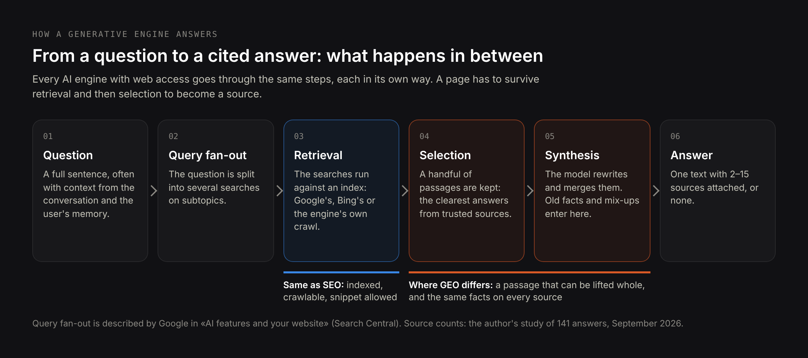
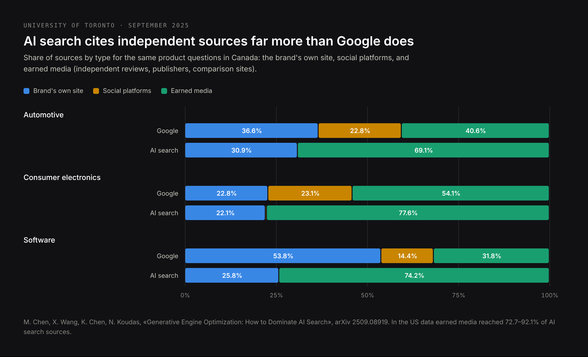
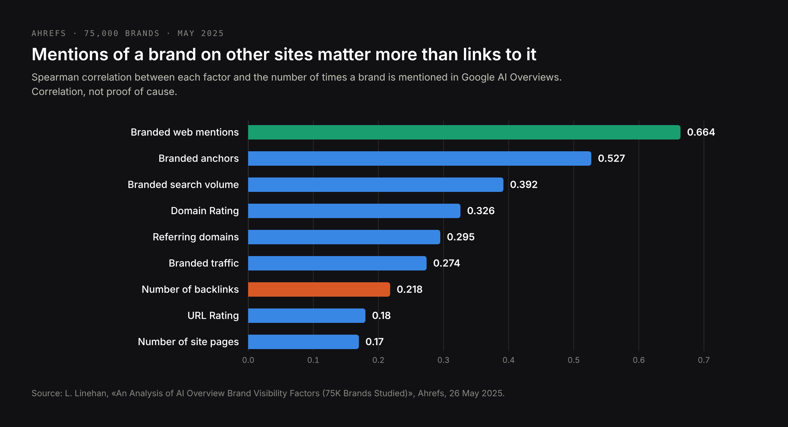
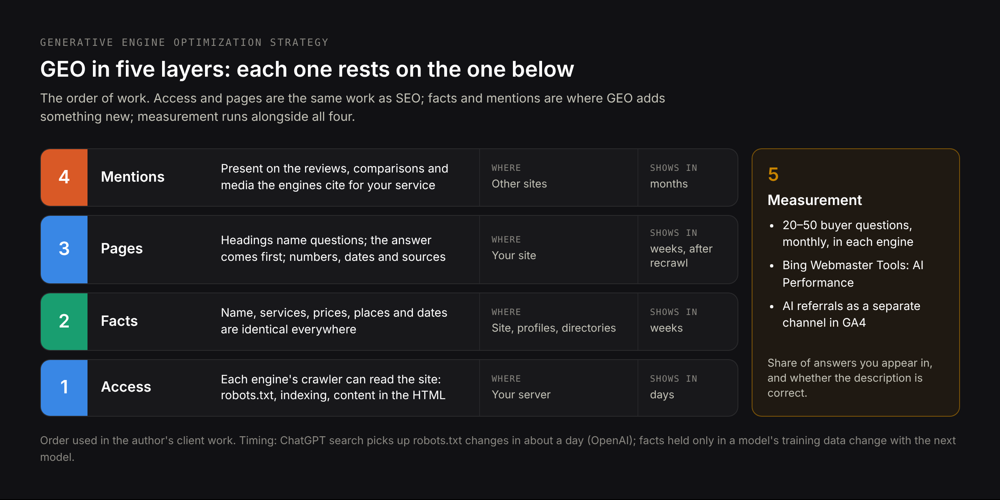

# DRAFT EN — «What is GEO» (24 Oct 2026). Definition article.
# Core: research/pseo/page-core/what-is-geo.md — what is geo 5,400, generative engine
# optimization 4,400, what is generative engine optimization 1,300, geo generative
# engine optimization 720+1,300, what is geo in marketing 720, what is geo in seo 480,
# generative engine optimization statistics 170, how does generative engine
# optimization work 140, strategy 90+90, best practices 40, checklist 40, examples 30,
# tools 720+720 (one section here). Intent: research/pseo/intent-check-what-is-geo.md.
# Not here: «services / agency / company» (GEO hub), comparisons (geo-vs-seo article).
# Sources: arXiv 2311.09735 (KDD 2024); arXiv 2509.08919 (University of Toronto, Sept
# 2025); Ahrefs, 75K brands (26 May 2025); OpenAI crawler docs; Google «AI features and
# your website» and the 2026 marketer's guide; Bing Webmaster blog (Feb and 16 Jun
# 2026); Alphabet Q2 2026 call (22 Jul 2026); TechCrunch (27 Feb 2026); Search Engine
# Roundtable (14–15 Oct 2026); the owner's 141-answer study; live test 23 Oct 2026.
# H1 (Title) and Meta title differ on purpose.

Title: What Is Generative Engine Optimization (GEO)? Definition, How AI Engines Choose Sources and What Works
Slug: what-is-generative-engine-optimization
Meta title: What Is GEO? Generative Engine Optimization Explained (2026)
Meta description: GEO, or generative engine optimization, explained with data: where the term comes from, how AI engines pick sources, what works and how to measure it.

---

> Quick answer: GEO, short for generative engine optimization, is the work of getting a business, product or fact included — and described correctly — in answers that AI systems write: ChatGPT, Perplexity, Gemini, Claude, Copilot and Google's AI Overviews and AI Mode. The term comes from a 2023 research paper by Princeton University and partners. It works on three things: whether AI crawlers can read your site, whether the facts about you are consistent everywhere, and whether other sites mention you, because AI engines cite third-party sources far more often than a company's own pages. Its result is a mention or a citation in an answer, not a position in a list of links.

Most definitions of GEO are one paragraph long and borrowed from each other. This article starts from primary sources: the paper that coined the term, two large studies of where AI engines take their sources, the documentation Google, OpenAI and Microsoft publish for site owners, my own analysis of [141 AI answers to buying questions](/blog/ai-assistant-recommendations-study), and a live check on 23 October 2026 of how Google and Perplexity answer the question «what is generative engine optimization» itself. That last check turned out to be the best example of GEO in this article.

## What is GEO? Generative engine optimization defined

**Generative engine optimization (GEO)** is the practice of making a company, its products and the facts about it easy for AI systems to find, trust and repeat when they write an answer. A search engine shows a list of pages and lets the reader choose. A generative engine reads those pages itself, picks a few passages and writes one answer, usually with two to fifteen sources attached. GEO is about being one of those sources, or at least one of the names in the answer, and about the answer describing you accurately.

Three things set GEO apart from earlier kinds of optimization:

- **The unit is a claim, not a page.** The engine does not show your page; it repeats something your page, or someone else's page, says about you.
- **The result is inclusion.** You are either in the answer or not. There is no page two.
- **Accuracy is part of the job.** An answer can name you with an old price, a service you dropped or a feature that belongs to a competitor. I describe those cases in [where AI gets outdated information about your company](/blog/where-ai-gets-outdated-information-about-your-company).

### Where the term generative engine optimization comes from

The name comes from a research paper, «GEO: Generative Engine Optimization», by Pranjal Aggarwal, Vishvak Murahari, Tanmay Rajpurohit, Ashwin Kalyan, Karthik Narasimhan and Ameet Deshpande, from Princeton University, Georgia Tech, the Allen Institute for AI and IIT Delhi. It was published on arXiv in November 2023 and presented at KDD 2024, one of the main data-mining conferences.

The authors built a benchmark of 10,000 queries across 25 domains, rewrote source pages in nine different ways and measured how much more often each rewrite was used in the generated answer. Their headline result: the right changes to a page raised its visibility in generative answers by up to 40%, and on Perplexity, tested live, by up to 37%. That paper is why the field has a name. Its findings are summarised further down, in the section on what works.

### What counts as a generative engine

A generative engine is any system that answers a question by writing text from sources it retrieves. In 2026 the ones that matter for most businesses are:

| Engine | Who runs it | Scale, latest public figure |
|---|---|---|
| Google AI Overviews and AI Mode | Google | AI Mode: more than 1 billion monthly users (Alphabet, 22 July 2026) |
| Gemini app | Google | 950 million monthly users (Alphabet, 22 July 2026) |
| ChatGPT with search | OpenAI | more than 900 million weekly users (OpenAI via TechCrunch, 27 February 2026) |
| Microsoft Copilot and Bing AI answers | Microsoft | no separate figure published |
| Perplexity | Perplexity AI | no recent official figure |
| Claude with web search | Anthropic | no separate figure published |

Each of them reads the web differently, which is the most practical thing to know about GEO and the subject of a whole section below.

## What GEO means in marketing, and the other meanings of «GEO»

Search «what is geo» and Google mixes several meanings, so it is worth separating them before anything else.

- **GEO in marketing before 2023** meant geographic targeting: showing ads or content by location (geotargeting, geofencing, geo-modified keywords such as «dentist Warsaw»). Many marketing glossaries still use it that way.
- **GEO in SEO and marketing since 2024** almost always means generative engine optimization, the subject of this article.
- **Outside marketing**, GEO is a geostationary orbit in satellite engineering, a common abbreviation for geography, and Georgia's country code in sport.

The two marketing meanings meet in one place: local businesses. When someone asks ChatGPT for «a dentist in Warsaw who speaks English», the answer depends both on location data and on generative engine optimization. In my study, ChatGPT referenced Google Maps in 23 of 47 answers to such buying questions.

A second naming problem: GEO, **AEO** (answer engine optimization), **LLMO** (large language model optimization) and **AIO** (AI optimization) are used interchangeably by many writers, and both Google's AI Overview and Perplexity repeat that in their answers. They overlap but they are not identical: AEO is narrower and is about your wording becoming the answer to one specific question. The differences, with examples, are in [GEO vs SEO vs AEO](/blog/geo-vs-seo).

## How generative engine optimization works: from a question to a cited answer

To optimize for something you need to know what it does. Every generative engine with web access goes through the same five steps, although each one does them differently.



1. **The question.** Usually longer and more specific than a search query: a full sentence, often with context from earlier in the conversation and, in ChatGPT, from the user's saved memory.
2. **Query fan-out.** The engine splits the question into several searches. Google documents this directly: AI Overviews and AI Mode may issue multiple related searches across subtopics to build one response.
3. **Retrieval.** Those searches run against an index: Google's own for AI Overviews and AI Mode, Bing's and the engine's own crawl for others. A page that is not indexed, or that blocks the engine's crawler, cannot be retrieved.
4. **Selection.** From dozens of retrieved pages, the engine keeps a handful of passages that answer a sub-question clearly and that it judges trustworthy.
5. **Synthesis.** The model writes the answer from those passages, merges them, shortens them and attaches citations. This is also where mistakes happen: two sources get blended, an old figure survives, a feature is attributed to the wrong company.

GEO acts on steps 3 to 5. Step 3 is mostly technical and the same as SEO. Steps 4 and 5 are where GEO differs: a page can be retrieved and still not be used, because no single passage on it answers the question on its own, or because other sources say something different about you.

### Why being indexed is necessary but not enough

Google states that there are no additional requirements to appear in AI Overviews or AI Mode: a page needs to be indexed and eligible to be shown with a snippet. That is the entry ticket. Selection then depends on whether a passage can be lifted and still make sense, and on what the rest of the web says. Google's own 2026 guide for marketers puts it the same way: meeting the technical requirements covers you «for search generally, including AI formats», and the rest is unique, useful content.

## Where AI engines get their sources: third-party sites vs your own website

The most useful finding about generative engine optimization so far is not about how to write a page. It is about whose pages get cited.

A University of Toronto team (Mahe Chen, Xiaoxuan Wang, Kaiwen Chen and Nick Koudas, September 2025) compared the sources behind Google results and AI search answers for the same product questions, sorting every source into three types: the brand's own site, social platforms and «earned» media, meaning independent reviews, publishers and comparison sites.



| Category (Canada) | Google: brand / social / earned | AI search: brand / social / earned |
|---|---|---|
| Automotive | 36.6% / 22.8% / 40.6% | 30.9% / 0% / 69.1% |
| Consumer electronics | 22.8% / 23.1% / 54.1% | 22.1% / 0.3% / 77.6% |
| Software | 53.8% / 14.4% / 31.8% | 25.8% / 0% / 74.2% |

The United States data point the same way, only more strongly: earned media made up 81.9% of AI search sources for cars, 92.1% for consumer electronics and 72.7% for software. Two more findings from the same paper matter for any business that works in more than one language:

- **AI answers and Google results share few sources.** For smartphones only 20% of the domains in the top 10 overlapped; for local services such as auto repair, 2.5%.
- **ChatGPT changes its sources with the language of the question.** The overlap between the domains it cited for the same question in different languages was close to zero. Claude was the most stable across languages. A company visible in English answers is not automatically visible in Polish or German ones.

Ahrefs reached the same conclusion from another direction. Studying 75,000 brands (Louise Linehan, May 2025), it measured which signals correlate with a brand being mentioned in Google's AI Overviews.



Mentions of the brand on other websites correlated at 0.664; the number of backlinks, the classic SEO signal, at 0.218. Brands in the top quarter by web mentions averaged 169 AI Overview mentions, the next quarter 14, and the bottom half next to none. Correlation is not proof of cause, and Ahrefs says so, but two independent studies pointing the same way is a strong signal: **in GEO, what others write about you weighs more than what you write about yourself.**

### The type of question changes the sources

There is one important exception, and my own data shows it. In September 2026 I asked ChatGPT, Perplexity and Google AI Mode 47 questions of the type «who should I hire for…» and counted every citation in the 141 answers.

| Engine | Citations per answer | Citations of providers' own websites | Answers that referenced Google Maps |
|---|---|---|---|
| Perplexity | 16.7 | 667 | 7 of 47 |
| Google AI Mode | 3.7 | 141 | 4 of 47 |
| ChatGPT | 1.6 | 47 | 23 of 47 |

For service questions, Perplexity and AI Mode built their answers largely from the providers' own websites, while ChatGPT leaned on its own search and on map listings. So the rule is not «your site doesn't matter». It is: **for product categories, independent reviews and publishers dominate; for services, your own pages count, but only if they answer the buyer's question directly.** The full breakdown is in the [study of 141 AI answers](/blog/ai-assistant-recommendations-study).

## What GEO research says works on a page

The KDD 2024 paper tested nine ways of rewriting a source page and measured the change in how visible that page became in generated answers. Here they are, translated into what you would actually change in your text.

| Method in the paper | What it means in your text | Measured effect on visibility |
|---|---|---|
| Quotation addition | Quote a named, relevant person: a client, an engineer, an official document | +41% |
| Statistics addition | Replace «many», «fast», «affordable» with numbers and dates | +31% |
| Fluency optimization | Fix awkward, hard-to-parse sentences | +28% |
| Cite sources | Name and link the source of every claim | +27% |
| Technical terms | Use the precise term your field uses | +18% |
| Easy-to-understand | Shorter sentences, one idea per sentence | +14% |
| Authoritative tone | State things plainly instead of hedging | +10% |
| Unique words | Vary vocabulary | +6% |
| Keyword stuffing | Repeat the target phrase | −8% |

Two details from the paper are more useful than the table itself. First, the gains were much larger for pages that started lower in the source list: a page in fifth position gained 115% from citing sources, while the page in first position lost 30% with the same change. GEO helps the underdog more than the leader. Second, the effects differed by subject: statistics helped most in law and government topics, quotations in people and society topics. There is no universal recipe, only a direction: **concrete, attributable, checkable statements get reused; vague ones do not.**

## Generative engine optimization strategy: five layers

Everything above reduces to five layers of work. They are listed in the order I do them for clients, because each one depends on the one below.



### 1. Access: let the AI crawlers read your site

Each engine has its own crawler, and a robots.txt written years ago may block it. OpenAI documents three of them, and they do different jobs:

- **OAI-SearchBot** finds pages for ChatGPT search. OpenAI states that sites which opt out of it will not be shown in ChatGPT search answers, apart from plain navigational links.
- **GPTBot** collects content for training future models. Blocking it does not remove you from ChatGPT search.
- **ChatGPT-User** visits a page when a user asks ChatGPT to open it; robots.txt may not apply to it.

So a business can keep its content out of model training and still be visible in ChatGPT answers:

```text
User-agent: OAI-SearchBot
Allow: /

User-agent: GPTBot
Disallow: /

User-agent: PerplexityBot
Allow: /

User-agent: *
Allow: /
```

Changes take about a day to reach ChatGPT search. Google's AI features use Googlebot, so nothing extra is needed there, but the snippet controls do apply: «nosnippet» or a short «max-snippet» limit how your content can appear in AI Overviews and AI Mode. If you want to check your setup quickly, I describe it in [how to prepare a website for AI search](/services/ai-search-readiness).

### 2. Facts: one version of the truth about your company

Generative engines merge sources. If your website says you were founded in 2015, LinkedIn says 2017 and an old directory lists a previous address, the answer may contain any combination. The work here is unglamorous: list the twenty facts that define your business — name, services, prices or price ranges, locations, languages, founders, years, key clients you can name — and make them identical on your site, Google Business Profile, LinkedIn, directories and any review platforms. The most common sources of wrong answers, and how to fix them, are in [how to correct wrong information in ChatGPT](/blog/how-to-correct-wrong-information-in-chatgpt).

### 3. Pages: written so a passage can be lifted

The selection step favours passages that answer a sub-question on their own. In practice that means:

- a heading that names the question in the words a customer would use;
- the answer in the first one or two sentences under it, with the subject named, not «we» or «it»;
- numbers, dates and names instead of adjectives;
- one page per service, not one page listing ten. In my study, the providers named most often had a page whose whole subject was the service being asked about.

### 4. Mentions: be present where engines read

Because earned media dominates citations, part of GEO happens off your site: reviews on the platforms your industry uses, inclusion in comparison articles, interviews and guest pieces in trade media, a correct entry in the directories that rank for your service. For a sole trader or a small firm this is less about volume and more about being present in the five or ten places that the engines actually cite for your type of question. The way to find those places is to ask the engines and record their sources.

### 5. Measurement

Without measurement, GEO is guesswork. It gets its own section below.

## GEO best practices checklist

| Area | Check | How to verify |
|---|---|---|
| Access | OAI-SearchBot, PerplexityBot and Googlebot are not blocked | Read robots.txt; test the key URLs |
| Access | Key pages are indexed in Google and Bing | Search Console, Bing Webmaster Tools |
| Access | Main content is in the HTML, not loaded only by scripts | View the page source |
| Facts | Name, services, prices, locations and dates match everywhere | Compare site, Google Business Profile, LinkedIn, directories |
| Facts | An «About» page states who is behind the business, with verifiable details | Read it as a stranger would |
| Pages | Each service has its own page | Site structure |
| Pages | Each heading names a question; the answer follows immediately | Read the first sentence under each heading |
| Pages | Claims carry numbers, dates and named sources | Search the text for «many», «best», «fast» |
| Pages | Structured data matches what is visible on the page | Rich Results Test |
| Mentions | You appear on the review and comparison sites that engines cite for your service | Ask the engines; record the sources |
| Mentions | Industry and local directories have current data | Check each entry |
| Measurement | A fixed set of 20–50 customer questions is checked monthly in each engine | Spreadsheet or monitoring tool |
| Measurement | AI referral traffic is tracked separately | GA4 channel or segment |

## Generative engine optimization examples

The best examples of GEO are the answers to questions about GEO itself, so on 23 October 2026 I asked Google and Perplexity «what is generative engine optimization» and looked at what they cited.

### Example 1: Google's AI Overview takes its definition from the third result


The organic results for this query were led by Moz, then a Reddit thread, then Coursera. The definition at the top of the AI Overview, however, is attributed to Coursera, not to the first result. Coursera's article opens with a «Key takeaways» block whose first line is a one-sentence definition. The Overview then cites Seer Interactive for the comparison with SEO and lists AEO, LLMO and AIO as alternative names.

The lesson is the core of GEO: **the passage that can be lifted whole wins, even from third place.** A page that ranks first but opens with a story is retrieved and passed over.

### Example 2: Perplexity starts from Wikipedia


Perplexity opened with Wikipedia and a practitioner's guide, then used Business.com, HubSpot, Coursera, the Cambridge Dictionary, Moz and the original paper on arXiv. Its answer, like Google's, repeats Wikipedia's framing that GEO is «also known as» answer engine optimization. That is the second lesson: **for definitions, engines lean on reference sources, and whatever those sources say becomes the default answer** — including simplifications. If an encyclopedia, dictionary or industry glossary describes your product category wrongly, that error will travel.

### Example 3: rewriting one paragraph for AI answers

A typical paragraph from a clinic's home page, before (the clinic is invented for the example):

> We are a passionate team with many years of experience, offering top-quality dental care for the whole family. Our tailored approach ensures great results at competitive prices.

Nothing in it can be quoted: no name, no place, no fact, no number. After:

> Nova Dental is a dental clinic in Warsaw's Mokotów district, open since 2014. It places implants on the day of the consultation, has English- and Ukrainian-speaking dentists, and a single implant with a crown costs from 4,900 zł.

The second version names the business, the city and district, the year, the service, the languages and the price. Each of those is a separate claim an engine can match to a question such as «English-speaking dentist in Warsaw for an implant, how much». That is the method from the research table — statistics, precise terms, plain statements — applied to a paragraph you already have.

## How to measure generative engine optimization

There is no Search Console for most AI engines, so measurement is built from four sources.

**1. A fixed question set.** Write 20 to 50 questions a buyer would ask, phrased the way they would ask them, including the city and the language. Ask each one in ChatGPT, Perplexity, Google AI Mode and Gemini once a month, in a clean session. Record three things: whether you are named, whether you are cited with a link, and whether the description is correct. The method is described step by step in [how to check what AI says about your company](/blog/how-to-check-what-ai-says-about-your-company).

**2. Share of answers.** From that set, the main figure is the share of questions in which you appear, per engine. Expect it to move slowly and differently by engine.

**3. Bing Webmaster Tools.** Microsoft's AI Performance report, in public preview since February 2026, shows how often your pages are cited in Copilot, Bing's AI answers and some partner experiences, which pages, and the «grounding queries» the AI used to find them. Since June 2026 it also groups those queries by intent and topic and shows your citation share. It is the only first-party citation report any engine provides so far, and it is free.

**4. Referral traffic.** ChatGPT, Perplexity and Gemini send visitors whose sessions can be grouped into an «AI» channel in GA4 by source (chatgpt.com, perplexity.ai, gemini.google.com, copilot.microsoft.com). ChatGPT normally adds «utm_source=chatgpt.com» to its links. One caution from this month: after the GPT-6 rollout on 7–8 October 2026, many ChatGPT links arrived without the tag and without a referrer, so GA4 counted those visits as Direct; on 15 October practitioners reported the tags returning, and OpenAI has not commented. A sudden drop in «ChatGPT traffic» may be a tracking change, not a visibility change.

Google does not report AI Overviews or AI Mode separately: their clicks and impressions are included in the regular Web performance report in Search Console.

## Generative engine optimization tools: what they measure and where they stop

The tools market has grown fast, and «generative engine optimization tools» is now searched as often as the term itself. They fall into four groups.

| Type | What it does | Examples | Limit |
|---|---|---|---|
| AI visibility trackers | Run your question set in several engines on a schedule and report mentions, citations and competitors | Profound, Peec AI, Otterly.AI | Answers vary between runs and users; a tracker samples, it does not see what every user sees |
| SEO suites with AI modules | Add AI mention tracking to keyword and backlink data | Semrush, Ahrefs Brand Radar | Prompt sets are often generic, not your buyers' questions |
| First-party reports | Citations measured by the engine itself | Bing Webmaster Tools AI Performance | Covers Microsoft's surfaces only |
| Manual method | You run the question set yourself in a spreadsheet | — | Time; at 30 questions and four engines, about two hours a month |

For a small business, the manual method plus Bing's report is enough to start. Trackers earn their cost when the question set is large, when several markets or languages are involved, or when you need to show trends to a board. No tool can make an engine cite you; they only show whether it does.

## Generative engine optimization statistics for 2026

| Figure | Value | Source |
|---|---|---|
| Google AI Mode monthly users | more than 1 billion | Alphabet Q2 2026 call, 22 July 2026 |
| Gemini app monthly users | 950 million | Alphabet Q2 2026 call, 22 July 2026 |
| ChatGPT weekly users | more than 900 million | OpenAI via TechCrunch, 27 February 2026 |
| Visibility gain from the best GEO rewrites | up to 40% (up to 37% on Perplexity) | KDD 2024 GEO paper |
| Effect of keyword stuffing | −8% | KDD 2024 GEO paper |
| Earned media share of AI search sources, US | 72.7–92.1% by category | University of Toronto, September 2025 |
| Earned media share of Google sources, Canada | 31.8–54.1% by category | University of Toronto, September 2025 |
| Correlation of brand web mentions with AI Overview mentions | 0.664 (backlinks: 0.218) | Ahrefs, 75,000 brands, May 2025 |
| Citations per answer | Perplexity 16.7, Google AI Mode 3.7, ChatGPT 1.6 | Bandziuk, 141 answers, September 2026 |
| ChatGPT answers referencing Google Maps for service questions | 23 of 47 | Bandziuk, September 2026 |

## Common GEO myths

**«You need an llms.txt file.»** Google states its Search systems don't use it, and no study has found that it increases citations. It has a use, but not that one; the details are in [does your site need llms.txt](/blog/does-your-site-need-llms-txt).

**«There is special markup for AI.»** Google says no special schema is required for its AI features. Structured data helps understanding when it matches the visible page, exactly as it did before.

**«Repeat the keyword so the AI picks it up.»** It is the only method in the GEO paper that made visibility worse: −8%.

**«GEO replaces SEO.»** Google's AI features are built on Google's index; ChatGPT and Copilot search run on web indexes too. A site that is not found by search engines is rarely found by generative engines. The relationship is covered in [GEO vs SEO](/blog/geo-vs-seo).

**«Someone can guarantee you'll be recommended by ChatGPT.»** Nobody controls the answer. Answers change between sessions, users and model versions. What can be promised is the work and the measurement, not the outcome.

## Does a small business need GEO?

It depends on how your customers choose. GEO is worth doing now if:

- your customers ask for recommendations before they buy: professional services, clinics, software, education, relocation, anything with a high price and a long decision;
- you already get some AI referral traffic and want to know why it comes and how to get more;
- an AI assistant describes your business wrongly — that costs you whether or not you «do GEO».

It can wait if your customers buy by walking past, by price comparison on marketplaces, or by calling the first local result. In that case local SEO and the Google Business Profile matter more.

For most small businesses GEO is not a separate budget line but a layer on top of SEO: the access and pages layers are the same work, and the facts and mentions layers are a few hours a month. In my practice, monitoring of AI answers on a fixed question set starts at 250 € a month, a one-off AI visibility audit at 250 €, and continuous work on Google and AI answers together at 800 € a month. What each option includes is on the [generative engine optimization services](/services/ai-ready-seo-and-geo-optimization) page, and the audit on the [AI visibility audit](/services/ai-visibility-audit) page.

## Common questions about generative engine optimization

**What is GEO short for?**
In SEO and marketing, GEO stands for generative engine optimization: optimizing to be included and correctly described in AI-generated answers. In older marketing texts GEO can also mean geographic targeting.

**Is GEO the same as AEO?**
They overlap, and many people use the terms interchangeably. Strictly, AEO (answer engine optimization) is narrower: it aims to make your wording the direct answer to one question, while GEO covers being named and cited anywhere in a generated answer. See [GEO vs SEO vs AEO](/blog/geo-vs-seo).

**How does generative engine optimization work?**
An AI engine splits the question into several searches, retrieves pages from an index, keeps a few passages and writes an answer from them. GEO makes your site readable for the engine's crawler, your facts consistent across the web, your pages easy to quote, and your business present on the third-party sites the engine trusts.

**How long does GEO take to show results?**
Access fixes show within days: ChatGPT search picks up robots.txt changes in about a day. Page changes show when the page is recrawled, usually within weeks. Mentions on other sites and corrections of wrong facts take one to several months, and facts that live only in a model's training data change only when the model is updated.

**Can anyone guarantee AI citations?**
No. Answers vary by session, user, language and model version. A trustworthy provider promises the work and a measurement method, and reports the share of answers you appear in over time.

**How much does GEO cost?**
From a few hours of your own time a month, if you do the checks yourself, to a few thousand euros a month at agencies. My prices: monitoring from 250 € a month, an audit from 250 € once, continuous SEO and GEO work together from 800 € a month.

**Do I need llms.txt for GEO?**
No. No AI search engine has confirmed using it to choose sources, and Google says its Search systems ignore it. Check robots.txt first: a blocked crawler costs you visibility, a missing llms.txt does not.

## Where to start with generative engine optimization

Start with the question your customers ask before they call you. Ask it today in ChatGPT, Perplexity and Google AI Mode, in the language your customers use, and write down who is named and which sites are cited. That list is your GEO plan: the cited sites are where you need to be present, and the named competitors show what the engines consider a good answer.

If you would rather have that done properly — 30 or more questions, four engines, every source recorded and a plan for the gaps — that is what my [AI visibility audit](/services/ai-visibility-audit) does. Or [write to me](/contacts) with the question your customers ask, and I'll tell you what the engines answer today.
