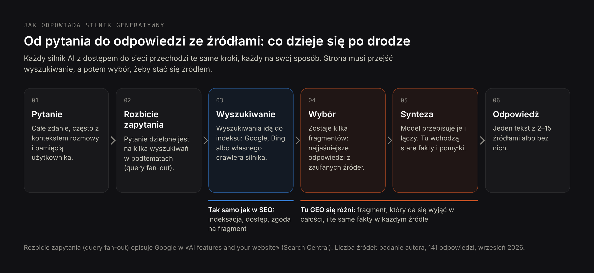
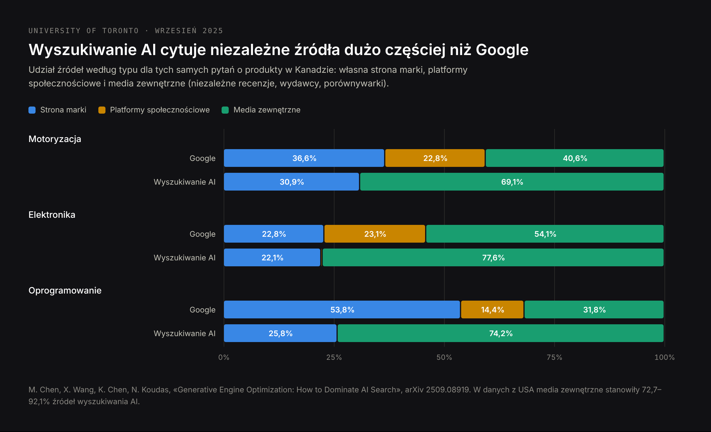
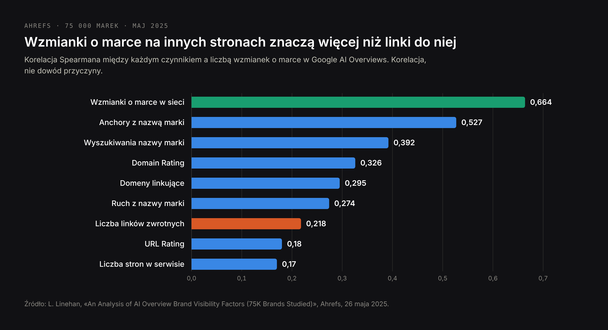
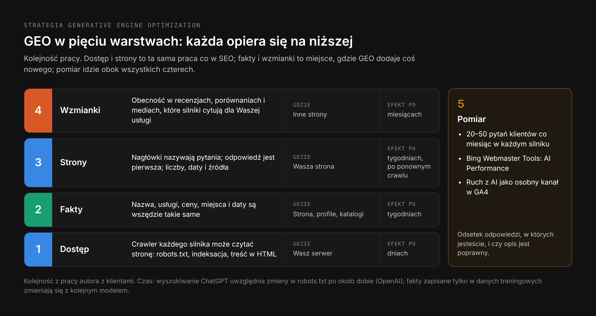
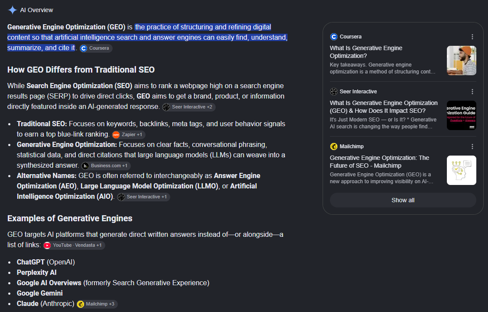
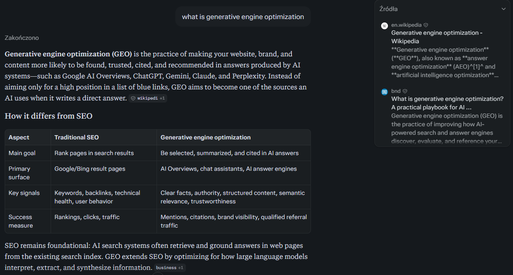

# DRAFT PL — «GEO co to jest» (24 Oct 2026). Same research as the EN version,
# written for Polish readers, not translated line by line. Core (PL): generative
# engine optimization 260, geo co to 110, geo co to znaczy 40, geo marketing 40,
# geo pozycjonowanie 40. SERP «geo co to»: Polish agency blogs about GEO. Prices in zł
# as on the PL service pages. H1 (Title) ≠ Meta title.

Title: GEO (generative engine optimization): co to jest, jak AI wybiera źródła i co naprawdę działa
Slug: geo-co-to-jest
Meta title: GEO co to jest? Generative engine optimization w 2026
Meta description: GEO, czyli generative engine optimization, na danych: skąd termin, jak ChatGPT i Google AI wybierają źródła, co działa, jak to mierzyć i ile kosztuje.

---

> Krótko: GEO, czyli generative engine optimization, to praca nad tym, żeby firma, produkt albo fakt trafił do odpowiedzi pisanych przez AI — w ChatGPT, Perplexity, Gemini, Claude, Copilocie oraz w AI Overviews i trybie AI w Google — i żeby był w nich opisany poprawnie. Termin pochodzi z pracy naukowej Princeton University i partnerów z 2023 roku. GEO działa na trzech polach: czy roboty AI mogą czytać Waszą stronę, czy fakty o firmie są wszędzie takie same i czy piszą o Was inne strony, bo silniki AI cytują źródła zewnętrzne znacznie częściej niż stronę samej firmy. Wynikiem jest wzmianka albo cytowanie w odpowiedzi, a nie pozycja na liście linków.

Większość polskich definicji GEO to jeden akapit przepisany z angielskich blogów. Ten artykuł opiera się na źródłach pierwotnych: pracy, która nadała nazwę dziedzinie, dwóch dużych badaniach tego, skąd silniki AI biorą źródła, dokumentacji Google, OpenAI i Microsoftu dla właścicieli stron, mojej analizie [141 odpowiedzi AI na pytania zakupowe](/pl/blog/pozycjonowanie-w-ai-badanie) i sprawdzeniu z 23 października 2026 roku, jak Google i Perplexity odpowiadają na samo pytanie «what is generative engine optimization». To ostatnie okazało się najlepszym przykładem GEO w całym tekście.

## GEO co to jest: definicja generative engine optimization

**Generative engine optimization (GEO)** to praca nad tym, żeby systemom AI łatwo było znaleźć firmę, jej usługi i fakty o niej, uznać je za wiarygodne i powtórzyć w odpowiedzi. Wyszukiwarka pokazuje listę stron i zostawia wybór człowiekowi. Silnik generatywny sam czyta te strony, wybiera kilka fragmentów i pisze jedną odpowiedź, zwykle z dwoma do piętnastu źródłami. GEO polega na tym, żeby być jednym z tych źródeł, a przynajmniej jedną z nazw w odpowiedzi — i żeby odpowiedź opisywała Was zgodnie z prawdą.

GEO różni się od wcześniejszych rodzajów optymalizacji w trzech punktach:

- **Jednostką jest twierdzenie, a nie strona.** Silnik nie pokazuje Waszej strony, tylko powtarza to, co ona — albo cudza strona — mówi o Was.
- **Wynikiem jest obecność.** Albo jesteście w odpowiedzi, albo nie. Drugiej strony wyników tu nie ma.
- **Poprawność to część pracy.** Odpowiedź może wymienić firmę ze starą ceną, usługą, której już nie ma, albo funkcją konkurenta. Takie przypadki opisuję w tekście [skąd AI bierze nieaktualne informacje o firmie](/pl/blog/skad-ai-bierze-nieaktualne-informacje-o-firmie).

### Skąd pochodzi termin generative engine optimization

Nazwa pochodzi z pracy «GEO: Generative Engine Optimization» autorstwa Pranjala Aggarwala, Vishvaka Muraharego, Tanmaya Rajpurohita, Ashwina Kalyana, Karthika Narasimhana i Ameeta Deshpande z Princeton University, Georgia Tech, Allen Institute for AI i IIT Delhi. Ukazała się w serwisie arXiv w listopadzie 2023 roku i została przedstawiona na KDD 2024, jednej z głównych konferencji o eksploracji danych.

Autorzy zbudowali zestaw 10 000 zapytań z 25 dziedzin, przepisali strony źródłowe na dziewięć sposobów i zmierzyli, o ile częściej każda wersja trafiała do wygenerowanej odpowiedzi. Główny wynik: dobrze dobrane zmiany zwiększały widoczność strony w odpowiedziach generatywnych nawet o 40%, a w Perplexity, testowanym na żywo, nawet o 37%. Dzięki tej pracy dziedzina ma nazwę. Jej wyniki omawiam niżej, w części o tym, co działa.

### Co to jest silnik generatywny

Silnik generatywny to każdy system, który odpowiada na pytanie, pisząc tekst na podstawie znalezionych źródeł. W 2026 roku dla większości firm liczą się:

| Silnik | Kto go prowadzi | Skala, ostatnia publiczna liczba |
|---|---|---|
| Google AI Overviews i tryb AI | Google | tryb AI: ponad 1 mld użytkowników miesięcznie (Alphabet, 22 lipca 2026) |
| Aplikacja Gemini | Google | 950 mln użytkowników miesięcznie (Alphabet, 22 lipca 2026) |
| ChatGPT z wyszukiwaniem | OpenAI | ponad 900 mln użytkowników tygodniowo (OpenAI za TechCrunch, 27 lutego 2026) |
| Microsoft Copilot i odpowiedzi AI w Bing | Microsoft | brak osobnej liczby |
| Perplexity | Perplexity AI | brak aktualnej oficjalnej liczby |
| Claude z wyszukiwaniem | Anthropic | brak osobnej liczby |

Każdy z nich czyta sieć inaczej. To najbardziej praktyczna rzecz, jaką warto wiedzieć o GEO, i temat osobnej części poniżej.

## Co znaczy GEO w marketingu i inne znaczenia skrótu «GEO»

Zapytanie «geo co to» zwraca w Google kilka znaczeń naraz, więc warto je od razu rozdzielić.

- **GEO w marketingu przed 2023 rokiem** oznaczało kierowanie geograficzne: reklamy i treści według lokalizacji (geotargeting, geofencing, frazy z miastem typu «dentysta Warszawa»). Wiele słowniczków marketingowych wciąż używa go w tym sensie.
- **GEO w SEO i marketingu od 2024 roku** to prawie zawsze generative engine optimization, czyli temat tego artykułu. W polskich tekstach spotkacie też nazwy «optymalizacja pod AI» i «pozycjonowanie w AI».
- **Poza marketingiem** GEO to orbita geostacjonarna w technice satelitarnej, skrót od geografii i kod kraju Gruzji w sporcie — stąd popularne zapytanie «geo co to za kraj».

Oba marketingowe znaczenia spotykają się w jednym miejscu: w firmach lokalnych. Gdy ktoś pyta ChatGPT o «dentystę w Warszawie, który mówi po angielsku», odpowiedź zależy i od danych o lokalizacji, i od generative engine optimization. W moim badaniu ChatGPT odwołał się do Map Google w 23 z 47 odpowiedzi na takie pytania zakupowe.

Drugi kłopot z nazwami: GEO, **AEO** (answer engine optimization), **LLMO** (large language model optimization) i **AIO** (AI optimization) wielu autorów używa zamiennie, a AI Overview w Google i Perplexity powtarzają to w swoich odpowiedziach. Te pojęcia się pokrywają, ale nie są tożsame: AEO jest węższe i dotyczy tego, żeby Wasze sformułowanie stało się odpowiedzią na jedno konkretne pytanie. Różnice z przykładami opisuję w tekście [GEO vs SEO vs AEO](/pl/blog/geo-vs-seo-roznice).

## Jak działa generative engine optimization: od pytania do odpowiedzi ze źródłami

Żeby coś optymalizować, trzeba wiedzieć, jak to działa. Każdy silnik generatywny z dostępem do sieci przechodzi te same pięć kroków, choć każdy robi to po swojemu.



1. **Pytanie.** Zwykle dłuższe i bardziej konkretne niż zapytanie w wyszukiwarce: całe zdanie, często z kontekstem wcześniejszej rozmowy, a w ChatGPT także z zapisaną pamięcią użytkownika.
2. **Rozbicie zapytania (query fan-out).** Silnik dzieli pytanie na kilka wyszukiwań. Google opisuje to wprost: AI Overviews i tryb AI mogą wykonać wiele powiązanych wyszukiwań w podtematach, żeby zbudować jedną odpowiedź.
3. **Wyszukiwanie.** Te wyszukiwania idą do indeksu: własnego indeksu Google w przypadku AI Overviews i trybu AI, indeksu Bing i własnego crawla w przypadku innych silników. Strony, która nie jest zaindeksowana albo blokuje robota danego silnika, nie da się znaleźć.
4. **Wybór.** Z kilkudziesięciu znalezionych stron silnik zostawia kilka fragmentów, które jasno odpowiadają na pytanie cząstkowe i które uznaje za wiarygodne.
5. **Synteza.** Model pisze odpowiedź z tych fragmentów, łączy je, skraca i dodaje cytowania. Tu powstają też błędy: dwa źródła się zlewają, przetrwa stara liczba, funkcja trafia do niewłaściwej firmy.

GEO działa na krokach 3–5. Krok 3 jest głównie techniczny i taki sam jak w SEO. Kroki 4 i 5 to miejsce, gdzie GEO się różni: strona może zostać znaleziona i mimo to nie zostać użyta, bo żaden jej fragment nie odpowiada na pytanie samodzielnie albo inne źródła mówią o Was coś innego.

### Dlaczego indeksacja jest konieczna, ale nie wystarcza

Google pisze, że nie ma dodatkowych wymagań, żeby pojawić się w AI Overviews lub trybie AI: strona musi być zaindeksowana i móc wyświetlać się z fragmentem. To bilet wstępu. Wybór zależy potem od tego, czy fragment da się wyjąć i nadal ma sens, oraz od tego, co mówi reszta sieci. Przewodnik Google dla marketerów na 2026 rok ujmuje to podobnie: spełnienie wymagań technicznych wystarcza «for search generally, including AI formats», a reszta to unikalne, użyteczne treści.

## Skąd silniki AI biorą źródła: strony zewnętrzne a strona firmy

Najbardziej użyteczny jak dotąd wniosek o generative engine optimization nie dotyczy pisania strony. Dotyczy tego, czyje strony są cytowane.

Zespół z University of Toronto (Mahe Chen, Xiaoxuan Wang, Kaiwen Chen i Nick Koudas, wrzesień 2025) porównał źródła wyników Google i odpowiedzi wyszukiwania AI dla tych samych pytań o produkty. Każde źródło przypisał do jednego z trzech typów: strona marki, platforma społecznościowa albo media zewnętrzne, czyli niezależne recenzje, wydawcy i porównywarki.



| Kategoria (Kanada) | Google: marka / social / media zewn. | Wyszukiwanie AI: marka / social / media zewn. |
|---|---|---|
| Motoryzacja | 36,6% / 22,8% / 40,6% | 30,9% / 0% / 69,1% |
| Elektronika | 22,8% / 23,1% / 54,1% | 22,1% / 0,3% / 77,6% |
| Oprogramowanie | 53,8% / 14,4% / 31,8% | 25,8% / 0% / 74,2% |

Dane z USA wskazują ten sam kierunek, tylko mocniej: media zewnętrzne stanowiły 81,9% źródeł wyszukiwania AI dla samochodów, 92,1% dla elektroniki i 72,7% dla oprogramowania. Dla firm działających w kilku językach ważne są jeszcze dwa wnioski z tej pracy:

- **Odpowiedzi AI i wyniki Google mają mało wspólnych źródeł.** Dla smartfonów pokrywało się tylko 20% domen z pierwszej dziesiątki, dla usług lokalnych, takich jak warsztaty samochodowe, 2,5%.
- **ChatGPT zmienia źródła razem z językiem pytania.** Domeny, które cytował dla tego samego pytania w różnych językach, prawie się nie pokrywały. Najstabilniejszy między językami był Claude. Firma widoczna w odpowiedziach po angielsku nie jest automatycznie widoczna w odpowiedziach po polsku.

Ahrefs doszedł do tego samego z innej strony. Na próbie 75 000 marek (Louise Linehan, maj 2025) sprawdził, które sygnały wiążą się z tym, że marka jest wymieniana w Google AI Overviews.



Wzmianki o marce na innych stronach dały korelację 0,664; liczba linków zwrotnych, klasyczny sygnał SEO, tylko 0,218. Marki z górnej ćwiartki pod względem wzmianek miały średnio 169 wzmianek w AI Overviews, następna ćwiartka 14, a dolna połowa prawie żadnych. Korelacja nie dowodzi przyczyny — Ahrefs sam to podkreśla — ale dwa niezależne badania wskazujące ten sam kierunek to mocny sygnał: **w GEO to, co piszą o Was inni, waży więcej niż to, co piszecie o sobie.**

### Rodzaj pytania zmienia źródła

Jest jeden ważny wyjątek i pokazują go moje własne dane. We wrześniu 2026 roku zadałem ChatGPT, Perplexity i trybowi AI w Google 47 pytań w rodzaju «kogo zatrudnić do…» i policzyłem każde cytowanie w 141 odpowiedziach.

| Silnik | Cytowań na odpowiedź | Cytowania stron samych wykonawców | Odpowiedzi z odwołaniem do Map Google |
|---|---|---|---|
| Perplexity | 16,7 | 667 | 7 z 47 |
| Tryb AI w Google | 3,7 | 141 | 4 z 47 |
| ChatGPT | 1,6 | 47 | 23 z 47 |

Przy pytaniach o usługi Perplexity i tryb AI budowały odpowiedzi w dużej mierze ze stron samych wykonawców, a ChatGPT opierał się na własnym wyszukiwaniu i wizytówkach w mapach. Zasada nie brzmi więc «Wasza strona nie ma znaczenia». Brzmi tak: **przy kategoriach produktów dominują niezależne recenzje i wydawcy; przy usługach liczą się Wasze strony, ale tylko wtedy, gdy wprost odpowiadają na pytanie klienta.** Pełne zestawienie jest w [badaniu 141 odpowiedzi AI](/pl/blog/pozycjonowanie-w-ai-badanie).

## Co według badań działa w GEO: zmiany na stronie

Praca z KDD 2024 sprawdziła dziewięć sposobów przepisania strony źródłowej i zmierzyła, jak zmienia się jej widoczność w wygenerowanych odpowiedziach. Oto one, przełożone na to, co realnie zmienia się w tekście.

| Metoda w pracy | Co to znaczy w Waszym tekście | Zmierzony efekt |
|---|---|---|
| Dodanie cytatów | Przytoczcie konkretną osobę: klienta, inżyniera, oficjalny dokument | +41% |
| Dodanie statystyk | Zamiast «wielu», «szybko», «tanio» — liczby i daty | +31% |
| Płynność tekstu | Poprawcie zdania, które trudno przeczytać | +28% |
| Podawanie źródeł | Nazwijcie i podlinkujcie źródło każdego twierdzenia | +27% |
| Terminy fachowe | Używajcie dokładnego terminu z Waszej branży | +18% |
| Prosty język | Krótsze zdania, jedna myśl w zdaniu | +14% |
| Pewny ton | Piszcie wprost, bez asekuracji | +10% |
| Rzadsze słowa | Urozmaicone słownictwo | +6% |
| Upychanie fraz | Powtarzanie frazy kluczowej | −8% |

Dwa szczegóły z pracy są cenniejsze niż sama tabela. Po pierwsze, zyski były dużo większe dla stron, które startowały niżej na liście źródeł: strona na piątej pozycji zyskała 115% dzięki podawaniu źródeł, a strona na pierwszej pozycji przy tej samej zmianie straciła 30%. GEO pomaga słabszym bardziej niż liderom. Po drugie, efekty różniły się w zależności od tematu: statystyki pomagały najbardziej w tematach prawnych i urzędowych, cytaty — w tematach o ludziach i społeczeństwie. Uniwersalnego przepisu nie ma, jest kierunek: **konkretne, przypisane do źródła, sprawdzalne twierdzenia są powtarzane; ogólniki — nie.**

## Strategia GEO: pięć warstw pracy

Wszystko powyżej sprowadza się do pięciu warstw. Podaję je w kolejności, w jakiej robię je dla klientów, bo każda zależy od tej pod nią.



### 1. Dostęp: wpuśćcie roboty AI na stronę

Każdy silnik ma własnego robota, a plik robots.txt napisany kilka lat temu może go blokować. OpenAI opisuje trzy swoje roboty i każdy robi co innego:

- **OAI-SearchBot** znajduje strony do wyszukiwania w ChatGPT. OpenAI pisze, że strony, które go zablokują, nie będą pokazywane w odpowiedziach wyszukiwania ChatGPT, poza zwykłymi linkami nawigacyjnymi.
- **GPTBot** zbiera treści do trenowania przyszłych modeli. Zablokowanie go nie usuwa Was z wyszukiwania ChatGPT.
- **ChatGPT-User** odwiedza stronę, gdy użytkownik poprosi ChatGPT o jej otwarcie; robots.txt może go nie dotyczyć.

Firma może więc nie oddawać treści do trenowania modeli i jednocześnie być widoczna w odpowiedziach ChatGPT:

```text
User-agent: OAI-SearchBot
Allow: /

User-agent: GPTBot
Disallow: /

User-agent: PerplexityBot
Allow: /

User-agent: *
Allow: /
```

Zmiany docierają do wyszukiwania ChatGPT po około dobie. Funkcje AI w Google korzystają z Googlebota, więc tam nic dodatkowego nie trzeba, ale działają ustawienia fragmentów: «nosnippet» albo krótki «max-snippet» ograniczają, jak Wasze treści mogą pojawić się w AI Overviews i trybie AI. Jak szybko to sprawdzić, opisuję na stronie [przygotowanie strony do wyszukiwania AI](/pl/oferty/przygotowanie-strony-do-wyszukiwania-ai).

### 2. Fakty: jedna wersja prawdy o firmie

Silniki generatywne łączą źródła. Jeśli na stronie piszecie, że firma działa od 2015 roku, na LinkedInie widnieje 2017, a stary katalog podaje poprzedni adres, odpowiedź może zawierać dowolną kombinację. Praca jest tu mało efektowna: spiszcie dwadzieścia faktów, które określają firmę — nazwę, usługi, ceny lub przedziały cen, adresy, języki, założycieli, lata, klientów, których możecie wymienić — i ujednolićcie je na stronie, w Profilu Firmy w Google, na LinkedInie, w katalogach i na platformach z opiniami. Najczęstsze źródła błędnych odpowiedzi i sposoby ich poprawiania opisuję w tekście [jak poprawić błędne dane o firmie w ChatGPT](/pl/blog/jak-poprawic-bledne-dane-o-firmie-w-chatgpt).

### 3. Strony: pisane tak, żeby fragment dało się wyjąć

Na etapie wyboru wygrywają fragmenty, które same odpowiadają na pytanie cząstkowe. W praktyce to znaczy:

- nagłówek nazywa pytanie słowami, których używa klient;
- odpowiedź stoi w pierwszym albo drugim zdaniu pod nim, z nazwanym podmiotem, a nie «my» czy «to»;
- liczby, daty i nazwy zamiast przymiotników;
- jedna strona na jedną usługę, a nie jedna strona z dziesięcioma. W moim badaniu najczęściej wymieniani wykonawcy mieli stronę poświęconą w całości usłudze, o którą pytano.

### 4. Wzmianki: bądźcie tam, gdzie czytają silniki

Skoro źródła zewnętrzne dominują wśród cytowań, część GEO dzieje się poza Waszą stroną: opinie na platformach używanych w Waszej branży, obecność w artykułach porównawczych, wywiady i teksty gościnne w mediach branżowych, aktualny wpis w katalogach, które są wysoko na Waszą usługę. Dla jednoosobowej działalności albo małej firmy nie chodzi o ilość, tylko o obecność w pięciu–dziesięciu miejscach, które silniki faktycznie cytują przy Waszym typie pytania. Te miejsca znajdziecie, pytając silniki i zapisując ich źródła.

### 5. Pomiar

Bez pomiaru GEO to zgadywanie. Pomiar ma osobną część poniżej.

## GEO checklista: dobre praktyki w jednej tabeli

| Obszar | Co sprawdzić | Jak to zweryfikować |
|---|---|---|
| Dostęp | OAI-SearchBot, PerplexityBot i Googlebot nie są zablokowane | Przeczytajcie robots.txt, sprawdźcie kluczowe adresy |
| Dostęp | Kluczowe strony są zaindeksowane w Google i Bing | Search Console, Bing Webmaster Tools |
| Dostęp | Główna treść jest w HTML, a nie ładowana tylko skryptami | Źródło strony |
| Fakty | Nazwa, usługi, ceny, adresy i daty są wszędzie takie same | Porównajcie stronę, Profil Firmy w Google, LinkedIn, katalogi |
| Fakty | Strona «O nas» mówi, kto stoi za firmą, ze sprawdzalnymi danymi | Przeczytajcie ją oczami obcej osoby |
| Strony | Każda usługa ma własną stronę | Struktura serwisu |
| Strony | Każdy nagłówek nazywa pytanie, odpowiedź jest od razu pod nim | Pierwsze zdanie pod każdym nagłówkiem |
| Strony | Twierdzenia mają liczby, daty i nazwane źródła | Szukajcie w tekście «najlepszy», «szybko», «wielu» |
| Strony | Dane strukturalne zgadzają się z tym, co widać na stronie | Test wyników z elementami rozszerzonymi |
| Wzmianki | Jesteście w serwisach z opiniami i porównaniach, które silniki cytują dla Waszej usługi | Zapytajcie silniki, zapiszcie źródła |
| Wzmianki | Katalogi branżowe i lokalne mają aktualne dane | Sprawdźcie każdy wpis |
| Pomiar | Stały zestaw 20–50 pytań klientów sprawdzany co miesiąc w każdym silniku | Arkusz albo narzędzie do monitoringu |
| Pomiar | Ruch z AI jest liczony osobno | Kanał albo segment w GA4 |

## Przykłady generative engine optimization

Najlepszymi przykładami GEO są odpowiedzi na pytania o samo GEO. 23 października 2026 roku zapytałem Google i Perplexity «what is generative engine optimization» i sprawdziłem, co zacytowały.

### Przykład 1: AI Overview w Google bierze definicję z trzeciego wyniku



W wynikach organicznych na to zapytanie pierwsze miejsce zajmował Moz, drugie wątek na Reddicie, trzecie Coursera. Definicja na górze AI Overview jest jednak przypisana Courserze, a nie pierwszemu wynikowi. Artykuł Coursery zaczyna się od bloku «Key takeaways», którego pierwsza linijka to definicja w jednym zdaniu. Dalej AI Overview cytuje Seer Interactive przy porównaniu z SEO i wymienia AEO, LLMO i AIO jako inne nazwy.

To sedno GEO: **wygrywa fragment, który da się wyjąć w całości, nawet z trzeciego miejsca.** Strona z pierwszego miejsca, która zaczyna się od opowieści, zostaje znaleziona i pominięta.

### Przykład 2: Perplexity zaczyna od Wikipedii



Perplexity zaczęło od Wikipedii i poradnika praktyka, a dalej użyło Business.com, HubSpot, Coursery, słownika Cambridge, Moz i oryginalnej pracy w arXiv. Jego odpowiedź, tak jak odpowiedź Google, powtarza ujęcie z Wikipedii, że GEO to «inaczej» answer engine optimization. To druga lekcja: **przy definicjach silniki opierają się na źródłach referencyjnych, a to, co te źródła piszą, staje się domyślną odpowiedzią** — razem z uproszczeniami. Jeśli encyklopedia, słownik albo branżowy słowniczek źle opisuje Waszą kategorię produktów, ten błąd będzie się powielał.

### Przykład 3: jeden akapit przepisany pod odpowiedzi AI

Typowy akapit ze strony głównej kliniki, przed zmianą (klinika jest wymyślona na potrzeby przykładu):

> Jesteśmy zespołem pasjonatów z wieloletnim doświadczeniem i oferujemy najwyższej jakości opiekę stomatologiczną dla całej rodziny. Indywidualne podejście gwarantuje świetne efekty w konkurencyjnych cenach.

Nie da się z niego niczego zacytować: brak nazwy, miejsca, faktu i liczby. Po zmianie:

> Nova Dental to klinika stomatologiczna na warszawskim Mokotowie, działająca od 2014 roku. Wszczepia implanty w dniu konsultacji, ma lekarzy mówiących po angielsku i ukraińsku, a pojedynczy implant z koroną kosztuje od 4900 zł.

Druga wersja podaje nazwę, miasto i dzielnicę, rok, usługę, języki i cenę. Każda z tych informacji to osobne twierdzenie, które silnik może dopasować do pytania typu «dentysta mówiący po angielsku w Warszawie, implant, ile kosztuje». To metoda z tabeli badań — liczby, precyzyjne terminy, proste stwierdzenia — zastosowana do akapitu, który już macie.

## Jak mierzyć generative engine optimization

Dla większości silników AI nie ma odpowiednika Search Console, więc pomiar składa się z czterech źródeł.

**1. Stały zestaw pytań.** Spiszcie 20–50 pytań, które zadałby klient, tak jak by je zadał, z miastem i w jego języku. Raz w miesiącu zadajcie każde w ChatGPT, Perplexity, trybie AI w Google i Gemini, w czystej sesji. Zapiszcie trzy rzeczy: czy jesteście wymienieni, czy jesteście zacytowani z linkiem i czy opis jest poprawny. Metodę krok po kroku opisuję w tekście [co asystenci AI mówią o Waszej firmie](/pl/blog/co-asystenci-ai-mowia-o-twojej-firmie).

**2. Udział w odpowiedziach.** Główna liczba z tego zestawu to odsetek pytań, w których się pojawiacie, osobno dla każdego silnika. Zmienia się powoli i w każdym silniku inaczej.

**3. Bing Webmaster Tools.** Raport AI Performance Microsoftu, dostępny w wersji preview od lutego 2026 roku, pokazuje, jak często Wasze strony są cytowane w Copilocie, odpowiedziach AI w Bing i części usług partnerskich, które to strony i jakich «grounding queries» AI użyło, żeby je znaleźć. Od czerwca 2026 roku grupuje też te zapytania według intencji i tematów oraz pokazuje Wasz udział w cytowaniach. To na razie jedyny raport o cytowaniach udostępniany przez sam silnik — i jest bezpłatny.

**4. Ruch z AI.** ChatGPT, Perplexity i Gemini kierują odwiedzających, których sesje w GA4 można zebrać w kanał «AI» według źródła (chatgpt.com, perplexity.ai, gemini.google.com, copilot.microsoft.com). ChatGPT zwykle dodaje do linków «utm_source=chatgpt.com». Jedno ostrzeżenie z tego miesiąca: po wdrożeniu GPT-6 7–8 października 2026 roku wiele linków z ChatGPT przychodziło bez tego parametru i bez referera, więc GA4 liczyło te wizyty jako bezpośrednie; 15 października praktycy zgłosili, że parametry wracają, a OpenAI tego nie skomentowało. Nagły spadek «ruchu z ChatGPT» może więc być zmianą w śledzeniu, a nie w widoczności.

Google nie raportuje AI Overviews ani trybu AI osobno: ich kliknięcia i wyświetlenia są wliczone w zwykły raport skuteczności (Web) w Search Console.

## Narzędzia do GEO: co mierzą i gdzie się kończą

Rynek narzędzi rośnie szybko. Dzielą się na cztery grupy.

| Typ | Co robi | Przykłady | Ograniczenie |
|---|---|---|---|
| Trackery widoczności w AI | Regularnie zadają Wasz zestaw pytań w kilku silnikach i raportują wzmianki, cytowania i konkurentów | Profound, Peec AI, Otterly.AI | Odpowiedzi różnią się między sesjami i użytkownikami; tracker robi próbkę, nie widzi tego, co każdy użytkownik |
| Pakiety SEO z modułami AI | Dodają śledzenie wzmianek w AI do danych o frazach i linkach | Semrush, Ahrefs Brand Radar | Zestawy pytań bywają ogólne, a nie pytaniami Waszych klientów |
| Raporty samych silników | Cytowania mierzone przez silnik | Bing Webmaster Tools AI Performance | Obejmuje tylko usługi Microsoftu |
| Metoda ręczna | Sami zadajecie zestaw pytań i zapisujecie wyniki w arkuszu | — | Czas: przy 30 pytaniach i czterech silnikach około dwóch godzin miesięcznie |

Małej firmie na start wystarczy metoda ręczna plus raport Bing. Trackery się opłacają, gdy pytań jest dużo, gdy w grę wchodzi kilka rynków lub języków albo gdy trzeba pokazywać trendy zarządowi. Żadne narzędzie nie sprawi, że silnik Was zacytuje — pokazuje tylko, czy to robi.

## Statystyki GEO na 2026 rok

| Wskaźnik | Wartość | Źródło |
|---|---|---|
| Użytkownicy trybu AI w Google miesięcznie | ponad 1 mld | Alphabet, wyniki za II kw. 2026, 22 lipca 2026 |
| Użytkownicy aplikacji Gemini miesięcznie | 950 mln | Alphabet, 22 lipca 2026 |
| Użytkownicy ChatGPT tygodniowo | ponad 900 mln | OpenAI za TechCrunch, 27 lutego 2026 |
| Wzrost widoczności po najlepszych zmianach GEO | do 40% (do 37% w Perplexity) | Praca o GEO, KDD 2024 |
| Efekt upychania fraz | −8% | Praca o GEO, KDD 2024 |
| Udział mediów zewnętrznych w źródłach wyszukiwania AI, USA | 72,7–92,1% zależnie od kategorii | University of Toronto, wrzesień 2025 |
| Udział mediów zewnętrznych w źródłach Google, Kanada | 31,8–54,1% zależnie od kategorii | University of Toronto, wrzesień 2025 |
| Korelacja wzmianek o marce z wzmiankami w AI Overviews | 0,664 (linki zwrotne: 0,218) | Ahrefs, 75 000 marek, maj 2025 |
| Cytowań na odpowiedź | Perplexity 16,7, tryb AI 3,7, ChatGPT 1,6 | Bandziuk, 141 odpowiedzi, wrzesień 2026 |
| Odpowiedzi ChatGPT z odwołaniem do Map Google przy pytaniach o usługi | 23 z 47 | Bandziuk, wrzesień 2026 |

## Najczęstsze mity o GEO

**«Potrzebny jest plik llms.txt».** Google pisze, że jego systemy wyszukiwania go nie używają, a żadne badanie nie wykazało, że zwiększa liczbę cytowań. Ma swoje zastosowanie, ale nie to; szczegóły w tekście [czy strona potrzebuje pliku llms.txt](/pl/blog/czy-strona-potrzebuje-pliku-llms-txt).

**«Istnieje specjalne oznaczenie dla AI».** Google pisze, że jego funkcje AI nie wymagają żadnych specjalnych danych strukturalnych. Dane strukturalne pomagają w zrozumieniu strony, gdy zgadzają się z tym, co na niej widać — dokładnie jak wcześniej.

**«Powtarzajcie frazę, żeby AI ją wychwyciło».** To jedyna metoda w pracy o GEO, która pogorszyła widoczność: −8%.

**«GEO zastąpi SEO».** Funkcje AI w Google opierają się na indeksie Google; wyszukiwanie w ChatGPT i Copilocie też działa na indeksach sieci. Strona, której nie znajdują wyszukiwarki, rzadko trafia do silników generatywnych. Zależność opisuję w tekście [GEO vs SEO](/pl/blog/geo-vs-seo-roznice).

**«Ktoś może zagwarantować, że ChatGPT Was poleci».** Nikt nie kontroluje odpowiedzi. Zmieniają się między sesjami, użytkownikami i wersjami modeli. Obiecać można pracę i pomiar, nie wynik.

## Czy mała firma potrzebuje GEO

To zależy od tego, jak wybierają Wasi klienci. GEO warto robić już teraz, jeśli:

- klienci przed zakupem pytają o rekomendacje: usługi profesjonalne, kliniki, oprogramowanie, edukacja, relokacja, wszystko z wysoką ceną i długą decyzją;
- macie już trochę ruchu z AI i chcecie wiedzieć, skąd się bierze i jak go zwiększyć;
- asystent AI źle opisuje Waszą firmę — to kosztuje niezależnie od tego, czy «robicie GEO».

Może poczekać, jeśli klienci kupują, przechodząc obok, porównując ceny na marketplace'ach albo dzwoniąc do pierwszego lokalnego wyniku. Wtedy ważniejsze są lokalne SEO i Profil Firmy w Google.

Dla większości małych firm GEO to nie osobna pozycja w budżecie, tylko warstwa na SEO: dostęp i strony to ta sama praca, a fakty i wzmianki to kilka godzin miesięcznie. U mnie monitoring odpowiedzi AI na stałym zestawie pytań zaczyna się od 1000 zł miesięcznie, jednorazowy audyt widoczności w AI od 1000 zł, a stała praca nad Google i odpowiedziami AI razem od 3500 zł miesięcznie. Co obejmuje każda opcja, opisuję na stronie [GEO SEO i optymalizacja pod AI](/pl/oferty/ai-seo-and-geo-optymalizacja), a audyt — na stronie [audyt widoczności w AI](/pl/oferty/audyt-widocznosci-w-ai).

## Najczęstsze pytania o GEO

**Co znaczy skrót GEO?**
W SEO i marketingu GEO to generative engine optimization: optymalizacja pod to, żeby firma trafiała do odpowiedzi generowanych przez AI i była w nich poprawnie opisana. W starszych tekstach marketingowych GEO może też oznaczać kierowanie geograficzne.

**Czy GEO to to samo co AEO?**
Pokrywają się i wiele osób używa tych nazw zamiennie. Ściśle biorąc, AEO (answer engine optimization) jest węższe: chodzi w nim o to, żeby Wasze sformułowanie stało się bezpośrednią odpowiedzią na jedno pytanie, a GEO obejmuje bycie wymienionym i cytowanym w dowolnym miejscu odpowiedzi. Zobaczcie [GEO vs SEO vs AEO](/pl/blog/geo-vs-seo-roznice).

**Jak działa generative engine optimization?**
Silnik AI dzieli pytanie na kilka wyszukiwań, pobiera strony z indeksu, zostawia kilka fragmentów i z nich pisze odpowiedź. GEO sprawia, że robot silnika może czytać Waszą stronę, fakty o firmie są wszędzie takie same, strony łatwo cytować, a firma jest obecna w zewnętrznych serwisach, którym silnik ufa.

**Po jakim czasie widać efekty GEO?**
Poprawki dostępu działają po kilku dniach: wyszukiwanie ChatGPT uwzględnia zmiany w robots.txt po około dobie. Zmiany na stronach widać po ponownym zaindeksowaniu, zwykle po kilku tygodniach. Wzmianki na innych stronach i poprawianie błędnych faktów to jeden do kilku miesięcy, a fakty zapisane tylko w danych treningowych modelu zmieniają się dopiero z nową wersją modelu.

**Czy ktoś może zagwarantować cytowania w AI?**
Nie. Odpowiedzi różnią się zależnie od sesji, użytkownika, języka i wersji modelu. Uczciwy wykonawca obiecuje pracę i metodę pomiaru oraz raportuje, w jakim odsetku odpowiedzi się pojawiacie.

**Ile kosztuje GEO?**
Od kilku godzin Waszego czasu miesięcznie, jeśli sprawdzacie sami, do kilkunastu tysięcy złotych miesięcznie w agencjach. U mnie: monitoring od 1000 zł miesięcznie, audyt od 1000 zł jednorazowo, stała praca nad SEO i GEO razem od 3500 zł miesięcznie.

**Czy do GEO potrzebny jest llms.txt?**
Nie. Żaden silnik wyszukiwania AI nie potwierdził, że używa go do wyboru źródeł, a Google pisze, że jego systemy go ignorują. Najpierw sprawdźcie robots.txt: zablokowany robot kosztuje widoczność, brak llms.txt — nie.

## Od czego zacząć z GEO

Zacznijcie od pytania, które klienci zadają, zanim do Was zadzwonią. Zadajcie je dziś w ChatGPT, Perplexity i trybie AI w Google, w języku Waszych klientów, i zapiszcie, kogo wymieniono i jakie strony zacytowano. Ta lista to Wasz plan GEO: cytowane strony to miejsca, w których trzeba być, a wymienieni konkurenci pokazują, co silniki uważają za dobrą odpowiedź.

Jeśli wolicie, żeby zrobić to porządnie — 30 lub więcej pytań, cztery silniki, każde źródło zapisane i plan na luki — to właśnie robi [audyt widoczności w AI](/pl/oferty/audyt-widocznosci-w-ai). Możecie też [napisać do mnie](/pl/kontakt) z pytaniem, które zadają Wasi klienci, a powiem, co silniki odpowiadają na nie dziś.
