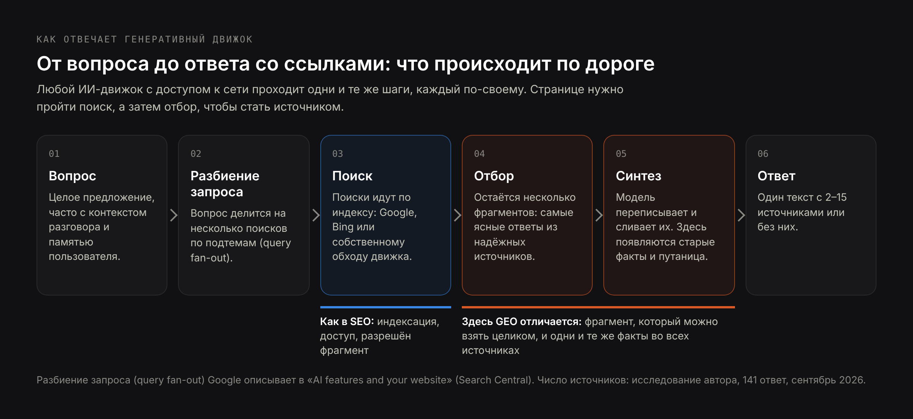
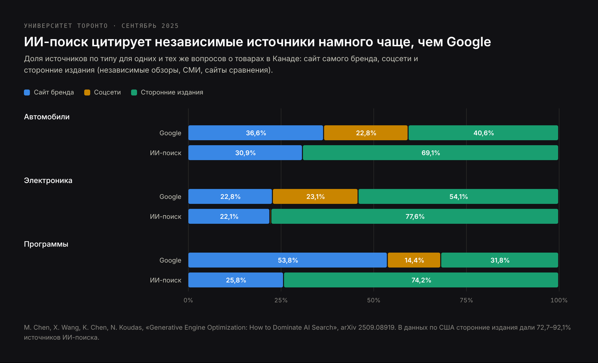
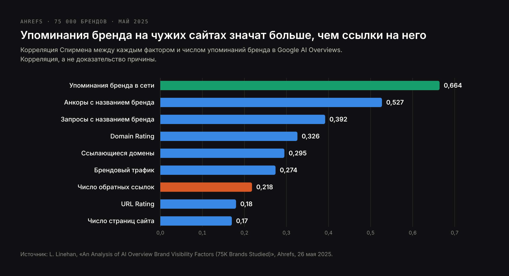
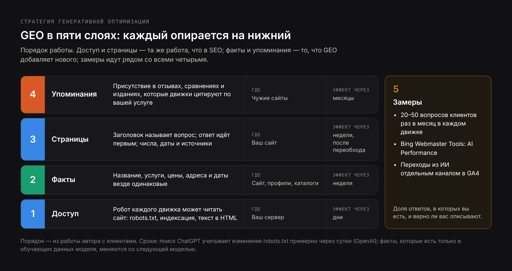

# DRAFT RU — «Что такое GEO» (24 Oct 2026). Same research as EN/PL, written for
# Russian-speaking readers. No frequencies in the core (Kazakhstan volumes = 0), made
# under the owner's AI-topic rule; SERP «что такое geo» = articles about GEO; PAA:
# «Что такое GEO-продвижение?», «Сколько стоит гео продвижение?». No mention of Russia.
# Prices in € as on RU pages. H1 (Title) ≠ Meta title.

Title: Что такое GEO: генеративная оптимизация под нейросети — определение, откуда ИИ берёт источники и что работает
Slug: chto-takoe-geo
Meta title: Что такое GEO-продвижение и как оно работает в 2026 году
Meta description: Что такое GEO (generative engine optimization) на данных: откуда термин, как ChatGPT и Google AI выбирают источники, что работает, как измерять и сколько стоит.

---

> Коротко: GEO, или generative engine optimization (генеративная оптимизация), — это работа над тем, чтобы компания, товар или факт попадали в ответы, которые пишут нейросети: ChatGPT, Perplexity, Gemini, Claude, Copilot, обзоры от ИИ и режим ИИ в Google, — и чтобы в этих ответах их описывали верно. Термин появился в научной работе Принстонского университета и соавторов в 2023 году. GEO работает с тремя вещами: могут ли роботы ИИ читать ваш сайт, одинаковы ли факты о компании во всех источниках и пишут ли о вас другие сайты, потому что ИИ-движки цитируют сторонние источники намного чаще, чем сайт самой компании. Результат GEO — упоминание или цитата в ответе, а не позиция в списке ссылок.

Большинство русскоязычных определений GEO — один абзац, пересказанный с английских блогов. Эта статья опирается на первоисточники: работу, которая дала области название, два больших исследования того, откуда ИИ-движки берут источники, документацию Google, OpenAI и Microsoft для владельцев сайтов, мой анализ [141 ответа ИИ на вопросы о выборе подрядчика](/ru/blog/issledovanie-otvetov-ii-assistentov) и проверку 23 октября 2026 года: как Google и Perplexity отвечают на сам вопрос «what is generative engine optimization». Последнее оказалось лучшим примером GEO во всей статье.

## Что такое GEO: определение генеративной оптимизации

**Generative engine optimization (GEO)** — это работа над тем, чтобы системам ИИ было легко найти компанию, её услуги и факты о ней, счесть их надёжными и повторить в ответе. Поисковик показывает список страниц и оставляет выбор человеку. Генеративный движок сам читает эти страницы, берёт несколько фрагментов и пишет один ответ, обычно с двумя–пятнадцатью источниками. GEO нужно, чтобы оказаться среди этих источников или хотя бы среди названий в ответе — и чтобы ответ описывал вас правильно.

От прежних видов оптимизации GEO отличают три вещи:

- **Единица работы — утверждение, а не страница.** Движок не показывает вашу страницу, а повторяет то, что она — или чужая страница — говорит о вас.
- **Результат — присутствие.** Вы либо есть в ответе, либо нет. Второй страницы выдачи здесь не бывает.
- **Точность — часть работы.** Ответ может назвать компанию со старой ценой, услугой, которой больше нет, или функцией конкурента. Такие случаи я разбираю в статье [откуда ИИ берёт устаревшие сведения о компании](/ru/blog/otkuda-ii-beryot-ustarevshie-svedeniya-o-kompanii).

### Откуда взялся термин generative engine optimization

Название появилось в работе «GEO: Generative Engine Optimization». Её авторы — Пранджал Аггарвал, Вишвак Мурахари, Танмай Раджпурохит, Ашвин Калян, Картик Нарасимхан и Амит Дешпанде из Принстонского университета, Технологического института Джорджии, Института ИИ Аллена и IIT Delhi. Работа вышла на arXiv в ноябре 2023 года и была представлена на KDD 2024, одной из главных конференций по анализу данных.

Авторы собрали 10 000 запросов из 25 областей, переписали исходные страницы девятью способами и измерили, насколько чаще каждая версия попадала в сгенерированный ответ. Главный результат: правильные правки повышали видимость страницы в генеративных ответах до 40%, а в Perplexity, который проверяли вживую, — до 37%. Благодаря этой работе у области появилось имя. Её выводы разобраны ниже, в разделе о том, что работает.

### Что считается генеративным движком

Генеративный движок — любая система, которая отвечает на вопрос, сочиняя текст по найденным источникам. В 2026 году для большинства компаний важны:

| Движок | Чей | Масштаб, последняя публичная цифра |
|---|---|---|
| Обзоры от ИИ и режим ИИ в Google | Google | режим ИИ: больше 1 млрд пользователей в месяц (Alphabet, 22 июля 2026) |
| Приложение Gemini | Google | 950 млн пользователей в месяц (Alphabet, 22 июля 2026) |
| ChatGPT с поиском | OpenAI | больше 900 млн пользователей в неделю (OpenAI через TechCrunch, 27 февраля 2026) |
| Microsoft Copilot и ответы ИИ в Bing | Microsoft | отдельной цифры нет |
| Perplexity | Perplexity AI | свежей официальной цифры нет |
| Claude с поиском | Anthropic | отдельной цифры нет |

Каждый из них читает интернет по-своему. Это самое практичное, что стоит знать о GEO, и ему посвящён отдельный раздел ниже.

## Что значит GEO в маркетинге и другие значения сокращения

На запрос «что такое geo» поиск выдаёт сразу несколько значений, поэтому их стоит развести с самого начала.

- **GEO в маркетинге до 2023 года** означало геотаргетинг: показ рекламы и контента по местоположению (геотаргетинг, геозоны, запросы с городом вроде «стоматология Варшава»). Многие маркетинговые словари до сих пор так его и описывают.
- **GEO в SEO и маркетинге с 2024 года** почти всегда означает generative engine optimization — тему этой статьи. По-русски её называют GEO-продвижением, GEO-оптимизацией, генеративной оптимизацией или оптимизацией под нейросети.
- **Вне маркетинга** GEO — геостационарная орбита в спутниковой технике, сокращение от «география» и код Грузии в спорте.

Оба маркетинговых значения сходятся в одном месте — в местном бизнесе. Когда человек просит ChatGPT найти «стоматолога в Варшаве, который говорит по-русски», ответ зависит и от данных о местоположении, и от генеративной оптимизации. В моём исследовании ChatGPT ссылался на Google Карты в 23 из 47 ответов на такие вопросы о выборе подрядчика.

Вторая путаница с названиями: GEO, **AEO** (answer engine optimization), **LLMO** (large language model optimization) и **AIO** (AI optimization) многие авторы используют как синонимы, и обзор от ИИ в Google и Perplexity повторяют это в своих ответах. Эти понятия пересекаются, но не совпадают: AEO уже и касается того, чтобы ваша формулировка стала ответом на один конкретный вопрос. Разницу с примерами я разбираю в статье [GEO, SEO и AEO: в чём разница](/ru/blog/geo-vs-seo-raznica).

## Как работает генеративная оптимизация: от вопроса до ответа со ссылками

Чтобы что-то оптимизировать, нужно понимать, как оно устроено. Любой генеративный движок с доступом к сети проходит одни и те же пять шагов, хотя каждый делает это по-своему.



1. **Вопрос.** Обычно длиннее и конкретнее поискового запроса: целое предложение, часто с контекстом из разговора, а в ChatGPT — ещё и с сохранённой памятью пользователя.
2. **Разбиение запроса (query fan-out).** Движок делит вопрос на несколько поисков. Google описывает это прямо: обзоры от ИИ и режим ИИ могут выполнить несколько связанных поисков по подтемам, чтобы собрать один ответ.
3. **Поиск.** Эти поиски идут по индексу: собственному индексу Google для обзоров и режима ИИ, индексу Bing и собственному обходу — для других движков. Страницу, которая не проиндексирована или закрыта от робота движка, найти нельзя.
4. **Отбор.** Из десятков найденных страниц движок оставляет несколько фрагментов, которые ясно отвечают на частный вопрос и которым он доверяет.
5. **Синтез.** Модель пишет ответ из этих фрагментов, сливает, сокращает и добавляет ссылки. Здесь же появляются ошибки: два источника смешиваются, выживает старая цифра, функция уходит не той компании.

GEO действует на шагах 3–5. Шаг 3 в основном технический и такой же, как в SEO. Шаги 4 и 5 — то место, где GEO отличается: страницу могут найти и всё равно не использовать, потому что ни один её фрагмент не отвечает на вопрос сам по себе или другие источники говорят о вас иначе.

### Почему индексации необходимо, но недостаточно

Google пишет, что для появления в обзорах от ИИ и режиме ИИ нет дополнительных требований: страница должна быть проиндексирована и допускать показ с фрагментом. Это входной билет. Дальше отбор зависит от того, можно ли взять фрагмент целиком так, чтобы он не потерял смысл, и от того, что говорит остальной интернет. В руководстве Google для маркетологов на 2026 год сказано то же самое: выполнения технических требований достаточно «for search generally, including AI formats», а остальное — уникальный и полезный контент.

## Откуда ИИ берёт источники: чужие сайты против сайта компании

Самый полезный на сегодня вывод о генеративной оптимизации касается не того, как писать страницу. Он о том, чьи страницы цитируют.

Команда Университета Торонто (Махе Чэнь, Сяосюань Ван, Кайвэнь Чэнь и Ник Кудас, сентябрь 2025) сравнила источники результатов Google и ответов ИИ-поиска на одни и те же вопросы о товарах. Каждый источник отнесли к одному из трёх типов: сайт бренда, соцсети или сторонние издания — независимые обзоры, СМИ и сайты сравнения.



| Категория (Канада) | Google: бренд / соцсети / сторонние | ИИ-поиск: бренд / соцсети / сторонние |
|---|---|---|
| Автомобили | 36,6% / 22,8% / 40,6% | 30,9% / 0% / 69,1% |
| Электроника | 22,8% / 23,1% / 54,1% | 22,1% / 0,3% / 77,6% |
| Программы | 53,8% / 14,4% / 31,8% | 25,8% / 0% / 74,2% |

Данные по США показывают то же самое, только резче: сторонние издания дали 81,9% источников ИИ-поиска для автомобилей, 92,1% для электроники и 72,7% для программ. Для компаний, которые работают на нескольких языках, важны ещё два вывода этой работы:

- **У ответов ИИ и выдачи Google мало общих источников.** Для смартфонов совпадали только 20% доменов из первой десятки, для местных услуг вроде автосервиса — 2,5%.
- **ChatGPT меняет источники вместе с языком вопроса.** Домены, которые он цитировал по одному и тому же вопросу на разных языках, почти не пересекались. Стабильнее всех между языками был Claude. Компания, которую видно в ответах на английском, не обязательно видна в ответах на русском или польском.

Ahrefs пришёл к тому же с другой стороны. На выборке из 75 000 брендов (Луиза Линехан, май 2025) он проверил, какие сигналы связаны с тем, что бренд упоминают в обзорах от ИИ в Google.



Упоминания бренда на других сайтах дали корреляцию 0,664, число обратных ссылок, классический сигнал SEO, — только 0,218. Бренды из верхней четверти по упоминаниям в среднем набирали 169 упоминаний в обзорах от ИИ, следующая четверть — 14, нижняя половина — почти ни одного. Корреляция не доказывает причину, и Ahrefs сам это подчёркивает, но два независимых исследования, указывающие в одну сторону, — сильный сигнал: **в GEO то, что пишут о вас другие, весит больше, чем то, что вы пишете о себе.**

### Тип вопроса меняет источники

Есть одно важное исключение, и его показывают мои собственные данные. В сентябре 2026 года я задал ChatGPT, Perplexity и режиму ИИ в Google 47 вопросов вида «кого нанять для…» и посчитал каждую ссылку в 141 ответе.

| Движок | Ссылок на ответ | Ссылок на сайты самих исполнителей | Ответов со ссылкой на Google Карты |
|---|---|---|---|
| Perplexity | 16,7 | 667 | 7 из 47 |
| Режим ИИ в Google | 3,7 | 141 | 4 из 47 |
| ChatGPT | 1,6 | 47 | 23 из 47 |

В вопросах об услугах Perplexity и режим ИИ строили ответы во многом по сайтам самих исполнителей, а ChatGPT опирался на собственный поиск и карточки в картах. Поэтому правило звучит не как «ваш сайт не важен», а так: **в категориях товаров побеждают независимые обзоры и издания; в услугах ваши страницы важны, но только если прямо отвечают на вопрос клиента.** Полная раскладка — в [исследовании 141 ответа ИИ](/ru/blog/issledovanie-otvetov-ii-assistentov).

## Что работает в GEO по данным исследований: правки на странице

Работа с KDD 2024 проверила девять способов переписать исходную страницу и измерила, как меняется её видимость в сгенерированных ответах. Вот они — в переводе на то, что вы на самом деле меняете в тексте.

| Метод в работе | Что это значит в вашем тексте | Измеренный эффект |
|---|---|---|
| Добавление цитат | Процитируйте конкретного человека: клиента, инженера, официальный документ | +41% |
| Добавление статистики | Вместо «много», «быстро», «недорого» — числа и даты | +31% |
| Гладкость текста | Исправьте фразы, которые трудно прочитать | +28% |
| Ссылки на источники | Назовите и дайте ссылку на источник каждого утверждения | +27% |
| Профессиональные термины | Используйте точный термин вашей отрасли | +18% |
| Простой язык | Короче предложения, одна мысль в предложении | +14% |
| Уверенный тон | Пишите прямо, без оговорок | +10% |
| Редкие слова | Разнообразная лексика | +6% |
| Набивка ключевыми словами | Повторение ключевой фразы | −8% |

Две детали из работы полезнее самой таблицы. Во-первых, выигрыш был намного больше у страниц, которые изначально стояли ниже в списке источников: страница на пятой позиции получила +115% от ссылок на источники, а страница на первой позиции при той же правке потеряла 30%. GEO помогает отстающим больше, чем лидерам. Во-вторых, эффект зависел от темы: статистика сильнее всего помогала в юридических и государственных темах, цитаты — в темах о людях и обществе. Универсального рецепта нет, есть направление: **конкретные, привязанные к источнику, проверяемые утверждения повторяют; общие слова — нет.**

## Стратегия GEO-продвижения: пять слоёв работы

Всё сказанное выше сводится к пяти слоям. Я перечисляю их в том порядке, в каком делаю для клиентов, потому что каждый опирается на нижний.



### 1. Доступ: пустите роботов ИИ на сайт

У каждого движка свой робот, а robots.txt, написанный несколько лет назад, может его закрывать. OpenAI описывает трёх своих роботов, и задачи у них разные:

- **OAI-SearchBot** находит страницы для поиска ChatGPT. OpenAI пишет, что сайты, которые его закрыли, не будут показываться в ответах поиска ChatGPT, кроме простых навигационных ссылок.
- **GPTBot** собирает материалы для обучения будущих моделей. Если его закрыть, вы не исчезнете из поиска ChatGPT.
- **ChatGPT-User** заходит на страницу, когда пользователь просит ChatGPT её открыть; robots.txt на него может не действовать.

Значит, компания может не отдавать свои тексты на обучение моделей и при этом оставаться видимой в ответах ChatGPT:

```text
User-agent: OAI-SearchBot
Allow: /

User-agent: GPTBot
Disallow: /

User-agent: PerplexityBot
Allow: /

User-agent: *
Allow: /
```

Изменения доходят до поиска ChatGPT примерно за сутки. Функции ИИ в Google используют Googlebot, поэтому там ничего дополнительно не нужно, но действуют настройки фрагментов: «nosnippet» или короткий «max-snippet» ограничивают, как ваши тексты могут появиться в обзорах от ИИ и режиме ИИ. Как быстро это проверить, я описываю на странице [подготовка сайта к ИИ-поиску](/ru/uslugi/podgotovka-saita-k-ii-poisku).

### 2. Факты: одна версия правды о компании

Генеративные движки смешивают источники. Если на сайте написано, что компания работает с 2015 года, в LinkedIn стоит 2017-й, а старый каталог показывает прежний адрес, в ответе может оказаться любая комбинация. Работа здесь скучная: выпишите двадцать фактов, которые определяют компанию, — название, услуги, цены или диапазоны цен, адреса, языки, основателей, годы, клиентов, которых можно назвать, — и сделайте их одинаковыми на сайте, в профиле компании в Google, в LinkedIn, в каталогах и на площадках с отзывами. Самые частые причины неверных ответов и способы их исправить — в статье [как исправить неверные данные о компании в ChatGPT](/ru/blog/kak-ispravit-nevernye-dannye-o-kompanii-v-chatgpt).

### 3. Страницы: написаны так, чтобы фрагмент можно было взять целиком

На шаге отбора выигрывают фрагменты, которые сами по себе отвечают на частный вопрос. На практике это значит:

- заголовок называет вопрос словами клиента;
- ответ стоит в первом или втором предложении под ним, с названным подлежащим, а не «мы» или «это»;
- числа, даты и названия вместо прилагательных;
- одна страница на одну услугу, а не одна страница на десять. В моём исследовании чаще всего называли тех исполнителей, у которых была страница целиком о той услуге, о которой спрашивали.

### 4. Упоминания: будьте там, где читают движки

Раз сторонние источники преобладают среди ссылок, часть GEO происходит вне вашего сайта: отзывы на площадках вашей отрасли, присутствие в сравнительных статьях, интервью и гостевые материалы в отраслевых изданиях, актуальная запись в каталогах, которые стоят высоко по вашей услуге. Для ИП или небольшой компании речь не о количестве, а о присутствии в пяти–десяти местах, которые движки действительно цитируют по вашему типу вопроса. Найти эти места можно, задав вопросы движкам и записав их источники.

### 5. Замеры

Без замеров GEO превращается в гадание. Им посвящён отдельный раздел ниже.

## Чек-лист GEO-оптимизации: лучшие практики в одной таблице

| Область | Что проверить | Как проверить |
|---|---|---|
| Доступ | OAI-SearchBot, PerplexityBot и Googlebot не закрыты | Прочитать robots.txt, проверить ключевые адреса |
| Доступ | Ключевые страницы проиндексированы в Google и Bing | Search Console, Bing Webmaster Tools |
| Доступ | Основной текст есть в HTML, а не подгружается только скриптами | Исходный код страницы |
| Факты | Название, услуги, цены, адреса и даты везде одинаковые | Сравнить сайт, профиль компании в Google, LinkedIn, каталоги |
| Факты | Страница «О нас» говорит, кто стоит за компанией, с проверяемыми данными | Прочитать её глазами постороннего человека |
| Страницы | У каждой услуги своя страница | Структура сайта |
| Страницы | Каждый заголовок называет вопрос, ответ идёт сразу под ним | Первое предложение под каждым заголовком |
| Страницы | У утверждений есть числа, даты и названные источники | Поискать в тексте «лучший», «быстро», «много» |
| Страницы | Микроразметка совпадает с тем, что видно на странице | Проверка расширенных результатов |
| Упоминания | Вы есть на площадках с отзывами и в сравнениях, которые движки цитируют по вашей услуге | Спросить движки, записать источники |
| Упоминания | В отраслевых и местных каталогах актуальные данные | Проверить каждую запись |
| Замеры | Постоянный набор из 20–50 вопросов клиентов проверяется каждый месяц в каждом движке | Таблица или сервис мониторинга |
| Замеры | Переходы из ИИ считаются отдельно | Канал или сегмент в GA4 |

## Примеры генеративной оптимизации

Лучшие примеры GEO — ответы на вопросы о самом GEO. 23 октября 2026 года я спросил Google и Perplexity «what is generative engine optimization» и посмотрел, на кого они сослались.

### Пример 1: обзор от ИИ в Google берёт определение из третьего результата


В обычной выдаче по этому запросу первое место занимал Moz, второе — ветка на Reddit, третье — Coursera. Но определение в начале обзора от ИИ приписано Coursera, а не первому результату. Статья Coursera начинается с блока «Key takeaways», и его первая строка — определение в одном предложении. Дальше обзор цитирует Seer Interactive в сравнении с SEO и перечисляет AEO, LLMO и AIO как другие названия.

В этом суть GEO: **выигрывает фрагмент, который можно взять целиком, даже с третьего места.** Страницу с первого места, которая начинается с истории, находят и пропускают.

### Пример 2: Perplexity начинает с Википедии


Perplexity начал с Википедии и руководства практика, а дальше использовал Business.com, HubSpot, Coursera, Кембриджский словарь, Moz и исходную работу на arXiv. Его ответ, как и ответ Google, повторяет формулировку Википедии, что GEO — это «иначе» answer engine optimization. Второй урок: **в определениях движки опираются на справочные источники, и то, что в них написано, становится ответом по умолчанию** — вместе с упрощениями. Если энциклопедия, словарь или отраслевой глоссарий неверно описывает вашу категорию товаров, эта ошибка будет расходиться дальше.

### Пример 3: один абзац, переписанный под ответы ИИ

Типичный абзац с главной страницы клиники, до правки (клиника придумана для примера):

> Мы — команда увлечённых профессионалов с многолетним опытом, предлагаем стоматологическую помощь высочайшего качества для всей семьи. Индивидуальный подход гарантирует отличный результат по доступным ценам.

Процитировать из него нечего: нет названия, места, факта, числа. После:

> Nova Dental — стоматологическая клиника в варшавском районе Мокотув, работает с 2014 года. Ставит импланты в день консультации, в клинике есть врачи, говорящие по-русски и по-украински, а один имплант с коронкой стоит от 4900 злотых.

Во второй версии есть название, город и район, год, услуга, языки и цена. Каждое из этого — отдельное утверждение, которое движок может сопоставить с вопросом вроде «стоматолог в Варшаве, говорящий по-русски, имплант, сколько стоит». Это метод из таблицы исследований — числа, точные термины, прямые утверждения, — применённый к абзацу, который у вас уже есть.

## Как измерять GEO-продвижение

Для большинства ИИ-движков аналога Search Console нет, поэтому замеры собираются из четырёх источников.

**1. Постоянный набор вопросов.** Выпишите 20–50 вопросов, которые задал бы клиент, так, как он бы их задал, с городом и на его языке. Раз в месяц задавайте каждый в ChatGPT, Perplexity, режиме ИИ в Google и Gemini, в чистой сессии. Записывайте три вещи: называют ли вас, ссылаются ли на вас и верно ли описание. Метод по шагам — в статье [что ИИ-ассистенты говорят о вашей компании](/ru/blog/chto-ii-assistenty-govoryat-o-vashey-kompanii).

**2. Доля ответов.** Главная цифра по этому набору — доля вопросов, в ответах на которые вы появляетесь, отдельно по каждому движку. Она меняется медленно и в каждом движке по-своему.

**3. Bing Webmaster Tools.** Отчёт AI Performance от Microsoft, доступный в превью с февраля 2026 года, показывает, как часто ваши страницы цитируются в Copilot, ответах ИИ в Bing и части партнёрских сервисов, какие это страницы и по каким «grounding queries» ИИ их нашёл. С июня 2026 года он ещё группирует эти запросы по намерениям и темам и показывает вашу долю цитирований. Пока это единственный отчёт о цитированиях от самого движка, и он бесплатный.

**4. Переходы из ИИ.** ChatGPT, Perplexity и Gemini приводят посетителей, чьи сессии в GA4 можно собрать в канал «ИИ» по источнику (chatgpt.com, perplexity.ai, gemini.google.com, copilot.microsoft.com). ChatGPT обычно добавляет к ссылкам «utm_source=chatgpt.com». Одна оговорка этого месяца: после выхода GPT-6 7–8 октября 2026 года многие ссылки из ChatGPT приходили без этой метки и без реферера, и GA4 записывал такие визиты как прямые заходы; 15 октября специалисты сообщили, что метки возвращаются, а OpenAI это не комментировала. Резкое падение «трафика из ChatGPT» может быть сбоем отслеживания, а не потерей видимости.

Google не выделяет обзоры от ИИ и режим ИИ в отчётах: их клики и показы входят в обычный отчёт об эффективности (Web) в Search Console.

## Инструменты для GEO: что они измеряют и где их предел

Рынок инструментов быстро растёт. Они делятся на четыре группы.

| Тип | Что делает | Примеры | Ограничение |
|---|---|---|---|
| Трекеры видимости в ИИ | Регулярно задают ваш набор вопросов в нескольких движках и показывают упоминания, ссылки и конкурентов | Profound, Peec AI, Otterly.AI | Ответы меняются от сессии к сессии и от пользователя к пользователю; трекер делает выборку и не видит того, что видит каждый |
| SEO-платформы с модулями ИИ | Добавляют отслеживание упоминаний в ИИ к данным о запросах и ссылках | Semrush, Ahrefs Brand Radar | Наборы вопросов часто общие, а не вопросы ваших клиентов |
| Отчёты самих движков | Цитирования, которые считает сам движок | Bing Webmaster Tools AI Performance | Охватывает только сервисы Microsoft |
| Ручной метод | Вы сами задаёте набор вопросов и записываете результаты в таблицу | — | Время: 30 вопросов и четыре движка — около двух часов в месяц |

Небольшой компании для начала хватит ручного метода и отчёта Bing. Трекеры окупаются, когда вопросов много, когда речь о нескольких рынках или языках или когда нужно показывать динамику руководству. Ни один инструмент не заставит движок вас процитировать — он только показывает, цитирует ли.

## Статистика GEO на 2026 год

| Показатель | Значение | Источник |
|---|---|---|
| Пользователи режима ИИ в Google в месяц | больше 1 млрд | Alphabet, итоги II квартала 2026, 22 июля 2026 |
| Пользователи приложения Gemini в месяц | 950 млн | Alphabet, 22 июля 2026 |
| Пользователи ChatGPT в неделю | больше 900 млн | OpenAI через TechCrunch, 27 февраля 2026 |
| Рост видимости после лучших правок GEO | до 40% (до 37% в Perplexity) | Работа о GEO, KDD 2024 |
| Эффект набивки ключевыми словами | −8% | Работа о GEO, KDD 2024 |
| Доля сторонних изданий в источниках ИИ-поиска, США | 72,7–92,1% в зависимости от категории | Университет Торонто, сентябрь 2025 |
| Доля сторонних изданий в источниках Google, Канада | 31,8–54,1% в зависимости от категории | Университет Торонто, сентябрь 2025 |
| Корреляция упоминаний бренда с упоминаниями в обзорах от ИИ | 0,664 (обратные ссылки: 0,218) | Ahrefs, 75 000 брендов, май 2025 |
| Ссылок на ответ | Perplexity 16,7, режим ИИ 3,7, ChatGPT 1,6 | Bandziuk, 141 ответ, сентябрь 2026 |
| Ответы ChatGPT со ссылкой на Google Карты в вопросах об услугах | 23 из 47 | Bandziuk, сентябрь 2026 |

## Частые мифы о GEO

**«Нужен файл llms.txt».** Google пишет, что его поисковые системы этот файл не используют, и ни одно исследование не показало, что он увеличивает число цитирований. У файла есть своя задача, но не эта; подробности — в статье [нужен ли сайту файл llms.txt](/ru/blog/nuzhen-li-saitu-fail-llms-txt).

**«Существует специальная разметка для ИИ».** Google пишет, что его функции ИИ не требуют никакой особой микроразметки. Микроразметка помогает понять страницу, если совпадает с тем, что на ней видно, — ровно как и раньше.

**«Повторяйте ключевую фразу, чтобы ИИ её подхватил».** Это единственный метод в работе о GEO, который ухудшил видимость: −8%.

**«GEO заменит SEO».** Функции ИИ в Google построены на индексе Google; поиск в ChatGPT и Copilot тоже работает на индексах сети. Сайт, который не находят поисковики, редко попадает в генеративные движки. Связь между ними я разбираю в статье [GEO и SEO: в чём разница](/ru/blog/geo-vs-seo-raznica).

**«Кто-то может гарантировать, что ChatGPT вас порекомендует».** Ответ не контролирует никто. Он меняется от сессии к сессии, от пользователя к пользователю и от версии к версии модели. Обещать можно работу и замеры, но не результат.

## Нужно ли GEO небольшому бизнесу

Это зависит от того, как выбирают ваши клиенты. GEO стоит делать уже сейчас, если:

- клиенты перед покупкой спрашивают рекомендации: профессиональные услуги, клиники, программы, обучение, переезд, всё с высокой ценой и долгим решением;
- у вас уже есть переходы из ИИ, и вы хотите понять, откуда они берутся и как их увеличить;
- ИИ-ассистент неверно описывает вашу компанию — это стоит вам денег независимо от того, «занимаетесь ли вы GEO».

Можно подождать, если клиенты покупают, проходя мимо, сравнивая цены на маркетплейсах или звоня по первому местному результату. Тогда важнее местное SEO и профиль компании в Google.

Для большинства небольших компаний GEO — не отдельная статья бюджета, а слой поверх SEO: доступ и страницы — та же работа, а факты и упоминания — несколько часов в месяц. У меня мониторинг ответов ИИ по постоянному набору вопросов стоит от 250 € в месяц, разовый аудит видимости в ИИ — от 250 €, а постоянная работа над Google и ответами ИИ вместе — от 800 € в месяц. Что входит в каждый вариант, описано на странице [GEO-оптимизация: видимость компании в ответах нейросетей](/ru/uslugi/ai-seo-i-geo-optimizaciya), а про аудит — на странице [аудит видимости в ИИ-поиске](/ru/uslugi/audit-vidimosti-v-ii-poiske).

## Частые вопросы про GEO

**Что означает сокращение GEO?**
В SEO и маркетинге GEO — это generative engine optimization, генеративная оптимизация: работа над тем, чтобы компания попадала в ответы, которые пишет ИИ, и была описана в них верно. В старых маркетинговых текстах GEO может означать геотаргетинг.

**GEO и AEO — это одно и то же?**
Они пересекаются, и многие используют эти названия как синонимы. Строго говоря, AEO (answer engine optimization) уже: его цель — чтобы ваша формулировка стала прямым ответом на один вопрос, а GEO охватывает любые упоминания и ссылки на вас в сгенерированном ответе. Подробнее — в статье [GEO, SEO и AEO](/ru/blog/geo-vs-seo-raznica).

**Как работает GEO-продвижение?**
ИИ-движок делит вопрос на несколько поисков, берёт страницы из индекса, оставляет несколько фрагментов и пишет из них ответ. GEO делает так, чтобы робот движка мог читать ваш сайт, факты о компании везде совпадали, страницы было легко цитировать, а компания присутствовала на сторонних сайтах, которым движок доверяет.

**Через сколько видны результаты GEO?**
Исправления доступа срабатывают за несколько дней: поиск ChatGPT учитывает изменения robots.txt примерно через сутки. Правки на страницах видны после переобхода, обычно через несколько недель. Упоминания на других сайтах и исправление неверных фактов занимают от одного до нескольких месяцев, а факты, которые есть только в обучающих данных модели, меняются лишь с новой версией модели.

**Может ли кто-то гарантировать ссылки в ответах ИИ?**
Нет. Ответы зависят от сессии, пользователя, языка и версии модели. Честный исполнитель обещает работу и метод замеров и показывает, в какой доле ответов вы появляетесь.

**Сколько стоит GEO-продвижение?**
От нескольких часов вашего времени в месяц, если проверять самому, до нескольких тысяч евро в месяц в агентствах. У меня: мониторинг от 250 € в месяц, аудит от 250 € разово, постоянная работа над SEO и GEO вместе от 800 € в месяц.

**Нужен ли для GEO файл llms.txt?**
Нет. Ни один ИИ-поисковик не подтвердил, что использует его для выбора источников, а Google пишет, что его системы файл игнорируют. Сначала проверьте robots.txt: закрытый робот стоит вам видимости, отсутствие llms.txt — нет.

## С чего начать GEO-продвижение

Начните с вопроса, который клиенты задают до того, как вам позвонить. Задайте его сегодня в ChatGPT, Perplexity и режиме ИИ в Google на языке ваших клиентов и запишите, кого назвали и какие сайты процитировали. Этот список и есть ваш план GEO: процитированные сайты — это места, где нужно присутствовать, а названные конкуренты показывают, что движки считают хорошим ответом.

Если хотите сделать это как следует — 30 и больше вопросов, четыре движка, каждый источник записан и есть план по пробелам, — этим занимается [аудит видимости в ИИ-поиске](/ru/uslugi/audit-vidimosti-v-ii-poiske). Или [напишите мне](/ru/kontakty) вопрос, который задают ваши клиенты, и я расскажу, что движки отвечают на него сегодня.
